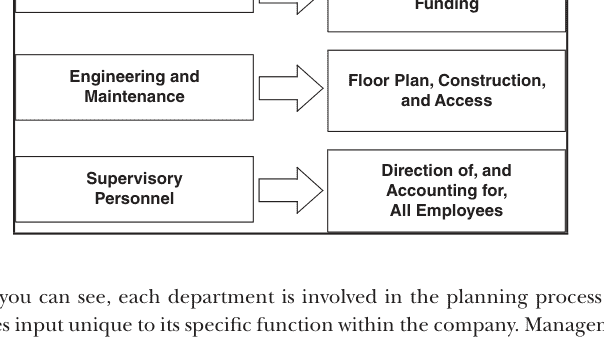

# CHAPTER 2

## Planning for Emergencies in the Office

几乎每个政府机构、设施和场所都有应急行动（或响应）计划。在紧急情况下，这些计划会得到实施，这些计划讨论了预期可能发生的紧急情况以及在特定情况下应启动的适当应对措施。这一流程已被证明随着时间的推移是成功的，一些私营部门也采用了这一做法并制定了自己的应急计划。然而，大多数企业尚未这样做。本章讨论了制定此类计划的必要性，并建议在各种紧急情况下应采取的具体行动方案。

### WHY PLAN?

首先也是最明显的问题是：为什么需要应急行动计划？答案是，在危机期间，例如爆炸、炸弹威胁、火灾、有害物质泄漏、武装袭击或自然灾害，压力、恐惧和恐慌会导致混乱状态。混乱的员工队伍将依赖管理层提供适当的指示。然而，管理者将承受与员工相同的压力；恐慌状态会限制或阻止管理层、安全人员或其他指定人员做出正确决策。完善的计划能让负责人承受压力时在紧急情况下做出正确的决策。计划必须经过深思熟虑、组织良好、易于获取，并在关键事件的压力来临前仔细预先制定应急方案。在紧急情况下，人们不应在极端压力下思考应采取何种行动；他们只需执行预先安排的计划。这样就能做出正确的决策，挽救生命、保护财产并消除对组织的干扰，例如生产力损失、财务费用增加和员工士气下降。从我们自身人身安全和生命安全的个人主观角度来看，在工作场所制定应急行动计划也很有意义。考虑一下我们每年在工作上花费多少小时。对我们中的许多人来说，四十小时的工作周只是最低标准，但让我们以标准工作周为基础做一些计算。假设每年有四周假期。在五十二周中，我们剩下大约四十八周在办公室。如果我们将每周四十小时乘以四十八周，得到 1,920 小时。假设我们再减少 120 小时以考虑联邦和州假日以及病假；这样每年我们在办公室的时间大约为 1,800 小时。一年大约有 8,730 小时。这意味着我们将生命中略多于 20% 的时间花在工作上。仅这一统计数据就强烈表明，我们应始终意识到自己在办公室应对各种可能影响我们安全的潜在紧急情况和关键事件方面准备得如何充分。

让我们看看我们应该做些什么来使工作场所更安全。有广泛的议题需要解决，从防止未经授权进入的基本门禁控制措施，到如何应对工作场所暴力问题，再到我们应对工作场所可能发生的各种潜在紧急情况和关键事件的准备程度如何。随着我们与世界各地的企业客户合作，我们注意到整体安全和生命安全准备程度因地区而异。例如在纽约市，每栋高层办公楼、酒店和公共集会场所都必须实施各种安全和生命安全措施。由于受当地法律驱动，整体准备水平相对较高。例如，制定健全的消防安全计划是第 5 号地方法规（LL5）强制要求的。该法律于 1973 年出台，是对一系列致命高层火灾的回应。纽约市消防局（FDNY）制定了该法律并建立了确保在火灾或烟雾情况下建筑物 occupants 安全的方法。除了对公共广播系统、警戒电话、拉动开关、频闪灯、烟雾探测器等技术要求外，还要求建筑物必须有经 FDNY 批准的书面消防安全计划。在该法律管辖范围内的建筑物还必须在建筑物有人占用时始终有受过培训的人员值班，他们熟悉该计划并能在火灾或烟雾紧急情况下实施该计划。

该法律已多次扩大，目标始终是提高受该条例覆盖的建筑物的安全水平。9 月 11 日袭击事件后，很明显提供给消防安全主任的培训不足以保护 occupants 免受火灾以外的各种紧急情况。在 2004 年，颁布了第 26 号地方法规，要求建筑物计划和培训包括各种非火灾紧急情况，包括使用大规模杀伤性武器的袭击、自然灾害和其他类型的潜在危险事件。在该法律实施后，建筑物人员现在必须接受的培训不仅限于如何应对火灾/烟雾情况，还包括如何应对化学武器或有害物质事件，通过确保供暖、通风和空调（HVAC）系统并密封建筑物。他们被教导如何应对炸弹威胁或爆炸、爆炸、燃气泄漏等情况，并且这一过程并未就此结束。2014 年纽约市消防法规要求建筑物消防安全主任被指定为建筑物消防和生命安全主任（FLSD），并强制要求他们接受如何应对主动枪手事件和医疗紧急情况的培训。因此，在纽约市的办公楼内，在正常工作时间内建筑物有人占用时必须有一名 FLSD 值班，在非工作时间内建筑物至少有一人占用时必须有一名疏散监督员值班。提供给 FLSD 的培训并非微不足道；火灾和烟雾紧急情况应对 20 小时，非火灾紧急情况应对 7 小时，主动枪手应对和医疗紧急情况准备 5 小时。FLSD 和所有副手必须通过消防部门在建筑物内进行的严格现场考试，并且必须证明对建筑物系统、公用设施、电梯和通信设备有完全了解，并能正确回答一系列基于情景的问题。其目标是确保建筑物人员能在紧急情况下安全地指挥 occupants。

如果你在纽约市工作，你仍然需要采取措施处理自己的业务连续性问题，但你的生命安全问题在很大程度上将由受过良好培训的 FLSD 来处理，其后盾是一支由安全人员、建筑物管理部门和工程代表组成的队伍。每位经 FDNY 批准的

计划中包含应急措施，以确保所有建筑内的人员都能及时获知紧急情况，并迅速被告知应采取哪些行动。需要特殊协助的人员也得到照应；每份计划都要求，管理层已知存在任何身体、情绪或精神方面状况、可能使其无法参与应急行动计划的人员，必须事先确定，并详细说明将其疏散或转移到安全地点的具体方式。如果客人或访客需要特殊协助，计划还必须说明在紧急情况下如何为他们提供帮助。例如，高层建筑的所有人员在部分或全部疏散或建筑内转移时，都必须被清点确认。此外，计划还包括详细的楼层平面图，以及有关建筑电梯、楼梯间和紧急出口、通信系统、防火和排烟系统、建筑系统和公共设施，以及所有转移区域和室外集合地点位置的信息。消防部门持有这些计划的副本，并确保计划既准确又包含正确的应对措施，以便在紧急情况下，所有人员都能得到快速、安全的照应。

办公楼、酒店和公共集会场所每年都必须进行多次演习，并为所有参与紧急行动的楼宇员工以及所有租户楼层管理员和搜索人员举行培训。为了让纽约市的建筑更加安全，投入了大量的时间、精力和金钱。此外，纽约市大多数办公楼的大堂都设有保安，要求访客出示有效的州政府颁发的身份证件才能进入。这些措施已被证明是行之有效的，纽约市的建筑被广泛认为是全美最安全、最有保障的建筑之一。唯一的问题是，并不是每个人都住在纽约市或在纽约市工作。

在我们于私营部门工作的十五余年里，我们走遍了美国各地和海外，观察了各个司法管辖区如何处理安保和生命安全方面的问题。在美国，即使是一些最具国际色彩的城市，也缺乏纽约市所采取的那些预防措施。因此，我们面临一个显而易见的问题：如果你所在的工作区域没有规定的应急响应计划，而且实际上也没有法律要求接受过培训的内部员工来管理任何紧急情况或重大事件，那么你该做些什么来让工作场所更安全？你的公司是否制定了任何计划或程序来应对工作中可能危及生命的事件？如果答案是否定的，那么你就有一些工作要做了。

为了帮助你理解即使是最基本的计划也能带来的实际益处，让我们来看一看也许是最常见的工作场所紧急情况，这样你就能明白，一个得当的计划确实可以意味着生与死的区别。

## 场景：心脏骤停

假设工作中有人因冠状动脉疾病或心脏病发作而突发心脏骤停。在心脏骤停期间，心脏停止跳动，导致大脑和身体缺氧。根据美国职业安全与健康管理局（OSHA）的一份报告，美国每年约有10,000例心脏骤停发生在工作场所。等待急救人员到达，存活率仅为5%至7%，而根据一项研究，使用除颤器的存活率则达到60%。¹此外，许多幸存者还必须应对缺氧带来的影响，缺氧在骤停发生三分钟后就可能开始。我们将讨论两种情况下的可能应对措施和结果：一种是没有制定任何应急行动计划的办公室，另一种是与大楼管理部门协调制定计划的办公室。

## 场景#1：没有制定计划

你在一栋高层办公楼的二十五楼工作，正坐在办公桌前，突然感到气短，胸口剧痛。十秒钟后，你倒下并失去意识。一位同事听到你摔倒的声音，冲进你的办公室，发现你没有反应。你的心脏在三十秒前已经停止跳动。

同事大喊求救。其他人冲了进来。拨打了911报警电话。六十秒过去了。911接线员正在收集信息，并已派出医疗急救人员。九十秒过去了。同事们疯狂地寻找是否有人会心肺复苏术（CPR）。现场没有自动体外除颤器（AED）。两分钟过去了。911接线员正在讲解如何进行胸外按压。在你的心脏停止跳动两分四十五秒后，一名未经培训的同事按照911接线员的指示开始进行胸外按压，但按压方式并不正确。

事发大约七分钟后，医护人员到达你所在的大楼并进入大堂。保安对医疗紧急情况一无所知，但仍试图协助急救人员前往你所处的楼层。保安手忙脚乱地找到电梯钥匙，才得以召回电梯并将其设置为独立/手动模式，然后将一部电梯降到一楼大堂。急救人员进入电梯，前往二十五楼。这又花了两分三十秒。他们走出电梯，进入你的办公区域。楼层上有人意识到他们到了，便带他们来到你的办公室。等到训练有素的专业人员开始评估你的情况、打开除颤器并准备好氧气瓶时，你的心脏已经停止跳动将近十一分钟。考虑到许多城市的响应时间甚至更长，还受到当地交通状况和恶劣天气的影响，预后变得更加黯淡。

## 场景#2：公司制定了全面计划

你在一栋高层办公楼的二十五楼工作，正坐在办公桌前，突然感到气短，胸口剧痛。十秒钟后，你倒下并失去意识。一位同事听到你摔倒的声音，冲进你的办公室，发现你没有反应。你的心脏在三十秒前已经停止跳动。

你的同事向另一位同事通报了紧急情况，并留在你身边。按照计划，第二位同事通知危机管理团队（CMT），他们立即执行各自的预定职责。他们通知最近的有CPR认证的员工，这些员工在三十秒内带着AED（在你所在大楼的多个地点都有配备）赶到。你的公司提供了CPR培训，并为参加培训并获得认证的员工志愿者提供奖励。因此，你所处的楼层有许多获得认证的人员立即响应。他们都带有CPR急救包。一位同事根据需要开始进行按压和人工呼吸，另一位同事打开AED。这一切发生的时间距离你的心脏停止跳动还不到两分钟。与此同时，另一名CMT成员拨打了911并提供了所有相关信息。CMT还联系了大楼管理部门，向其通报了紧急情况的性质。大楼独立启动了自己的医疗应急响应规程。大楼工程师将一部电梯停运，并将其设置为独立/手动模式。这样可以确保一部专供到达的急救人员使用的电梯在大堂等候。按照规程，工程师特意选择了一部足够大、能够容纳担架的电梯。一名大楼代表被安排在大堂外等候，以便将医护人员带入大楼。另一名大楼代表则赶到事件现场，

与同事一起工作，确保救护车人员到达你的楼层后能够直接进入，通过打开所有门并移开家具和围观者来为他们清理通道。

与此同时，心肺复苏团队已连接好 AED 并在聆听指示。设备显示建议进行电击。AED 自动启动循环，并在第二次循环的第二次电击时检测到心跳。

与场景 #1 一样，急救人员在七分钟后到达大楼。但在这种情况下，他们被大楼工作人员迎接并被护送进入等待的电梯。他们在六十秒后到达你的楼层，并被护送到事故现场。到达时，他们发现患者处于危重但稳定的状况，正在呼吸，心跳很快。

尽管下面问题的答案显而易见，我们还是问一下吧：如果你是经历医疗紧急情况的人，你更希望哪一种场景发生？更好的结果难道不值得事先规划和练习吗？

## ALL-HAZARDS EMERGENCY ACTION PLAN

医疗紧急情况虽然可能是所有工作场所紧急情况中最常见的一种，但只是可能在工作中发生、需要预先计划应对的众多潜在危险情况之一。那么，你该如何开始制定全风险应急行动计划的过程呢？除非你或组织中的某人有制定应急行动计划的经验，否则像这样的项目将需要外部顾问的协助。找到合适的顾问并非易事，我们稍后会讨论这个问题。大多数顾问可能会建议从全面的风险评估开始，以识别可能影响你的设施和员工的危险和其他事件。毫无疑问，评估过程对最终计划的成功至关重要，我们也会对此进行阐述。然而，在采取这一步之前，还有一个更大的障碍需要克服：公司高级管理层的认可。没有真正理解该过程重要性的高级管理人员的充分而完整的支持，最终结果将不尽如人意。

除了高级管理层或其代表的参与外，规划过程还需要公司主要部门的参与。不可或缺的参与者部分名单包括保安、设施管理、人力资源（HR）、信息技术、总法律顾问办公室以及根据需要其他部门。这种全公司范围的规划方法可以最大程度地了解公司及其员工的需求，以及保护生命和资产并确保业务连续性的最佳方式。然而，重申我们刚才所说的一点，根据我们的经验，除非最高层管理层在推动该过程或完全支持该过程，否则最终结果将不过是一份放在公司活页夹中、供管理层作为其关注安全和保障的例子的漂亮文件。它永远不会成为真正可行和有效的行动计划，无法实现创造更安全工作环境的目标。

高级管理层参与的另一个极其重要的原因涉及计划在关键事件或紧急情况下如何实施。规划过程中最重要的要素之一是确定主要决策者并建立指挥链。在 Global Security Group 制定的计划中，我们将指挥和控制组织为指挥和实施。高级管理人员被纳入 CMT。他们负责指挥和控制，负责评估事件或紧急情况的性质，决定适当的行动方案，并向负责计划执行的个人提供指示。参与计划实施的人员被确定为危机响应团队（CRT）的成员。这些个人将执行 CMT 的指示并确保计划得到正确实施。CRT 成员通常包括中层管理人员、一线主管以及设施部门的工作人员。强烈建议你对将被分配到这些团队的个人有清晰的认识，并明确谁将是主要决策者，谁有资格在高级管理人员不在场或丧失行为能力时担任替补。

计划将如何展开？在紧急情况下，CMT 的成员将通过各种方式获知事件的性质，例如通过直接观察、听到媒体报道或公共广播公告、听到来自当地执法部门或应急管理部门的天气相关警告或警报，或收到电子邮件或短信。CMT 将迅速评估信息并确定是否启动应急行动计划。如果要实施计划，CMT 将通知负责执行计划的 CRT。CRT 成员将包括例如设施部门的员工。他们可能会对办公系统和公用设施采取任何行动。来自信息技术部门的 CRT 成员可能被要求保护计算机系统或将运营转移到另一个地点。

其他 CRT 成员将监督 CMT 指示的行动。例如，在疏散事件中，被指定的 CRT 成员将确保所有员工都得到通知并意识到已下达疏散命令。他们将与搜救人员协调，确保场所确实已清空。他们还将被分配对所监督的所有人员进行点名。与此同时，CMT 将继续监测情况并确定是否需要采取额外行动。

该系统以国家事件管理体系（NIMS）为模式。根据联邦应急管理署（FEMA），NIMS 是一种全面的、全国性的事件管理方法，适用于所有管辖层级和职能领域。其旨在适用于各种潜在事件、危险和影响的全谱系，无论规模、地点或复杂程度如何。NIMS 系统的一个要素，即统一指挥的概念，也体现在企业应急行动计划的应用中。CMT 由公司各部门的高级管理人员组成。他们不同的知识和能力将在紧急情况下立即可用，就像在任何重大事件的应急行动中，需要警察部门、消防部门、应急管理办公室、市长或州长办公室、建筑部门和其他机构的代表一样。CMT 是将统一指挥应用于影响你办公室的事件和紧急情况。

如果你是位于多租户高层建筑中的公司管理人员或高管，那么一个重要问题可能已经浮现在你脑海中：作为租户，你无法控制建筑系统和公用设施。在许多情况下，某些紧急情况需要对这些公用设施采取行动。例如，响应异丙基巯醇（天然气臭味剂）的气味，可能需要关闭大楼的燃气供应。破裂的管道可能需要关闭水源；洪水期间可能需要切断电力；最重要的是，可能需要确保 HVAC 系统安全，以防止毒物进入并扩散到大楼中。

如果你的办公地点在纽约市，这个问题就不是问题。根据当地法律，高层办公楼（以及包括酒店和公共集会场所在内的其他几类占用）需要在工作时间安排消防/生命安全主任（FLSD）值班，以管理和指挥所有紧急情况。这些人员得到消防/生命安全大队的支持，所有人员都接受过培训，可以就保护建筑物 occupants 和建筑系统采取必要的任何行动。对少数几种场景的可能应对措施的实地考察将说明这一点。

## 情景：空中危害

假设一辆装载危险物质的卡车在靠近您建筑物的地方发生了事故。您位于事故的下风向。碰撞导致有毒物质从车辆中泄漏。该物质进入空气并被微弱但持续的微风吹向您的方向。进一步假设无论该物质是什么，对人类都极其危险，甚至可能是致命的。

再次，我们将对这种事件的应对措施进行双情景分析。在情景 #1 中，您位于纽约市或其他要求在现场配备训练有素的人员以确保对火灾或非火灾紧急情况做出正确响应的辖区。在情景 #2 中，您办公室所在的建筑物所在的辖区没有此类要求。

### 情景 #1：未制定全楼范围的计划

保安人员一到两人可能会控制对建筑物的出入，而建筑工程师和支持人员可能会处理日常维护中必须每日处理的机械问题。上述任何个人都从未接受过如何应对非火灾紧急情况的培训，并且每个人对如何应对火灾或烟雾事件也只有最基本的了解。建筑物距离有毒物质泄漏非常近。因此，从应急行动的角度来看，限制暴露是正确的应对措施。由于危险在建筑物外，疏散将不是正确的应对措施，因为它会使离开建筑物的人员暴露于有害物质。了解建筑物外的危险情况，您公司的高级人员告知所有员工留在建筑物内并就地避难。一小时过去了，建筑物内的人们开始感到头晕和不适。在没有采取任何措施防止有毒物质进入建筑物的情况下实施就地避难协议是否足够，鉴于刚刚描述的情况？答案显然是否定的。建筑物正在从外部吸入新鲜空气。取决于空气入口的位置以及卡车泄漏的物质是比空气重还是比空气轻，建筑物的暖通空调系统实际上会将有毒化学品吸入并在整个建筑物内循环。电梯的移动也会通过电梯井在电梯轿厢上下移动时将任何空气传播的污染物扩散到整个建筑物。建筑物和装卸码头的门，如果有的话，也会为有毒物质提供进入的途径。

### 情景 #2：建筑物拥有适当的应急计划

为应对空中危害，建筑物保安人员和工程师指示所有员工留在建筑物内并实施就地避难协议。此外，保安人员和工程师根据其应急行动协议执行了少数额外的安全措施。他们锁定建筑物主大堂门和其他出入口，关闭暖通空调系统，并将电梯停用。这些措施确保有毒空气不会进入建筑物；至少如果进入，也不太可能扩散。作为租户，您对这些行动没有任何控制权，完全依赖建筑物人员迅速且正确地执行。在拥有自己的应急行动计划的建筑物中，这将是应对方式；个别租户只需遵守指示的行动即可。

在纽约市等市政当局，建筑物消防/生命安全人员负有为所有人员提供安全的首要责任。一旦得知附近发生涉及危险物质释放的事件，建筑物的 FLSD 将立即召集消防和生命安全分队并迅速确定正确的行动方案。（在其他积极主动的辖区，建筑物保安或公司保安负责人可以执行此职能。）FLSD 和分队接受过在有毒空气威胁情况下实施就地避难的培训，并会立即采取正确行动。暖通空调系统将立即关闭，所有电梯都将返回大堂或行程的最低楼层。如果辅助空气处理单元由租户控制，FLSD 团队将确保这些单元也由适当的分队成员关闭或通过指示租户采取该行动来关闭。分队的安全代表将确保建筑物被锁定，FLSD 将立即做出类似以下的公告：

> “紧急情况！一辆装载危险物质的卡车在第七大道和 44 街拐角附近发生了事故。卡车泄漏的物质极其危险。我们正在实施建筑物就地避难协议。暖通空调系统将被锁定，建筑物将被锁定，电梯将被停用，以防止物质进入建筑物。我们正在与消防部门联系，并被指示继续我们的就地避难程序，直至另行通知。我们会尽快向您更新。”

在这种情况下，您作为公司的高级主管，只需确保您的人员遵守 FLSD 的指示即可。

那么我们回到之前的问题：如果您不在建筑物人员会实施此类响应的地区，您如何为员工的安全提供保障？答案是通过与建筑物工作人员和管理层的稳健合作。我们经验表明，如果被要求这样做，建筑物人员会与租户合作。如果他们拒绝与您建立这种合作关系，那么您面临两种可能性：接受由于他们拒绝在建筑物层面管理紧急情况而使您面临更大风险的事实，或者，下次租约到期时，寻找另一位不反对为其租户提供安全和生命安全的房东。如果您是安全主管，确定和制定应急行动协议是您工作的重要组成部分。您必须向高级管理层通报这些协议的状态并定期培训员工。

## 您需要为哪些情况做计划？

让我们现在来看看确定应急行动计划应解决哪些事件和紧急情况。第一步是对设施进行风险评估，权衡诸如位置、业务性质、设施规模、员工人数、当地天气模式、地质不稳定、当地犯罪水平和设施控制程度等因素。正如我们之前简要提到的，虽然这可以在内部完成，但学习曲线很陡。更好的选择是聘请合格的安全顾问。这引出了另一个问题：您如何找到真正知道自己在做什么的顾问？来自同事的推荐是一种方法，但不要害怕在面试顾问时要求他们查看其先前的工作成果和为您所在行业其他人完成的项目示例。如果顾问回避或试图告诉您他们无法向您展示为他人准备的工作，请选择其他人。敏感信息可以轻松涂黑，您不需要保留任何纸质或数字副本。我们不会将样本留在潜在客户处，但在会议期间允许潜在客户在办公室翻阅一些工作样本是完全可以接受的。

一旦经验丰富的专业人员准备了准确的评估，他或她就会制定计划。准确的评估至关重要，因为应急计划必须明确定义针对特定事件应采取何种行动。需要采取行动的潜在事件包括以下内容：

- Active shooter
- Biological incident/Release
- Blackout/Power loss
- Bomb—Human-borne explosive
- Bomb threat
- Vehicle-borne explosive
- Chemical incident/Release
- Earthquake
- Explosion
- Fire/Smoke condition
- Flood
- Hostage situation
- Intruder/Threatening individual
- Medical emergency
- Radiological or nuclear incident/Release
- Severe weather
- Suspicious mail
- Suspicious item/Possible explosive device

根据您所在的位置，可能需要对特定事件给予更多或更少的重视。例如，西海岸的企业可能会比位于这些事件不太令人担忧的地区的企业更关注对地震、泥石流和野火的应对。纽约市的企业可能会解决龙卷风威胁（是的，它们在纽约市偶尔会发生）的问题，但程度不如德克萨斯、堪萨斯或俄克拉荷马州那样应对龙卷风威胁。

评估了 EAP 中应解决的确切紧急情况和事件。现在必须确定决策循环中的人员。之前，关于 CMT 和 CRT 的角色，我们强调了谁将成为您的现场指挥官的重要性。这将是一个单独的个人还是一小群关键决策者？必须确定谁将决定是否需要采取行动，以及该人或群体将如何接收所需信息以及他们的决定将如何传达给员工。

## 避难就地

在办公环境中，避难就地 simply 意味着你通过留在建筑物内部来保持安全。无需在建筑物内移动到避难区；只要不离开建筑物，你就可以自由活动。FDNY 对避难就地的定义是：“在紧急情况下指示建筑物 occupants 留在建筑物内、在其工作地点停留的预防措施。”

## 建筑内转移

根据 FDNY 的说法，建筑内转移是指“在紧急情况下，将建筑物 occupants 从建筑物内的受威胁区域有控制地转移到同一建筑物内的建筑内转移区域”。建筑内转移区域（IBRAs）是预先指定的，并且比在实施避难就地协议期间仅停留在工作站所提供的保护更强。通常，IBRA 位于建筑物的核心部位，可为 occupants 提供抵御可穿透外墙的威胁的保护。在选择 IBRAs 时必须谨慎，以确保其足够容纳员工和其他 occupants 的数量，具有卫生间通道，并且没有或很少有窗户。

需要提及的一点是，应急计划必须以所有员工都能轻松理解的方式制定。9 月 11 日袭击事件后不久，当时的 CNN 评论员 Jack Cafferty 在直播中讨论了由一家安全咨询公司为该网络制定的应急行动计划。Cafferty 举起这本装帧精美的应急响应手册并感叹道，在阅读之后，他不明白在紧急情况下需要做什么。此外，CNN 没有人尝试向员工解释安全措施；也没有安排任何演练来练习计划中规定的措施。应急计划必须清晰易懂，指示易于遵循至关重要。此外，必须定期进行演练。如果员工被指示撤离，他们需要知道出口在哪里、出口通向何处以及室外集合区在哪里。如果指示是转移，员工必须确切知道 IBRAs 在哪里以及如何到达那里。请记住，在危机期间，认知能力和感知能力会严重受损。请回忆我们在第 1 章中关于速感、隧道视野、认知失调和听觉排除的影响的讨论。计划中的清晰度将在这些影响发生时大大减少混乱。更重要的是安排频繁的演练，以便每位员工都了解在紧急情况下该做什么以及如何做。我们稍后会讨论演练的重要性。

## 良好计划的关键要素

任何有效的应急行动计划都必须解决若干重要事项。计划必须根据需要进行更新并定期检查。指挥中心必须确定并定义部门之间的合作。沟通是任何计划中最常出现问题的要素，必须明确定义并包含冗余。当然，在每种紧急情况下个人必须采取的行动也必须明确划分。

### 持续更新

一旦计划制定完成，就必须经常更新或在人员或其他可能影响计划实施的事项发生重大变化时进行更新。可以肯定的是，超过数月的应急计划需要进行审查和更新。例如，应急计划指示某些员工在紧急情况下执行特定任务。员工可能被指定为团队负责人、搜救人员和急救提供者，或担任对计划成功至关重要的其他职位。显然，每当员工入职或离职时，计划都需要更新，除非该员工在计划中没有重要作用。如果该个人是团队负责人，则必须进行修订。此外，计划必须反映设施物理结构任何变化。例如，关闭出口、楼梯间或电梯是计划修订的原因。同样，新增出口也必须在计划中体现。即使设施或其人员没有变化，计划也应至少每季度更新一次。然而，当任何变化发生时，指定负责人必须确定它是否会影响应急行动计划。每当员工离职时，人力资源部门必须检查计划并确定该人员在计划执行中是否具有重要作用。员工休假或调往不同部门时也必须进行此类检查。每当发生调动或离职时，人力资源部门必须通知安全部门或负责更新计划的人员，以便他们评估计划是否受到影响。如果需要替补，人力资源部门必须协助替换缺失的团队成员。物理设施管理部门也必须有类似要求。工程和维护部门必须在开始任何施工或维护之前检查应急计划并与安全部门协商。然后将确定计划的活动是否会干扰应急行动计划的执行。如果会，则必须调整计划以考虑该活动。

### 合作

请记住，制定和维护成功计划的关键在于公司内部各部门之间的合作。每个部门必须参与计划开发的每个阶段。展品 2.1 按区域详细说明了部门在应急行动计划制定中的职责。

展品 2.1 应急行动计划制定中的部门职责

正如你所见，每个部门都参与规划过程，并提供与其在公司内特定职能相关的独特意见。管理层必须协调各部门的意见，以实现制定可行应急计划的目标。如果没有这种协调，计划将不可行且无效。

### 指挥中心

在公司设施内设立应急指挥中心也是明智的。它应配备安全通信设备、录音机、公司应急行动计划以及记录紧急情况下所有采取行动的日志。理想情况下，指挥中心还应配备备用发电机以及食物和水供应，但在高层建筑的办公空间中做到这一点通常极其困难。指挥中心人员应能够访问完整的员工印刷名单以及员工紧急信息表的纸质副本。他们还必须拥有所有供应商、地方机构以及提供关键服务的其他人员或公司的紧急联系电话的印刷名单。电话和电子设备的电池会耗尽，因此请保留纸质副本以防电力受影响。

指挥中心电话应允许直接接入，无需经过交换台或接待员。该号码应是每个员工都熟悉的独特号码；该号码绝不应占线。电话应溢出到其他溢出线路以处理紧急情况下增加的呼叫量。

### 果断行动

任何应急行动计划中最常见的要素之一涉及设施的全部或部分疏散。虽然此类疏散的需求并不常见，但有时及时的疏散可以决定建筑物员工、访客和客人的生死。世贸中心袭击事件中近 3,000 人死亡。除了几百人因飞机撞击大楼而瞬间死亡外，其余人死于未能及时撤离建筑物。英勇的消防员、警察以及牺牲自己生命帮助疏散大楼的平民保安和其他建筑工作人员拯救了数千人。对许多幸存者的采访显示，大多数人在撞击发生后的几分钟内不知道该做什么。许多逃出来的人聚集在双子塔基部。在北塔被击中而第二架飞机撞击南塔之前，许多人被告知在南塔内或返回办公室是安全的。数千名南塔 occupants 留在办公室且未被疏散。他们不知道该做什么，也不知道接下来会发生什么。很少有企业制定应急行动计划；相反，他们依靠建筑管理来

在紧急情况下，负责提供指引。很少有人考虑到，在充满恐慌人群的黑暗楼梯间里，走下五十层或七十五层楼梯需要多长时间。没有为有特殊需求的人做出任何安排，例如坐轮椅或使用助行器的人。这种对灾难准备工作的疏忽，又造成了多少额外的生命损失？

尽管如此，也有例外。一位名叫瑞克·雷斯科拉的前士兵、越战老兵，时任摩根士丹利添惠公司的安全副总裁。他的办公室在世贸中心南塔的44层。雷斯科拉非常重视培训和准备工作，每年至少进行两次疏散演练。1993年世贸中心第一次爆炸时他就在现场，并亲自确保公司每位员工安全疏散。9月11日，第一架飞机撞击北塔时，雷斯科拉正在上班。世贸中心的港务局官员没有下令疏散，而是告诉南塔的租户留在楼内。

雷斯科拉意识到事态的严重性，无视官员的指示，亲自带领摩根士丹利占据南塔44至74层的2700名员工疏散。他行动如此迅速果断，以至于第二架飞机撞击南塔时，公司大多数员工已安全疏散。除6人外，公司所有员工都幸免于难。雷斯科拉就是遇难的6人之一。最后一次有人看到他，是他正走回南塔楼梯间，确保所有人都已安全撤出。

袭击发生几年后，戴维正在教授一门关于实施应急行动计划以及规划、培训、演练，尤其是领导力的重要性的课程。为了说明这一点，戴维讲述了雷斯科拉所做的事。在场有个人举手说，他曾为摩根士丹利工作，那天成功逃生。他解释道，公司里许多员工都不喜欢雷斯科拉；他“太卖力了”，不合他们口味，他们认为他对培训和演练的坚持是荒谬的。这个人坦言自己曾也有这种看法，然后他轻声说，如果不是瑞克·雷斯科拉，他那天就没命了。他说他每天都感谢雷斯科拉。

紧急情况下的关键要素是果断行动。“犹豫即死亡”或“行动或承受”这些老生常谈，在紧急情况下最为真切。对摩根士丹利添惠的员工来说，幸运的是，领导他们的人知道如何行动和领导。紧邻世贸中心的一栋八层楼里的美国海关总署800多名员工也安全撤离。后来，1970年《职业安全与健康法》的执行机构——合规办公室发布的一份报告指出，摩根士丹利和海关总署在1993年爆炸袭击后都花费了大量时间和精力重新制定疏散计划，这一事实使几乎所有员工都能逃生。³ 这两家单位都有深思熟虑的计划并加以演练。归根结底，关键还在于两者都有果断的领导者，他们选择采取行动并执行计划。而许多其他公司的员工并非如此，他们坐在办公室里等待别人告诉自己该怎么做。无法知道有多少人把自己的生命归功于瑞克·雷斯科拉。

现在，你们每个人都应当决定，如果遇到类似情况，就像他那样行动。不要等待别人站起来领导。你可以成为那个人。大多数人都是追随者。只需一个人就能激励整个办公室行动起来。

你如何知道何时指挥大楼的全面或部分疏散？或者，就此而言，何时就地避难或转移？决策取决于建筑类型、紧急情况的性质以及当时在场的人数。就紧急行动计划而言，必须有一套清晰明确的标准来启动该程序。如果发生某类事件，就启动疏散。这必须毫不犹豫、毫不质疑、不加讨论地执行。将你的人撤至安全地点。然而，理解如何决定是否疏散的最简单方法是，比较建筑内条件与建筑外条件是更安全还是更危险。如果留在室内会让人员面临更大风险，那么就应疏散。这种推理过程本会在9月11日导致南塔疏散。可以说，如果第一次撞击是意外，疏散未受影响的大楼可能会使人员面临被坠落碎片击中的风险。然而，更有说服力的论点是，没人知道飞机撞击是意外还是故意行为，因此在决定行动方案时应考虑最坏情况。此外，两座塔楼占地面积相同。距离很近，这支持疏散，但应通过距离危险区域最远的塔楼一侧的出口进行。

那么，如果建筑外的危险更大呢？这时你有两种选择：要么就地避难，要么转移至事先指定的楼内安置区。如果建筑外的危险无法穿透建筑，那么指示员工就地避难就足够了。这适用于极端天气、建筑外示威或空气中含有有毒物质的危险。然而，如果危险能够穿透建筑，则应指示实施楼内转移程序。例如，恶劣天气加剧，窗户被吹破，或风携碎片击碎玻璃。在这种情况下，就应转移。如果楼外有枪手，你会评估到子弹可能穿透玻璃，并且根据建筑结构，某些情况下也能穿透墙壁。同样，你也应转移。在这些情况下，由CMT（危机管理团队）决定实施哪个程序。CRT（危机响应团队）将执行该指令，并确保所有人员都能参与所采取的行动。在疏散或转移过程中，搜寻人员按照CRT的指示，确保办公室、休息室或卫生间内无人滞留。CRT还会指示一线经理在疏散或转移期间对所有人员进行清点。（在就地避难的情况下通常不需要清点。）记住，必须有一种机制，使得访客、宾客、承包商和供应商在紧急情况下也能被清点。

## 个人行动

几点补充值得注意。在疏散时，如果无法返回办公室，请记得带上必须随身携带的物品。如果外面寒冷，不要不带外套就疏散。如果你需要服药，务必带上药品。不要忘记车钥匙和房门钥匙。我们还强烈建议所有人员在办公室备一双可更换的鞋。想象一下穿着高跟鞋走下五十层楼梯的情景。这个建议对男女都适用。2004年纽约市停电期间，戴维不得不从曼哈顿中城的办公室走回住所，大约15英里。那天他很庆幸自己的健身包里有那双新百伦跑鞋。

现在我们需要讨论如何标识疏散路线，以避免危机中的混乱。几乎每个人都在这样的建筑里待过：紧急出口标志位于天花板附近，或者标识方式令人困惑。我们都经历过试图离开不熟悉的建筑，却花了好几分钟沮丧地寻找出口的滋味。记住，这种混乱在危机中只会更严重。我们推荐一种非常简单的方法，以色列政府建筑多年来一直成功使用：在靠近视线高度的墙壁上涂上指示方向的彩色线条，且不至于过度影响建筑装饰。

例如，假设在建筑物的某个区域使用红色和蓝色。红线将引导人员前往主要疏散点 A。蓝线将引导人员前往备用疏散点 B。该系统简单，更重要的是，在紧急情况下易于遵循。它还允许人员快速朝正确方向移动。管理层需要做的只是指示所有员工、访客和客人使用主要路线 A 或备用路线 B 离开建筑物，这可以通过沿着墙上的红线或蓝线行走来实现。该系统已被证明即使在最极端条件下也能良好运行。如果这种颜色编码系统不可行，请确保标识清晰可见，并且通过培训和演练，人员了解出口的位置、如何标识（如 A 楼梯间），以及楼梯间通向何处。

## Communication

我们已大量讨论了沟通和及时通知公司人员的重要性。应如何进行此类通知？理想情况下，消息应通过尽可能多的方式发送。最快且覆盖面最广的方法是通过公共广播（PA）系统。如果您没有有线 PA 系统，许多电话系统都有公共广播功能。 mass notification 服务非常普遍且有效。消息可以输入或口述，系统会将消息内容作为语音邮件、电子邮件或短信发送出去。许多系统还具有允许收件人使用相同消息回复的功能（例如，“我安全”）。

有些方法则不理想。例如，火灾报警器是一个非常常见的选择。然而，这种类型的报警器只传达一条信息：“立即撤离。”此类警报无法传达任何额外信息。此外，简单地在报警后撤离的做法存在问题。例如，在纽约市，人员被告知不要在报警后撤离，而应等待 FLSD 的指示。报警仅用于让每个人注意即将到来的公告。报警后立即撤离可能会使您处于危险之中。也许离您最近的出口不安全。公告会提醒人员该危险，但除非您等待，否则您可能会有风险。此外，积极的枪手也曾拉响警报以使更多人受到伤害。

如果报警是唯一可行的选择，可能可以将火灾报警器与简单的照明系统结合使用，利用与主要和备用逃生路线相同的颜色来传达更多信息。例如，如果我们使用红蓝标识疏散路线，我们还使用红蓝灯与火灾报警器配合使用，以提醒人员需要离开建筑物以及使用哪条疏散路线。电话也可以作为通知手段。响铃次数或时长可以传达简单信息。例如，每部电话响两声短铃可能意味着建筑物外正在进行示威。长铃可能表示示威已变得暴力，员工应等待进一步指示。然而，这种方法需要一支训练有素的员工队伍，以确保对系统完全理解。同样，信息也可以通过主管人员的直接口头沟通或通过使用备用警报来传达。关键点是确保传达给员工的消息清晰、无歧义且易于理解。

每个应急行动计划还必须建立处理访客和其他不熟悉计划的人员的程序。实现这一目标的方法是指定被访人员对访客负责。如果该人员在紧急情况下被指定执行特定职能，则其有责任找到其他人来为访客提供指引。计划还必须为特殊需求人员提供保障。有很多方法可以做到这一点，但必须在紧急情况发生前进行规划。例如，使用轮椅的人员可能使用椅式担架或楼梯椅快速疏散。该设备必须可用且可接近，并且必须有专门人员接受使用培训。了解在紧急情况下，没有时间思考计划，只有执行计划。成功完全取决于给予员工的培训水平。为了妥善准备在紧急情况下帮助需要特殊协助的人员，所有此类人员必须提前识别并列入名单。在紧急情况下，员工将尝试直接协助这些人员。如果他们无法做到，则 CMT 有责任在第一响应人员到达时将该名单交给他们。

一旦建筑物被疏散，必须建立具体程序，对公司人员以及访客进行点名，地点为指定的集合区域或重新安置到 IBRAs。还必须建立防止员工在正常工作时间前启动疏散程序时来上班的程序。到达员工的出现只会导致混乱并阻碍任何救援尝试。计划还必须在事件结束后促进恢复正常状态。

除了制定处理影响整个公司的一般紧急情况的应急行动计划外，还需要制定员工特定应急计划。管理层必须保存每位员工的信息，包括紧急联系电话、家庭成员姓名及其在工作日可联系到的地点、相关病史以及紧急情况下的特殊指示。及时获取这些信息不仅能增强员工的个人安全，还能更轻松地支持受伤、死亡或发生医疗紧急情况的员工家属。管理层应强烈考虑在人力资源部门内设立家庭支持单元，以协调家庭可能需要的任何帮助。员工的直接主管和人力资源部门都应在异地设施中保存员工应急信息表的副本。这将确保即使整个设施被毁，信息仍然可用。见图 2.2，了解此类表格的示例。

此表格是推荐为公司每位员工准备的样本。在危机期间，例如恐怖袭击、火灾或自然灾害，需要尽可能多的信息来帮助治疗伤员或识别死者。在任何情况下，伤亡员工的家属都需要精神和物质方面的帮助。简单的员工信息表将在速度至关重要的时刻使该任务更轻松。该表格还可以包括指纹和 DNA 样本。这是一个即使讨论也令人不快的主题，但考虑到世贸中心袭击后受害者身份识别工作持续了超过一年，这是一个至少应考虑的选项。指纹很容易获取，一小包头发足以进行 DNA 采样。不幸的是，这已成为应急规划和管理领域讨论的一部分，但事实就是如此。

## Expertise

一个准备充分的应急行动计划需要专业知识和所有相关部门的意见。只有经验丰富且训练有素的人员才能设计出有效的计划。公司应聘请训练有素的安全官监督公司安全需求，或聘请信誉良好的安全顾问协调此任务。聘请咨询公司定期更新应急计划、进行突击

## 附件 2.2 员工紧急信息表

姓名 ________________________ 出生日期 ________________________
地址 ___________________________________________________________
部门 ________________________ 分机 ____________________________
电话（家庭） __________________ 手机 ____________________________
婚姻状况： ☐ 单身 ☐ 已婚 ☐ 分居 ☐ 离婚
☐ 子女
配偶 ________________ 白天联系电话 ____________________
配偶地址 ___________________________________________________
医生 ________________________ 电话 ____________________________
地址 ___________________________________________________________
未成年子女 年龄 学校 地址 学校电话 #
1. _________________________________________________________________
2. _________________________________________________________________
3. _________________________________________________________________
成年子女 地址 联系方式
1. _________________________________________________________________
2. _________________________________________________________________
特殊健康状况或过敏： _____________________________
___________________________________________________________________
血型 __________ 遗嘱： ☐ 是 ☐ 否 ☐ （如是请附上）
宗教 __________ 神职人员 __________ 电话 __________
特殊说明：
___________________________________________________________________
___________________________________________________________________
___________________________________________________________________
___________________________________________________________________
___________________________________________________________________

演练以评估其有效性，并为您的员工提供专门的安全培训。附件 2.3 是应急行动计划表的示例，可指导您为自己的公司制定计划。请记住，我们不建议您在没有受过训练的安全专业人员的协助下制定此类计划。

## 附件 2.3 应急行动指南

## 为什么我们需要制定计划？

- 在爆炸或炸弹威胁等危机中，压力、恐惧和恐慌可能导致混乱状态。这可能导致组织控制的丧失以及员工生命的损失。
- 一个组织良好的计划以及在危机中做出正确决定的能力可以限制对组织的干扰。潜在的干扰包括：日常活动、生产时间损失、额外财务支出以及员工士气的下降。

以结构化、详细且经过充分演练的疏散系统形式进行的预先规划可以限制这些情绪反应和组织中断，并提高所有相关人员的整体安全水平。

## 一般信息

组织名称： _______________________________

地点： _______________________________

设施规模： ☐ 小   ☐ 中   ☐ 大
设施控制： ☐ 公司控制   ☐ 管理公司
☐ 多家公司

员工人数： _______________________________

风险因素： ☐ 低   ☐ 中   ☐ 高

## 基本计划要求

- 1. 各组的代表应参与规划的各个方面：
  ☐ 管理   ☐ 安全   ☐ 厂务工程师   ☐ 维护
- 2. 必须以员工易于理解的格式准备说明。
- 3. 计划必须不断更新并反映人员和设施物理结构的变化。

## 附件 2.3 应急行动指南（续）

- 4. 必须强制执行疏散计划的定期演练。
- 5. 必须在每次演练后建立计划的定期审查时间表。

## 计划制定的关键要素

- 1. 明确部门角色和职责。

| 部门 | 职责 |
|---|---|
| 安全 | 疏散和响应 |
| 管理 | 组织和资金 |
| 工程和维护 | 平面图、建筑、通道 |
| 监督员（现场责任） | 指挥人员并清点所有员工 |

部门代表

安全： _______________________________
管理： _______________________________
工程和维护： _______________________________
监督人员： _______________________________

- 2. 明确紧急情况并为每种情况建立启动紧急情况的标准。

基于情况：

- 可信信息：电话威胁、情报。
- 可疑物品、邮件或其他在设施内或附近的物体。

| 紧急类型 | 启动紧急情况的标准 |
|---|---|
| 汽车炸弹 | _______________________________ |
| 炸弹威胁 | _______________________________ |
| 可疑物体 | _______________________________ |
| 暴力示威 | _______________________________ |
| 身体攻击 | _______________________________ |
| 火灾 | _______________________________ |

（续）

## 附件 2.3 应急行动指南（续）

- 3. 确定集合区域。该区域必须是设施中最坚固的地方，应尽可能远离炸弹爆炸影响，并免受二次爆炸风险。

- 4. 为每种情况定义疏散路线和集合区域。
- **情况 A：** ________________________
  路线 ________________________
  集合区域 ________________________
- **情况 B：** ________________________
  路线 ________________________
  集合区域 ________________________
- **情况 C：** ________________________
  路线 ________________________
  集合区域 ________________________
- **情况 D：** ________________________
  路线 ________________________
  集合区域 ________________________
- **情况 E：** ________________________
  路线 ________________________
  集合区域 ________________________
- **情况 F：** ________________________
  路线 ________________________
  集合区域 ________________________

- 5. 是否进行全面或部分疏散的决定基于建筑类型、事件类型和员工人数。
- **全面疏散：**
  情况： ________________________
- **部分疏散：**
  情况： ________________________

## 附件 2.3 应急行动指南（续）

- 6. 建立一种疏散通知方法，确保所有员工都能收到指示。
  ☐ 火警   ☐ 公共广播   ☐ 麦克风   ☐ 电话   ☐ 警报
- 7. 为不熟悉疏散计划的访客或其他人员建立程序。
- 8. 建立在集合区域和疏散过程中清点人员的方法。
- 9. 建立在集合区域清点和疏散访客的程序。
- 10. 建立防止人员在正常工作时间前启动疏散协议时来上班的程序。
- 11. 建立事件结束后恢复正常的程序。

| 紧急性质 | 启动标准 | 通知方式 | 全面/部分疏散 | 路线 | 集合区域 |
|---|---|---|---|---|---|
| 汽车炸弹 | 设施旁有可疑车辆 | 公共广播 | 全面 |  |  |
| 电话威胁 | 员工接到电话 | 警报 麦克风 | 部分/全面 |  |  |
| 可疑物体 | 员工发现物体 | 警报 麦克风 | 部分/全面 |  |  |
| 暴力示威 | 境外示威可能导致暴力 | 警报 麦克风 | 无 |  |  |
| 火灾 | 火灾、烟雾 | 火警 | 全面 |  |  |

计划应如何物理构建？每个顾问安排计划的方式不同；有些人以段落形式起草计划，有些人使用要点。我们的做法是根据大卫在担任 DEA 特工期间使用的战术计划格式制定计划。我们建议采用简单、简洁的布局，易于访问和实施。一个关于应急计划应如何运作的良好视觉示例可以在电影《萨利机长》中看到，该片基于美国航空1549号航班于2009年1月15日因鸟击导致空中客车A320双发动机失效后迫降哈德逊河的故事。影片中一个戏剧性的场景描绘了切斯利·萨伦伯格机长和杰弗里·斯基莱斯副驾驶（由汤姆·汉克斯和阿伦·埃克哈特饰演）在双发动机灾难性失效后采取的行动。汉克斯告诉埃克哈特“拿 QRH”—快速参考手册—他们试图

重新启动引擎。说明简短扼要，没有多余的语言。这就是我们始终努力要达到的目标。

同样的计划结构可以应用于任何紧急情况。每一起单独的事件都有其特定的应对措施；对自然灾害的响应将与对送递包裹中藏有疑似爆炸装置的响应不同。这些不同的应对程序几乎总是会导致疏散、就地避难或建筑物内转移。这些行动在所有紧急情况和重大事件的光谱中将基本保持一致。请注意，单一的紧急情况可能导致设施某一区域员工的部分疏散，另一区域员工的转移，以及已在更安全位置的员工就地避难的指令。在制定计划时，你需要涵盖以下几点：

- 分配给 CMT 的人员
- 分配给 CRT 的人员
- 分配为楼层看守员和搜查员的人员
- 关键作业人员（负责保护系统、启动发电机等）
- 通知方式
- 最近应急响应人员的全部联系人清单（纸质版）
- 所有承包商/供应商的全部联系人清单（纸质版）
- 最近医疗机构的全部联系人清单（纸质版）
- 所有员工的联系信息清单（纸质版）
- CPR 认证人员清单以及 AED、急救箱或其他紧急医疗设备（如楼梯椅）的位置
- 紧急物资的识别（食物、水、毯子等）
- 需要在紧急情况下协助的所有员工清单（纸质版）
- IBRAs 的识别
- 外部集合区域的识别及其行进路线
- 点名程序
- 每种类型事件/紧急情况的综合应对清单
- 详细的疏散协议
- 详细的就地避难协议
- 建筑物内转移的详细协议

计划的实施需要与建筑物管理部门和安保部门协调。如前所述，合作的程度将因所在位置的不同而有很大差异。在我们的咨询实践中，我们发现建筑物工作人员准备程度的这种巨大差异通常是一个关键问题。我们还发现，在不少情况下，建筑物业主或管理公司的行为已上升到刑事过失的程度。在 Global Security Group 受聘为大都市区制定一份全面的全危害计划的一个实例中，我们要求建筑物提供该现场现有的任何应急行动计划的副本。该计划由当地的外部顾问编制，已实施数年。经审查后，我们发现该计划中存在许多严重且危险的指令，这些响应几乎被所有政府和私营部门的安全和生命安全专家普遍拒绝。一个特别明显的例子是，指示住户在他们楼层以下的火灾情况下，乘楼梯前往屋顶。该计划称，市消防部门受过训练，可在火灾情况下使用直升机从屋顶疏散建筑物住户。Global Security Group 的一名高级消防安全顾问，FDNY 的退休官员和资深培训师，看到计划中出现此内容时感到震惊，因为这与 FDNY 的明确指示相悖。该顾问致电相关部门的负责人，询问该协议是否正确。负责人回复说，他们关于建筑物疏散的协议与 FDNY 相同：不要疏散到屋顶或在屋顶避难。他半开玩笑地解释说，无论如何，向住户保证当地消防部门会通过空中从屋顶营救他们可能存在问题，因为该部门根本没有直升机。确保你的计划是在与当地部门合作下制定的，并请他们审查最终成果。

### NOTES

- 1. OSHA, “Saving Sudden Cardiac Arrest Victims in the Workplace: Automated External Defibrillators,” OSHA 3185-09N, 2003. https://www.osha.gov/Publications/3185.html.
- 2. New York City Fire Department Notice of Promulgation of 3 RCNY §6-02, “Office Building Emergency Action Plans.” http://www.nyc.gov/html/fdny/pdf/rcny/rcny_6_02_final_rule.pdf.
- 3. Emelia J. Benjamin, Salim S. Virani, Clifton W. Callaway, et al., “Heart Disease and Stroke Statistics—2018 Update: A Report from the American Heart Association,” Circulation 137, no. 12 (January 2018): e67–e492. https://doi.org/10.1161/CIR.0000000000000558.
