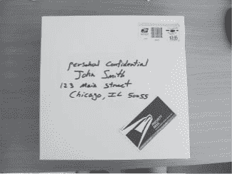
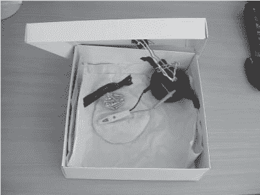

# CHAPTER 3

### Receipt of Suspicious Mail and Packages and Bomb Threats

在上一章中我们讨论了办公室紧急情况的一般情况，目的是强调制定计划的重要性。虽然我们讨论了对几种不同类型紧急情况的一般响应，但我们并未逐一列出每一种事件和紧急情况并描述相应的适当响应。要做到这一点，需要为每个主题各写一本书。然而，确实有一些问题常见到足以单独成章，并讨论如果发生此类事件如何应对。这里讨论的响应具有一般性，并且很可能因你的企业或设施的位置、与建筑物工作人员的合作程度以及警察响应所需的时间而有所改变。

### DELIVERED PACKAGES

让我们从送递包裹开始。基于众多原因，恐怖分子和其他罪犯长期以来偏爱通过邮件或其他包裹递送服务发动袭击。这是一种让肇事者能够从相对安全的位置发动打击的策略。例如，当爆炸物通过邮件发送时，袭击可以通过不知情的第三方送达，而袭击者则保持匿名。这些袭击可能令人恐惧且有效，信件和包裹炸弹在全球各地已夺去数百人的生命并使数百人致残。一个个人或一群个人可以针对在相距甚远的地区的多名目标，而无需冒被捕的风险。在爆炸物的情况下，爆炸不仅会伤害打开包裹的人，还会导致证据部分损毁。包裹通常会直接送达预定目标，如果装置隐藏得当，在为时已晚之前它们是不可能被检测到的。此外，使用这种方法企图杀害或伤害他人的人并不仅限于恐怖分子。心怀不满的员工、精神错乱的人，甚至被抛弃的恋人也对许多此类袭击负有责任。

涉及利用邮件系统进行恐怖活动的案件通常难以侦破，甚至需要数年、数十年才能解决。还记得“Unabomber”案件吗。炸弹客 Ted Kaczynski 多年来恐吓全国，向不知情的受害者寄送炸弹以推广他怪异的议程。普通的侦查技术并未导致他被捕。在多年徒劳的破案尝试后，联邦调查局（FBI）的行为科学家同意了炸弹客的一项要求，即在全国性媒体上发表他的“Unabomber宣言”。FBI 凭借对该嫌疑人的详尽心理画像，赌博般地认为会有人认出宣言的内容或风格并报警。这正是发生的情况；Kaczynski 的兄弟在读到发表的文章后举报了他。

爆炸物并不是可以藏匿在信件或送递包裹中的唯一伤害机制。许多人会记得 9 月 11 日袭击后数周内通过邮件投递的炭疽袭击。在那些袭击中，五人死亡，另外十七人感染。该案最终于 2008 年由 FBI 关闭，他们公开认定微生物学家 Bruce Edwards Ivins 为袭击的唯一肇事者，这一结论随后受到质疑。虽然没有任何科学证据最终证明 Ivins 的有罪，但案件仍被关闭。鉴于由此引发的广泛恐慌，人们认识到致命物质可以通过邮件传播的明显容易性，美国邮政服务（USPS）实施了反制措施，以确保炭疽永远不会再次通过邮件递送系统传播。然而，其他有毒物质，包括化学和生物制剂，仍可能通过邮件发送。只要存在邮件递送系统，这种类型的威胁就会继续被用来制造恐慌。

## 基本防护措施

个人和公司如何防范利用邮件或其他普通承运人进行的攻击？在美国境内，有专门负责协助维护邮件系统的邮政检查员。政府正在努力通过获取可用的额外技术设备来保持领先于威胁曲线，以便在邮件投递前监测邮件并检测爆炸物、毒物和生物危害。如果您居住在海外，除非您住在以色列，否则不太可能有此类保障。再次强调，您需要自行承担保护自己免受利用邮件投递系统进行的攻击的个人责任。

让我们谈谈一些基本的常识性措施，它们是对信件攻击的第一道防线。在家中或办公室实施的措施与在海外工作时实施的措施有很大区别。首先，在海外生活时，您应尽一切努力避免在家中收到邮件、包裹或递送。我们稍后会讨论递送问题，但在可能的情况下，请将邮件和包裹送至替代地点，例如您的办公地点。对于政府雇员而言，这是自动的。使馆工作人员的每位成员都使用陆军邮局（APO）作为邮寄地址。邮件会用 X 射线扫描，在某些情况下还会使用爆炸物检测设备，并在使馆内部进行分拣。邮件室工作人员接受过正确的处理程序培训，更能够识别可疑物品。然而，私营部门的个人没有受过训练的政府雇员为其筛查邮件的奢侈。私营企业开始意识到自己对这种攻击的脆弱性，并开始在私人邮件室解决这些问题。我们鼓励这一趋势。如果在威胁评估中，我们发现公司邮件处理程序存在缺陷，我们会设计公司专用的措施来加以纠正。尽管如此，公司在实施必要的安保变更方面进展缓慢。而且不幸的是，虽然攻击发生后安保通常会加强，但随着事件记忆的淡化，安保通常也会松懈。因此，每个人都需要成为自己的安全检查员。

大多数与接收邮件和包裹有关的措施都基于常识。第一条规则：相信你的直觉。它们通常是正确的。如果你收到任何原因让你觉得可疑或让你感到不舒服的物品，不要打开它。小心地将其放在一边，平静地考虑你的选择。（我们将在下面讨论这些选项。）

最简单的方法是通过退回地址来区分邮件。从熟悉的寄件人寄来的信件或在正常业务过程中收到的邮件不是威胁（除非是前妻或前夫）。预期的包裹也是如此。例如，如果你从 Eddie Bauer 目录订购了东西，两周后你收到来自 Eddie Bauer 的包裹，可以安全地认为该包裹是合法的。你可以将大多数期刊和其他订阅的物品也归入同一“安全”类别。属于普通业务邮件的邮件——例如水电费账单——也属于此类。那剩下的呢？例如，你收到一个退回地址不熟悉的盒子。你不记得订购过任何东西，所以你会更注意包裹的类型。你注意到它来自美国某个地方，盒子上印有公司名称。因此，你可以拨打美国的电话信息或在互联网上查询该公司的名称和号码。如果你得知这是你的配偶订购但忘记告诉你的东西，你就解开了谜团。也有可能你订购了某样东西，只是忘记了，这一点小小的研究会唤起你的记忆。

什么类型的邮件或包裹应该拉响警报，让你打电话给警察或使馆寻求指导？美国邮政服务局（USPS）制定了最好的一般性指导方针。很少有人意识到 USPS 拥有自己的武装邮政检查员调查部门。其中许多检查员擅长识别伪装成信件或包裹的爆炸装置。接下来我们将描述 USPS 的一些建议以及其他政府机构关于如何检测邮件炸弹的建议。

### 限制性背书

邮件炸弹可能包含“私人”或“个人/机密”或“仅限收件人开启”等字样。原因很明显。炸弹制造者希望确保是预期的受害者，而不是办公室里的秘书或家里的其他人打开包裹并引爆炸弹。如果包裹送到办公室，而收件人没有习惯收到个人邮件，则这一点尤其重要。其他措辞，例如“易碎”、“加急”或“小心处理”，在邮件炸弹中也很常见。

### 信封上的可疑字迹

显然，如果信封是用从报纸或杂志上剪下的字母[content]

## 基本防护措施

个人和公司如何防范利用邮件或其他普通承运人进行的攻击？在美国境内，有专门负责协助维护邮件系统的邮政检查员。政府正在努力通过获取可用的额外技术设备来保持领先于威胁曲线，以便在邮件投递前监测邮件并检测爆炸物、毒物和生物危害。如果您居住在海外，除非您住在以色列，否则不太可能有此类保障。再次强调，您需要自行承担保护自己免受利用邮件投递系统进行的攻击的个人责任。

让我们谈谈一些基本的常识性措施，它们是对信件攻击的第一道防线。在家中或办公室实施的措施与在海外工作时实施的措施有很大区别。首先，在海外生活时，您应尽一切努力避免在家中收到邮件、包裹或递送。我们稍后会讨论递送问题，但在可能的情况下，请将邮件和包裹送至替代地点，例如您的办公地点。对于政府雇员而言，这是自动的。使馆工作人员的每位成员都使用陆军邮局（APO）作为邮寄地址。邮件会用 X 射线扫描，在某些情况下还会使用爆炸物检测设备，并在使馆内部进行分拣。邮件室工作人员接受过正确的处理程序培训，更能够识别可疑物品。然而，私营部门的个人没有受过训练的政府雇员为其筛查邮件的奢侈。私营企业开始意识到自己对这种攻击的脆弱性，并开始在私人邮件室解决这些问题。我们鼓励这一趋势。如果在威胁评估中，我们发现公司邮件处理程序存在缺陷，我们会设计公司专用的措施来加以纠正。尽管如此，公司在实施必要的安保变更方面进展缓慢。而且不幸的是，虽然攻击发生后安保通常会加强，但随着事件记忆的淡化，安保通常也会松懈。因此，每个人都需要成为自己的安全检查员。

大多数与接收邮件和包裹有关的措施都基于常识。第一条规则：相信你的直觉。它们通常是正确的。如果你收到任何原因让你觉得可疑或让你感到不舒服的物品，不要打开它。小心地将其放在一边，平静地考虑你的选择。（我们将在下面讨论这些选项。）

最简单的方法是通过退回地址来区分邮件。从熟悉的寄件人寄来的信件或在正常业务过程中收到的邮件不是威胁（除非是前妻或前夫）。预期的包裹也是如此。例如，如果你从 Eddie Bauer 目录订购了东西，两周后你收到来自 Eddie Bauer 的包裹，可以安全地认为该包裹是合法的。你可以将大多数期刊和其他订阅的物品也归入同一“安全”类别。属于普通业务邮件的邮件——例如水电费账单——也属于此类。那剩下的呢？例如，你收到一个退回地址不熟悉的盒子。你不记得订购过任何东西，所以你会更注意包裹的类型。你注意到它来自美国某个地方，盒子上印有公司名称。因此，你可以拨打美国的电话信息或在互联网上查询该公司的名称和号码。如果你得知这是你的配偶订购但忘记告诉你的东西，你就解开了谜团。也有可能你订购了某样东西，只是忘记了，这一点小小的研究会唤起你的记忆。

什么类型的邮件或包裹应该拉响警报，让你打电话给警察或使馆寻求指导？美国邮政服务局（USPS）制定了最好的一般性指导方针。很少有人意识到 USPS 拥有自己的武装邮政检查员调查部门。其中许多检查员擅长识别伪装成信件或包裹的爆炸装置。接下来我们将描述 USPS 的一些建议以及其他政府机构关于如何检测邮件炸弹的建议。

### 限制性背书

邮件炸弹可能包含“私人”或“个人/机密”或“仅限收件人开启”等字样。原因很明显。炸弹制造者希望确保是预期的受害者，而不是办公室里的秘书或家里的其他人打开包裹并引爆炸弹。如果包裹送到办公室，而收件人没有习惯收到个人邮件，则这一点尤其重要。其他措辞，例如“易碎”、“加急”或“小心处理”，在邮件炸弹中也很常见。

### 信封上的可疑字迹

显然，如果信封是用从报纸或杂志上剪下的字母

## 处理可疑物品的注意事项

如果你收到一个包裹或信件，怀疑其中可能含有炸弹或危险物质，你该怎么办？首先要做的就是保持冷静，以便清晰思考。请记住，该包裹在投递过程中已被大量人员接触过，因此将其移至安全地点通常是安全的。如果情况并不明显，**切勿打开物品**。不要甚至尝试打开包裹的一部分来试图观察内容物。如果是炸弹或生物武器，任何篡改都可能导致其爆炸或释放有毒物质。将包裹或信件放在开阔区域。若处理的是疑似爆炸物，不要将其放在抽屉、橱柜或其他封闭空间。通过限制物体的空间，实际上会增强爆炸力。隔离该物品并疏散区域。对于小型装置，危险仅限于该楼层或附近区域的人员。疏散楼层并使用固定电话报警。如果装置含有疑似污染物，你确实需要将其 containment，最好用塑料 containment。不要在建筑物内移动包裹，尤其是不要使用电梯。如果怀疑有危险物质泄漏，应关闭供暖、通风和空调系统，以避免物质在建筑物内扩散。

不要将物体浸入水中。许多化学物质遇水会爆炸。在任何情况下，水都可能无法使装置失效。相反，水可能会导致电子引爆装置短路并产生不幸后果。不要触碰包裹并撤离该区域。

## 在办公桌上接收邮件和包裹

如何避免邮件炸弹或含有生物危害的信件顺利通过办公室邮件室并被送到你的办公桌？是否有办法让办公室邮件室成为抵御此类攻击的第一道防线？答案，当然是肯定的。你只需将在家中采取的常识性步骤系统地应用于办公室即可。结合处理邮件的政策和程序，邮件室员工需要接受培训，了解应注意什么以及如何确定哪些物品可以立即投递、哪些需要更严格审查、哪些应被拒收、丢弃或退回。仅仅教授可疑邮件和包裹的警告信号，就能在很大程度上防止这些威胁危及你、同事、员工以及你的设施。

除了培训外，解决工作场所邮件室安全问题还有很多技术解决方案。企业更有可能负担得起能够快速评估可疑包裹的技术设备。诸如 X 光机和金属探测器等物品随处可得，可以为邮件室购买。所有制造此类设备的公司也都会向终端用户提供现场指导。他们将培训你的员工正确使用机器，使他们能够检测到否则无法观察到的威胁。此外，相对廉价且可行的做法是，将邮件室的空气空间与建筑物的通风系统隔离开来。这样做可以防止在发生危险化学品或生物危害攻击时整个设施被污染。暴露将被控制，不会扩散到邮件室之外。此预防措施可以迅速实施，并在发生此类攻击时大幅减少暴露人员数量。如果你是经常收到威胁邮件和包裹的公司的管理人员，你应将制定此类计划作为在你的办公场所的首要任务。如果你不是高管或管理人员，你可以考虑将此问题提请管理层或适当决策者注意。

我们提供了一个基本的邮件室协议，以帮助你了解妥善保护邮件设施应采取的步骤。然而，实施有效的筛查系统需要一种针对你设施独特需求量身定制的综合方法。此外，系统的有效性取决于操作人员。懒惰、无能、培训不足和人为错误都可能导致系统失效。因此，一个真正有效的筛查系统还应包括人员选拔标准、培训指南和持续评估流程。它还应提供报告和纠正失误和失败的机制。展品 3.1 是一个示例邮件室筛查协议。

请记住，有时一个包裹会显示展品中列出的多个警告信号；有时只会显示一两个。有时炸弹制造者足够了解筛查程序，会将炸弹或生物危害包装得没有任何警告信号。然而，作为一般规则，包裹或信件至少会有一些迹象表明它值得进行更严格的审查。展品 3.2 显示了一个看似无害的包裹，上面带有限制性批注。它也没有回邮地址。该包裹可能完全合法且没有任何风险。然而，一个有效且运作良好的筛查系统肯定会将此包裹识别为需要额外关注的对象。

## 展品 3.1 邮件室协议

### 总则

信件或包裹炸弹事件已发生在企业、大学、政府办公室和设施以及私人住宅。发动此类攻击的动机可能包括报复、保险欺诈，以及针对个人或组织的政治或环境恐怖主义。

### 将邮件用作炸弹投递方式

邮件或包裹服务对恐怖分子或罪犯来说是理想的战术，原因有几个：
- 通过邮件寄送炸弹，攻击者可以远程打击特定目标。
- 邮件或包裹可以随时送达任何目标。
- 攻击由不知情的参与者投递——邮递员或包裹递送人员。
- 很难识别可疑物品；它可能看起来像任何其他邮件。

所有这些因素都使邮件攻击具有吸引力，因为被捕风险降低，攻击成功的概率增加。

### 制定计划

邮件炸弹安全计划的主要目标是在武器化的信件或包裹到达预期收件人之前检测到它。因此，公司需要建立完善的筛查程序以限制风险。邮件室协议加上常识和良好判断可以实现降低此类攻击脆弱性的目标。

### 计划中应包含的重要要素
- 在制定计划时，你必须区分商务邮件、常规邮件和非常规邮件。商务邮件和常规邮件是定期从其他企业、客户或顾客处收到的。非常规邮件需要接受最大程度的审查。
- 处理包裹时，重要的是为员工创建一个方式，以便他们通知安全或邮件人员有关包裹的预期到达。

员工需要提供收件人姓名、部门和电话号码以及寄件人姓名、包裹内容及其预期大小等信息。
- 安全人员和任何处理邮件的人员都需要熟悉可疑迹象并定期接受培训。下一个列表根据以往事件列出了信件和包裹的不同警告信号。

### 地址
- 手写地址或打字潦草的地址
- 不完整或不合逻辑的回邮地址
- 不常见的回邮地址
- 包裹上的外国回邮地址，表明它不是由本地企业寄出
- 没有回邮地址
- 送达方式异常（在非工作时间或由不属于包裹服务的人员送达）

### 感官和感觉
- 尺寸和重量不成比例。
- 物品倾斜或感觉异常（例如，粉末感）。
- 有奇怪的气味。
- 信封感觉僵硬、坚硬，或含有重纸板、金属或塑料，阻止信封弯曲。
- 从包裹传来声音（滴答声、嗡嗡声、咔嗒声）或其他奇怪噪音。

### 视觉
- 信封或包裹被撕裂或打开。
- 信封或包裹上有油渍。
- 粉末或任何物质从中泄漏。
- 信封或包裹上有威胁性信息。
- 信封或包裹上的邮资过多。
- 电线从信封或包裹中突出。
- 信封或包裹用过量的胶带或绳子密封。
- 常用词、地址和/或姓名拼写错误，这可能表明英语困难。
- 信封或包裹使用公司头衔但没有参考姓名。
- 信封或包裹标记为“个人”、“机密”或“私人”。

## 展品 3.1 邮件室协议（续）

计划必须包括涉及可疑信件或包裹的紧急情况的处理程序。当一件邮件被判定为可疑时，主要关注点应是您个人安全以及其他员工的安全。请记住，当您发现可疑包裹时，您的职责就结束了。此时，责任归属于为此类情况而训练的执法专业人员。

### 当您发现可疑信件或包裹时
- 保持冷静。
- 将物品放下。
- 不要移动物品或将其带到室外。
- 疏散该区域。
- 通知保安和管理人员。
- 通知执法部门。

## 展品 3.2 需要特殊处理程序的看似无害的包裹

不幸的是，邮件炸弹并不需要很高的技术就能制造和发送。展品 3.3 是非常简单的爆炸装置和触发系统的照片。装满钉子和螺丝的此类装置会变成极其致命的武器，能够向大面积区域喷射破片。

公司可以选择为邮件室购买专门设计的容器，用于遏制小型爆炸装置，如含有炸弹的信件或包裹的影响。几家公司制造了这些装置，它们旨在吸收侧向爆炸能量和所有侧向爆炸碎片。爆炸的冲击力将被向上引导，防止致命破片的侧向扩散。

## 展品 3.3 简单的包裹炸弹和触发系统

正如我们提到的，根据您的风险水平和收到的邮件量，您可能希望考虑购买金属探测器、X 射线设备和其他类似设备。许多地点会对每件邮件进行 X 射线检查。这始终是一个良好的做法。然而，能够处理大量邮件的 X 射线机的成本可能过高。因此，许多公司用金属探测器扫描邮件，这是一种成本更低的替代方案。这种做法基于这样一个前提：炸弹无法在没有金属部件的情况下制造。虽然这通常是正确的，但 X 射线选项无疑是保护办公室的更好选择之一。还有其他技术可供使用，包括检测爆炸性化合物的设备。在某些地点，排爆犬也被用来筛查包裹和送货。

Global Security Group 提供的一项服务是对企业邮件室进行全面评估和改造。该评估包括制定公司特定的邮件处理程序，并整合最佳且最具成本效益的技术检测系统。然而，如果没有一支训练有素且警觉的员工队伍，一切都无法奏效。

## 可疑的袋子/包裹或其他无人看管的物品

保安或员工发现无人看管的袋子或其他物品的场景也值得讨论。我们如何确定是否应为例如所有者不明的袋子启动全面的响应协议？更有可能的是，有人只是不小心把袋子遗忘了，但我们的响应不能做出这种假设。我们可以并且应该调查这种可能性，但在这样做的同时，该区域必须被清空。请记住，小袋子甚至手提箱对建筑结构的威胁与装有数千磅炸药的卡车炸弹不同。正确的做法是遵循侧向响应策略，清理包裹周围的即时区域以及附近可能存在风险的任何其他地方，例如隔壁的石膏板墙办公室。用座机打电话报警并等待他们调查。与此同时，您已确保如果包裹最终证明是爆炸装置，也不会有人受伤。

## 炸弹威胁和爆炸

想象一下，您坐在办公室里，电话响了。您接起电话，听到一个男人的声音说：“我恨你的国家（或你的公司、种族、宗教），几分钟内你们设施里的炸弹就会爆炸。”您该怎么办？您应该怎么做？您是否应直接立即通知所有同事并疏散大楼，还是应与其他高级管理人员讨论该怎么做？威胁是否真实的可能性有多大？您可能需要在很短的时间窗口内做出决定。

大多数爆炸都是没有预警发生的。然而，在相对罕见的情况下，放置了爆炸装置的个人会打电话或其他方式联系目标设施，警告炸弹将在一定时间内爆炸。虽然很难说炸弹制造者有人性，但警告使建筑物内的占用者能够疏散，从而减少人员伤亡。由此造成的损失将是财产损失，而不是人员伤亡。这是例外而不是规则。在当今历史时期，仅对财产造成损害并不能满足今天的恐怖分子。对战斗人员和非战斗人员，或男女老幼都不做区分。炸弹制造者通常唯一打的电话是为了对袭击负责，而不是发出警告。

即使如此，任何应急行动计划中都必须包含炸弹威胁协议。如果收到炸弹威胁，至关重要的是尽可能多地从呼叫者那里获取信息，因为时间至关重要。获取这些信息最好通过使用炸弹威胁清单来完成。展品 3.4 是我们多年来开发的炸弹威胁清单样本。我们结合了我们认为来自烟酒枪炮及爆炸物管理局、FBI 以及各种其他联邦、州和地方警察机构的清单的最佳要素。此外，我们还对问题进行了颜色编码，以按重要性优先排序。应先询问与安全相关的问题。如果呼叫者愿意回答，应记录这些问题的答案：
- 炸弹何时会爆炸？
- 炸弹在哪里？
- 它看起来是什么样？
- 什么会导致它爆炸？
- 它是什么类型的炸弹？

## 展品 3.4 炸弹威胁清单样本

通话的准确日期和时间： _______________________________

接听人： _______________________________

接听电话号码： _______________________________

呼叫者原话： _______________________________

### 询问呼叫者的问题：
1. 炸弹何时会爆炸？ _______________________________
2. 炸弹在哪里？ _______________________________
3. 它看起来是什么样？ _______________________________
4. 什么会导致它爆炸？ _______________________________
5. 它是什么类型的炸弹？ _______________________________
6. 您放置了炸弹吗？ _______________________________
7. 您为什么放置炸弹？ _______________________________
8. 您叫什么名字？ _______________________________
9. 您从哪里打电话？ _______________________________
10. 您的地址是什么？ _______________________________

### 背景噪音：
- 工厂 ☐
- 街道 ☐
- 飞机 ☐
- 办公室声音 ☐
- 声音 ☐
- 火车 ☐
- 派对 ☐
- 安静 ☐
- 音乐 ☐
- 动物 ☐

### 对受威胁设施的熟悉程度：
- 很熟悉 ☐
- 有些 ☐
- 无 ☐

### 呼叫者听起来是否熟悉？
- 是 ☐
- 否 ☐

如果是，像谁？ _______________________________
_______________________________

## 展品 3.4 炸弹威胁清单样本（续）

**声音**
- 响亮 ☐
- 高音 ☐
- 沙哑 ☐
- 喝醉 ☐
- 柔和 ☐
- 低沉 ☐
- 愉快 ☐
- 其他 ☐

**说话**
- 快 ☐
- 清晰 ☐
- 口吃 ☐
- 含糊 ☐
- 扭曲 ☐
- 鼻音 ☐
- 舌音不清 ☐
- 其他 ☐

**口音**
- 当地 ☐
- 外国 ☐

**语言**
- 受过教育 ☐
- 一般 ☐
- 差 ☐
- 辱骂 ☐
- 粗俗 ☐

**态度**
- 冷静 ☐
- 理性 ☐
- 连贯 ☐
- 深思熟虑 ☐
- 正义感 ☐
- 愤怒 ☐
- 非理性 ☐
-  amusement ☐

**性别**
- 男性 ☐
- 女性 ☐
大约年龄： ________________
来电显示： ________________
种族 ________________
备注 ________________
________________
________________

立即拨打 911（或当地等同号码）。
尽可能长时间让呼叫者继续说话。

在进一步讨论清单的使用之前，我们必须说明，绝大多数炸弹威胁都是恶作剧，并非真实威胁。此类威胁的制造原因有很多：

- 心怀不满的员工希望扰乱工作场所，以打击士气并造成负面财务影响。
- 活动人士对某家公司或行业心怀不满。
- 罪犯或恐怖分子在测试威胁的应对响应。
- 敲诈勒索资金（例如，近期针对美国和加拿大各地设施和学校的威胁，要求以比特币支付）。
- 制造恐慌和恐惧。

事实上，除非情况特殊，否则警方不会仅凭威胁就直接疏散整栋建筑或设施。如果对所有炸弹威胁的应对方式都是立即疏散，那么任何有恶意意图的人都能通过一个电话、一条短信、一封电子邮件或一封信件轻松清空整栋大楼。炸弹可能难以被带入建筑物内；当然，足够大、足以造成结构性破坏的炸弹更是如此。想要袭击大量人群的恐怖分子会制造炸弹威胁，因为他知道楼内成百上千的人会因此走到室外，而在室外他们更容易遭受攻击。这种情况确实发生过。这就是为什么应对炸弹威胁的第一步是评估情况。除非存在特殊情况或证据表明威胁是真实且迫在眉睫的，否则疏散并不是正确的应对行动。一个需要立即疏散场所的威胁示例是：来电称停放在建筑物旁边的某辆卡车装满了2000磅硝酸铵和燃油，将在二十分钟内爆炸。安保人员确认，一辆符合描述的卡车正停在来电者所述的位置，检查后发现该车似乎装载沉重。在报警的同时，快速查看视频录像，发现该卡车靠近建筑物停放，司机匆忙下车，跳进另一人驾驶的汽车。此案的事实可能表明需要采取双重策略：将所有楼内人员引导到离威胁最远的一侧，并立即通过该侧楼梯间进行疏散。

让我们设想一种情况，威胁的内容表明该威胁是真实的。爆炸时间至关重要，特别是如果决定要疏散建筑物的话。炸弹的位置也极其重要，因为它将决定选择哪条疏散路线。当然，什么会引爆炸弹这个问题也很重要，因为它可能提供有助于阻止装置引爆的信息。

在讨论表3.4清单中的其他一些问题之前，我们应该明确一点：接到炸弹威胁后的首要任务是迅速收集有助于挽救生命的信息。清单中包含许多需要询问来电者的问题。正如我们提到的，接听电话的人应首先询问与安全相关的问题。前五个问题（如果你使用纸质清单，这些问题应以红色标注）是与安全相关的问题，必须首先询问。第6至第10题属于调查性质，旨在获取后续当局需要的额外信息。清单中的勾选框也旨在帮助后续对袭击或威胁进行调查。这些问题不需要在通话过程中回答。然而，这些细节将非常有助于接听电话的人记住尽可能多的细节。表格底部的指示是拨打911并报告威胁，但当然，各国的警务紧急电话号码各不相同。每位员工都应知道本地相当于911的号码，或如何尽快联系警方。

如果没有立即危险的迹象，目标是让来电者尽可能长时间地保持通话。当然，如果来电者说炸弹将在几分钟内爆炸，这条建议就立刻被抛到窗外了。否则，尽量从来电者那里获取尽可能多的信息。疏散时，请随身携带表格，并趁信息在你脑海中还清晰时尽量填写。请记住，接到炸弹威胁时，安全是压倒一切的首要关切。如果这样做会让你或他人的生命面临风险，就不要浪费宝贵时间去与来电者周旋或获取额外信息。再次强调，绝大多数炸弹威胁都是毫无根据的恶作剧。清单上问题的答案将让出警的执法人员能够评估情况。

对威胁的一种常见响应（无论是内部还是出警执法人员）是搜查可疑装置。在搜查过程中，应避免使用手持无线电和手机，因为任何无线电传输都可能引爆以这种方式控制的装置。搜查重点放在那些明显不该出现在该处的东西上，例如公文包或行李袋出现在极不可能出现的地方。搜查必须彻底、系统，并重点关注：

- 公共区域
- 先从低楼层开始
- 疏散路线
- 外墙

如果发现装置：

- 切勿触摸或检查该装置。
- 疏散并隔离、控制该区域。
- 切勿使用手机或无线电。
- 立即将你自己和他人撤至安全距离以外。

对可疑包裹的响应理论是，首先实施横向疏散策略，然后如果你在多楼层办公室或设施中，再疏散上下方楼层。如果装置爆炸，室内石膏板墙无法提供足够的保护。请记住，一个小型简易爆炸装置不会对建筑物结构构成严重威胁。一般来说，此类爆炸物会对附近没有掩护保护的人员构成严重威胁。远离玻璃窗和二次危险源（燃气、电力等），如果身处办公楼，请躲到坚硬掩护物后面或离开该楼层。高层办公楼的楼板/天花板由钢筋混凝土制成，能为人们提供有效保护；而内墙很可能是石膏板，无法提供同样保护。

让我们暂时从炸弹爆炸威胁转向因威胁而实际发生的爆炸。如果发生爆炸，不要假设威胁已经结束。可能存在结构坍塌、二次爆炸甚至多个装置的风险。以色列人用惨痛教训认识到，恐怖分子经常在同一个大区域放置两个或更多爆炸装置。第一个装置引爆后，在最初的冲击过后，警察、救援人员和更多平民会冲向现场，试图帮助受害者。炸弹客在安全距离处观察，直到他们对现场人数满意，然后远程引爆第二个装置。这是一个两难局面。很少有人能压制自己的人性，让恐惧阻止自己去救助伤员。如果可能，尽量让受过训练的专业人员在你们冲进去之前先封锁现场。

这种双爆式袭击还被用来杀害那些在一次袭击中幸存并跑向最近掩护区域的平民。这是哈马斯惯用的战术，该组织经常试图以此方式杀害以色列境内更多的平民。炸弹客在某个区域放置第一个爆炸装置，目的是尽可能多地杀死人。他们将第二个装置放置在幸存者可能会跑去寻求庇护的邻近区域。这些恐怖分子凶手在安全距离外观察，直到足够多的男女老少到达这个他们以为安全的区域，然后用一个简单的电话呼叫拨打连接到装置上的手机，引爆炸弹。

