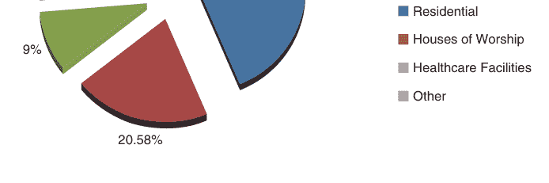
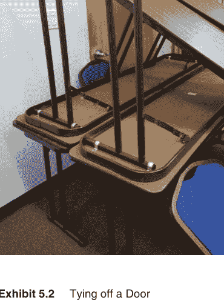
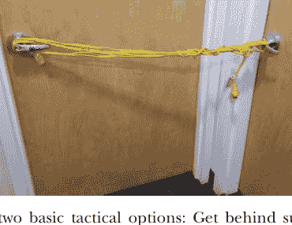
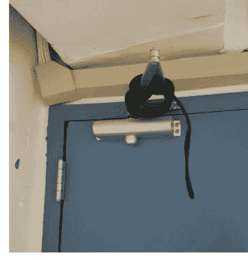
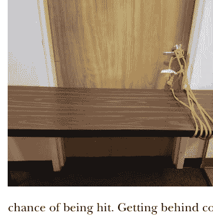

# 第5章

## 第5章 在主动射击事件中生存

### 背景与定义

似乎每隔几周就会有一条突发新闻头条，报道办公室或其他商业场所，或学校、教堂、医院发生主动射击事件。联邦、州和地方执法机构报告称此类事件正在上升，但究竟什么是主动射击者，这些暴力行为与其他枪击事件有何不同？联邦调查局（FBI）将主动射击者定义为“在人口密集地区积极从事杀人或企图杀人的个人。该定义隐含射击者使用一支或多支枪支。”¹ 这个定义与FBI之前的定义略有不同，之前的定义额外要求事件发生在“封闭且人口密集的地区。”² 值得注意的是，虽然最危险的主动射击事件发生在封闭和人口密集地区，但也有多起事件发生在户外，没有建筑结构的限制，这些事件与在建筑物或剧院内发生的事件一样难以逃离。即使在户外，逃跑也很困难，因为人群的移动会阻碍甚至使经过适当考虑的行动变得不可能。2017年10月1日拉斯维加斯枪击案（由斯蒂芬·帕多克实施）就是这种动态的一个例子。直接从高处射击的射击者方向跑开

在无遮蔽的开阔地带停留是错误的做法，正如我们后面所讨论的那样。然而，如果有 20,000 人朝那个方向移动，你转移到别处的能力基本上为零。人群本身就是限制因素。

前面引用的 FBI 研究以及对 2014–2015 年、2016–2017 年和 2018 年发生的枪击事件的补充报告分析了 2000 年至 2018 年间在美国发生的 277 起活跃枪手事件。³ 这些研究指出的最重要一点之一是，活跃枪手事件正变得越来越常见。联邦、州和地方执法机构建议每个企业、学校、政府设施、酒店和公共集会场所都为此类紧急情况做好准备。FBI 的这一告诫在这方面是一个振聋发聩的呼吁：

> 活跃枪手带来的增强威胁以及活跃枪手事件发生的迅速性，支持了执法人员和公民同样做好准备的重要性。⁴

一些地方政府正在积极采取行动；2016 年底，纽约市成为首个要求所有高层办公楼、酒店和公共集会场所在其消防安全和应急行动计划中纳入活跃枪手应对培训的主要城市。这一反应很大程度上是由这样一个事实驱动的，即所有活跃枪手事件中最大的一类发生在商业场所（占 44%）。

## 2000–2018 年按地点划分的活跃枪手事件

正如该图表所示，44%——接近一半的活跃枪手事件——发生在商业环境中。该研究进一步将商业环境中的枪击事件细分为两个子类别，“对行人开放的商业” 和 “对行人关闭的商业”。两者之间的区别与出入有关；高层建筑中的公司办公室是“封闭”场所的例子，而购物中心则被视为“开放”。在 FBI 分析的封闭商业环境中的大多数事件中，地点和人员都是蓄意针对的；枪手与被针对的地点和受害者之间存在联系。在压倒性多数的案例中，枪手是前员工或现任员工，或偶尔是员工的配偶。这里的目标是有意的，而不是随机的。此外，纽约市警察局对活跃枪手事件的审查发现，这类袭击的受害者中有 41% 与袭击者有职业关系。⁵ 美国特勤局的一项研究得出结论，这些类型的事件有特定的预定目标，因此对所有公司员工构成直接风险。⁶ 由于很明显，工作场所的枪击事件几乎总是由已知人员实施，因此可以合理地得出结论，这种类型的袭击是可以预见和预防的。问题是如何。

工作场所活跃枪手事件数量的增加促使许多私营部门公司为其员工提供活跃枪手应对培训。这种培训通常很少关注如何培训企业人力资源人员和高层管理人员识别不满员工或其他表现出令人担忧或威胁行为的已知个人的预警信号。工作场所活跃枪手事件幸存者中常听到的一句话是，预警信号被观察到但没有得到妥善处理。在某些情况下，需要执法部门介入。然而，在许多其他情况下，如果某个人行为令人担忧，但没有达到刑事程度，刑事司法系统将无济于事。2018 年 6 月 28 日在《首都公报》发生的袭击就是这种情况，当时执法部门无效，因为引起关注的行为要么不构成犯罪，要么只构成轻微刑事犯罪。在这种情况下，一名警察侦探实际上表示他认为该个人对受害者不构成威胁——这一信念后来被证明是错误的，因为该嫌疑人随后枪杀了五名员工。⁷ 需要注意的是，虽然执法人员可能拥有丰富的现实经验，但他们并没有接受过评估与已知和已识别个人相关的风险水平的训练。所需要的是一个工具，使雇主至少能够对行为引起担忧的个人进行初步评估。总是存在与后期暴力行为相关的预警信号和行为，雇主可以寻找这些信号。

## 行为和动机因素

根据特勤局，多名受害者袭击者中存在一些共同的行为和动机因素。⁸ 其中许多指标可能在入职前未被研究。联邦和州法律限制了在招聘过程中何时以及如何使用刑事调查。然而，这一担忧不适用于员工被解雇且雇主在评估前员工可能造成的暴力风险时调查其过去历史的情况。特勤局的研究发现，这些袭击者的 71% 除了轻微交通违规外，还有刑事指控历史。2019 年 2 月 15 日在伊利诺伊州奥罗拉发生的活跃枪击事件是我们最终确定本书草案时发生的，是一个典型的例子。一名在仓库枪杀五人并 wound 多名警察的枪手是一名有重罪定罪的被解雇员工。他在与仓库经理和人力资源人员会面期间开枪，当时他被告知在本次会议上被解雇。其他来自该枪手的预警信号也被报道。我们相信，我们在本章中讨论的评估概念的应用本可以很好地防止这起袭击。

许多工作场所袭击者与执法部门有联系，但未导致指控。研究中完全三分之一的袭击者有与家庭暴力行为有关的暴力历史。此外，54% 的袭击者有非法药物/物质滥用的历史，这通常与其它刑事活动相关。

不出所料，精神健康问题在袭击者中也很常见，其中 64% 在袭击前已被诊断出精神健康问题。最常见的症状与精神病性症状相关（偏执、幻觉或妄想）或自杀念头。完全有 25% 的袭击者在袭击前曾因治疗或精神科药物处方而住院。此外，袭击者患有未诊断的精神疾病或未寻求治疗的疾病的可能性表明，这一数字高于报告。同样，法律使得对精神健康或其他健康相关问题的调查变得困难甚至不可能。然而，这些问题可能在员工在职期间或解雇后变得为人所知。

活跃枪手和其他大规模伤亡袭击的肇事者对其行为有动机或多个动机。特勤局的研究确定了以下动机⁹：

- 怨恨：46%（工作场所：21%；家庭：18%；个人：7%）
- 意识形态或种族主义：21%
- 精神健康/精神病：14%
- 政治：4%
- 名声：4%
- 未知：14%

检查这些因素并学习识别风险因素是防止工作场所暴力行为在发生前发生的首要步骤。虽然这些项目并不能预测，但它们暗示了可能比不满或扰乱秩序的员工严重得多的潜在问题。

怨恨是在评估暴力潜力时最重要的风险因素。怨恨，牛津英语词典定义为“真实或想象的错误或其他投诉或抗议的原因，尤其是不公平对待”，促使了 46% 的大规模暴力行为肇事者包括活跃枪手事件的发生。工作场所中经常犯的错误是试图用客观标准来评估怨恨。那是一种错误且可能危险的看法方式。通过潜在袭击者的眼睛来看待。他们的感知或妄想是什么？这就是我们必须评估此类情况的方式。你不必同意怨恨是合法的；你需要尝试确定怨恨在多大程度上可能导致员工以暴力方式行动。虽然根据特勤局，分析的所有袭击中有 57% 仅对随机人员造成伤害，只有 14%（四起袭击）仅对袭击者所知的预选个人（例如同事或主管）造成伤害，但这四起袭击都是由工作场所怨恨驱动的。

特勤局研究将执念定义为“对某人、活动或信念的强烈或痴迷的 preoccupation，以至于影响了生活的许多方面”。¹⁰ 研究指出，执念通常“通过寻求或消费大量关于执念对象的信息而表现出来”，并且执念“通常带有愤怒或情绪化的基调，并围绕几个主题展开，包括个人恩怨、浪漫冲突、个人失败、 perceived 不公、妄想、社会政治意识形态或其他大规模暴力事件”。这种行为会如何表现？许多人有爱好和强烈的兴趣，有些

bordering on obsessive or compulsive behavior. What differentiates a fixation from a strong interest is that in these cases the fixation becomes the central focus of a person’s life. That, coupled with extreme emotion, particularly anger, may become a dangerous motivation.

Other factors of concern mentioned in the Secret Service study are listed next.

- *Significant stressors:* All attackers had at least one stressor in their lives in the five years leading up to the attacks.
- *Family/Romantic relationships:* Spousal estrangement, divorces, romantic breakups, rejected proposals, physical or emotional abuse or death of a parent
- *Personal issues:* Unstable living conditions, physical illnesses, or other significant disorders
- *Work or school environments:* Being fired or suspended, filing grievances, being bullied at work or school, feeling disrespected, or being the subject of real or perceived gossip
- *Contact with law enforcement not leading to arrest/charges:* Being the subject of domestic disturbance calls or being sought for a crime unrelated to the attack
- *Financial instability:* These financial stressors included an inability to maintain employment; living in homeless shelters; failed business ventures; and civil court filings and proceedings, such as judgments, evictions, tax warrants, and wage garnishments.
- *Rigidness, hostility, or extreme self-centeredness:* Some inappropriately asserted control over others, as observed by their histories of domestic violence, sexual assault, harassment, or harming animals. Others had a history of violent/angry outbursts following interpersonal conflicts with coworkers, neighbors, or family members. Some attackers displayed an inflated sense of self or entitlement, unrealistically believing that they were deserving of certain relationships, successes, or benefits, with some reacting angrily when they did not obtain what they believed they deserved. Again, it is what they believe that matters, not whether we agree with their perception.
- *Threatening communications:* 79 percent made threats or engaged in other threatening communications. These may be overt or veiled and both verbal and nonverbal.
- *Concerning communications:* 75 percent engaged in other concerning communications that did not reach the threshold of a threat (i.e., made

- A lack of empathy
- Envy of others or the belief that one is the object of envy
- Arrogant, haughty behavior or attitudes

Any program that seeks to identify employees with a potential to act out violently should consider these criteria as well.

Other law enforcement agencies have also compiled lists of behavioral indicators associated with violent actors. The Department of Homeland Security (DHS) identifies “Indicators of Potential Workplace Violence” in its Active Shooter booklet.12 These indicators may include:

- Increased use of alcohol and/or illegal drugs
- Unexplained increase in absenteeism or absenteeism explained by vague physical complaints
- Noticeable decrease in attention to appearance and hygiene
- Depression/withdrawal
- Resistance and overreaction to changes in policy and procedures
- Repeated violations of organizational policies
- Increased severe mood swings
- Noticeably unstable, emotional responses
- Explosive outbursts of anger or rage without provocation

In addition, the individual exhibits signs of suicidal behavior (e.g., makes comments about “putting things in order”) or paranoia (e.g. “everybody’s against me”). Other factors that DHS includes are:

- Increasingly talks of problems at home
- Escalation of domestic problems into the workplace
- Talk of severe financial problems
- Talk of previous incidents of violence
- Empathy with individuals committing violence
- Increase in unsolicited comments about firearms, other dangerous weapons and violent crimes.*

*Disclaimer: This list of behaviors is not comprehensive, nor is it intended as a mechanism for diagnosing violent tendencies.

## ASSESSMENT AND RESPONSE

In our practice, Global Security Group has created a comprehensive assessment process in how to identify a potential threat of violence by recognizing the behaviors, personality traits, types of communication, motivations, triggering events, and other concerning behavior common to active shooters and other individuals capable of violent acts. This assessment is not dispositive of the issue; it simply identifies warning signs that may require intervention. In our view, prevention, not simply a robust response, is the preferred method of dealing with potential workplace violence issues. The question is *how* to respond.

What should a company do if an individual is deemed a potential risk by management or human resources personnel? That largely depends on the exact nature of the conduct, but the response typically follows a two-pronged approach: law enforcement involvement and in-house security measures. This comprehensive approach may not always be possible. As mentioned, the criminal justice system is poorly suited to addressing incidents where an employee is displaying concerning or even threatening behavior. Absent conduct that violates criminal law, the police will not be able to take any action. In fact, in many jurisdictions, even documented and provable threats of violence will only amount to a minor criminal violation with associated penalties that offer little in the way of a serious deterrent. In that event, the company must focus more heavily on what can be done privately. Access to the office or facility must be controlled. In some cases where the threat is deemed severe, armed security may have to be engaged. If it becomes necessary to hire armed guards, you must ensure that the guards are well trained and capable of engaging an armed and determined attacker. In our practice, we frequently encounter situations where the persons charged with protecting clients are ill suited to the task. They are not well trained and lack even a basic level of fitness. As a consumer of security services, you have a right to expect a qualified individual, and you have a duty to ensure that whoever is assigned to your site is capable.

The first and perhaps most important step to survive a shooting incident at work is to prepare yourself mentally to respond before the incident occurs. This is of extreme importance because when you are under extreme stress, you will suffer a degradation of cognitive ability. In simple terms, you will lose the ability to think clearly. You will also likely experience one or more of the most common psychological responses to fear or extreme emotional safety; if you do not know where the shooter is, you cannot be certain you are not exposing yourself to greater risk by moving. In this case, look for a room in which you can take refuge and implement the “barricade” strategy. This does not mean simply finding a place to hide; it means finding a place you can create a barrier that denies entry to anyone one trying to enter and do you harm. Ideally, this location will allow you to barricade the door quickly and can provide some protection in the event rounds are fired in your direction. If the shooter is in close proximity and you can neither avoid nor barricade, then you must “confront” the shooter immediately and violently. We discuss each strategy individually in the next sections.

## Avoid

Clearly, avoiding a dangerous situation is the preferred option. Get away from the shooter if you have access to a safe exit. Remember, bullets are moving with extreme velocity and will penetrate doors and interior walls. Until you are behind an object with substantial mass, you are not safe from rounds fired in your direction; an interior wall may provide concealment but will not protect you.

Always know where the nearest exits are and where they take you. Know the termination points of stairwells; a stairwell may terminate in the basement, but the exit out may be on the ground floor. Blindly following the stairs until they end is not acceptable. Visualize the entire route and then move; the visualization strategy helps your effort to escape even when the stress caused by extreme fear causes you to lose the ability to think clearly. Even ordinary actions will become difficult to perform when you are in fear for your life; turning a doorknob, generally a simple task, may become problematic. Visualization helps overcome these issues.

Make sure you are not headed toward the shooter. That may not be difficult if you can actually see the shooter; once you know where he or she is, you can determine whether escape is possible. If you attempt to evacuate, remember that bullets pass quite easily through most interior walls and doors, so you will still be in danger until you are completely clear of the scene, off the floor, or have an intervening structure between you and the shooter that will stop bullets. If you cannot see the shooter, this task becomes more problematic. Some people believe that you can determine the location of the shooter by hearing the gunshots; that is not true. Sound is an unreliable indicator of location and direction. Most of us can relate to stopping at an intersection,

听到警报声越来越近，却无法确定警报声来自哪个方向。枪声来源的位置可能同样难以判断。如果你猜错了方向，就有可能在疏散途中遭遇枪手。在盲目疏散和选择合适地点设障自保之间，通常更稳妥的选择是后者——先设障隐蔽，直到能够合理确定枪手的位置并安全撤离。

撤离时，你必须牢记：赶到现场的执法人员并不知道枪手是谁，因此他们不会（也不应该）假定逃跑的人都是无辜的受害者。枪手常常企图混入奔逃的人群中逃脱。据报道，2017年1月1日伊斯坦布尔雷纳夜总会袭击案的枪手阿卜杜勒卡迪尔·马沙里波夫，就是用受害者的血涂抹自己、伪装成受害者才得以逃脱。请举起双手，手掌张开，十指分开。服从现场警员的一切命令，不要妨碍他们行动。

## 设障

如果你无法撤离，或者不确定枪手的位置，请寻找一个能迅速有效设障、防止其进入的房间或其他场所。理想情况下，该房间应在枪手视线之外，并能为你抵挡射来的子弹。房间不必固若金汤，只要能延缓枪手闯入即可。根据先前引用的2013年联邦调查局研究，在所有能够确定持续时间的活跃枪手事件中，69.8%的事件在五分钟或更短时间内结束。^13^ 枪手拖延不起，也不会花时间试图攻破一个已设障的房间。

关于如何固守房间、阻止闯入，人们会提出许多问题：如何迅速用障碍物堵住房间？任何房间都能用作庇护所吗？门没有锁，或者朝外开而不是朝内开，有关系吗？阻止他人进入房间的最有效方法是什么？回答这些问题的最佳方式，莫过于那句名言：“一图胜千言。”

在示例5.1中，一把椅子抵住门这种简单的权宜之计，就能让一道轻便路障变得有效——哪怕一个250磅重的男子用全身力气去推也推不开。一个常见问题是如何为向外开的门设障。如果家具和设备足够多，枪手就会被威慑住而不敢尝试进入。向外开的门也可以用绳索拴住，如示例5.2所示。

### 示例5.1 用家具堵住向内开的门

防止门被打开的方法还有很多，但示例5.3和5.4应能充分说明这一原理。

一旦你已设障隐蔽，请保持安静。将手机调至静音，并关闭振动功能，因为振动也可能被听到。拨打911，向当局报告正在发生的情况。如果枪手就在附近，你担心通话被听到，那么只需拨打911并保持线路畅通。未挂断的911电话会促使警方出动。记得调低手机音量，以防911接线员的声音被听到。但不要将手机静音，因为你希望接线员听到现场的声音。现在越来越多的地区还提供“短信911”选项。

### 示例5.2 拴住门

请考虑如果枪手透过路障射击，你该如何保护自己。有两种基本的战术选择：躲到结实的掩体后面，和/或进入理想的设障位置。这两个概念都需要解释清楚。

### 示例5.3 拴住门的闭合装置

### 示例5.4 将门拴在大件/重物上

“结实掩体”指的是具有足够质量和密度来阻挡子弹的物体或结构。如前所述，大多数室内构造连威力一般的手枪子弹都挡不住。子弹很容易穿透石膏板墙和木门。在典型的办公环境中，什么能挡住子弹？重型物体，如大型复印机、服务器或装满文件的文件柜，都能在子弹朝你射来时提供保护。如果附近有这样的物体，就利用它们作为掩体。如果没有，你必须进入理想的设障位置，这个位置要考虑子弹穿透墙壁或门后的弹道。如果你想象子弹穿过门或墙射入室内时可能走过的路径，就可以选择一个能最大程度降低中弹几率的姿势。躲在掩体后面是更好的选择。如果房间内有结实的物体，比如一个装满文件的文件柜，就躲到它后面，并确保你的位置使子弹在击中文件柜后必须先穿过文件才能打到你的身体。

## 对抗

如果枪手堵住了唯一的出口，你无法“躲避”，或者没有时间设障，怎么办？你唯一的选择就是“对抗”枪手，为生存而战。如何与枪手搏斗取决于具体情况。例如，如果你所处的房间无法上锁，也没有时间设障，或者房间里没有任何东西可以用来有效设置路障，那么你就要选择一个有利位置，准备对枪手发起身体攻击。如果你在自己的办公室，就关上门，移动到门开启的一侧。枪手很可能会端着枪走进来。蹲下身子，准备在枪手进入房间时扑向他/她；你的目标是抓住枪支并把它按到地上。如果身边有另一个人，那个人可以扑倒枪手，将他/她摁倒在地，而你则控制武器。如果你被枪手打了个措手不及，你就没有这个选择了。你可以投掷物品作为回应，然后用临时武器或赤手空拳攻击枪手。

攻击枪手的最佳时机是他/她的武器子弹打光、正在重新装弹或武器卡壳的时候。首先控制武器；避开枪口，抓住武器并用力将其朝下指向地面。有些人主张将武器向上推，理由是攻击者把武器压下来比举起来更难。与其长篇讨论这些方法的相对利弊，不如关注一个最重要的问题：你的头是暴露的，如果你判断失误，你或其他人可能会被射中头部。把武器向下压住，直到有人帮你把枪手放倒。记住，如果你抓住的是步枪或霰弹枪的枪管，枪管可能很烫。不要管它，死死抓住。像踢足球一样，用扑抱动作将枪手撞倒在地。加速冲向目标，压低肩膀，双臂环抱在枪手臀部下方。用双臂圈住枪手并猛力冲撞。撞击力和枪手身体着地的冲击力应该能造成一些伤害。不要让枪手站起来；用一切必要手段将他/她压在地上。记住，枪手身上可能还有第二把甚至多把枪和其他武器。要留心并控制住枪手的双手。

活跃枪手事件可能发生在商业场所、学校、政府设施、开放空间、居民区、宗教场所、医疗机构等地方。每个地点都有不同的具体特征；校园枪击案的动态与剧院或宗教场所的不同。就工作场所的活跃枪手事件而言，某些因素可以使我们完全预防此类事件。工作场所枪击案几乎总是由前雇员或现任雇员、雇员的前配偶或情人，或与公司有某种积怨的人实施的。袭击发生前你就认识这个人，而且几乎在所有情况下，他/她此前的行为都会让你警觉到其可能实施暴力。不要忽视这些警告。A-B-C生存策略已被证明有效。如果你采取了预防措施，也许就永远用不上这一策略了。

## 注释

- 1. 美国联邦调查局，《2014年和2015年美国活跃枪手事件》。https://www.fbi.gov/file-repository/activeshooterincidents_us_2014-2015.pdf/view
- 2. J. Pete Blair和Katherine W. Schweit，《活跃枪手事件研究，2000–2013》，得克萨斯州立大学和美国联邦调查局，美国司法部，华盛顿特区，2014年。https://www.fbi.gov/file-repository/active-shooter-study-2000-2013-1.pdf/view。
- 3. 美国司法部，美国联邦调查局，《2018年美国活跃枪手事件》，2019年4月。https://www.fbi.gov/file-repository/active-shooter-incidents-in-the-us-2018-041019.pdf/view。
- 4. 美国司法部，美国联邦调查局，《2016年和2017年美国活跃枪手事件》，2018年4月。https://www.fbi.gov/file-repository/active-shooter-incidents-us-2016-2017.pdf/view
- 5. 纽约市警察局，《活跃枪手建议与风险缓解分析》，2016年版。https://www1.nyc.gov/assets/nypd/downloads/pdf/counterterrorism/active-shooter-analysis2016.pdf
- 6. 国土安全部，美国特勤局，《公共场所大规模袭击——2017》。https://www.secretservice.gov/forms/USSS_NTAC-Mass_Attacks_in_Public_Spaces-2017.pdf。
- 7. Tamar Lapin，《侦探在袭击前并不认为涉嫌枪击报社者构成威胁》，2018年7月1日。https://nypost.com/2018/07/01/detective-didnt-believe-alleged-newsroom-shooter-was-a-threat-before-attack/。

8. 美国国土安全部，美国特勤局，《公共空间中的大规模袭击——2017年》。
9. 注：百分比超过100，因为一起案件有两个动机。
10. 美国国土安全部，美国特勤局，《公共空间中的大规模袭击——2017年》，第4页。
11. “自恋型人格障碍”，《心理学今日》，2019年。https://www.psychologytoday.com/us/conditions/narcissistic-personality-disorder。
12. 美国国土安全部，“积极枪手：如何应对”，华盛顿特区。https://www.dhs.gov/xlibrary/assets/active_shooter_booklet.pdf。
13. Blair 和 Schweit，《2000–2013年积极枪手事件研究》。
