# 第7章：前往高风险地区

大多数犯罪或恐怖行动并非随机进行。几乎所有恐怖或犯罪袭击之前都有一个准备阶段，在此阶段会收集有关预定目标的情报。如果你需要前往潜在危险地区，或者你是高知名度人士，或者你是负责保护高知名度人士的安全专业人员，本章将非常值得你关注。我们将讨论如何选择路线以降低驾车时的风险。你将了解侦察是如何进行的，从而明白如何运用反侦察技术来察觉自己是否被监视或跟踪，并了解不要形成可预测行为模式的重要性。此外，我们还会涵盖从高风险地区撤离人员的主题。

### 路线选择原则与一般车辆安全措施

针对驾车者的袭击在恐怖分子和普通罪犯中都很常见。乘车出行的人可能相当脆弱。如果坏人花过时间观察你，他们就会确切知道你在何时何地最脆弱，并选择在那个时刻对你下手。正因如此，我们专门用一章来教导居住或前往世界上较为麻烦地区美国人如何将涉及车辆的风险降至最低。由于驾车时遭受袭击很常见且极其危险，你必须学会以旨在提高安全性的方式来驾驶（或乘坐车辆）。值得注意的是，这一主题在全球几乎所有情报学院中都有教授。其目标是减少在驾驶或上下车时遭到袭击、绑架或暗杀的人数。

提高安全级别最重要的方法之一，就是在可能的情况下仔细选择驾车路线，并遵循路线选择和驾驶的原则。这一培训模块通常被概括为十条规则。

1. 在车内及车周围保持警觉。
2. 避开拥堵点。
3. 避开单车道道路。
4. 注意前方车辆。
5. 注意后方车辆。
6. 避免可预测的出行模式。
7. 警惕“包围”陷阱。
8. 避开交通繁忙的道路。
9. 使用有安全避难所的道路。
10. 使用照明良好的道路。

大多数（如果不是全部的话）学科和研究领域都有自己独特的规则。其中许多规则只是陈述显而易见的事实，以达到教学目的。以枪械训练为例。在实战射击这一领域有许多常见规则。然而，最初那条规则略带诙谐地表述为：“枪战中的第一条规则是带枪。”这条规则应用于驾驶安全时的对应说法是“选好你的路”。你必须明白，安全是日常关注的问题，而你新的安全思维模式的一部分，就是有意识地选择能让潜在攻击者处于劣势的道路。这与将军为一场战役选择最有利的地形并无二致。

2002年8月，CNN获得了一盘展示基地组织恐怖分子所受训练的录像带。之后还有更多视频，但这盘录像带具有证明价值，因为它重点展示了车辆袭击。查看这些录像可以提供许多宝贵的安全教训。其中一个与本讨论直接相关的例子，是展示基地组织恐怖分子如何袭击一辆行驶中的车辆以绑架车内人员的片段。片段显示几辆恐怖分子的车辆跟随目标。这些车辆将受害者的车包围起来，随即发起袭击。几秒钟内，受害者被从车里拖出，扔进其中一辆恐怖分子的车中。如果目标仅仅是为了杀人，袭击甚至用不了那么长时间。

这盘录像带揭示了很多关于恐怖分子的训练水平以及他们训练所要执行的任务类型。首先显而易见的是，录像带中的行动小组组织有序，且对正在演练的技术进行了充分排练，尽管与美军或以色列战术小队会采用的技术相比，这些技术略显原始。恐怖分子在不同任务分工的小组之间进行协调；他们有突击队，也有外围警戒。行动协调良好，小组之间用手持无线电进行通讯。他们还使用不同车辆执行不同任务。他们用皮卡车运送突击队，摩托车则用于外围警戒小组。他们处理俘虏时迅速高效。袭击完成后，他们用车喇叭发出撤退指令。当他们撤出并离开该区域时，引爆了爆炸装置。不过，录像中最令人恐惧的元素或许是突击队成员在用英语发号施令。更值得注意的是，扮演受害者的人在用英语向绑架者求饶。你认为他们在为谁做准备？

任何人如何能保护自己免受此类袭击？当然有办法。一种是配备有效的装甲车辆以及前后护卫车上的安全人员。然而，由于我们大多数人没有这种安保水平的条件，我们必须采取行动，让自己永远不会成为此类袭击的目标。要做到这一点，你需要严格遵循本章的建议。虽然这样做并不能保证你不会受到袭击，但肯定会降低你成为此类袭击受害者的几率。无论如何，绝不可偏离这些程序，这一点至关重要。

### 规则1：保持警觉

甚至在进入车辆之前，就要对任何异常情况保持警觉。想一想：你将要在外国驾车前往某处。你并不真正了解当地的交通规则，而且通常也无法辨别异常事物，因为你并不真正知道在那个国家什么算正常、什么不算。你可能已经成为抢劫、劫车、绑架、袭击或暗杀的目标。因此，你要格外注意自己的车辆，以及靠近你车辆的车辆和人员。记住，你

当你正要上车时，你尤其脆弱。下次你在繁忙的停车场时，花几分钟观察人们走向自己汽车的样子。很少有人会费心环顾四周，看看是否有任何异常、可疑或不对劲的地方，但你需要这样做。

## 规则2：避开咽喉点或瓶颈

避开咽喉点或瓶颈。这一概念在规划安全出行路线时至关重要。理解咽喉点或瓶颈所带来的危险，是避免遭遇伏击或其他袭击的核心。什么是咽喉点？就是任何一个你必须经过才能到达潜在攻击者所知地点的地方。例如，假设家到办公室的通勤时间约为四十分钟。你的家位于一个安全的社区，有几条路可以开车去上班。然而，无论选择哪条路线，你都必须经过一座桥。或者，无论你从住处走哪条侧街，最终都会汇入一条你必须经过才能到达目的地的街道或大道。这就是瓶颈或咽喉点（见图7.1）。

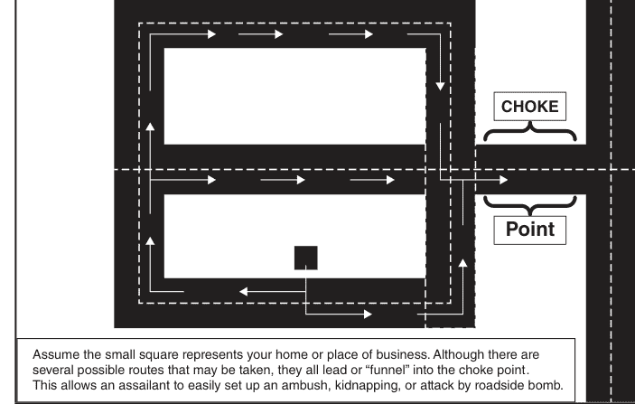

该车已移动到距离他们后保险杠仅有几英寸的位置，有效地将目标夹在两辆便衣执法车辆之间（见图7.2）。目标还没反应过来，武装特工就已经用枪指着他们了。恐怖分子已经学会了这种技术，而且他们会实践。

## 图7.2 双车阻挡法：停车标志或信号灯

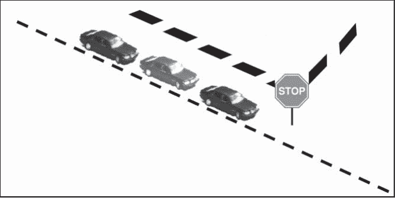

如果你让自己以这种方式被围住，在你反应过来之前，武装袭击者就已经出现在你的车窗外，尖叫着用武器对准你。你的车窗很可能被砸碎，然后你会被持枪者从车中拖出。我们无法教你任何正确的战术反应，让你能毫发无损地逃脱这种情况。即使你携带武器（在国外土地上这不太可能），并且训练有素，在这种情况下你也几乎无能为力。反恐学校教授的一种可能有效的技术是尝试撞击阻挡车辆（通常撞击前方车辆，但在某些情况下则撞击后方车辆）以破解伏击。然而，要成功执行这一技术，你需要一定的空间来提速和机动。始终保持你的车与前车之间有足够的距离，以便在必要时采取这些行动。即使前车开始倒车，只要你在车与前方车辆之间留出足够的距离，你仍然可以做出反应。一些专业驾驶学校教授撞击逃生技术，如果你要前往世界上危险的地区，你可能会考虑参加他们的课程。然而，即使你训练有素，你真的准备好在一个外国国家面对车流中实际撞击车辆了吗？想想在做出这个决定之前，情况得有多么危急。最好完全避免这种情况。我们将在讲解如何察觉监视存在时讨论如何实现这一目标。

## 规则5：留意你后面的车

开车时使用后视镜。如果你成为目标，你会被跟踪。除非你被一个训练极其有素的监视小组盯上，否则跟踪你的人通常会驾驶车辆紧跟在你后面，或者隔一两辆车。经常检查后视镜，留意谁在你后面。同样，我们将在本章后面进一步解释反监视技术。

## 规则6：避免可预测的行程

在家和工作地点之间变换路线。我们已经讨论过在高风险地区改变日常规律的重要性，这同样适用于驾车。避免可预测性会让别人更难跟踪你。记住，如果你被跟踪，那些监视你的人会有一定程度的偏执。如果你的行为让他们觉得你对监视有警觉，他们很可能会转向更容易的目标。即使他们不更换目标，你仍然让他们难以跟踪，并且你会更容易察觉他们的存在。

## 规则7：警惕“围堵”

围堵是执法人员常用的手段，不幸的是，坏人也会用。在双车道的道路上，多个车辆上的袭击者会试图将你围堵起来，方法是一辆车在你前面、一辆在你后面、一辆在你侧面，迫使你停下来（见图7.3）。

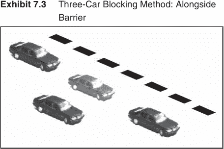

在该图中，三辆阻挡车辆包围了目标车辆。由于屏障阻止了那个方向的逃跑，袭击者需要做的就是堵住前方、后方和开放的一侧。这是一个协调动作，要求三辆阻挡车辆同时减速，迫使目标停车。如果该技术执行不佳，目标可能能够驶出包围圈逃脱。然而，如果车辆以协调一致的方式减速，目标可能发现逃脱很困难（但并非不可能）。除了撞击技术外，反恐驾驶学校还教授学员几种破解这种陷阱的方法。同样，你必须在一所信誉良好的学校里向专业人士学习这些对策。你还必须定期练习这些技巧。

同一攻击的另一种形式可能由四辆阻挡车辆在宽阔、多车道且没有隔离双向交通的硬性屏障的道路上实施（见图7.4）。可以想象，这种攻击执行起来更加困难。如果你看过福克斯电视台的《最惊险警察追捕》，你就会知道即使是训练有素的专业警察有时也很难用这种方式协调指挥停车。

## 图7.4 四车阻挡

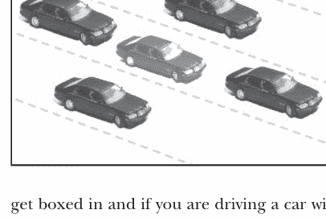

所有这些技术都需要坏人事先进行一定的协调和练习。而且，正如CNN获取的基地组织训练录像带所示，坏人确实会练习。如果你到现在还没有接受这个现实，那就看看那盘录像带。即便如此，如果你保持警觉，就能看到危险来临并驾车逃脱。正如我们所说，即使你真的被围住，只要你开的车有一定质量和马力，你仍然可以使用我们描述的技术破解围堵战术。要意识到逃跑过程中你可能会被枪击。然而，我们宁愿冒着逃跑时被枪击的风险，也不愿被绑架者带走。尽管这种场景可能令人恐惧，但它需要监视和协调，并且可以通过在袭击发生前提前发现坏人来破解。

被围住时，只要你开的车有一定质量和马力，你仍然可以使用我们描述的技术破解围堵战术。要意识到逃跑过程中你可能会被枪击。然而，我们宁愿冒着逃跑时被枪击的风险，也不愿被绑架者带走。尽管这种场景可能令人恐惧，但它需要监视和协调，并且可以通过在袭击发生前提前发现坏人来破解。

## 规则8：避开严重拥堵的道路

只要可能，就避开容易堵车的道路。这说起来容易做起来难，因为堵车在全世界都是现实。如果你所居住国家的道路状况导致你每天在同一地点、同一时间遇到严重拥堵，你必须特别注意变换出行路线。走走停停的交通让你很容易遭到袭击或绑架。记住，摩托车是暗杀中传统使用的交通工具。即使是在拥堵的交通中，摩托车也能让袭击者迅速接近目标。即使在高峰时间，骑摩托车逃跑也非常简单。

## 规则9：寻找安全避风港

在路上行驶时，沿途有警察局的路比没有警察局的路更好。原因很简单：如果你确实需要警察帮助，他们就在附近。其他安全避风港也是如此，例如医院和友好国家的大使馆。

## 规则10：选择照明良好的道路

只要可能，就在照明良好的道路上行驶。光线始终是犯罪的一种威慑。它让你看清前方道路，使驾驶更安全。不幸的是，在世界许多地方，找到照明充足的道路很困难。

## 应急车辆操作

对于任何被视为高风险目标的人或生活在危险地区的人来说，最后一点是：不要仅仅考虑参加应急车辆操作课程（EVOC）；立即参加一个，然后再参加反恐驾驶技术课程。普通公民可以在三到四天的训练中学到很多东西。EVOC课程将教你高速驾驶的基础知识。你将学习安全地高速过弯和转弯。紧急制动技术、变道和高速倒车是反恐驾驶课程的基础。该课程教授学生破解恐怖分子和犯罪分子常用的各种车辆攻击。通常，你将学习如何破解路障、如何逃离伏击、追缉干预技术机动，以及如何在静止状态或高速下反向转向。还将教授高速倒车，以便在无法进行“J”形转弯时逃离路障。即使撇开学习如何防御针对你的攻击这一明显优势不谈

你身处车辆中时，这类课程也会提高你在正常驾驶期间的整体安全水平。请记住，常见的交通事故是三十五岁以下旅行者以及任何年龄健康旅行者的头号死因。你死于车祸的几率远大于成为恐怖主义或刑事暴力的受害者。反恐驾驶技术是你应该认真考虑掌握的技能。如果你有司机、保镖或安保团队，请让他们接受培训。如果你主要依赖当地雇佣的司机，他们的培训至关重要。以下分析更清晰地说明了这一点。

## 巴基斯坦的一起汽车袭击分析

我们分析一起导致五人死亡的悲剧性袭击，其中四人是美国人。通过回顾此类事件并了解犯了什么错误，我们可以防止更多无辜生命的损失。这起事件发生在1997年11月12日的巴基斯坦卡拉奇。虽然我们对在受害者家属无疑仍在感受二十多年后的巨大损失时，对此事件进行事后诸葛亮式的评判感到不安，但我们认为忽视这些事件所能学到的教训的实际价值，会使受害者的死亡变得毫无意义。如果另一个家庭可以免于失去他们的父亲、母亲或孩子，那么从这场悲剧中吸取的教训或许会具有某种积极意义。

在我们讨论这种情况时，请记住我们刚刚描述的规则。我们并不掌握此次袭击的所有事实，但很明显，未能遵守基本车辆安全规则 1、5 和 6（以及下一节讨论的反监视原则）导致了这些谋杀。1997年11月12日，约上午8:00，联合德州石油公司（UTP）的四名员工由公司雇用的巴基斯坦司机从他们下榻的酒店接走。当地司机驾驶的是一辆蓝色四门尼桑旅行车。三名男子住在珍珠大陆酒店；第四名住在喜来登酒店。当车辆离开酒店区域时，它被一辆车内有两三名男子的红色本田思域跟随。据推测，思域在交通中落后于尼桑，司机不得不猛烈地穿梭于车流中才能追上来。令人惊讶的是，尼桑的司机要么没有注意到，要么没有对一辆红色车辆的追踪感到警惕。执法部门和便衣机构通常不会选择红色车辆作为监视车辆，因为它们很容易被认出和记住。在本案中，车辆的颜色并没有起到任何作用。尼桑司机未能注意身后交通，违反了规则 5，即使该车辆颜色鲜艳且驾驶行为不稳定。大约上午8:10，红色思域追上了尼桑，切断了其去路并迫使它停下。一两个持AK-47突击步枪的袭击者从思域中出来，通过挡风玻璃向司机开枪将其杀死。司机的被杀确保了车辆无法逃脱。随后恐怖分子移动到尼桑两侧，通过车窗将四名美国人处决。第三名袭击者可能在思域内部开火。

毫无疑问，四名UTP员工在袭击前已被监视。虽然对此次事件的报道中没有提到此类监视，但可以想见，如此袭击不可能在没有通过实地监视收集先期情报的情况下被策划和执行。据推测，尼桑司机和四名UTP员工都没有察觉到监视的存在。我们在反监视部分详细讨论了如何确定你是否处于监视之下以及反监视措施。

另一个安全漏洞是司机及其乘客未能通过改变行驶路线和出行时间来改变出行模式。没有做出任何努力来避免可预测性，违反了规则 6。除了违反多项与车辆相关的安全规则外，还犯了其他错误。第一个错误，也是最容易纠正的错误，是在高风险地区运送员工时使用适当的装甲车辆。适当的装甲车辆本可以为恐怖分子发射的7.62x39mm步枪子弹提供足够的防护。此外，经过适当训练的司机本可以提高防止此次袭击发生的机会。许多EVOC和反恐驾驶课程教授在操作装甲车辆时使用的各种具体技术；这些课程很重要，因为装甲的额外重量会显著改变车辆的操控特性。反恐阶段的培训教授适当的观察技能，这非常宝贵。此外，这些课程还教授如何击败车辆路障。在实践指导下，击败路障并不难学习。你只需要一辆质量和动力足够的车辆。在本案中，一辆四门旅行车被一辆本田思域堵住。

如果你保持警惕并且封锁车辆位置不当，你可能能够逃脱伏击。你可以在任何专业的反恐驾驶学校学习如何执行这种机动。另一个现在就应该养成的良好习惯是，永远不要太靠近你前方车辆的车尾。确保你停车时可以看到前方车辆的后轮。养成这种常态做法，你将始终在你和前方车辆之间保持足够的空间，以便在遭受袭击时做出反应，即使前方车辆倒车也是如此。

我们的建议是尽量参加那些拥有曾在特勤局、外交安全局、缉毒局（DEA）、联邦调查局（FBI）或中央情报局（CIA）担任执法或情报官员的教官的学校。还有几所紧急驾驶学校，其非特工教官曾在备受尊敬的学院任教，例如FBI/DEA学院、联邦执法培训中心，或马里兰州贝尔茨维尔的特勤局学院。通过接受培训或让你的司机接受培训，你可以显著提高在即使是经过精心策划和协调的袭击中幸存的机会。你将学会如何躲避和逃脱。此外，你还会学到汽车如何被用作武器。你的汽车是一辆以高速行驶的数千磅重的物体。简单地撞向封锁车辆，甚至反复撞击，都可以使袭击者失去行动能力，甚至可能杀死他们。不用说，碾压武装恐怖分子将使他们永久性地无法继续作案。需要记住的一点是，如果你驾驶的是装甲车辆，防护装甲会增加很大的重量：此类车辆的悬挂系统经过增强以适应额外重量，但正如所讨论的，其操控特性将与普通车辆截然不同。如果你计划参加驾驶课程，你需要使用自己的装甲车辆或找到拥有此类车辆车队的学校。

其他安全漏洞也导致了UTP员工的被杀。本案的袭击者是穆特希达人民运动的成员，一个激进的伊斯兰组织。袭击发生的时机，就在巴基斯坦人米尔·艾迈尔·坎西在弗吉尼亚州费尔法克斯因1993年在CIA总部谋杀两名CIA雇员被判处死刑后一天，使调查人员将两起事件联系起来，并将卡拉奇的杀戮定性为报复性恐怖行为。两名巴基斯坦国民在巴基斯坦被逮捕、审判并被定罪。参与其中的该组织其他成员仍在逃。2002年11月，坎西因其罪行被弗吉尼亚州处决。美国国务院在UTP员工被杀之前立即警告了美国人在巴基斯坦可能遭受袭击的可能性。通过听从警告并推迟旅行，本次事件本可以避免。

美国国务院预计，每当美国或以色列对恐怖分子采取打击行动时，就会发生此类报复性袭击。如果你真的担心以这种方式被袭击，你将需要为你的车辆装甲并学习

## 反监视

反恐驾驶技术。通过将这些行动与遵守其他基本车辆安全和路线选择规则相结合，你可以大幅降低被针对的风险。虽然这些措施看起来可能很极端，但要防御有组织的武装车辆袭击，别无他法。

大多数恐怖分子和罪犯的行动并非随机或草率进行。几乎所有恐怖主义和刑事袭击都先于一个预作战阶段，在此阶段会收集有关目标的情报。通常，恐怖分子会编制潜在目标清单，他们认为这些目标会促进其政治目标。潜在目标包括军事设施、经济中心、平民人口中心以及特定个人。许多目标是根据其原籍国选择的，美国和以色列公民是最理想的目标。确切的选择程序本身尚不明确。然而有一点很清楚，那就是恐怖分子在获得与行动可能成功或失败相关的广泛信息之前，不会将资源投入到袭击中。即使是像个人暗杀或绑架这样的小规模行动也是如此。基本上，恐怖分子进行的是可行性研究的等价物。

2002年10月27日，在约旦安曼被暗杀的美国外交官劳伦斯·福利的悲惨谋杀案，不幸地提醒了这一事实。福利在离开住所时被枪杀。据美联社电讯报道，他的袭击者在动手前已对他进行了一段时间的监视。报道引用了一名约旦警察官员的话说：“这起杀戮似乎是由专业人士实施的，他们已跟随福利一段时间以确定他的日程安排。”福利是一名职业外交官，60岁，是美国国际开发署的高级行政人员。他的职责涉及帮助约旦人民发展仅为他们自身利益的项目。除了他是美国外交官这一事实外，恐怖组织杀害这样一个人有什么可能的动机？答案很可能是，他们杀害福利没有任何具体理由。很可能，他们的目标是杀害与美国大使馆有关联的任何人。恐怖分子对使馆人员进行监视，并根据他提供的机会选择目标。这意味着他们会寻找日程安排规律且可预测的目标；没有安全保护且似乎对监视的存在并不明显的人。福利很简单地被谋杀了，因为恐怖分子认为袭击他会使他们面临最低的风险。

当你阅读这本书时，网上绝不会缺少针对恐怖分子的“如何操作”指导手册。许多激进的伊斯兰网站发布了题为“如何绑架美国公民”的指南，这不过是对哈马斯最初出版的“如何绑架以色列人”的改写。这份“指南”的大部分内容都花在讨论在尝试之前如何收集有关潜在目标的情报上。这种“信息收集”指的是对预定受害者的实地监视。恐怖分子花费数月甚至数年研究目标和潜在的攻击方法。他们在做功课方面变得相当熟练。他们大量使用互联网搜索照片和建筑蓝图。他们查阅公共文件。他们支付信息费用，与我们政府和执法机构支付线人信息的方式大致相同。然而，没有什么可以替代获取直接信息和查明地面事实。广泛使用监视是情报收集过程中的一个组成部分。恐怖分子使用的方法与执法和情报界人士使用的方法有很多相同之处。他们租用可直接看到潜在目标的公寓。他们拍摄并跟踪绑架或暗杀的潜在目标。

普通罪犯也进行一种监视，尽管规模远没有那么复杂。考虑入室盗窃的罪犯会先观察地点，有时只有几分钟，有时则长达数月。在执法术语中，这被称为“踩点”潜在目标。一些犯罪组织和个人会出于纯粹的刑事目的对个人或地点进行广泛监视。

我们在第6章提到，俄罗斯的一些有组织犯罪团伙在莫斯科机场蹲守，寻找富有的外国人作为受害者。通常，一名或多名步行人员会观察乘客下机情况。识别有钱人并不困难，尤其是那些忽视不要显得过于张扬或富有的一般规则的人。机场工作人员可能会进行步行监视。空乘人员在长途飞行中有大量时间，甚至可能是对目标潜在价值进行初步评估的人。然后只需简单地跟随目标到酒店即可。当地出租车司机可能会被指派接那个人；因此该团伙无需多次车辆监视就能确切知道他/她住在哪里。无论如何，该人已被确定为抢劫或财产盗窃的目标，而罪犯进行的情报收集几乎保证了成功且有利可图的结局。目标可能是等待几天，直到那个人外出，然后进行简单的抢劫。或者罪犯可能会只确定酒店和房间，等待那个人外出，然后进入无人房间并偷走留下的贵重物品。无论如何，无论肇事者是恐怖分子还是普通罪犯，监视探测的相同原则都适用。

## 监视司空见惯

长期以来，对居住、工作甚至在国外旅行的美国人和西欧人的监视一直很常见。经常与外国情报官员进行的监视有关，他们寻找与受试者在该国停留的 stated 原因不一致的活动。更常见的是，监视的对象可能完全是商业性质的。最高级别的商业间谍活动是由受过最高级别训练、拥有无限资源的政府特工进行的。商业间谍活动对收集情报的政府来说价值数十亿美元，我们的客户过去曾是此类监视的目标。这种情况将继续存在，政府行为者、恐怖分子和罪犯进行的监视已成为常态。

正因如此，国家部在安全海外研讨会的一部分中为海外政府雇员提供反监视指导。此外，该部门还认识到对在海外工作的平民公司非政府雇员进行教育的重要性，并为平民也提供此类培训。为此，该部门发布了《在海外工作的美国人的安全指南》，强调了解周围环境以检测可能监视存在的重要性。虽然该文件已不再可用，但下一节将教你如何做到这一点。

## 什么是监视？

监视到底是什么？监视其实不过是收集信息，通常来自实地观察或电话、传真、电子邮件或无线电通信的拦截。监视的具体目的是汇编与目标的行动、关联和活动相关的情报。在执法中，监视的目的是

获取证据或情报，通常是为了支持对目标对象的刑事起诉。在特殊情况下，执法部门使用监视并非为了起诉，而是为了收集有关涉嫌外国特工、有组织犯罪或其他国内颠覆团体的情报信息。恐怖分子和/或犯罪分子将监视作为实施犯罪或恐怖袭击的前奏。

监视可以通过多种方式进行。既可以使用人力监视，也可以使用技术监视（利用技术追踪或监控目标）。“人力监视”通常指观察监视对象的活动和动态。监视可以是移动的，也可以是固定的，但通常是两者兼而有之。移动监视包括在徒步、驾车或两者结合的情况下主动跟踪某人。目的是追踪目标对象的行动：确定他们去哪里、行进路线、做什么以及会见谁。“固定监视”是指监视人员从固定地点观察目标对象。可以从相邻建筑物、停放的车辆，甚至徒步的固定位置进行。

图表7.5展示了一个以停放的车辆作为监视点（即“眼线”）的典型固定监视设置。注意目标车辆与监视车辆之间的间隔车辆数量。这种间距使目标不太可能察觉监视的存在。街道的弯曲也利于监视者，因为它允许从隐蔽位置观察车辆整个驾驶员一侧。还要注意，这条街道是单行道。监视点车辆只需通知其他监视人员目标已上车并正在离开。其他单位可以在目标已知或预计的路线上更远的地方等待，以便在远离目标住所的地方接续移动监视。

## 图表7.5 固定监视

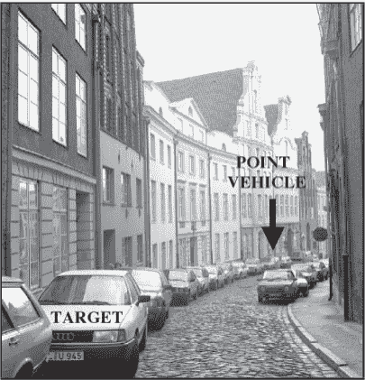

## 识别监视：黄金法则

让我们讨论你可能被跟踪或以其他方式受到监视的常见方式。通过了解这些技巧，你会对要观察什么变得敏感，并能识破除最精密监视之外的一切企图。

你怎么知道自己是否被跟踪？首先要注意的是你的警觉程度。如果你在“白色状态”下四处游荡（参见第1章的颜色代码定义），即便是最拙劣的监视你也会毫无察觉。注意你的周围环境。这是最重要的一件事。判断你是否成为监视目标的核心法则是：*如果你在时间和距离上至少三次看到同一个人或车辆，那么你就可以假设自己被跟踪了。*

监视是一门艺术，而非科学。其目的是在不被察觉的情况下观察某人。实施监视的个人或团队技能越高超，你就越难意识到他们的存在。我们先讨论人力移动监视——步行或驾车跟踪某人。对这一技巧的讨论会让你理解监视是一门艺术的说法，也会让你对标准监视技术有一个基本了解。

## 监视方法

让我们假设你正被恐怖分子跟踪。也许你是一位知名商人，被选定为可能绑架的目标。恐怖分子决定跟踪你，以评估你的安保水平，并选择抓你的最佳时间和地点。如果你一直遵循前面给出的建议，你应该显得相当警觉，并留意周围发生的一切。如前所述，这一点本身就可能促使坏人去寻找更容易的目标。但假设他们开始跟踪你。通常，监视会从他们认为与你相关的某个地点开始。如果他们的情报使他们能够确定你的住所，他们可能会从那里开始。如果不能，那么他们很可能会试图从你的工作地点开始接近你。监视的初始阶段会有人从固定地点观察你——也许是在你家街对面停放的汽车里，或是在附近一处能很好观察你的公寓里。记住，他们不需要在物理上靠近你。

只要有一副不错的双筒望远镜，他们就能在视野清晰的情况下保持相当远的距离。例如，如果你的家位于一个只有一条路可走的地方，他们甚至不需要在你家监视你。他们可以安排人守在你必经的十字路口，从那里开始监视。顺便说一句，这个阶段给了你第一次发现他们存在的机会。即使你在一个地方只住了很短时间，你也会开始留意那些看起来不寻常或不合时宜的事物。例如，一辆陌生的车辆停在你所在的街道上，可能表明你正被监视。

假设你进入自己的车辆并开始开车去某个地方。如果你被跟踪并且对周围环境保持警觉，你将获得第二次发现他们存在的机会。这很大程度上取决于跟踪你的人数和他们的技能水平。记住，监视需要技巧。坏人需要在试图避免被观察的同时看到你。

最容易识别的监视是单车监视，尤其是跟踪者不是特别熟练的时候。你开车驶上你的街道，一辆停在你所在街区路边的车立刻启动，汇入你身后的车流。如果此人单独行动，就需要时刻保持你在他/她的视线内。那辆车会一直跟在你后面，并匹配你的速度。你转弯，它就转弯。如果跟踪你的人完全无能，他/她会紧贴你的保险杠——一直紧跟在你正后方。如果你变道，那辆车也会跟着变道。显然，这种行为应该很容易被你注意到。你通过侧视镜和后视镜观察，并在心中记下谁在你后面。如果一辆车的几次动作都与你匹配，那么就值得更密切地关注它了。通过几个简单的操作，很容易确认一辆车是否在跟踪你。同时，重要的是不要向跟踪你的人暴露你已察觉他们的存在。我们将在本章后面讨论绕行街区、变换车速等技巧。

一个单独跟踪你的人如果监视技巧娴熟，可能会更成功。一个有能力的跟踪者不会紧贴你的保险杠，而是与你保持谨慎的距离。他会从错开的位置跟着你，而不是在你正后方。例如，你在高速公路上行驶在左侧车道。监视车辆在你后面几辆车之后，被右侧车道的其他车辆遮挡。司机可以观察你，而当车辆不直接在你正后方时，你不太可能发现跟踪。如果你开始变道准备出高速，此人正好位于右侧车道，无需变道即可驶出，然后跟着你上匝道（见图表7.6）。

## 图表7.6 从错开位置跟随的监视点车辆

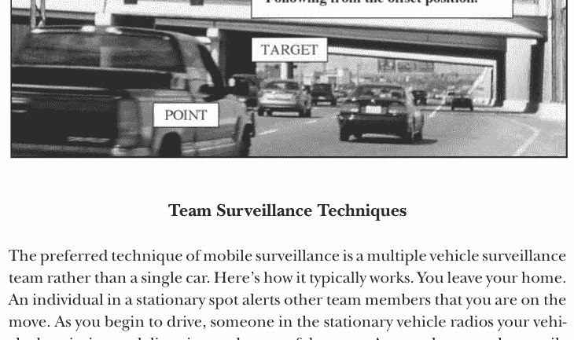

## 团队监视技术

移动监视的首选技术是多车监视团队，而不是单车。典型的运作方式如下。你离开家。一个处于固定位置的人提醒其他团队成员你已开始移动。当你开始驾车时，静止车辆中的某人通过无线电向团队其余成员通报你的车辆特征和方向。然后，第二辆车可以轻松、流畅且不引人注意地插到你后面。其余团队成员保持距离跟随，并准备按照监视负责人的指示占据监视点位置。例如，假设你正驾车行驶在一条繁忙的街道上。在车流中，跟踪你的人很容易融入路上其他车辆而避免被发现。然而，假设你转弯进入一条车少的小路。领头车可能会随你转弯并保持监视点。但在这种安静、车流量小的区域，你更容易注意到有车跟在你后面，因此领头车司机会更加谨慎。领头车会一直跟着你，直到司机感到需要脱离以避免被发现。也许领头车会保持接触，直到你准备再次转弯。此时，领头车必须选择是否再次随你转弯。如果领头车决定脱离以避免被发现，司机会通过无线电通知排在其后的下一辆车（通常称为“替补”），让它转弯。领头车直行，一张新面孔的司机则占据监视点位置。此过程……

is repeated frequently, with surveillance cars switching off to avoid having the same car follow for too long.

The more cars that are used, the harder it is to spot their presence. Harder, but certainly not impossible. How can you pick up on the presence of surveillance vehicles if multiple vehicles are used? There are several ways. First, if you pay attention to the cars around you, you may notice the same car reappearing behind you at regular intervals. Remember, this technique is only as good as the people using it. For example, one member of the surveillance team may possess less skill than other team members and may remain as the point vehicle for too long. Even skilled surveillance agents are sometimes forced to hold the “eyeball” because their alternate is too far back in traffic to help out and the choice is to risk detection or risk losing contact with the target. If this happens, you will have the opportunity to pick up on the surveillance.

Other group surveillance methods require a higher level of training and more surveillance vehicles. For this reason, these methods are more likely to be utilized by professional intelligence officers or specialized police units. These techniques are used by premier American law enforcement agencies, such as the DEA and FBI. Agencies or groups that are superbly trained will use numerous surveillance vehicles, stationary surveillance points, cars running along parallel streets and even ahead of the target.

The system shown in Exhibit 7.7 is extremely effective because prepositioned vehicles cover every possible route that the target can take. The wide coverage makes it unnecessary to take turns with the target. Think about it: If you are driving and there is one car behind that mirrors your movements, you will take notice and you will identify their presence quite rapidly. Identification of trained teams is much more difficult because they keep placing different cars behind you. Identification is even more difficult if team members stage themselves in positions along your route and simply alert other members by radio that you have just passed a particular location. Teams using six to ten cars will be hard to detect.

Commonly available technology can make matters even worse for anyone trying to detect the presence of surveillance. If a team augments its surveillance with electronic tracking devices, it may be almost impossible to detect. However, once again, all it takes is a little human error to blow the entire operation. You still have an advantage because you know what is usual for your surroundings. Keep alert. Remember the rule: If you see the same car or individual three times separated by time and distance, you are being followed. Again, it is difficult, if not impossible, to conceive of terrorists or common criminals using some of the more sophisticated surveillance techniques. If you are the subject

## Exhibit 7.7 Moving Box Surveillance

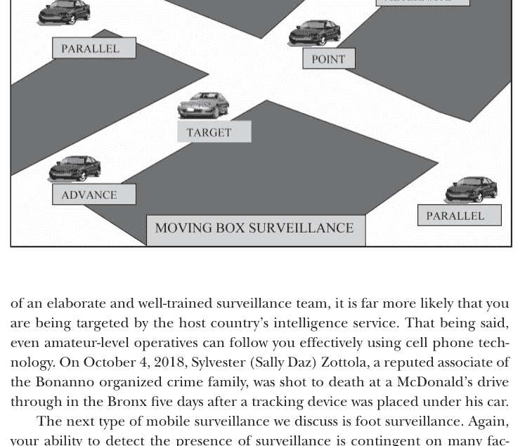

of an elaborate and well-trained surveillance team, it is far more likely that you are being targeted by the host country’s intelligence service. That being said, even amateur-level operatives can follow you effectively using cell phone technology. On October 4, 2018, Sylvester (Sally Daz) Zottola, a reputed associate of the Bonanno organized crime family, was shot to death at a McDonald’s drive through in the Bronx five days after a tracking device was placed under his car.

The next type of mobile surveillance we discuss is foot surveillance. Again, your ability to detect the presence of surveillance is contingent on many factors. How many people are on the street? Is there anything particular about the appearance of the person following you? Unusual dress or physical characteristics will obviously help you figure out that you are being followed. You would be far more likely to observe Dennis Rodman following you than you would Dennis Franz. By the way, this cuts both ways. Remember the advice in Chapter 1 about dressing and behaving conservatively? If you are sporting pink hair, you are not going to blend in—unless you are in certain neighborhoods in Los Angeles, New York, or London.

Foot surveillance techniques can be similar to the techniques used in a mobile surveillance. A team is more effective than a single-person surveillance operation. One person follows on foot, not too closely behind you. The person may be following in an offset fashion by walking behind you on the other

side of the street. When you turn, the tail does not but rather allows the alternate to pick you up. Once again, the technique is only as good as the individual operative’s skill level. The same mistakes that allow you to identify mobile surveillance hold true in regard to foot surveillance. It is also likely that anyone following you will need to remain in radio contact with other team members still in their respective vehicles. Years ago, agents in law enforcement agencies used miniature microphones either clipped inside their lapel or built into an earpiece, allowing operatives to use the same equipment to transmit and listen to responses or other radio traffic while in their vehicles or on foot. Today, with the prevalence of cell phones, it is no longer necessary to use clandestine microphones to transmit while following someone on foot. It is commonplace to see people walking down the street and talking on their cell phones. This will not be something that will catch your attention. However, if the cell phone activity is coupled with other patterns of behavior consistent with someone conducting surveillance, it may indicate that you are being followed by a team using both vehicular and foot surveillance techniques.

## Technical Surveillance

The most effective surveillance combines physical surveillance techniques with technical surveillance. This allows for the most complete acquisition of information with the lowest probability of detection. Surveillance conducted in this manner by a professional and well-trained team can be extremely difficult to detect and defeat.

“Technical surveillance” is a broad term that refers to the use of electronic or optical equipment to gather information. The range of such equipment is vast, including cameras, listening devices (bugs), tracking transmitters, infrared and microwave radiation, parabolic microphones, cell phone tracking, and wiretapping. Although these devices do not replace the need for physical surveillance, they certainly provide a substantial addition to the effort. The use of eavesdropping equipment, for example, can allow people to gather information that would otherwise have been impossible to collect. The use of a simple video camera can allow a particular location to be monitored by a signal transmitted to a point remote from the actual site of the surveillance. Most video surveillance systems are internet based anyway so they can be monitored from anywhere there is connectivity.

Generally, stationary and mobile surveillance techniques are used in tandem. However, if the subject appears to be surveillance conscious—that is, if

he or she takes precautions to avoid being followed—then a stationary surveillance method may be used exclusively. This method also may be utilized quite effectively with technical surveillance techniques, such as wiretaps.

Let us assume that a stationary surveillance is set up on the residence of Subject A in conjunction with a wiretap on Subject A’s phone. The wire tap intercepts a call where Subject A arranges to meet someone at a particular location later that day. Stationary surveillance may then be set up at the location of the anticipated meeting. This technique seemingly avoids the necessity of following Subject A from his or her residence to the meet location. However, surveillance agents would still attempt to follow Subject A to the meet location in order to see where the subject went before the meeting. Perhaps the subject went to another location and removed a package from an unknown residence that would be transferred at the meeting. A thorough surveillance technique would try to see if that is, in fact, what happened.

This scenario is quite common in narcotics investigations. Therefore, it is standard practice in the DEA and other law enforcement agencies to keep a subject under constant surveillance even while a wiretap is operative. Telephonic intercepts may not provide all the information that is needed. For example, a DEA wire tap may reveal that the subject is going to meet someone to conduct a drug transaction. If the subject is a supplier, for example, it may be clear from the intercepted conversations that he or she is going to deliver a large quantity of drugs to a customer. It is common for drug dealers to keep their supply of narcotics in a safe location known as a stash house. If the location of the stash house is unknown and it is believed that the subject will go there before the meeting, surveillance will try to follow the subject from the residence to find where the drugs are being stored. They will combine a wiretap and other technical surveillance techniques with an aggressive physical surveillance. Remember, tapping a phone is far easier in many countries than it is in the United States. In addition, it is not all that difficult to place a transmitter in a vehicle or other location to eavesdrop on your conversations. The technology needed to accomplish all of these things is available online or at your nearest spy shop.

Surveillance is frequently augmented with video cameras. This is a bit high tech for the average criminal or poorly trained terrorist, but it is certainly within the grasp of well-funded and well-trained terror groups. Needless to say, if you are being targeted by an intelligence service of a foreign country, expect them to rely heavily on such devices. As we noted, it is also quite easy to place tracking devices on your vehicle, which gives the opposition the luxury of being able to track your movements on a map accurately to within several feet. These devices can also measure the target’s direction of travel and speed and show which

intersection he or she is approaching. The use of this type of technology is likely to go unnoticed (unless you engage a professional service with equipment that can detect the presence of active or passive equipment). That is the bad news. The good news is that it is extremely unlikely that any terrorist cell, no matter how well funded it is, will have this type of equipment. And even if the terrorists do have such equipment, there is always the human factor to consider. A mistake by surveillance operatives can compromise even the most elaborate operations. In fact, an alert subject can observe and compromise even a competent team after only a single mistake. In law enforcement parlance, this is referred to as “burning the surveillance” or simply “getting burned.”

What should you do if you believe you’re being followed or monitored? The general rule is to avoid making it obvious to those watching you that you are aware of their presence. This is recommended for a number of reasons, the first being your own personal safety. We certainly recommend that you appear to be an alert and cautious person to anyone trying to follow you. You will remember the story of the army sergeant in Chapter 1 who was crossed off a terrorist hit list because he seemed to be alert to possible surveillance. Projecting a sense of awareness may very well mark you as a difficult target, and you may be passed over for an easier one. However, if you do detect surveillance, here are a few pointers:

- Do not change your routine. Look as if you are going about your business oblivious to the presence of surveillance.
- Stay in well-lit and populated areas only.
- Do not stare at the people following you or attempt evasion unless you have reason to believe an attack on you is imminent.
- Calmly proceed to a safe haven like the U.S. embassy (or an embassy of a friendly nation), a hospital, or a police station.
- Contact the regional security officer (RSO) as soon as possible.

The reason not to show that you are aware that you are being followed is that you do not know how they will react. Therefore, it is prudent not to provoke any reaction. It is conceivable, not likely, but possible, that you are being followed in order to be assassinated. Any action you take may cause those following you to attempt to kill you rather than allowing you to escape. Perhaps you are being followed by the country’s intelligence service or by local police. Alerting them to the fact that you have become aware of their activities may cause an unwelcome reaction. You may be taken into custody for interrogation or you may receive a beating. A friend of ours who worked as an agent for the Diplomatic Security Service related a story about agents finding surveillance devices in hotel rooms they were staying in while in Russia. The agents tore out such devices only to find the tires on their vehicle slashed the next morning. The message being delivered was “You know the game, and you need to play by the rules.”

What is the correct response when you realize that you are being followed? The Department of State recommends that you contact the embassy or consulate immediately. The embassy RSO will decide whether the local authorities need to be notified or whether to handle it in-house. This decision will depend on several factors, most important of which is the level of mutual cooperation between the embassy and local authorities. In some countries, the relationship is less than cooperative, and, as mentioned, it may well be that the local police or intelligence agencies are the ones following you. This is particularly true in many developing nations, where corruption is rampant and the police sometimes are working for the bad guys. The embassy will know whether that is likely and will proceed accordingly.

How can you check whether people are following you? Remember, your goal is to identify that you are being followed without tipping your hand. During David’s tenure with the DEA, he participated in hundreds of surveillance operations. Sometimes the surveillance would get burned. Targets wouldn’t do anything to tip their hand but later confided to an informant or an associate on a wiretapped line that they were being followed. Occasionally a bad guy would write down a license plate number and get a motor vehicles check done on it. DEA vehicles were “flagged” with the local motor vehicle department, and the state authorities would notify the agency if someone ran the plates. On rare occasions a target would try to confront a surveillance agent or simply wave, acknowledging the agent’s presence. The object of surveillance detection for our purposes is never to confront those following you but simply to figure out that you are being followed without the surveillance team realizing that you did.

Many techniques are effective for picking up the presence of people following you. Counterespionage schools and schools specifically designed to teach criminals to watch out for surveillance exist. Years ago, Colombian cocaine traffickers began mandating that their workers abroad attend these schools to prevent them from getting arrested in possession of millions of dollars in cash or drugs. In schools operated by expatriate Americans, Cubans, Israelis, and Russians, students were trained to drive in a manner designed to frustrate surveillance.

The premise of these techniques is actually quite simple: Do things that are unusual and see if anyone does the same thing. For example, one such technique is called squaring the block. Drive to an intersection and turn right (or left). Drive to the next intersection and make another right (or left). Repeat the process two more times and you are back where you started, going in the same direction. This is certainly an unusual move to make. Look in your rearview mirror. Is anyone doing the same thing? If so, you may be being followed. Remember, the fact that this is an unusual move will not be lost on the surveillance team. If you do this maneuver, it is best to disguise your purpose with a plausible excuse for the series of turns you make. Let’s say you drive past a side street with a Starbucks on the right. Continue to the next side street and turn right. Take the first available right and turn again. Making another right will put you on the street with the Starbucks. Notice if the car you suspect made those turns with you. In any case, pull over and grab a coffee, which provides an explanation for the series of turns you made. When you leave, notice if the same car leaves with you. Remember that the team could have put another car in its place.

Another method is to drive into a store parking lot and see who follows you in. Does the same vehicle leave when you do? (Remember that if multiple vehicles are used, someone in another vehicle may follow you out.) If you are on a highway, try to vary your speed. Does anyone seem to slow down or speed up with you? By the way, one of the most effective ways to compromise surveillance is by driving on a highway below the posted limit. In point of fact, most people routinely break the speed limit. If you are driving at an almost painfully slow speed, most people will pass you. See who does not. It is very difficult to slow down enough to stay behind someone under those conditions. Surveillance operatives often have the lead car pass and exit the highway when possible. The alternate stays comfortably back to allow for distance to be eaten up slowly if it must eventually pass the subject. The more effective method is to use a helicopter to stay with a subject looking for a tail. Another effective method is to use tracking devices. If the folks on you are this sophisticated, then you have a problem.

Use your rear- and side-view mirrors but not in a way that makes it clear you are aware you are being followed. Casually notice cars around you, especially cars that seem to mirror your movements. If you are able, jot down their license plate numbers. An easy way to do this is use the text-to-speech function on your smartphone. If you are paying attention, detecting surveillance is not all that difficult to do. Remember, your goal is to detect the presence of surveillance without doing anything to indicate that you are aware that you are being followed.

There are many more aggressive ways to “burn” surveillance. Some people suggest that you let your tail follow you down a one-way street or that you radically change speed or change lanes repeatedly. You may exit a highway and then immediately reenter back onto the same road. Double back along your

route. Avoid using these and other such methods; while they are very likely to reveal whether you are being followed, they alert those following you that you are aware of their presence. You need to be very low key and select only those techniques that don’t advertise the fact that you are checking to see if you are being followed.

When you are being followed, you are at risk. Stay calm, try to confirm your suspicions, and do nothing to confront or antagonize the people who are tailing you. You have the advantage as long as the bad guys believe they are invisible. Once they realize that you know they are there, they can change from surveillance to assault, if that is their ultimate purpose.

If you find yourself the subject of surveillance, you need to start to “what-if” the situation. If you are attacked, where can you go for help? How far is it to the embassy or consulate? Are the local police likely to assist you?

The first and best choice, when possible, is to drive immediately to the embassy, where you will be safe and where you can speak with the RSO or a subordinate. That person will advise you what to do and will notify whatever local authorities he or she deems appropriate. If the officer believes that you are in imminent danger, he or she will assist you in safely leaving the country if necessary.

## ADDITIONAL VEHICLE SAFETY MEASURES

We have covered route selection and countersurveillance so now let’s discuss specific threats while driving. Attacks can come in many forms: car bombs, road bombs, drive-by shootings, ambush, roadblocks, and carjacking, to name but a few. You must appreciate the dangers that driving abroad may present and learn to minimize those risks. Before we go into detail about specific security-related issues, we want to reiterate the point that the greatest danger to Americans who are driving overseas is traffic accidents. It is estimated that at least 200 Americans die each year in traffic accidents overseas. In fact, traffic accidents abroad kill far more Americans each year than disease, violence, or terrorism. According to the Association for Safe International Road Travel (ASIRT), “The chances of being killed on the roads in countries to which many Americans currently travel is from 20 to 70 times higher than in the United States.”

All internationally bound Americans should consult ASIRT. It provides excellent analysis of road and travel conditions around the world as well as detailed information about the road conditions, driver behaviors, patterns of

traffic, seasonal hazards, night travel, medical care, and traffic safety statistics. A visit to its website (asirt.org) is highly recommended.

### Vehicle Preparation and Selection

When driving abroad, the absolute first step to take is to make sure that whatever car you drive is reliable. Most parts of the world do not have the Automobile Association of America or roadside assistance. Your vehicle must run well and reliably. Maintenance is an absolute necessity and is far more important than it is in the United States. You must be sure that oil is changed, belts are replaced periodically before they exhibit excessive wear, and your car undergoes frequent engine inspections. If you are renting a car, select one with low mileage and from a reputable company. Rent a make and model common to the country. Avoid choosing a vehicle that would clearly mark you as being affluent or a tourist, but do select one with the best crash rating available. Since, as we’ve said, more Americans abroad are killed in traffic accidents than are the victims of terrorism or street crime, you need to make sure the vehicle is equipped with seat belts and air bags as well.

Is there anything about the rental car that will identify it as such to an interested observer? In the past it was common in the United States to issue license plates that clearly identified the cars as being rentals. (The situation is less common today.) Are there markings of that sort on the vehicle you are renting? Recall our discussion about how predatory criminals in the United States looked for the license plates that indicated that vehicles were rentals. This is equally true, and perhaps even more so, abroad. As we have repeatedly noted, to a criminal in a developing country, an American tourist or resident is far more likely to have something worth taking than a local citizen. In many countries, most locals cannot afford to rent a car; affluent tourists and foreigners are the predominant customers of car rental companies.

Drive with the doors locked and, whenever possible, with the windows closed. Make sure the climate control system works. If you are in a country in where air conditioning in cars is not common, you will have to drive with windows open, which places you at greater risk.

### Secure Your Valuables

It is always sound advice to secure your valuables and not leave anything worth stealing in plain view even when you are in the car and driving. Many people

have enough sense not to leave their wallet, camera, or other items that will attract the attention of a would-be thief in a parked car. You must get in the habit of securing your valuables even when you are driving. Often criminals post themselves at heavily trafficked intersections and observe the interior compartments of vehicles as they pass. Once they see an item of interest, it is a simple matter for them to smash the window, grab the object, and disappear into the crowd before you even have time to react. Thieves on motorcycles or motor scooters routinely drive in between lanes of traffic. How difficult would it be for someone on a moped to reach into your open window, grab your purse or wallet on the seat next to you, and escape? Professional thieves make their living doing this every day. Furthermore, by having some item of value visible in the car, you also may attract the attention of a nonprofessional who may seize on the opportunity that you have presented. You can easily prevent these crimes of opportunity. Remember, in many parts of the world, the monthly salary of a factory worker putting in a fifty-hour workweek equals what you may pay to have dinner with your spouse at a fancy hotel restaurant. Your brand-new digital camera or laptop or phone on the front seat is equal to several months’ wages. Don’t tempt locals with unnecessary displays of affluence.

### Recognize a Setup

In case this point isn’t already obvious, you should never pick up hitchhikers or stop for any reason in an area that is not populated and well policed. Often female hitchhikers induce cars to stop. Then the drivers are victimized by the hitchhiker’s companions who were hidden nearby. Do not offer to give a ride to anyone whom you do not know well. Criminals have unlimited numbers of ways to deceive motorists into stopping and provide them a chance to strike. These techniques are common wherever there are criminals; that means everywhere. A technique that is often tried at night in the United States is called the stop sign bump. Criminals select a motorist. Perhaps the car is a valuable model; if a sexual crime is being attempted, the driver is a female driving alone. When the targeted vehicle approaches a stop sign and comes to a halt, the criminal’s car gently moves up close behind and lightly bumps the target vehicle. In almost every case, the driver of the “accidentally” struck vehicle stops and gets out to check the damage, exchange license and insurance information, or yell at driver who just hit him or her. That is exactly what the bad guy is counting on, and that is when he will strike. If this happens to you, do not stop on the road. Drive to the nearest area of safety, such as a police station or hospital, and stop there.

Often the bad guys pose as good Samaritans themselves. A few years ago in Long Island, New York, a series of sexual assaults were perpetrated by a man who prowled the highway looking for females driving alone late at night. The assailant would pull alongside the victim’s car and start shouting that there was something wrong with her tire. The man was clean cut and well dressed and seemed sincere and concerned. The driver would pull off the road to check what was wrong, with the “good Samaritan” pulling in behind and offering to provide assistance. That is when the women were raped. Do not stop anywhere you would be vulnerable to attack. Drive to a safe place and then check your tire. Sometimes criminals pose as injured victims themselves. Concerned drivers who stop to offer assistance are assaulted.

Contact the local embassy or consulate for information to prepare yourself against local crimes involving vehicles or otherwise. A particular country may have recently experienced a rash of carjackings that follow a particular pattern. Being forewarned is truly being forearmed. Learn how the criminals operate, and you can protect yourself through vigilance and proper avoidance measures. Another thing for you to always bear in mind: Criminals frequently work in groups. Just like a pickpocket who uses an accomplice to “accidentally” bump the victim while the pocket is being picked, thieves, robbers, carjackers, and the like also use others to distract or deceive the victim.

### Vehicle Safety Check

We mentioned before how important it is to be aware of your surroundings and to change your routine frequently. These are things we can control. Unfortunately, there are other things we can’t control. We can’t watch our car all the time or always park it in a secure parking area. Criminals and terrorists who might want to attack us know that and may try to use your unattended car as a tool to fulfill their goal. Although we can’t watch the car all the time, the minimum we can do is to check it before we get in. The following discussion deals with the necessity and method of checking your vehicle.

It is good practice to give your vehicle a quick safety check anytime you are going somewhere. Do this prior to your trip, in a safe area. Check the tires for wear, low pressure, or flats. Check the spare tire as well. Also examine fluid levels and the condition of the engine belts. In many areas of the world, the danger of becoming a bombing victim is all too real. Therefore, it is necessary to physically examine the vehicle for explosive devices. This may seem to be an inconvenience, but to quote one of Tom Clancy’s characters in The Hunt for Red

十月，“追求安全没有奢侈可言。”那么，何时应该进行这样“奢侈”的检查呢？

## 停车

你会把车停在哪里？你的住所是否有车库或安全停车场？工作地点的停车场是否安全，还是公众可以随意进入？如果可能的话，尽量不要在街上停车，而应使用信誉良好且值得信赖的停车场。显然，如果你必须把车停在街上或不安全的停车场，那你将面临更大的风险。如果你厌倦了崭新的笔记本电脑，就把它留在车里吧——很快你就会再去买一台新的。此外，尽管从统计数字来看，普通犯罪对你构成的危险大于恐怖袭击，但使用安全的停车设施也能在这一方面提升你的安全。汽车炸弹可以迅速且不引人注意地安装到车辆上，但通常潜在的炸弹袭击者需要一点隐私才能将其固定。也许攻击者想要通过破坏你的发动机或电气系统，或者割破你的轮胎来使你的车辆瘫痪。这类活动在黑暗偏僻的街道或安静公共车库中远比在受保护的私人车场内更容易得手。你把车停在什么地方，确实决定了你需要对它进行多大程度的检查。正如我们已经指出的，一般规则是：每当你没有直接看到你的车时，就必须检查它。例如，如果你在美国大使馆工作，并将车停在有经过审查的安保人员看守的安全车场，那么你也许可以免去全面细致的检查。但如果你把车停在潜在攻击者可以不受阻碍地接近车辆的任何地方，你就至少需要做一次粗略的检查。在你轻视这种做法的重要性之前，请记住恐怖分子为何经常选择汽车炸弹袭击。因为汽车通常由同一个人使用，而且往往有固定的时间规律，所以汽车是成功实施袭击的理想选择。想要伤害你的人知道，在某个时刻，他们可以在特定时间和特定地点找到坐在驾驶座上的你。这可能带来致命的后果。仅仅因为你可能不是一个特别引人注目的目标，不要就以为你不会被在所在国家活动的恐怖组织盯上。恐怖的目的就是制造恐怖。许多恐怖组织的既定目标是在世界任何地方谋杀美国人。

## 汽车炸弹

汽车炸弹袭击在世界各地都有发生。甚至美国每年也有汽车炸弹案件。当大卫在长岛担任探员时，萨福克郡一名名叫丹尼斯·伍斯坦霍夫的缉毒侦探就死于自家车道上的汽车炸弹。在国际上，汽车炸弹继续被用来杀害特定目标，因此这一威胁不容低估。伊兰曾培训以色列外交人员掌握检查车辆的正确技巧。当他开始讨论这个问题时，学员们通常会说：“这是浪费时间。我不是机械师，如果有人把炸弹放在我的汽车发动机里，我永远也找不到。”伊兰私下也同意这种说法，并决定研究真实的汽车炸弹案例，以评估他所教授的课程的实际效果。他花了几年的时间分析了多起将汽车炸弹安放在车辆上的袭击事件。令他惊讶的是，在几乎所有的事件中，人员伤亡本来都是可以轻易避免的。在他审查的几乎所有事件中，袭击者都把炸弹放在了很容易被找到的地方——只要驾驶员受过培训，知道该往哪里看，并把检查车辆当作日常预防措施。为什么会这样？难道专业炸弹专家不能把爆炸物藏在一个不易被观察到的地方吗？

要回答这个问题，我们需要记住几个事实。首先，罪犯和/或恐怖分子安装炸弹的时间有限。恐怖分子通常是在汽车停在公共场所时接近车辆的。他们必须行动迅速，因为在放置装置的过程中，路人可能会看到他们。即便是恐怖分子也会紧张，担心被发现和被逮捕的风险。因此，他们会尽量缩短暴露时间以降低被抓获的风险。其次，罪犯和恐怖分子都认为人们不会检查自己的车辆。所以，为什么要冒着被发现的风险去做一些复杂耗时的事情，比如打开发动机盖，把炸弹放在发动机舱内呢？那只会增加他们暴露的风险，却不能显著提高任务成功率。制造汽车炸弹最简单的方法之一，就是把爆炸物塞进一个皱巴巴的牛皮纸袋里，放到车底下。这个纸袋看起来就像另一件垃圾，也许是某人吃剩的午餐。袭击者等待目标回到车内，然后远程引爆炸药。他们常用手机来实现这一目的。手机依靠电池工作，使用电池的设备会产生电流。很容易将这些电流引导到电子雷管上。袭击者只需拨打连接炸弹的电话号码，炸弹就会引爆。

那么，你应该如何检查你的车辆？你不需要任何特殊技能来防范袭击。你只需要知道车辆的哪些位置可能被放置炸弹，然后在每次你的车离开你的直接视线之后，花几分钟检查这些薄弱点。一旦你知道该往哪里看，就很容易发现任何异常。

你的车辆上最容易被放置炸弹的四个位置是：轮胎后方、轮胎上方、车辆底部，以及后备箱或发动机舱。

### 轮胎后方的炸弹

恐怖分子试图利用汽车炸弹暗杀某个特定对象时，常用的一种手法是将爆炸装置藏在轮胎后方，即你正对着轮胎时所看到的那一侧（见图 7.8）。

图 7.8 轮胎后方的炸弹（左）和轮胎后方的炸弹特写（右）

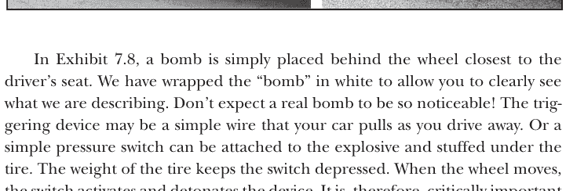

在图 7.8 中，炸弹就放在离驾驶座最近的车轮后方。我们用白色包裹了这个“炸弹”，以便你能清楚地看到我们所描述的东西。可别指望真正的炸弹会这么显眼！触发装置可能是一根简单的电线，当你开车离开时，车身会拉动它。或者，也可以把一个简单的压力开关连接到爆炸物上，然后塞到轮胎下面。轮胎的重量将开关压住。当车轮移动时，开关被触发，装置随之引爆。因此，在你停车后检查车底至关重要。如果你到达时那里什么都没有，但返回时却多出什么东西，那你可能就有麻烦了。

### 轮胎上方的炸弹

在图 7.9 中，炸弹被放在驾驶座一侧的车轮顶部。在你认为这样的炸弹很容易被发现之前，请先设想一下这种情况：一个深色的装置在傍晚被放在轮胎顶部。即使是这种有些业余的尝试，大部分时候也会成功。晚上在外面吃完晚饭回来取车的人，通常不会花太多时间检查车辆。前轮胎或车轮的顶部或后方以及车底这些位置，除非有人蹲下来，否则并不能立刻看到。尽管攻击者

### 图 7.9 轮胎上方的炸弹

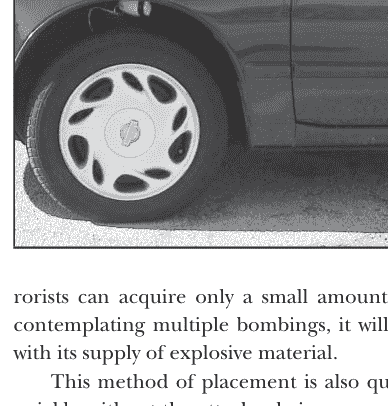

可以在任何轮胎后方安装炸弹，但统计显示，在大多数情况下，恐怖分子通常将装置放在离驾驶座最近的前轮胎后方。这并不奇怪，因为炸弹离预期受害者越近，所需炸药就越少，因此炸弹的尺寸也可以越小。这一点之所以重要，有几个原因。首先，较小的装置不易被察觉。其次，恐怖分子往往只能获得少量炸药。如果一个团体正在策划多起爆炸袭击，它就需要对炸药供应有所节制。

恐怖分子只能获得少量炸药。如果一个团体正在策划多起爆炸袭击，它就需要对炸药供应有所节制。

这种放置方式之所以也很受欢迎，是因为它可以快速完成，攻击者无需长时间暴露。这种技巧完成起来非常迅速，甚至可以用在停在公共道路上或开放停车区域的车辆上。引爆方式通常是一个简单的触发装置。车辆一旦移动，触发装置（或手雷的保险销）就会被拉动，装置随即引爆。虽然这种方法非常常见，因为炸弹设置相对容易，但装置也很容易被发现。你只需要快速查看轮胎后方，特别注意离驾驶座最近的那个轮胎的后方区域。请记住，这个位置会根据左舵车和右舵车而改变。

### 车底下的炸弹

在针对车辆的爆炸袭击中，直接在车底放置一个大型爆炸装置，是恐怖分子最常选择的方法。拥有足量爆炸物的攻击者经常使用这种方法。原因很简单。只要有足够的爆炸物，攻击者就可以组装出足以完全摧毁车辆、确保目标死亡的炸弹。此外，攻击者放置这种炸弹也非常容易，因为不需要将其物理连接到汽车的任何一个部件上。攻击者可以在家中准备好炸弹，然后只需将其直接

在车底下（见图 7.10）。攻击者暴露的时间非常短，因此被发现和被捕的风险极低。通常这种装置是用遥控器或定时装置引爆的。因此，在停车后以及离开时，务必检查车底，确保没有任何变化。

在图 7.10 中，炸弹被放在一个浅色盒子里，放在车底下。炸弹很容易被误认为是掉在地上的披萨盒。如果你停在披萨店附近，你可能会忽略它。恐怖分子指望你接受最合理的解释。别忘了，夜间放置的深色盒子如果不彻底搜查，每次都可能看不见。

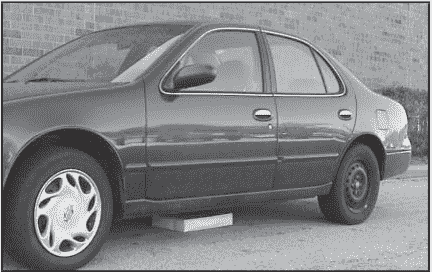

如前所述，攻击者以这种方式放置炸弹非常容易，但警觉的司机也很容易防止这种攻击。正如攻击者可以在车底放置炸弹一样，目标也可以查看自己的车辆底下，非常清楚地看到炸弹。但是请注意一点：记住纸袋伎俩。在检查过程中，如果你看到一个皱巴巴的袋子，比揉成一团的三明治包装大，就要怀疑它。记住停车后检查车底的区域。如果你回来时注意到有什么东西，而你刚到时并没有，就要保持怀疑。

## 炸弹藏在后备箱或发动机舱内

将炸弹放置在后备箱或发动机舱内对恐怖分子攻击者来说并不流行，因为这需要在放置爆炸物之前先撬开汽车。然而，如果可以在不被发现的情况下完成，这是一个不会被看到的极佳放置炸弹的地方（见图 7.11）。由于这种类型的炸弹安装所需的时间比前面讨论的要长，攻击者需要在无人可以看到的地方的封闭或僻静处操作。他们也可能在停车场安装此类炸弹，在那里你把钥匙交给泊车员。

### 图 7.11 后备箱内的炸弹

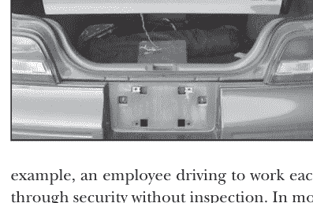

虽然攻击者的风险更高，需要更复杂的技术，但当目标是将炸弹送入安全设施时，这种方法已被使用。将炸弹放在熟悉安保人员的汽车内，驱动进入安全地点，比放在不熟悉的汽车内更容易。例如，每天开着同一辆车上班的员工很可能会在未经检查的情况下通过安检。在大多数政府设施中，即使是安全地点，安保人员通常也会放行熟悉的车辆或由熟识的人员驾驶的车辆，或者只是例行检查身份证件。我们两人从未在任何地方见过安保人员检查过车辆。一旦我们出示身份证件，我们总是会被直接放行通过警卫岗哨。对于成千上万拥有敏感设施不受限制访问权的联邦特工、情报分析员、军官和其他人员来说也是如此。作为一条规则，特工和军事人员不会接受关于如何保护其私人或配发车辆的方法的指导。将爆炸物放置在特工的汽车中，让特工在不知情的情况下将其带入敏感设施，并不会特别困难。

由于目的是炸毁设施，攻击者会使用大量的爆炸物。因此，当你打开汽车后备箱时很容易发现它。此外，即使不检查后备箱，意识强、警觉的司机也能通过车辆操控特性的变化感受到后备箱中额外的重量。

在发动机舱内放置炸弹要稍微难找一些，但一点训练就能解决这个问题。每当我们检查后备箱或打开引擎盖时，我们需要意识到攻击者可能已将炸弹固定在引擎盖或后备箱上，并将其布设为在引擎盖或后备箱打开超过一定程度时爆炸。在任何一种情况下，我们都应非常缓慢地打开它，不要一次全部打开，就像图 7.12 所示。

### 图 7.12 发动机舱内的炸弹

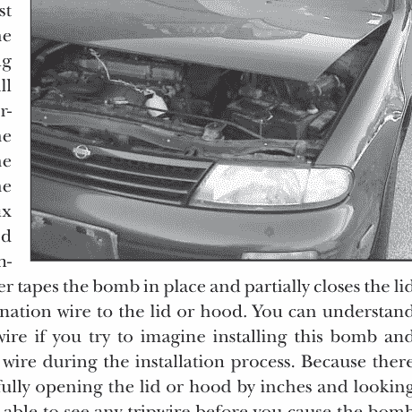

正如图所示，通常有一段很长的电线，带有相当多的松弛，连接到后备箱盖或引擎盖上。引爆装置最简单的方法是利用后备箱或引擎盖的开启来拉紧电线，从而触发炸弹或拉出手榴弹的保险销。存在松弛是因为炸弹制造者必须能够将炸弹固定在车辆上并将电线连接到盖子上，而不会将其引爆。炸弹制造者将炸弹粘贴在原位，然后部分关闭盖子或引擎盖，然后将引爆电线系在盖子上或引擎盖上。如果你试着想象安装这种炸弹而不拉动引爆电线，你就能理解电线需要松弛的原因。由于电线有松弛，通过小心地将盖子或引擎盖以英寸为单位打开并在下方观察，你应该能够在炸弹爆炸前看到任何绊线。攻击者也可以轻松地使发动机失灵，以确保目标在试图诊断发动机故障时打开引擎盖。炸弹也可能设置定时、运动或其他引爆方法，电线作为次要方法。然而，正如钥匙链上的电子后备箱释放按钮可以安全地打开和检查后备箱一样，引擎盖也有电子遥控开启功能。一些注重安全的个人还在引擎盖和后备箱上安装双重锁定装置，或在汽车的战略区域放置指示器，以检测是否有人进入过后备箱或引擎盖下作为额外预防措施。每个詹姆斯·邦德迷都会记得 007 的把戏：弄湿一根长头发并夹在两扇折叠衣柜门之间。如果头发被扰动，就很清楚有人进入过衣柜。你可以使用一小块 strategically 放置的胶带或线来检测车辆是否被未经授权进入。随身携带一个小手电筒放在钥匙链上也是一个好主意。不要依赖放在车内的手电筒来检查车辆。在检查车辆之前就开始检查，因为在远离车辆时更容易看到车底。如果你注意到有什么东西而且天黑了，你需要随身携带灯。市场上有很多好的小灯具（见图 7.13），当然，每个人的手机也可以轻松充当手电筒。

### 图 7.13 钥匙链上的小手电筒

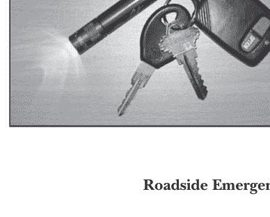

## 路边应急设备

在车内备一套基本的路边应急工具包也是一个好主意。基本设备与你在家中个人或工作用车中应保持的相同。确保你有一个充气、尺寸完整的备胎。通常随车附带的应急备胎是不合适的。你可能需要在维修区维修或更换轮胎之前，行驶很长一段路程，路况也很差。应急备胎不建议行驶超过 25 英里，并且限制了你的行驶速度。确保有功能正常的千斤顶和轮胎扳手。如果你的汽车轮胎上有防盗螺母，确保钥匙在车内。

你还需要一套基本工具包，包括可调扳手、一字和十字螺丝刀、钳子、胶带或 PVC 胶带、搭电线、防水的手电筒、存放在防水塑料容器中的备用电池、虹吸泵、一罐轮胎充气剂和六个道路警示灯。你还应考虑的一件优秀设备是可充电应急启动电源。这是一种电池，可以在电池失效且周围无人可搭电时启动你的车辆。许多此类设备内置压缩机，允许你在紧急路边情况下充气轮胎。你还必须根据你将要旅行的环境扩展这套基本工具包。例如，在非常炎热的气候中，你需要携带额外的散热器冷却液以及充足的饮用水。在寒冷天气中，携带冰刮刀、小型折叠铲、应急蜡烛、防水平火柴和手套。携带一个小型急救包，包括创可贴、纱布和胶带也是一个好主意。

如果你要进行跨国旅行，指南针是必不可少的物品。如今全球定位系统（GPS）甚至更好，可以让你在地图上将位置精确定位到几英尺之内。视你所在的国家而定，GPS 可能能够为你提供与在美国可以获得的同类型详细驾驶指示。如果不能，该系统仍能告诉你位置和方向并在地图上显示出来。可用 GPS 系统的价格已大幅下降，且设备以非常合理的价格出售，这在很大程度上是因为高度复杂的 GPS 系统可以直接下载到你的智能手机上。只要你有充足的电量和网络连接，你不仅可以精确地定位自己，还可以将该位置发送给任何你想发送的人，甚至允许他人实时看到你的位置。

## 高风险地区人员撤离

在大多数情况下，紧急情况的性质并不需要将公司人员从该国撤离。然而，很经常需要向人员传达有关特定地区危险的特定警告。例如，如果在某城市的主要购物区附近发生大规模反西方示威，就需要警告人员这一发展并指示他们远离该区域。在某些情况下，东道国的情况恶化到需要撤离的地步。在这种情况下最好的做法是效仿使馆或领事馆的政策。美国国务院每年都会为世界各地的许多外交使团启动撤离行动，无论是部分还是全部。显然，当此行动成为必要时，美国国务院也会建议非政府美国公民撤离。如果国务院决定使馆人员的家属处于危险之中，他们将被首先撤离。在这方面遵循美国国务院的指示可能是明智的。家属通常在局势恶化到完全崩溃之前就被撤离。此时，仍有可能乘坐商业航班或包机离开该国。撤离家属的时间是在前往机场的旅程尚未充满危险之前。关键人员很可能会在危机加剧时留在使馆。他们的大部分职能将是照顾尚未离开的美国公民的福祉。如果你发现自己处于这种类型的境地，你必须与使馆保持不间断的联系。如果正在考虑关闭使馆，那么你也应该离开了。使馆工作人员将在撤离期间协助你，如果你无法自行安全离开。

忽视这样一个现实是极不负责任的，即无论你在海外何处，都可能出现需要撤离的时候。因此，尤其是在世界上的高威胁地区，拥有一个完整的评估计划至关重要。该计划必须与当地使馆协调。区域安全官应在计划制定的所有阶段进行咨询。该计划必须在发生民众骚乱、恐怖主义、自然灾害或医疗紧急情况时，为员工及其家属提供全部或部分撤离。合适的避难国家或地点必须提前确定，并且必须与所选国家的设施和机构事先安排好，以便处理你所有或部分人员的抵达。

撤离计划完全由各公司自行负责。使馆既没有资源也没有授权为私营部门员工提供撤离。它确实有责任告知当地美国公民对其安全或财产的任何潜在危险，并将协调和协助制定任何撤离计划。在危机时期，使馆人员将尽一切可能协助所有美国公民安全离开该国，如果有必要的话。与使馆或领事馆的预先规划对于在不造成生命损失或伤害的情况下实现这一点至关重要。

当地使馆最重要的角色可能是监测该国内的安全局势。请记住，使馆工作人员可以接触到私营公司无法获得的高层政府联系和情报。即使是与当地政府最高层有联系的大型公司，也可能无法察觉即将到来的危机的预警信号。政府通常控制媒体，其内容可能反映政府的立场，而不一定是真相。与使馆保持密切联系对于监测恶化局势并开始实施必要步骤以在必要时实施撤离是必要的。

美国国务院建议每家公司指定一名高级管理人员，由适当人员协助，负责任何撤离的规划以及监测东道国的政治和安全局势。指定的管理人员及其支持团队应至少每半年召开一次会议，以审查计划和当地局势。定期会议尤为重要，因为人员变动可能需要在计划细节中体现。本地或整个地区局势稳定性的任何重大变化都应促使撤离委员会更频繁地开会。在每次会议之前，应对员工通知系统进行测试。结果应在会议期间讨论，并应确定并纠正不足之处。再次，在高风险地区，测试必须更频繁地进行。

计划应确定一个安全的集合区域，供员工在下令撤离时聚集。集合区域必须仔细选择其防御性以及其与机场或登船点的接近程度。应特别注意集合区域与出发点之间道路的性质。最好有多条可能的路线。美国国务院强烈建议撤离人员在安全的集结区集合，而不是在登船点集合，以最大限度地减少撤离人员暴露于危险之中。计划必须考虑到其中一条或多条计划路线因某种原因无法通行。向机场运输撤离人员时，例如，以可沿途得到保护且不会使承运商运输能力不堪重负的适当规模的团体进行。你最后想要的是你的员工被迫等待数小时甚至数天才能登机。

计划还必须确定在骚乱或自然灾害使主要集结区不安全的情况下的次要集合区域。同样，应确定次要出发点，以防机场或其他主要选择关闭。如果你的公司与使馆保持不间断的联系并密切监测局势，那么在局势达到关键水平之前，应有可能通过商业承运商顺利撤离员工。在商业承运商已满或不可用的情况下，可以与国内也下令撤离的其他公司联合安排包机。与包机航空公司的联系应在实际紧急情况发生前很久就建立。如果局势导致所有服务和政府职能完全崩溃，美国国务院建议待在安全区域内，不要试图在国内移动以求离开。美国国务院发现，四处移动使人员暴露于远大于待在原地等待局势稳定所带来的危险。一旦撤离被认为必要，任何公司人员都不应单方面尝试离开该国或内部旅行。集合区域应充分储备不易腐烂的食品、淡水和药品。任何服用处方药的人都应随身携带足够的数量以度过危机。

美国国务院已确定撤离的三个阶段和一个需要留守的第四阶段。每个阶段都有特定的设定

of procedures attendant to it. According to the Overseas Security Advisory Council, the phases are:

**Phase I, Alert Stage:** A warning to companies and individuals of host country instability.

**Phase II, Limited Action:** Increased preparation for evacuation includes those preparations made under conditions of increased tension or instability that could lead to partial or complete evacuation of expatriate employees and their dependents.

**Phase III, Evacuation Phase:** Final preparation and/or evacuation includes those preparations made under conditions in which the decision to evacuate is imminent or has already been made. Withdrawal and cessation of business is imminent or under way.

**Standing Fast:** Could be implemented in the event that evacuation is not considered prudent. Under this concept, employees and their dependents would remain in their quarters (or other designated location) for an extended period of time until tensions abate.

In Phase I, a situation begins to develop in the host country or region that engenders some concern from the embassy. Typically, the embassy will issue a warning or simply advise the expatriate community of the nature of the incident causing some concern. This notice should be considered akin to a hurricane warning or perhaps a report from the U.S. Geological Survey detailing some minor seismic activity that may foreshadow an earthquake. It is at this stage, the earliest twitch, that preplanning should be done. The evacuation committee should meet and discuss the recent events. The evacuation plan should be reviewed and assessed. Every what-if should be pondered, and the employee notification system should be tested.

The Department of State recommends that evacuation priorities be established. It suggests:

- First priority: Dependents
- Second priority: Individuals other than key expatriate employees
- Third priority: Key expatriate employees

This is basically the same system that is used by the government. If you will pardon the sexism, it is the modern equivalent of “women and children first.”

Dependents are, quite naturally, the first concern. The government then makes the distinction between “essential” and “nonessential” personnel. In the private sector, this is defined as the difference between ordinary employees and key personnel. In a gradually developing situation, an evacuation will be ordered for government employees along these lines. Dependent family members are considered most vulnerable, and evacuation is generally attempted before any real danger develops. If conditions worsen and operations are gradually curtailed, nonessential employees are sent home next. Essential personnel remain until the last possible moment, generally assisting nongovernmental citizens who disregarded earlier warnings and stayed in country too long. Evacuation plans should be organized along those lines for corporate employees. Throughout Phase I, evacuation plans should be constantly updated, and all personnel must be made aware of the process if evacuation is necessary. In the office, planning should include the protection of assets and proprietary information in case evacuation becomes necessary. Backups of corporate records and computer files should be made and sent to a secure site or to the home office. Teams should be assigned to identify what documents or equipment might need to be destroyed or what computer information would need to be removed from computer hard drives. Assume that in an unstable situation, foreign assets will be deliberately searched, looted, and possibly destroyed.

As conditions continue to worsen, Phase II is reached. Evacuation may be a real possibility or may be imminent. Additional planning is made and all assets are placed in a standby status. Management must continue to monitor the situation and know the whereabouts of all employees and their family members at all times. Management should be in constant contact with the embassy, the home office, and other in-country expatriate companies with which cooperative evacuation protocols have been established.

Phase III is reached when the senior corporate manager, who has been in constant contact with the embassy and home office, determines that the situation has become dangerous, volatile, or otherwise unstable and nonessential employees and that all dependent family members must be evacuated. Assets should have already been put in place in Phase II to support the evacuation. During this stage, the senior manager must decide whether to assemble all personnel at a secure staging area or allow everyone to remain in their homes pending the actual call to evacuate. The staging area should be assessed again for its defensibility, and routes to the airport or other departure points should be scouted and assessed for safe passage.

Under certain conditions, staying put and hunkering down may be determined to be a safer choice than evacuating. Employees and their family members would be instructed to remain in their homes or report to alternate secure assembly points. Families should have prepared stocks of food, water, and medicine in case this becomes a necessity. The decision as to where to hunker down will be made by management in conjunction with the RSO.

It is important to understand that merely having a plan is not enough. For the plan to be effective, it must be thoroughly and regularly drilled. At first the drills must be frequent. Once personnel become familiar with the plan, unscheduled drills should be conducted on a quarterly basis at the very least. Ideally the plan should be drilled each time critical personnel are changed. More frequent drilling is indicated in high-risk locations or if the nature of the business is inherently dangerous or a high-profile target. Particular attention should be given to communication in order to make absolutely sure all personnel are able to receive notifications and direction as needed.

In military operations and tactical law enforcement, there is a concept known as a postoperational brief back. This is nothing more than a critical review, conducted by the participants, of the operation. The purpose of this review is to provide the necessary feedback required to make subsequent operations even more successful. Similarly, postdrill reviews must be held after any run-through of the emergency plan. For the reviews to be effective in eliminating plan weaknesses, representatives of each of the departments must attend the meetings.

In addition, for the plan to be effective, it must be coordinated with the appropriate departments or agencies within the local host government, as long as the inclusion of local the government is safe and prudent. Representatives from the local police and fire departments as well as any emergency management agencies should be consulted. Unless there is some security reason to prevent it, these government contacts should be consulted in the planning stage and also should be invited to sit in on operational meetings. If agency representatives are willing, they should be involved in drilling the plan once it is in place and in any “tabletop” exercises (exercises where key decision makers and emergency management personnel discuss responses to various simulated incidents and emergencies around a table rather than during an actual formal drill or exercise) designed to prepare management to implement the plan in an emergency and to evaluate performance during a mock crisis.
