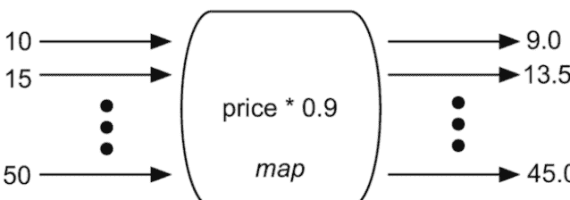
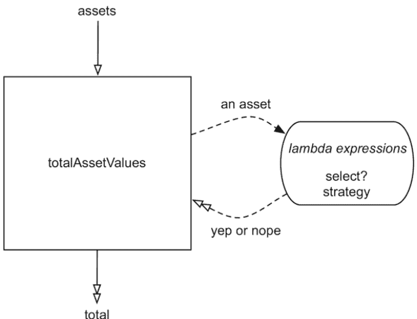
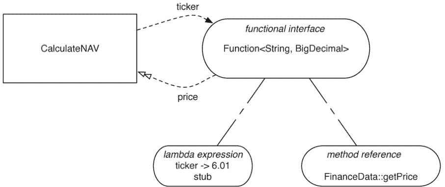
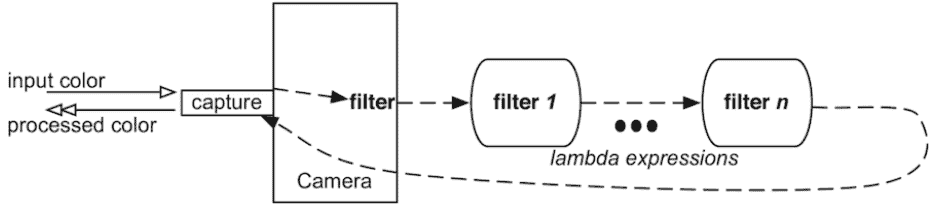

# Java 函数式编程，第二版


## 关于实用派图书系列

实用派图书系列是一家敏捷出版公司。我们之所以在这里，是因为我们想要改善开发者的生活。我们通过创作及时、实用的书籍来实现这一目标，这些书籍由程序员为程序员编写。

我们的 Pragmatic 课程、研讨会和其他产品可以帮助您和您的团队创建更好的软件，并获得更多乐趣。如需了解更多信息以及最新的 Pragmatic 书籍，请访问我们的网站 [实用派程序员官网](http://pragprog.com)。

我们的电子书不包含任何数字版权管理，且始终是 DRM-free。我们率先推出了 beta 书籍概念，您可以在书籍仍在编写过程中购买和阅读，并向作者提供反馈，以帮助为所有人制作出更好的书籍。所有购买者可享受的免费资源包括源代码下载（如适用）、勘误表和讨论论坛，均可在本书主页 pragprog.com 上找到。我们致力于让您的生活更轻松。

## 新书发布

想要跟上我们最新的书籍、公告以及偶尔的特别优惠吗？只需在 [实用派程序员官网](pragprog.com) 上创建一个账户（只需电子邮件地址和密码），并选择接收新闻通讯的复选框。您也可以在 Twitter 上关注我们 @pragprog。

## 关于电子书格式

如果您直接从 [实用派程序员官网](pragprog.com) 购买，您将以一份价格获得所有可用格式的电子书。您可以通过 Dropbox 在所有设备（包括 iPhone/iPad、Android、笔记本电脑等）之间同步电子书。您将获得该版本的免费更新。当然，您也可以随时回来重新下载书籍。从 Amazon Kindle 商店购买的电子书受 Amazon 政策约束。Amazon 文件格式的局限性可能导致电子书在不同设备上的显示效果不同。如需更多信息，请参阅我们的 FAQ [电子书常见问题](pragprog.com/#about-ebooks)。要了解更多关于本书的信息并访问免费资源，请访问 [本书主页](https://pragprog.com/book/vsjava2e)，即本书的主页。

感谢您的持续支持，

## 实用派图书系列

制作本书的团队包括：戴夫·兰金（首席执行官）、珍妮特·弗洛（首席运营官）、塔米·科龙（执行编辑）、杰奎琳·卡特（开发编辑）、波托马克索引有限责任公司（索引）、吉尔森图形（排版）、安迪·亨特和戴夫·托马斯（创始人）

如需客户支持，请联系 support@pragprog.com。

如需国际版权，请联系 rights@pragprog.com。

## *献给毅力。*


## 1. 欢迎，Lambda 表达式！
- 改变思维方式
- 函数式代码的巨大收益
- 为什么使用函数式风格编码？
- 演进，而非革命
- 点点语法糖，增添甜味
- 小结

## 2. 使用集合
- 遍历列表
- 转换列表
- 查找元素
- 跳过值
- 终止迭代
- 复用 Lambda 表达式
- 使用词法作用域和闭包
- 选取元素
- 将集合归约为单一值
- 连接元素
- 小结

## 3. 字符串、比较器和过滤器
- 遍历字符串
- 实现 Comparator 接口
- 多重和流式比较
- 使用 collect 方法和 Collectors 类
- 列出目录中的所有文件
- 列出目录中的特定文件。
- 使用 flatMap 列出直接子目录
- 监视文件变更
- 小结

## 4. 数据转换
- 计算统计信息
- 何时使用 map 而非 flatMap
- 检查条件
- 分区集合
- 计算出现次数
- 求和值
- 使用 flatMapping 和 filtering
- Teeing 操作
- 小结

## 5. 使用 Lambda 表达式进行设计
- 使用 Lambda 表达式分离关注点
- 使用 Lambda 表达式进行委托
- 使用 Lambda 表达式进行装饰
- 窥视默认方法
- 使用 Lambda 表达式创建流畅接口
- 小结

## 6. 使用资源
- 清理资源
- 使用“执行周围”模式清理资源
- 管理锁
- 创建简洁的异常测试
- 小结

## 7. 惰性求值。
- 延迟初始化
- 惰性求值
- 利用 Stream 的惰性
- 创建无限惰性集合
- 小结

## 8. 优化递归
- 使用尾调用优化
- 使用记忆化提速
- 小结

## 9. 使用 Lambda 表达式组合函数
- 使用函数组合
- 使用 MapReduce
- 迈向并行化
- 小结

## 10. 错误处理
- 从整体视角看待错误处理
- 异常处理与命令式风格
- 受检异常与带 Stream 的函数式风格
- 异常处理 vs. 函数式风格
- 下游处理
- 函数式编程中的失败处理
- 小结

## 11. 重构为函数式风格
- 为重构创建安全网
- 重构传统的 for 循环
- 重构更复杂的循环
- 重构无界循环
- 重构 for-each
- 重构以重新处理逻辑
- 重构文件处理
- 重构数据分组操作
- 重构嵌套循环
- 现实世界中的重构。
- 小结

## 12. 函数式编程惯用法
- 不要编写紧凑的 Lambda 表达式
- 优先使用方法引用
- 正确构建函数式管道
- 将不同条件保留在不同的过滤器中
- 提供良好的特定领域参数名
- 为参数使用类型推断
- 函数式管道中的副作用
- 小结

## 13. 汇总
- 使用函数式风格成功的关键实践
- 性能问题
- 采用函数式风格

## A1. 函数式接口入门集
## A2. 语法概览
## A3. Web 资源
## 参考文献。

## 第一版前言

文卡特·斯布拉曼尼安绝不会被描述成一个“瀑布”风格的人。所以，当他提到他要开始写一本 Java 8 的书——那时 Java 8 的设计尚未最终定稿，很久以前的事了——我一点也不惊讶。很明显，这将是一个“敏捷”图书项目。

尽管随着语言和库特性的演进，不得不不止一次地重新修订文本，文卡特有一个秘密优势——他知道我们要去哪里。Java 8 的设计深受函数式编程核心原则的影响：函数即值、不可变性和无状态性。我们这么做并非因为函数式编程很时髦或很酷；我们这么做是因为，以不可变数据上的无状态转换来表达程序，而不是对可变数据结构进行修改，这样的程序往往更易于阅读和维护，更不容易出错，并且能更优雅地并行化。

Java 8 中引入的新特性共同设计，旨在促进更具表现力和更适合并行的库的开发。Lambda 表达式降低了将行为编码为数据的语法开销；默认方法允许现有库随时间演变，


使核心 JDK 类（如 Collections）能够利用 lambda 表达式；java.util.stream 包利用这些语言特性，以声明式、富有表现力且并行友好的方式，对集合、数组和其他数据源提供丰富的聚合操作。这一切合在一起，能够产出更强大、性能更佳的代码，并带来更愉悦的编程体验。

本书不仅提供了大量使用这些新特性的示例，还让读者一窥其设计背后的原理，以及*为何*它们能产出更好的代码。让 Venkat 带你领略这门全新改进的 Java——你一定会大饱眼福。

Brian Goetz  
Java 语言架构师，Oracle 公司  
2013 年 9 月

## 关于《Java 函数式编程，第二版》的赞誉

《Java 函数式编程，第二版》带你走进函数式编程原理的应用之旅，助你编写更清晰、简洁、可靠的现代 Java 代码。本书已更新，涵盖 Java 的最新特性，每一章都包含大量前后对比示例，阐释 Java lambda 和 Stream 的实用性与威力。

- Brian Goetz，Oracle 公司 Java 语言架构师，《Java 并发编程实战》作者

我没时间读市面上所有的书，更不用说重读任何一本书了。Venkat 的《Java 函数式编程》第二版值得重读。我曾是第一版的忠实粉丝，但新版在原有优势基础上进一步提升，堪称现代 Java 编程最佳入门读物。其中包含错误处理、函数式习惯用法的新章节，以及最关键的、关于重构到函数式风格的具体技术的讨论。上“函数式列车”，写出更好的软件。

- Brian Sletten，Bosatsu Consulting, Inc. 总裁，《WebAssembly：权威指南》作者

为了保持竞争力，开发者永不停止学习。《_Java 函数式编程，第二版_》为各级 Java 开发者提供了机会，使其在 lambda 表达式和 Stream 等方面保持 Java 编码技能敏锐且与时俱进。你会反复回到本书，汲取许多最佳实践、方法和技巧，使自己的 Java 编程技能保持尽可能敏锐。

- Sharat Chander，Java SE 产品管理高级总监

Venkat 拥有独特的叙事式写作风格。它不做任何假设，通过大量代码示例，以直观易懂的方式，轻松引导读者从一个概念过渡到下一个概念。如果你是函数式编程新手，本书为该主题提供了坚实基础，帮助你掌握语法以及更具概念性的内容。

- Ian Roughley，TrueNorth 工程副总裁

此作重新点燃了对工艺精神的赞赏，是读书小组和团队讨论的绝佳选择。具体来说，在着手任何新项目之前，都应重温第 12 章“函数式编程习惯用法”。Venkat 提炼精华的才华展现得淋漓尽致，为读者呈现了通过网络搜索或 LLM 无法获得的素材。

- Don Bogardus，Everee 质量自动化架构师，Utah JUG 副主席

## 致谢

说过去几年充满挑战，那简直是轻描淡写。世界上每一个人都受到了不同程度的影响，有人影响更大。不过，这更像是一场毅力的考验。在如此多的不确定性和变化中，着手将本书更新至第二版，同时还要撰写另一本新书，这很难。但我们最终走到了今天，这在很大程度上要归功于一些了不起的人的支持。

首先，我要向 Oracle 的 Java 语言团队成员表示诚挚的感谢，感谢他们为 Java 的函数式能力所持续付出的努力。最近几个 Java 版本对 JDK 的改进，丰富了我们作为程序员使用 Java 函数式设施的能力。

我谨向 Brian Goetz、Brian Sletten、José Esteves de Souza Neto 和 Ian Roughley 表示由衷的感谢，感谢他们抽出时间审阅第二版并提供宝贵反馈。我要感谢 Brian Goetz 抽出时间提供详尽反馈，并帮助我改进本书的多个部分。书中如有任何错误，概由我本人负责。

我要感谢 Joe Horvath 和 Nicholas Dierauf 担任早期读者，并在本书勘误页面上报告错误。感谢你们帮助改进本书，不胜感激。特别感谢 David Tonhofer 耐心帮助我改进本书中的诸多内容。

若没有许多帮助过第一版的人的支持，第二版就不可能出版。感谢 Kimberly Barnes、Fred Daoud、Raju Gandhi、Marty Hall、Praveen Kumar、Rebecca Parsons、Kirk Pepperdine、Chris Richardson、Ian Roughley、Nate Schutta、Ken Sipe、Dan Sline 和 Bruce Take。我也要感谢 Greg Helton、Günter Jantzen、Narayanan Jayaratchagan、Wacek Kusnierczyk、Nabeel Ali Memon、Marc-Daniel Ortega、Arjo Ouwens、Philip Schwarz、Ekaterina Sh、Dan Talpau、Benjamin Tan、Brian Tarbox、Marco Vermeulen 和 Jason Weden 抽出时间报告第一版中的错误。

Jackie Carter 是本书的出色编辑，我很高兴能称她为好友。Jackie，你让这变得如此有趣，一段愉快的旅程。谢谢你。The Pragmatic Bookshelf 的友善团队再次表现出色，使这一切变得轻而易举。我感谢我的妻子 Kavitha，感谢她的支持与耐心。

## 前言

你一定会大饱眼福。世界上最突出、最广泛使用的语言之一支持面向对象、命令式和函数式编程。你可以将最强大的工具之一——面向对象范式——与命令式风格混合，如我们过去所做的，或与函数式风格混合，如你将在本书中学到的，从而降低代码的复杂性。我们可以在 Java 中相当有效地完成以前只能通过其他语言在 JVM 上才能实现的事情——这意味着 Java 程序员拥有更大的力量。

我很幸运，在过去几十年里有幸使用多种语言进行编程：C、C++、Java、C#、F#、Ruby、Groovy、Scala、Clojure、Kotlin、Erlang、Haskell、Elm、JavaScript ……。当被问到哪一种是我最喜欢的时，我斩钉截铁的回答是，令我兴奋的不是语言本身，而是我们编程的方式。

编程中的科学与工程吸引了我，但正是编程中的艺术让我流连忘返。编码与写作有很多共同点——表达我们的想法有不止一种方式。Java 帮助我们使用对象编写代码，我们可以将其与函数式能力相结合，以实现我们的设计和想法。

Java 的函数式编程设施可以使我们的代码比命令式风格更具表现力、更易于编写、更不容易出错，也更易于并行化。函数式编程已经存在数十年，并在 Lisp、Clojure、Erlang、Smalltalk、Scala、Groovy 和 Ruby 等语言中被广泛使用。它不仅是 Java 中相对新的方式，也是更好的方式。

既然编码就像写作，我们可以从该领域学到一些东西。在《写作这回事》[Zin01] 中，William Zinsser 推崇简单、清晰和简洁。为了创建更好的应用程序，我们可以从使代码更简单、更清晰、更简洁开始。在本书中，我们将探讨 Java 的函数式编程风格如何帮助我们做到这一点。

### 本书适合谁阅读

本书面向精通 Java 面向对象编程，并渴望学习和应用 Java 函数式编程设施的程序员。你需要具备之前 Java 版本的良好编程经验，至少是 Java 5，才能充分利用本书。

主要对 Scala、Groovy、JRuby、Kotlin 和 Clojure 等 JVM 语言感兴趣的程序员可以从本书的示例中受益，并可以将其与那些语言中提供的设施联系起来。他们还可以使用这些示例来帮助团队中的其他 Java 程序员。

具有其他语言函数式编程经验且目前参与 Java 项目的程序员也可以使用本书。他们可以学习自己已有的知识如何转化为 Java 中 lambda 表达式使用的具体细节。

熟悉 Java lambda 表达式的程序员可以使用本书来帮助指导和培训在这个领域起步的团队成员。


### 本书包含什么

本书将帮助你快速掌握 Java 中的函数式编程能力，用优雅的风格思考，并从 Java 开发工具包（JDK）库的新增内容中受益。我们将采用示例驱动的方式来探索这些概念。我们将不再讨论函数式编程的理论，而是深入具体的日常任务，应用优雅的风格。这种方法将使你迅速掌握这些概念，从而立即在项目中实际运用它们。

初次阅读时，请按顺序逐章阅读，因为我们会基于之前讨论过的概念和示例进行构建。每章末尾都有一个快速摘要，回顾所涵盖的内容。稍后在开发应用程序时，可以快速浏览本书中任何相关的示例或章节。还有一个语法附录可供快速查阅。

本书其余部分的组织如下。

我们在第 1 章，Hello, Lambda Expressions! 中讨论函数式编程风格、其优势，以及它与普遍的命令式风格有何不同。我们还将在本章中探讨 Java 如何支持 lambda 表达式。

Java 的集合框架得到了特殊的函数式处理，新增了支持函数式操作的接口、类和方法。我们将在第 2 章，Using Collections 中探讨这些内容。

在第 3 章，Strings, Comparators, and Filters 中，我们将利用函数式风格和 lambda 表达式来处理字符串、实现 Comparator 接口，并使用过滤器进行文件选择。

Collectors 是 JDK 中最通用的实用工具类之一，具有转换数据的惊人能力。我们将在第 4 章，Transforming Data 中深入探讨这一点。

除了使用 JDK 中的函数式设施之外，我们还可以在设计自己创建的方法和类时应用优雅的风格，从中受益。我们将在第 5 章，Designing with Lambda Expressions 中介绍函数式设计技巧。

lambda 表达式有助于形成一种代码结构，帮助划分用于管理对象生命周期和资源清理的操作，我们将在第 6 章，Working with Resources 中讨论这一点。

我们将在第 7 章，Being Lazy 中看到 lambda 表达式的优势。它们让我们能够推迟实例创建和方法求值，以及创建无限的惰性集合，从而提升代码性能。

在第 8 章，Optimizing Recursions 中，我们将使用 lambda 表达式优化递归，并利用记忆化技术实现卓越性能。

我们将在第 9 章，Composing Functions with Lambda Expressions 中将本书涵盖的技术付诸实践，在那里我们将转换对象、实现 MapReduce，并以很少的努力安全地并行化程序。

故障是系统设计的一部分，在第 10 章，Error Handling 中，我们将探讨如何在函数式编程和使用 Streams API 时处理错误。

由于 Java 已经存在几十年了，企业中存在大量命令式风格的代码。你可以使用第 11 章，Refactoring to Functional Style 中的众多示例来练习函数式思维，并将现有的命令式风格代码重构为函数式风格。

编写优秀的可维护代码不仅需要学习语法和语义。了解该做什么，尤其是不该做什么，可以帮助创建真正更容易让团队维护的代码。你将在第 12 章，Functional Programming Idioms 中了解效果最佳的惯用风格。

在第 13 章，Bringing It All Together 中，我们将回顾采用函数式编程技术所需的关键概念和实践。

在附录 1，Starter Set of Functional Interfaces 中，我们将浏览一些最流行的函数式接口。

关于函数式接口、lambda 表达式以及方法/构造函数引用的语法快速概览在附录 2，Syntax Overview 中。

本书中提到的 URL 汇总于附录 3，Web Resources，方便你查阅。

### 本书使用的 Java 版本

要运行本书中的大多数示例，你至少需要 Java 8。有些示例使用了较新版本 Java 中才有的功能。

使用自动化脚本，本书中的示例已在以下 Java 版本上进行了测试：

```
openjdk version "18.0.1.1" 2022-04-22
OpenJDK Runtime Environment (build 18.0.1.1+2-6)
OpenJDK 64-Bit Server VM (build 18.0.1.1+2-6, mixed mode, sharing)
```

花几分钟下载适合你系统的 Java 版本。这将帮助你跟随本书中的示例进行操作。

### 如何阅读代码示例

在 Java 中编写代码时，我们将类放在包中，将可执行语句和表达式放在方法中。为了减少杂乱，我们将在代码清单中省略包名和导入语句。本书中的所有代码都属于一个包：

```
package fpij;
```

未在方法中列出的任何可执行代码都是未显示的 main 方法的一部分。在浏览代码清单时，如果你想查看完整的源代码，请记住本书网站上只需点击一下即可获取。

### 在线资源

书中引用的许多 Web 资源已收录于附录 3，Web Resources。以下是一些可以帮助你开始使用本书的资源：

用于下载本书所用 Java 版本的 OpenJDK 网站[1]。

Pragmatic Bookshelf 网站上本书的页面[2]。在那里你可以下载本书的所有示例源代码。你也可以通过提交勘误条目或在论坛中发布你的评论和问题来提供反馈。如果你以 PDF 形式阅读本书，可以单击代码清单上方的链接来查看或下载特定的示例。

现在让我们来玩点 lambda 表达式和 Stream 的把戏...

Venkat Subramaniam
2023 年 6 月

### 脚注

- [1] https://openjdk.org/projects/jdk/18/
- [2] http://www.pragprog.com/titles/vsjava2e

## Hello, Lambda Expressions!

近年来，Java 的发展速度非常快，Java 8 已成为许多组织的基准版本。我们可以在 Java 中使用命令式风格或函数式风格编写面向对象代码，甚至可以在同一应用程序中根据需要混合使用它们。命令式风格一直是 Java 中编写代码最流行、最常用的方式。但是，这种风格虽然对开发者来说最为熟悉，却充满了偶然的复杂性。许多开发者正日益转向在 Java 中使用函数式编程风格。其中主要原因是，一旦开发者习惯了语法和范式，函数式风格代码的复杂性较低，更易于阅读和理解。

### 改变思维方式

命令式风格——自 Java 诞生以来，它就是 Java 提供给我们的方式。在这种风格中，我们告诉 Java 想要它做的每一步，然后眼睁睁地看着它忠实地执行那些步骤。这种方式一直运行良好，但略显底层。代码往往会变得冗长，我们常希望语言能聪明一点；这样我们就可以以声明方式告诉它我们想要_什么_，而不是深入探讨_如何_去做。幸运的是，Java 可以帮助我们做到这一点。让我们看几个示例，了解其中的优势和风格差异。

#### 惯用方式

让我们从熟悉的基础开始，看看这两种范式的实际运作。以下是一种命令式方法，用于查找给定城市集合中是否包含 Chicago——请记住，本书中的代码清单仅包含代码片段（参见如何阅读代码示例）。

```
introduction/fpij/Cities.java

boolean found = false;
for(String city : cities) {
    if(city.equals("Chicago")) {
        found = true;
        break;
    }
}
System.out.println("Found chicago?:" + found);
```

这个命令式版本既嘈杂又底层；它涉及多个部分。我们首先初始化一个名为 found 的 boolean 标志，然后遍历集合中的每个元素。如果我们找到了要查找的城市，那么我们设置标志并


跳出循环。最后，我们打印出查找的结果。

### 更好的方式

作为细心的Java程序员，一看到这段代码，我们就会立刻将其改写得更简洁、更易读，如下所示：

```
introduction/fpij/Cities.java

System.out.println("Found chicago?:" + cities.contains("Chicago"));
```

这是声明式风格的一个示例——contains 方法帮助我们直接切入业务。

### 显著改进

这一改变从几个方面改进了我们的代码：

- 不需要处理可变变量
- 迭代步骤在内部封装
- 更少冗余
- 更清晰；保持专注
- 障碍更少；代码紧密贴合业务意图
- 更不容易出错
- 更易于理解和维护

### 超越简单场景

那很简单——在集合中检查元素是否存在的声明式函数在Java中已经存在很长时间了。现在想象一下，对于解析文件、操作数据库、调用Web服务、编写并发程序等更高级操作，不再需要编写命令式代码。Java现在使得编写简洁、优雅、不易出错的代码成为可能，不仅适用于简单场景，而且贯穿我们整个应用程序。

### 旧方式

让我们看看另一个示例。我们将定义一个价格集合，并尝试几种方式来计算折扣价格的总和。

```
final List<Integer> prices = Arrays.asList(10, 30, 17, 20, 18, 45, 12);
```

假设我们需要计算大于$20的价格打九折后的总和。让我们先用惯常的Java方式来实现。

```
introduction/fpij/DiscountImperative.java
```

```
double totalOfDiscountedPrices = 0.0;

for(int price : prices) {
    if(price > 20) {
    totalOfDiscountedPrices += price * 0.9;
    }
}
System.out.println("Total of discounted prices: " + totalOfDiscountedPrices);
```

这是一段熟悉的代码；我们从一个可变变量开始，用来存储折扣价格的总和。然后我们遍历价格，挑选出每个大于$20的价格，计算每个商品的折扣值，并将其加到总和中。最后，我们打印折扣价格的总值。

以下是代码的输出。

折扣价格总计：67.5

它能运行，但写起来感觉很糟糕。这不怪我们；我们不得不使用当时可用的工具。但代码相当底层——它受“原始类型执念”之害，违背了单一职责原则（SRP）。该代码还违反了单一抽象层级原则（SLAP），因为它深入多层嵌套细节。它先处理价格集合，然后对每个价格检查其值，接着对于每个选定的值（嵌套三层深处）计算乘积并求和。除了不得不应对糟糕的设计之外，在家办公的我们还得把这段代码藏起来，不让渴望成为程序员的孩子看到，因为他们可能会沮丧地叹息：“你谋生就是干这个的？”

### 再次更好的方式

我们可以做得更好——好得多。我们的代码可以类似于需求规范。这将有助于缩小业务需求与实现它们的代码之间的差距，进一步降低需求被误解的可能性。

与其告诉Java创建一个可变变量并反复为其赋值，不如与它进行更高层次的抽象对话，如下段代码所示。

```
introduction/fpij/DiscountFunctional.java

final double totalOfDiscountedPrices =
prices.stream()
.filter(price -> price > 20)
.mapToDouble(price -> price * 0.9)
.sum();

System.out.println("Total of discounted prices: " + totalOfDiscountedPrices);
```

让我们大声读出来——筛选大于$20的价格，将价格映射为折扣值，然后将它们相加。代码的逻辑流与我们描述需求的方式一致。作为Java的惯例，我们会换行长代码，并在方法名前将点号垂直对齐，如之前的示例所示。

代码简洁，但我们使用了现代Java中的许多新特性。首先，我们在价格列表上调用stream方法。这为我们打开了通往*特殊*迭代器的大门，该迭代器拥有大量便捷函数，我们稍后将讨论。

我们不再显式遍历价格列表，而是使用一些特殊方法，如filter和map。与我们在旧版Java和Java开发工具包（JDK）中习惯使用的方法不同，这些方法将一个匿名函数——lambda表达式——作为参数，放在括号()中。（我们很快将深入探讨这一点。）我们调用sum方法，它是reduce操作的一种特殊形式，用于计算mapToDouble结果的总和，而mapToDouble是map方法的一种特殊形式。

循环被隐藏起来，就像在contains方法中一样。但map方法（以及filter方法）更为复杂。对于价格列表中通过筛选的每个价格，mapToDouble方法会调用提供的lambda表达式，将给定价格转换为折扣价。sum方法（一种reduce操作）将转换后的值相加，得出最终结果。

以下是此版本代码的输出：

```
Total of discounted prices: 67.5
```

### 改进之处

与惯常方式相比，你可以看到几处改进：

- 组织良好，不冗杂
- 没有底层操作
- 更容易增强或修改逻辑
- 迭代由方法库控制
- 高效；循环的惰性求值
- 在需要时更容易并行化

稍后我们将讨论Java如何提供这些改进。

### Lambda来拯救

Lambda表达式（即匿名函数）是摆脱命令式编程麻烦的函数式关键。与属于类的方法不同，lambda是我们可以在方法内创建的独立函数。通过改变编程方式并利用lambda，我们可以编写不仅优雅简洁，而且不易出错、更高效，以及更容易优化、增强和并行化的代码。

### 函数式代码的巨大收益

函数式代码具有更高的信噪比；我们编写的代码行数更少，但每一行或每个表达式都能发挥更大作用。与命令式版本相比，我们从函数式版本中获得了相当多的收益：

- 我们避免了对变量的显式突变或重新赋值，这些往往是错误的根源，并导致难以实现并发的代码。在命令式版本中，我们在循环中反复设置totalOfDiscountedPrices变量。在函数式版本中，我们的代码中没有显式突变。更少的突变会导致代码中更少的错误。
- 函数式版本可以轻松并行化。如果计算耗时，我们可以轻松地为列表中的每个元素并发运行它。如果我们对命令式版本进行并行化，就必须担心对totalOfDiscountedPrices变量的并发修改。在函数式版本中，我们只有在变量完全“烘焙完成”后才能访问它，这消除了线程安全问题。
- 代码更具表达性。我们不需要通过多个步骤来传达意图——创建一个初始哑值，遍历价格，将折扣值添加到变量中，等等——而只是要求列表的map方法返回一个包含折扣值的列表并将它们相加。
- 函数式版本更简洁；与命令式版本相比，它用更少的代码行实现了相同的结果。更简洁的代码意味着要写更少的代码、读更少的代码、维护更少的代码——参见《简洁是否仅仅意味着代码更少？》。
- 函数式版本更直观——代码读起来更像我们陈述问题的方式——一旦熟悉语法，就更容易理解。map方法将给定的函数（计算折扣）应用于集合的每个元素，并生成结果集合，如下图所示。



借助lambda表达式的支持，我们可以充分利用Java中函数式编程的强大功能。如果我们采用这种风格，就可以创建更具表达性和简洁性的代码，具有更少的可变性和更少的错误。

Java的一项关键优势一直是其对面向对象范式的支持。函数式风格并不与面向对象编程（OOP）相悖。真正的范式转变是从命令式编程向声明式编程转变。借助现代Java，我们现在可以非常有效地混合使用函数式和面向对象的编程风格。我们可以继续使用面向对象风格来建模领域实体、它们的状态及其关系。此外，我


可以将行为或状态转换、业务工作流以及数据处理建模为一系列函数，以形成函数组合。

### Joe 问道：简洁仅仅意味着更少的代码吗？

简洁即短小、无冗余，并浓缩至本质，以有效传达意图。其益处深远。

编写代码就像把食材随便拼凑在一起；让代码简洁，就像将其熬制成酱汁。编写简洁代码往往需要付出更多努力。阅读的代码更少，但有效的代码应当清晰透明。难以理解或隐藏细节的简短代码清单只是简短的，而非简洁的。

简洁代码有助于设计敏捷，并且样板代码更少。这意味着我们可以快速尝试设计想法，如果效果好就继续前进，如果效果差就及时放弃。

### 为什么采用函数式编程风格？

我们了解了函数式编程风格的一般优势，但值得采用这种新风格吗？我们应当期待微小的改进，还是会发生翻天覆地的变化？在投入时间和精力之前，这些都是我们需要得到解答的真切问题。

编写 Java 代码并不困难；语法很简单。我们对类库及其 API 已经相当熟悉且自如。真正让我们费力的，是使用 Java 开发典型企业级应用所需的编码和维护工作量。

我们必须确保同事程序员在适当的时候关闭了数据库连接，不持有超出所需时间的事务，在正确层级妥善处理异常，正确获取和释放锁……清单远不止这些。

单独来看，其中每一项似乎都不是什么大问题。但当它们与领域固有的复杂性结合在一起时，事情就变得令人应接不暇、费工费力，并且难以维护。

如果我们能将每一项决策都封装成能够妥善管理约束的小段代码，会怎么样呢？那么我们就无需不断耗费时间、精力和心力来强制执行策略。那将是一大胜利——认知负荷更小——所以让我们来看看函数式风格能提供什么帮助。

### 迭代加强版

我们不断编写迭代来处理对象列表，并操作集合和映射。Java 中我们习惯使用的迭代器虽然熟悉且原始，却并不简单。它们不仅使用起来需要几行代码，而且也难以组合。

如何遍历集合并打印其中每个元素？我们可以使用 for 循环。如何从集合中筛选某些元素？仍然使用 for 循环，但需要额外的可变变量来支持此操作。筛选出值之后，如何将结果归约为单个值，例如最小值、最大值或平均值？更多循环，更多可变变量。

这就像是一个什么都懂但毫无长项的迭代工具。Java 现在为各种操作提供了专门的内部迭代器：一个用于简单循环，一个用于映射数据值，一个用于筛选特定值，一个用于归约，以及若干便捷函数，用于获取最小值、最大值、平均值等等。

此外，这些操作易于组合，因此我们可以组合多种操作来以更少的代码、更轻松地实现业务逻辑。完成后，代码更易于理解，因为它逻辑上按照问题中描述的顺序流动。我们将在第 2 章《使用集合》以及全书中看到此方面的若干示例。

### 强制执行策略

策略主导着企业级应用。例如，我们可能需要确保某个操作拥有适当的安全凭据。我们可能需要确保事务运行迅速并且正确更新审计跟踪。这些任务通常会变成枯燥的服务层代码，如以下伪代码形式所示：

```
Transaction transaction = getFromTransactionFactory();
//... operation to run within the transaction ...
checkProgressAndCommitOrRollbackTransaction();
UpdateAuditTrail();
```

这种方法存在两个问题。首先，它通常会导致重复劳动，进而增加维护成本。其次，很容易忘记应用程序代码中可能抛出的异常，从而危及事务生命周期和审计跟踪的更新。我们可以实现正确的 try 和 finally 块，但每次有人修改该代码时，我们都必须重新验证它没有出错。

或者，我们可以摒弃工厂，将这段代码颠倒过来。不再接收一个事务，而是将处理代码发送到一个管理良好的函数中，如下所示（伪代码）：

```
runWithinTransaction((Transaction transaction) -> {
//... operation to run within the transaction ...
});
```

这只是一个微小的步骤，却能带来巨大的节省。检查状态并更新审计跟踪的策略已被抽象并封装在 runWithinTransaction 方法中。我们向该方法发送一段需要在事务上下文中运行的代码。我们不再需要担心忘记执行步骤，或者异常处理得不好。强制执行策略的函数会处理所有这些内容。

我们将在第 6 章、*处理资源* 中介绍如何使用 Lambda 表达式来强制执行此类策略。

### 扩展策略

策略似乎在我们周围不断增长——除了强制执行之外，企业级应用还需要扩展策略的方式。基于某些配置信息，我们可能需要添加或移除一系列操作，而这些操作又可能需要在模块的核心逻辑执行之前进行处理。这是 Java 中的常见任务，但需要大量前瞻性思考和设计。

扩展性机制通常是一个或多个接口。我们可以精心设计这些接口以及将实现它们的类层次结构。结果可能是有效的，但这项工作可能会留下若干我们需要维护的接口和类。设计很容易变得臃肿且难以维护，从而危及我们最初追求的可扩展性目标。

有一种替代方案——函数式接口和 Lambda 表达式，它们让我们能够设计可扩展的策略。这样一来，我们不必被迫创建额外的接口或遵循某个方法名，而是可以专注于想要提供的核心行为，正如我们将在 *使用 Lambda 表达式进行装饰* 中看到的那样。

### 无忧并发

当一款大型应用即将交付里程碑时，一个巨大的性能问题浮出水面。团队很快发现，瓶颈在于应用程序的庞大模块，该模块涉及处理大量数据。团队中的某人建议，如果我们能更有效地利用可用的多核，就能提升性能。但如果这个庞大模块就像典型的旧式 Java 代码，这个建议带来的兴奋感很可能会转瞬即逝。

团队很快意识到，将庞大模块的代码从串行版本转换为并发版本需要付出巨大努力，会带来额外复杂性，并为许多多线程相关的错误敞开大门。难道就没有更简单的方法来获得更好的性能吗？

如果串行代码和并发代码之间没有区别，而串行运行与并发运行之间的区别仅仅是打开一个开关，以清晰表达我们的意图，那会怎样？

这似乎只在纳尼亚才有可能实现，但如果我们以函数纯度来开发模块，这却是非常现实的。内部迭代器和函数式风格消除了轻松实现并行的最后障碍。JDK 类库的设计旨在使串行与并行执行之间的切换只需进行一次小而明确且不显眼的代码更改，正如我们将在《飞跃到并行》中看到的那样。

### 讲述故事

在业务需求与代码实现之间的转化中，损失了太多。差距越大，出错的机会就越多，维护成本也就越高。如果代码的阅读方式更贴近业务描述问题的方式，那么它就更易于阅读，


与业务人员讨论更容易，也更容易演进以满足他们不断变化的需求。

例如，你听到业务人员说：“获取所有股票代码的价格，找出低于 500 美元的价格，并计算只筛选出的股票的净资产总值。”使用现有的新设施，我们可以写出类似这样的代码：

```
tickers.stream()
.map(StockUtil::getprice)
.filter(StockUtil::priceIsLessThan500)
.sum()
```

在这里几乎不存在翻译损失，因为没什么可翻译的。这就是函数组合的作用，我们将在本书中多次看到这一点，尤其是在第 9 章“使用 Lambda 表达式组合函数”中。

### 关注点分离

应用程序中常见的需求是将核心计算与其依赖的细粒度逻辑分开。例如，订单处理系统可能希望根据交易来源应用不同的税务计算。将税务计算逻辑与其余处理分离，将有助于我们创建更可复用、更可扩展的代码。

在面向对象编程中，我们称这种关注点分离，通常使用策略模式来解决。这通常涉及创建一个或多个接口以及一堆类来实现它们。

现在我们可以用更少的代码实现同样的效果。而且，我们可以快速试验设计想法，而不会被必须首先布置的代码层次结构所拖累。我们将在“使用 Lambda 表达式分离关注点”中介绍如何使用轻量级函数创建此模式并分离关注点。

### 延迟求值

在构建企业级应用程序时，我们可能需要与 Web 服务交互、进行数据库调用、处理 XML……列表还在继续。我们需要执行很多操作，但并非所有操作都始终必要。避免某些操作，或至少推迟那些暂时不需要执行的操作，是提高性能和应用程序启动或响应时间的最简单方法之一。

这是一个简单的目标，但使用纯面向对象方法可能难以实现。例如，我们不得不处理对象引用和空检查，以推迟重量级对象的初始化。

或者，我们可以使用新的 Optional 类及其提供的函数式风格 API，以最小的努力使意图更加明确，正如我们将在“延迟初始化”中看到的那样。

### 提高可测试性

活动部件较少的代码通常更不容易出问题。就其本质而言，函数式风格的代码对变更更具弹性，并且需要相对较少的测试工作。

此外，正如我们将在第 5 章“使用 Lambda 表达式进行设计”和第 6 章“使用资源”中看到的，Lambda 表达式可以作为轻量级模拟或存根，并有助于创建高度表达性的异常测试。Lambda 表达式还可以作为很好的测试辅助工具。一组常见的测试用例可以接收并使用 Lambda 表达式。测试可以捕获需要为回归测试而验证的行为的本质。同时，传入的 Lambda 表达式可以作为需要验证的实现的变体。

JDK 本身包含的自动化测试就是很好的例子。这些测试展示了 Lambda 表达式如何帮助参数化测试用例的关键行为；例如，它们帮助将测试组合为“创建结果容器”，然后是“断言某些参数化后置条件”。

我们讨论过，函数式风格不仅能帮助我们编写更高质量的代码，还能优雅地解决许多常见的应用开发挑战。这意味着我们可以更快、更省力、更少地出错地创建应用程序——只要我们遵循一些准则，我们将在下文讨论这些准则。

### 演进，而非革命

要获得函数式风格的好处，我们不必切换到另一种语言，只需改变使用 Java 的方式即可。

C++、Java 和 C# 等语言最初支持命令式和面向对象编程。现在，所有这些语言也都采用了函数式编程风格。我们已经看到了这两种风格的示例，并讨论了从函数式风格中获得的好处。现在，让我们探讨一些关键概念和实践，它们将帮助我们采用新风格。

Java 语言团队投入了大量时间和精力，将函数式功能引入语言和 JDK。为了获得好处，我们需要掌握一些新概念。如果我们遵循一些准则，就可以改进代码：

- 声明式编程。
- 提倡不可变性。
- 避免副作用。
- 优先使用表达式而非语句。
- 使用高阶函数进行设计。

让我们快速看看这些实践。

### 声明式编程

熟悉的命令式风格的核心是可变性和命令驱动编程。我们创建变量或对象，并在过程中修改它们的状态。我们还提供要执行的详细命令或指令，例如创建循环索引、递增其值、检查是否到达末尾、更新数组的第 n 个元素，等等。在过去，由于工具的性质和硬件的局限性，我们以这种方式编程是有道理的。

我们看到，在集合上以声明式方式使用 contains 方法比命令式风格更易于使用。所有艰苦的工作和低级细节都被移入库函数中，我们无需处理它们。如果这种方式更容易，我们宁愿一切都这样做。不可变性和声明式编程是函数式编程风格的本质，而 Java 现在使它们变得非常容易接近。

### 提倡不可变性

可变代码有许多活动部件。事物变化越多，组件就越容易出错，错误也就越容易混入。多个变量变化的代码难以理解，也难以并行化。不可变性从根本上消除了所有这些问题。

Java 支持不可变性，但不强制执行——但我们可以。我们需要改变以前修改对象状态的陈旧习惯。尽可能，我们必须使用不可变对象。

声明变量、字段和参数时，倾向于将其声明为 final，遵循约书亚·布洛奇在《Effective Java》[Blo18] 中的明智建议：“将对象视为不可变”。

创建对象时，提倡使用不可变对象，例如 String 类。使用集合时，例如使用 List.of() 函数或 Collections 类的 unmodifiableList 方法来创建不可变或不可修改的集合。

通过避免可变性，我们可以创建纯函数——即没有副作用的函数。

### 避免副作用

想象一下编写一段代码，通过 Web 获取股票价格，然后更新共享变量。如果我们需要获取多个价格，就被迫按顺序运行这些耗时的操作。如果求助于多线程，那么我们就必须承受线程和同步问题，以防止竞态条件。净结果是应用程序性能差，或者为了管理多个线程而彻夜难眠。我们可以通过消除副作用来完全消除这些问题。

没有副作用的函数遵守不可变性，不会更改其输入或其可及范围内的任何内容。这些函数更易于理解，错误更少，也更容易优化。没有副作用消除了对竞态条件或同时更新的任何顾虑。因此，我们也可以轻松并行化此类函数的执行，正如我们将在“迈向并行化的飞跃”中看到的那样。

### 优先使用表达式而非语句

语句很固执，会强制产生可变性。表达式提倡不可变性和函数组合。例如，我们最初使用 for 语句来计算折扣价格的总和。这个版本提倡可变性和冗长的代码。通过切换到使用 map 和 sum 方法（它们都是表达式）的更具表现力的声明式版本，我们避免了可变性，并且能够链式调用或组合函数。

最好使用表达式进行设计，并在代码中多用表达式而少用语句。这将使代码简洁且更易于理解。代码将按逻辑流动，顺序与我们陈述问题的顺序相同。如果问题发生变化，简洁版本更容易更改。

### 使用高阶函数进行设计

与某些函数式编程语言（例如 Haskell）不同，Java 允许我们随意修改变量。在这方面，Java 不是，也永远不会是纯函数式编程语言。但是，我们可以通过使用高阶函数在 Java 中编写函数式风格的代码。

高阶函数将重用的概念提升到一个新水平。与其仅仅依赖对象和类来促进重用，不如使用高阶函数，我们可以轻松重用小型、专注、内聚且编写良好的函数。

在面向对象编程中，我们习惯于将对象传递给方法、在方法中创建对象以及从方法中返回对象。高阶函数对函数所做的，就像方法对对象所做的那样。使用高阶函数，我们可以执行以下操作：


- 将函数传递给函数
- 在函数中创建函数
- 从函数返回函数

我们已经见过将函数传递给另一个函数的示例，稍后将看到创建和返回函数的示例。让我们再看一遍我们的“将函数传递给函数”示例。

```
prices.stream()
	.filter(price -> price > 20)
	.mapToDouble(price -> price * 0.9)
	.sum();
```

在这个示例中，我们将一个函数，price -> price * 0.9，作为参数发送给 mapToDouble。被传递的函数是在调用高阶函数 mapToDouble 时即时创建的。通常，一个函数具有函数体、名称、参数列表和返回类型。这里即时创建的函数具有一个参数列表，后跟一个箭头 (->)，然后是简短的函数体。这里参数的类型可能由 Java 编译器推断，且返回类型是隐式的。这个函数是匿名的；它没有名称。与其称这些为匿名函数，不如称它们为 lambda 表达式。

在 Java 中，传递匿名函数的概念并非完全陌生；我们习惯于传递匿名类的实例。如果我们的匿名类只有一个方法，我们仍然需要经历创建类（尽管是匿名的）并实例化它的繁琐过程。相反，我们现在可以使用 lambda 表达式在 Java 中享受轻量级语法。此外，我们习惯于使用对象来抽象概念。现在我们可以将其与使用 lambda 表达式抽象行为相结合。

以这种编程风格设计应用程序需要一些重新思考。我们必须调整我们根深蒂固的命令式思维，以函数式思考。起初这可能有点困难，但我们很快就会习惯，并在前进的过程中将那些有缺陷的 API 远远抛在身后。

现在让我们转换思路，看看 Java 如何处理 lambda 表达式。我们习惯于将对象传递给方法，但现在可以存储函数并传递它们。让我们看看 Java 接受函数作为参数背后的魔力。

### 为代码增添一点语法糖

我们可以使用 Java 中已有的功能来实现所有想法，但 lambda 表达式消除了繁琐的仪式，并通过添加一点语法糖来使我们的努力更加甜蜜。这很快就转化为更快速创建的代码，并使表达我们的想法更加容易。

在过去，我们使用过许多只有一个方法的接口：Runnable、Callable、Comparable 等等。这些接口在 JDK 库中很常见，并且经常出现在只期望一个函数的地方。所有这些期望单一方法接口的现有库方法现在都可以接受轻量级函数，这要归功于函数式接口提供的出色语法糖。

函数式接口是只有一个抽象（未实现）方法的接口。再次思考单一方法接口，如 Runnable、Callable、Comparable 等等，它们都符合这个定义。现代 JDK 有更多此类接口——Function、Predicate、Consumer、Supplier 等等（有关函数式接口入门集的摘要，请参见附录 1，函数式接口入门集）。函数式接口还可以有零个或多个静态方法和默认方法，这些方法直接在接口中实现。

我们可以使用 @FunctionalInterface 注解来标记函数式接口。编译器不要求此注解，但明确说明接口的用途很有帮助。此外，如果我们用此注解标记一个接口，编译器将强制执行该接口符合函数式接口资格的规则。

如果一个方法将函数式接口作为参数，那么我们可以传递以下任何内容：

- 匿名内部类，老式方法（但我们为什么要这么做？）
- lambda 表达式，就像我们调用 map 方法时所做的那样
- 方法或构造函数引用（我们稍后将看到）

如果方法的相应参数是对函数式接口的引用，编译器会很乐意将 lambda 表达式或方法/构造函数引用作为参数接受。

当我们将 lambda 表达式传递给方法时，编译器将把 lambda 表达式转换为相应函数式接口的实例。这种转换不仅仅是就地生成一个内部类。此实例的合成方法符合与参数对应的函数式接口的抽象方法。例如，map 方法将函数式接口 Function<T, R> 作为其参数。在对 map 方法的调用中，Java 编译器将其合成，如下图所示。

```
Call:
prices.stream().map(price -> price * 0.9);
```

```
//synthesized by the Java Compiler
...
... Double apply(Integer param) {
int price = Integer.intValue(param);
return Double.valueOf(price * 0.9d);
}
```

```
In Stream...
Stream<R> map(Function<T, R> mapper) {
...
... = mapper.apply(...);
...
}
```

lambda 表达式的参数必须与接口抽象方法的参数匹配。此合成方法返回 lambda 表达式的结果。如果返回类型不直接匹配抽象方法的返回类型，合成方法可能会将返回值转换为适当的可赋值类型。

我们已经了解了如何将 lambda 表达式作为参数传递给方法。让我们快速回顾所学内容，然后继续探索 lambda 表达式。

### 总结

在现代 Java 中，这是一个全新的世界。我们现在可以使用高阶函数，以优雅且流畅的函数式风格进行编程。这可以导致简洁的代码，代码错误更少，更易于理解、维护和并行化。Java 编译器会发挥它的魔力，以便我们在期望函数式接口的地方发送 lambda 表达式或方法引用。

我们已准备好深入探索 lambda 表达式以及经过精细调整以与 lambda 表达式协同工作的 JDK 库的有趣部分。在下一章中，我们将从使用 lambda 表达式执行最基本的编程任务之一开始：使用集合。

## 使用集合

我们经常使用数字、字符串和对象的集合。它们如此普遍，以至于从编码集合中去除哪怕少量的仪式，也能极大地减少代码杂乱。在本章中，我们将探讨使用 lambda 表达式来操作集合。我们使用它们来遍历集合、将它们转换为新集合、从中提取元素，并轻松连接它们的元素。

本章结束后，我们用于操作集合的 Java 代码将一去不复返——它将比以往任何时候都更加简洁、富有表现力、优雅且可扩展。

### 遍历列表

遍历列表是集合上的基本操作，但多年来它经历了几次重大变化。我们将从旧样式开始，并将一个示例（枚举一组名称）演变为优雅的样式。

我们可以使用以下代码轻松创建一个名称列表：

```
final List<String> friends =
Arrays.asList("Brian", "Nate", "Neal", "Raju", "Sara", "Scott");
```

要创建不可变列表，我们可以使用较新引入的 List.of() 函数，而不是 Arrays.asList()。

以下是遍历并打印每个元素的惯用，但不太理想的方式。

```
collections/fpij/Iteration.java
for(int i = 0; i < friends.size(); i++) {
    System.out.println(friends.get(i));
}
```

我将这种风格称为“*自我创伤模式*”——它很冗长且容易出错。我们不得不停下来思考，“是 i < 还是 i <=？”
只有在需要操作集合中特定索引的元素时才有用，但即便如此，我们也可以选择使用一种支持不可变性的函数式风格，我们很快就会讨论。

Java 还提供了一种比老式 for 循环更文明一点的结构。

```
collections/fpij/Iteration.java
for(String name : friends) {
```


```
System.out.println(name);
}
```

在底层，这种形式的迭代使用 Iterator 接口，并调用其 hasNext 和 next 方法。

这两个版本都是外部迭代器，它们混合了我们如何做与我们想要实现什么。我们显式地通过它们控制迭代，指示从哪里开始和在哪里结束；第二个版本在底层使用 Iterator 方法来做到这一点。通过显式控制，break 和 continue 语句也可以帮助管理迭代的控制流。

第二种结构比第一种更简洁。如果我们不打算修改集合中特定索引处的元素，其风格优于第一种。这两种风格都是命令式的，在现代 Java 中我们可以抛弃它们。

有相当多的理由支持转向函数式风格：

- for 循环本质上是顺序的，难以并行化。

- 此类循环是非多态的；我们得到的正是所要求的。我们将集合传递给 for，而不是在集合上调用方法（一种多态操作）来执行任务。

- 在设计层面，代码违反了“告知，不要询问”原则。我们要求执行特定的迭代，而不是将迭代的细节留给底层库。

是时候用更优雅的 *内部迭代* 函数式风格版本来取代旧的命令式风格了。在内部迭代中，我们将大部分 *如何做* 的控制权交给底层库，以便专注于本质的 *要做什么*。底层函数将负责管理迭代。让我们使用内部迭代器来枚举这些名称。

*Iterable* 接口已通过一个名为 *forEach* 的特殊方法进行了增强，该方法接受 *Consumer* 类型的参数。顾名思义，*Consumer* 的实例将通过其 *accept* 方法消费传递给它的内容。让我们使用 *forEach* 方法配合再熟悉不过的匿名内部类语法。

```
collections/fpij/Iteration.java
```

```
friends.forEach(new Consumer<String>() { //Verbose, please don't do this
    public void accept(final String name) {
        System.out.println(name);
    }
});
```

我们在 *friends* 集合上调用了 *forEach*，并向其传递了 *Consumer* 的一个匿名实例。*forEach* 方法将为集合中的每个元素调用给定 *Consumer* 的 *accept* 方法，并让它随意处理该元素。在本示例中，我们只是打印给定的值，即 *name*。

让我们看看这个版本的输出，它与前两个版本的输出相同：

Brian
Nate
Neal
Raju
Sara

我们只做了一件事：用新的内部迭代器 forEach 取代了旧的 for 循环。就好处而言，我们从指定如何迭代转变为专注于对每个元素要做什么。坏消息是代码看起来更加冗长——冗长到足以让人对这种新的编程风格失去兴趣。幸运的是，我们可以快速解决这个问题；这正是 lambda 表达式和新编译器魔力派上用场的地方。让我们再做一次更改，将匿名内部类替换为 lambda 表达式。

```
collections/fpij/Iteration.java
```

```
friends.forEach((final String name) -> System.out.println(name));
```

好多了。代码变少了，但请仔细看看其中的内容。forEach 是一个高阶函数，它接受一个 lambda 表达式或代码块，以在列表中每个元素的上下文中执行。调用期间，变量 name 会绑定到集合的每个元素上。底层库控制 lambda 表达式的求值方式。它可以决定以惰性方式、以任意顺序执行它们，并按其认为合适的方式利用并行性。

此版本生成的输出与前几个版本相同。

内部迭代器版本比其他版本更简洁。但是，使用它时，我们能够将注意力集中在要为每个元素实现什么，而不是如何遍历迭代——它是声明式的。

此版本有一个局限性。一旦 forEach 方法开始，与其他两个版本不同，我们无法跳出迭代。（有设施可以处理此局限性。）因此，当我们想要处理集合中的每个元素时，这种风格很有用。稍后我们将看到替代函数，它们可让我们控制迭代的路径。

lambda 表达式的标准语法要求参数用括号括起来，并提供以逗号分隔的类型信息。Java 编译器也提供了一些宽容，可以推断类型。省略类型很方便，需要较少的努力，也更不啰嗦。以下是省略类型信息后的前面代码。

```
collections/fpij/Iteration.java
```

```
friends.forEach((name) -> System.out.println(name));
```

在这种情况下，Java 编译器根据上下文确定 name 参数是 String 类型。它会查找被调用方法（本示例中为 forEach）的签名，并分析其作为参数的函数式接口。然后，它会查看该接口的抽象方法，以确定预期的参数数量及其类型。如果 lambda 表达式采用多个参数，我们也可以使用类型推断，但在这种情况下，必须为所有参数省略类型信息；在 lambda 表达式中，要么为所有参数指定类型，要么一个都不指定。

Java 编译器将单参数 lambda 表达式视为特例：如果参数类型已被推断，则可以省略参数周围的括号。

```
collections/fpij/Iteration.java
```

```
friends.forEach(name -> System.out.println(name));
```

有一个注意事项：推断的参数是非 final 的。在前面的示例中，当我们显式指定类型时，还将参数标记为 final。这可以防止我们在 lambda 表达式内修改参数。一般来说，修改参数不够得体且会导致错误，因此将它们标记为 final 是一种良好做法。不幸的是，当我们偏好类型推断时，必须更加自律，避免修改参数，因为编译器不会保护我们。

通过这个示例，我们已经走得很远，并大幅减少了代码。但还有更多。让我们迈出最后一步，再榨出一点简洁性。

```
collections/fpij/Iteration.java
```

```
friends.forEach(System.out::println);
```

在前面的代码中，我们使用了方法引用。Java 允许我们只需用所选的方法名替换代码体。我们将在下一节中进一步探讨这一点，但目前，让我们回顾 Antoine de Saint-Exupéry 的金言：“完美不在于无可增添，而在于无可删减。”

lambda 表达式帮助我们简洁地遍历集合。接下来，我们将介绍它们如何帮助消除可变性，并在转换集合时使代码更加简洁。

### 转换列表

操作集合以产生另一个结果，和遍历集合元素一样容易。假设我们被要求将一系列名称转换为全大写。让我们探索一些实现此目标的选项。

Java 的 String 是不可变的，因此其实例无法更改。我们可以创建全大写的新字符串并替换集合中的相应元素。但是，原始集合将丢失；此外，如果原始列表是不可变的（例如使用 List.of() 创建时），则列表无法更改。另一个缺点是很难对计算进行并行化。

创建一个包含全大写元素的新列表是更好的选择。

这个建议乍一看可能显得天真；性能是我们共同关注的显而易见的问题。令人惊讶的是，函数式方法通常比命令式方法产生更好的性能，我们将在 [性能问题] 中看到这一点。

让我们从给定集合中创建一个全大写名称的新集合。

```
collections/fpij/Transform.java
```

```java
final List<String> uppercaseNames = new ArrayList<>();

for(String name : friends) {
    uppercaseNames.add(name.toUpperCase());
}
```

在这种命令式风格中，我们创建了一个空列表，然后一次一个元素地用全大写名称填充它，


在遍历原始列表时。作为迈向函数式风格的第一步，我们可以使用“遍历列表”中介绍的内部迭代器 forEach 方法来替换 for 循环，如下所示。

collections/fpij/Transform.java

```java
final List<String> uppercaseNames = new ArrayList<>();
friends.forEach(name -> uppercaseNames.add(name.toUpperCase())); //BAD IDEA
System.out.println(uppercaseNames);
```

我们使用了内部迭代器，但这仍然需要一个空列表以及向其中添加元素的操作。此外，我们在 lambda 表达式内部修改了一个共享的可变变量（即列表）。这是个糟糕的主意，因为如果需要并行化此迭代，这样做是不安全的，因此应避免此类代码。我们可以做得更好。

### 使用 Lambda 表达式和 Stream API

Stream 接口的 map 方法可以帮助我们避免可变性，并使代码简洁。Stream 很像对象集合上的迭代器，并提供一些优雅的流式操作。使用此接口的方法，我们可以组合一系列调用，使代码的阅读和流程与我们陈述问题的方式相同，从而更易于阅读。

Stream 的 map 方法可以将一组输入映射或转换为一组输出——这非常适合手头的任务。

collections/fpij/Transform.java

```java
friends.stream()
    .map(name -> name.toUpperCase())
    .forEach(name -> System.out.print(name + " "));
System.out.println();
```

stream 方法在 JDK 的所有集合上都可用，它将集合包装为 Stream 的实例。map 方法将给定的 lambda 表达式或括号内的代码块应用于 Stream 中的每个元素。map 方法与 forEach 方法截然不同，forEach 方法只是在集合中每个元素的上下文中运行该代码块。此外，map 方法会收集运行 lambda 表达式的结果并返回结果集合。最后，我们使用 forEach 方法打印结果中的元素。新集合中的名称全是大写：

> BRIAN NATE NEAL RAJU SARA SCOTT

map 方法可用于将输入集合映射或转换为新的输出集合。该方法会确保输入序列和输出序列中包含相同数量的元素。但是，输入中的元素类型不必与输出集合中的元素类型匹配。在这个例子中，输入和输出都是字符串集合。我们可以将一段代码传递给 map 方法，例如返回给定名称的字符数。在这种情况下，输入仍将是字符串序列，但输出将是数字序列，如下一个示例所示。


```java
friends.stream()
.map(name -> name.length())
.forEach(count -> System.out.print(count + " "));
```

结果是每个名称中的字母数量计数：

> 5 4 4 4 5

使用 lambda 表达式的版本没有显式的可变操作；它们简洁明了。这些版本也不需要任何初始空集合或冗余变量；那个变量悄然退入底层实现的阴影中。

#### 使用方法引用

我们可以使用一种称为 *方法引用* 的功能，将代码进一步精简。当预期函数式接口的实现时，Java 编译器会接受 lambda 表达式或对方法的引用。使用此功能，简短的 `String::toUpperCase` 可以替换 `name -> name.toUpperCase()`，如下所示：

collections/fpij/Transform.java

```java
friends.stream()
        .map(String::toUpperCase)
        .forEach(name -> System.out.println(name));
```

Java 知道要在合成方法中传递的参数上调用 String 类的给定方法 toUpperCase——即函数式接口抽象方法的实现。这里该参数引用是隐式的。在类似前面示例的简单情况下，我们可以用方法引用替代 lambda 表达式；参见《何时应该使用方法引用?》。

在前面的示例中，方法引用指的是实例方法。方法引用也可以指向静态方法和带有参数的方法。我们将在稍后看到这些示例。

> > Joe 问道：
> > 何时应该使用方法引用？

在 Java 编程中，我们通常会使用 lambda 表达式，而非方法引用。但这并不意味着方法引用不重要或不那么有用。当 lambda 表达式简短且对实例方法或静态方法进行简单直接的调用时，方法引用是不错的替代方案。换句话说，如果 lambda 表达式只是将其参数原样传递，我们可以将其替换为方法引用。

这些候选 lambda 表达式很像电影《办公空间》[3] 中的 Tom Smykowski，他的工作是“从客户那里获取规格说明，并将其传达给软件工程师”。出于这个原因，我将 lambda 到方法引用的重构称为“办公空间模式”。

除了简洁之外，使用方法引用还能让我们更直接地使用为这些方法已经选定的名称。

当我们使用方法引用时，编译器在底层有不少“魔法”。方法引用的目标对象和参数是从传递给合成方法的参数中推导出来的。这使得使用方法引用的代码比使用 lambda 表达式的代码简洁得多。但是，如果我们需要在将参数作为参数发送之前对其进行操作，或在返回之前修改调用结果，则无法使用这种便利。

Stream API 配合 lambda 表达式帮助我们枚举集合并将其转换为新集合。它们还可以帮助我们从集合中简洁地选取一个元素，如下一节所示。

#### 查找元素

现在已经很熟悉的优雅 map() 方法用于遍历和转换集合，但不能直接帮助从集合中选取元素。filter 方法正是为此目的而设计的。

从一组名称中，让我们选出以字母 N 开头的名称。由于列表中可能没有匹配的名称，结果可能是一个空列表。让我们先使用旧方法来编写代码。

collections/fpij/PickElements.java

```java
final List<String> startsWithN = new ArrayList<>();
for(String name : friends) {
    if(name.startsWith("N")) {
        startsWithN.add(name);
    }
}
```

对于简单任务来说，这是一段啰嗦的代码。我们创建了一个变量并将其初始化为空集合。然后我们遍历集合，查找以所需字母开头的名称。如果找到，则将元素添加到集合中。

让我们重构此代码以使用 filter 方法，并看看它如何改变情况。

collections/fpij/PickElements.java

```java
final List<String> startsWithN =
friends.stream()
    .filter(name -> name.startsWith("N"))
    .collect(Collectors.toList());
```

filter 方法期望一个返回布尔结果的 lambda 表达式。如果 lambda 表达式对某个元素返回 true，则该元素会被添加到结果集合中；否则将被跳过。最后，该方法返回一个 Stream，其中仅包含 lambda 表达式返回 true 的元素。
最后，我们使用 collect 方法将结果转换为 List——我们将在“使用 collect 方法和 Collectors 类”中进一步讨论此方法。

让我们打印结果集合中的元素数量。


```java
System.out.println(String.format("Found %d names", startsWithN.size())));
```

从输出可以清楚地看出，该方法从输入集合中选取了正确数量的元素。

> Found 2 names

filter 方法返回一个 Stream，它是一个内部迭代器，与 map 方法类似，但相似之处仅此而已。
而 map 方法返回的集合大小与输入集合相同，filter 方法则不一定。它可能产生一个结果集合，其元素数量范围从零到输入集合中的最大元素数量。但与 map 方法不同，filter 方法返回的结果集合中的元素是输入集合元素的一个子集。

在前面的示例中，由 Collectors.toList() 创建的列表之后可能会被修改。如果希望迭代创建不可修改的列表，则应改用 Collectors.toUnmodifiableList()（JDK 10 中添加）或 toList() 方法（JDK 16 中添加），而不是 collect(Collectors.toList()))。


filter() 函数在根据传递给函数的谓词中提供的条件从集合中挑选元素时非常有用。如果我们宁愿跳过处理某些元素，可以使用 skip() 或 dropWhile() 函数，如我们接下来将看到的。

#### 跳过值

给定一组值，如果我们想跳过处理一定数量的值，或者直到满足某个条件，可以在传统的 `for` 循环中将 `continue` 语句与 `if` 语句一起使用。在函数式风格中，我们不使用 `if` 或 `continue`。相反，我们可以使用 `skip()` 或 `dropWhile()` 函数来控制迭代。

如果想跳过集合中的前四个值并只处理其余值，请将要跳过的值的数量传递给 `skip()` 函数，如下所示：

```
collections/fpij/SkipElements.java

friends.stream()
.skip(4)
.map(String::toUpperCase)
.forEach(System.out::println);
```

前一个示例中对 `skip()` 的调用将忽略集合中的前四个值，不再进行进一步处理。因此，输出是除前四个值以外的所有值的转换：

- SARA
- SCOTT

如果不是跳过一定数量的值，而是想跳过值直到遇到满足某个条件的元素，请使用 `dropWhile()`（它在 JDK 9 中引入）。在下一个示例中，我们将跳过直到遇到长度不大于 4 的名称。

```
friends.stream()
.dropWhile(name -> name.length() > 4)
.map(String::toUpperCase)
.forEach(System.out::println);
```

而 filter() 的工作方式就像每辆接近的车都会开启或关闭的车库门，skip() 和 dropWhile() 的工作方式更像一扇最初关闭、然后打开并保持敞开的门。

在前面的代码中，由于集合的第一个元素 Brian 长度大于 4，它会被跳过或从进一步处理中删除。下一个元素 Nate 长度为 4，因此处理从该元素开始。尽管元素 Scott 长度大于 4 个字母，但它会被处理，因为这扇门（可以说）已经打开了，如输出所示：

- NATE
- NEAL
- RAJU
- SARA
- SCOTT

我们讨论了函数式风格中命令式风格 continue 的等价物，但流行的 break 语句呢？

#### 终止迭代

在我为一组开发人员教授函数式编程课程大约一小时后，一位程序员问我们是否有计划中的休息时间。我开玩笑说：“在函数式编程中，我们没有休息时间。”尽管这句话引来了轻笑，但终止迭代可是件正经事。Java 提供了至少两种在到达集合末端之前退出迭代的方法——limit() 和 takeWhile()，其中后者是在 JDK 9 中添加的。

要仅处理集合中的前三个值，请使用 limit() 函数，如下所示：

```
collections/fpij/TakeElements.java

friends.stream()
  .limit(3)
  .map(String::toUpperCase)
  .forEach(System.out::println);
```

输出显示，仅处理了集合中的前三个值，然后终止了迭代：

BRIAN
NATE
NEAL

如果不是针对特定数量的元素，而是想在遇到满足某个条件的元素时终止迭代，可以使用 takeWhile()，如下面的代码所示：

```
friends.stream()
.takeWhile(name -> name.length() > 4)
.map(String::toUpperCase)
.forEach(System.out::println);
```

在此示例中，只要遇到的元素长度大于 4，处理就会继续。第一个元素 Brian 符合此预期，但第二个元素 Nate 不符合，因此迭代立即终止，如输出所示：

BRIAN

与 skip() 和 dropWhile() 函数类似，limit() 和 takeWhile() 方法的行为也像一扇门。但不同于最初关闭，这些方法的行为更像一扇敞开的门，当不满足给定条件时，它会永久关闭。

到目前为止，使用 Lambda 表达式所实现的简洁性不错，但如果不小心，代码重复可能会迅速出现。让我们接下来解决这个问题。

### 重用 Lambda 表达式

Lambda 表达式看似简洁，但实际上很容易在代码中随意重复它们。重复代码会导致难以维护的低质量代码；如果我们需要做出更改，就必须在多个地方查找并修改相关代码。

避免重复也有助于提高性能。通过将与某个知识点相关的代码集中在一个地方，我们可以轻松研究其性能特征，并在一处进行更改以获得更好的性能。

现在让我们看看使用 Lambda 表达式时有多容易陷入重复陷阱，并考虑避免重复的方法。

假设我们有一些名称集合：friends、editors、comrades 等等。

```
final List<String> friends =
Arrays.asList("Brian", "Nate", "Neal", "Raju", "Sara", "Scott");
```

```
final List<String> editors =
Arrays.asList("Brian", "Jackie", "John", "Mike");
```

```
final List<String> comrades =
Arrays.asList("Kate", "Ken", "Nick", "Paula", "Zach");
```

我们想过滤掉以特定字母开头的名称。让我们先使用 filter 方法采取一种朴素的方法。

collections/fpij/PickElementsMultipleCollection.java

```
final long countFriendsStartN =
friends.stream()
.filter(name -> name.startsWith("N"))
.count();
```

```
final long countEditorsStartN =
editors.stream()
.filter(name -> name.startsWith("N"))
.count();
```

```
final long countComradesStartN =
comrades.stream()
.filter(name -> name.startsWith("N"))
.count();
```

Lambda 表达式使代码简洁，但悄然导致了重复代码。在前面的示例中，对 Lambda 表达式的一次更改需要在多个地方进行更改——这可不行。幸运的是，我们可以将 Lambda 表达式分配给变量并重用它们，就像处理对象一样。

前面示例中的 filter 方法是 Lambda 表达式的接收方，它接受 java.util.function.Predicate 函数式接口的引用。在这里，Java 编译器会施展魔法，根据给定的 Lambda 表达式合成 Predicate 的 test 方法的实现。与其让 Java 在参数定义位置合成该方法，不如我们更显式一些。在此示例中，可以将 Lambda 表达式存储在类型为 Predicate 的显式引用中，然后将其传递给函数；这是一种消除重复的简单方法。

让我们重构前面的代码，使其遵循 DRY 原则。[4]（有关不要重复自己——DRY——原则，请参阅 Andy Hunt 和 Dave Thomas 所著的《程序员修炼之道：从小工到专家》[HT00]。）

collections/fpij/PickElementsMultipleCollection.java

```
final Predicate<String> startsWithN = name -> name.startsWith("N");
```

```
final long countFriendsStartN =
    friends.stream()
        .filter(startsWithN)
        .count();
final long countEditorsStartN =
    editors.stream()
        .filter(startsWithN)
        .count();
final long countComradesStartN =
    comrades.stream()
        .filter(startsWithN)
        .count();
```

我们没有多次重复 Lambda 表达式，而是创建了一次，并将其存储在名为 `startsWithN`、类型为 `Predicate` 的引用中。在对 `filter` 方法的三次调用中，Java 编译器欣然以 `Predicate` 实例的外衣接受了存储在变量中的 Lambda 表达式。

新变量温和地消除了悄悄混入的重复。不幸的是，它很快就会卷土重来，如我们接下来将看到的，我们需要更强大的手段来遏制它。

### 使用词法作用域和闭包

一些开发人员存在一个误解，认为使用 Lambda 表达式可能会引入重复并降低代码质量。与这一观点相反，即使代码变得更加复杂，我们仍然不需要牺牲代码质量来享受 Lambda 表达式带来的简洁性，如本节将展示的。

我们成功在前面的示例中重用了 Lambda 表达式，但当引入另一个要匹配的字母时，重复会迅速出现。让我们进一步探讨这个问题，然后使用词法作用域和闭包来解决它。

#### Lambda 表达式中的重复

让我们从 *好友* 名称集合中选出以 N 或 B 开头的名称。继续前面的示例，我们可能会想写类似下面的代码：

```
collections/fpij/PickDifferentNames.java

final Predicate<String> startsWithN = name -> name.startsWith("N");
final Predicate<String> startsWithB = name -> name.startsWith("B");

final long countFriendsStartN =
    friends.stream()
        .filter(startsWithN)
        .count();

final long countFriendsStartB =
    friends.stream()
        .filter(startsWithB)
        .count();
```

第一个谓词测试名称是否以 N 开头，第二个测试是否以 B 开头。我们将这两个实例分别传递给对 filter 方法的两次调用。这似乎是合理的，


但是这两个谓词仅仅是重复的，它们使用的字母不同。让我们想办法消除这种重复。

### 使用词法作用域消除重复

作为第一种选择，我们可以将字母作为参数提取到一个函数中，并将该函数作为参数传递给 filter 方法。这是个合理的想法，但 filter 方法不会接受某个任意函数。它坚持要接收一个接受一个参数的函数，该参数表示集合中的上下文元素，并且返回布尔结果。它期待的是一个 Predicate。

为了便于比较，我们需要一个变量来缓存字母以便稍后使用，并一直保留它直到收到参数（本例中为 name）。让我们为此创建一个函数。

```
collections/fpij/PickDifferentNames.java

public static Predicate<String> checkIfStartsWith(final String letter) {
    return name -> name.startsWith(letter);
}
```

我们将 checkIfStartsWith 定义为一个静态函数，它接受一个 String 类型的字母作为参数。然后它返回一个 Predicate，该 Predicate 可以传递给 filter 方法以便稍后求值。与我们迄今看到的接受函数作为参数的高阶函数不同，checkIfStartsWith 返回一个函数作为结果。这也是一个高阶函数，正如我们在《演进，而非革命》中讨论过的。

checkIfStartsWith 返回的 Predicate 与我们迄今看到的 lambda 表达式不同。在 return name -> name.startsWith(letter) 中，name 是什么很清楚：它是传递给这个 lambda 表达式的参数。但是变量 letter 绑定到什么了？由于它不在这个匿名函数的作用域中，Java 会跨越到这个 lambda 表达式定义的作用域，并在该作用域中找到变量 letter。这被称为词法作用域。词法作用域是一种强大的技术，它让我们可以缓存在一个上下文中提供的值，以便在另一个上下文中稍后使用。由于这个 lambda 表达式闭合了其定义的作用域，它也被称为闭包。关于词法作用域访问限制，请参见《词法作用域有限制吗？》。

#### 词法作用域有限制吗？

从 lambda 表达式内部，我们只能访问封闭作用域中为 final 或实际上为 final 的局部变量。

lambda 表达式可能会立即被调用，也可能会被懒加载调用或从多个线程调用。为了避免竞态条件，我们在封闭作用域中访问的局部变量在初始化后不允许更改。任何更改它们的尝试都会导致编译错误。

标记为 final 的变量直接符合这一要求，但 Java 并不强制要求我们将它们标记为 final。相反，Java 会查找两点。第一，被访问的变量必须在 lambda 表达式定义之前在封闭方法中初始化。第二，这些变量的值在其他任何地方都不会改变——也就是说，它们实际上是 final 的，尽管没有标记为 final。

在使用捕获局部状态的 lambda 表达式时，我们应该意识到无状态的 lambda 表达式是运行时常量，但捕获局部状态的 lambda 表达式会产生额外的求值开销。

我们可以在调用 filter 方法时使用 checkIfStartsWith 返回的 lambda 表达式，如下所示：

```
collections/fpij/PickDifferentNames.java

final long countFriendsStartN =
friends.stream()
	.filter(checkIfStartsWith("N"))
	.count();
final long countFriendsStartB =
friends.stream()
	.filter(checkIfStartsWith("B"))
	.count();
```

在调用 filter 方法时，我们首先调用 checkIfStartsWith 方法，传入所需的字母。这个调用会立即返回一个 lambda 表达式，然后将其传递给 filter 方法。

通过创建一个高阶函数（本例中的 checkIfStartsWith）并使用词法作用域，我们成功地消除了代码中的重复。我们不需要重复进行比较来检查名称是否以不同的字母开头。

#### 重构以缩小作用域

在前面的（有异味的）示例中，我们使用了一个静态方法，但我们不希望用静态方法来污染类以缓存每个变量。最好能将函数的作用域缩小到需要的地方。我们可以使用 Function 接口来做到这一点。

collections/fpij/PickDifferentNames.java

```
final Function<String, Predicate<String>> startsWithLetter =
(String letter) -> {
	Predicate<String> checkStarts = (String name) -> name.startsWith(letter);
	return checkStarts;
};
```

这个 lambda 表达式取代了静态方法 checkIfStartsWith，可以出现在函数内部，就在需要它之前。startsWithLetter 变量引用了一个 Function，它接受一个 String 并返回一个 Predicate。

与我们之前看到的静态方法相比，这个版本有些冗长，但我们很快就会对其进行重构以使其简洁。就所有实际目的而言，这个函数等同于静态方法；它接受一个 String 并返回一个 Predicate。我们不需要显式创建 Predicate 的实例并返回它，而是可以将其替换为一个 lambda 表达式。

collections/fpij/PickDifferentNames.java

```
final Function<String, Predicate<String>> startsWithLetter =
(String letter) -> (String name) -> name.startsWith(letter);
```

我们减少了冗余，但我们可以通过删除类型并让 Java 编译器根据上下文推断类型，将简洁性再提高一个档次。让我们来看看简洁版本。

collections/fpij/PickDifferentNames.java

```
final Function<String, Predicate<String>> startsWithLetter =
letter -> name -> name.startsWith(letter);
```

要习惯这种简洁语法需要一点努力。如果这让你眼花缭乱，请随时移开视线片刻。既然我们已经重构了那个版本，就可以用它来替代 checkIfStartsWith 方法，如下所示：

collections/fpij/PickDifferentNames.java

```
final long countFriendsStartN =
friends.stream()
.filter(startsWithLetter.apply("N"))
.count();

final long countFriendsStartB =
friends.stream()
.filter(startsWithLetter.apply("B"))
.count();
```

在本节中，我们对高阶函数进行了全面的探讨。我们的示例说明了如何将函数传递给函数、在函数内创建函数，以及从函数内返回函数。它们还展示了 lambda 表达式所促成的简洁性和可重用性。

在本节中，我们很好地使用了 Function 和 Predicate，但让我们讨论一下它们之间的区别。Predicate<T> 接受一个类型为 T 的参数，并返回一个布尔结果，以指示它所代表的任何检查的决策。每当我们想要对传递给谓词的候选项做出是否通过的决策时，都可以使用它。像 filter 这样评估候选元素的方法会将 Predicate 作为参数。另一方面，Function<T, R> 表示一个接受类型为 T 的参数并返回类型为 R 的结果的函数。这比始终返回布尔值的 Predicate 更通用。我们可以在任何想要将输入转换为另一个值的地方使用 Function，因此 map 方法使用 Function 作为其参数是合理的。

从集合中选择元素很简单。接下来，我们将介绍如何从集合中选择仅一个元素。

### 选择一个元素

合理地期望从集合中选取一个元素比选取多个元素更简单。但是有一些复杂性。让我们看看习惯性方法引入的复杂性，然后引入 lambda 表达式来解决它。

让我们创建一个方法，查找以给定字母开头的元素并打印它。

collections/fpij/PickAnElement.java

```
public static void pickName(
    final List<String> names, final String startingLetter) {
    String foundName = null;
    for(String name : names) {
        if(name.startsWith(startingLetter)) {
            foundName = name;
            break;
        }
    }
    System.out.print(String.format("A name starting with %s: ",
        startingLetter));
    if(foundName != null) {
        System.out.println(foundName);
    } else {
        System.out.println("No name found");
    }
}
```

这个方法的气味足以与过往的垃圾车一较高下。我们首先创建了一个 foundName 变量并将其初始化为 null——这是我们第一个代码异味的来源。这将迫使进行空检查，如果我们忘记处理它，结果可能是 NullPointerException 或令人不快的响应。然后我们使用外部迭代器遍历元素，但不得不


如果找到元素则跳出循环——导致代码异味的其他来源还有：原始类型泛滥、命令式风格和可变性。跳出循环后，我们需要检查响应并打印相应的结果。对于一个简单的任务来说，这需要写相当多的代码。

让我们重新思考这个问题。我们只想挑选第一个匹配的元素，并安全地处理不存在此类元素的情况。这次我们使用 Lambda 表达式来重写 pickName 方法。

```
collections/fpij/PickAnElementElegant.java

public static void pickName(
final List<String> names, final String startingLetter) {
final Optional<String> foundName =
names.stream()
.filter(name -> name.startsWith(startingLetter))
.findFirst();

System.out.println(String.format("A name starting with %s: %s",
startingLetter, foundName.orElse("No name found")));
}
```

JDK 库中的一些强大功能共同作用，帮助实现了这种简洁性。首先，我们使用 filter 方法获取所有匹配所需模式的元素。然后，Stream 类的 findFirst 方法帮助从该集合中挑选出第一个值。该方法返回一个特殊的 Optional 对象，它是 Java 中官方指定的“空值除臭剂”。

当结果可能缺失时，Optional 类非常有用。它能保护我们免于意外遇到 NullPointerException，并向读者明确表明“没有找到结果”是一种可能的情况。我们可以使用 isPresent 方法来询问对象是否存在，并可以使用其 get 方法或 JDK 10 中添加的首选替代方法 orElseThrow() 来获取当前值。或者，我们可以使用 orElse 方法（这个名字听起来最具有“威胁性”）为缺失的实例提供一个替代值，就像前面的代码中所示。

让我们使用迄今示例中所用的示例朋友集合来测试 pickName 函数。

```
collections/fpij/PickAnElementElegant.java
pickName(friends, "N");
pickName(friends, "Z");
```

该代码会挑出第一个匹配的元素（如果找到的话），否则打印一条适当的消息。

以 N 开头的名字：Nate
以 Z 开头的名字：未找到名字

findFirst 方法和 Optional 类的组合大大减少了我们的代码及其异味。不过，使用 Optional 时我们并不局限于前述选项。例如，我们可以不为缺失的实例提供备选值，而是要求 Optional 在存在值时才运行一段代码或 Lambda 表达式，如下所示：

```
collections/fpij/PickAnElementElegant.java
foundName.ifPresent(name -> System.out.println("Hello " + name));
```

与使用命令式版本来挑选第一个匹配的名称相比，这种简洁流畅的函数式风格看起来更好。但是，流畅版本是否比命令式版本做了更多工作？答案是否定的——这些方法很聪明，只会执行必要的工作量（我们将在“利用流的惰性”中详细讨论这一点）。

查找第一个匹配元素的过程演示了 JDK 的几个更多实用功能。接下来，我们将探讨 Lambda 表达式如何帮助从集合中计算出单个结果。

### 将集合缩减为单个值

迄今为止，我们已经介绍了几种操作集合的技术：挑选匹配的元素、选择特定元素以及转换集合。所有这些操作都有一个共同点：它们都独立地对集合中的单个元素进行操作。没有哪个操作需要比较元素之间的关系，也无需将一个元素的计算结果传递给下一个元素。在本节中，我们将探讨如何比较元素，并跨集合传递计算状态。

让我们从一些基本操作开始，逐步构建更复杂的功能。作为第一个示例，让我们读取 friends 名称集合中的值，并确定字符的总数。

```
collections/fpij/PickALongest.java

System.out.println("Total number of characters in all names: " +
friends.stream()
.mapToInt(name -> name.length())
.sum());
```

要计算字符总数，我们需要每个名字的长度。可以使用 mapToInt 方法轻松计算出来。将名称数据转换为长度后，最后一步是求总和。这一步我们使用内置的 sum 方法来完成。此操作的输出如下：

> 所有名字中的字符总数：26

我们利用了 mapToInt 方法，它是 map 操作的一个变体（mapToInt、mapToDouble 等变体会创建类型特化的流，例如 `IntStream` 和 `DoubleStream`），然后我们将结果长度 *缩减* 为求和值。

与使用 `sum` 方法不同，我们可以使用多种方法，例如使用 `max` 查找最长长度，使用 `min` 查找最短长度，使用 `sorted` 对长度进行排序，使用 `average` 查找长度的平均值，等等。

前面示例中隐藏的魅力是日益流行的 *MapReduce* 模式[5]，其中 `map` 方法是展开操作，而 `sum` 方法是更一般的缩减操作的特殊情况。实际上，JDK 中 `sum` 方法的实现使用了 `reduce` 方法。让我们来看看 reduce 的更一般形式。

作为示例，让我们读取给定的名称集合并显示最长的一个。如果有多个名称长度相同且最长，我们将显示找到的第一个。一种做法是先算出最长长度，然后挑选该长度的第一个元素。但这需要遍历列表两次——效率不高。这时 `reduce` 方法就派上用场了。

我们可以使用 `reduce` 方法比较两个元素，并将结果传递下去，以便与集合中剩余元素进一步比较。就像我们迄今看到的集合上的其他高阶函数一样，`reduce` 方法会遍历集合。此外，它会将 Lambda 表达式返回的计算结果向后传递。一个示例将有助于澄清这一点，让我们直接看代码。

```
collections/fpij/PickALongest.java

final Optional<String> aLongName =
friends.stream()
.reduce((name1, name2) ->
name1.length() >= name2.length() ? name1 : name2);
aLongName.ifPresent(name ->
System.out.println(String.format("A longest name: %s", name)));
```

我们传递给 reduce 方法的 Lambda 表达式接受两个参数 name1 和 name2，并根据长度返回其中之一。reduce 方法不知道我们的具体意图。这一关注点与该方法分离，体现在我们传递给它的 Lambda 表达式中——这是策略模式的一种轻量级应用——请参阅《设计模式：可复用面向对象软件的基础》[GHJV95]，作者 Gamma 等人。

这个 Lambda 表达式符合名为 BinaryOperator 的 JDK 函数式接口中 apply 方法的接口。这是 reduce 方法接收的参数类型。让我们运行 reduce 方法，看看它是否从我们的朋友列表中挑选出两个最长名字中的第一个。

一个最长的名字：Brian

当 reduce 方法遍历集合时，它首先用列表中的前两个元素调用 Lambda 表达式。Lambda 表达式的结果用于后续调用。在第二次调用中，name1 绑定到上一次 Lambda 表达式调用的结果，而 name2 绑定到集合中的第三个元素。Lambda 表达式的调用将继续针对集合中其余的元素进行。最后一次调用的结果作为 reduce 方法调用的结果返回。

reduce 方法的结果是一个 Optional，因为调用 reduce 的列表可能为空。在这种情况下，将不存在最长的名字。如果列表只有一个元素，reduce 将返回该元素，我们传递的 Lambda 表达式不会被调用。

与使用 reduce 方法计算最大值不同，我们也可以使用专门的 max 方法。在这种情况下，我们需要将 Comparator 作为参数传递，如下所示：

```
collections/fpij/PickALongest.java

friends.stream()
.max(java.util.Comparator.comparing(String::length));
```

与将 Lambda 表达式传递给 reduce 方法相比，这无疑更加简洁——我们将在第 3 章“字符串、比较器和过滤器”中进一步探讨 Comparator 的用法。

从示例中可以推断，reduce 方法或 max 方法的结果最多是集合中的一个元素。如果我们想设置默认值或基准值，可以将该值作为额外参数传递给 reduce 方法的重载变体。例如，如果我们想挑选的最短名字是 Steve，可以这样将其传递给 reduce 方法：

```
collections/fpij/PickALongest.java

final String steveOrLonger =
friends.stream()
.reduce("Steve", (name1, name2) ->
name1.length() >= name2.length() ? name1 : name2);
```

如果有比给定基准更长的名字，则会被选中；否则，函数将返回基准值，本示例中即 Steve。这个版本的 reduce 不会返回 Optional，因为如果集合为空，将返回默认值；不存在缺失或不存在的值的问题。


在结束本章之前，让我们来看看集合上一个基本的却看似困难的操作：连接元素。

### 连接元素

我们已经探索了如何选择元素、迭代和转换集合。然而，在一个琐碎的操作——连接集合——中，如果没有新添加的 join 函数，我们可能会失去使用简洁优雅代码所取得的所有收益。这个简单的方法非常有用，有望成为 JDK 中最常用的函数之一。让我们看看如何使用它来打印列表中的值，用逗号分隔。

让我们用我们的朋友列表来练习。仅使用旧的 JDK 库，要打印用逗号分隔的名称列表需要做什么？

我们需要遍历列表并打印每个元素。既然 Java 5 的 for 结构比原始的 for 循环更好，让我们从它开始。

```
collections/fpij/PrintList.java

for(String name : friends) {
    System.out.print(name + ", ");
}
System.out.println();
```

那是简单的代码，但让我们看看它产生了什么结果。

Brian, Nate, Neal, Raju, Sara, Scott,

该死；末尾有个讨厌的逗号（我们要怪斯科特吗？）。我们如何告诉 Java 不要在那里放逗号？不幸的是，循环会运行完毕，没有简单的方法将最后一个元素与其他元素区分开。要修复这个问题，我们可以回到惯常的循环。

```
collections/fpij/PrintList.java
```

```
for(int i = 0; i < friends.size() - 1; i++) {
System.out.print(friends.get(i) + ", ");
}
```

```
if(friends.size() > 0)
System.out.println(friends.get(friends.size() - 1));
```

让我们看看这个版本的输出是否体面。

Brian, Nate, Neal, Raju, Sara, Scott

结果看起来不错，但产生输出的代码却不然。把我们传送上去吧，现代 Java。

我们不必忍受那种痛苦。`StringJoiner` 类清理了所有混乱，而 `String` 类有一个新增的便利方法 `join`，可以将那段臭名昭著的代码变成简单的一行代码。

collections/fpij/PrintList.java

```
System.out.println(String.join(", ", friends));
```

让我们快速验证输出是否和产生它的代码一样迷人。

Brian, Nate, Neal, Raju, Sara, Scott

乍看之下，`String` 的 `join` 方法调用 `StringJoiner` 类来连接第二个参数（一个可变参数）中的值，并用第一个参数分隔成一个更大的字符串。使用此功能，我们不仅限于用逗号连接。例如，我们可以获取一堆 `paths` 并轻松将它们连接起来形成一个 `classpath`，得益于新方法和类。

我们已经看到如何连接元素列表；在连接之前，我们也可以转换元素。我们已经知道如何使用 `map` 方法转换元素。我们还可以使用像 filter 这样的方法来有选择地保留想要的元素。将元素（用逗号或其他内容分隔）连接起来的最后一步，仅仅是一个归约操作。

我们可以使用 reduce 方法将元素连接成字符串，但这需要我们付出一些努力。JDK 有一个名为 collect 的便利方法，它是另一种归约形式，可以帮助我们将值收集到目标目标中。

collect 方法执行归约，但将实际实现或目标委托给一个 collector。例如，我们可以将转换后的元素放入 ArrayList 中。或者，继续当前的示例，我们可以将转换后的元素收集为用逗号连接的字符串。

```
collections/fpij/PrintList.java

System.out.println(
 friends.stream()
 .map(String::toUpperCase)
 .collect(joining(", ")));
```

我们在转换后的列表上调用了 collect，并向其提供了由 joining 方法返回的 collector，该方法是 Collectors 实用工具类上的一个静态方法。Collector 充当接收器对象，接收 collect 方法传递的元素，并以所需格式存储它们：ArrayList、String 等。我们将在“使用 collect 方法和 Collectors 类”中进一步探讨 collect 方法。

以下是名称，现在是大写且用逗号分隔。

BRIAN, NATE, NEAL, RAJU, SARA, SCOTT

StringJoiner 对连接格式提供了更多控制；如果需要，我们可以指定前缀、后缀和中缀字符序列。

我们看到了 lambda 表达式和新添加的类与方法如何使 Java 编程变得更容易、更有趣。让我们回顾本章所学的内容。

### 总结

集合在编程中很常见，由于 lambda 表达式和 Stream API，在 Java 中使用它们现在要简单得多。我们可以用优雅、简洁的代码取代冗长的旧方法，来执行集合上的常见操作。内部迭代器使遍历集合、在不忍受可变性的情况下转换集合，以及从集合中选择元素都变得方便。使用这些函数意味着更少的代码要写。这可以带来更易于维护的代码、更多执行有用的域或应用程序相关逻辑的代码，以及更少处理编码基础的代码。

在下一章中，我们将介绍 lambda 表达式如何简化另一项基本编程任务：处理字符串和比较对象。

### 脚注

- [3] http://en.wikipedia.org/wiki/Office_Space
- [4] http://c2.com/cgi/wiki?DontRepeatYourself
- [5] http://research.google.com/archive/mapreduce.xhtml

## 字符串、比较器和过滤器

JDK 包含许多促进函数式风格的便利方法。在使用库中熟悉的类和接口时——例如 String——我们需要寻找机会使用函数式风格来取代命令式风格。另外，在任何我们使用只有一个方法的匿名内部类的地方，都可以使用 lambda 表达式来减少样板代码和仪式感。

在本章中，我们将使用 lambda 表达式和方法引用来遍历字符串、实现比较器、列出目录中的文件，以及观察文件和目录的变化。前一章中介绍的许多方法将再次出现，以帮助完成手头的任务。你在过程中学到的技巧将有助于将冗长、枯燥的任务转化为简洁的代码片段，你可以快速编写并轻松维护。

### 遍历字符串

CharSequence 接口中 String 类的 chars 方法返回一个 IntStream，它很有助于流畅地遍历字符串的字符。我们可以使用这个方便的内部迭代器来对构成字符串的单个字符应用操作。让我们在一个示例中使用它来处理字符串。在此过程中，我们将讨论一些使用方法引用的其他实用方法。


```
final String str = "w00t";

str.chars()
   .forEach(ch -> System.out.println(ch));
```

chars 方法返回一个我们可以使用 forEach 内部迭代器进行迭代的 Stream。我们在迭代器内可以直接读取访问字符串中的字符。以下是迭代并打印每个字符时的结果。

- 119
- 48
- 48
- 116

结果不是我们期望的。我们看到的是数字而不是字母。这是因为 chars 方法返回一个表示字母的整数流，而不是字符流。在修复输出之前，让我们进一步探索一下 API。

在前面的代码中，我们在 forEach 方法的参数列表中创建了一个 lambda 表达式。该实现是一个简单的调用，我们将参数直接作为参数路由到 [println] 方法。由于这是一个琐碎的操作，我们可以借助 Java 编译器消除这些平淡无奇的代码。我们可以依靠它为我们执行这个参数路由，就像我们在 [使用方法引用] 中所做的那样。

我们已经了解了如何为实例方法创建方法引用。例如，对于调用 `name.toUpperCase()` 的实例方法，方法引用是 `String::toUpperCase`。但是在这个示例中，我们对静态引用 `System.out` 进行调用。在方法引用中，双冒号左侧可以使用类名或表达式。利用这种灵活性，很容易为 `println` 方法提供引用，正如我们下面将看到的那样。

compare/fpij/IterateString.java

```
str.chars()
.forEach(System.out::println);
```

在这个示例中，我们看到了 Java 编译器在参数路由方面的聪明之处。请回顾，lambda 表达式和方法引用可以代替函数式接口的实现，而 Java 编译器会就地合成适当的方法（参见 [一点语法糖来甜化]）。在我们之前使用的方法引用 `String::toUpperCase` 中，合成方法的参数变成了方法调用的目标，如下所示：`parameter.toUpperCase();`。这是因为方法引用基于类名（`String`）。在这个示例中，方法引用再次针对一个实例方法，但基于一个表达式——一个通过静态引用 `System.out` 访问的 `PrintStream` 实例。既然我们已经为方法提供了目标，Java 编译器决定使用参数的


将合成的方法作为引用方法的参数传递，如：`System.out.println(parameter);`. 太棒了。

使用方法引用的代码简洁明了，但我们需要深入挖掘一下，才能理解其中的原理。一旦我们习惯了方法引用，大脑就会自动解析这些内容。

在这个示例中，尽管代码简洁，但输出结果不尽如人意。我们希望看到字母，而不是它们所在的数字。为了解决这个问题，让我们编写一个便捷方法，将 int 类型的值作为字母打印出来。


```
private static void printChar(int aChar) {
    System.out.println((char)(aChar));
}
```

我们可以引用这个便捷方法来修复输出。


```
str.chars()
    .forEach(IterateString::printChar);
```

我们可以继续将 chars 的结果作为 int 使用，在需要打印时，再将结果转换为字符。此版本的输出将显示字母。

```
w
o
o
t
```

如果我们想从一开始就处理字符而不是 int，可以在调用 chars 方法后立即将 int 转换为字符，如下所示：

compare/fpij/IterateString.java

```
str.chars()
.mapToObj(ch -> Character.valueOf((char)ch))
.forEach(System.out::println);
```

`chars` 方法返回一个 `IntStream` 实例。如果在它上调用 `map`，结果也将是一个 `IntStream`。但我们需要一个字符流（一个 `Stream<Characters>`），为此，我们使用 `mapToObj` 而不是 `map`。

我们使用了 `chars` 方法返回的 `Stream` 上的内部迭代器，但并不局限于该方法。一旦获得一个 `Stream`，我们可以使用它上可用的任何方法，例如 `map`、`filter`、`reduce` 等，来处理字符串中的字符。例如，我们可以从字符串中筛选出仅保留数字，如下所示：

compare/fpij/IterateString.java

```
str.chars()
.filter(ch -> Character.isDigit(ch))
.forEach(ch -> printChar(ch));
```

我们可以在下一个输出中看到筛选后的数字。

```
0
0
```

同样，我们不再向 `filter` 方法和 `forEach` 方法传递 lambda 表达式，而是可以使用相应方法的引用。

compare/fpij/IterateString.java

```
str.chars()
.filter(Character::isDigit)
.forEach(IterateString::printChar);
```

这里的方法引用帮助消除了枯燥的参数路由。此外，在这个示例中，我们看到了方法引用的另一种变体，与之前两次使用它们的情况不同。我们第一次见到方法引用时，为一个实例方法创建了它。后来，我们为对静态引用的调用创建了一个。现在，我们正在为一个静态方法创建方法引用——方法引用似乎源源不断。

实例方法引用和静态方法引用在结构上看起来相同：例如，String::toUpperCase 和 Character::isDigit。为了决定如何路由参数，Java 编译器会检查该方法是实例方法还是静态方法。如果是实例方法，则合成方法的参数会成为调用的目标，如 parameter.toUpperCase();（此规则的例外是，如果目标已经指定，如 System.out::println）。另一方面，如果方法是静态的，则合成方法的参数会作为参数传递给该方法，如 Character.isDigit(parameter);。有关方法引用变体及其语法的列表，请参见附录 2，语法概述。

虽然这种参数路由很方便，但有一个注意事项——因方法冲突而产生的歧义。如果同时存在匹配的实例方法和静态方法，由于引用的歧义，我们将得到编译错误。例如，如果我们编写 Double::toString 来将 Double 实例转换为 String，编译器会困惑是使用公共实例方法 String toString()，还是使用来自 Double 类的静态方法 public static String toString(double value)。如果遇到这种情况，不用担心；我们只需切换回使用合适的 lambda 表达式版本即可继续。

一旦我们习惯了函数式风格，就可以根据自己的舒适程度，在 lambda 表达式和更简洁的方法引用之间切换。

我们使用了 chars() 方法来轻松遍历字符。接下来，我们将探索 Comparator 接口的增强功能。

### 实现 Comparator 接口

Comparator 接口在 JDK 库的数百个地方都有使用，从搜索操作到排序、反转等等。这个老牌接口已转变为函数式接口；其好处是，我们可以使用优雅流畅的语法来实现比较器。

让我们创建几个不同的 Comparator 实现，以了解函数式风格的影响。得益于无需创建匿名内部类而节省的所有按键，我们的手指会感谢我们的。

#### 使用 Comparator 排序

我们将构建一个示例，使用几个不同的比较点对人员列表进行排序。让我们先创建 Person JavaBean。

compare/fpij/Person.java

```java
public class Person {
    private final String name;
    private final int age;

    public Person(final String theName, final int theAge) {
        name = theName;
        age = theAge;
    }

    public String getName() { return name; }
    public int getAge() { return age; }

    public int ageDifference(final Person other) {
        return age - other.age;
    }

    public String toString() {
        return String.format("%s - %d", name, age);
    }
}
```

我们可以在 Person 类上实现 Comparable 接口，但这将限制我们只能进行一种特定的比较。我们希望能够在不同的属性上进行比较——例如，按姓名、年龄或多个字段的组合进行比较。为了获得这种灵活性，我们将在需要时，借助 Comparator 接口为不同的比较创建代码。

让我们创建一份人员列表来使用，这些人有不同的姓名和年龄。


```
final List<Person> people = Arrays.asList(
    new Person("John", 20),
    new Person("Sara", 21),
    new Person("Jane", 21),
    new Person("Greg", 35));
```

我们可以按姓名或年龄对人员进行排序，并按升序或降序排列。为了以惯常的方式实现这一点，我们会使用匿名内部类实现 Comparator 接口。但这里的精髓在于比较逻辑的代码，我们编写的任何其他内容都是纯粹的样板代码。我们可以使用 lambda 表达式将其精简至本质。

让我们先按年龄升序对列表中的人员进行排序。

既然我们有一个 List，显而易见的选择是 List 上的 sort 方法。但此方法有一些缺点。它是一个 void 方法，这意味着调用它时列表会被修改。为了保留原始列表，我们必须先创建副本，然后在副本上调用 sort 方法；这相当费力。相反，我们将寻求 Stream 的帮助。

我们可以从 List 获取一个 Stream，并方便地在其上调用 sorted 方法。与其操作给定的集合，不如它会返回一个排序后的集合。我们可以在调用此方法时优雅地配置 Comparator 参数。

compare/fpij/Compare.java

```
List<Person> ascendingAge =
people.stream()
    .sorted((person1, person2) -> person1.ageDifference(person2))
    .collect(toList());

printPeople("Sorted in ascending order by age: ", ascendingAge);
```

我们首先使用 stream 方法将给定的人员列表转换为 Stream。然后我们在其上调用了 sorted 方法。此方法将 Comparator 作为其参数。由于 Comparator 是一个函数式接口，我们方便地传入了一个 lambda 表达式。最后，我们调用了 collect 方法，并要求它将结果放入 List 中。请回顾，collect 方法是一个归约器，它有助于将转换迭代的成员定位为所需的类型或格式。toList 是 Collectors 便捷类上的一个静态方法。

Comparator 的 compareTo 抽象方法采用两个参数，即要比较的对象，并返回一个 int 结果。为了符合这一要求，我们的 lambda 表达式采用两个参数，两个 Person 实例，其类型由 Java 编译器推断。我们返回一个 int 值，指示对象是否相等。

由于我们希望按年龄属性排序，我们比较给定的两个人员的年龄并返回差值。如果它们的


同年龄时，我们的 lambda 表达式将返回 0 表示它们相等。否则，它将通过返回负数表示第一个人更年轻，或返回正数表示根据年龄差更老。

sorted 方法将遍历目标集合中的每个元素（本示例中为 people），并应用给定的 Comparator（本例中为 lambda 表达式）来决定元素的逻辑顺序。sorted 的执行机制与我们之前看到的 reduce 方法非常相似。reduce 方法将列表归约为一个值。而 sorted 方法则使用比较结果来执行排序。

排序完实例后，我们想要打印值，因此调用便捷方法 printPeople；让我们接下来编写该方法。

```
compare/fpij/Compare.java
public static void printPeople(
final String message, final List<Person> people) {
System.out.println(message);
people.forEach(System.out::println);
}
```

在此方法中，我们打印一条消息并遍历给定的集合，打印每个实例。

让我们调用 sorted 方法，列表中的人将按年龄升序打印。

按年龄升序排列：
John - 20
Sara - 21
Jane - 21
Greg - 35

让我们重新审视对 sorted 方法的调用，并对其再作一处改进。

在传递给 sorted 方法的 lambda 表达式中，我们只是对两个参数进行路由——第一个参数作为 ageDifference 方法的目标，第二个作为其参数。与其编写这段代码，不如使用 office-space 模式（即，要求 Java 编译器再次执行路由，使用方法引用）。

此处我们想要的参数路由与之前看到的略有不同。目前为止，我们看到过参数在一种情况下作为目标、在另一种情况下作为参数。然而，在当前情况下，我们有两个参数想要拆分：第一个作为方法的目标，第二个作为参数。别担心。Java 编译器友好地点头说：“我可以替你处理。”

让我们用对 ageDifference 方法的简洁引用来替换之前对 sorted 方法调用中的 lambda 表达式。

```
people.stream()

.sorted(Person::ageDifference)
```

由于 Java 编译器提供的方法引用便利性，代码极其简洁。编译器获取了参数（即正在比较的两个人实例），并将第一个设为 ageDifference 方法的目标，第二个设为参数。与其显式地连接这些参数，不如让编译器为我们多做一些工作。使用这种简洁性时，我们必须小心确保第一个参数是引用方法的预期目标，而其余参数是其参数。

### 重用 Comparator

我们轻松地按年龄升序对人们进行了排序，同样也能轻松地按降序排序。让我们试一下。

```
compare/fpij/Compare.java
printPeople("Sorted in descending order by age: ",
people.stream()
.sorted((person1, person2) -> person2.ageDifference(person1))
.collect(toList()));
```

我们调用了 sorted 方法，并传递了一个符合 Comparator 接口的 lambda 表达式，与上次类似。唯一的区别是 lambda 表达式的实现——我们交换了年龄比较中的人。结果应按年龄降序排序。让我们看看输出。

按年龄降序排列：
Greg - 35
Sara - 21
Jane - 21
John - 20

更改比较逻辑是轻而易举的。但我们无法将此版本重构为使用方法引用，因为这里的参数顺序不遵循方法引用的参数路由约定；第一个参数不是作为方法的目标使用，而是作为其参数。有一种方法可以修复这个问题，并在过程中消除潜入的工作重复。让我们看看如何做到。

此前我们创建了两个 lambda 表达式：一个用于按升序对两个人的年龄进行排序，另一个用于按降序排序。这样做，我们重复了逻辑和工作，并违反了 DRY 原则。[6] 如果我们只想反转比较，JDK 在 Comparator 上提供了一个名为 reversed 的方法，该方法带有一个名为 default 的特殊方法修饰符。我们将在“默认方法初探”中讨论默认方法，但在此处我们将使用 reversed 方法来消除重复。

```
Comparator<Person> compareAscending =
(person1, person2) -> person1.ageDifference(person2);
Comparator<Person> compareDescending = compareAscending.reversed();
```

我们首先创建了一个 Comparator compareAscending，使用 lambda 表达式语法按升序比较人们的年龄。要反转比较顺序，与其重复工作，不如直接在第一个 Comparator 上调用 reversed，以获得另一个比较顺序反转的 Comparator。在内部，reversed 方法创建一个交换其参数比较顺序的比较器。这使得 reversed 方法成为一个高阶方法——该函数创建并返回另一个没有副作用的函数式表达式。让我们在代码中使用这两个比较器。

```
printPeople("Sorted in ascending order by age: ",
people.stream()
.sorted(compareAscending)
.collect(toList())
);
printPeople("Sorted in descending order by age: ",
people.stream()
.sorted(compareDescending)
.collect(toList())
);
```

Java 的现代特性如何大幅降低代码复杂度和工作重复已经变得清晰，但要获得所有好处，我们必须探索 JDK 提供的看似无穷无尽的可能性。

我们一直在按年龄排序，但也可以轻松地按姓名排序。让我们按姓名升序字母顺序排列；同样，只需更改 lambda 表达式内的逻辑。

```
compare/fpij/Compare.java

printPeople("Sorted in ascending order by name: ",
people.stream()
.sorted((person1, person2) ->
person1.getName().compareTo(person2.getName()))
.collect(toList()));
```

在输出中，我们现在应该看到按姓名升序字母顺序列出的人。

按姓名升序字母顺序排列：
Greg - 35
Jane - 21
John - 20
Sara - 21

到目前为止，我们的比较要么基于年龄属性，要么基于姓名属性。我们可以使 lambda 表达式中的逻辑更加智能。例如，我们可以同时根据姓名和年龄进行排序。

让我们从列表中选出最年轻的人。我们可以在按年龄升序排序后找到第一个人。但我们不需要走那么远；Stream 提供了 min 方法。该方法也接受一个 Comparator，但根据给定的比较器返回集合中最小的对象。

让我们使用该方法。

```
compare/fpij/Compare.java

people.stream()
    .min(Person::ageDifference)
    .ifPresent(youngest -> System.out.println("Youngest: " + youngest));
```

在对 min 方法的调用中，我们使用了 ageDifference 方法的引用。min 方法返回一个 Optional，因为列表可能为空，因此可能没有最年轻的人。然后，我们使用 Optional 的 ifPresent 方法打印我们从中获取的最年轻的人的详细信息。

让我们看看输出。

最年轻：John - 20

我们也可以轻松地在列表中找到最年长的人。只需将该方法引用传递给 max 方法即可。

```
compare/fpij/Compare.java

people.stream()
    .max(Person::ageDifference)
    .ifPresent(eldest -> System.out.println("Eldest: " + eldest));
```

让我们看看列表中最年长的人的姓名和年龄的输出。

最年长：Greg - 35

我们了解到 lambda 表达式和方法引用使得实现比较器简洁且易于。至于 JDK，它已发展出一些便捷方法


添加到 Comparator 接口中，以使比较更加流畅，如我们接下来将看到的。

### 多重与流畅比较

让我们来看看 Comparator 接口的便捷方法，并使用它们轻松基于多个属性进行比较。

我们将继续使用上一节的示例。要按姓名对人员进行排序，我们使用了以下代码：

```
people.stream()
.sorted((person1, person2) ->
person1.getName().compareTo(person2.getName()));
```

与过去使用内部类语法相比，这种语法简洁多了。但得益于 Comparator 接口中的便捷函数，我们可以做得更好。通过使用它们，我们可以更流畅地表达目标。例如，要按姓名对人员进行排序，我们可以这样写：

```
final Function<Person, String> byName = person -> person.getName();
people.stream()
.sorted(comparing(byName));
```

在这段代码中，我们静态导入了 Comparator 接口中的 comparing 方法。comparing 方法使用提供的 Lambda 表达式中嵌入的逻辑来创建一个 Comparator。换句话说，它是一个高阶函数，接受一个函数（Function）并返回另一个函数（Comparator）。除了使语法更加简洁之外，代码现在读起来也更流畅，以表达正在解决的问题。

我们可以将这种流畅性进一步发挥，以进行多重比较。例如，这里有一些简洁的语法，可以同时按年龄和姓名以升序对人员进行排序：

```
final Function<Person, Integer> byAge = person -> person.getAge();
final Function<Person, String> byTheirName = person -> person.getName();

printPeople("Sorted in ascending order by age and name: ",
people.stream()
.sorted(comparing(byAge).thenComparing(byTheirName))
.collect(toList()));
```

我们首先创建了两个 Lambda 表达式：一个用于返回给定人员的年龄，另一个用于返回该人员的姓名。然后，我们在调用 sorted 方法时将这两个 Lambda 表达式组合起来，以同时比较两个属性。comparing 方法创建并返回了一个基于年龄进行比较的 Comparator。在返回的 Comparator 上，我们调用了 thenComparing 方法，以创建一个同时基于年龄和姓名进行比较的组合 Comparator。这段代码的输出显示了先按年龄再按姓名排序的最终结果。

```
Sorted in ascending order by age and name:
John - 20
Jane - 21
Sara - 21
Greg - 35
```

如我们所见，使用 Lambda 表达式的便利性和 JDK 中的实用类，很容易组合 Comparator 实现。接下来，我们将探讨 Collectors。

### 使用 collect 方法和 Collectors 类

我们在示例中几次使用了 collect 方法，将 Stream 元素收集到 ArrayList 中。这是一个归约操作，用于将集合转换为另一种形式（通常是可变集合）。当 collect 函数与 Collectors 类的实用方法结合使用时，提供了丰富的便利功能，我们将在本节中看到。

让我们以 Person 列表为例，来探讨 collect 的强大功能。假设我们只想从原始列表中收集年龄大于 20 岁的人员。下面是一个使用可变性和 forEach 的版本：

```
compare/fpij/OlderThan20.java

List<Person> olderThan20 = new ArrayList<>();
people.stream()
    .filter(person -> person.getAge() > 20)
    .forEach(person -> olderThan20.add(person)); //BAD IDEA
System.out.println("People older than 20: " + olderThan20);
```

我们使用 filter 方法从 Person 列表中筛选出年龄大于 20 岁的人员。然后，在 forEach 方法中，将元素添加到我们在开始迭代前初始化的 ArrayList 中。在重构之前，让我们先看看这段代码的输出。

年龄大于 20 岁的人员：[Sara - 21, Jane - 21, Greg - 35]

这段代码产生了所需的结果，但存在一些问题。首先，向目标集合中添加元素的操作相当低级——是命令式而非声明式。如果我们决定使迭代并行，我们就必须立即处理线程安全问题——可变性使得并行化变得困难。幸运的是，我们可以使用 collect 方法轻松缓解这些问题。让我们看看如何操作。

collect 方法接收一个元素流，并将其收集或汇集到结果容器中。为此，该方法需要知道三件事：

- 如何创建结果容器（例如，使用 ArrayList::new 方法）
- 如何向结果容器中添加单个元素（例如，使用 ArrayList::add 方法）
- 如何将一个结果容器合并到另一个容器中（例如，使用 ArrayList::addAll 方法）

对于纯粹的顺序操作，最后一项可能不是必需的；该代码设计用于顺序和并行执行。

让我们将这些操作提供给 collect 方法，以收集过滤操作后流的结果。

```
compare/fpij/OlderThan20.java

List<Person> olderThan20 =
people.stream()
    .filter(person -> person.getAge() > 20)
    .collect(ArrayList::new, ArrayList::add, ArrayList::addAll); //VERBOSE
System.out.println("People older than 20: " + olderThan20);
```

此版本代码与前一版本产生相同的结果，但此版本有很多好处。

首先，我们带着意图进行编程，表达更加清晰，明确指明将结果收集到 ArrayList 中的目标。collect 方法将工厂或供应商作为第一个参数，随后是帮助将元素累积到集合中的操作。

其次，由于代码中没有执行任何显式变更，因此很容易并行化迭代的执行。由于我们让库控制变更，它可以为我们处理协调和线程安全问题。尽管 ArrayList 本身不是线程安全的，但这很巧妙。

collect 方法可以根据需要执行并行添加到不同的子列表中，然后以线程安全的方式将它们合并到更大的列表中（因此有最后一个参数来帮助合并列表）。

我们看到了 collect 方法相对于手动将元素添加到 ArrayList 中的优势。接下来，让我们看看这个方法的另一个重载版本，它更简单、更方便——它使用 Collector 作为参数。Collector 将供应商、累加器和合并器的操作封装到一个接口中——这些操作在前面的示例中被指定为三个单独的参数——以便于使用和重用。Collectors 实用类提供了一个 toList 便捷方法，它创建 Collector 接口的一个实现，用于将元素累积到 ArrayList 中。让我们修改前面的版本以使用此版本的 collect。

```
compare/fpij/OlderThan20.java
List<Person> olderThan20 =
    people.stream()
    .filter(person -> person.getAge() > 20)
    .collect(Collectors.toList());
System.out.println("People older than 20: " + olderThan20);
```

这种简洁版本的 `collect` 与 `Collectors` 实用类的便利性远不止于此。`Collectors` 上有几种方法可用于执行各种收集或累积操作。例如，除了 `toList` 之外，还有用于累积到集合的 `toSet`、用于收集到键值集合的 `toMap`，以及用于将元素串联为字符串的 `joining`。我们还可以使用 `mapping`、`collectingAndThen`、`minBy`、`maxBy` 和 `groupingBy` 等方法组合多个合并操作。

让我们使用 `groupingBy` 按年龄对人员进行分组。

```
compare/fpij/OlderThan20.java
Map<Integer, List<Person>> peopleByAge =
people.stream()
.collect(Collectors.groupingBy(Person::getAge));
System.out.println("Grouped by age: " + peopleByAge);
```

通过对 `collect` 方法的简单调用，我们可以执行分组。`groupingBy` 方法接受一个 Lambda 表达式或方法引用（称为*分类器函数*），该函数返回我们要用于分组的属性的值。根据我们从该函数返回的内容，它将上下文中的元素放入相应的桶或组中。我们可以在此输出中看到分组结果：

```
Grouped by age: {35=[Greg - 35], 20=[John - 20], 21=[Sara - 21, Jane - 21]}
```

`Person` 的实例根据其年龄进行分组。

在前面的示例中，我们按年龄对人员进行了分组和收集。`groupingBy` 方法的一个变体可以组合多个条件。简单的 `groupingBy` 收集器使用分类器将元素流组织到桶中。另一方面，通用的 `groupingBy` 收集器还可以应用另一个


收集器到每个桶中。换句话说，收集到桶中的值可以在下游经过更多的分类和收集，如我们接下来将看到的。

继续上一个示例，我们不再按年龄创建所有人员对象的映射，而是只获取按年龄分组的人员姓名。

```
compare/fpij/OlderThan20.java

Map<Integer, List<String>> nameOfPeopleByAge =
people.stream()
.collect(
groupingBy(Person::getAge, mapping(Person::getName, toList())));
System.out.println("People grouped by age: " + nameOfPeopleByAge);
```

在此版本中，groupingBy 接受两个参数：第一个是年龄，即用于分组的条件；第二个是一个 Collector，它是对 mapping 函数调用的结果。这些方法来自 Collectors 工具类，并在代码中静态导入以供使用。mapping 方法接受两个细节：要映射的属性（本例中为 name）以及要收集到的对象类型，例如列表或集合。让我们看看这段代码的输出：

```
People grouped by age: {35=[Greg], 20=[John], 21=[Sara, Jane]}
```

我们可以看到，姓名列表已按年龄分组。

让我们再看一个组合。让我们按姓名的首字符对姓名进行分组，然后获取每个组中年龄最大的人员。

```
compare/fpij/OlderThan20.java

Comparator<Person> byAge = Comparator.comparing(Person::getAge);
Map<Character, Optional<Person>> oldestPersonOfEachLetter =
people.stream()
.collect(groupingBy(person -> person.getName().charAt(0),
        reducing(BinaryOperator.maxBy(byAge))));
System.out.println("Oldest person of each letter:");
System.out.println(oldestPersonOfEachLetter);
```

我们首先根据姓名的首字母对姓名进行分组。为此，我们将 lambda 表达式作为 groupingBy 方法的第一个参数传递。在该 lambda 表达式内部，我们返回姓名的首字符以用于分组。本例中的第二个参数不是 mapping，而是执行一个归约操作。在每个组中，它将元素归约为年龄最大的人员，由 maxBy 方法决定。由于操作组合，语法有点紧凑，但它的意思是：按姓名首字符分组，并归约为年龄最大的人员。让我们看看输出，它列出了以给定字母开头的每个姓名分组中年龄最大的人员。

```
Oldest person of each letter:
{S=Optional[Sara - 21], G=Optional[Greg - 35], J=Optional[Jane - 21]}
```

我们已经领略了 collect 方法和 Collectors 的强大功能。请花几分钟时间在集成开发环境或文档中查看 Collectors 工具类，熟悉其提供的功能。接下来，我们将使用 lambda 表达式来代替一些过滤器。

### 列出目录中的所有文件

使用 File 类的 list 方法列出目录中的所有文件名非常简单。要获取所有文件而不仅仅是文件名，可以使用 listFiles 方法。这很容易，但挑战在于拿到列表后该如何处理。与其使用冗长的传统外部迭代器，不如使用优雅的函数式设施来遍历列表。为了实现这一点，我们需要调用 JDK 的 CloseableStream 接口，以及一些相关的高阶便捷函数。

下面是列出当前目录中所有文件名的代码。

```
compare/fpij/ListFiles.java

Files.list(Paths.get("."))
.forEach(System.out::println);
```

要列出不同目录中的文件，可以将 "." 替换为所需目录的完整路径。

我们首先使用 Paths 便捷类的 get 方法从字符串创建了一个 Path 实例。然后，使用 Files 工具类（在 java.nio.file 包中）的 list 方法，我们得到了一个 CloseableStream 来遍历给定路径中的文件。接着，我们在其上使用了内部迭代器 forEach 来打印文件名。

让我们看看这段代码输出的一部分：列出当前目录的文件和子目录。

```
./aSampleFiles.txt
./bin
./fpij
...
```

如果我们只想获取当前目录中的子目录，而不是列出所有文件，可以使用 filter 方法：

```
compare/fpij/ListDirs.java

Files.list(Paths.get("."))
.filter(Files::isDirectory)
.forEach(System.out::println);
```

filter 方法从文件流中仅提取了目录。我们没有传入 lambda 表达式，而是提供了对 Files 类 isDirectory 方法的方法引用。请回顾，filter 方法期望一个 Predicate，它返回布尔结果，因此此方法很合适。最后，我们使用内部迭代器打印目录名称。这段代码的输出将显示当前目录的子目录。

```
./.bin
./fpij
./output
...
```

这很简单，代码行数比旧式 Java 代码要少。接下来，让我们看看只列出匹配模式的特定文件。

### 列出目录中的特定文件

Java 长期以来一直提供 list 方法的一个变体来挑选文件名。这个版本的 list 接受一个 FilenameFilter 作为其参数。这个接口有一个名为 accept 的方法，它接受两个参数：File dir（表示目录）和 String name（表示文件名）。我们会从 accept 方法返回 true 以将给定文件名包含在列表中，否则返回 false。让我们探索实现此方法的选项。

在 Java 中，向 list 方法传递实现 FilenameFilter 接口的匿名内部类实例是一种惯用做法。例如，让我们看看如何使用这种方法仅选择 fpij 目录中的 java 文件。

```
compare/fpij/ListSelectFiles.java

final String[] files =
    new File("fpij").list(new java.io.FilenameFilter() {
        public boolean accept(final File dir, final String name) {
            return name.endsWith(".java");
        }
    });
if(files != null) {
    for(String file: files) {
        System.out.println(file);
    }
}
```

这花费了一些精力和几行代码。那段代码中有很多冗余：对象创建、函数调用、匿名内部类定义、类中的嵌入方法等等。我们不再需要忍受这种痛苦；我们可以简单地传递一个接受两个参数并返回布尔结果的 lambda 表达式。Java 编译器可以为我们处理其余部分。

虽然我们可以在前一个示例中简单地用 lambda 表达式替换匿名内部类，但我们可以做得更好。DirectoryStream 设施可以更高效地遍历大型目录结构，所以让我们探索这条路径。newDirectoryStream 方法有一个变体，它接受额外的 filter 参数。

让我们使用 lambda 表达式获取 fpij 目录中所有 java 文件的列表。

```
compare/fpij/ListSelectFiles.java

Files.newDirectoryStream(
    Paths.get("fpij"), path -> path.toString().endsWith(".java"))
    .forEach(System.out::println);
```

我们摆脱了匿名内部类，将冗长的代码变成了简洁的代码。两个版本的净效果相同。让我们打印选定的文件。

该代码将仅显示提及目录中的 .java 文件，如下面的部分输出所示：

```
fpij/Compare.java
fpij/IterateString.java
fpij/ListDirs.java
...
```

我们根据文件名选择了文件，但我们也可以轻松地根据文件属性选择文件，例如文件是否可执行、可读或可写。为此，我们需要 listFiles 方法的一个变体，它接受 FileFilter 作为其参数。再次，我们可以使用 lambda 表达式而不是创建匿名内部类。让我们看一个列出当前目录中所有隐藏文件的示例。

```
compare/fpij/ListHiddenFiles.java

final File[] files = new File(".").listFiles(file -> file.isHidden());
```

如果我们正在处理大型目录，则可以使用 DirectoryStream，而不是直接使用 File 上的方法。

我们传递给 listFiles 方法的 lambda 表达式的签名符合 FileFilter 接口 accept 方法的签名。在 lambda 表达式中，我们接收一个名为 file 的 File 实例作为参数。如果文件具有隐藏属性，则返回布尔值 true，否则返回 false。

我们可以进一步精简这里的代码；与其传递 lambda 表达式，不如使用方法引用来使代码更简洁：

```
compare/fpij/ListHiddenFiles.java

new File(".").listFiles(File::isHidden);
```

我们创建了 lambda 表达式版本，然后将其重构为更简洁的方法引用版本。在编写新代码时，采用这条路径完全可以。如果我们能一眼看出简洁的代码，那么当然可以直接输入它。在“先使其运行，再使其更好”的精神下，先让简单的东西运行起来是很好的；一旦我们理解了代码，就可以进一步重构以提高简洁性、性能等等。

我们通过一个示例过滤出目录中的特定文件。接下来，我们将看看如何探索子目录的 a


给定目录。

#### 使用 flatMap 列出直接子目录

我们了解了如何列出给定目录的成员。让我们来看看如何探索给定目录中的直接（一级深度）子目录，先使用一种基本操作，然后更方便地使用 `flatMap` 方法。

先使用传统的 `for` 循环遍历给定目录中的文件。如果子目录包含任何文件，我们就将它们添加到列表中；否则，就将子目录本身添加到列表中。最后，我们将打印找到的文件总数。下面是代码——困难的方法。

```
compare/fpij/ListSubDirs.java

public static void listTheHardWay() {
    List<File> files = new ArrayList<>();

    File[] filesInCurrentDir = new File(".").listFiles();
    for (File file : filesInCurrentDir) {
        File[] filesInSubDir = file.listFiles();
        if (filesInSubDir != null) {
            files.addAll(Arrays.asList(filesInSubDir));
        } else {
            files.add(file);
        }
        System.out.println("Count: " + files.size());
    }
}
```

我们获取当前目录中的文件列表并遍历每个文件。对于每个文件，我们查询其子项，如果存在，则将它们添加到文件列表中。这行得通，但伴随着常见的问题：可变性、原始类型执念、命令式风格、噪音……。我们可以使用一个名为 flatMap 的小方法来摆脱这些问题。

正如名称所示，此方法将在映射后扁平化。它将映射集合中的元素，很像 map 方法所做的那样。但是与 map 方法不同，map 方法中我们通常从 lambda 表达式返回一个元素，而这里我们返回一个 Stream。然后该方法将通过映射每个元素获得的多个流扁平化为一个平坦的流。

我们可以将 flatMap 用于各种操作，但手头的问题很好地展示了此方法的实用性。每个子目录都有一个文件列表或流，我们试图获取当前目录所有子目录中文件的组合（或扁平化）列表。

某些目录（或文件）可能为空且没有子项。在这种情况下，我们只是在没有子项的目录或文件元素周围包装一个流。如果我们选择忽略一个文件，JDK 中的 flatMap 方法可以很好地处理空情况；它会将对 Stream 的 null 引用合并为空集合。让我们看看 flatMap 方法的实际运用。

```
compare/fpij/ListSubDirs.java
public static void betterWay() {
    List<File> files =
        Stream.of(new File(".").listFiles())
            .flatMap(file -> file.listFiles() == null ?
                Stream.of(file) : Stream.of(file.listFiles()))
            .collect(toList());
    System.out.println("Count: " + files.size());
}
```

我们获得了当前目录中文件的流，并在其上调用了 flatMap 方法。我们向该方法传递了一个 lambda 表达式，该表达式为给定文件返回子项的 Stream。flatMap 返回一个扁平化的映射，包含当前目录子目录的所有子项的集合。我们使用 collect 和 Collectors 的 toList 方法将它们收集回 List 中。

我们作为 flatMap 方法参数传递的 lambda 表达式，对于给定文件，返回其子项的 Stream（如果有）。否则，它返回仅包含该文件的流。flatMap 方法优雅地处理了这种情况，并将这些流映射为流的集合，最后将其扁平化为一个最终的文件 Stream。

flatMap 消除了大量工作——它将一系列两个操作（通常称为单子组合）优雅地合并为一个单一步骤。

我们了解了 flatMap 方法如何简化列出子目录直接（一级深度）内容的任务。接下来，我们将创建一个文件更改观察者。

### 监视文件更改

我们知道如何查找文件和目录，但如果我们想坐等并在文件被创建、修改或删除时收到警报，那也很简单。这种设施对于监视配置文件和系统资源等特殊文件的更改非常有用。这里我们将探讨自 Java 7 起可用的设施，即 WatchService，以监视文件更改。我们在这里看到的大多数功能来自 JDK 7，主要改进将体现在内部迭代器的便利性上。

让我们创建一个示例来监视当前目录中的文件更改。JDK 中的 Path 类可以导向文件系统的一个实例，该实例充当监视服务的工厂。我们可以向此服务注册任何通知，如下所示：

```
compare/fpij/WatchFileChange.java

final Path path = Paths.get(".");
final WatchService watchService =
    path.getFileSystem()
        .newWatchService();

path.register(watchService, StandardWatchEventKinds.ENTRY_MODIFY);

System.out.println("Report any file changed within next 1 minute...");
```

我们已注册一个 WatchService 以观察当前目录的任何更改。我们可以轮询监视服务以获取此目录中文件的任何更改，它将通过 WatchKey 通知我们。一旦获得对键的访问权限，我们就可以遍历所有事件以获取文件更新的详细信息。由于多个文件可能同时更改，一次轮询可能返回一组事件而不是单个事件。让我们看看轮询和遍历的代码。

```
compare/fpij/WatchFileChange.java

final WatchKey watchKey = watchService.poll(1, TimeUnit.MINUTES);

if (watchKey != null) {
    watchKey.pollEvents()
        .stream()
        .forEach(event ->
        System.out.println(event.context()));
}
```

这里我们看到了旧版 Java 和较新版本 Java 功能的相互作用。我们将 pollEvents 返回的集合转换为 Stream，然后在其上使用内部迭代器来显示更新文件的详细信息。

让我们运行代码，修改当前目录中的 sample.txt 文件，看看程序是否会告密更改情况。

```
Report any file changed within next 1 minute...
sample.txt
```

当我们修改文件时，程序立即报告文件已更改。我们可以使用此设施来监视各种文件的更改并在应用程序中执行相应任务。或者，我们可以根据需要仅注册文件创建或删除。

### 总结

使用 lambda 表达式和方法引用，处理字符串和文件以及创建自定义比较器等常规任务变得更加容易和简洁。匿名内部类演变为一种优雅的风格，在此过程中，可变性像早晨太阳下的雾气一样消失了。作为偏爱这种风格的额外好处，我们可以从强大的 JDK 设施中受益，以高效地遍历大型目录。

现在你了解如何创建作为参数传递给方法的 lambda 表达式。在下一章中，我们将进一步运用本章中看到的一些想法，几乎不费吹灰之力地转换数据。

#### 脚注

- [6] http://c2.com/cgi/wiki?DontRepeatYourself

## 第 4 章

## 转换数据

如果你正在创建业务应用程序，你会整天处理数据，从早餐到晚餐，甚至更多。你必须查找平均值、最小值和最大值；查询某些信息的存在；将一个集合转换为另一个集合；切片集合；对值进行分组；列表还在继续。

如果你按编写的代码行数获得报酬，那么命令式风格非常合适。我们可以编写更多代码，然后花更多时间试图弄清楚为什么它不起作用。有人称之为工作保障，但这很快就会让我们恐惧的东西。

你来这里是因为你关心结果，而不是付出的努力。你想编写更少的代码来完成工作，然后在业务需求变化时轻松对其进行更改。Java 中的函数式编程 API 以及 JDK 提供的惊人函数能帮你搞定——它们消除了数据转换任务中的枯燥工作。

在本章中，我们将从计算集合上的一些统计信息开始，然后应用转换，这些转换会为集合中的每个值产生多个数据。接下来，我们将看到如何根据一些


标准，以及如何为不同特征或属性对数据进行分组。我们将通过探讨如何一次性执行不止一种，而是两种不同的转换来结束本章。通过所有这些内容，我们将看到，归功于 Collectors 类中强大的实用函数，我们实际需要编写的代码其实很少。编写更少的代码，修改更少的代码，投入更多时间完成实际工作。让我们开始转换一些数据。

### 计算统计信息

给定一个数据集合——例如股票价格列表、储蓄账户集或某城市每日温度值的数组——我们通常需要在集合上计算不同的值，如平均值、最小值、最大值等。传统上，使用命令式方法，我们会先创建一个用于存储结果的目标变量并将其初始化为某个值。然后，在遍历集合中的元素时，我们会访问每个元素的相应值，并根据我们想要的计算相应地更新目标变量。结果是冗长的代码，往往难以理解和维护，并且对于大数据集，如果需要更快的执行速度，也难以并行化。

得益于 Java 的函数式能力，这些顾虑如晨雾在晨光中蒸发般消失不见。特别是，对于转换数据，java.util.stream.Collectors 类的一部分实用函数是快速实现这些操作的绝佳伴侣。

我们将通过一系列示例来探讨 Collectors 类中许多函数提供的优势。我们需要一组数据来使用。为此，我们将首先创建一个 Person 记录，它持有名、姓以及作为字符串的电子邮件地址列表。


```
package fpij;

import java.util.List;

public record Person(
    String firstName, String lastName, List<String> emailAddresses) {
    public String fullName() { return firstName + " " + lastName; }

    public static final List<Person> SAMPLE_DATA = List.of(
        new Person("John", "Doe", List.of()),
        new Person("Sara", "Walker", List.of("sara@example.com")),
        new Person("Mike", "Baker",
            List.of("mike@example.com", "baker@example.com")),
        new Person("Dev", "Shah",
            List.of("dev@example.com", "shah@example.com")),
        new Person("Sara", "Lee",
            List.of("slee@example.org", "lee@example.com")),
        new Person("Nancy", "Xie",
            List.of("nancy@example.com", "xie@example.com", "nx@example.com")),
        new Person("Jill", "Smith", List.of("jill@example.com")));
}
```

如果您使用的 Java 版本较旧，不支持 Records 特性，请将 Person 实现为普通类，并提供名为 firstName、lastName 和 emailAddresses 的方法来访问类的字段。

我们需要一组示例 Person 实例列表来使用。与其编写一个方法来创建并返回 Person 实例列表，不如将列表存储在 SAMPLE_DATA 公共最终字段中。记录是不可变的，List.of() 方法创建的列表也是不可变的。因此，record 和 final 结合 of() 方法，赋予我们创建不可变数据的能力，这些数据可以被自由访问，而无需担心调用者进行任何不当修改。示例数据包含 Person 实例，不同实例与虚构人物关联的电子邮件地址数量各不相同。

假设我们的业务要求让我们查找列表中人员的平均电子邮件地址数量。我们希望从一组值中计算出一个单一值——你可能会将其识别为归约操作；参见第 2 章，使用集合。除了 reduce() 方法之外，我们还见过一些专门的归约操作，例如 count()、sum() 和 collect()。让我们探索几种不同的选项来计算 SAMPLE_DATA 中人员的平均电子邮件地址数量。

采用最直接的渐进式方法，应用我们已知的知识：

transforming/fpij/AverageNumberOfEmailAddresses.java

```
package fpij;

import static java.util.stream.Collectors.*;
import java.util.List;
import static fpij.Person.SAMPLE_DATA;

public class AverageNumberOfEmailAddresses {
    public static void main(String[] args) {
        System.out.println("Average number of email addresses: " +
        SAMPLE_DATA.stream()
        .map(Person::emailAddresses)
        .mapToDouble(List::size)
        .sum()/SAMPLE_DATA.size() * 1.0);
    }
}
```

我们从 SAMPLE_DATA 获取了一个流，使用 map() 函数将其转换为电子邮件地址流，然后将其转换为电子邮件地址数量流，计算总和，最后计算平均值。

让我们执行代码，看看它针对给定集合报告什么：

平均电子邮件地址数量：1.5714285714285714

这满足了业务要求，但尽管是函数式风格，那段代码看起来很笨拙，尤其是最后一行。作为程序员，我们经常寻找提高抽象级别的方法。事实证明，DoubleStream 接口有一个 average() 方法，正好符合我们的需求。让我们修改之前的代码以使用该方法：

```
System.out.println("Average number of email addresses: " +
SAMPLE_DATA.stream()
.map(Person::emailAddresses)
.mapToDouble(List::size)
.average()
.orElse(0));
```

这比之前的版本更好，也更少冗余。average() 方法返回一个 Optional<Double>，如果存在则返回该值，否则返回 0。这是合理的代码，对于给定问题已经足够好。这个版本易于得出、理解和维护。

您可能会想合并某些步骤——出于偏好，随意合并以使代码简洁。但请记住，好处可能主要是美观上的，从性能或可维护性的角度来看，可能没有任何收益。

既然如此，让我们继续合并步骤。我们可以将两个 map() 操作合并为一个，如下所示：

```
System.out.println("Average number of email addresses: " +
SAMPLE_DATA.stream()
.mapToDouble(person -> person.emailAddresses().size())
.average()
.orElse(0));
```

合理地询问 map() 和 average() 操作是否可以合并。这个问题可能会引导我们更深入地探索 JDK 库。collect 方法接受一个 Collector 作为参数，该 Collector 执行将数据收集为所需形式的操作：例如列表、集合或计数。

您可以自行实现 Collector 接口，但 JDK 的创建者花费了时间和精力，提供了几个便捷函数，用于创建执行不同常见操作的 Collector 实现。使用这些函数，您可以轻松实现所需的任务。让我们看看如何针对计算给定列表中人员的平均电子邮件地址数量来实现这一点。

```
System.out.println("Average number of email addresses: " +
SAMPLE_DATA.stream()
.collect(averagingDouble(person -> person.emailAddresses().size())));
```

我们使用流的内部迭代器遍历 SAMPLE_DATA 集合，并使用 collect 方法执行归约操作。collect 方法接受一个 Collector 作为参数，该 Collector 可以对数据集合执行各种操作。在本示例中，我们使用由 averagingDouble 方法返回的 Collector。我们指示 averagingDouble 方法创建一个 Collector，用于计算 SAMPLE_DATA 列表中人员的平均电子邮件地址数量。

计算人员平均电子邮件地址数量的所有四种代码版本的输出相同。选择您最熟悉的版本。将代码逐步演进为函数式风格并在发现更新的函数或更直接的函数时进行重构，是一种良好的做法，以此找到解决方案。

我们将平均值计算为 double 类型。Collectors 类还具有专门的方法 averagingInt 和 averagingLong，分别用于以整型和长整型计算平均值。


除了计算平均值之外，你还可以使用其他专门的函数来计算最小值和最大值。如果你想同时计算平均值、最小值和最大值，你可能会想知道是否必须分别使用每个单独的专门方法。这是一个选项，但这会使代码变得冗长，而且你最终会遍历同一个集合三次，而不是只遍历一次。Collectors 提供了专门的方法，可以一次性从集合中获取多个统计结果；根据你想要的结果类型，使用 summarizingDouble、summarizingInt 或 summarizingLong。

transforming/fpij/Statistics.java

```java
package fpij;

import static java.util.stream.Collectors.*;
import static fpij.Person.SAMPLE_DATA;

public class Statistics {
public static void main(String[] args) {
var statistics = SAMPLE_DATA.stream()
.collect(
summarizingDouble(person -> person.emailAddresses().size()));

System.out.println("Number of people: " + statistics.getCount());
System.out.println(
"Number of email addresses: " + statistics.getSum());
System.out.println(
"Average number of email addresses: " + statistics.getAverage());
System.out.println(
"Max number of email addresses: " + statistics.getMax());
System.out.println(
"Min number of email addresses: " + statistics.getMin());
}
}
```

summarizingDouble 方法接受一个 lambda 表达式，用于指定我们希望对其进行统计计算的内容。它返回一个 Collector 的实例，该实例会将结果累积到一个 DoubleSummaryStatistics 实例中。一旦一次性完成计算，我们就可以从 DoubleSummaryStatistics 的实例中获取所需的汇总数据。这个实例为传递给 summarizingDouble 方法的 lambda 表达式所突出的值提供了 min、max、average、count 和 sum。

让我们看看前面代码的输出：

```
Number of people: 7
Number of email addresses: 11.0
Average number of email addresses: 1.5714285714285714
Max number of email addresses: 3.0
Min number of email addresses: 0.0
```

我们了解了如何将集合转换为平均值或统计摘要。接下来，我们将探讨另一种常见的转换，并好好掌握何时使用 map 以及何时选择 flatMap。

### 何时使用 map 与 flatMap

当程序员开始接触函数式编程风格时，他们会很快学习并熟悉使用 Stream API 的 filter 和 map 方法。每当我们想要将一个数据集合转换为另一个集合时，我们会迅速采用 map 方法。这很好，但我们必须真正理解什么时候这个函数是正确的选择，以及什么时候我们可能需要超越它。

让我们看看如何从人员列表中获取名字列表的代码。

```java
List<String> firstNames = SAMPLE_DATA.stream()
.map(Person::firstName)
.toList();
```

```java
System.out.println(firstNames);
```

这是简单的代码，它产生了所需的结果：

[John, Sara, Mike, Dev, Sara, Nancy, Jill]

我们得到了给定人员列表中每个人的名字。让我们更仔细地看看作为方法引用传递给 map 函数的函数。Person 记录的 firstName 方法是一个一对一函数。给定一个 Person 实例，该方法返回一个表示该 Person 实例名字的单个字符串。

map 方法非常适合使用一对一函数作为参数来将一个集合转换为另一个集合。但是，如果我们需要使用一对多函数，它可能不是正确的选择。让我们进一步深入探讨这一点。

假设我们被要求获取列表中所有人的所有电子邮件地址列表。为此操作，我们需要使用 `emailAddresses()` 方法。给定一个 Person 实例，`emailAddresses` 方法返回一个包含零个或多个元素的电子邮件地址集合。相比之下，`firstName` 是一个 *一对一* 函数，而 `emailAddresses` 是一个 *一对多* 函数。为这个问题使用 `map()` 不会产生最佳结果。让我们看看原因，并了解 `flatMap()` 如何巧妙地解决这个问题。

让我们看看将 *一对多* 函数（即 `emailAddresses` 方法）传递给 `map` 函数的后果：

```java
List<List<String>> listOfListOfEmailAddresses = SAMPLE_DATA.stream()
.map(Person::emailAddresses)
.toList();

System.out.println(listOfListOfEmailAddresses);
```

在遍历 `SAMPLE_DATA` 集合时，我们取出每个元素并应用 `emailAddresses` 方法，然后使用 `toList` 方法将结果收集到一个列表中。这段代码的输出如下：

```
[[], [sara@example.com], [mike@example.com, baker@example.com],
[dev@example.com, shah@example.com], [slee@example.org, lee@example.com],
[nancy@example.com, xie@example.com, nx@example.com], [jill@example.com]]
```

在输出中，我们有一个嵌套在外部列表中的字符串列表。在代码中，我们将迭代结果存储在类型为 `List<List<String>>` 的变量 `listOfListOfEmailAddresses` 中。如果我们想要一个嵌套在外部列表中的电子邮件地址列表，那么这段代码运行得非常出色。但我们很可能实际上想要一个简单的一级电子邮件地址列表，而不是多级列表——当然，这取决于业务需求。

因此，如果我们有一个 _一对多_ 函数并使用 `map` 方法，最终会得到一个嵌套集合。如果我们想要一个集合，则需要在映射后采取额外步骤——我们需要将生成的 `List<List<String>>` 扁平化为一级 `List<String>`。

与 Ruby 和 Kotlin 等语言不同，Java 没有 _flatten_ 函数，但暂且假设它有，这样我们就可以编写如下代码：

```java
SAMPLE_DATA.stream().map(Person::emailAddresses).flatten() //hypothetical
```

我们会先进行 map，再执行 flatten 来得到一级列表。这很好，但仍然需要进行两次单独的调用。将两个步骤合并为一个步骤将非常理想。仔细看，这个单一的组合步骤应该叫做 `mapFlatten` 是非常合理的，可以这样使用：

```java
SAMPLE_DATA.stream().mapFlatten(Person::emailAddresses) //hypothetical
```

但幸运的是，没有 `mapFlatten`。这是因为，当你说第三次这个方法名时，你会感觉到下颌关节周围脸颊肌肉一阵剧痛。这是因为你的下颌骨（mandible）为了说 "map flatten" 而不得不忍受的尴尬动作。如果有一个名为 _mapFlatten_ 的方法，会导致重复性劳损并成为一种职业病——哎呀。为了避免这种情况，该方法可以命名为 `flatMap` 而不是 `mapFlatten`。

方法名 `flatMap` 更易发音，顺口好说，但请记住它执行操作的顺序是相反的——先执行 map，然后再执行 flatten。

事实证明，尽管 Java 没有 flatten 方法，但它确实有 flatMap。你传递给 flatMap 方法的 lambda 表达式必须返回一个 Stream。让我们使用 flatMap 将人员列表转换为他们的电子邮件地址列表——一个扁平列表：

```java
List<String> emailAddresses = SAMPLE_DATA.stream()
.flatMap(person -> person.emailAddresses().stream())
.toList();

System.out.println(emailAddresses);
```

我们将 map 调用改为 flatMap 调用，并确保传递给 flatMap 的 lambda 表达式返回一个 Stream 而不是 List。让我们看看更改后的输出：

```
[sara@example.com, mike@example.com, baker@example.com, dev@example.com,
shah@example.com, slee@example.org, lee@example.com, nancy@example.com,
xie@example.com, nx@example.com, jill@example.com]
```

啊，这样好多了。我们得到了一个简单的一级电子邮件地址列表，而不是一个包含电子邮件地址列表的外部列表。

从这个例子中，我们很好地了解了何时使用 map 与 flatMap。让我们总结一下观察结果：

- 使用 map 通过一对一函数将一个集合转换为另一个集合
- 使用 flatMap 通过一对多函数将一个集合转换为另一个集合


当然，如果你想使用 _一对多_ 函数将一个集合映射到嵌套另一个集合的集合中——虽少见但可能——请放心使用 `map` 方法。

`map()` 和 `flatMap()` 在对有序集合进行映射时都会保留顺序。而 `map()` 会保留基数（即，转换 n 个元素会产生包含 n 个元素的输出），`flatMap()` 则不做此类保证。例如，如果对某个元素的转换没有产生任何值，那么该元素的输出将被压缩。

### 检查条件

数据转换并不总是需要产生像平均值或列表这样的特定值。有时，“转换”实际上可能是验证集合中的所有元素是否满足某些特征的行为，结果可能仅是一个布尔值。这可以被视为对集合执行 filter 操作后跟随 reduce 操作的组合。Stream API 简化并为这种转换提供了很好的方法，效率很高。让我们来看看。

假设我们需要在给定的集合中查找是否有人至少有一个电子邮件地址，以及分别查找是否有人至少有十个电子邮件地址。我们可以使用 anyMatch 函数来检查集合中是否有任何元素满足条件。

```
System.out.println("Anyone has email address: " +
SAMPLE_DATA.stream()
.anyMatch(person -> person.emailAddresses().size() > 0));

System.out.println("Anyone has more than 10 email address: " +
SAMPLE_DATA.stream()
.anyMatch(person -> person.emailAddresses().size() >= 10));
```

anyMatch 方法接受一个谓词，用于检查给定人员的所需条件。该谓词不会对集合中的每个元素都进行求值。相反，anyMatch 方法会高效地对元素调用谓词，但仅在看到 true 响应之前。一旦知道有一个匹配项，它就会立即停止进一步求值，因为这样的计算将是多余的。

#### 前面代码的输出如下：

```
Anyone has email address: true
Anyone has more than 10 email address: false
```

如果，与其检查是否有任何元素匹配给定条件，不如你想检查每个元素是否都匹配，请使用 allMatch。只要谓词对某个元素返回 false，allMatch 就会终止对集合的进一步处理——为了效率而进行短路求值。除了获得高效实现之外，使用这些方法的更大好处在于，我们可以专注于清晰简洁地表达意图，并将高效执行的细节留给运行时来处理。让我们在一个示例中使用此函数：

```
System.out.println("Everyone has at least one email address: " +
SAMPLE_DATA.stream()
.allMatch(person -> person.emailAddresses().size() > 0));

System.out.println("Everyone has zero or more email address: " +
SAMPLE_DATA.stream()
.allMatch(person -> person.emailAddresses().size() >= 0));
```

#### 此评估的输出如下：

```
Everyone has at least one email address: false
Everyone has zero or more email address: true
```

我们不仅限于检查是否有任何或全部匹配。我们还可以使用 noneMatch 方法来检查是否没有元素满足条件。

在迄今为止看到的示例中，我们得到的输出是一个单一值或列表。但是，Collectors 类即使在我们需要将集合转换为多个集合时也能帮我们处理好。

### 分区集合

有时在处理大量数据过程中，我们可能会遇到这样的业务需求：需要将数据集合拆分为两组——满足条件的元素和不满足条件的元素。例如，全职员工与兼职员工、未成年人与成年人、电力驱动机器与燃气驱动机器、诚实政治家与不诚实政治家，等等。好吧，再想一想，最后一个可能不需要任何计算努力。尽管如此，一般来说，拆分集合是一项我们希望高效完成的任务。

如前所述，filter 函数可用于从集合中选取满足条件的元素并丢弃其余元素。但如果使用此方法，我们将需要对集合进行两次迭代：一次用于选取满足条件的元素，另一次用于选取不满足条件的元素。这是代码重复且付出双倍努力——效率低下。这时，Collectors 类的 partitioningBy 方法就派上用场了。

与其使用 filter 进行两次迭代，不如使用 partitioningBy 只迭代一次。在这种情况下，我们可以将与传递给 filter 方法调用的相同谓词传递给 partitioningBy。collect 调用接收来自 partitioningBy 的收集器后，其结果将是一个 Map。该 Map 将有两个键：true，对应满足传递给 partitioningBy 的谓词的元素列表；false，对应不满足该谓词的元素。

让我们通过一个示例来看看这在实际中如何应用，其中我们将 person 集合拆分为两组：拥有多个电子邮件地址的人和拥有零个或一个电子邮件地址的人：

```
Map<Boolean, List<Person>> thoseWithAndWithoutMultipleEmails =
SAMPLE_DATA.stream()
.collect(partitioningBy(person -> person.emailAddresses().size() > 1));

System.out.println("Number of people with at most one email address: " +
thoseWithAndWithoutMultipleEmails.get(false).size());

System.out.println("Number of people with multiple email addresses: " +
thoseWithAndWithoutMultipleEmails.get(true).size());
```

partitioningBy 方法用于仅对集合迭代一次，但结果是存储到 Map 中的两个独立列表。我们可以使用 Map 的 get 方法并传递一个布尔值，依次获取这两部分。代码输出如下：

```
Number of people with at most one email address: 3
Number of people with multiple email addresses: 4
```

partitioningBy 函数将集合拆分为两部分，但我们已经看到 groupingBy 函数可以将集合拆分为多个部分。让我们接下来更深入地探讨该函数。

### 计算出现次数

在《使用 collect 方法和 Collectors 类》中，你看到了 groupingBy 函数和 mapping 函数将集合拆分为不同组的惊人功能。我们在那里领略了收集器的递归本质。collect 方法接受一个收集器作为参数。例如，我们可以传递调用 groupingBy 得到的结果。但我们还看到一种变体：将调用 mapping 方法的结果作为第二个参数传递给 groupingBy。再进一步，mapping 函数本身期望其第二个参数也是一个收集器。这种递归结构令人震撼：

```
//pseudocode
...stream()
.collect(groupingBy(...)) //collect takes a Collector

or

...stream()
.collect(groupingBy(..., mapping(...))) //groupingBy may take a Collector

or

...stream()
.collect(groupingBy(..., mapping(..., toList())))
//groupingBy may take a Collector and mapping takes a Collector

...
```

在本节中，我们将重新探讨 groupingBy 函数，以深入了解与收集器相关的函数的这种递归本质。

在 person 集合中，人们有不同的姓名，但有些人可能巧合地拥有相同的名和/或姓。假设我们想要统计集合中拥有相同名的人数。我们可以使用 groupingBy 根据名对集合中的值进行分组。但与其为每个组存储值或映射以获取人员的特定详细信息，不如使用 counting 收集器函数，如下所示：

```
Map<String, Long> namesCount =
SAMPLE_DATA.stream()
.collect(groupingBy(Person::firstName, counting())));
```

```
System.out.println(namesCount);
```

groupingBy 函数根据 groupingBy 的第一个参数指定的名对集合中的 person 进行分组。与其将结果存储到列表中，不如由 counting 方法创建的收集器对组中的值进行处理。结果是基于名创建的每个组中人数的统计，如以下输出所示：

```
{Mike=1, Dev=1, John=1, Nancy=1, Sara=2, Jill=1}
```

counting 函数创建的收集器期望计数为 Long 类型。如果我们的代码期望计数为 int 而不是 long，这将很不方便。在 reduce 操作期间，我们可以使用 counting 的收集器收集数据，然后将 Long 值转换为 Integer。我们可以通过使用 collectingAndThen 方法来收集数据并对其执行操作来实现这一点。

首先，让我们将结果（namesCount 变量）的类型从 Map<String, Long> 改为 Map<String, Integer>。然后，我们将调用 counting 包装在调用 collectingAndThen 中，如下所示：

```
Map<String, Integer> namesCount =
```


SAMPLE_DATA.stream()
.collect(groupingBy(
    Person::firstName, collectingAndThen(counting(), Long::intValue)));

System.out.println(namesCount);

我们在接下来显示的输出中看不到任何差别，但
现在计数的类型是 Integer 而不是 Long：

{Mike=1, Dev=1, John=1, Nancy=1, Sara=2, Jill=1}

你在本节中看到的 Collector 的递归性质展示了
可组合性的强大。你可以以多种方式反复对流进行
切片和分块，直到获得所需的
结果。首先，我们看到 groupingBy() 方法让我们
选择一个分类器函数，并使用它根据分类器将集合映射为
值列表。然后，我们通过更复杂的示例看到了，
如何将生成的值列表当场视为一个可以进一步
收集的流。你可以这样深入挖掘，没有任何限制，
这要归功于 Collector 的可组合性。要让这个实用类的巨大威力完全
沉淀下来需要一些时间。如果你自己
多玩一些示例，你很快就会对它有更深的理解，并踏上更充分
利用它的道路。

Counting 检查元素的数量，但求和
操作要复杂一些。让我们看看 Collectors
是如何处理的。

### Summing Values

到目前为止，我确定你已经认识到，Collectors 拥有如此多的函数，
可能是 JDK 中最全面的实用类之一。如果你在周五晚上
想找个聪明的伙伴一起消磨时光，我建议你邀请 Collectors——你绝不会失望。除了我们已经看到的所有方法之外，
Collectors 实用类还有一个函数可以对值求和。让我们用它来计算一个人拥有的电子邮件地址总数，
同时根据姓氏对集合中的人进行分组。

```java
var namesAndEmailAddressesCount =
SAMPLE_DATA.stream()
.collect(groupingBy(
Person::lastName,
summingInt(person -> person.emailAddresses().size())));
```

```java
System.out.println(namesAndEmailAddressesCount);
```

和之前一样，groupingBy 的第一个参数决定组的标签。第二个参数决定为每个组存储什么内容。在这里，它是它为每个组看到的所有电子邮件地址数量的总和。让我们通过查看输出来确认这一点：

```
{Xie=3, Baker=2, Smith=1, Walker=1, Shah=2, Doe=0, Lee=2}
```

如果觉得难以应对，你并不孤单，Collectors 实用类不知疲倦地不断提供新功能。休息一下，然后继续本章中的接下来几个示例。

### Using flatMapping and filtering

你之前在 Stream 上使用过 filter 和 flatMap 方法。带 ing 结尾的方法名称用于 collect 调用中，而不是直接用于 Stream。

当我们在归约操作的中途，收集数据时，如果必须处理一对多函数，
我们可以使用 flatMapping，就像我们在流处理级别可以选择 flatMap 而不是 map 一样——请参阅何时使用 map 还是 flatMap。

另外，如果我们正在执行归约操作，并决定丢弃某些值，
这些值在流级别要么不可见，要么处理起来相当麻烦，
我们可以使用 filtering 操作来定制 collect 操作。

你可以根据要解决的问题，独立或联合使用 filtering 和 flatMapping 这两种方法。

假设我们需要根据姓氏对集合中的人进行分组，并将以 .com 结尾的电子邮件地址作为值存储。首先想到的是 filter——但我们要过滤的数据不在 Person 级别，而是嵌入到 emailAddresses 属性中。在流处理级别移除非 ".com" 地址相当困难。

相反，我们将推迟处理电子邮件地址，直到 collect 阶段。我们可以根据姓氏进行分组。然后，我们可以使用 flatMap 而不是 map，因为我们有 _一对多_ 关系。由于这是在 collect 阶段，我们将使用 flatMapping 而不是 flatMap 来将电子邮件地址存储到每个组中。但我们只想要以 ".com" 结尾的电子邮件地址，所以我们需要使用 filtering 方法。虽然在流级别的 filter 操作称为 filter，但在 collect 期间执行时，它称为 filtering。让我们来看看代码：

```java
var lastNamesAndEmailAddressesFiltered = SAMPLE_DATA.stream()
.collect(
    groupingBy(Person::lastName,
        flatMapping(person -> person.emailAddresses().stream(),
            filtering(address -> address.endsWith(".com"), toList()))));
System.out.println(lastNamesAndEmailAddressesFiltered);
```

与 flatMap 类似，flatMapping 方法期望传递给它的 lambda 表达式返回一个 Stream。在这个示例中，我们将结果传递给 filtering 操作，该操作只允许以 ".com" 结尾的电子邮件地址通过。最后，我们将生成的电子邮件地址打包到一个列表中。让我们看一眼输出，以确认代码按预期工作：

```
{
Xie=[nancy@example.com, xie@example.com, nx@example.com],
Baker=[mike@example.com, baker@example.com],
Smith=[jill@example.com],
Walker=[sara@example.com],
Shah=[dev@example.com, shah@example.com],
Doe=[],
Lee=[lee@example.com]
}
```

输出中没有任何非 ".com" 的电子邮件地址；那个以 ".org" 结尾的地址在处理过程中被丢弃了。

之前的代码查找所有以 .com 结尾的电子邮件地址，但我们不应假设电子邮件地址都会是小写。除非我们有保证地址全是小写，否则我们可以在 collect 操作中途再添加一个转换来轻松处理电子邮件地址的大小写差异。我们可以修改以下代码片段：

```java
flatMapping(person -> person.emailAddresses().stream())
```

我们可以用以下代码片段替换它来处理大小写差异：

```java
flatMapping(
    person -> person.emailAddresses().stream().map(String::toLowerCase)
)
```

这一变化也展示了可组合性的强大——能够转换 collect 操作中生成的列表。

filtering 和 flatMapping 是相对较新的函数，添加到了 Collectors 类中。该类中还有另一个较新的函数，我们将在下一节中看到其包含的精妙之处。

### Teeing Operations

在本章中我们看到的几乎所有示例中，我们都将集合转换为单个值或另一个集合。到目前为止唯一的例外是 `partitioningBy` 函数，它生成两个独立的集合。这很强大，但仅限于给我们提供一个满足给定条件的集合和另一个不满足的集合。如果我们想要从一次迭代中产生两个不同的结果，但这些结果彼此没有直接关系或互斥，该怎么办？

`teeing` 函数创建一个 `Collector`，它会对流经其中的数据应用两个不同的转换，并最终将两个结果合并为一个累积结果。

假设我们想要获取电子邮件地址数量最少的人的全名，同时也想要获取电子邮件地址数量最多的人的全名。我们可以轻松地通过迭代一次执行 `min` 操作，并通过再次迭代执行 `max` 操作。但如你所见，这并不理想。这是冗长、重复的代码，包含多次迭代，当同事提交拉取请求时，这不会让我们感到自豪。我们应该做得更好，而使用 `teeing` 我们可以做到。

我们可以在 `collect` 方法的参数列表中调用 `teeing` 函数。`teeing` 函数接受三个参数。第一个是一个 `Collector`，它作用于流经函数管道的数据，以执行我们想要的第一个操作或转换。第二个参数也是一个 `Collector`，它以同样的方式作用于数据，就像


第一个，但执行不同的操作或转换。最后，第三个参数 BiFunction 用于合并两个操作的结果，以产生组合的累积结果。让我们使用 teeing 来按需查找最小值和最大值：

```
record MinMax(String least, String most) {}

var leastAndMostEmailAddressPerson =
SAMPLE_DATA.stream()
.collect(
teeing(
minBy(comparing(person -> person.emailAddresses().size())),
maxBy(comparing(person -> person.emailAddresses().size())),
(min, max) ->
new MinMax(min.map(Person::fullName).orElse(""),
max.map(Person::fullName).orElse(""))));

System.out.println(leastAndMostEmailAddressPerson);
```

我们在需要的方法中创建了一个局部记录 MinMax。记录使意图清晰，代码也富有表现力。记录是在现代 Java 中创建元组的好方法，并且适合方便地处理小型任意数据集合。传递给 teeing 函数的第一个参数使用 Collectors 的 minBy 函数选择电子邮件地址数量最少的人。第二个参数使用 maxBy 方法选择电子邮件地址数量最多的人。如果流动的数据为空，那么可能不存在最小值或最大值。因此，minBy 和 maxBy 的结果是 Optional<T>。在将两个值合并为累积结果的函数中，我们使用两个组件或属性创建局部记录 MinMax 的实例。第一个 least 将保存由 Collector 的 minBy 选择的人的全名；如果没有值，则返回空字符串。同样，我们创建 most 的值。让我们执行代码并检查输出：

```
MinMax[least=John Doe, most=Nancy Xie]
```

代码识别出了电子邮件地址数量最少的人和数量最多的人。

我们已经看到了 Collectors 工具类中的许多函数。这些函数可以与 collect 方法单独使用。此外，我们还可以组合这些方法来解决更复杂的问题。由于 Collectors 函数的递归特性，大多数方法可以接受本身也是 Collectors 的额外参数，就像我们在 Counting Occurrences 中看到的那样。

### 总结

数据转换是编程中的常见操作，Java 的更新使我们能够优雅而轻松地应对这些挑战。执行转换的能力既包含在 *Streams API* 中，也特别包含在 *Collectors* 工具类中。在本章中，我们看到了可以使用 *Collectors* 中不同方法完成的多种转换。我们从一些简单的转换开始，转向更复杂的转换，最后总结了可用于在一次迭代中一次性执行多个转换的设施。花点时间熟悉 *Collectors* 中的函数，因为它是 JDK 中最全面的类之一。

在下一章中，我们将探讨使用函数式接口和 Lambda 表达式设计程序的方法。

## 使用 Lambda 表达式进行设计

OOP 已成为事实上的标准，但借助 Java 中的 Lambda 表达式，我们可以从设计技巧包中再掏出几招。在 Java 中，OOP 和函数式风格可以互相补充，并很好地协同工作。我们可以利用这些来创建轻量级设计，使其灵活易变且更易扩展。

我们可以使用简洁的代码来替代接口、类层次结构和匿名内部类。完成同样的工作需要更少的代码行数，并且我们可以快速尝试新想法。

在本章中，Lambda 表达式将一些精妙的设计理念付诸实践；在我们经常使用对象的地方，我们将改用轻量级函数。我们将使用 Lambda 表达式轻松地将逻辑与函数分离，使其更具可扩展性。然后，我们将应用它们来委派职责，并在仅几行代码中实现装饰器模式。最后，我们将使用它们将乏味的接口转化为流畅、直观的接口。

### 使用 Lambda 表达式分离关注点

我们通常创建类来复用代码；我们有良好的初衷，但这并不总是正确的选择。通过使用高阶函数，我们可以在不需要类层次结构的情况下实现相同的目标。

#### 探索设计关注点

让我们以求和资产值为例，来说明关注点分离的设计理念。我们将通过迭代来构建它。我们最初创建的设计会在一个方法中混合多个关注点，但我们将快速重构代码，使方法更加内聚。让我们从 Asset 类开始。

```
designing/fpij/Asset.java

public class Asset {
    public enum AssetType { BOND, STOCK };

    private final AssetType type;
    private final int value;

    public Asset(final AssetType assetType, final int assetValue) {
        type = assetType;
        value = assetValue;
    }

    public AssetType getType() { return type; }

    public int getValue() { return value; }
}
```

Asset 是一个带有两个属性的简单 JavaBean：type 和 value。

假设我们需要计算给定所有资产的总值——让我们在 AssetUtil 类中为此编写一个方法。

```
designing/fpij/AssetUtil.java
public static int totalAssetValues(final List<Asset> assets) {
    return assets.stream()
        .mapToInt(Asset::getValue)
        .sum();
}
```

我们在此函数中使用了 Lambda 表达式的便利性。我们将 Asset 列表转换为 Stream，然后使用 mapToInt 方法将其映射为值的 Stream。最后，我们使用 sum 方法将此流中的值缩减或总计，以得到单个值。

让我们定义一些资产来试用该代码。

```
designing/fpij/AssetUtil.java
final List<Asset> assets = Arrays.asList(
    new Asset(Asset.AssetType.BOND, 1000),
    new Asset(Asset.AssetType.BOND, 2000),
    new Asset(Asset.AssetType.STOCK, 3000),
    new Asset(Asset.AssetType.STOCK, 4000)
);
```

这是使用这些资产调用 totalAssetValues 方法的示例。

```
designing/fpij/AssetUtil.java
System.out.println("Total of all assets: " + totalAssetValues(assets));
```

代码将报告所有给定资产的总值，如输出所示。

Total of all assets: 10000

使用 Lambda 表达式编写 totalAssetValues 方法是件好事——我们使用了流式迭代器并倾向于不可变性。但让我们将注意力转移到方法本身的设计上。它与三个关注点纠缠在一起：如何迭代、总计什么、如何总计。这种纠缠的逻辑会导致复用性差。让我们来看看。

#### 与关注点纠缠

假设我们需要仅计算债券资产的总值。快速浏览 totalAssetValues 方法后，我们意识它几乎做了我们需要的一切。为什么不复制粘贴那段代码呢？毕竟，集成开发环境费劲地提供该功能的键盘快捷方式，肯定有其道理，对吧？

我们将保持 totalAssetValues 完好，但会复制它并修改新版本，如下所示：

```
designing/fpij/AssetUtil.java

public static int totalBondValues(final List<Asset> assets) {
    return assets.stream()
        .mapToInt(asset ->
            asset.getType() == AssetType.BOND ? asset.getValue() : 0)
        .sum();
}
```

totalBondValues 和 totalAssetValues 除了名称不同之外，唯一的区别在于我们传递给 mapToInt 函数的 Lambda 表达式。在较新的方法中，如果资产是债券，我们选取其价格；否则，价格用 0 表示。与其将逻辑挤在同一个 Lambda 表达式中，不如使用 filter 方法仅提取债券，并保持传递给 mapToInt 方法的 Lambda 表达式与从 totalAssetValues 方法复制的版本保持不变。

让我们调用这个版本的方法并确保它能正常工作。


designing/fpij/AssetUtil.java

```java
System.out.println("Total of bonds: " + totalBondValues(assets));
```

输出应仅报告债券价格的总和。

Total of bonds: 3000

命运弄人，现在我们被要求仅统计股票。我们明知再次复制粘贴代码在道义上是错的，但无人知晓。

designing/fpij/AssetUtil.java

```java
public static int totalStockValues(final List<Asset> assets) {
    return assets.stream()
        .mapToInt(asset ->
        asset.getType() == AssetType.STOCK ? asset.getValue() : 0)
        .sum();
}
```

让我们也调用这个版本的方法：

designing/fpij/AssetUtil.java

```java
System.out.println("Total of stocks: " + totalStockValues(assets));
```

输出给出了我们想要的结果：仅股票的总额。

Total of stocks: 7000

嘿，它起作用了，我们甚至使用了 Lambda 表达式。是时候宣布完工并庆祝了吗？

还不算；如果我们那些极客朋友发现了重复代码，他们就不再和我们来往了。我们需要更好的设计：一个符合 DRY[7] 原则的设计，一个能让母亲们感到骄傲的设计。

### 重构以分离关键关注点

让我们回顾一下这三个方法。它们共享我们之前提到的三个关注点中的两个。迭代方式和汇总的方式是相同的。而“要汇总什么”的关注点是不同的，是从这些方法中分离出来的一个良好候选。

这里似乎是使用策略模式的合适位置（参见 Gamma 等人的《可复用面向对象软件的设计模式》[GHJV95]）。我们通常在 Java 中创建接口和类来实现该模式，但在这里 Lambda 表达式将为我们带来设计优势。

让我们将这三个方法重构为一个接受函数式接口作为参数的方法。

designing/fpij/AssetUtilRefactored.java

```java
public static int totalAssetValues(final List<Asset> assets,
    final Predicate<Asset> assetSelector) {
    return assets.stream()
        .filter(assetSelector)
        .mapToInt(Asset::getValue)
        .sum();
}
```

totalAssetValues 的这个重构版本接受两个参数：资产列表和一个用于评估是否应考虑某项资产的 Predicate。

乍看之下，这似乎是我们在 Java 中一贯会做的事，但它在几个方面有所不同。我们没有创建自己的接口，而是复用了 JDK 中的 java.util.function.Predicate 接口。此外，我们不是创建类或匿名内部类，而是可以将 Lambda 表达式传递给 totalAssetValues 方法的重构版本。

让我们深入了解这个重构版本。我们使用 `filter` 方法过滤了资产列表，然后使用 `mapToInt` 函数将资产映射为它们的价格，并对它们求和。我们只是将接收到的 `Predicate` 传递给了 `filter` 方法，并为 `mapToInt` 的参数使用了方法引用。

`filter` 方法负责挑选我们感兴趣的资产。在内部，它会调用给定 `Predicate` 的 `test` 方法来做出该决定。如果选择器接受该资产，我们就使用其值在链条中进一步求和。

通过这个重构，我们将三个普通方法转变为一个高阶函数，它依赖于轻量级策略来处理可配置的关注点，如下图所示。



让我们使用 `totalAssetValues` 的这个重构版本来汇总所有资产的值。

designing/fpij/AssetUtilRefactored.java

```java
System.out.println("Total of all assets: " +
    totalAssetValues(assets, asset -> true));
```

我们调用 totalAssetValues 函数，将资产列表作为第一个参数传递，并将一个简洁的 Lambda 表达式作为第二个参数。当函数遍历资产时，它会为每个资产调用该 Lambda 表达式，询问该资产的值是否应包含在总额中。由于我们想汇总所有资产，这里返回布尔值 true。

在这个重构设计中，我们使用了开闭原则。[8] 我们可以轻松更改选择条件而无需修改方法，正如我们将在接下来看到的。

让我们复用该函数来计算仅债券的总额，然后计算仅股票的总额。我们将不同的 Lambda 表达式作为第二个参数传递给 totalAssetValues 函数。

designing/fpij/AssetUtilRefactored.java

```java
System.out.println("Total of bonds: " +
    totalAssetValues(assets, asset -> asset.getType() == AssetType.BOND));

System.out.println("Total of stocks: " +
    totalAssetValues(assets, asset -> asset.getType() == AssetType.STOCK));
```

让我们快速运行对重构后的 totalAssetValues 函数的这三个最后调用，以确保输出与之前版本相同。

```
Total of all assets: 10000
Total of bonds: 3000
Total of stocks: 7000
```

我们使用 Lambda 表达式将关注点与方法分离。这是策略模式的一个简单应用，但无需创建额外的类。这种模式确实要求高阶函数的用户多付出一些——他们必须选择选择逻辑。但如果他们愿意，可以将这些 Lambda 表达式保存到变量中并复用。

本节我们专注于方法层面的关注点；接下来，让我们将该技术应用到类层面。

### 使用 Lambda 表达式进行委托

> 我们使用 Lambda 表达式和策略模式将关注点从方法中分离出来。我们也可以使用它们将关注点从类中分离出来。从复用角度来看，委托比继承是更好的设计工具。通过委托，更容易更改我们依赖的实现，并可以更动态地插入不同的行为。这有助于使类的行为独立于其依赖部分的行为，并使设计更加灵活，而无需强制形成深层类层次结构。

#### 创建委托

我们不是将部分责任委托给另一个类，而是可以将其委托给 Lambda 表达式和方法引用。这将进一步减少类的激增。让我们通过一个示例来探索这个想法；我们将从一个名为 CalculateNAV 的类开始，该类使用来自 Web 服务的数据执行财务计算。

designing/fpij/CalculateNAV.java

```java
public class CalculateNAV {
    public BigDecimal computeStockWorth(
        final String ticker, final int shares) {
        return priceFinder.apply(ticker).multiply(BigDecimal.valueOf(shares));
    }
    //... other methods that use the priceFinder ...
}
```

在 computeStockWorth 方法中，我们从一个（尚未定义的）priceFinder 请求股票代码的价格，并根据股数确定净值。CalculateNAV 可能有其他方法来执行其他计算，例如收益率，使用 priceFinder 返回的价格。这就是 priceFinder 应该作为类中的字段，而不是 CalculateNAV 某个特定方法的参数的原因。

现在我们需要 priceFinder；必须决定它是什么类型的对象。我们想要发送一个股票代码并接收一个价格，希望从 Web 服务获得。java.util.function.Function<T, R> 函数式接口似乎是我们需求的一个很好的轻量级选择。它的抽象方法可以接受一个值并返回另一个可能类型不同的值。让我们使用它来定义该字段。

designing/fpij/CalculateNAV.java

```java
private Function<String, BigDecimal> priceFinder;
```

在 computeStockWorth 方法中，我们已经在使用 Function 接口的 apply 方法。让我们通过构造函数注入来初始化该字段，而不是在类中直接耦合到某个实现。实际上，我们正在使用依赖注入和依赖倒置原则。[9] 我们不是嵌入实现，而是将关注点分离并依赖于抽象。这将使代码更具可扩展性，并有助于缩短编码和测试时间。以下是 CalculateNAV 类的构造函数。

designing/fpij/CalculateNAV.java

```java
public CalculateNAV(final Function<String, BigDecimal> aPriceFinder) {
    priceFinder = aPriceFinder;
}
```

我们已经准备好使用 CalculateNAV，但需要实现对 Web 服务的调用。让我们接下来探讨这一点。

### Web 服务的存根


我们专注于 CalculateNAV 的设计；我们希望快速运行它并获取反馈。在使用单元测试对该类的设计进行测试驱动时，我们不希望依赖外部服务——这会使测试变得脆弱。我们希望对 Web 服务进行存根。

不过，总的来说，在 Java 中创建存根（或模拟对象）可能很繁琐，我们通常依赖于库。得益于 Lambda 表达式及其流畅性，这变得更加容易了。让我们创建一个单元测试来尝试我们的 computeStockWorth 方法，对 apply 方法的实现进行存根。

```
designing/fpij/CalculateNAVTest.java
public class CalculateNAVTest {
@Test
public void computeStockWorth() {
    final CalculateNAV calculateNAV =
        new CalculateNAV(ticker -> new BigDecimal("6.01"));
    BigDecimal expected = new BigDecimal("6010.00");
    BigDecimal actual = calculateNAV.computeStockWorth("GOOG", 1000);
    BigDecimal delta = actual.subtract(expected);

    assertEquals(0, delta.doubleValue(), 0.001);
}

//...
}
```

创建测试轻而易举。我们向 CalculateNAV 构造函数传递了一个 Lambda 表达式——这是对 Web 服务进行轻量级存根。在 Lambda 表达式内部，我们响应调用返回了一个编造的价格值。然后，在测试中，我们断言 computeStockWorth 对给定的股票代码和股数返回了预期结果，容差为 0.001。

我们还可以断言传递给 Lambda 表达式的股票代码是正确的。我们还可以轻松地进一步添加其他测试——例如，一个异常测试，以确保代码能正确处理 Web 服务故障。我们可以做到这一切，而不需要花时间创建与 Web 服务通信的代码，而是仅仅对其实现进行存根。

让我们运行测试，并确保 JUnit 报告测试已通过。

```
...
Test run finished after 53 ms
[	3 containers found ]
[	0 containers skipped ]
[	3 containers started ]
[	0 containers aborted ]
[	3 containers successful ]
[	0 containers failed ]
[	1 tests found ]
[	0 tests skipped ]
[	1 tests started ]
[	0 tests aborted ]
[	1 tests successful ]
[	0 tests failed ]
```

测试代码很快；我们轻松地对 Web 服务的依赖进行了存根，这有助于快速开发和测试代码。但在与真实 Web 服务一起运行之前，我们不能说完成了。那是我们的下一项任务。

### 与 Web 服务集成

让我们先在 CalculateNAV 的实例上调用 computeStockWorth：

designing/fpij/CalculateNAV.java

```
final CalculateNAV calculateNav = new CalculateNAV(FinanceData::getPrice);
System.out.println(String.format("100 shares of Apple worth: $%.2f",
calculateNav.computeStockWorth("AAPL", 100)));
```

与在这里对实现进行存根不同，我们向 **FinanceData** 的 `getPrice` 方法传递了一个方法引用。我们需要实现该方法以完成此任务。

如果我们能找到提供当前股票价格的服务，与真实 Web 服务通信就很简单。对于本示例，我们将使用 Unicorn Data Services[10] 的试用 URL 来获取一个股票代码的股票价格。下一段代码中硬编码的 `api_token` 值仅适用于选定的股票代码。如果您想尝试不同股票代码的示例，请在该网站上注册以获取您自己的 `api_token` 值，或使用您喜欢的替代服务。

#### designing/fpij/FinanceData.java

```
public class FinanceData {
public static BigDecimal getPrice(final String ticker) {
try {
final String URL =
"https://eodhistoricaldata.com/api/eod/%s.US?%s&s&s&%s";
final URL url = new URI(String.format(URL,
ticker,
"fmt=json",
"filter=last_close",
"api_token=0eAFFmLifG5orCUuwAKQ8l4WWFQ67YX")).toURL();
try(Scanner scanner = new Scanner(url.openStream())) {
return new BigDecimal(scanner.nextLine());
} } catch(Exception ex) {
throw new RuntimeException(ex);
}
}
}
```

在 `getPrice` 方法中，我们向 Web 服务发送请求，只索要最新收盘价。我们将服务返回的 `String` 数据转换为 BigDecimal 并返回。现在让我们调用我们编写的 computeStockWorth 方法。

100 股 Apple 的价值：$14264.00

在输出中，我们可以看到编写本书时 100 股 Apple 股票的价值。如果我们现在运行代码，价值可能会高得惊人——让我们拭目以待。

我们必须想办法处理调用 Web 服务时可能出现的异常。使用空 catch 块抑制异常或在随意的位置打印异常是极其糟糕的做法。与其在 Lambda 表达式内部处理异常，不如找到合适的位置来处理它们。这要求我们重新抛出异常，以便上游代码可以处理它们。

Lambda 表达式和方法引用只能在它们所代表的函数式接口的抽象方法中使用 throws 子句声明了受检异常的情况下抛出受检异常。由于 Function 接口的 apply 方法未指定任何预期异常，因此我们无法在此示例中直接抛出受检异常。作为一种变通方法，我们将异常封装到了未受检的 RuntimeException 中。Lambda 表达式现在只是将异常传递下去，我们将在代码的上游处理它。当然，任何未处理的运行时异常都会导致应用程序突然终止。

如图所示，在本示例中，我们将部分类职责委托给了 Lambda 表达式和方法引用。



我们采用的方法帮助我们将对 Web 服务的调用实现与使用从服务获取的数据的方法解耦开来。这也帮助我们轻松地对服务进行存根，以快速测试我们的计算方法。接下来，我们将使用 Lambda 表达式来组合多个行为。

### 使用 Lambda 表达式进行装饰

到目前为止，我们一直避免创建实现类来支持委托接口。我们需要这些接口的简单实现，所以这工作得相当不错。让我们对这些实现提出更高要求，要求它们与多个委托对象交互，并看看 Lambda 表达式如何处理这种情况。

委托很棒，但如果我们可以链式委托以添加行为，则可以将其进一步发挥。然后，我们可以创建离散的行为变体，并像冰淇淋店的配料一样将它们撒在类上。

装饰器模式很强大，但程序员们常常因其实现所需的沉重的类和接口层次结构（例如 JDK 中的 FilterInputStream 和 FilterOutputStream）而犹豫不决（参见 Gamma 等人的《设计模式：可复用面向对象软件的基础》[GHJV95]）。现在，我们可以用更少的努力在 Java 中实现此模式。

在下一个示例中，我们将——当然使用 Lambda 表达式——链式委托来实现装饰器模式。这将帮助我们了解如何只需几行代码就能创建灵活且可扩展的轻量级设计。

#### 设计过滤器

为相机添加过滤器是链式行为或职责的一个好示例。我们可能最初没有过滤器，然后添加一个过滤器，再添加几个。我们希望我们的设计具有灵活性，不在乎有多少个过滤器。让我们创建一个示例 Camera，它将使用过滤器来处理捕获的颜色。

designing/fpij/Camera.java

```
@SuppressWarnings("unchecked")
public class Camera {
private Function<Color, Color> filter;

public Color capture(final Color inputColor) {
    final Color processedColor = filter.apply(inputColor);
    //... more processing of color...
    return processedColor;
}

//... other functions that use the filter ...
}
```

Camera 有一个用于过滤器的字段，即对 Function 实例的引用（与我们之前看到的委托示例类似）。这个过滤器函数可以接收一个 Color 并返回一个处理后的 Color。从目前的情况来看，这个类似乎只使用一个过滤器，但通过设计上的小调整，我们将使其支持多个过滤器。

为了实现这种灵活性，我们将使用一种称为默认方法的特殊类型中的方法。除了抽象方法，接口还可以拥有标记为 default 的带实现的方法。这些方法会自动添加到实现接口的类中。这是 Java 中的一种技巧，用于在不修改每个类的情况下为现有类添加新方法。此外，接口还可以有静态方法。

除了 apply 抽象方法，Function 接口还有一个名为 andThen 的默认方法，用于组合或链式调用多个 Function。


在充当 Function 参数的 lambda 表达式中，我们可以轻松使用此方法。

andThen 方法可以组合或链接两个 Function。一旦组合了函数，对 apply 的调用就会在链式的函数之间跳转。让我们快速看看它是如何工作的。假设我们这样组合两个 Function，target 和 next：

```
wrapper = target.andThen(next);
```

现在让我们对生成的 wrapper 调用 apply 方法。

```
wrapper.apply(input);
```

该调用的结果与执行以下操作相同：

```
temp = target.apply(input);
return next.apply(temp);
```

如果没有临时变量，则相当于：

```
return next.apply(target.apply(input));
```

让我们编写一个接受 Function 可变参数的 setFilters 方法；我们可以向该函数发送零个或多个过滤器。此外，让我们为 Camera 创建构造函数。

designing/fpij/Camera.java

```
public void setFilters(final Function<Color, Color>... filters) {
filter =
Stream.of(filters)
.reduce((filter, next) -> filter.andThen(next))
.orElse(color -> color);
}
public Camera() { setFilters(); }
```

在 setFilters 方法中，我们遍历过滤器，并使用 andThen 方法将它们组合成一个链。如果未提供任何过滤器，则 reduce 方法（我们在《将集合缩减为单个值》中见过此方法）将返回一个空的 Optional。在这种情况下，我们向 orElse 方法提供一个虚拟过滤器作为参数，它只需返回过滤器将接收以进行处理的颜色。如果我们向 setFilters 方法提供过滤器，则 filter 字段将引用第一个过滤器——即 Function<Color, Color> 的一个实例——它位于过滤器链的头部。

我们将一个 lambda 表达式作为 reduce 方法返回的 Optional 的 orElse 方法的参数提供。Function 接口有一个 identity 静态方法，它执行与我们编写的 lambda 表达式相同的操作。与其创建自己的 lambda 表达式，不如使用对该方法的引用。为此，我们需要将

```
.orElse(color -> color);
```

to

```
.orElseGet(Function::identity);
```

除了 setFilters 方法之外，我们还有一个构造函数，它只是将过滤器设置为我之前提到的虚拟过滤器。

带有过滤器的相机设计已完成，让我们试试看。我们先不使用任何过滤器来使用它，但需要先创建一个 Camera 实例。让我们创建一个并将其赋给局部变量 camera。

designing/fpij/Camera.java

```
final Camera camera = new Camera();
final Consumer<String> printCaptured = (filterInfo) ->
System.out.println(String.format("with %s: %s", filterInfo,
camera.capture(new Color(200, 100, 200))));
```

要查看相机的运行情况，我们需要一个打印 `capture` 方法结果的便捷函数。与其创建独立的 `static` 方法，不如在此处（就在 `main` 方法内部）创建一个 lambda 表达式，用于充当 `Consumer` 函数式接口的实例。我们选择 `Consumer` 是因为打印会消耗值且不产生任何结果。此函数将分别使用 200、100 和 200 作为颜色的 `red`、`green` 和 `blue` 部分调用 `capture`，并打印结果过滤/处理后的输出。让我们要求相机捕获给定的颜色。

designing/fpij/Camera.java

```
printCaptured.accept("no filter");
```

由于未提供任何过滤器，捕获的颜色应与输入相同；让我们在输出中验证这一点。

with no filter: java.awt.Color[r=200,g=100,b=200]

### 添加过滤器

添加过滤器非常简单；我们只需将过滤器传递给 `setFilters` 方法。过滤器可以是简单的 lambda 表达式或方法引用。我们可以将 `java.awt.Color` 类的 `brighter` 用作过滤器，因此让我们只需将此方法的引用传递给 `setFilters` 方法。

designing/fpij/Camera.java

```
camera.setFilters(Color::brighter);
printCaptured.accept("brighter filter");
```

让我们看看应用此过滤器后 `capture` 的结果。

with brighter filter: java.awt.Color[r=255,g=142,b=255]

输入颜色已变亮。如我们所见，输出的 RGB 值高于输入中的相应值。让我们快速将过滤器更改为更深的色调。

designing/fpij/Camera.java

```
camera.setFilters(Color::darker);
printCaptured.accept("darker filter");
```

这应当会降低输入的亮度，如输出所示。

with darker filter: java.awt.Color[r=140,g=70,b=140]

### 添加多个过滤器

迄今为止设计良好；现在让我们混合两个过滤器——一个更亮，一个更暗——以查看链式调用的效果。

designing/fpij/Camera.java

```
camera.setFilters(Color::brighter, Color::darker);
printCaptured.accept("brighter & darker filter");
```

我们向 setFilters 方法传递了两个方法引用——只需精华，无需繁文缛节。（我们本可以传递 lambda 表达式而非方法引用。）现在两个过滤器已链式连接，Camera 实例中的过滤器引用指向链的头部。对 capture 方法的调用现在将颜色处理路由通过每个过滤器，如下图所示：



使用此过滤器组合，输入颜色将经历一系列转换或过滤。首先，它通过亮化过滤器，使色调变亮；然后，它通过暗化过滤器，使颜色再次变暗，如输出所示。

with brighter & darker filter: java.awt.Color[r=178,g=99,b=178]

添加超过两个过滤器也差不多；我们只需传递更多逗号分隔的过滤器，可以是方法引用，也可以是 lambda 表达式。

我们设计了对象链式调用并实现了装饰器模式，而无需创建类层次结构。魔力就在 setFilters 方法中的几行代码里。我们在此很好地利用了 JDK Function 接口。在这个例子中，我们看到了 lambda 表达式和方法引用大放异彩。

在本节中，我们还遇到了另一个 Java 特性：默认方法。让我们接下来仔细看看它们。

### 默认方法初探

在我们在前一节中探索的设计中，我们使用了默认方法。默认方法与 lambda 表达式或函数式编程风格并非内在相关。但如果没有它们，集合中的许多便捷方法都不可能实现。

接口演进是默认方法背后的关键动力。90 年代初定义的 API 曾是个好主意，但为了让平台保持相关性，它需要不断发展。默认方法为此提供了一条无干扰的路径。今后，当我们使用接口进行设计时，很可能会使用默认方法。让我们来研究它们的行为以及它们与类如何协同工作。

Java 编译器遵循几条简单的规则来解析默认方法：

- 子类型会自动继承其超类型的默认方法。
- 对于贡献默认方法的接口，子类型中的实现优先于超类型中的实现。
- 类中的实现（包括抽象声明）优先于所有接口默认值。
- 如果两个或多个默认方法实现之间存在冲突，或者两个接口之间存在默认-抽象冲突，则继承类应当消除歧义。

为了更好地理解这些规则，让我们创建一个带有默认方法的示例。

```java
public interface Fly {
    default void takeOff() { System.out.println("Fly::takeOff"); }
    default void land() { System.out.println("Fly::land"); }
    default void turn() { System.out.println("Fly::turn"); }
    default void cruise() { System.out.println("Fly::cruise"); }
}
```

```java
public interface FastFly extends Fly {
    default void takeOff() { System.out.println("FastFly::takeOff"); }
}
```

```java
public interface Sail {
    default void cruise() { System.out.println("Sail::cruise"); }
    default void turn() { System.out.println("Sail::turn"); }
}
```

```java
public class Vehicle {
    public void turn() { System.out.println("Vehicle::turn"); }
}
```

本示例中的所有接口都有默认方法。FastFly 接口扩展自 Fly 接口并重写了 takeOff 方法，提供其自己的默认实现。FastFly 还继承了 Fly 接口的其他三个方法（规则 1）。任何继承自 FastFly 的类或接口都会看到 FastFly 中 takeOff 的实现，而不是 Fly 中的实现（规则 2）。

所有三个接口都为 cruise 和 turn 方法提供了实现。此外，Vehicle 类实现了 turn 方法。


让我们创建一个继承这些类型的类。

```
public class SeaPlane extends Vehicle implements FastFly, Sail {
    private int altitude;
    //...
    public void cruise() {
        System.out.print("SeaPlane::cruise currently cruise like: ");
        if(altitude > 0)
            FastFly.super.cruise();
        else
            Sail.super.cruise();
    }
}
```

SeaPlane 扩展 Vehicle 并实现 FastFly 和 Sail 接口。让我们更仔细地看看这个类的实现。

turn 方法似乎存在冲突，但事实并非如此。尽管 turn 方法在接口中存在，但超类 Vehicle 中的实现在这里优先（规则 3），因此无需解决冲突。

但 Java 编译器会强制我们在 SeaPlane 类中实现 cruise 方法，因为 FastFly（派生自 Fly）和 Sail 接口中的默认实现存在冲突（规则 4）。

从重写的方法内部，我们可以回调到相应的默认方法。例如，从 cruise 方法内部，我们可以看到如何调用 FastFly 和 Sail 接口的默认方法。

我们可以看到，在重写方法内部调用默认方法时，为何需要指定接口名称（如 FastFly 或 Sail）的逻辑。乍一看，使用 `super` 似乎多余，但它是必需的。Java 编译器正是通过这种方式判断我们是指 `default` 方法（使用 `super` 时）还是接口中的 `static` 方法。在 Java 中，接口可以选择包含 `default` 方法和 `static` 方法，且它们可能具有相同的名称。

要查看 `default` 方法的实际行为，让我们创建一个 `SeaPlane` 实例并在其上调用方法。

```
SeaPlane seaPlane = new SeaPlane();
seaPlane.takeOff();
seaPlane.turn();
seaPlane.cruise();
seaPlane.land();
```

在计算机上运行代码之前，我们先在脑中运行一下；让我们通读代码，确保已理解这些规则。

对 `takeOff` 方法的调用应转至 `FastFly` 接口中的实现（规则 1 和 2）。`Vehicle` 中 `turn` 方法的实现应被选用于对 `SeaPlane` 的 `turn` 方法调用，尽管这些方法在接口中可用（规则 3）。由于我们被迫在 `SeaPlane` 上实现 `cruise` 方法，因此对 `cruise` 的调用应调用该特定实现（规则 4）。最后，对 `land` 方法的调用将落在 `Fly` 接口的实现上（规则 1）。

我们现在可以将代码在脑中运行得到的输出与在计算机上运行得到的输出进行比较：

```
FastFly::takeOff
Vehicle::turn
SeaPlane::cruise currently cruise like: Sail::cruise
```

我们在接口中使用了默认方法，而在过去，接口只允许包含抽象方法。看到这里，可能会觉得接口已演变为抽象类，但事实并非如此。抽象类可以有状态，但接口不能——这消除了多重继承中“菱形问题”的冲突顾虑。另外，我们可以从多个接口继承（实现）一个类，但只能从最多一个抽象类继承（扩展）。尽可能优先使用接口而非抽象类这一经典建议仍然值得遵循。现在，得益于默认方法的能力，接口比以往更具吸引力和强大功能。

既然我们了解了默认方法的行为，让我们将注意力重新转回 lambda 表达式。在本章迄今为止，我们已经了解了 lambda 表达式可以采用的不同形式，以及使用它们能实现的多个设计目标。接下来，我们将介绍它们如何影响类的接口。

### 使用 Lambda 表达式创建流畅接口

本章我们一直在探讨方法和类的内部实现。现在让我们将重点转移，看看 lambda 表达式如何帮助塑造类的外观或接口。我们可以使用这些技术来构建类的 API，使其对程序员来说更直观、更流畅。

#### 从设计开始

让我们从简单的 Mailer 类开始，演进其接口设计。

```
designing/fpij/Mailer.java

public class Mailer {
    public void from(final String address) { /*... */ }
    public void to(final String address) { /*... */ }
    public void subject(final String line) { /*... */ }
    public void body(final String message) { /*... */ }
    public void send() { System.out.println("sending..."); }

    //...
}
```

这个类看起来很常规——一堆 void 方法。让我们使用这个类来配置并发送电子邮件。

```
designing/fpij/Mailer.java

Mailer mailer = new Mailer();
mailer.from("build@agiledeveloper.com");
mailer.to("venkats@agiledeveloper.com");
mailer.subject("build notification");
mailer.body("...your code sucks...");
mailer.send();
```

我们都遇到过这样的代码，但它有一些异味。首先，它很啰嗦；我们不得不多次重复 `mailer`。其次，调用结束时，我们该如何处理 `mailer` 实例？我们可以重复用它进行另一组调用，还是它是一次性的？我们怎么知道？

一个答案可能是“去阅读文档”，但这对“把‘自述文档’放一边，直接开始摆弄东西”的我们来说帮助不大。让我们设计这个 API，使其更直观、更流畅。

#### 使用方法链

我们讨论了两种异味：重复使用 `mailer` 引用和对象生命周期不明确。现在让我们解决第一种异味。

与其重复引用，不如在上下文对象上继续对话状态，这样会很棒。我们可以使用简单的 _方法链_ 或 _层叠方法模式_ 来实现这一点。在此模式中，方法不再返回 `void`，而是每个方法返回一个实例。返回的对象通常是 _this_，即调用方法的对象。我们使用返回的对象来构建或链接后续调用。让我们演进 `Mailer` 以使用此设计；我们将新版本称为 `MailBuilder`。类中的每个方法（除了 `send` 等终端方法）都返回引用，而不是 `void`。

```
designing/fpij/MailBuilder.java

public class MailBuilder {
    public MailBuilder from(final String address) { /*... */; return this; }
    public MailBuilder to(final String address) { /*... */; return this; }
    public MailBuilder subject(final String line) { /*... */; return this; }
    public MailBuilder body(final String message) { /*... */; return this; }
    public void send() { System.out.println("sending..."); }
}
```

```
//... }
```

新界面使用起来会不那么嘈杂；我们摆脱了重复的变量名，并优雅地链式调用了调用。

```
designing/fpij/MailBuilder.java
```

```
new MailBuilder()
.from("build@agiledeveloper.com")
.to("venkats@agiledeveloper.com")
.subject("build notification")
.body("...it sucks less...")
.send();
```

我们从 `MailBuilder` 实例开始，按顺序链式调用函数，并在上一个调用返回的实例上进行调用。方法链（有些人喜欢称之为“*列车失事*”）在链式调用过程中将状态从一个调用传递到下一个调用。本示例中的终端方法 `send` 完成了序列。

尽管这种设计减少了噪音，但它有一些缺点。`new` 关键字显得突兀，降低了 API 的流畅性和可读性。该设计并不能阻止有人存储来自 `new` 的引用，然后从该引用进行链式调用。在后一种情况下，我们仍然会遇到对象生命周期问题，即我之前提到的第二种异味。此外，还有很多边界情况——例如，我们必须确保类似 `from` 的方法被调用且仅调用一次。

我们需要进一步完善设计，使其更直观、更流畅。让我们请出我们的老朋友——lambda 表达式——来帮忙。

#### 使 API 更直观、更流畅


让我们进一步演进设计。这次我们将把方法链式调用方式与 lambda 表达式相结合。我们将把这个版本的 mailer 称为 FluentMailer。

```
designing/fpij/FluentMailer.java

public class FluentMailer {
private FluentMailer() {}

public FluentMailer from(final String address) { /*... */; return this; }
public FluentMailer to(final String address) { /*... */; return this; }
public FluentMailer subject(final String line) { /*... */; return this; }
public FluentMailer body(final String message) { /*... */; return this; }

public static void send(final Consumer<FluentMailer> block) {
final FluentMailer mailer = new FluentMailer();
block.accept(mailer);
System.out.println("sending...");
}

//...
}
```

就像在方法链式调用版本中一样，所有非终端方法都返回实例。此外，在这个版本中，我们将构造函数设为私有。这将禁止直接创建对象。我们还将终端方法 send 设为静态方法，并且它期望一个 Consumer 作为参数。

与其创建一个实例，用户现在会调用 send 并传入一段代码块。send 方法会创建一个实例，将其交给代码块，并在返回后完成任何必要的验证并执行最终的发送操作。

这可能感觉有点绕，但我们消除了之前讨论过的异味。对象的作用域被限制在代码块内，一旦从 send 方法返回，引用就消失了。我们还可以在代码块中受益于流畅的方法链式调用，而不必让刺眼的 new 关键字突兀地出现。让我们在示例中使用这个新 API。

```
designing/fpij/FluentMailer.java

FluentMailer.send(mailer ->
 mailer.from("build@agiledeveloper.com")
 .to("venkats@agiledeveloper.com")
 .subject("build notification")
 .body("...much better..."));
```

我们调用了 send 方法并向其传递了一个 lambda 表达式。在 lambda 表达式中，我们收到了一个 mailer 实例，并在其上调用了所需的方法链。

实例的作用域相当容易看出：我们获取它，使用它，然后返回它。出于这个原因，这也被称为 *借用模式*。

从一个平凡重复的接口开始，我们演进了设计以支持流畅接口。这种设计在应用程序的多个领域都很有用。例如，我们可以用它来配置邮件发送器、指定数据库连接参数，或者在任何需要以受控方式在实例上构建一系列状态的地方。

### Wrapping Up

Lambda 表达式不仅仅是一个语言特性；它们变成了一个强大且轻量的设计工具。与其费力创建接口和类的层次结构，不如重用函数接口，并在可能的地方传递 lambda 表达式和方法引用。这种技术可以帮助我们轻松创建委托，以便在方法和类级别快速实现策略模式。我们也可以使用 lambda 表达式来实现装饰器模式。通过将 lambda 表达式转化为可靠的工具，我们可以创建易于阅读、流畅的接口以及代码中的配置细节。

在下一章中，我们将探讨借用模式的一个变体；我们将使用 lambda 表达式在管理对象生命周期时施加更大的控制。

### Footnotes

- [7] http://c2.com/cgi/wiki?DontRepeatYourself
- [8] http://en.wikipedia.org/wiki/Open/closed_principle
- [9] http://c2.com/cgi/wiki?DependencyInversionPrinciple
- [10] https://eodhistoricaldata.com
