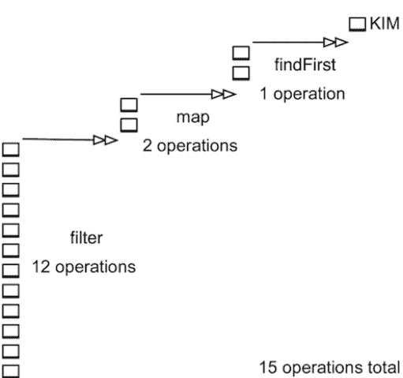
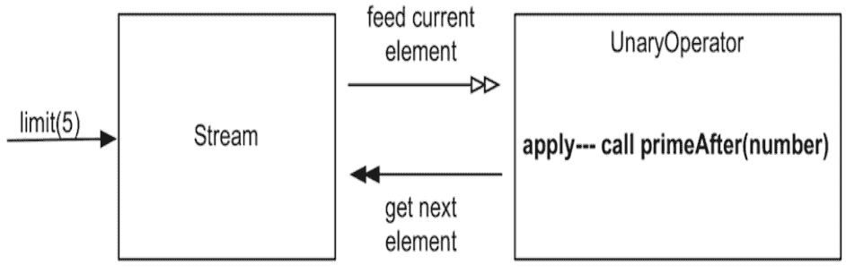

- [13] https://junit.org

## 第 7 章

## 惰性求值

在 Java 中，我们通常会急切地执行代码。例如，参数在方法调用时立即求值。这样做有充分的理由；急切的代码易于编写和思考。但是，将承诺推迟到最后负责任的时刻是一种良好的敏捷实践。在执行代码时，通过稍微懒惰一点，我们可以获得性能提升。急切很简单，但懒惰更高效。但是，有了 Lambda，我们可以轻松地懒惰，同时使事情既简单又高效。

将函数的执行推迟到必要时才执行是一种好策略。然而，我们仍然需要找出如何推迟函数调用，这可能需要一些工作。悖论的是，懒惰往往需要努力，这造成了阻碍。毕竟，谁想努力工作才能懒惰呢？在 Java 中，我们不必如此；我们可以放松，因为 Lambda 表达式使运行我们的程序既懒惰又快速。

在本章中，我们首先从一个任务开始：推迟创建重量级对象，然后将一些急切计算转换为惰性求值。作为最后一个任务，我们将研究如何通过利用 Streams 中内置的惰性来创建无限惰性序列。本章的技巧可以帮助我们的程序运行得更快，代码变得更加简洁，也让我们看起来更聪明。

### 延迟初始化

在面向对象编程中，我们在任何方法调用之前确保对象构建良好。我们进行封装，确保正确的状态转换，并保持对象的不变量。大多数情况下这工作良好，但当对象内部的一些部分是重量级资源时，如果我们推迟创建它们，将受益匪浅。这可以加快对象创建速度，程序也不会在创建可能不会使用的东西上浪费任何精力。

推迟创建对象一部分的设计决策不应给对象的用户带来负担——它应该是无缝的。让我们探讨一些设计惰性初始化的方法。

#### 一个熟悉的方法

在以下示例中，我们将编写一种延迟创建重量级实例的方法。然后，我们将改进设计。

让我们从一个 Holder 类开始，它需要一些重量级资源。由于它依赖的资源，创建此类的实例可能需要大量的时间和内存。为了解决这个问题，我们可以将重量级资源移动到另一个类中——比如说，Heavy。然后，Holder 的实例将保留对 Heavy 实例的引用，并根据需要将调用路由到它。

让我们创建 Heavy 类。

lazy/fpij/Heavy.java

```java
public class Heavy {
    public Heavy() { System.out.println("Heavy created"); }
}
```


public String toString() { return "quite heavy"; }
}

这个类代表一个假想的重量级资源。在其构造函数中，我们打印一条消息来告知它何时被创建。让我们在 Holder 类的第一个试用版本中使用这个类的实例，名为 HolderNaive。

### lazy/fpij/HolderNaive.java

```java
public class HolderNaive {
    private Heavy heavy;

    public HolderNaive() {
        System.out.println("Holder created");
    }

    public Heavy getHeavy() {
        if (heavy == null) {
            heavy = new Heavy();
        }

        return heavy;
    }

    //...
}
```

乍一看，这段代码似乎很简单。我们创建了一个空引用 heavy，并在首次调用 `getHeavy` 方法时将其赋值为合适的实例。让我们使用这个类来创建 `HolderNaive` 的实例，并看看它是否推迟了 `Heavy` 实例的创建。

### lazy/fpij/HolderNaive.java

```java
final HolderNaive holder = new HolderNaive();
System.out.println("deferring heavy creation...");
System.out.println(holder.getHeavy());
System.out.println(holder.getHeavy());
```

这段代码的输出如下：

Holder created
deferring heavy creation...
Heavy created
quite heavy
quite heavy

这似乎有效。这个解决方案很常见，但也相当简单，无法保证线程安全。让我们逐步分析。

### 提供线程安全

对于 `HolderNaive` 的一个实例，依赖的 `Heavy` 实例会在首次调用 `getHeavy` 方法时创建。在随后对该方法的调用中，将返回已创建的实例。这正是我们想要的，但有个问题。这段代码存在竞态条件。

如果两个或多个线程同时调用 `getHeavy` 方法，我们可能会得到多个 `Heavy` 实例，可能每个线程一个。这个副作用是不希望的。让我们修复它。

```java
public synchronized Heavy getHeavy() {
    if (heavy == null) {
        heavy = new Heavy();
    }
    return heavy;
}
```

我们使用 `synchronized` 关键字标记 `getHeavy` 方法以确保互斥。如果两个或多个线程并发调用此方法，由于互斥，只有一个线程被允许进入，其他线程将排队等待。第一个进入方法的线程将创建实例。

当后续线程进入此方法时，它们会看到实例已存在，并直接返回它。

我们避免了竞态条件，但该方案带来了另一个负面影响。现在对 `getHeavy` 方法的每次调用都必须忍受同步开销；即使没有并发竞争线程，调用线程也必须跨越内存屏障（参见 Brian Goetz 的 *Java 并发编程实践* [Goe06]）。

实际上，竞态条件发生的可能性非常短暂，仅在首次给 heavy 引用赋值时才可能发生，同步方法是一种过于粗暴的解决方案。我们需要在首次创建引用之前保证线程安全，之后则可以自由、无阻碍地访问该引用。我们将采用 David Wheeler 的建议来实现这一点：“计算机科学中的任何问题都可以通过增加一个间接层来解决。”[14]

### 增加一个间接层

本示例中添加的间接层来源于 `Supplier<T>` 类。这是 JDK 中的一个函数式接口，只有一个名为 `get` 的抽象方法，用于返回一个实例。换句话说，这是一个无需输入就不断给出的工厂，有点像母亲的爱。

在最基本的形式中，`Supplier` 将返回一个实例。例如，我们可以实现 `Supplier<Heavy>` 来返回 `Heavy` 的实例，如下所示：

```java
Supplier<Heavy> supplier = () -> new Heavy();
```

或者，我们可以使用构造函数引用代替传统的 `new` 语法来实例化一个实例。构造函数引用很像方法引用，只不过它引用的是构造函数而不是方法。只要 lambda 表达式仅仅是实例化一个实例，就可以使用构造函数引用。让我们看一个使用构造函数引用的示例。

```java
Supplier<Heavy> supplier = Heavy::new;
```

我们看到了 `Supplier` 能为我们做什么，但我们需要比这种简单形式更多的东西。我们需要推迟并缓存实例。我们可以通过将实例创建移到另一个函数中来实现这一点，如下所示，这是 `Holder` 类的最终版本。

lazy/fpij/Holder.java

```java
public class Holder {
    private Supplier<Heavy> heavy = () -> createAndCacheHeavy();

    public Holder() {
        System.out.println("Holder created");
    }

    public Heavy getHeavy() {
        return heavy.get();
    }

    //...
}
```

在这个版本中，字段 `heavy` 是 `Supplier<Heavy>` 的一个实例。我们将其赋值为一个 lambda 表达式，Java 编译器会从中合成一个具有预期 `get` 方法的实现。该实现简单地将调用路由到 `createAndCacheHeavy` 方法，我们很快会实现该方法。`getHeavy` 方法返回与 `Supplier` 的 `get` 方法相同的内容。

如我们所见，创建 `Holder` 实例时，不会创建 `Heavy` 实例。这种设计实现了延迟初始化的目标。我们还需要一种不过分严苛的线程安全解决方案。`createAndCacheHeavy` 方法正是为此而设。

让我们先看看这个方法的代码。

lazy/fpij/Holder.java

```java
private synchronized Heavy createAndCacheHeavy() {
    class HeavyFactory implements Supplier<Heavy> {
        private final Heavy heavyInstance = new Heavy();

        public Heavy get() { return heavyInstance; }
    }

    if (!HeavyFactory.class.isInstance(heavy)) {
        heavy = new HeavyFactory();
    }

    return heavy.get();
}
```

我们将把这个方法标记为 `synchronized`，以便并发调用该方法的线程互斥。但在该方法内部，首次调用时，我们会迅速将 `Supplier` 引用 `heavy` 替换为直接供应商 `HeavyFactory`，后者将返回一个 `Heavy` 实例。让我们看看这如何妥善解决线程安全问题。

让我们考虑这样一个场景：刚刚创建了一个 `Holder` 的新实例。假设两个线程并发调用 `getHeavy` 方法，随后第三个线程在很久之后调用该方法。当前两个线程调用 `Holder` 中默认供应商的 `get` 方法时，`createAndCacheHeavy` 方法会让其中一个通过，并让另一个等待。第一个进入的线程将检查 `heavy` 是否是 `HeavyFactory` 的实例。由于它不是默认的 `Supplier`，该线程会将 `heavy` 替换为 `HeavyFactory` 的一个实例。最后，它返回该 `HeavyFactory` 持有的 `Heavy` 实例。

第二个进入的并发线程会再次检查 `heavy` 是否是 `HeavyFactory` 的实例，并跳过创建。它将简单地返回第一个线程返回的同一实例。这里我们假设 `Heavy` 本身是线程安全的，我们只关注 `Holder` 的线程安全。

我们已经解决了竞态条件，但由于实例是延迟创建的，我们不再需要如此保守。既然 `heavy` 已被替换为 `HeavyFactory`，后续对 `getHeavy` 方法的调用将直接进入 `HeavyFactory` 的 `get` 方法，而不会产生任何同步开销。

我们设计了延迟初始化，同时避免了空检查。我们还确保了延迟实例创建的线程安全性。这是虚拟代理模式的一种简单、轻量级实现。接下来，我们将使用 lambda 表达式来推迟函数求值。

### 延迟求值

在上一节中，我们推迟了重量级对象的创建，以加快代码执行速度。本节将进一步探讨这一点，以推迟方法的运行，并利用这种方法来改进我们的设计。主要目标是将代码执行减少到最低限度——尤其是昂贵的代码——并加快执行速度。

Java 在求值逻辑运算时已经使用了延迟执行。例如，在 `fn1() || fn2()` 中，如果 `fn1` 返回布尔值 `true`，则永远不会执行 `fn2` 的调用。同样，如果将 `||` 替换为 `&&`，当 `fn1` 返回布尔值 `false` 时，`fn2` 的调用也不会发生。程序从这种短路求值中受益；我们避免了不必要的表达式或函数求值，这有助于提高性能。我们经常依赖这种短路求值来保证代码正确性。

虽然 Java 在求值逻辑运算符时使用延迟或正则求值顺序，但在求值方法参数时使用急切或应用顺序。在调用方法之前，会对传递给方法的所有参数进行完全求值。如果方法没有使用所有传递的参数，程序就浪费了时间和精力来执行它们。我们可以使用 lambda 表达式来推迟部分参数的执行。

Java 编译器在调用位置对参数列表中的 lambda 表达式和方法引用进行求值。这些的调用被推迟，直到它们在被传递的方法内部被显式调用。我们可以利用这种行为，通过在 lambda 中嵌入对它们的调用来推迟甚至避免方法调用


expressions. We can’t seamlessly wrap arbitrary arguments into lambda expressions. We have to explicitly design for it, as we’ll see here.

表达式。我们无法将任意参数无缝包装为 lambda 表达式。我们必须明确为它设计，稍后将在此过程中了解。

Many methods in the JDK—including methods on the Stream class—do lazy evaluation. For instance, the filter method may not invoke the Predicate, passed as an argument, on all the elements in the target collection.

JDK 中的许多方法（包括 Stream 类上的方法）都会执行惰性求值。例如，filter 方法可能不会对目标集合中的所有元素调用作为参数传递的 Predicate。

We can design lazy evaluation of arguments to methods by turning the parameters into functional interfaces. Let’s work that approach into an example to get a feel for the design.

我们可以通过将参数转换为函数式接口，来设计方法参数的惰性求值。让我们通过一个示例来实践这种方法，以了解这种设计。

### Starting with Eager Evaluation

### 从急切求值开始

In the example here, methods take significant time to run. We’ll call them eagerly and then alter the design to improve speed.

在此示例中，方法运行需要花费大量时间。我们将急切地调用它们，然后修改设计以提高速度。

Let’s start with a method evaluate that takes quite a bit of time and resources to run.

让我们从一个名为 evaluate 的方法开始，它运行起来耗费大量时间和资源。

```java
lazy/fpij/Evaluation.java
public class Evaluation {
public static boolean evaluate(final int value) {
System.out.println("evaluating ..." + value);
simulateTimeConsumingOp(2000);
return value > 100;
}
//...
}
```

A call to evaluate would take a couple of seconds to run, so we definitely want to postpone any unnecessary calls. Let’s create a method, eagerEvaluator, which is like almost any method we write in Java: all of its arguments will be evaluated before its call.

调用 evaluate 需要几秒钟才能运行，因此我们肯定希望推迟任何不必要的调用。让我们创建一个名为 eagerEvaluator 的方法，它几乎像我们在 Java 中编写的任何其他方法一样：其所有参数都将在调用之前求值。

```java
lazy/fpij/Evaluation.java

public static void eagerEvaluator(
    final boolean input1, final boolean input2) {
    System.out.println("eagerEvaluator called...");
    System.out.println("accept? " + (input1 && input2));
}
```

The method takes two boolean parameters. Within the method, we perform a logical and operation on the parameters. Sadly, it's too late to benefit from the lazy evaluation this operation automatically provides since the arguments are evaluated well before we enter this method.

该方法接受两个 boolean 参数。在方法内部，我们对参数执行逻辑与运算。遗憾的是，为时已晚，无法从该操作自动提供的惰性求值中受益，因为参数在进入该方法之前就已经求值了。

Let's invoke eagerEvaluator and pass as arguments the results of two evaluate method calls.

让我们调用 eagerEvaluator，并将两个 evaluate 方法调用的结果作为参数传递。

```java
lazy/fpij/Evaluation.java

eagerEvaluator(evaluate(1), evaluate(2));
```

If we run this code we'll see both the calls to evaluate execute well before we enter the eagerEvaluator method.

如果运行此代码，我们将看到两个 evaluate 调用在进入 eagerEvaluator 方法之前就已经执行。

```
evaluating ...1
evaluating ...2
eagerEvaluator called...
accept?: false
```

This would take at least four seconds to run because of the cumulative delay from the calls to the evaluate method. We'll improve on that next.

由于 evaluate 方法调用带来的累积延迟，运行此代码至少需要四秒钟。我们将在下一部分对其进行改进。

### Designing for Lazy Evaluation

### 为惰性求值设计

If we know that some arguments may not be used during the execution of a method, we can design the method's interface to facilitate the delayed execution of some or all arguments. The arguments can be evaluated on demand, as in this lazyEvaluator method:

如果我们知道某些参数在方法执行期间可能不会被使用，我们可以设计方法的接口，以便推迟部分或所有参数的执行。参数可以按需求值，如下面的 lazyEvaluator 方法所示：

```java
lazy/fpij/Evaluation.java

public static void lazyEvaluator(
final Supplier<Boolean> input1, final Supplier<Boolean> input2) {
System.out.println("lazyEvaluator called...");
System.out.println("accept?: " + (input1.get() && input2.get()));
}
```

Rather than taking two boolean parameters, the method receives references to the Supplier instances. This JDK functional interface will return an instance, Boolean in this case, in response to a call to its get method. The logical and operation we use within the lazyEvaluator method will invoke the get methods only on demand.

该方法不再接受两个 boolean 参数，而是接收 Supplier 实例的引用。这个 JDK 函数式接口会在对其 get 方法进行调用时返回一个实例（在此示例中为 Boolean）。我们在 lazyEvaluator 方法中使用的逻辑与运算将仅按需调用 get 方法。

If we pass two calls to evaluate as arguments to the lazyEvaluator method, the second will be evaluated only if the first call returned a boolean true. Let's run the method to see this.

如果将两个 evaluate 调用作为参数传递给 lazyEvaluator 方法，只有在第一个调用返回 boolean true 时，第二个调用才会被求值。让我们运行该方法来查看这一点。

```java
lazy/fpij/Evaluation.java

lazyEvaluator(() -> evaluate(1), () -> evaluate(2));
```

Each Supplier makes a call to the evaluate method, but not until the lazyEvaluator method is invoked. The evaluation is lazy and optional, determined by the flow of execution within the lazyEvaluator method. We can see this delayed evaluation in the output when we run the code.

每个 Supplier 都会对 evaluate 方法进行一次调用，但要在调用 lazyEvaluator 方法之后才会进行。求值是惰性且可选的，由 lazyEvaluator 方法内部的执行流程决定。当我们运行代码时，可以在输出中看到这种延迟求值。

```
lazyEvaluator called...
evaluating ...1
accept?: false
```

The arguments aren't evaluated before we enter the lazyEvaluator method. The second call to evaluate was skipped in this version. This example call of lazyEvaluator takes only about two seconds, whereas the previous call to eagerEvaluator took about four seconds.

在进入 lazyEvaluator 方法之前不会对参数进行求值。在此版本中，第二个 evaluate 调用被跳过了。这个 lazyEvaluator 示例调用只需要大约两秒钟，而之前的 eagerEvaluator 调用大约需要四秒钟。

We saw the cost savings of the lazy evaluation. This technique is helpful when we have to evaluate a large number of methods or if method evaluations are time/resource consuming.

我们看到了惰性求值带来的成本节约。当需要求值大量方法，或者方法求值耗时/耗费资源时，这种技术非常有帮助。

This technique can significantly boost performance, but its disadvantage is it burdens the caller with packaging the calls in a lambda expression. Sure, lambda expressions are concise, but they're a hindrance compared to the usual way of passing arguments. In some contexts, we may be able to use method references instead of lambda expressions, and this can make the code a bit more concise and ease the burden a little.

这种技术可以显著提升性能，但其缺点是给调用者带来了将调用封装在 lambda 表达式中的负担。当然，lambda 表达式很简洁，但与通常的参数传递方式相比，它们确实是一种阻碍。在某些场景中，我们可以使用方法引用而不是 lambda 表达式，这可以使代码更加简洁，并稍微减轻负担。

The lazy solutions so far have helped us make code more efficient. Next, we'll use it purely for convenience.

迄今为止的惰性求值方案已经帮助我们让代码更高效。接下来，我们将纯粹为了方便而使用它。

### Leveraging the Laziness of Streams

### 利用 Stream 的惰性求值

In previous chapters we've seen the facilities that the Stream interface offers, but so far we haven't discussed one of their most salient features—they're really lazy, in a good way. The lazy evaluation of Streams is powerful. First, we don't have to do anything special to derive their benefits. In fact, we've used them many times already! Second, they can postpone not just one, but a sequence of evaluations so that only the most essential parts of the logic are evaluated, and only when needed. Let's look at how lazy Streams are and how we benefit from that.

在前面的章节中，我们已经了解了 Stream 接口提供的功能，但迄今为止我们还没有讨论它们最突出的特性之一——它们确实是惰性的，而且是一种良好的惰性。Stream 的惰性求值非常强大。首先，我们不需要做任何特殊的事情就能获得其好处。事实上，我们已经多次使用过它们了！其次，它们可以推迟不仅一个，而是一系列求值，这样只有最必要的逻辑部分会被求值，并且仅在需要时才会求值。让我们来看看 Stream 有多惰性，以及我们如何从中受益。

### Intermediate and Terminal Operations

### 中间操作和终止操作

Streams have two types of methods: _intermediate_ and _terminal_, which work together. The secret behind their laziness is that we chain multiple intermediate operations followed by a terminal operation.

Stream 拥有两种类型的方法：_中间操作_ 和 _终止操作_，它们协同工作。其惰性的秘密在于我们将多个中间操作链式调用，随后跟一个终止操作。

Methods like `map` and `filter` are intermediate; calls to them return immediately, and the lambda expressions provided to them aren't evaluated right away. The core behavior of these methods is cached for later execution and no real work is done when they're called. The cached behavior is run when one of the terminal operations, like `findFirst` and `reduce`, is called. But not all the cached code is executed, and the computation will complete as soon as the desired result is found. Let's look at an example to understand this better.

像 `map` 和 `filter` 这样的方法是中间操作；对它们的调用会立即返回，传递给它们的 lambda 表达式也不会立即求值。这些方法的核心行为会被缓存以供稍后执行，在调用时不会执行任何实际工作。当调用像 `findFirst` 和 `reduce` 这样的终止操作时，会执行缓存的行为。但并非所有缓存的代码都会被执行，计算会在找到所需结果后立即完成。让我们通过一个示例来更好地理解这一点。

Suppose we're given a collection of names and we're asked to print in all caps the first name that's only three letters long.

假设我们得到一组名称，并被要求打印长度仅为三个字母的第一个名称的全大写形式。

We can use Stream's functional-style methods to achieve this. But first, let's create a few helper methods.

我们可以使用 Stream 的函数式风格方法来实现这一点。但首先，让我们创建一些辅助方法。

```java
public class LazyStreams {
  private static int length(final String name) {
    System.out.println("getting length for " + name);
    return name.length();
  }

  private static String toUpper(final String name ) {
    System.out.println("converting to uppercase: " + name);
    return name.toUpperCase();
  }

  //...
}
```

The two helper methods simply print the parameters they receive before returning the expected results. We wrote these methods to take a peek at the intermediate operations in the code we'll write next.

这两个辅助方法只是在返回预期结果之前打印它们接收到的参数。我们编写这些方法是为了在接下来编写的代码中窥探中间操作的执行情况。

```java
public static void main(final String[] args) {
  List<String> names = List.of("Brad", "Kate", "Kim", "Jack", "Joe",
      "Mike", "Susan", "George", "Robert", "Julia", "Parker", "Benson");

  final String firstNameWith3Letters =
      names.stream()
          .filter(name -> length(name) == 3)
          .map(name -> toUpper(name))
          .findFirst()
          .orElse("");

  System.out.println(firstNameWith3Letters);
}
```

We started with a list of names, transformed it into a Stream, filtered out only names that are three letters long, converted the selected names to all caps, and picked the first name from that set.

我们从一个名称列表开始，将其转换为 Stream，过滤出长度仅为三个字母的名称，将选定的名称转换为全大写，并从该集合中选择第一个名称。

At first glance, it appears the code is doing a lot of work transforming collections, but it's deceptively lazy; it didn't do any more work than was absolutely essential. Let's take a look.

乍一看，代码似乎在对集合进行大量转换，但它具有欺骗性的惰性；它并没有做比绝对必要的更多工作。让我们来看看。

### Method Evaluation Order

### 方法求值顺序

It would help to read the code from right to left, or bottom up, to see what's going on here. Each step in the call chain will do only enough work to ensure that the terminal operation in the chain completes. This behavior is in direct contrast to the usual eager evaluation, but it is efficient.

从右到左或从下往上阅读代码，将有助于了解这里发生了什么。调用链中的每个步骤只会执行足够的工作，以确保链中的终止操作完成。这种行为与通常的急切求值形成直接对比，但它是高效的。

If the code were eager, the filter method would have first gone through all dozen names in the collection to create a list of two names, Kim and Joe, whose length is three (letters). The subsequent call to the map method would have then evaluated the two names. The findFirst method finally would have picked the first element of this reduced list. We can visualize this hypothetical eager order of evaluation in the following figure.

如果代码是急切求值的，filter 方法首先会遍历集合中所有十几个名称，创建一个包含长度为三个字母的两个名称（Kim 和 Joe）的列表。随后对 map 方法的调用会求值这两个名称。最后，findFirst 方法会从这个缩减后的列表中选择第一个元素。我们可以在下图中可视化这种假设的急切求值顺序。




但是，filter 和 map 方法骨子里都是惰性的。随着执行过程沿链条推进，filter 和 map 方法会存储 lambda 表达式，并将一个外观传递给链中的下一个调用。只有在调用终端操作 findFirst 时，求值才会开始。

求值顺序也不同，如下图所示。filter 方法不会一次性处理完集合中的所有元素。相反，它会运行直到找到满足附加 lambda 表达式中给定条件的第一个元素为止。一旦找到元素，它就将其传递给链中的下一个方法。在这个示例中，这个下一个方法（即 map）对给定输入执行其部分操作，并将其传递下链。当求值到达末尾时，终端操作会检查是否已收到所需的结果。

如果终端操作得到了所需内容，链的计算即终止。如果终端操作不满意，它会要求对集合中的更多元素执行操作链。

通过检查此操作排序的逻辑，我们可以看到执行将仅遍历集合中必要的元素。通过运行代码，可以看到这种行为的证据。

```
getting length for Brad
getting length for Kate
getting length for Kim
converting to uppercase: Kim
KIM
```

从输出可以看到，一旦找到了我们要找的候选名称，示例列表中的大多数元素都未被求值。

上一个示例中看到的操作逻辑序列，在 JDK 内部是通过融合操作实现的——中间操作中的所有函数被融合为一个函数，在每个元素上按需求值，直到终端操作满意为止。归根结底，数据只进行一次遍历——过滤、映射和元素选择都在一次操作中完成。

### 窥探惰性

在 Java 中，将一系列操作写成链式调用是首选且自然的方式。但要真正看出惰性求值直到调用终端操作才开始，我们可以将前面代码中的链拆分为步骤。

```
lazy/fpij/LazyStreams.java
Stream<String> namesWith3Letters =
names.stream()
.filter(name -> length(name) == 3)
.map(name -> toUpper(name));

System.out.println("Stream created, filtered, mapped...");
System.out.println("ready to call findFirst...");

final String firstNameWith3Letters =
namesWith3Letters.findFirst()
.orElse("");

System.out.println(firstNameWith3Letters);
```

我们将集合转换为流，过滤了值，然后映射了结果集合。然后，单独调用了终端操作。让我们运行代码来查看求值顺序。

```
Stream created, filtered, mapped...
ready to call findFirst...
getting length for Brad
getting length for Kate
getting length for Kim
converting to uppercase: Kim
KIM
```

从输出可以清楚地看出，中间操作将真正的工作推迟到了调用终端操作这一最后负责时刻。即使如此，它们也只完成了满足终端操作所需的最少工作。非常高效，是吧？

这个例子帮助我们揭示了 Stream 的真正威力。接下来，我们将使用 Streams 创建无限集合。

### 创建无限惰性集合

使用无限集合可以使创建不断增长序列（例如斐波那契数）的代码更清晰、更易于表达。但根据我们在 Java 中的经验，由于实际内存限制，可能会认为序列不能是无限的。在这里，Stream 的惰性再次派上用场。

在 Java 中，集合仍然需要是有限的，但流可以是无限的。我们将在这里看到，惰性如何成为实现无限流的关键支撑。我们将使用它们来创建富有表现力、易于理解的代码，以生成无限增长的序列。

#### 绝望的尝试

我们将使用素数序列 2、3、5、7、... 作为示例来探讨这里的概念。首先，让我们创建一个辅助函数来判断一个数字是否为质数。

```
public static boolean isPrime(final int number) {
    return number > 1 &&
    IntStream.rangeClosed(2, (int) Math.sqrt(number))
    .noneMatch(divisor -> number % divisor == 0);
}
```

大于 1 的数如果不能被 2 到其平方根之间的任何数整除，则是质数。通常，我们会使用外部迭代器在该范围内搜索除数。相反，这里我们使用了更多 Java 的精髓——IntStream 接口的 rangeClosed 静态方法。

方法名中的 closed 后缀强调，值的范围将包含第二个参数。例如，rangeClosed(1, 10) 将返回包含值 1、2、...、10 的范围，并将其打包到一个 Stream 中。相比之下，接口中的另一个静态方法 range 将返回一个值范围，直到（但不包括）第二个参数中的值。

在 `isPrime` 方法中，我们使用 `rangeClosed` 方法返回的流上的简洁明了的 `noneMatch` 方法。`noneMatch` 方法将 `Predicate` 作为其参数，我们使用它来确定给定数字是否有除数。如果 lambda 表达式对范围内所有值都返回 `false`，`noneMatch` 方法将产生 `boolean` 值 `true`——也就是说，如果没有除数。

在第一次尝试中，我们将使用 `isPrime` 方法从给定 `number` 开始创建一系列质数。

```
//don't try this at the office
public static List<Integer> primes(final int number) {
    if(isPrime(number)) {
        return concat(number, primes(number + 1));
    }

    return primes(number + 1);
}
```

如果给定的 `number` 是质数，我们将其包含在其后的质数列表中。否则，我们跳过它并继续获取该列表。

别急着发推文；不，你谦卑的作者并没有疯——那段代码诱人地优雅，但 sadly，行不通。如果我们实现 `concat` 方法并运行代码，将进入无限递归并最终抛出 `java.lang.StackOverflowError`。

让我们深入研究一下代码，看看能否从中挽回些什么。`StackOverflowError` 来自对 `primes` 方法的递归调用。如果我们能对这个调用采取惰性策略，就不会出问题。

### 触及星辰

前面我们已经看到 Stream 有多惰性。它们在我们要求结果之前不会做任何实际工作——有点像我的孩子。我们可以依赖这种惰性来轻松创建一个惰性的无限集合。

当我们从集合或通过其他方式创建 Stream 时，我们会很快收到一个外观，它有可能返回一个无限列表。但它非常巧妙；它只返回我们要求的那么多元素，按需生成元素。我们可以使用该功能来表达无限集合，并从该列表中生成我们想要的任意数量的（有限）元素。让我们来看看如何实现。

Stream 接口有一个名为 iterate 的静态方法，可以创建无限 Stream。它需要两个参数：启动集合的种子值，以及一个 UnaryOperator 接口的实例，它是集合中的数据提供者。iterate 方法返回的 Stream 会推迟创建元素，直到我们使用终止方法请求它们为止。例如，要获取第一个元素，可以调用 findFirst 方法。要获取十个元素，可以在 Stream 上调用 limit 方法，例如：limit(10)。

让我们看看这些想法在代码中如何体现。

```
lazy/fpij/Primes.java

public class Primes {
  private static int primeAfter(final int number) {
    if(isPrime(number + 1)) {
      return number + 1;
    }

    return primeAfter(number + 1);
  }
}


```java
public static List<Integer> primes(final int fromNumber, final int count) {
    return Stream.iterate(primeAfter(fromNumber - 1), Primes::primeAfter)
           .limit(count)
           .collect(toList());
}
//...
}
```

我们首先定义了一个便捷方法 primeAfter，它返回给定数之后的一个质数。如果给定数旁边的数是质数，则立即返回；否则，该方法会递归地询问接下来的质数。处理无限系列的代码位于 primes 方法中。它在功能上虽然简洁，但真正的复杂性隐藏在 iterate 方法和 Stream 中。

primes 方法将创建一个无限质数系列，起始于大于或等于给定参数的第一个质数。在调用 iterate 方法时，第一个参数为无限系列提供种子值。如果给定的数是质数，则它被用作种子。否则，则使用该数之后的第一个质数。第二个参数（即方法引用）充当 UnaryOperator，该操作符接受一个参数并返回一个值。在此示例中，由于我们引用了 primeAfter 方法，它接受一个数并返回该数之后的质数。

调用 iterate 方法的结果是一个 Stream，它会缓存所给定的 UnaryOperator。当我们请求特定数量的元素，且只有在此时，Stream 才会将当前元素（给定的种子值作为第一个元素）传递给缓存的 UnaryOperator 以获取下一个元素，然后再将该元素传回给 UnaryOperator 以获取接下来的元素。这个序列会重复所需的次数，直到获取到我们请求的元素数量，如下图所示。



#### 仅按需执行

让我们先调用 `primes` 方法，获取从 1 开始的十个质数，然后再获取从 100 开始的五个质数。

```
lazy/fpij/Primes.java
```

```
System.out.println("10 primes from 1: " + primes(1, 10));

System.out.println("5 primes from 100: " + primes(100, 5));
```

`primes` 方法创建一个从给定输入开始的无限质数集合的 `Stream`。要从集合中获取特定数量的元素，我们调用 `limit` 方法。然后，我们将返回的元素集合转换为列表并打印出来。对 `collect` 的调用触发了序列的求值。方法 `limit` 也是一种中间操作，它会惰性地记录后续求值所需的元素数量！让我们来看这段代码的输出。

```
10 primes from 1: [2, 3, 5, 7, 11, 13, 17, 19, 23, 29]
5 primes from 100: [101, 103, 107, 109, 113]
```

该代码生成了两个质数系列，一个从 1 开始，另一个从 100 开始。它们是从我们在 `primes` 方法中如此简洁地创建的无限系列中提取的，这要归功于 Streams 的惰性特性以及 lambda 表达式/方法引用的强大功能。

我们看到 lambda 表达式和 Stream 实现是如何协同工作以提高执行效率的。虽然 lambda 表达式和方法引用使代码优雅、富有表现力且简洁，但 Java 应用程序中真正的性能提升将来自 Streams。lambda 表达式是 Java 的入门毒品，而 Streams 才是真正的瘾头——在开发 Java 应用程序时，请做好沉迷其中的准备。

我们仅用几行代码就完成了大量工作；花几分钟欣赏 lambda 表达式、函数式接口以及 Streams 效率的强大之处，完全没问题。在下一章中，我们将把 lambda 表达式的使用再提升一个层次，使递归更加高效。

### 总结

lambda 的引入为 Java 带来了效率提升；我们可以惰性地推迟代码执行，直到真正需要它时才执行。我们可以延迟重量级资源的初始化，并轻松实现虚拟代理模式。同样，我们可以推迟方法参数的求值，以使调用更加高效。改进版 JDK 的真正功臣是 Stream 接口及其相关类。我们可以利用它们的惰性行为，只需几行代码即可创建无限集合。这意味着可以编写高度富有表现力、简洁的代码来执行复杂操作，而这些操作在以前的 Java 中我们甚至无法想象。

在下一章中，我们将探讨 lambda 表达式在优化递归中的作用。

#### 脚注

[14] [http://en.wikipedia.org/wiki/David_Wheeler_(computer_scientist)](http://en.wikipedia.org/wiki/David_Wheeler_(computer_scientist))
