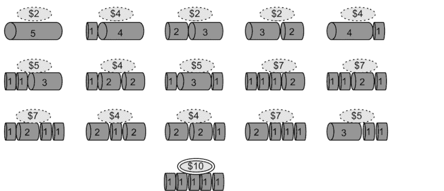

## 优化递归

递归是解决问题的一种强大且迷人的方式。它高度富有表现力——使用递归，我们可以通过对子问题应用相同的解决方案来提供一个问题的解决方案，这种方法被称为分治法。各种应用都采用递归，例如在地图上寻找最短距离、计算最小成本或最大利润，或减少浪费。

当今大多数使用的语言都支持递归。不幸的是，真正受益于递归的问题往往规模相当大，而简单的实现很快就会导致栈溢出。在本章中，我们将探讨尾调用优化（TCO）技术，使递归能够处理大规模输入。接着，我们将研究可以用高度递归的重叠解决方案来表达的问题，并探讨如何使用记忆化技术使它们运行得飞快。

### 使用尾调用优化

使用递归最大的障碍是大规模输入问题的栈溢出风险。出色的 TCO 技术可以消除这一顾虑。尾调用是指最后执行的操作是对自身的调用的递归调用。这与普通递归不同，在普通递归中，函数除了调用自身外，通常还会对递归调用的结果进行进一步计算。TCO 让我们能够将普通递归调用转换为尾调用，从而使递归在处理大规模输入时变得实用。

Java 在编译器级别不直接支持 TCO，但我们可以使用 lambda 表达式在几行代码中实现它。这种解决方案有时被称为*蹦床调用*，让我们可以享受递归的强大功能，而无需担心栈溢出。

我们将使用一个非常简单且常见的示例来实现 TCO，即计算一个数的阶乘。

#### 从未优化的递归开始

让我们先来看一段使用简单未优化递归来计算阶乘的代码。

```
recur/fpij/Factorial.java

1: public class Factorial {
2:   public static int factorialRec(final int number) {
3:     if(number == 1) {
4:       return number;
5:     }
6: 
7:       return number * factorialRec(number - 1);
8:   }
9: }
```

当递归降到值为 1 时终止。对于较大的值，我们递归调用该数乘以该数减 1 的阶乘。让我们使用数字 5 来试用这个方法。

```
recur/fpij/Factorial.java
```

```
System.out.println(factorialRec(5));
```

120

这似乎有效，但让我们再试一次，这次使用一个较大的输入值。

```
recur/fpij/Factorial.java
```

```
try {
    System.out.println(factorialRec(20000));
} catch(StackOverflowError ex) {
    System.out.println(ex);
}
```

我们以防御性的方式编写了那个调用；让我们来看看输出结果。

java.lang.StackOverflowError

递归没有处理大规模输入。它轰然崩溃。这在采用这种强大且富有表现力的技术时是一个严重障碍。

问题不在于递归本身。它是由在等待递归完成时保持计算的部分结果引起的。让我们更仔细地看看 factorialRec 方法中的第 7 行。我们在该行上执行的最后操作是乘法（*）。在保留给定数字的同时，我们


等待下一次对 factorialRec 的调用返回结果。因此，每次调用都会使调用栈增长，如果输入规模不断增大，代码执行最终会崩溃。我们需要一种不保留栈的递归方式。

在《计算机程序的构造和解释》[AS96]中，Abelson 和 Sussman 讨论了 TCO 技术，他们在内部将递归转换为纯迭代。理想情况下，我们希望依赖编译器提供此类优化，但由于编译器不提供，我们可以使用 lambda 表达式手动完成，正如我们接下来将看到的。

### 转向尾递归

在使用 TCO 技术之前，我们必须重新设计代码，使其不会构建调用栈。而不是等待在 factorialRec 方法的第 7 行执行乘法，我们可以使用已有内容计算部分乘积，并将其作为额外参数传递给后续调用。这样，当我们从递归调用返回时，就不需要执行任何算术运算了。这是一个很好的第一步，但还不够。此外，我们在递归调用方法之前，必须先退出当前栈层级。换句话说，我们需要将对 factorialRec 的急切调用转换为惰性调用。为此，我们将使用 TailCall 函数式接口和一个伴随的 TailCalls 类。我们很快就会设计这两者，但先假设它们已经存在。

首先，让我们向 TailCalls 类的方法添加静态导入。

```
recur/fpij/Factorial.java

import static fpij.TailCalls.done;
import static fpij.TailCalls.call;
```

我们将在用于计算阶乘的新递归版本中使用这两个方法，即 `factorialTailRec` 方法。

```
recur/fpij/Factorial.java

public static TailCall<Integer> factorialTailRec(
    final int factorial, final int number) {
    if (number == 1) {
        return done(factorial);
    }

    return call(() -> factorialTailRec(factorial * number, number - 1));
}
```

这个计算阶乘的版本是尾递归的；也就是说，最后一次操作是对自身的（延迟/惰性）调用，并且在返回时无需对结果进行进一步计算。此外，我们没有急切地调用方法 `factorialTailRec`，而是将其包装在 lambda 表达式中以供惰性/稍后执行。

### 创建 TailCall 函数式接口

当我们调用 `factorialTailRec` 方法时，它会立即返回一个 `TailCall` 实例。关键在于，如果我们调用 `done` 方法，则表示递归终止。另一方面，如果我们通过 `call` 方法进行调用，则表示要求递归继续，但只有在退出当前栈层级之后才会继续。为了充分理解这是如何工作的，我们需要查看这些方法的内部，因此让我们深入了解 `TailCall` 接口和 `TailCalls` 伴随类。我们先从接口开始。

```
recur/fpij/TailCall.java

@FunctionalInterface
public interface TailCall<T> {

    TailCall<T> apply();

    default boolean isComplete() { return false; }

    default T result() { throw new Error("not implemented"); }

    default T invoke() {
        return Stream.iterate(this, TailCall::apply)
            .filter(TailCall::isComplete)
            .findFirst()
            .get()
            .result();
    }
}
```

此接口中有四个方法：一个抽象方法，其余为默认方法。isComplete 方法仅返回 false 值。result 方法的默认实现在被调用时会崩溃——只要递归正在进行，我们就永远不会调用此方法；TailCall 接口的替代实现将在递归终止时处理这种情况。

关键工作在 invoke 方法中的简短代码中完成。该方法与 apply 方法协作，apply 方法将返回等待执行的下一个 TailCall 实例。invoke 方法有两个职责。首先，它必须反复遍历待处理的 TailCall 递归，直到达到递归末尾。其次，到达末尾后，它必须返回最终结果（可在终止 TailCall 实例的 result 方法中获取）。

invoke 方法很短，但这里有很多内容，所以让我们放慢速度，深入探讨一下。

我们不知道将评估多少次递归；它不是无限的，但我们可以将其视为一系列未知长度的对象。一旦我们能够将此视为一系列 TailCall 对象，就可以轻松地对待处理 TailCall 实例的 Stream 进行惰性迭代。我们在“创建无限惰性集合”中使用的技术将帮助我们在这里惰性地生成下一个待处理 TailCall 实例。让我们仔细看看如何做到这一点。

要创建待处理 TailCall 实例的惰性列表，我们使用 Stream 接口的 iterate 静态方法。此方法接受一个初始种子值和一个生成器。我们使用当前 TailCall 实例（this）作为种子。生成器是一个 UnaryOperator，它接收当前元素并生成下一个元素。为了让生成器返回下一个待处理 TailCall 实例，它可以使用当前 TailCall 的 apply 方法。我们为此目的使用方法引用 TailCall::apply 来创建生成器。

简而言之，我们设计了 invoke 方法，使得迭代从种子（即第一个 TailCall 实例）开始，并遍历生成器生成的后续 TailCall 实例，直到找到表示递归终止的 TailCall 实例。

### 创建 TailCalls 便利类

迭代将继续，直到 isComplete 方法报告完成。但是，TailCall 接口中此方法的默认实现始终返回 false 值。这时伴随类 TailCalls 就派上用场了。它提供了 TailCall 函数式接口的两种不同实现：一种在 call 方法中，另一种在 done 方法中。


```
public class TailCalls {
    public static <T> TailCall<T> call(final TailCall<T> nextCall) {
        return nextCall;
    }

    public static <T> TailCall<T> done(final T value) {
        return new TailCall<T>() {
            @Override public boolean isComplete() { return true; }
            @Override public T result() { return value; }
            @Override public TailCall<T> apply() {
                throw new Error("not implemented");
            }
        };
    }
}
```

在这个类中，我们实现了两个静态方法 call 和 done。call 方法仅接收一个 TailCall 实例并将其传递下去。这是一个便利方法，以便递归调用（如 factorialTailRec）可以优雅地以对 done 或 call 的对称调用结束。

在 done 方法中，我们返回一个专门的 TailCall 版本以指示递归的终止。在此方法中，我们将接收到的值包装到专门实例的重写 result 方法中。专门版本的 isComplete 将通过返回 true 值来报告递归的结束。最后，apply 方法会抛出异常，因为此方法永远不会在表示递归结束的这个终止 TailCall 实现上被调用。

在这个设计中，我们可以看到通过 call 返回的 TailCall 如何继续递归，而从 done 返回的 TailCall 如何终止递归。此外，递归调用全部在 invoke 默认方法的循环中惰性求值，因此绝不会像简单递归那样增加栈层级。

我们设计 TailCall 和 TailCalls 是为了与 factorialTailRec 一起使用，但它们可用于任何尾递归函数。

### 使用尾递归函数

我们看到了尾递归函数 factorialTailRec、函数式接口 TailCall 和便利类 TailCalls。让我们通过一个场景来了解这些如何协同工作。

让我们先从对 factorialTailRec 的调用开始，以计算 2 的阶乘，如下所示：

```
factorialTailRec(1, 2).invoke();
```

第一个参数 1 是阶乘的初始值；第二个参数 2 是我们想要求阶乘的值。对 factorialTailRec 的调用将检查给定数字是否等于 1，既然不等于，就会使用 call 方法并传递一个 lambda 表达式，该表达式生成一个 TailCall 实例。

这个合成的实例将惰性地调用 factorialTailRec，分别传入两个参数 2 和 1。回到 factorialTailRec 方法调用之外，对 invoke 方法的调用将以这个第一个 TailCall 实例作为种子创建一个惰性集合，并探索该集合，直到收到一个终止的 TailCall 实例。当种子 TailCall 的 apply 方法被调用时，它将导致使用之前提到的两个参数调用 factorialTailRec。这次对 factorialTailRec 的第二次调用将导致对 done 方法的调用。

对 done 的调用将返回一个终止的专门 TailCall 实例，以示递归终止。invoke 方法现在将返回计算的最终结果，在此例中为 2。

阶乘递归的 TCO 已完成。让我们来试用一下 factorialTailRec 方法。我们先用较小的输入参数值来调用它。


```
recur/fpij/Factorial.java
System.out.println(factorialTailRec(1, 5).invoke());
```

我们使用初始阶乘值 1 和数字来初始化 `factorialTailRec`。这次调用的结果是一个 `TailCall` 实例，我们在其上调用 `invoke` 方法。该调用的结果应该与我们之前看到的未优化递归版本相同。

让我们用大输入值运行这个版本。

```
recur/fpij/Factorial.java
System.out.println(factorialTailRec(1, 20000).invoke());
```

之前的版本遇到了栈溢出。让我们看看这个版本的命运。

0

我们的努力有了回报。我们避免了栈溢出，但由于算术溢出，结果为 0；阶乘结果是一个非常大的数字。我们很快就会修复它——我们需要使用 `BigInteger` 而不是 `int`。在解决那个问题之前，让我们重新审视一下解决方案。我们有一些清理工作要做。

### 清理递归

`factorialTailRec` 的实现看起来简单诱人。但它有一个缺点：我们污染了方法的接口。我们不再传递一个简单清晰的输入 `number`，而是必须传递两个参数。我们依赖调用者为第一个参数提供 1；像 0 这样的参数会导致结果偏离。我们还必须在对 `factorialTailRec` 的调用结果上调用 `invoke`——这不太愉快。我们可以通过引入额外的间接层来轻松修复这些问题。

我们可以将 `factorialTailRec` 设为私有方法，并引入一个调用它的公共方法。

recur/fpij/Factorial.java

```
public static int factorial(final int number) {
    return factorialTailRec(1, number).invoke();
}
```

这个方法恢复了简单的接口并封装了尾递归的细节。它处理额外的参数，并在最后负责调用必要的 `invoke` 方法。让我们使用这个修改后的版本。

recur/fpij/Factorial.java

```
System.out.println(factorial(5));
System.out.println(factorial(20000));
```

我们用较小的值和离谱的大值运行了最新版本；让我们看看输出。

```
120
0
```

对于较小的值，结果良好，但大值需要修复。让我们把它作为最后一步来处理。

### 修复算术溢出

使用 int 原始类型时，阶乘代码简洁优雅。为了避免算术溢出，我们必须切换到 `BigInteger`。不幸的是，我们将失去像 `*` 和 `-` 这样的简单算术运算符的流畅性，而必须使用 `BigInteger` 上的方法来执行这些操作。我们将通过在 `BigFactorial` 类中为这些操作创建小函数来减少代码中的混乱。

recur/fpij/BigFactorial.java

```
public class BigFactorial {
    public static BigInteger decrement(final BigInteger number) {
        return number.subtract(BigInteger.ONE);
    }

    public static BigInteger multiply(
        final BigInteger first, final BigInteger second) {
        return first.multiply(second);
    }

    final static BigInteger ONE = BigInteger.ONE;
    final static BigInteger FIVE = new BigInteger("5");
    final static BigInteger TWENTYK = new BigInteger("20000");

    //...
}
```

我们编写了一些使用 `BigInteger` 的便捷方法和字段。现在让我们来看看重要部分：封装的尾递归函数及其周围的流畅包装器。


```
private static TailCall<BigInteger> factorialTailRec(
    final BigInteger factorial, final BigInteger number) {
    if(number.equals(BigInteger.ONE)) {
        return done(factorial);
    }

    return call(() ->
        factorialTailRec(multiply(factorial, number), decrement(number)));
}

public static BigInteger factorial(final BigInteger number) {
    return factorialTailRec(BigInteger.ONE, number).invoke();
}
```

与之前版本使用 int 不同，这个版本使用 `BigInteger`。其余代码基本相同，使用 `TailCall` 接口、`TailCalls` 类和 TCO 技术。

让我们调用这个修改后的阶乘版本。

recur/fpij/BigFactorial.java

```
public static void main(final String[] args) {
    System.out.println(factorial(FIVE));
    System.out.println(String.format("%.10s...", factorial(TWENTYK)));
}
```

既然我们使用了 `BigInteger`，操作应该可以正常进行。

120
1819206320...

我们看到数字 5 的正确阶乘值和大输入的裁剪输出值。

只需几行代码，我们就将未优化的递归转换为尾递归，并避免了栈溢出，这要归功于 lambda 表达式、函数式接口和无限流。

有了这项技术，我们可以大胆地实现递归解决方案，只需进行小幅重新设计即可将其转换为尾调用。

我们在此处使用的方法使递归对于大型输入成为可能。接下来，我们将了解如何从性能角度使其变得实用。

### 使用记忆化加速

快，25 乘以 12 等于多少？

除非你有超能力，否则你需要花些努力和时间才能得出 300 的结果。现在，如果我再问一次 25 乘以 12 等于多少，你会立即脱口而出 300。你怎么这么快就变好了呢？嗯，你记得结果，暂时记住了它——或者我们应该说你对其进行了记忆化。

如果你最近评估过一个表达式或查找过一些信息，并且你再次需要它，你很可能会使用记忆中的细节而不是重复执行任务。但计算机可以比我们高效得多地做这种事情。重用计算结果而不是重复评估，这项技术称为记忆化。

这在递归问题中尤其有用，因为解决方案包含多个具有相同解的子问题。

让我们看看记忆化如何将过度递归的问题转变为极快的执行。我们将探索一个问题，使用递归实现它，并注意随着问题规模增加它变得指数级缓慢。然后我们将使用记忆化技术加速它，并在此过程中了解 lambda 表达式如何帮助解决方案。

#### 优化问题

我们可以在各个领域看到优化问题，例如经济、金融和资源分配，在这些领域中，从多个可行方案中选择一个最优解。例如，我们可能需要找到资产销售的最大利润或地点之间的最短路径。在一种称为 *动态规划* 的算法技术中，我们大量使用递归来解决问题。这将递归提升到一个新的水平；问题的解与子问题的解重叠。

如果我们天真地实现这样的递归，我们最终会得到计算，其运行时间随着输入规模的增加而呈指数级增长。这时就该用到 *记忆化* 了。在这项技术中，我们查找解决方案（如果已存在），并只执行和存储计算一次。反复请求重叠解决方案中存在的冗余不会转化为重新计算，而是转化为对结果的快速查找。这项技术将指数级时间复杂度转变为仅线性时间。让我们使用一个示例来实现这一点：杆切割问题。[15]

我们将为一家批发购买杆材并零售销售的公司提供解决方案。他们发现，通过将杆材切割成不同尺寸，可以最大化利润。公司对不同长度杆材收取的价格经常变化，因此公司希望我们编写一个程序，揭示给定尺寸杆材的最大利润是多少。让我们先找到一个简单的解决方案，然后再对其进行改进。

我们将从一个存储不同长度杆材价格的类开始。

recur/fpij/RodCutter.java

```
public class RodCutter {
private final List<Integer> prices;
public RodCutter(final List<Integer> pricesForLengths) {
    prices = pricesForLengths;
}

//...
}
```

让我们使用不同长度的一些示例价格，从 1 英寸开始。

recur/fpij/RodCutter.java

```
final List<Integer> priceValues =
    Arrays.asList(2, 1, 1, 2, 2, 2, 1, 8, 9, 15);

final RodCutter rodCutter = new RodCutter(priceValues);
```

#### 简单递归

我们可以使用简单的递归来解决这个问题。如果给定一根 5 英寸的杆，我们可以查询该长度的价格。在此示例中，这将使我们得到 2 美元。我们可以做得更好——毕竟，一根 4 英寸的杆也能卖 2 美元，所以我们可以将杆切成两段——4 英寸和 1 英寸——来增加利润。继续这种方法，我们发现，任意长度 n 的最大利润是该长度所有可能 2^(n-1) 次切割所得利润的最大值。即，对于给定长度 n，max(不切割, 切割(1, n - 1), 切割(2, n - 2), ...)。下图是 5 英寸杆的所有可能切割所得利润的一个示例。




要计算 5" 的最大利润，我们需要先计算 4"、3"、2" 和 1" 的最大利润。同理，要计算 4" 的最大利润，我们需要先计算更小尺寸的最大利润。该方案巧妙地引入了重叠递归；我们将先不做任何优化地实现它，然后再进行改进。

让我们实现最大利润的逻辑。

```
recur/fpij/RodCutter.java

```java
public int maxProfit(final int length) {
    int priceAtLength = length <= prices.size() ? prices.get(length - 1) : 0;

    return Math.max(priceAtLength,
        IntStream.range(1, length)
            .map(i -> maxProfit(i) + maxProfit(length - i))
            .max()
            .orElse(0));
}
```
```

在 maxProfit 方法中，我们查找特定长度的价格。然后，我们递归地计算组合成给定长度的切割方案的利润，并从中选出最大值。实现起来出人意料地简单。让我们针对几个长度试一下。

System.out.println(rodCutter.maxProfit(5));
System.out.println(rodCutter.maxProfit(22));

10
44

输出看起来合理，但此计算需要花费几分钟。如果将长度从 22 稍微增加，程序会大幅变慢，甚至需要数小时。这是因为该计算的时间复杂度是指数级的——O(2^n-1)——我们正在对各种长度执行冗余计算。我们需要对结果进行记忆化，以大幅加快执行速度。

### 对结果进行记忆化

记忆化是一种简单却聪明的技术，可用于加快重叠递归计算的速度。使用此技术时，程序在运行时仅在未进行过计算的情况下才进行计算。每次发生新计算时，我们都会缓存结果，并针对相同输入的后续调用复用这些结果。仅当预计给定输入每次都会返回相同结果时，此技术才有用。我们的钢条切割问题符合这一预期：对于给定长度和给定价格集，无论询问多少次，利润都是相同的。让我们对利润计算的结果进行记忆化。

在查找子长度的利润时，如果该长度的利润已被计算过，我们可以跳过计算。这将加快程序速度，因为查找利润的冗余调用将变成对哈希映射的快速查找。听起来不错，但最好能有一段可复用的代码来做这件事。让我们创建一个可复用的类，将其称为 Memoizer。它目前尚不存在，但我们先假设它存在，并编写使用它的代码。让我们重构 maxProfit 方法，以使用 Memoizer 类的静态方法 callMemoized。

```
public int maxProfit(final int length) {
    return callMemoized(this::computeMaxProfit, length);
}
```

```
private int computeMaxProfit(
    Function<Integer, Integer> memoizedFunction, int length) {
    int priceAtLength = length <= prices.size() ? prices.get(length - 1) : 0;
    return Math.max(priceAtLength, IntStream.range(1, length)
        .map(i -> memoizedFunction.apply(i) + memoizedFunction.apply(length - i))
        .max()
        .orElse(0));
}
```

在深入代码之前，让我们先看看设计的核心。我们创建一个名为 computeMaxProfit 的函数，并对其进行记忆化。记忆化版本会在调用实际实现之前先查找值。让我们讨论一下如何实现这一点。

在 maxProfit 方法中，我们调用 Memoizer 类的（尚未实现的）callMemoized 方法。向该函数传递 computeMaxProfit 方法的方法引用作为第一个参数，以及我们正在为其计算最大利润的钢条长度作为第二个参数。

computeMaxProfit 方法接受两个参数——第一个是对函数记忆化版本的引用，第二个是我们想要计算最大利润的长度。在 computeMaxProfit 方法中，我们执行任务，当需要递归时，我们将调用路由到 memoizedFunction，即记忆化函数引用。如果值已被缓存或记忆化，这将快速返回。否则，它将递归地将调用路由到 computeMaxProfit 方法以计算该长度。当我们看到 callMemoized 方法时，将全面了解这一过程是如何发生的。

缺失的拼图是如何从传递给 callMemoized 方法的参数创建记忆化函数。让我们查看 Memoizer 类的实现，以深入理解这一点。

```
```java
recur/fpij/Memoizer.java

public class Memoizer {
    public static <T, R> R callMemoized(
        final BiFunction<Function<T,R>, T, R> functionToMemoize, final T input) {
        Function<T, R> memoizedFunction = new Function<T, R>() {
            private final Map<T, R> store = new HashMap<>();

            public R apply(final T input) {
                if(!store.containsKey(input)) {
                    store.put(input, functionToMemoize.apply(this, input));
                }

                return store.get(input);
            }
        };

        return memoizedFunction.apply(input);
    }
}
```
```

Memoizer 只有一个简短的函数。在 callMemoized 中，我们创建一个 Function 的实现，其中检查给定输入的解是否已存在于 store HashMap 中。如果给定输入存在值，我们返回它；否则，我们为给定输入计算值，将其存储在 store HashMap 中，并返回计算出的值。

maxProfit 方法的这个版本很好地封装了记忆化的细节。对该方法的调用与之前的版本相同：

System.out.println(rodCutter.maxProfit(5));
System.out.println(rodCutter.maxProfit(22));

让我们运行记忆化版本，并确保报告的最大利润与之前版本相同。

10
44

两个版本的利润保持一致，但执行速度天壤之别。记忆化版本耗时不到 0.05 秒，而之前的版本需要好几分钟。使用这个记忆化版本，我们可以轻松将钢条长度提升到较大的值，仍只需不到一秒钟即可获得结果。例如，500" 的长度对执行时间毫无影响；速度极快。

在本章中，我们使用 lambda 表达式和无限流来实现尾调用优化和记忆化。这些示例展示了 Java 的特性如何结合在一起，创造出强大的解决方案。你可以使用类似的技术，为自己的复杂问题创造出巧妙的解决方案。

### 总结

递归是编程中的宝贵工具，但递归的简单实现通常对于实际问题并不有用。函数式接口、lambda 表达式和无限流可以帮助我们设计尾调用优化，使递归在该类情况下可行。我们还可以将递归与记忆化相结合，以加快重叠递归的执行速度。

在下一章中，我们将探讨一个使用 lambda 表达式的实际示例，然后几乎不费吹灰之力地将其并行化。

### 脚注

- [15] http://en.wikipedia.org/wiki/Cutting_stock_problem