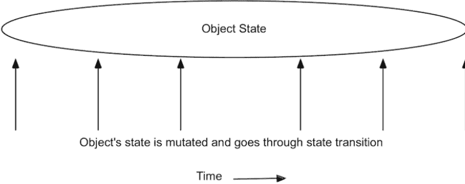
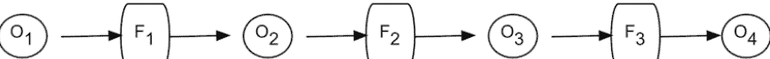
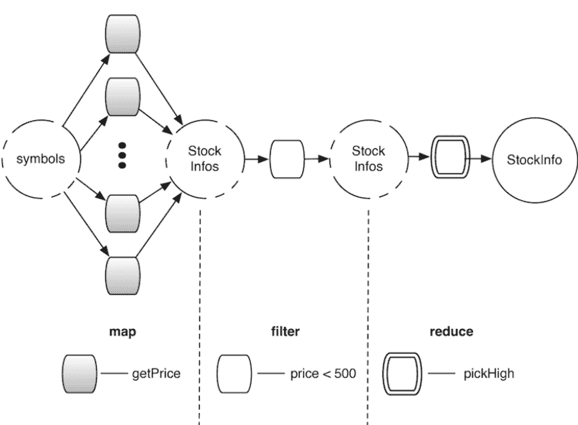

## 使用 Lambda 表达式组合函数

使用 Java，我们拥有两种强大的工具：面向对象方法和函数式风格。它们并非互斥；可以协同工作，共创更大价值。

在 OOP 中，我们经常修改状态。如果将 OOP 与函数式风格相结合，我们可以通过将轻量级对象传递一系列内聚函数来转换对象，而不是修改状态。这有助于我们创建更易于扩展的代码——若要产生不同的结果，只需更改函数的组合方式即可。除了对象，我们还可以将函数作为组件来进行编程。

在本章中，我们将探讨函数组合。然后，我们将利用它来创建一个流行 MapReduce 模式的实用工作示例，在其中分散独立计算，并收集结果以构建解决方案。作为最后一步，得益于无处不在的 JDK 库，我们几乎不费吹灰之力地将这些计算并行化。


### 使用函数组合

面向对象编程范式帮助我们实现抽象、封装和多态；继承是该范式中最薄弱的环节。以函数式风格编程时，我们会组合高阶函数，并尽可能推广不可变性和函数。我们可以利用面向对象编程的经验，同时将优雅的函数式风格融入 Java 中。

让我们感受一下对象转换。假设我们需要找零钱，于是请朋友换开一张 10 美元的钞票。我们不希望朋友把钞票撕碎然后把碎片还给我们。相反，我们希望钞票消失在朋友的口袋里，同时出现一些面值较小的钞票。混合 OOP 和函数式风格就像这样；我们将轻量级对象传递给函数，并期待其他对象出现。

在这种综合方法中，要完成任务，我们将一系列适当的函数串联起来。当对象经过该系列中的函数时，它们会转换为新对象，从而产生所需结果。我们可以在下图中看到纯粹 OOP 与混合 OOP-函数式风格之间的区别。在纯粹 OOP 中（至少在 Java 使用的方式中），对象的状态会随时间经历转换。在综合方法中，我们看到轻量级对象转换为其他对象，而不是对象状态的转换。





让我们通过一个示例来更好地理解这一点。我们将从一个股票代码列表开始，从中创建一个排序后的列表，其中每个项目对应的股票价值超过 100 美元。在习惯性的方法中，我们会使用外部迭代器遍历列表并更新一个可变集合。相反，我们将转换对象。我们将股票代码列表过滤为价格超过 100 美元的股票代码列表，然后对列表进行排序，最后报告结果。

我们需要一个股票代码示例列表，所以让我们从这里开始。

#### applying/fpij/Tickers.java

```java
public class Tickers {
  public static final List<String> symbols = Arrays.asList(
    "AMD", "HPQ", "IBM", "TXN", "VMW", "XRX", "AAPL", "ADBE",
    "AMZN", "CRAY", "CSCO", "SNE", "GOOG", "INTC", "INTU",
    "MSFT", "ORCL", "TIBX", "VRSN", "RIVN");
}
```

这个示例列表中有大约二十个股票代码。我们需要确定每只股票的价格。我们在“与 Web 服务集成”中看到了从 Web 服务获取最新价格的代码。当使用硬编码的 api_token 时，该服务仅适用于少数几个股票代码。如果您希望使用该服务来获取任何股票代码的价格，则需要获取自己的令牌。为了避免经历那番麻烦，我们将在本章中创建一个函数，为股票代码返回一些虚假价格。相关代码如下：

#### applying/fpij/FinanceData.java

```java
public class FinanceData {
    public static BigDecimal getPrice(final String ticker) {
        Map<String, String> fakePrices = new HashMap<>() {
            {
                put("AMD", "81"); put("HPQ", "33"); put("IBM", "135");
                put("TXN", "150"); put("VMW", "116"); put("XRX", "15");
                put("AAPL", "131"); put("ADBE", "360"); put("AMZN", "106");
                put("CRAY", "130"); put("CSCO", "43"); put("SNE", "72");
                put("GOOG", "2157"); put("INTC", "36"); put("INTU", "369");
                put("MSFT", "247"); put("ORCL", "67"); put("TIBX", "24");
                put("VRSN", "157"); put("RIVN", "26");
            }
        };

        try { Thread.sleep(200); } catch(Exception ex) {} //simulate a call delay

        return new BigDecimal(fakePrices.get(ticker));
    }
}
```

getPrice 方法为给定的股票代码返回一些虚假价格。由于我们只查找价值超过 100 美元的股票，可以使用 Stream 的 filter 方法来缩小列表范围。得到简短列表后，可以使用 Stream 的 sorted 方法轻松对其进行排序。最后，可以将股票代码连接起来打印。这些都是我们以前见过的操作，在这里汇集在一起以帮助完成此任务。让我们来看看代码。

#### applying/fpij/Stocks100.java

```java
final BigDecimal HUNDRED = new BigDecimal("100");

System.out.println("Stocks priced over $100 are:");

System.out.println(
Tickers.symbols()
 .stream()
 .filter(
 symbol -> FinanceData.getPrice(symbol).compareTo(HUNDRED) > 0)
 .sorted()
 .collect(joining(", "));
```

这一系列操作以链式形式流畅地执行。这些操作满足结合律；股票代码流被过滤、排序和连接。当我们经过这些组合函数时，原始股票代码列表保持不变，我们首先从中创建一个过滤后的股票代码流，然后创建一个排序后的股票代码流。最后，我们将最后一个流中的股票代码连接起来以供打印。如果我们想选择特定的股票代码（例如第一个）而不是排序，只需稍微修改链条即可；我们可以重用大部分函数。让我们来参观我们的虚拟股票市场，看看列表中哪些股票的价值超过 100 美元。

价值超过 100 美元的股票有：
AAPL, ADBE, AMZN, CRAY, GOOG, IBM, INTU, MSFT, TXN, VMW, VRSN

将函数组合成操作链的能力非常强大，并带来一些好处。它使代码更易于理解。缺乏可变性减少了出错的机会，并使代码更容易并行化。我们可以修改链中的几个环节，也可以轻松地在途中更改行为。我们将在下一个示例中看到这些好处如何体现。

### 使用 MapReduce

在 MapReduce 模式中，我们表达两组操作：一组用于对集合中的每个元素执行操作，另一组用于合并这些结果以得出最终结果。由于其简单性和利用多核处理器的能力，这种模式正在引起关注。

JVM 已准备好利用多核处理器。为了充分利用 JVM 和多核处理器的真正威力，我们必须改变编码方式。在本节中，我们将通过一个示例探索 MapReduce 模式，并在下一节中基于该示例对其进行并行化。

让我们继续使用我们一直在用的示例。给定一个股票代码列表，让我们选择价值低于 500 美元的最高价股票。让我们首先使用命令式风格处理此示例，并快速将其演变为函数式风格。这将帮助我们了解风格上的差异，以及如何在更接近真实场景的情况下，从熟悉的风格过渡到函数式风格。

### 准备计算

首先，我们需要一些实用函数来获取价格、比较价格等等。让我们先介绍这些。

为了方便处理股票名称和价格，让我们创建一个具有不可变字段的类。

#### applying/fpij/StockInfo.java

```java
public class StockInfo {
public final String ticker;
public final BigDecimal price;

public StockInfo(final String symbol, final BigDecimal thePrice) {
ticker = symbol;
price = thePrice;
}

public String toString() {
return String.format("ticker: %s price: %g", ticker, price);
}
}
```

StockInfo 只是一个值对象；它保存一个股票代码及其价格。给定一个股票代码，我们需要一个函数来创建 StockInfo 实例，并填充价格信息。我们将在该函数的实现中重用虚假 FinanceData 的 getPrice 方法。

#### applying/fpij/StockUtil.java

```java
public class StockUtil {
public static StockInfo getPrice(final String ticker) {
return new StockInfo(ticker, FinanceData.getPrice(ticker));
}
//...
}
```

getPrice 方法只是一个包装器，一个方便的方法。

我们需要一个方法来告诉我们价格是否小于所需金额，所以让我们创建它。

```java
public static Predicate<StockInfo> isPriceLessThan(final int price) {
return
stockInfo -> stockInfo.price.compareTo(BigDecimal.valueOf(price)) < 0;
}
```

这是一个高阶方法。它接受一个价格值，并返回一个 Predicate，可以在以后对其进行求值，以检查给定的 StockInfo 实例是否小于 lambda 表达式中缓存的价格值。

最后一个方便方法将帮助我们从一对股票中选择最高价的股票。

#### applying/fpij/StockUtil.java

```java
public static StockInfo pickHigh(
    final StockInfo stock1, final StockInfo stock2) {
    return stock1.price.compareTo(stock2.price) > 0 ? stock1 : stock2;
}
```

pickHigh 只是从给定的一对 StockInfo 实例中返回价格最高的一个实例。我们已经创建了所需的函数，并准备将它们投入使用。让我们创建命令式版本的代码，以获取范围内的最高价股票。

### 从命令式风格过渡...

我们习惯于命令式编程，但正如我们将在这里看到的，这可能需要大量工作。

#### applying/fpij/PickStockImperative.java

```java
final List<StockInfo> stocks = new ArrayList<>();

for(String symbol : Tickers.symbols) {
    stocks.add(StockUtil.getPrice(symbol));
}

final Predicate<StockInfo> isPriceLessThan500 =
    StockUtil.isPriceLessThan(500);
final List<StockInfo> stocksPricedUnder500 = new ArrayList<>();

for(StockInfo stock : stocks) {
    if(isPriceLessThan500.test(stock))
```


stocksPricedUnder500.add(stock);
}

StockInfo highPriced = new StockInfo("", BigDecimal.ZERO);

for(StockInfo stock : stocksPricedUnder500) {
    highPriced = StockUtil.pickHigh(highPriced, stock);
}

System.out.println("High priced under $500 is " + highPriced);

我们创建了三个循环。在第一个循环中，我们创建了一个包含每个符号价格的 StockInfo 列表。在第二个循环中，我们创建了一个精简的股票信息列表，限制为价格低于 $500 的股票。在最后一个循环中，我们从候选股票中选出了价格最高的那只。让我们来看看会选中哪只股票。

High priced under $500 is ticker: INTU price: 369.000

在那段代码中，我们可以看到三个不同的步骤：从符号到股票，再到筛选后的股票，最后从中选出价格最高的股票。如果愿意，我们可以将所有操作合并到一个循环中。下面是合并的命令式版本：

applying/fpij/PickStockImperativeClubbed.java

```
StockInfo highPriced = new StockInfo("", BigDecimal.ZERO);
final Predicate<StockInfo> isPriceLessThan500 =
    StockUtil.isPriceLessThan(500);

for(String symbol : Tickers.symbols) {
    StockInfo stockInfo = StockUtil.getPrice(symbol);

    if(isPriceLessThan500.test(stockInfo))
        highPriced = StockUtil.pickHigh(highPriced, stockInfo);
}

System.out.println("High priced under $500 is " + highPriced);
```

这一步让我们有得也有失。我们减少了代码并去掉了几个循环；代码越少越好。但我们仍在使用命令式编程，在修改变量。此外，如果我们想要修改逻辑——比方说，我们想选出价格低于 $1,000 的最高价股票——就不得不修改这段代码。其中没有任何部分是可复用的。回到我们的三步版本代码，我们可以将每个部分模块化为一个函数以供复用。与其合并步骤，不如将它们保持为独立的步骤，这样我们就能轻松地将它们从命令式风格转换为函数式风格，下节将介绍这一点。

### ...转向函数式风格

在命令式版本中，我们使用了三个不同的循环，但 JDK 为每个步骤都提供了专门的函数式风格方法。我们可以轻松使用这些便捷方法，而无需手动创建任何内部迭代器来以函数式风格编写逻辑。让我们将代码重构为函数式风格；这个版本是声明式的，保持了不可变性，简洁明了，并使用了函数组合。

applying/fpij/PickStockFunctional.java

```
public static void findHighPriced(final Stream<String> symbols) {
final StockInfo highPriced =
symbols.map(StockUtil::getPrice)
.filter(StockUtil.isPriceLessThan(500))
.reduce(StockUtil::pickHigh)
.get();

System.out.println("High priced under $500 is " + highPriced);
}
```

在 findHighPriced 方法中，我们使用方法链来转换对象。我们从一串符号流开始，流向股票流。首先，我们将符号映射为填充了价格的股票。在 map 操作之后，我们精简列表并将其归约为单个值。reduce 函数为我们提供了额外的控制，但如果我们只是想选出最高值，也可以改用 Stream 上的 max 方法。

这个版本的行数大约是多步骤命令式版本的一半。它的行数大约与合并的命令式版本相同。除了简洁之外，这段代码还有几个好处。最大的收益是，并行化这段代码是不额外成本的，如下节所示。我们通过使用函数组合和高阶函数，并避免可变性，获得了这一好处。这个版本的代码更容易理解——符号被映射为 StockInfo，然后过滤到所需范围，最后归约为一个包含最高值及其对应股票代码的单一对象。

在调用 findHighPriced 方法之前，我们需要将 Tickers 中的符号列表转换为符号流。


```
findHighPriced(Tickers.symbols.stream());
```

让我们运行代码，确保结果与命令式版本相同。

```
High priced under $500 is ticker: INTU price: 369.000

```

代码简洁，这个版本选出了与之前版本相同的股票，价格也相同。

让我们花一分钟时间，在下图中直观地查看本示例中执行的操作。



在图中，我们看到 map 操作将获取股票价格的函数应用到 symbols 集合中的每个元素上。这给我们提供了一组 StockInfo 实例的流，然后我们过滤该流以选择股票，最后应用 reduce 操作将其提炼为一个 StockInfo 对象。图中操作的布局展示了并行化的潜力。下节将深入探讨这一点。

### 迈向并行化的飞跃

在之前的示例中，我们获取了许多股票符号的价格。无论是像示例中那样使用模拟时间延迟生成假数据，还是通过网络调用从服务获取真实数据，为每个符号获取数据都需要花费相当长的时间。我们处理的符号越多，顺序运行代码所需的时间就越长。尽管我们顺序执行了获取价格的函数，但在之前的图中，我们将这些调用垂直堆叠显示。这有助于可视化这些函数并非一个接一个地运行，而是可以并行运行。也就是说，我们不必等待列表中某个符号的价格获取完成，才开始获取下一个符号的价格。并行运行获取价格的函数将大大缩短执行时间。得益于 Java 的函数式编程能力和 Stream API，我们可以轻松地将之前的示例并行化，以加快执行速度。

在做任何更改之前，让我们仔细看看代码。我们将股票代码传递给 map 方法，该方法顺序调用附加函数从我们的假服务获取价格。所有价格到达后，我们顺序将列表精简到所需价格范围内的股票。在最后一步（同样是顺序的），我们从中选出价格最高的股票。

在这三种操作中，第一种最慢。它涉及对 Web 服务的调用，产生网络延迟，并且需要执行 20 次——每个股票代码一次。剩下的操作涉及轻量级的算术运算，几乎不耗时。幸运的是，在这个问题中，最慢的部分彼此独立，可以一次性全部执行。

我们不必等待（假）Web 服务对某个股票代码的价格请求做出响应，才发送下一个请求。Web 服务能够并发处理多个请求，除非特定供应商为了将免费或基础服务与可能出售的高级服务区分开来而设置了限制。

让我们再次运行之前的版本，看看选出价值低于 $500 的最高价股票花了多长时间。以下输出是使用基于 UNIX 的 time 实用工具运行程序时生成的。

```
High priced under $500 is ticker: INTU price: 369.000

real 0m4.147s
user 0m0.058s
sys 0m0.019s
```

如果我们使用真实的 Web 服务来获取股票价格，运行时间会因网络连接质量和服务响应时间而异。由于本示例中使用的是假服务，我们只会承担模拟延迟。函数式顺序版本大约花了 4 秒来选出合适的股票。让我们将代码并行化，看看效果如何。

让代码并发是一个大话题——从何处开始，如何进行？我们需要将任务分发到多个线程上，然后收集结果，接着再进行顺序步骤。在此过程中，我们必须


确保没有竞态条件；我们不希望线程与其他线程的更新发生冲突并搞乱数据。

这里有两个关注点：一个是如何实现，另一个是如何正确实现。对于第一个关注点，我们可以借助库来管理线程。做好正确实现的责任在我们。竞态条件在很大程度上源于共享可变性。如果多个线程同时尝试更新一个对象或变量，我们需要确保线程安全。如果遵循良好的函数式风格并坚持不可变性，这个关注点就会消失。

令人惊讶的是，借助我们创建的设计，代码只差一步就能从顺序运行变为并行运行。我们只需切换一个调用，从这里：

```
findHighPriced(Tickers.symbols.stream()));
```

到这里：

```
findHighPriced(Tickers.symbols.parallelStream()));
```

stream 和 parallelStream 具有相同的返回类型，但它们返回的实例不同。parallelStream 返回的实例会在多个线程之间并行运行 map 和 filter 等方法，由幕后的线程池管理。其好处是，我们可以轻松在顺序版本和并发版本之间切换，而 findHighPriced 等方法对并行性可以无感知。

让我们运行代码的并行版本，并查看运行时间。同样，我使用 time 实用工具生成了以下输出。

```
High priced under $500 is ticker: INTU price: 369.000
real 0m0.470s
user 0m0.076s
sys 0m0.023s
```

第一个好消息是，这个版本选出的股票与顺序版本相同。毕竟，飞快地运行却得到错误结果是没有意义的。第二个好消息是执行速度。并行版本大约花费了 0.4 秒，这比顺序版本所花时间要少得多。

在决定调用 stream 还是 parallelStream 时，我们需要考虑几个问题。首先，我们是否希望并发运行 lambda 表达式？其次，代码应该能够独立运行，而不会引起任何副作用或竞态条件。第三，解决方案的正确性不应取决于计划并发运行的 lambda 表达式的执行顺序。例如，对 forEach 方法进行并行化并在我们提供的 lambda 表达式中打印结果是没有意义的。由于执行顺序不可预测，输出顺序可能会令人困惑。另一方面，能够执行计算并将结果转发以供进一步处理的方法（如 map 和 filter）是很好的候选者；请参见以下侧边栏。

#### Joe 问：我们应该选择并行流吗？

库使并行化变得容易，但有时这不是正确的选择。这取决于您的数据和计算。有时，并行计算可能比其顺序版本更慢。

我们常常依赖并发来加速执行。但是，让事物并发是有代价的——执行时间。我们需要评估，以确保节省的时间远远超过了使用并发的代价。

对于小型集合，如果每个元素的任务都相当短且快速，顺序执行可能会优于任何并发解决方案。只有当任务耗时且集合规模相当大时，并发的优势才会显现出来。

尽管 Java 中的并行流使并行化代码变得相当容易，我们仍然需要评估手头的问题和数据大小，以确定是否存在执行时间节省。

从顺序到并行的更改是轻而易举的，但我们做了许多事情来使这成为可能。首先，我们避免了可变性，并保持函数纯净，没有副作用。我们避免了竞态条件和线程安全问题，这对于正确性至关重要——又快又错误是没有意义的。我们应该格外小心，确保传递给流操作的 lambda 表达式没有副作用。

其次，我们组合函数的方式有所帮助。决定按顺序还是并行运行是在上游做出的，即当我们将 List 转换为 Stream 时。findHighPriced 方法中其余的代码没有改变；两个版本共享这部分代码。从顺序到并行就像切换开关一样简单。

### 总结

Lambda 表达式有助于将函数组合成一系列操作，这让我们可以将问题转化为对象转换的关联序列。此外，通过保持不可变性并避免副作用，我们可以轻松并行化链中部分操作的执行并获得速度提升。

迄今为止，我们讨论了展示 Java 函数式编程能力多么出色的功能。接下来，我们将看到一个例外，即棘手的异常处理话题。
