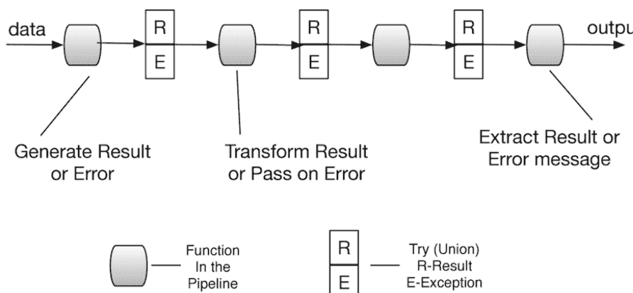

## 第 10 章

## 错误处理

墨菲定律说，如果某事可能失败，它就会失败。软件系统会失败；错误是不可避免的。我们编写的代码应该预见并妥善响应可能发生的运行时错误。错误处理不应该是事后的想法。您处理错误的方式应该取决于应用程序要求，并且代码应与这些期望保持一致。无论我们以命令式风格还是函数式风格编写代码，正确的错误处理都是我们的责任。

函数式风格代码令人惊叹、简洁、复杂度低且易于使用……直到我们遇到异常处理。异常处理从根本上说是一种命令式编程理念。抛出异常与函数式编程不兼容。但是，我们仍然需要处理使用函数式编程范式编写的代码中的失败。

使用函数式管道编程时，我们没有像在命令式编程中那样随意抛出异常的奢侈。这是命令式风格可能比函数式编程更有优势的一个领域。

您不允许从函数式管道抛出受检异常。也不要抛出运行时异常。当然，编译器不会阻止您这样做，但这会突然终止函数式管道处理，先前处理的数据可能会丢失。在函数式管道中抛出异常根本不是一个选择。

在本章中，我们将使用具体示例，仔细探讨为什么异常处理在函数式编程中并不总是正确的选择。为了说明这一点，我们将首先从熟悉的命令式风格开始，其中抛出异常是常态。然后我们将把代码转换为函数式风格，以享受这种范式的好处，但如您所见，我们很快就会遇到异常问题。然后，我们将不抛出异常，而是将错误视为一种数据形式，并在下游处理失败。到本章结束时，您将很好地了解如何编程来处理失败，并能够将这些想法应用到您自己的使用函数式风格的项目中。

### 从整体角度看待错误处理

在深入代码之前，我们需要退后一步思考如何处理错误。我们将在这里讨论一个示例应用程序，并利用它来推动本章其余部分关于错误处理的讨论。

假设我们被要求编写一个程序，给定一组 IATA 代码，打印机场名称。快乐路径很简单——给定列表，将其映射为名称并打印。但是，过程中有几件事可能出错。当从提供 IATA 代码到机场名称映射的远程 Web 服务访问详细信息时，我们可能会遇到网络错误。还有一种可能是，给定的一个或多个 IATA 代码无效，或未被 Web 服务识别。

作为程序员，我们可能会快速识别可能的故障，但如何处理它们不由我们决定。业务和需求应该决定这一点。如果查询某个 IATA 代码名称的请求失败，我们是否应该优雅地失败整个程序？我们是否应该忽略故障，只报告成功映射的 IATA 到名称的名称？我们是否应该按顺序报告名称和故障？我们是否应该将名称组织为一组，将故障组织为另一组？在不同情况下，这些都是不错的选择，但实现必须符合业务的要求。


假设我们向业务方澄清需求，他们建议成功时打印名称，失败时打印错误详情；我们可以针对这一点进行设计。但是，如果他们改变主意，我们希望设计能够适应这种变化，且对代码的改动尽可能小。出于这个原因，发生错误的地方通常不是处理错误的正确位置。我们的大部分代码可能需要将结果和失败传播给调用代码，并让边缘代码根据要求处理结果的显示或错误的恰当处理。

接下来，我们将编写一个小程序，使用命令式风格的代码来处理异常。

### 异常处理与命令式风格

您的用户不关心您使用什么编程风格。无论您使用命令式风格还是函数式风格实现代码，结果都应该相同。无论您选择哪种范式，程序都必须优雅地处理失败。在本节中，我们将从命令式风格代码入手，直接深入到处理失败的核心。一旦我们看到代码如何处理异常以及程序的输出，我们将探讨将该代码转换为函数式风格的选项，并验证输出是否与命令式风格代码的输出一致。

我们将沿用上一节的要求：给定机场 IATA 代码列表，检索并打印机场名称，并打印找不到的名称的错误详情。让我们先从给定 IATA 代码时检索机场名称的代码开始：

exceptionhandling/fpij/AirportInfo.java

```java
package fpij;

import java.util.Scanner;
import java.net.URL;
import java.io.IOException;

public class AirportInfo {
public static String getNameOfAirport(String iata)
throws IOException, AirportInfoException {

var url = "https://soa.smext.faa.gov/asws/api/airport/status/" + iata;

try(var scanner = new Scanner(new URL(url).openStream())) {
var response = scanner.nextLine();

if(!response.contains("Name")) {
    throw new AirportInfoException("Invalid airport code " + iata);
}

return response.split("/")[3]; //a bruteforce way to get the Name
}
}
}
```

`getNameOfAirport` 方法获取机场的 IATA 代码，与 Web 服务通信以获取该机场的信息，并从响应中提取机场名称。由于代码的特性——可能会出现访问远程 Web 服务失败或服务无法识别给定代码的情况——失败是不可避免的。

`getNameOfAirport` 方法不是处理任何错误的正确位置。如果服务调用失败，我们仅将 `IOException` 从 URL 传播到 `getNameOfAirport` 的调用方。另一方面，如果服务调用成功但我们没有得到想要的机场详细信息，`getNameOfAirport` 方法将抛出一个特定于领域的受检异常 `AirportInfoException`，如下所示：

exceptionhandling/fpij/AirportInfoException.java

```java
package fpij;

public class AirportInfoException extends Exception {
    public AirportInfoException(String message) {
        super(message);
    }

    public AirportInfoException(Throwable cause) {
        super(cause);
    }

    public AirportInfoException(String message, Throwable cause) {
        super(message, cause);
    }
}
```

现在我们有了给定 IATA 代码时获取机场名称的代码，让我们关注下一个更高级别的函数。我们想要获取给定 IATA 代码列表中所有机场的名称。让我们先看看如何用命令式风格编写代码——之后，我们将看到如何用函数式风格做同样的事情。

`getNamesOfAirports` 方法获取机场列表，调用 `AirportInfo` 类的 `getNameOfAirport` 方法，并返回名称列表。这可以处理正常路径，但我们还需要考虑失败的可能性。程序员通常倾向于在发生失败时抛出或传播异常。如果我们有“一旦失败就停止”的要求，这可能有效，但当用户希望看到成功和失败的结果时，这并不是一个解决方案。我们需要捕获成功结果和失败详情，并将它们传递给调用方。

以下是新 `AirportNames` 类中 `getNamesOfAirports` 方法的实现：

exceptionhandling/fpij/AirportNames.java

```java
public class AirportNames {
public static List<DataOrException<String>> getNamesOfAirports(
List<String> iataCodes) {
List<DataOrException<String>> result = new ArrayList<>();
for(var iataCode: iataCodes) {
try {
result.add(DataOrException.of(
AirportInfo.getNameOfAirport(iataCode).toUpperCase())));
} catch(IOException | AirportInfoException ex) {
result.add(DataOrException.of(ex));
}
}
return result;
}
}
```

在上述代码中，DataOrException 作为结果的包装器——成功时是机场名称的字符串，失败时是异常。AirportNames 的 getNamesOfAirports 命令式地遍历 IATA 代码列表，并使用我们之前编写的 getNameOfAirport 方法从服务中获取机场名称。如果调用成功，该方法将获取的名称转换为大写，将其包装为 DataOrException 的实例，并添加到结果列表中。如果调用失败，该方法则在 catch 块中将失败详情包装为 DataOrException 的实例并添加到结果列表中。尽管命令式风格较为冗长，但在处理异常方面非常出色，我们在此充分利用了这一点。让我们快速看看用于包装数据或异常的 DataOrException 接口：

exceptionhandling/fpij/DataOrException.java

```java
package fpij;

public sealed interface DataOrException<T> {
public default boolean isDataPresent() { return true; }

public default T getDataOrThrow() {
throw new RuntimeException("No data");
}

public default Exception getExceptionOrThrow() {
throw new RuntimeException("No Exception");
}

public static <T> DataOrException<T> of(T data) {
return new Data<T>(data);
}

public static <T> DataOrException<T> of(Exception exception) {
    return new TheException<T>(exception);
}

record Data<T>(T data) implements DataOrException<T> {
    public T getDataOrThrow() { return data; }
}

record TheException<T>(Exception exception) implements DataOrException<T> {
    public boolean isDataPresent() { return false; }

    public Exception getExceptionOrThrow() { return exception; }
}
}
```

DataOrException 的第一个重载静态方法返回一个携带给定数据的包装器实例。该方法的第二个重载版本返回一个携带异常的包装器实例。使用此机制，我们可以方便地在函数之间传输数据或异常。

让我们从 main 方法中调用 getNamesOfAirports 方法，提供几个我最喜欢的得克萨斯州（Lone Star state）机场的 IATA 代码：


```java
public static void main(String[] args) {
    var iataCodes = List.of("AUS", "DFW", "HOU", "IHA", "SAT");

    for(var result: getNamesOfAirports(iataCodes)) {
        if(result.isDataPresent()) {
            System.out.println(result.getDataOrThrow());
        } else {
            System.out.println("Error: " +
                result.getExceptionOrThrow().getMessage());
        }
    }
}
```

让我们运行这段代码，看看它是如何工作的。

```
AUSTIN-BERGSTROM INTL
DALLAS-FORT WORTH INTL
WILLIAM P HOBBY
Error: Invalid airport code IHA
SAN ANTONIO INTL
```

输出显示了有效 IATA 代码对应的机场名称。我本想输入 IAH，却误输入了 IHA，结果发现没有该代码的机场。别担心，代码优雅地处理了这一情况，礼貌地告诉我们发生了什么，然后继续显示列表中下一个机场的名称。

作为边缘函数的 main 方法可以根据要求决定如何处理异常。它可以根据需求的变化而演进：仅打印成功的名称、仅打印错误、将它们分组等。从设计角度来看，这个解决方案更容易扩展。例如，将来如果一个 getNamesOfAirports 调用方想要所有结果和失败，而另一个调用方希望在第一个异常时快速失败，我们可以修改 getNamesOfAirports，使其根据调用方的偏好（可以作为参数传递）返回完整的成功/失败列表或仅返回第一个失败。

前面的代码是命令式风格，但您可能会问，函数式风格呢？我们知道与命令式风格相比，函数式风格代码更优雅，但它在处理错误时也应该优雅。让我们看看将代码重构为函数式风格的努力接下来会如何。


### 受检异常与流式函数式编程

暂且不考虑异常，将命令式风格代码重构为函数式风格代码很容易。我们有一个 IATA 代码列表，可以在列表上调用 stream 方法，调用 map 获取给定 IATA 代码的名称，然后再次调用 map 将名称转换为大写，最后使用 toList 方法将结果放入列表中。代码如同生活，当我们不必处理错误时都很简单。但没有失败风险的乐趣不是选项。

将抛出异常的代码与 Stream API 一起使用会带来一些严重的挑战。让我们使用函数式风格重写命令式解决方案，看看会出现什么问题：

```
public static List<String> getNamesOfAirports(List<String> iataCodes) {
    return iataCodes.stream()
        .map(iataCode -> AirportInfo.getNameOfAirport(iataCode))
        .map(String::toUpperCase)
        .toList();
}
//ERROR: This code will not compile
```

正如你从函数式风格中期待的那样，代码优雅、简洁、可读性好，能清晰传达意图，并且……遗憾的是，它无法工作。请继续编译，你将看到以下错误：

```
fpij/AirportNames.java:10: error:
unreported exception IOException; must be caught or declared to be thrown
    .map(iataCode -> AirportInfo.getNameOfAirport(iataCode))
                               ^
1 error
```

该错误来自我们传递给 map 方法的 lambda 表达式。Stream 的 map 方法的参数接受 Function<T, R> 作为其参数。该函数式接口的抽象方法 R apply(T) 没有任何 throws 子句。因此，作为 map 参数使用的 lambda 表达式或方法引用不允许抛出任何受检异常。

乍看之下，这似乎是一个严重的限制。一些开发者对此抱怨过。有些人甚至采取了 fork JDK 代码并添加 throws 子句这一极端措施。但 Java 语言背后的人们做出了正确的决定——这并非疏忽。让我们来看看原因。

### 异常处理与函数式风格

值得重申：

**异常处理**

异常处理本质上是一种命令式编程思想。异常处理与函数式编程不兼容。

一些程序员认为 `Stream` API 与异常处理的问题在于，`filter`、`map` 等方法使用的函数式接口不处理受检异常。这引导他们采用一种糟糕的解决方案：抛出一个包装底层受检异常的未检查异常。这可能会通过让编译器停止抱怨异常应被捕获或抛出，从而提供暂时的缓解。但这并没有解决程序如何处理错误这一根本问题。

让我们通过重构之前的代码来消除编译器错误，尝试这种经常被尝试的糟糕解决方案。然后我们将讨论为什么这是一个糟糕的主意。

在传递给 `map` 方法的 lambda 表达式中，我们将受检异常包装在 `RuntimeException` 中。以下是代码——请不要在办公室或任何公共场所尝试此操作。

```
public static List<String> getNamesOfAirports(List<String> iataCodes) {
    return iataCodes.stream()
        .map(iataCode -> { //Bad idea
          try {
            return AirportInfo.getNameOfAirport(iataCode);
          } catch(Exception ex) {
            throw new RuntimeException(ex);
          }})
        .map(String::toUpperCase)
        .toList();
}
```

如果 Airport 的 getNameOfAirport 方法返回机场名称，我们将其转发给下一个 map 方法进行大写转换。但如果发生失败，代码将以未检查异常崩溃。

从函数式管道中间抛出异常是个糟糕的主意，原因有几个。函数式管道要么是惰性执行，要么是并行执行。如果流是并行执行的，管道中的异常可能来自另一个线程。另外，传递给管道中任何函数（如 filter、map 等）的 lambda 表达式可能会被惰性执行。无论哪种情况，调用者可能不在控制流中，无法正确接收异常。

你可能会问：如果整个管道连同终端操作完全嵌入在一个函数中，并且流是顺序执行的，那又如何？在之前的代码中，异常会冲毁调用栈。如果你仔细检查代码，会发现我们在任何地方都没有捕获异常。因此，这会导致程序突然终止。你可能会想在 getNamesOfAirports 方法中添加 try-catch，将方法当前的主体移入 try 块。这可能有助于捕获异常，但到那时你已经脱离了函数式管道，无法继续处理任何剩余的 IATA 代码，也无法收集之前成功处理的 IATA 代码的结果。一切皆失，一无所获，正如你在输出中所见：

```
Exception in thread "main" java.lang.RuntimeException:
fpij.AirportInfoException: Invalid airport code IHA
...
```

此代码的输出与命令式风格代码的输出大相径庭。让我们思考一下导致此问题的根本原因。

在函数式编程中，尤其是使用 Stream API 时，我们正在处理一个函数式管道。如果我们希望优雅地处理失败并继续处理集合中的其他元素，那么在管道中间崩溃说不通。

> > **不要让它崩溃**
> >
> > 不要在函数式管道内引发或传播异常。

想象一位朋友惊慌地给你打电话，说他们在高速公路中间车道驾驶时轮胎爆裂了。如果你不想突然结束这段友谊，你能给的最糟糕的建议就是：“爆胎然后倒车开起来。”现在，你永远不会那样做……对吧？你很可能会建议：“小心地向前开，驶离高速公路或停到路边，然后下游处理它。”

没错，下游处理它。

### 下游处理

理想情况下，我们在函数式管道中执行的操作是无副作用的纯操作。数据在函数式管道的各个阶段之间转换时和谐流动。在现实中，事情会出错，墨菲定律介入，我们必须优雅地处理可能遇到的混乱局面。

在函数式编程中，处理错误和异常的一个好策略是将错误视为一种数据形式，将其向下移动管道，并在下游处理它。

#### 将接收到的异常包装成对象


将错误和异常视为数据形式。将详细信息包装在对象中并向下移动。

要将错误视为一种数据形式，我们需要将结果或错误捕获并封装到一个对象中。简而言之，我们需要一个联合类型。[16] 联合类型是一种数据结构，可以容纳多种不同类型的数据中的一种，但其实例在运行时只能容纳预期类型中的一种数据。在我们的情况中，我们需要联合类型的对象，该对象只能容纳两种类型中的一种：要么是结果，要么是错误。在函数式编程中，联合类型通常被称为 *Either 单子*，因为它在函数式管道的各个阶段中传输数据或错误。

顺便提一下，我们本章早些时候已经走过这条路，当时我们创建了 *DataOrException* 包装器来在命令式代码中传输数据或错误。现在，在函数式编程的上下文中，当包装器在函数式管道中流动时，我们需要对其进行更多操作，并且我们继续使用联合类型的想法。仿效 Scala[17] 等语言和 Vavr[18] 等库中的此类解决方案，我们将把新实现称为 Try。

我们的 Try 可能有两种形式：Success，它携带数据或结果；或 Failure，它以 Throwable 形式携带异常。我们将构建函数式管道，使管道中的每个阶段处理传递给它的 Try 中携带的结果。作为回应，每个阶段将创建另一个 Try。如果成功，此 Try 包含该阶段的结果；否则包含错误。如果管道中的某个阶段接收到的是 Failure 而非 Success，该阶段中的函数将仅将该失败向下游传递，而不进行处理。

我们不会让数据通过 Stream API 流动，而是建模为：数据或错误（被捕获为 Success 或 Failure）沿着管道传递，如下图所示。



在这个设计中，管道以给定的输入数据集合开始。在处理每个元素时，以 Success 或 Failure 形式出现的 Try 实例会沿链条传递。该


流水线的最终阶段从其接收到的 `Success` 中提取结果，或者如果接收到 `Failure`，则提取错误的详细信息。

让我们重写 `getNamesOfAirports` 方法以使用这种方法，使用尚未编写的 `Try` 接口和 `Success` 及 `Failure` 类。

```java
public static List<Try<String>> getNamesOfAirports(List<String> iataCodes) {
    return iataCodes.stream()
        .map(iataCode -> Try.of(() -> AirportInfo.getNameOfAirport(iataCode)))
        .map(name -> name.map(String::toUpperCase))
        .toList();
}
```

从结构上看，此版本的 `getNamesOfAirports` 与我们编写的第一个函数式风格版本相同。与第一个版本遇到编译错误不同，在这个版本中，我们更有能力处理异常。

我们获取一组 IATA 代码，并使用 `StreamAPI` 通过流水线处理每个元素。在第一个 `map` 方法调用中，在作为参数传递的 Lambda 表达式中，我们调用 `AirportInfo` 的 `getNameOfAirport` 方法，传递给定的 IATA 代码。正如您所知，此方法可能返回机场名称或抛出异常。

我们将对 `getNameOfAirport` 的调用包装在另一个 Lambda 表达式中，并将其传递给尚未编写的 `Try` 的 `of` 方法。由于该 Lambda 表达式将返回一个名称，看起来合适的函数式接口是 `Supplier<T>`。但是，该接口的抽象方法 `get` 不允许抛出任何异常。相反，`java.util.concurrent` 中古老的 `Callable<T>` 接口在这里会非常好用——除了方法名之外，`Callable` 和 `Supplier` 之间的主要区别在于，前者允许从其 `call` 方法实现中抛出异常，而后者不允许从其 `get` 方法实现中这样做。

第一个 map 调用的结果是一个 Try，但实际上，它可能是携带机场名称的 Success，或是携带出错详情的 Failure。因此，Success 和 Failure 都是实现 Try 接口的类。

在函数式流水线中，传递给第二个 map 调用的 Lambda 表达式会将名称转换为大写（如果接收到的 Try 是 Success），或者在出错时原样传递 Failure。这是使用 Try 的 map 方法完成的。在函数式流水线的最后一步，我们将 Try 实例列表返回给调用者。这样，getNamesOfAirports 的调用者就可以根据整体系统要求，控制如何处理数据和异常。

要使之前的代码工作，我们需要创建 Try、Success 和 Failure。创建这些有几种不同的选择。如果您使用的 Java 版本支持 sealed 类，可以按照这里给出的代码进行。如果您使用的是旧版 Java，则从 Try 的定义中省略 sealed 和 permits 子句。

让我们实现表示成功或失败的 Try 接口。

exceptionhandling/fpij/Try.java

```java
package fpij;

import java.util.concurrent.Callable;
import java.util.function.Function;

public sealed interface Try<T> permits Success, Failure {
    T getResult();

    Throwable getError();

    static <T> Try<T> of(Callable<T> code) {
        try {
            return new Success<T>(code.call());
        } catch(Throwable throwable) {
            return new Failure<T>(throwable);
        }
    }

    default <R> Try<R> map(Function<T, R> mapper) {
        if(this instanceof Success<T>) {
            return of(() -> mapper.apply(getResult()));
        } else {
            return new Failure<R>(getError());
        }
    }
}
```

该接口包含两个抽象方法，以及一个静态工厂方法和一个默认方法。getResult 用于获取结果（如果存在）。另一方面，getError 用于在发生失败时获取异常。

`of` 静态方法充当工厂方法：如果给定 `Callable` 的 `call` 方法返回结果，则返回一个 `Success` 实例。否则，它会捕获生成的异常，并将其作为 `Failure` 实例传递。`Success` 和 `Failure` 均符合 `Try` 接口。

Try 接口中的最后一个方法是 map 方法，它使用作为参数给出的 Function 转换结果（如果存在）。如果 Try 持有的是错误而不是结果，也就是说，如果它是 Failure，那么 map 方法将简单地传递该失败而不应用给定的函数。

所有必要的逻辑都在 Try 接口中。该接口的实现类仅仅是结果或错误的持有者。

让我们将 Success 编写为 record：

exceptionhandling/fpij/Success.java

```java
package fpij;

public record Success<T>(T result) implements Try<T> {
    @Override
    public T getResult() { return result; }

    @Override
    public Throwable getError() {
        throw new RuntimeException("Invalid invocation");
    }
}
```

这个 record 没有太多内容——它仅仅是一个数据载体，并符合 Try 接口。

类似地，Failure 类非常简单直接：

exceptionhandling/fpij/Failure.java

```java
package fpij;

public record Failure<T>(Throwable throwable) implements Try<T> {
    @Override
    public T getResult() { throw new RuntimeException("Invalid invocation"); }

    @Override
    public Throwable getError() { return throwable; }
}
```

Success 是结果的载体，Failure 是坏消息的载体。再看一遍 getNamesOfAirports 方法，看看这些类是如何使用的。

作为最后一步，让我们看看 getNamesOfAirports 的函数式风格实现可以如何使用：

```java
public static void main(String[] args) {
    var iataCodes = List.of("AUS", "DFW", "HOU", "IHA", "SAT");
    getNamesOfAirports(iataCodes).stream()
        .map(name -> switch (name) {
            case Success(String result) -> result;
            case Failure(Throwable throwable) -> "Error: " + throwable.getMessage();
        })
        .forEach(System.out::println);
}
```

我们将错误处理推到了最边缘，以便将代码与业务要求对齐。通过以强类型形式保留所有信息，我们可以在需求变化时优雅地演进程序。main 方法从 getNamesOfAirports 方法获取 Try 实例列表，并使用流的内部迭代器进行遍历。在 map 调用中，如果 Try 是成功，则从中提取结果；否则，提取错误详情。

我们正在使用 Java switch 表达式的惊人功能。如果您使用的是旧版 Java，可以改用传统的 if-else——代码会有点啰嗦，但能完成任务。

运行代码并查看输出：

```
AUSTIN-BERGSTROM INTL
DALLAS-FORT WORTH INTL
WILLIAM P HOBBY
Error: Invalid airport code IHA
SAN ANTONIO INTL
```

它成功了……输出与命令式风格版本的输出完全相同。唉！

在结束本章之前，让我们汇总一下关于在函数式风格代码中处理错误的所有内容。

### 在函数式编程中处理失败

使用函数式风格和 `Stream API` 进行编程时，将错误视为一种数据形式。如果流水线某个阶段调用的较低级别函数抛出异常，请捕获并将其包装成一个失败对象。不要编写只传输数据的流水线，而应设计为传输一种可能携带数据或错误的联合对象。这是处理函数式流水线中错误的一种好方法，但这种方法也有后果。

如果函数式流水线中的任何阶段都不可能出错，那么函数可以专注于处理数据。但是，如果流水线的任何阶段都有可能出错，那么下游阶段就必须编写为处理联合对象，并在成功时采取措施转换数据，在失败时将错误推向下游。这使得流水线中的函数内聚性降低。它们不能只专注于数据转换，还需要处理错误，或者至少将错误向下游传递。

如果必须处理错误，就需要在命令式风格和函数式风格之间做出选择。如果需要复杂的错误处理，命令式风格可能是更好的选择。如果您想使用函数式风格，代码必须设计为传递联合对象而不仅仅是数据，这比仅仅编写一个处理数据的流水线要费力得多。请评估您的选项，创建原型，并体验一下，看看对您的用例来说，使用命令式风格还是函数式风格更好。


### 总结

处理失败很难，无论是在生活中还是在编程中。异常处理本质上是一种命令式编程思想，我们不能将异常与函数式风格代码混用。处理失败的一种方法是将错误视为一种数据形式。本章我们通过一个实际示例，深入探讨了如何做到这一点。该解决方案在处理错误方面很有效，但会让代码变得稍微复杂，且内聚性降低。编写函数式风格代码时，处理错误需谨慎。

在下一章中，我们将运用所学知识，将一些使用命令式风格编写的遗留代码转换为函数式风格。

### 脚注

- [16] https://en.wikipedia.org/wiki/Union_type
- [17] https://www.scala-lang.org/api/2.13.6/scala/util/Try.xhtml
- [18] https://www.javadoc.io/doc/io.vavr/vavr/0.9.2/io/vavr/control/Try.xhtml
