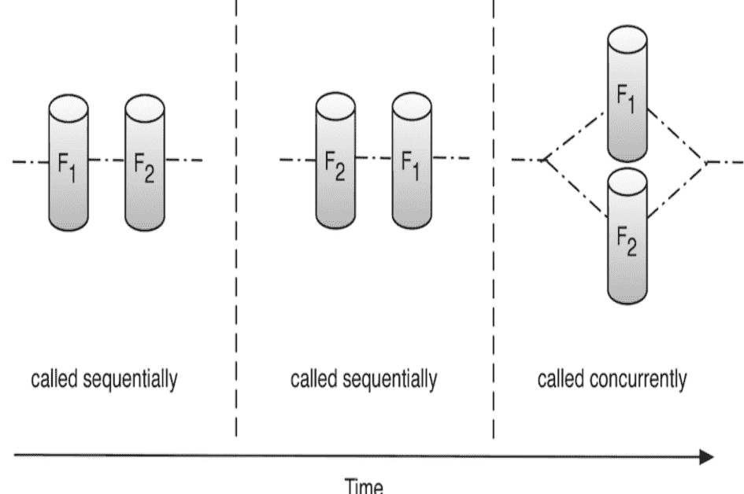

## 第 13 章

## Bringing It All Together

在整本书中，我们探索了 Java lambda 表达式，使用它们来遍历集合、实现更好的轻量级设计，并轻松组合和并行化代码。在本最终章节中，我们将汇总一切。我们将回顾为了充分受益于函数式风格而需要磨练的实践，然后讨论这种风格的性能影响，最后提出一些关于如何成功采用函数式风格的建议。

### Essential Practices to Succeed with the Functional Style

Java 中的函数式特性不仅改变了我们输入的语法。为了充分利用这些特性并创建高度简洁和轻量级的应用程序，我们需要改变设计、代码和思维方式；这与我们在 Java 中习惯的命令式和面向对象范式不同。让我们回顾一下我们需要改变开发应用程序方式的几个基本方法，以及我们将因此获得的好处。

#### More Declarative, Less Imperative

我们需要提高抽象层次。与其命令式地关注要采取的步骤，不如声明式地思考和表达我们想要实现的更大目标。例如，不要命令计算机逐个遍历集合中的每个元素，而是请它筛选出我们想要的元素，或者将一个集合映射或转换为另一个集合。这有助于进一步落实“不要询问，要告知”（Tell, Don’t Ask）原则，并使代码更加简洁和富有表现力。[20]

例如，假设我们得到一份股票价格列表，并被要求选出最大值。根据经验，我们的第一直觉可能是以命令式的方式编写如下代码：

```
int max = 0;
for(int price : prices) {
if(max < price) max = price;
}
```

相反，让我们声明式地思考。我们将告诉程序选出最大值，而不是要求它逐步遍历：

```
final int max = prices.stream()
	.reduce(0, Math::max);
```

好处远不止代码行数更少。我们引入错误的机会更少——不编写的代码拥有最少的 Bug。少量易于理解的代码比大量冗余代码更简单。

命令式代码比较原始，涉及更多的可变性。另一方面，声明式代码提高了抽象层次并减少了对可变变量的需求。这也降低了代码中出错的可能性。

#### Favor Immutability

可变变量是不良品味，共享的可变变量纯属祸害。我们常常会对变量的更改感到困惑或忽略。结果，拥有更多可变变量的代码往往会有更多错误。拥有共享可变变量的代码很难正确地并行化。减少错误的一种方法是尽可能避免可变性，而函数式风格使这变得更容易。

纯函数式语言只有值：初始化后无法更改的一次写入变量。由于 Java 不强制执行不可变性，责任在于我们来优先考虑不可变性。当我们遇到可变变量时，可以检查库以查看是否有函数式风格的等效项来消除它们。

#### Reduce Side Effects

无副作用的函数既不影响也不受其边界之外任何事物的影响。具有副作用的函数或方法难以理解、难以维护、更容易出错，并且难以并行化。

如果我们消除副作用，那么只要函数的输入保持不变，输出就会始终相同。这使得代码更容易理解，并且减少了确保正确行为所需的测试用例数量。

没有副作用对于*引用透明性*至关重要，这意味着函数的调用可以用其结果值替换，而不会影响程序的正确性。函数式风格非常赞成创建无副作用的函数，其好处是深远的。

javac 编译器和 JVM 即时编译器可以轻松优化对无副作用函数的调用。具有副作用的函数会强制执行顺序并限制优化。另一方面，对无副作用函数的调用可以更自由地移动和重新排序。例如，在下图中，F1 和 F2 是两个独立的函数调用。编译器可以更改其顺序执行的顺序，甚至可以安排它们在多个核心上并发运行，这归功于它们的引用透明行为。



使用 lambda 表达式时，我们应该确保代码没有副作用。这样做不仅可以减少出错的机会，还可以帮助我们轻松并行化代码，正如我们在“飞跃并行化”中看到的那样。如果我们想要使用诸如我们在“使用尾调用优化”中看到的尾调用优化等技术，消除副作用至关重要。

#### Prefer Expressions over Statements

表达式和语句都是我们在程序中编写的命令，用于指示计算机执行某些操作或完成某些工作。语句执行操作但不返回任何内容，而表达式执行操作并返回结果。使用 lambda 表达式编程时，我们可以倾向于创建更多表达式而非语句来获得好处。

首先，由于语句不返回任何内容，它们必须引起副作用并改变内存以实现其目的。另一方面，表达式可以设计为支持引用透明性，从而给我们带来之前讨论过的好处。

另一个好处是，与语句不同，表达式可以组合。这有助于我们使用函数式编程中的一种强大模式——函数链。我们可以创建一个函数链，使计算结果从一个函数顺畅地流向下一个函数。代码开始读起来像问题陈述，使其更容易遵循。

我们在“走向函数式风格”中看到了这一点的好处，我们将一组股票代码列表通过一系列函数来确定最高价股票及其价格。这种模式还可以帮助我们创建流畅的接口，正如我们在“使用 lambda 表达式创建流畅接口”中看到的那样。

#### Design with Higher-Order Functions

在 Java 中，我们需要做出的最大变化之一是使用高阶函数进行设计。我们习惯于将对象传递给方法，但现在我们也有能力将函数作为参数传递。这使我们能够编写更简洁的代码：任何我们过去将匿名内部类传递给单方法接口的地方，现在都可以传递 lambda 表达式或方法引用。

例如，要为 Swing 按钮注册一个简单的事件处理程序，以前我们需要经过很多麻烦，如下一个示例所示。

```
button.addActionListener(new ActionListener() {
public void actionPerformed(ActionEvent event) {
JOptionPane.showMessageDialog(frame, "you clicked!");
}
}
```


});
```

We can trade such clunky code in for more concise code, like this:

```
button.addActionListener(event ->
JOptionPane.showMessageDialog(frame, "you clicked!"));
```

The ceremony and the clutter are gone, leaving behind just the essence. Not only did we write fewer lines of code here but also needed fewer imports in the code. That's because we no longer have to refer to the ActionListener interface by name, and the reference to ActionEvent is optional since we used type inference.

Once we get used to lambda expressions, they will have a lot of impact on our designs. We can design our methods to receive functional interfaces as parameters. This will enable the callers to pass in either lambda expressions or method references as arguments, which will help us take a lightweight approach to separating concerns from methods and classes, as we discussed in Chapter 5, Designing with Lambda Expressions. The common, familiar design patterns are more approachable when we design with lambda expressions; we need fewer lines of code, classes, and interfaces, and far less ceremony to implement our designs.

### 性能考量

Java has come a long way and is used in a vast number of enterprise applications where performance is critical. It’s reasonable to ask whether the functional features will affect performance. The answer is yes, and mostly for the better!

Before we dig into that, let’s recall Donald Knuth’s wise words: “We should forget about small efficiencies, say about 97% of the time: premature optimization is the root of all evil.”[21] With that in mind, we should boldly try out the new style where it makes sense. If the performance we get is adequate for the needs of the application, we can move on. Otherwise, we have to critically evaluate the design and profile the code to figure out the real bottlenecks.

The Java specification provides a great amount of flexibility to facilitate compiler optimizations. In addition, to provide better support for lambda expressions, the JVM bytecode instruction set has been enhanced with invokedynamic pseudocode (see Brian Goetz’s JavaOne 2012 presentation “Lambda: A Peek under the Hood”)[22] that efficiently handles method call dispatching. This eliminates the need to create anonymous inner classes, and invocations of lambda expressions turn into mere method call invocations —see A Little Sugar to Sweeten. This can make calls using lambda expressions fast and also eases the burden on garbage collection. Let’s examine the performance improvements we can achieve.

Here’s the imperative code to count the number of primes in a collection of numbers.

```java
long primesCount = 0;
for(long number : numbers) {
    if(isPrime(number)) primesCount += 1;
}
```

We're using the habitual for loop to invoke a method isPrime to determine if each number in the collection is prime. If a number is prime, we increment the primesCount mutable variable. Let's measure the time to run this code for a large collection, say 100,000 numbers.

0.0250944 seconds

That took about 0.02 seconds, but the code is in the style we want to curtail; let's see if the new style we want to adopt will stand up to this performance. Let's refactor that code to our favorite functional style: code that's declarative, is created in favor of immutability, has no side effects, and is composed of higher-order functions chained together.

```java
final long primesCount =
numbers.stream()
    .filter(number -> isPrime(number))
    .count();
```

We transformed the collection into a Stream and then used the filter method to pick only primes from the collection. Then we got the size of the filtered collection. In essence, we asked the code to filter out just the primes in the collection. Let's see how much time this version takes to run on the same collection the previous version ran on.

0.0253816 seconds

From the output we see that the performance using lambda expression is about the same; we didn't lose anything, but we've gained quite a bit. It's trivial to parallelize the functional-style version. To parallelize the imperative version, on the other hand, we have to...um...that's a slippery slope we want to avoid.

Let's waste no time. Here's the parallelized functional-style version:

```java
final long primesCount =
numbers.parallelStream()
.filter(number -> isPrime(number))
.count();
```

That was hardly any effort. Let's see the gain in speed by running the code.

0.00649266 seconds

The parallelized version, running on a quad-core processor, took about 0.006 seconds.

Before we run off to celebrate this glorious performance, let's admit that a large number of performance metrics are contrived, and we can't blindly rely on them. If nothing else, this example simply shows that using lambda expressions and the functional style doesn't have to mean poor performance. When creating real code for enterprise applications, we have to keep an eye on performance and address concerns where they arise.

### 采用函数式风格

Picking up new syntax is relatively easy, but changing the way we design and think takes more effort. Programming in the functional style in Java is a paradigm shift, and we've seen examples that show this change is good. Here are a few ways in which we can make an easy and successful transition to this exciting functional world in Java.

Following a few practices we discussed in Essential Practices to Succeed with the Functional Style, will help us get better at functional-style coding. Java is now a mixed-paradigm language with support for imperative, object-oriented, and functional programming. We have to judiciously balance them, but the ability to do so comes from experience, trying out designs, and evaluating the trade-offs.

At the beginning of the transition to this paradigm, it's quite natural to continue to think in the most familiar ways. That's fine; we can implement and quickly refactor the code; "Make it work, then make it better real soon" is a good mantra to follow. With experience, the need for these refactoring efforts will diminish and more functional-style code will flow more naturally.

To get better at what we do, we have to be willing to change our ways. This means we have to fearlessly try out our ideas and then improve them based on feedback from our colleagues. We can benefit a great deal from tactical code reviews, pair-programming sessions, and brown-bag sessions at work. Outside of work, special-interest groups like local Java user groups are great places for us to expand our knowledge. We can participate in local study groups or help organize one if none exist.

Java and lambda expressions have improved and will continue to improve the way we develop software. These powerful features have breathed new life into today's most popular language. It's an exciting time to be a programmer.

Program well, and in style.

### 脚注

- [20] http://pragprog.com/articles/tell-dont-ask
- [21] http://c2.com/cgi/wiki?PrematureOptimization
- [22] https://www.youtube.com/watch?v=C_QbkGU_lqY
