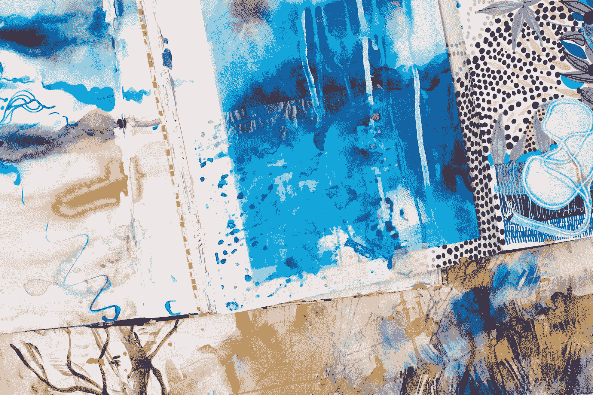
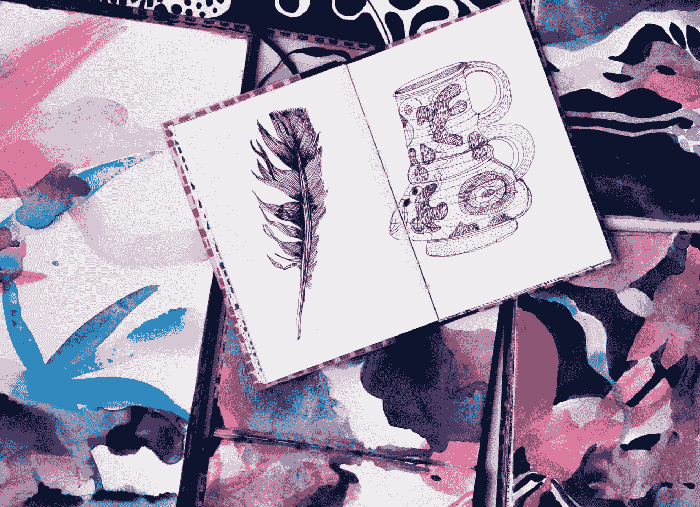
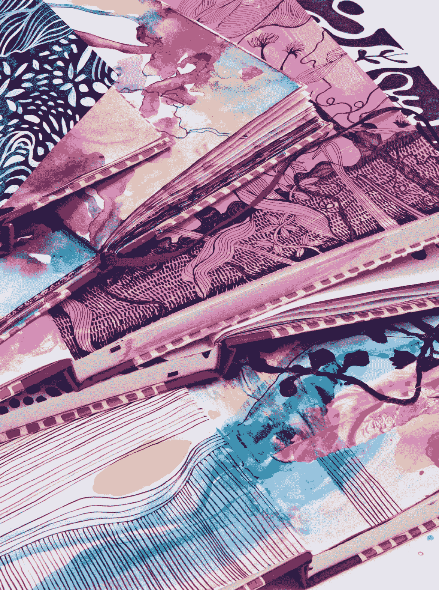
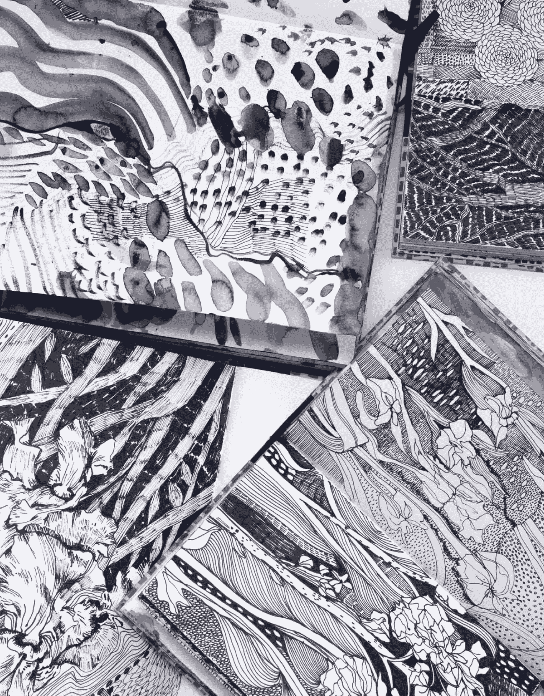
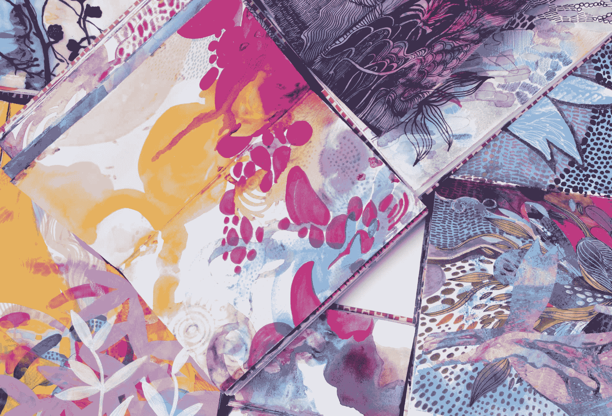
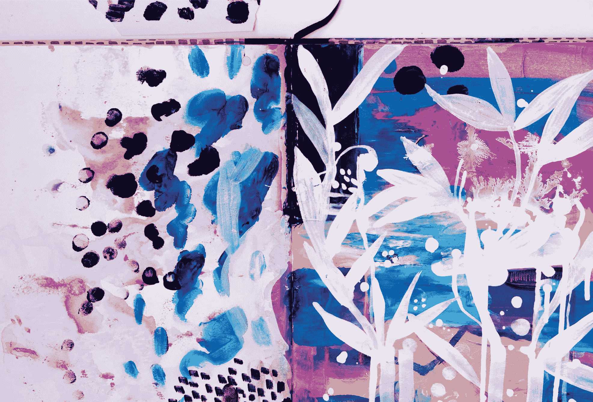
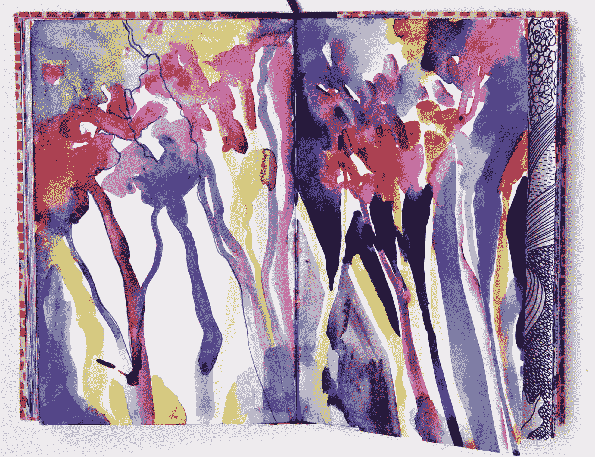

# 表现力素描本：培养创造技能、勇气和自信

# 引言

## 什么是表现力素描本？

## 培养你的创造力
一个表意素描本是你想象力的游乐场——一个培养创造力并发展你自己艺术风格的地方。在这本书中，我提供了许多指引来照亮你的道路，帮助你打造一本独一无二的素描本。
这本书关于探索你创造的召唤，并将那些想法引导到纸面上。它关于帮助你创作出只有你才能创造的艺术。
请记住，你的素描本不会充满完美无瑕的绘画或完美的结果。但有时凌乱而充满欢乐的实验将为发现和完善你自己的视觉风格和艺术声音铺平道路。请记住，素描本是你发展艺术实践的地方，而不是你完全成形的地方。它们是艺术旅程的一部分；它们不是最终目的地。

通过创作和实验变得自信。通过更频繁地创作艺术，你所做的艺术会有所提升。

探索对你重要的主题和想法。素描本是一个安全的尝试之地，让你更深入了解自己的兴趣和着迷之处。

## 将艺术融入生活
一本优秀的素描本无关完美的结果。它关乎通过实践学习和成长。素描本是一个让你对自己的创造力更有信心、更勇敢的安全之地。它也是你发展一种能点亮你的艺术方法和过程的地方，让你充满能量和热情。把你的素描本看作与自己进行创造性对话的地方。

通过创作更多艺术变得更有灵感。不要等待感觉准备好才开始；通过开始并采取行动，我们才变得准备好。

## 实验与发现
素描本除了实验和发现之外没有规则。我们通过创作变得富有创造力。你的素描本可能包含很少的实际素描。对一些人来说，素描本可能完全是关于写生，而对另一些人来说，它是关于探索色彩和构图，或记录想法、记忆或概念。我希望这本书能给你一点创造性的火箭燃料，让你在自己的艺术方向上起飞。

让你的素描本独属于你。它必须反映你这个人，并成为一个你可以探索与你产生共鸣的主题和题材的地方。

素描本是一场艺术冒险。尝试不同的方法，并在过程中发现和揭示你的艺术声音。

我的素描本看起来就像我做的。你的素描本将包含反映你的页面，它们看起来就像你做的。

素描本是创作具有个人价值的艺术的地方。
