# 第 1 章

## 魔力与动力
为什么要发展你自己的素描本练习？坚持素描本将帮助你培养自己的自我表达和创造力。本章旨在帮助你拆解可能阻碍你创造力的任何障碍和壁垒。它还将帮助你了解开始素描本的原因以及你希望素描本成为什么。寻找有关如何反思和记录你的艺术兴趣和灵感的技巧。

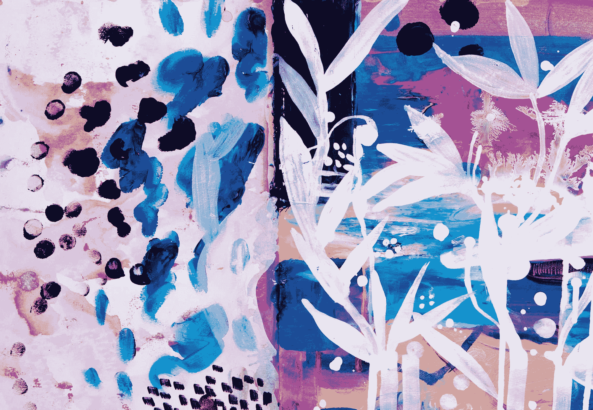

### 开始素描本的理由
你现在可能没有意识到，但使用素描本可以提升生活。素描越多，你就越邀请创造性的炼金术进入你的生活。以下是开始你自己的素描本（或在感到卡住时继续）的几个原因。

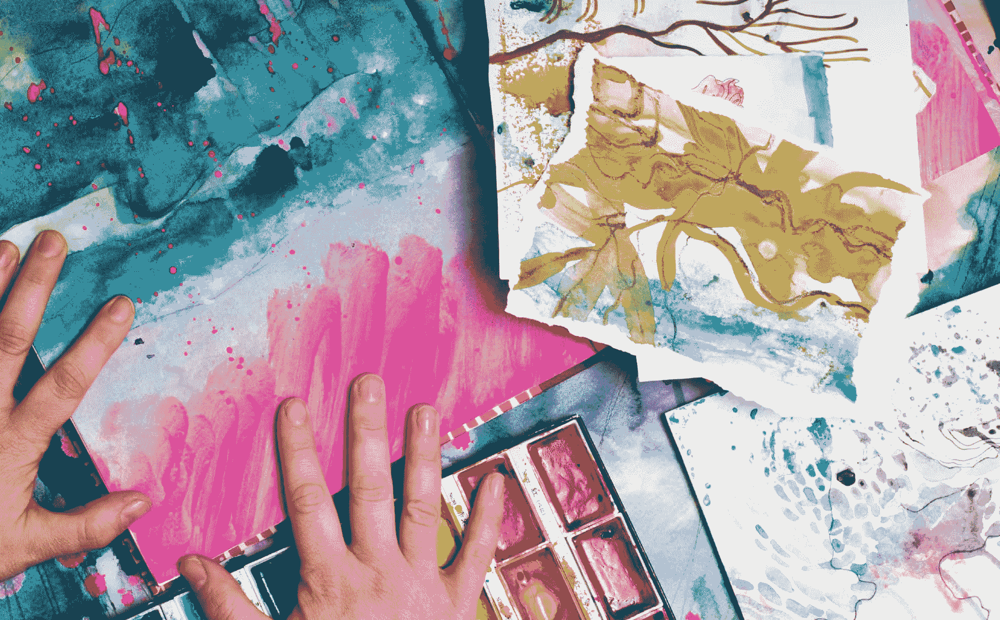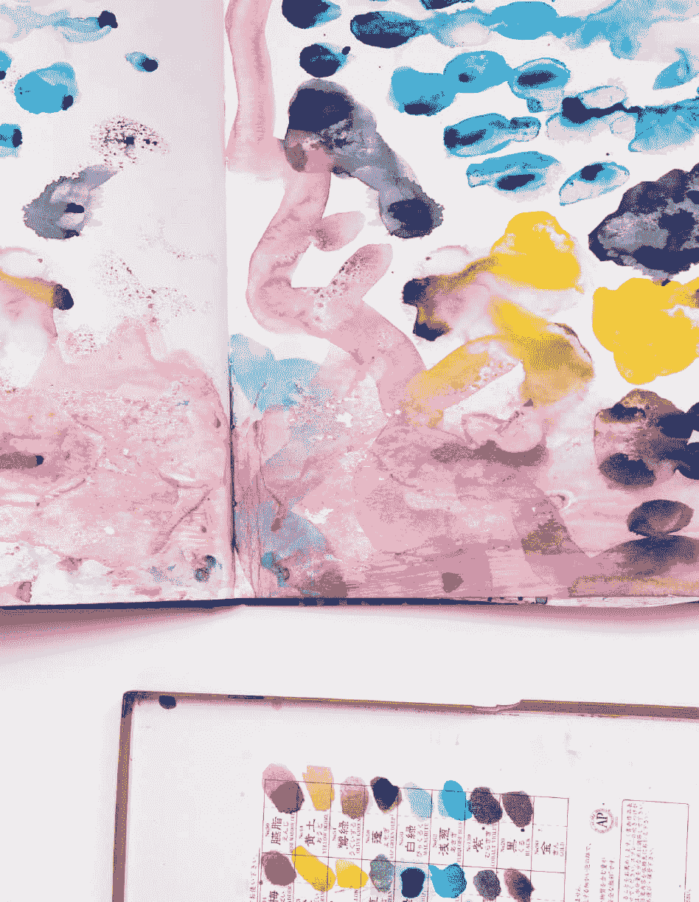
在素描本中玩耍以发展艺术技能。素描本是学习和成长的地方——它不会充满完美无瑕的杰作。有些页面看起来会像一团乱，但这无关紧要。

#### 探索想法
你的素描本是你理解、发展和探索你的艺术兴趣或执念的绝佳场所。拆解是什么让你对艺术和生活感到好奇，并将这些想法素描在页面上。在发展素描本的过程中，你将头脑或心中的想法带到纸上使其活起来。

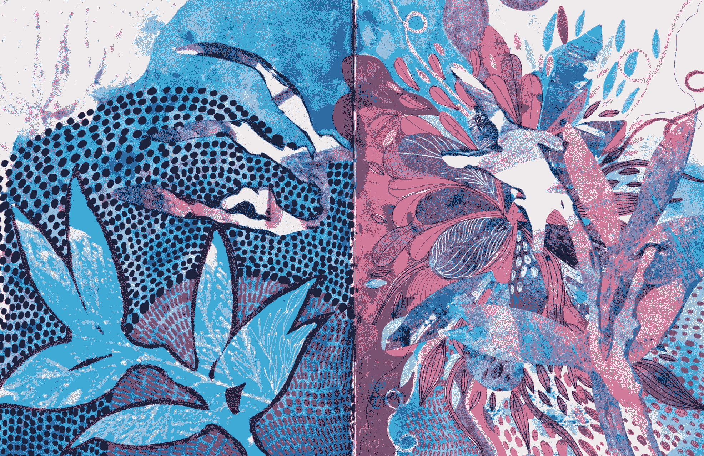
素描本提供了发现模式和反复出现的主题的机会。这两页素描本相隔数年创作。注意在图案背景上使用白色花卉剪影。通过翻阅旧素描本，你可以发现反复出现的主题并找到联系。

#### 记录你的创作之旅
用素描本记录你的创作觉醒。把你的素描本看作你在艺术旅程中的朋友和伴侣。

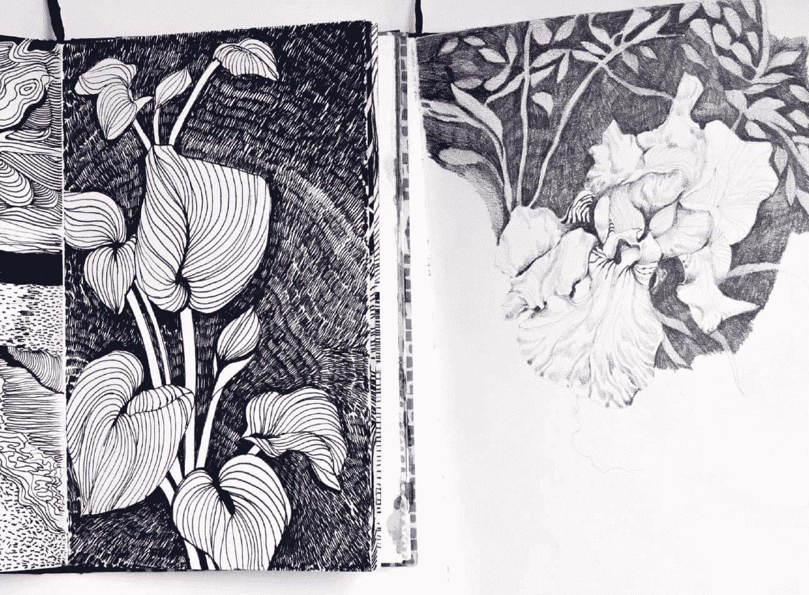
素描本是理解和探索是什么让你好奇的地方。拿一个想法的萌芽并扩展和探索它。

#### 私密/安全之地
你的素描本是为你准备的。它可以是一个私密和个人的游乐场。你不必与任何人分享。你不需要展示其内容或将其挂在墙上。如果你愿意，你可以合上封面并将里面的内容保持私密，就像你与自己进行的对话一样。

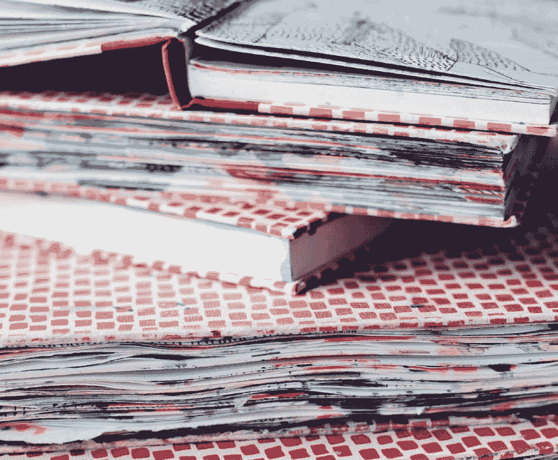
素描本的内容不需要公开分享。为自己创作艺术，只为创造的喜悦。素描本页面是为了发现，而不是展示。

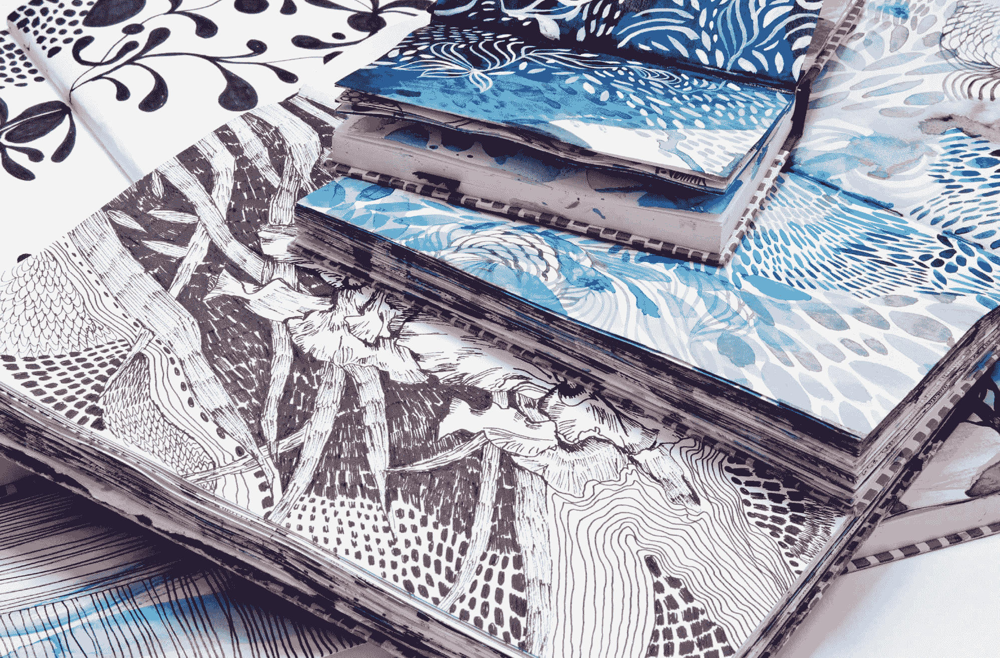
素描本记录你的艺术发展和成长。

#### 发展你的技能
我们通过创作学习创作。我们通过实践变得更好。你的素描本是创作和实践、发展和进步的地方。

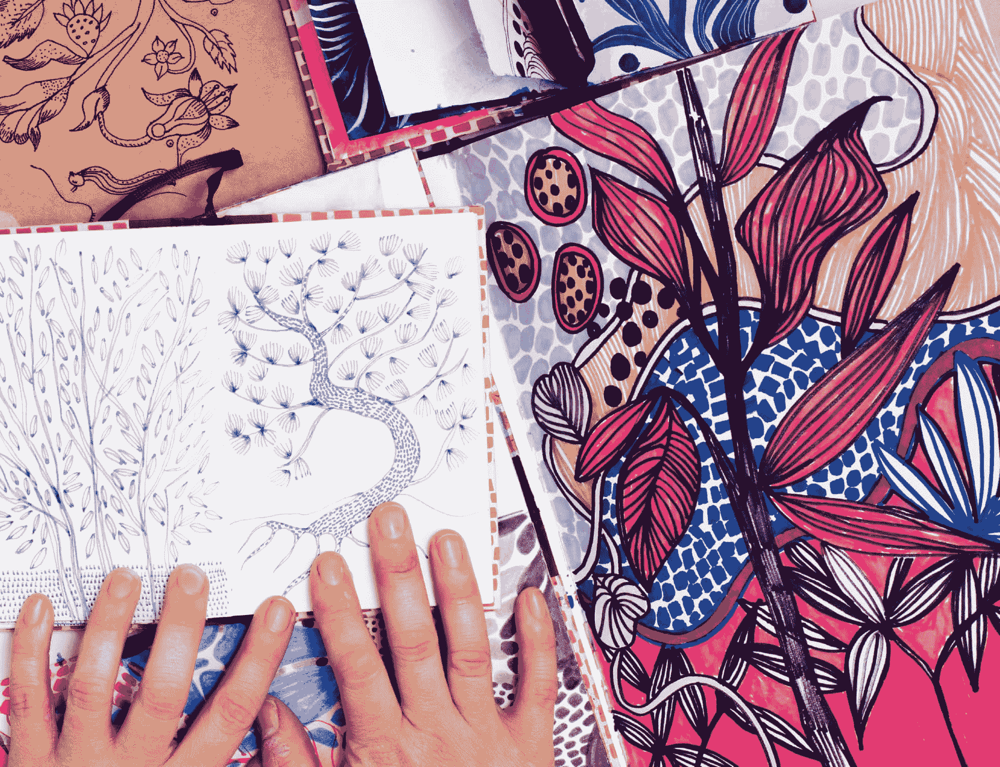
在无中生有中获得乐趣。通过实践发现和发展。小而渐进的行动随着时间的推移相互累积，以培养技能和自信。

#### 在数月或数年后回望
你的素描本捕捉了你生命中的一个季节。保留所有素描本并回望你在生命中的某个时期身在何处或感兴趣什么，这会非常有回报。社交媒体让我们如此容易地将自己、我们的生活、我们的创作产出和艺术作品与他人比较。我们往往倾向于将自己最糟糕的努力与他人的最佳努力进行比较。相反，我们应该将自己的作品与自己的作品比较，并问自己：我在学习吗？我在发展吗？我在表达自己吗？我对自己的产出感到满足吗？我在推动自己吗？

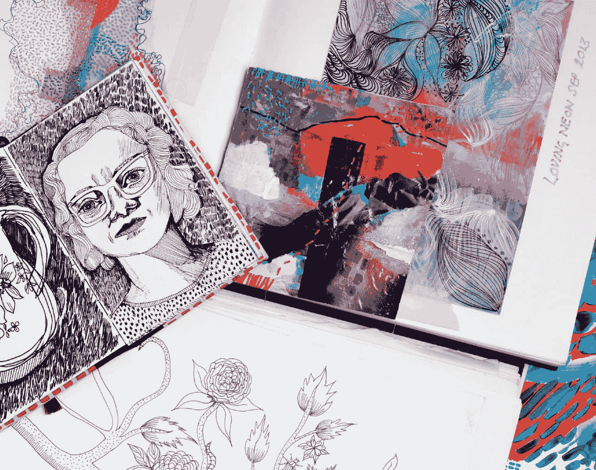
回望旧素描本，发现过去的兴趣或着迷之处。素描本让你能够随时间追踪想法和进步。

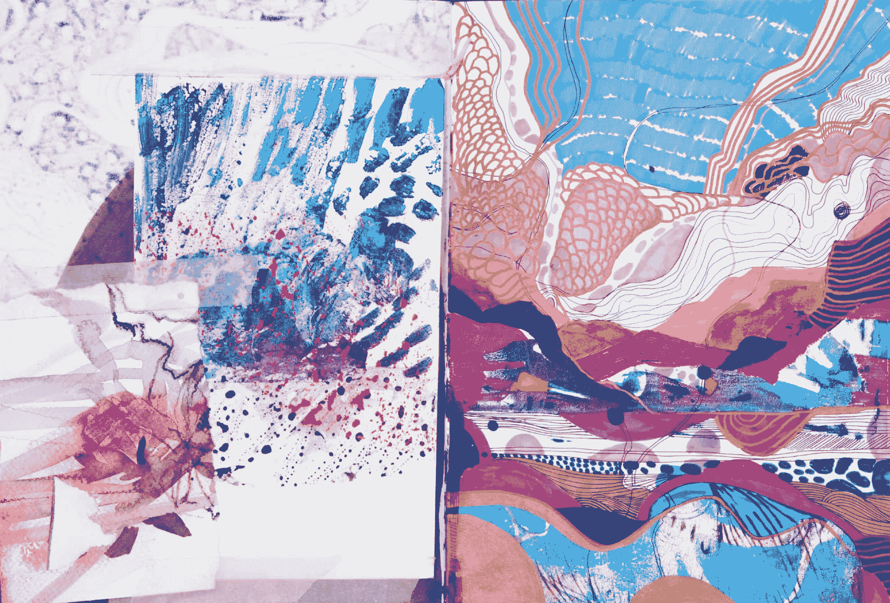
素描本是你想法的现成归档系统。

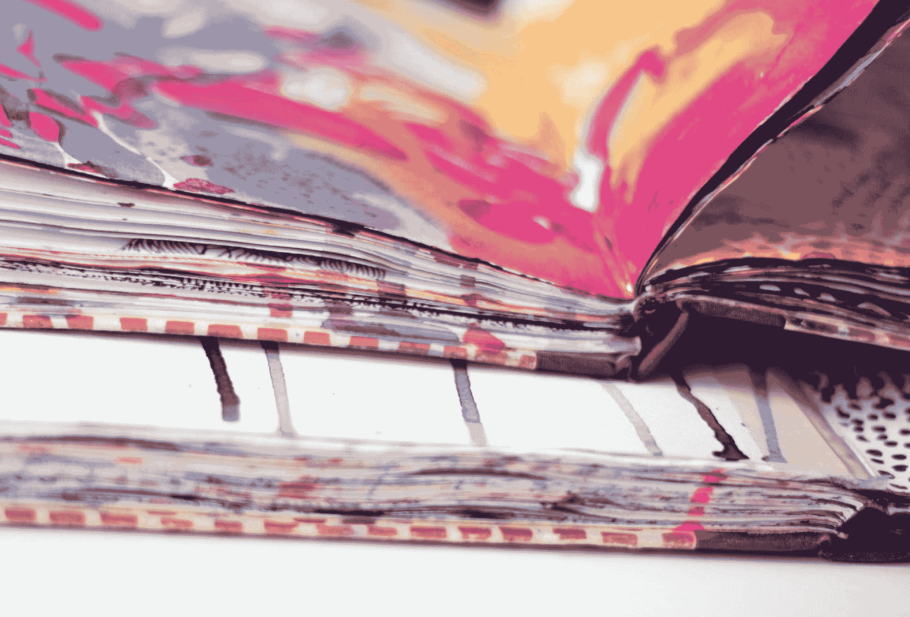
完成的艺术页面共同存在于一本装订的卷册中。

#### 集中一处
你的素描本是一个绝妙的想法文件柜，所有内容都安全地保存在一处。

#### 一件美丽的物件
你的素描本可以发展成一件美丽的物件。你可能会非常欣赏素描本的完成页面如何共同保留在一本装订的卷册中。

#### 令人满足
为自己创作艺术可以滋养人心且令人满足。在素描本中实验可以提升你的精神并为生活带来喜悦。将空白页面变成充满意义或学习、色彩或线条的东西，有一种极其令人满意的感觉。

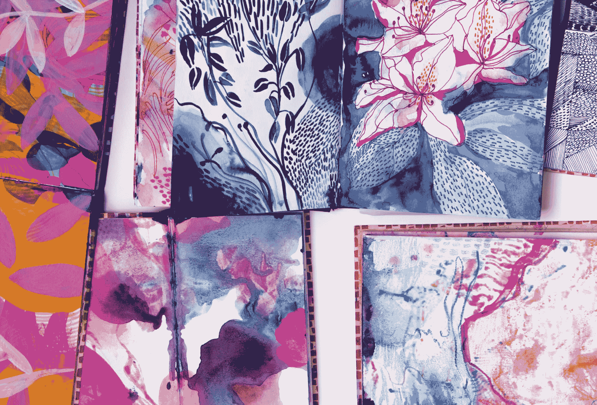
将空白页面变成充满艺术和个人意义的页面是令人愉快和充实的。

#### 过程，而非结果

你的速写本是一个让你享受并从创作过程中学习的地方。速写本无关乎完成的艺术作品。它是探索过程、扩展小片段并发展你自己的艺术语言和词汇的地方。我常常从失败的尝试、我最糟糕的页面——那些我不喜欢的页面中学到最多。将你的速写本视为一个从“做”中获得洞察和智慧的地方，而这种洞察并不一定基于你是否喜欢结果。有时魔力发生在你的大脑中，而不是纸面上。价值可能来自你在创作过程中学到的东西，而非你所创造的东西。

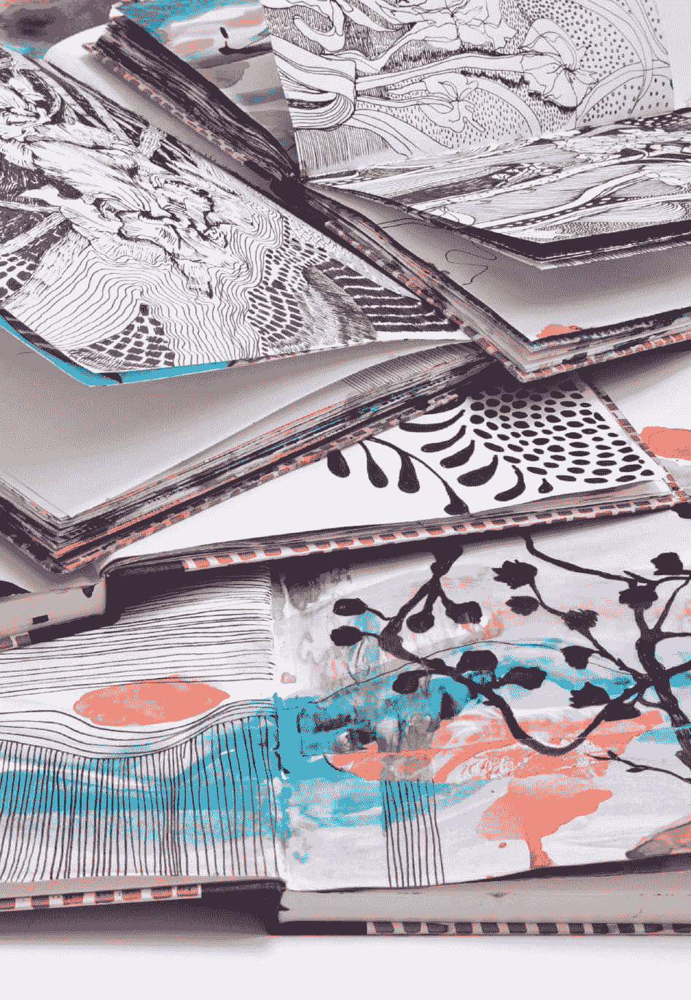

速写本练习是一种自我发现的练习。创作艺术页面是挖掘那些令你兴奋、感兴趣并拓展你的事物的一种方式。

## 创造意义

使用速写本可以帮助你与自己建立联系。它可以促使你更意识到生活中那些让你充满活力和生机的事情。使用速写本是一种发现的练习；它邀请你思考什么点亮了你，什么让你好奇，什么让你着迷，什么让你感到开阔。你的速写本将成为一个定义你所重视之物的地方，在那里你挖掘来自你自己的、给自己的信息。

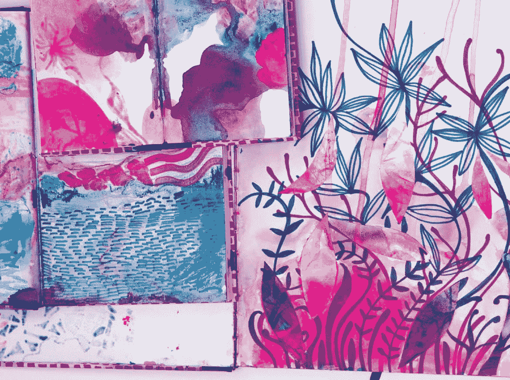

你通过创作所学到的东西可能比你所创造的东西更重要。大号速写本上使用了记号笔绘制的花卉图案，并粘贴了拼贴的叶子形状。它以一泼热粉色颜料收尾，我让颜料滴落到页面上。中号速写本包含记号笔、粉彩涂鸦、水彩泼洒以及蓝色记号笔痕迹。在较小的速写本中，我在探索色彩如何相互搭配。

## 诠释世界

创作艺术是诠释世界的一种方式。当你开始绘画时，你会经常发现自己开始用新的眼光看事物。当我画一个物体时，我了解它，我欣赏它的形态、复杂性、结构和图案。

真正凝视某物的行为邀请你以不同的方式看待它。你对主题获得新的洞察，并可能发现之前未曾注意到的东西。绘画某物的行为，即使是平凡的物体，往往也会揭示主题中隐藏的美。

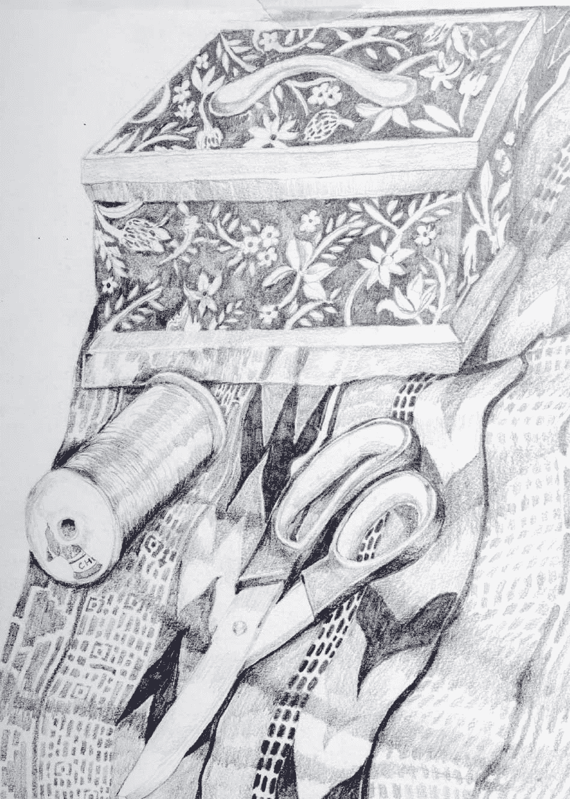

在平凡中寻求非凡。绘画可以揭示物体中隐藏的美。通过绘画一个主题，你会以不同的方式看待它并获得更深的理解。

## 一个跳板

你的速写本可以成为与自己进行刺激性对话的起点。它的页面可以包含想法的开端，你可能希望将其发展成绘画或更大的艺术作品。这是一个捕捉那些想法的地方，否则它们可能会消散或在虚空中丢失。这是某事的开始，它带你踏上发现之路。

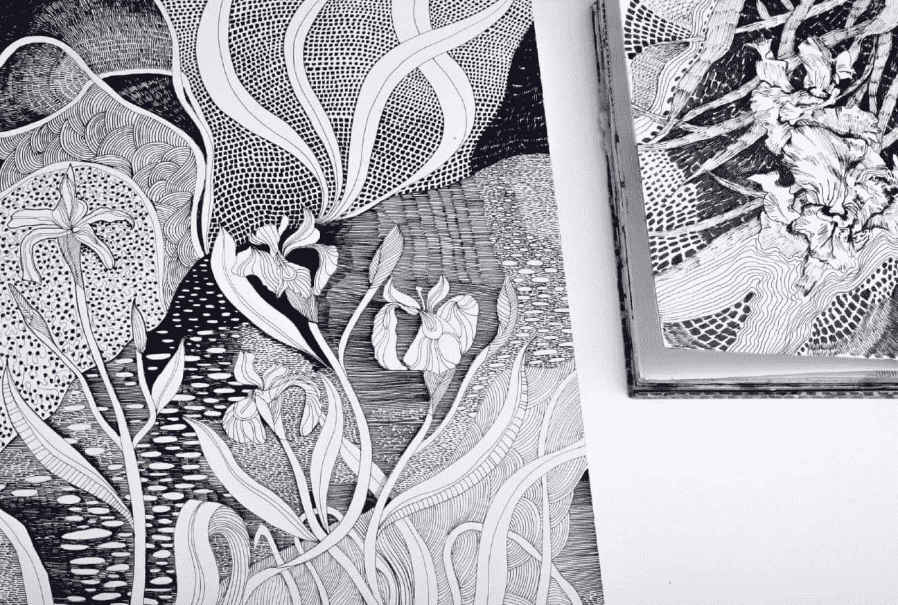

你速写本中的页面可能包含想法或想法的片段，你可能希望将其扩展到页面之外，成为更大、更完整的艺术作品。

## 克服障碍

克服障碍是创造力的一个不可或缺的部分，所以让我们花点时间反思这些障碍可能是什么。

我们中的一些人希望更有创造力，但我们害怕尝试也害怕失败。我们开始然后迷失，或变得受阻，或不知道下一步该怎么做。我的目标是帮助你克服这些障碍并解决它们。

以同情和好奇心面对你自己的创造性脆弱。

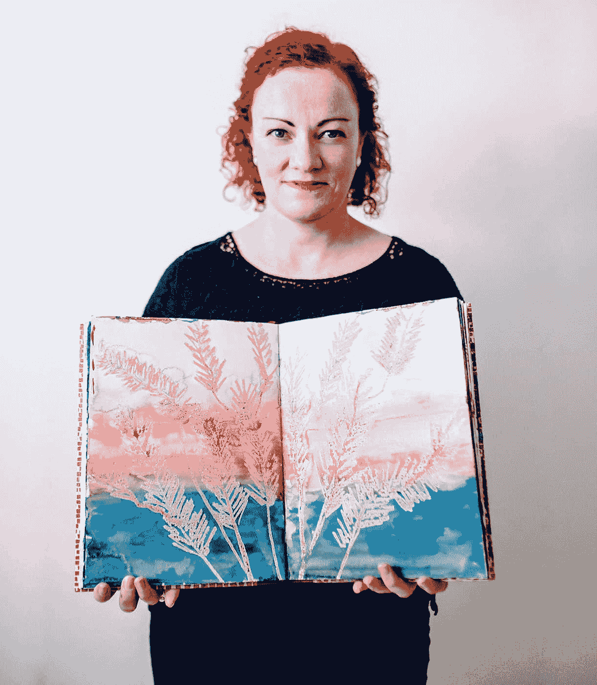

### 我不会画画

我生命中有很多年我停止了绘画并且没有重新开始。我对自己制作的一切都极度苛刻。令人悲伤的是，我关于画不好画的心理喋喋不休和自我批评阻碍了我做我所爱的事情。我听从自己的负面言论并相信它，无论它是否真实。

当我们还是小孩子时，我们带着天生的喜悦和好奇心绘画。我们画彩虹、火柴人、房子和棒棒糖树。当我们年轻时，我们绘画是因为这是一种理解和探索周围世界的方式，也是因为它很有趣。我们需要把这个爱玩的孩子带回纸上，不要让自己的批评阻止我们享受过程。

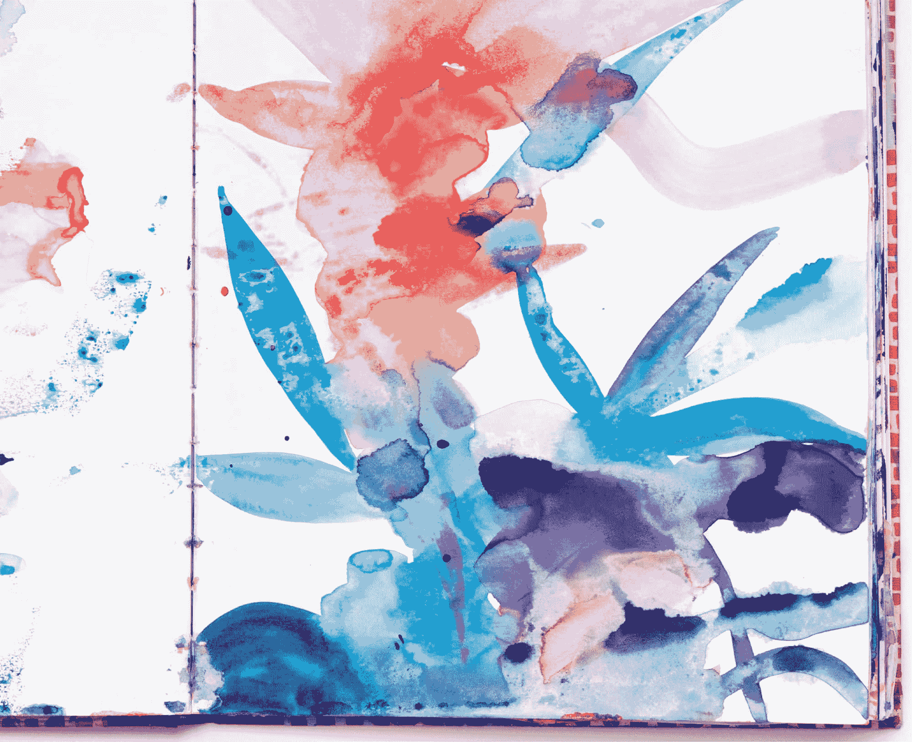

速写本是艺术旅程的一部分，而非目的地。其内容可能是不完整和实验性的。以玩心而非完美为目标。

### 我不喜欢自己的作品

我过去常常让自我批评和不友善的自我评判支配我的行为。我过去常常开始一本新速写本然后放弃它，因为我太完美主义了，我觉得我的作品不够好。我希望我的速写本是辉煌的杰作。我希望每一页都精美得足以挂在画廊里。我想向自己证明我是一个有才华且值得的艺术家。我希望我的速写本承担太多。

所有这些压力、所有这些期望和所有这些完美主义导致了被遗弃的速写本的墓地。

记住要滋养自己而不是批评你的作品。对你的艺术和你自己的同情心帮助你发展、成长和学习，而压力下的完美主义会让你停滞不前。稍微降低标准，对自己期望少一点，可以让你取得更多成就。不完美带来的自由让你更能进入心流。你会发现，有了这种心态，你会创作出更好的作品并享受过程。不创作的痛苦比创作自己不喜欢的东西的痛苦更令人瘫痪。

任何新的创作尝试都可能让你感到暴露和脆弱；它可能会引发怀疑、恐惧、评判或批评的感觉。在你开始创作时，对自己友善和温柔。

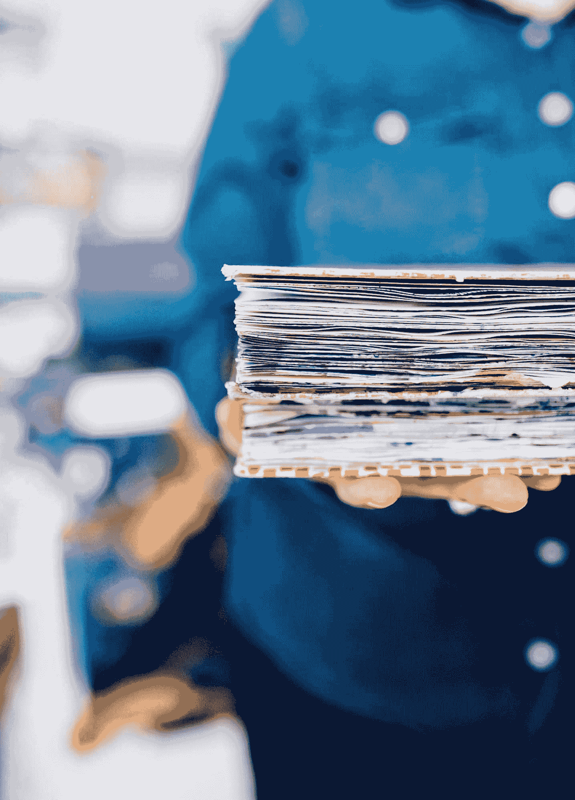

### 我不知道该做什么/从哪里开始

很多时候我真的不知道该做什么，或没有感到有灵感在速写本中做任何事情。我万无一失的回应是总是做点什么。采取一个微小行动并从那里开始的力量可以成为激发灵感的一种方式。翻页然后开始。我们可以花一生的时间思考、计划、沉思和考虑。通常所有这些思考和计划可能正是阻止我们行动的东西。所以与其思考如何开始，不如深呼吸然后开始。这本书中有很多想法和提示，但只有你能采取行动。开始至关重要；阅读关于开始的内容是不够的。

开始可能是最困难的部分，但通过采取行动你会获得动力。

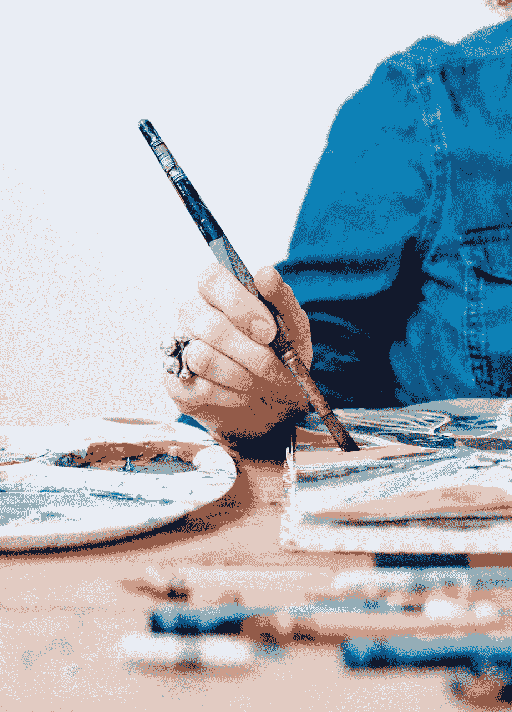

### 障碍是创造力的一部分

找到阻止我们开始或继续的障碍很容易。有时当我们已经在进行时，障碍会出现。尝试审视并承认你自己的阻碍和障碍。你需要知道它们是什么才能克服它们。使用本书中的练习来绕过你的创造性阻碍和坎坷。听听你对自己说的话——它有帮助吗？

将阻碍和障碍视为创造力的不可或缺的一部分，并知道任何值得的旅程途中都会有一些挫折。这些阻碍是学习过程的一部分，也是你扩展和发展的一部分，所以不要让它们成为你创作道路的终点，就像我多年前那样。

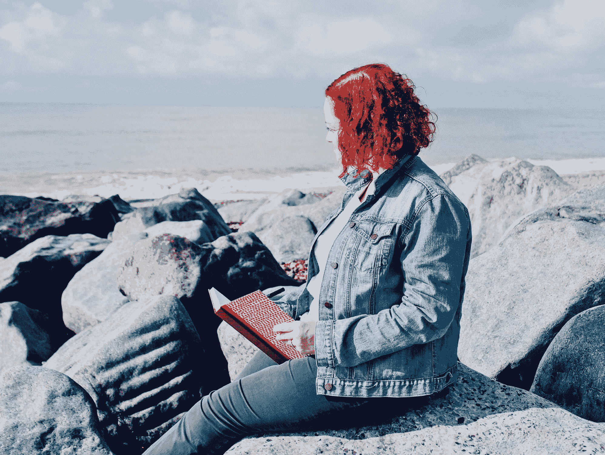

障碍是艺术过程的一部分。通过学习克服或绕过它们，我们变得更有信心和创造力。

## 你的动机与意图

素描本帮助我建立自信，发现内在的艺术家，并表达自我。当我开始定期使用素描本时，它变成了一个安全的空间，让我的创造力和艺术得以蓬勃发展，是一个提升技能的地方，也是通向更具表现力和创造力生活的跳板。我鼓励你探索自己使用素描本的动机。

我坚信写下东西的重要性，因为有时把笔尖触到纸上的行为可以将无形变为有形。自问自答有助于我们阐明意图，让我们找到清晰感。我邀请你思考自己使用素描本的动机。将答案写在你的素描本中，或者如果那样感觉不对，就在纸上探索它们。询问自己为什么想培养素描本练习、想实现什么、想感受什么，以及打算何时何地使用素描本，这非常有力量。请使用以下提示：

• 我想培养素描本练习，因为…
• 当我在素描本中工作时，我希望感受到…
• 我希望我的素描本是一个我可以…的地方
• 我将每（频率）使用我的素描本（指定）段时间
• 我将在（地点）使用我的素描本

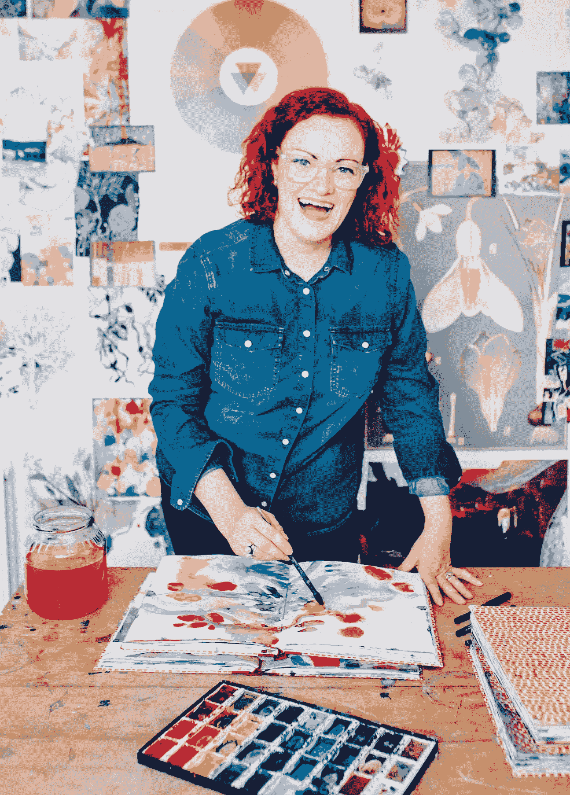

意图的清晰是强有力的起点。

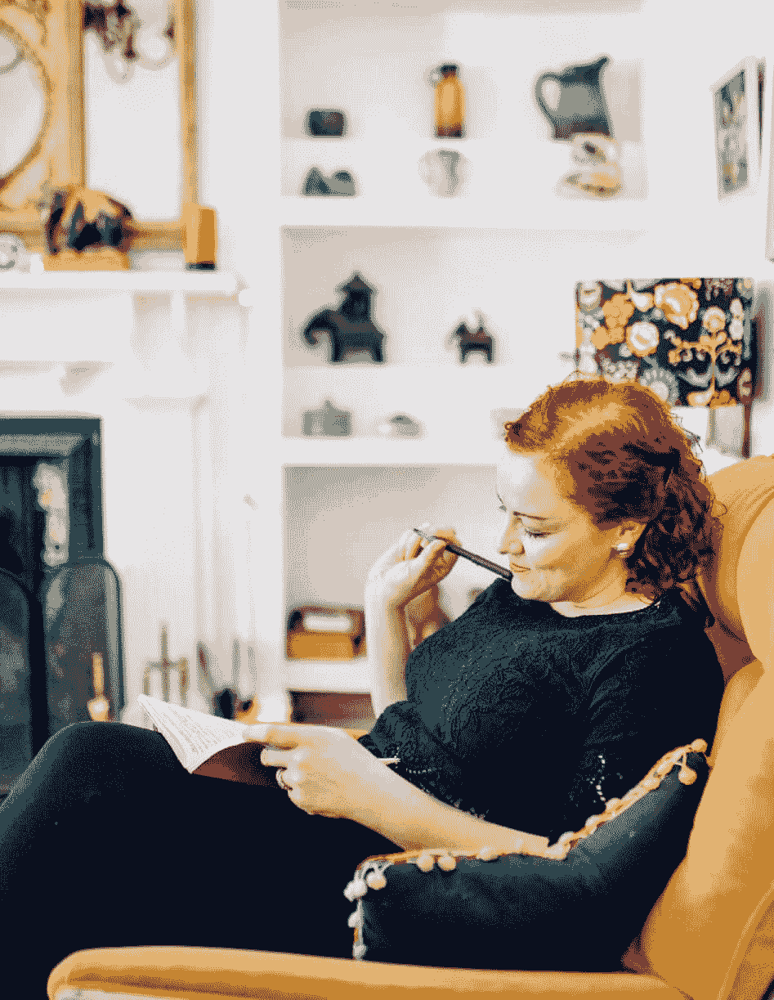

定义你的个人动机并设定你的意图。

### 挖掘你的兴趣

花一点时间完成以下简单却发人深省的练习。它专注于思考和书写你着迷的事物。它要求你识别那些与你产生共鸣的主题、学科领域、物体或想法，以及你可能想在素描本中探索的内容。

### 在一页上捕捉想法

这个练习的前提是捕捉你在素描本中可能想要深入探讨的所有或部分事物。把它看作是对一页纸的意识流头脑倾倒。你可能觉得自己并不真正知道这个问题的答案，那么花一点时间思考和书写可以成为推动事情发展的绝佳方式。

### 个人灵感地图

问自己这个问题：我想在素描本中探索什么？然后安静坐下思考你的答案。写下所有浮现在脑海的东西。不要自我审查。你的清单听起来像是一堆奇怪事物的拼凑也没关系。奇怪很奇妙。我现在相信我的“奇怪”是我最有趣的部分。我的终身痴迷于图案就是我奇怪的一个例子（我仍然记得五岁时我们搬离的那所房子里的所有地毯和壁纸图案。）然后还有我对自然界中随机物品的全情热爱（贝壳、羽毛、松果、叶子、海藻、鱼鳞等等）。所有这些都体现在我的艺术和素描本中。挖掘你的怪癖和独特性，然后拥抱它们，培养它们，庆祝它们，并利用它们。

把这次写作、思考和记笔记的练习看作捕捉你微小好奇心的起点。这是一种记录你兴趣的方式，无论是短暂的片段还是成熟的想法。这是你想在素描本中探索的事物的宝藏地图。你列出感兴趣、着迷、好奇或引起你好奇心的主题。至少花 20 分钟写下激发你兴趣的微小和宏大的事物。

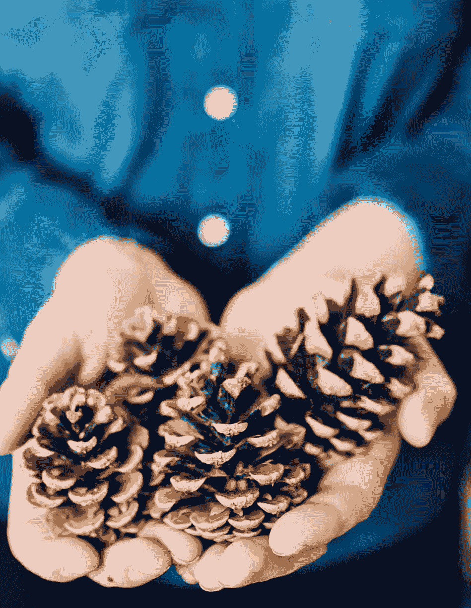

探索你的兴趣、痴迷和好奇心。你对哪些主题着迷？

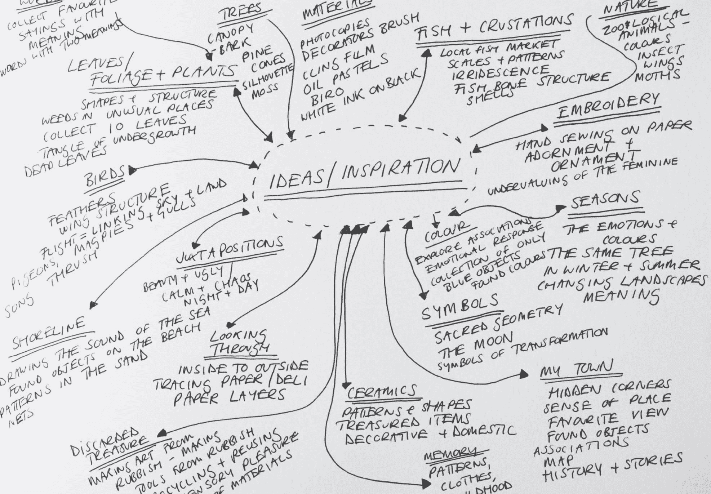

这是我其中一张灵感地图的例子。你的会完全不同，并包含对你而言特别的事物。我们都是独一无二的，有各自的影响、兴趣和灵感。倾听你内心的低语，你的内在智慧，并写下它。写下这些想法将使你能够跟随它们独特的线索。

### 有意识地关注你的兴趣

这个练习是你以后可以返回、添加或从头到尾重新做的。你可能会发现，在你完成这个练习后，当你只是进行日常例行活动时，新的想法会涌现。仿佛写下这些东西的行为让你的大脑在其他时间更容易寻找灵感。当你有意识地寻求灵感时，你会发现它无处不在。

### 自问问题

在你的素描本或空白纸上完成这个练习——由你选择。我倾向于在较大张的纸上做，以便我有自由和空间写下我喜欢的那么多内容。

为了让你的想法流动，请自问以下一些或全部问题：

• 你如何描述打动你的艺术？
• 你最被哪种艺术题材吸引？
• 童年时你喜欢创作或绘画什么？
• 考虑你到目前为止的创造力。你喜欢什么？
• 是否有一种艺术方法你一直想尝试？
• 哪些艺术材料引起你的兴趣？
• 哪些学科领域让你兴奋？
• 哪些学科领域让你着迷？
• 你对什么感到好奇？
• 你喜欢收集什么类型的物品？
• 你喜欢反复造访什么样地方？
