# 第 4 章
## 拓展你的创意

现在是时候拿起你在前几章中学到的实用工具和技巧并在此基础上进行拓展了。从一个让你着迷的主题或话题开始，并进行实验！

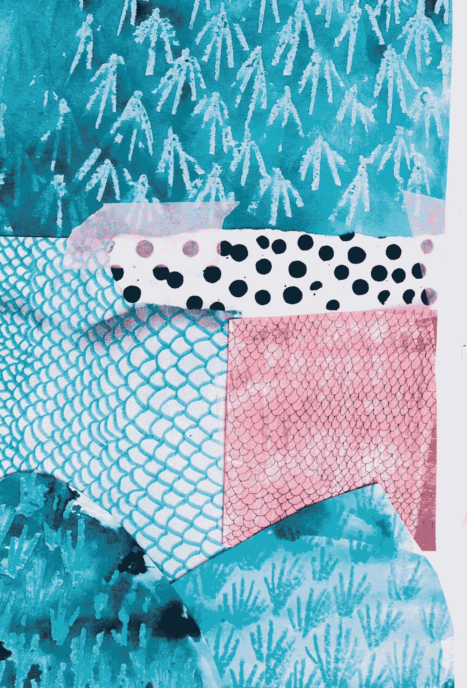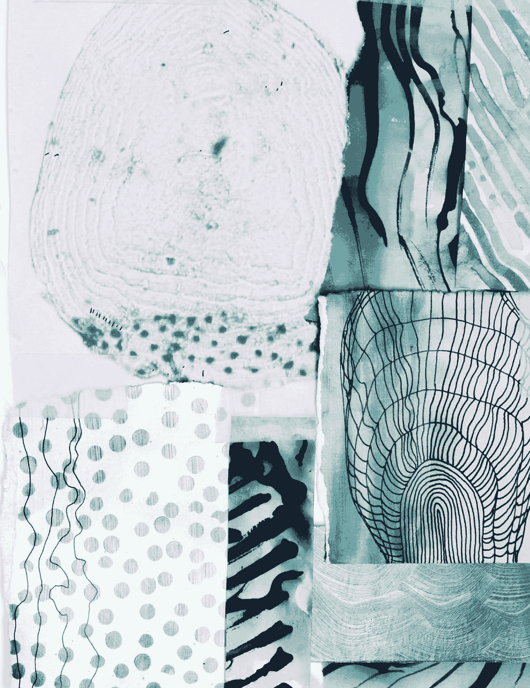

### 主题

正在寻找一个激发素描本艺术创作的主题吗？以这些起点为基础，发挥它们，并使其成为你自己的。选择对你最有意义和重要性的主题和话题。

#### 经历
-   选择你去过的地方，并利用记忆或照片创作回应这次访问的艺术作品。
-   创作反映你认为重要的个人经历、一段旅程、一个爱好或生活变化的页面。
-   选择一个你关心的事业，并考虑它如何成为素描本艺术的起点。
-   创作反映你世界观、信念或你知道为真的事物的页面。
-   画出你人生的故事或关键时刻。
-   思考你的个人价值观，并以其中一个作为创作艺术页面的起点，即，勇气、真理或平等。

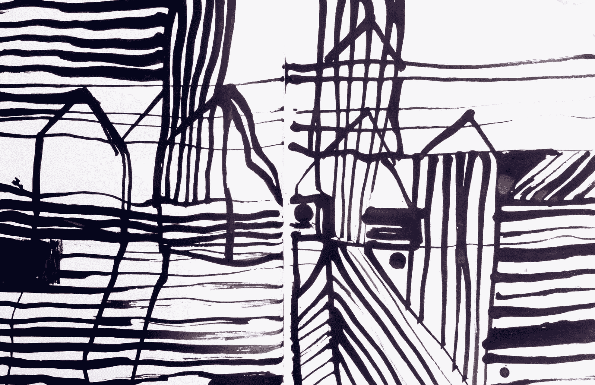

这个想象风景的例子是用蘸墨的树枝制作的。

#### 人与地点
-   画一系列自画像，突出你认为重要的东西，或包含对你个人有意义的符号或母题。
-   在你的素描本中创作探索对你有意义的地方各方面的页面。
-   以你居住的地方为起点，创作受家乡启发的素描本艺术。
-   在你的素描本中创作一页献给对你特别重要的人。

#### 情感与想象
-   选择一种与你产生共鸣的情感并尝试描绘它。
-   创作受童年记忆启发的艺术页面。
-   在你的素描本中创造一个想象中的世界、城市或风景。
-   为一个梦境专门留出一页素描本。
-   选择一首你喜欢的诗或歌曲，用它来启发素描本中的一页。例如，你可以在听歌的同时尝试表现性标记练习，看看它对你的标记质量和多样性有何影响。

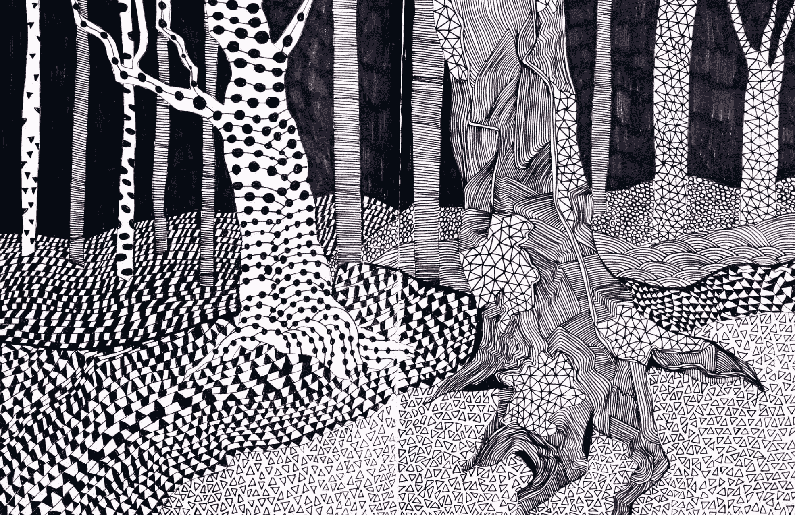

尝试从想象中创作风景或城市景观。这片拼贴森林是用细头笔和马克笔绘制的。尝试将标记练习中的图案和标记融入其中。

#### 物件与事物
-   我们周围的物件都有意义。选择几件对你有意义的物品，并以它们作为素描本页面的起点。
-   选择一件你认为美丽的物件，并在同一页上反复绘制它，或使用不同的材料绘制。
-   为一件你本打算丢弃的东西专门留一页，例如一块过熟的水果、蔬菜或包装。
-   为一件发现的物件预留一页。它可能是别人丢弃的东西，也可能是自然界的东西，例如你在散步时找到的松果或树枝。

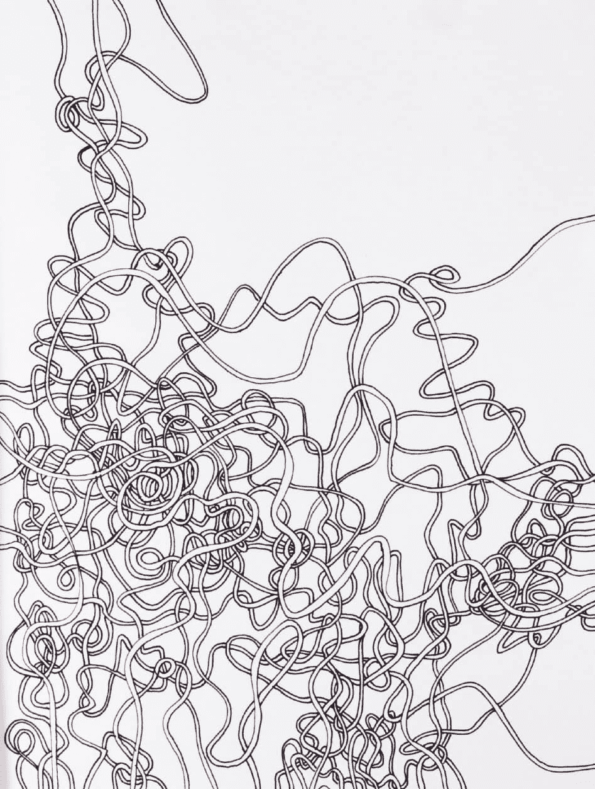

美丽可以在简单的丢弃物品中找到。这页素描本的灵感来自一些杂乱的线绳。

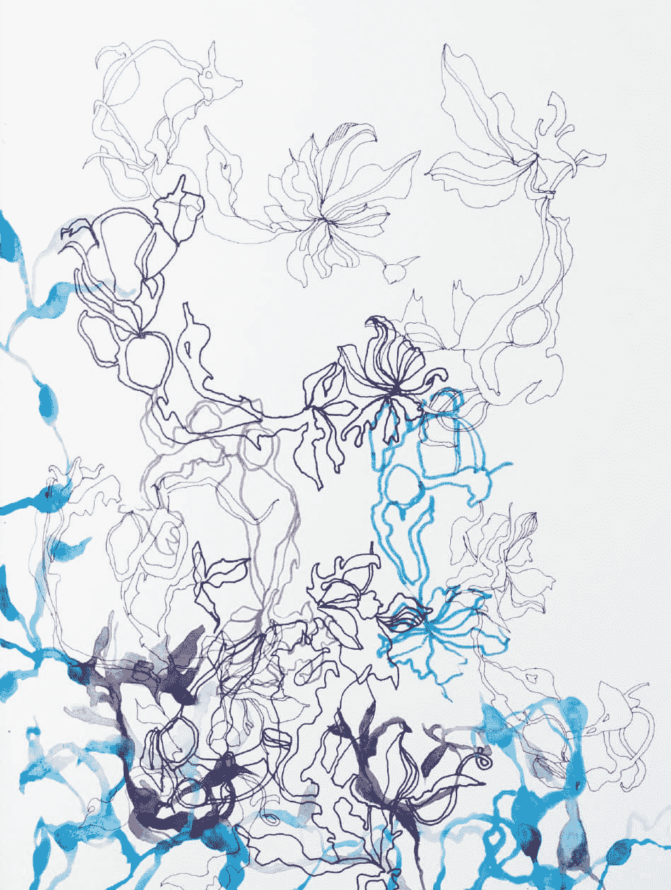

通过在同一页上反复绘制一个物体来进行实验。这页包含我从海滩找到的一小块海藻的许多快速素描。

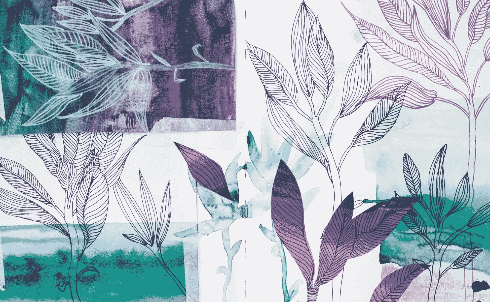

一个有趣的起点可以带你走向许多不同的方向。通过在同一页上使用重复进行实验。我使用多种不同的艺术材料创作了这些叶子，包括拼贴、黑色细线笔、水彩和永久性白色马克笔。

选择以下主题之一，并在家中或邻里寻找它的例子。拍照以用作素描本页面的参考资料：
-   透视
-   平衡/不平衡
-   并置
-   风化/锈蚀
-   圆形
-   线条与角度
-   天际线
-   关系与联系

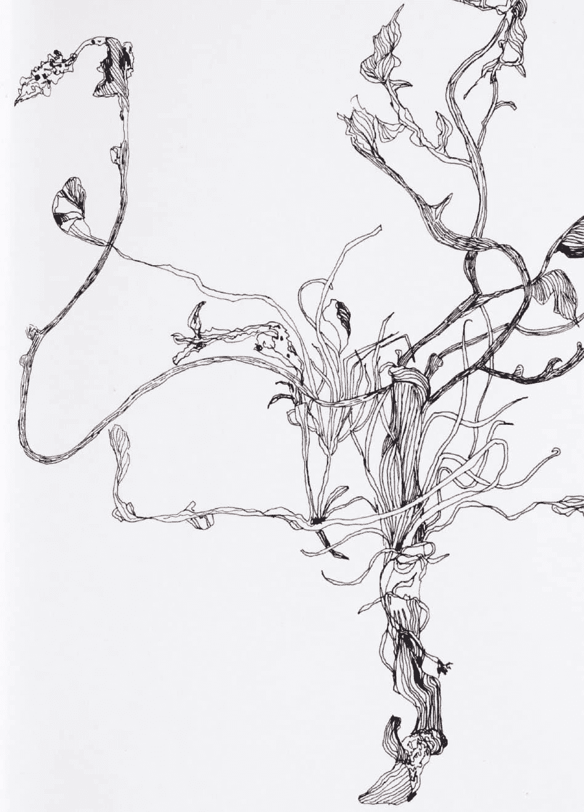

一件小而看似无关紧要的物品可能非常有趣可画。例如，试着画一根找到的树枝或一株干枯的杂草。

### 拓展创意

拓展创意的一种方法是重新审视你的灵感地图，并挑选其中一个线索进行拓展。新的创意可以来自于拓展地图上的单一概念。

首先取一个想法并将其置于新地图的中心。写下你可能想要探索这个主题的所有方式——任何想到的东西。写下所有内容——不要自我编辑——只是让想法和联想自由流动。在我的原始创意地图上，我写下了“鱼鳞”。我通过写下我可能如何在素描本中运用鱼鳞灵感的方式来拓展这个想法。我的一些想法包括使用珠光漆、在显微镜下观察鱼鳞的形状、用铝箔制作鱼鳞、研究鱼鳞的作用以及研究不同的图案。

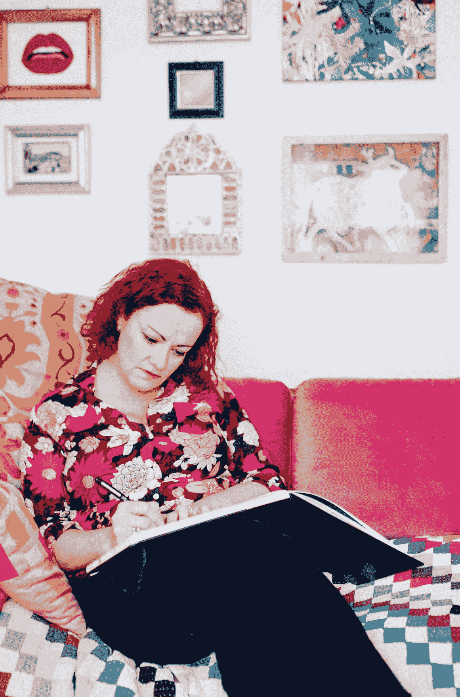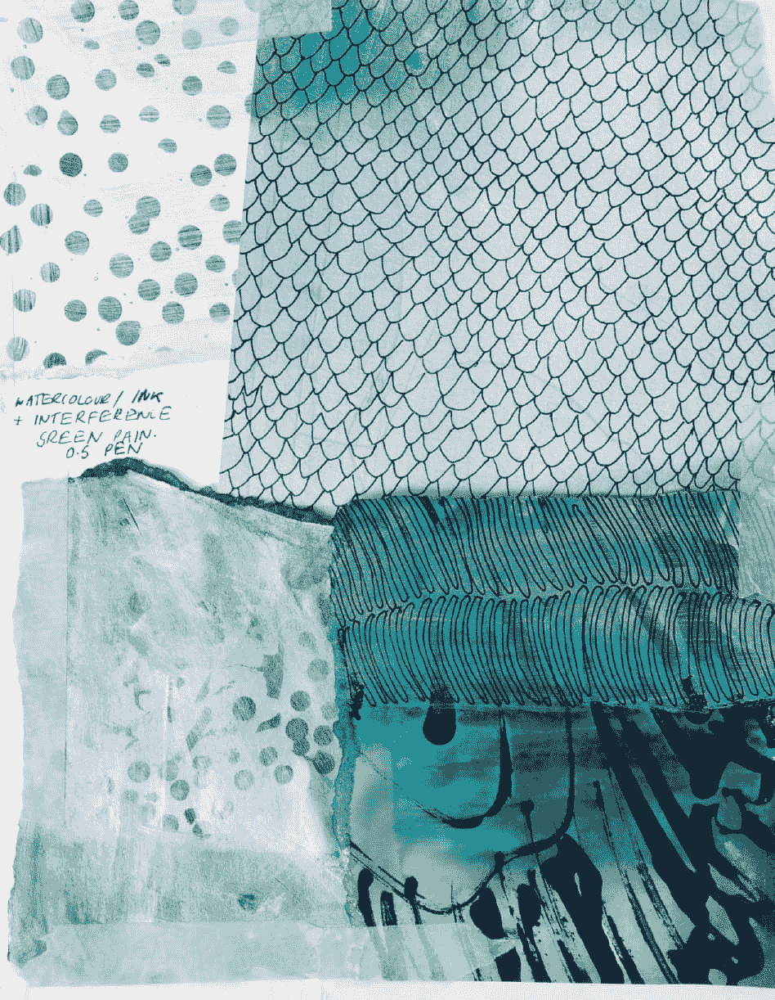

利用你的素描本捕捉想法。你的素描本不需要充满完成的艺术作品；相反，将其用作萌芽想法、某事的开端或你可能想稍后重新审视以培养和滋养的思考种子的储存库。

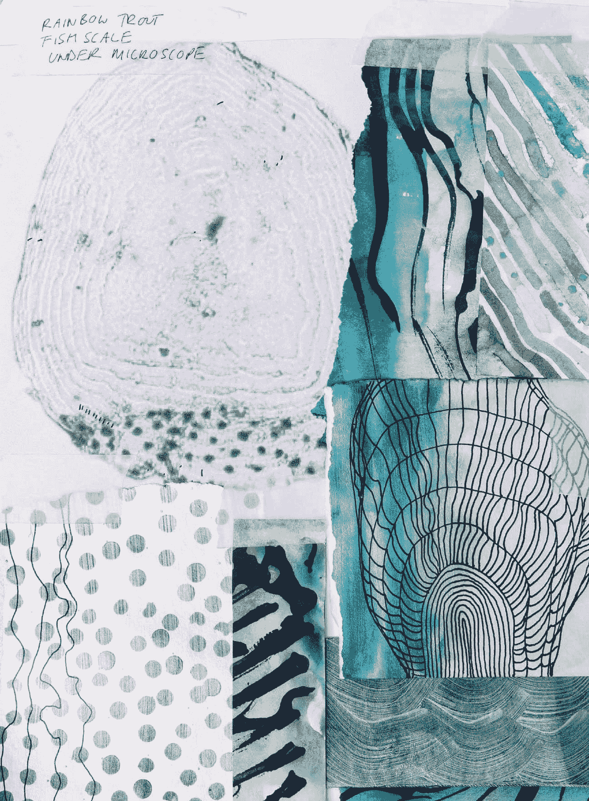

#### 结合创意

通过不仅叠加艺术用品，还混合意义的层次和结合创意来制作有趣且个人化的艺术作品。

你的素描本可以成为整合你兴趣、让它们相交和交织的地方。

从你的灵感地图中取两个不同的想法并将它们融合在同一页素描本上，可以成为创作对你个人且具有独特意义的艺术的起点。

从你的灵感地图中选择两个想法，并在同一页上将它们结合、对比或并置。以只有你能做到的方式将这些想法编织在一起。做出有趣的组合、关联或令人惊讶的联系。

随着你艺术实践的发展，你在寻找自己的刺激物方面会变得更加自信。花时间思考和拆解你希望通过艺术实现的目标，会使定义你的方向变得更容易。意图的清晰指导行动。

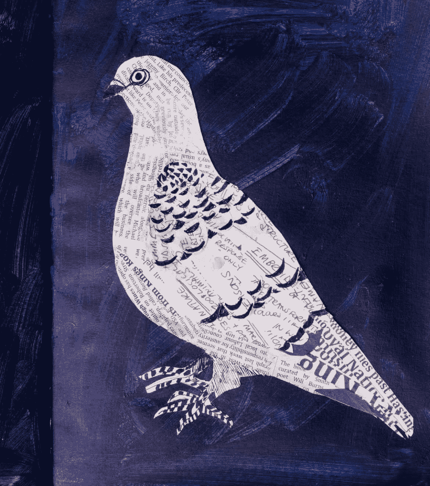

从你的灵感地图中结合两个截然不同的想法，看看会发生什么。有时将想法结合起来可以产生一个比其构成部分更大的新概念。在我的原始灵感地图上，我写下了两个独立的想法：1) 用垃圾制作速写本艺术，以及 2) 鸽子。我将这两个想法结合起来，用垃圾做了一只鸽子。

## 研究与探究

一旦你有了想法，研究可以帮助你理解其背景并帮助你成长和加强它。研究可以帮助你对主题形成自己的回应，并为你提供多条可进入的途径。以下是研究你的主题的几种方法：

• 寻找探索过类似主题的艺术家。在网上或书籍中阅读他们的资料。如果有机会，参观画廊并观看他们的作品。做笔记、绘画或直接从原作中汲取灵感都可能带来启发。

• 将其他艺术家的作品作为跳板。这可以帮助你学习并发展自己的方法和风格。

• 回顾你自己的作品和速写本，并记录下你喜欢且希望进一步探索的主题、过程或元素。你可能希望对你的速写或页面进行注释，并写下扩展它们的方法。

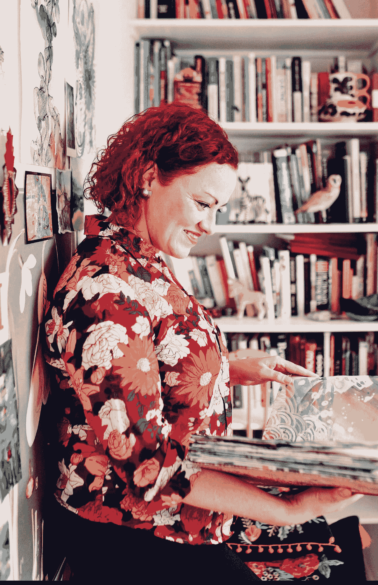

## 收集与珍藏

收集一些可以放入速写本的东西，例如想法片段、明信片、照片，以及你想进一步探索其作品的艺术家的名字。

我可能会粘贴在我其他地方完成的但想保留的已完成作品的片段，或是我找到的东西、一张小复印纸、一个视觉提醒，或是一个我可以回头参考的提示。珍藏这些片段并安全地收集在速写本的页面中，让我能够翻阅我现在的和旧的速写本，并追溯久远的线索。

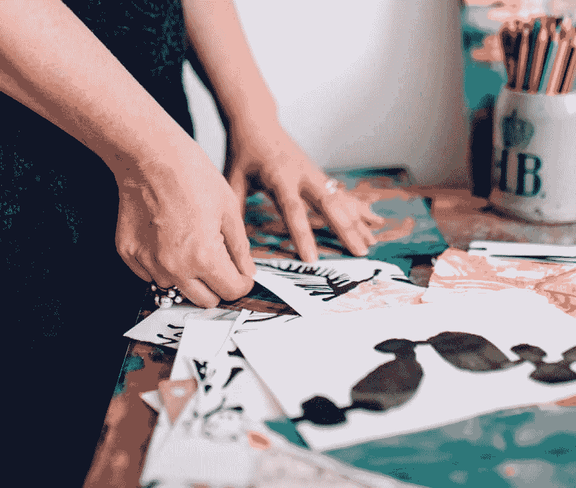

速写本可以是你收集手中、头脑和心中的东西的地方。将你以后可能想要重访的物品粘贴到速写本中。

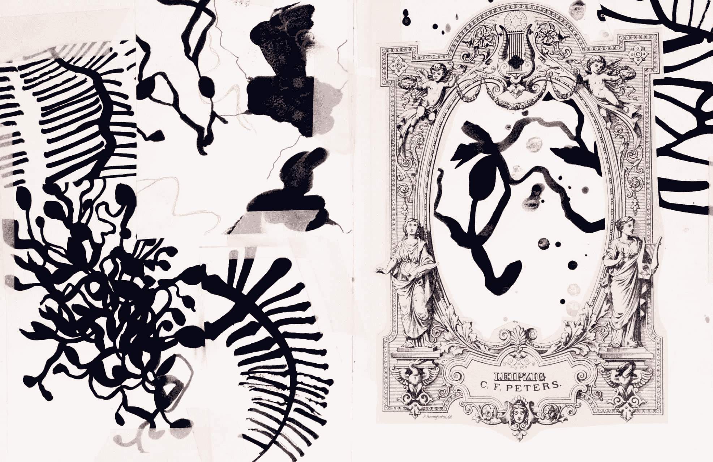

你的速写本可以成为信息和想法的绝佳储存库。

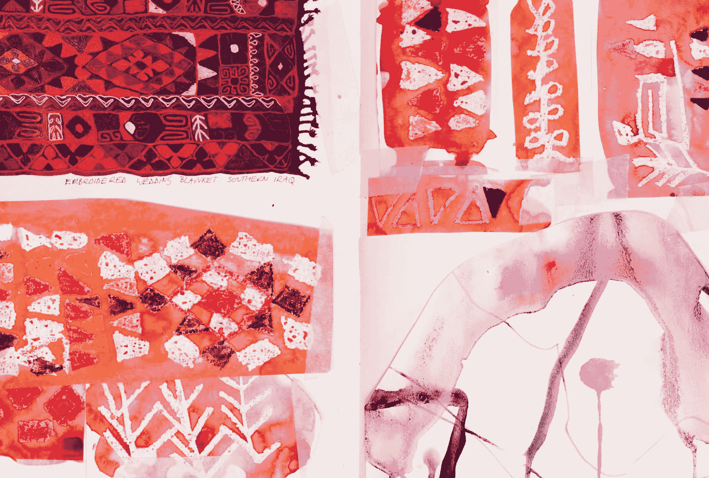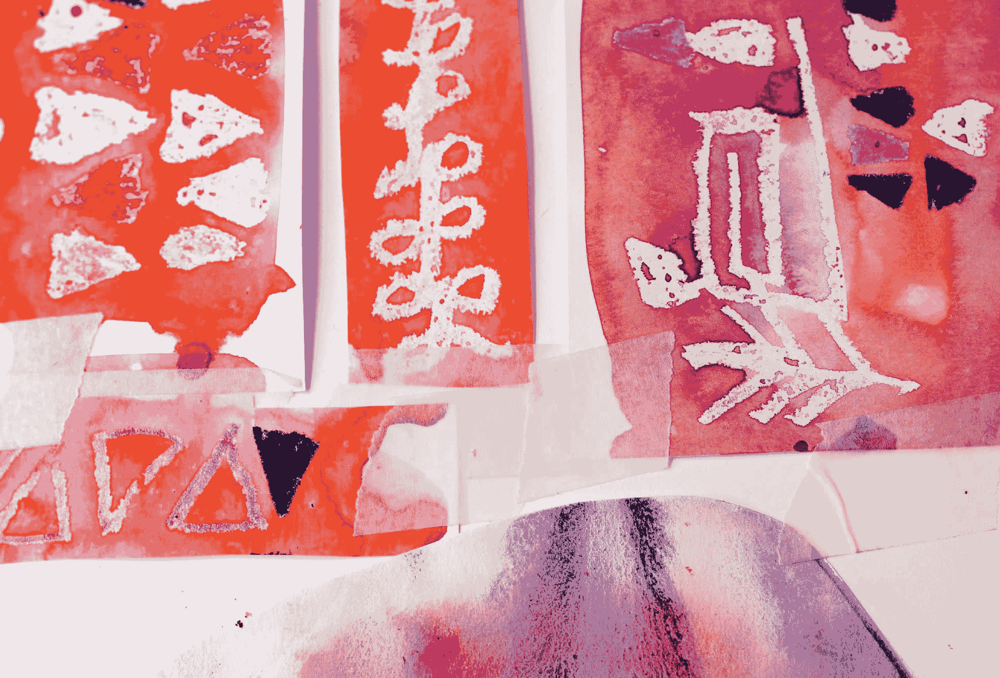

使用你的速写本收集你认为在视觉上有趣的东西，例如杂志上的图片、明信片，或你想为将来参考而保留的艺术实验的小片段。

## 写作

我经常通过写作建立联系和发展想法。如果有一个我感兴趣的主题，我可能会去图书馆、网上搜索，或阅读书籍以了解更多。我在阅读时做笔记，帮助我思考如何回应它、我个人对它感兴趣的是什么，或我可以在速写本中做什么来发展我的回应。有时意识流写作，即我不间断地写下所有我能想到、对某个主题感兴趣或知道的事情，可以是一种有用的工具。这种头脑倾倒可能包含有趣想法的种子。

你可能想在速写本中做笔记。这是你的速写本用来实验的，所以做对你有意义的事情。尝试以下方法：

• 写一些简短的笔记，描述你对所创作内容的回应，或反思你在创作过程中喜欢的部分。

• 你可能想写一些技术笔记，关于你使用的颜色、如何调配某种特定色调的油漆，或你想记住的关于所用工具或材料的任何其他信息。

• 如果你在实地作画，记下场景中最吸引你的元素。

• 随意将你的速写本用作视觉笔记本，记录艺术家、想法或思想的笔记，以在未来提醒和激发你——某种程度上是供你回顾并取用东西的想法文件柜。

• 描述一个想法的进展、你采取的步骤，或你如何发展你的思维过程。创建书面记录，以便日后可以复制该过程。

• 记录关于如何推进一个想法、扩展它，或将其带向新方向或不同方向的想法。

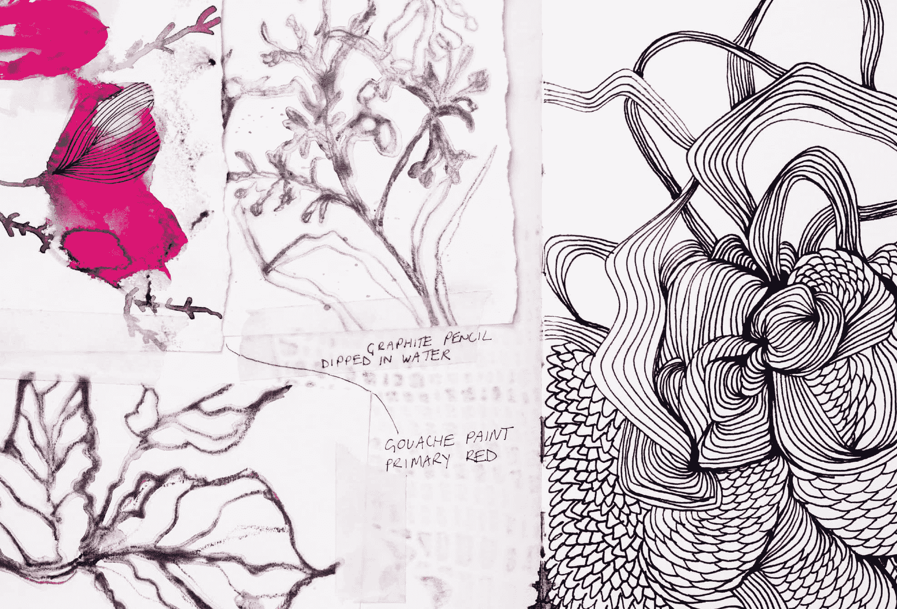

在速写本中写作可以帮助你与所创作的内容建立联系。它可以是一个盘点和反思你所创作的内容的过程和成果的机会，或是一种记录你的观察和回应的方式。或者它也可以是记住你使用的材料、颜色或组合的一种方式。

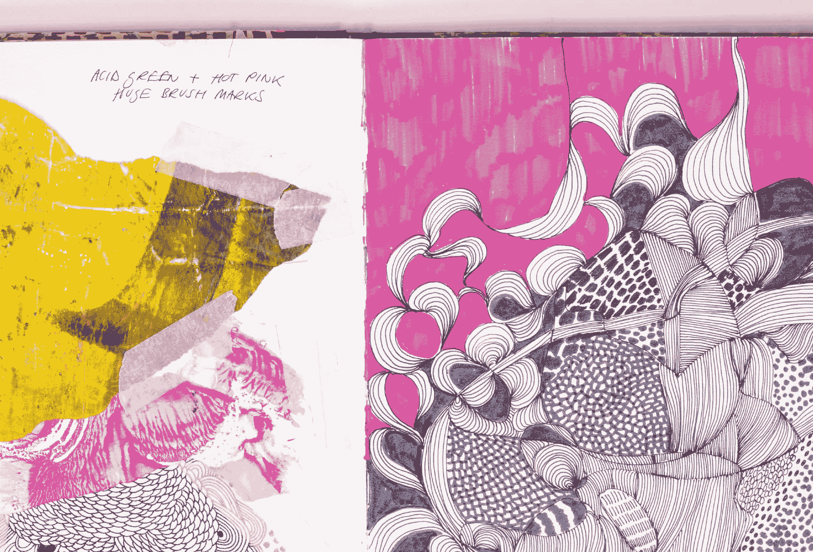
