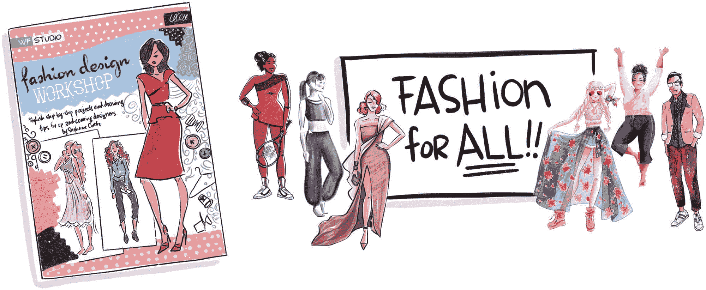

# 时尚设计工作坊：Remix：新锐设计师的现代、包容和多元时尚插画方法

[*OceanofPDF.com*](https://oceanofpdf.com)

[*OceanofPDF.com*](https://oceanofpdf.com)

## 指南
1. 封面
2. 内容开始
3. 1. 1
    2. 3
    3. 4
    4. 5
    5. 6
    6. 7
    7. 8
    8. 9
    9. 10
    10. 11
    11. 12
    12. 13
    13. 14
    14. 15
    15. 16
    16. 17
    17. 18
    18. 19
    19. 20
    20. 21
    21. 23
    22. 22
    23. 24
    24. 25
    25. 26
    26. 27
    27. 28
    28. 29
    29. 30
    30. 31
    31. 32
    32. 33
    33. 34
    34. 35
    35. 36
    36. 37
    37. 39
    38. 38
    39. 40
    40. 41
    41. 42
    42. 43
    43. 44
    44. 45
    45. 46
    46. 47
    47. 48
    48. 49
    49. 50
    50. 51
    51. 52
    52. 53
    53. 54
    54. 55
    55. 57
    56. 56
    57. 58
    58. 59
    59. 60
    60. 61
    61. 62
    62. 63
    63. 64
    64. 65
    65. 66
    66. 67
    67. 68
    68. 69
    69. 70
    70. 71
    71. 72
    72. 73
    73. 74
    74. 75
    75. 76
    76. 77
    77. 78
    78. 79
    79. 80
    80. 81
    81. 82
    82. 83
    83. 84
    84. 85
    85. 86
    86. 87
    87. 88
    88. 89
    89. 90
    90. 91
    91. 92
    92. 93
    93. 94
    94. 95
    95. 96
    96. 97
    97. 98
    98. 99
    99. 100
    100. 101
    101. 103
    102. 102
    103. 104
    104. 105
    105. 106
    106. 107
    107. 108
    108. 109
    109. 110
    110. 111
    111. 112
    112. 113
    113. 114
    114. 115
    115. 116
    116. 117
    117. 119
    118. 118
    119. 120
    120. 121
    121. 122
    122. 123
    123. 124
    124. 125
    125. 126
    126. 127
    127. 128
    128. 2

[*OceanofPDF.com*](https://oceanofpdf.com)

## 引言
欢迎来到《时尚设计工作坊：混搭》——时尚设计、插画和创造力在这里与包容性、赋权和个性相交汇！在这本与我第一本著作《时尚设计工作坊》（Walter Foster Publishing）相伴的书中，我们通过学习时尚设计的艺术来更深入地探索创造性表达，包括在多种媒介中尝试各种有趣且引人入胜的技巧，同时学习培养独一无二的个人风格。《时尚设计工作坊：混搭》是对设计的颂扬，以及我们如何通过时尚表达自我，无论体型、身体能力或性别如何。

在本书中，有志于时尚设计的 aspirants、潮流引领者和风格达人受邀探索各种各样的工具和材料，这些工具和材料可用于描绘和设计一系列时尚——从华丽的礼服和红毯造型到运动服和时尚的都市装束。 使用石墨铅笔、钢笔和记号笔，以及水彩颜料、金属漆笔甚至拼贴画，来自各行各业的时尚达人将拥抱尝试不同类型的混合媒介所带来的创造力，以创作出从经典传统到狂野奇思的各种时尚。 尝试所有建议的工具，以了解什么最适合你和你的个人风格——无论是传统的绘画方法还是数字插画工具。

在 第 1 章 中，你将学习开始所需的一切，包括如何使用各种特色艺术工具，以及基本的绘画和素描技巧。 第 2 章 包含一份全面的测验，用于发掘你的个人风格，然后更详细地介绍如何使用多种艺术技巧来适应每种风格和设计主题。

在 第 3 章、4 和 5 中，你将通过逐步的项目开始将知识付诸实践，这些项目展示了如何创建受流行文化和当代时尚启发的各种设计。 在 第 6 章 中，你将学习如何创建自己独特的主题时装系列，而书籍最后四页包含各种形状和尺寸的模板，你可以扫描或复印以反复使用。

无论你是经验丰富的时尚达人还是第一次入门，你一定能找到富有创意的设计点子、灵感，以及大量艺术技巧和窍门，帮助你将时尚插画提升到下一个水平！

[*OceanofPDF.com*](https://oceanofpdf.com)
