# 第 1 章

## 开始

### 工具与材料

**素描本或散页绘画纸。** 准备各种尺寸的素描本或笔记本。 在较小的页面上快速勾勒草图；然后在较大的纸张上完善你的想法。 使用任何湿性媒介，如记号笔或水彩时，请务必使用较厚的纸张，以防止起皱。

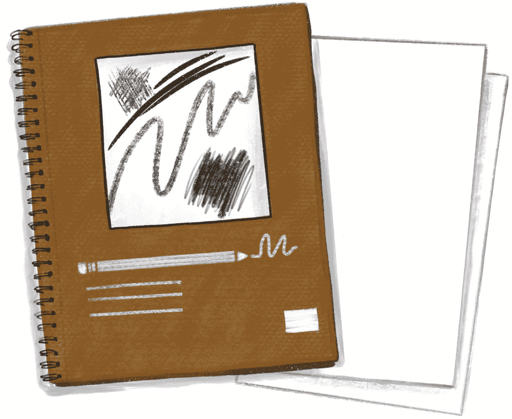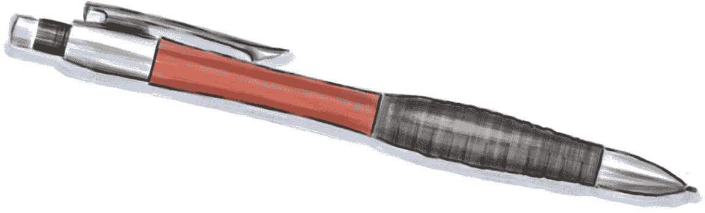

**可塑橡皮。** 这些可塑橡皮可以塑造成尖端以提高精度。 它们永远不会磨损，也不会留下橡皮屑。 它们对纸张也很温和。

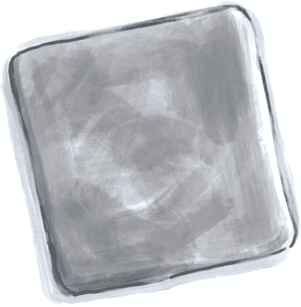

**石墨铅笔。** 任何铅笔都可以使用，但你可能更喜欢自动铅笔，因为铅芯保持锋利并产生一致的线条粗细。

**彩色铅笔。** 彩色铅笔是一种方便易用的上色方法。 专业级彩色铅笔具有蜡质、柔软的铅芯，非常适合上色和叠加色彩层次。 水彩铅笔也是为你的作品添加色彩点缀的另一个极佳选择。

**粉彩铅笔。** 粉彩铅笔正如其名所示：传统的软粉彩装在木质笔杆中。 它们像铅笔一样绘画，可以用普通铅笔削笔器削尖。 它们的质地比传统的彩色铅笔略带粉感，可用于叠加和混合色彩。

**记号笔。** 透明水性记号笔有多种款式。 它们非常适合大面积涂上鲜艳的色彩，而且还允许分层和混合，这对于表现半透明面料非常有帮助。

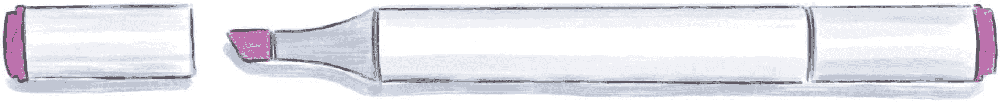

**颜料墨水笔。** 这些永久性墨水笔不会渗墨，并有多种笔尖尺寸。 最细的笔尖非常适合描绘微小细节；较粗的笔尖和刷头非常适合大胆或变化的线条粗细。

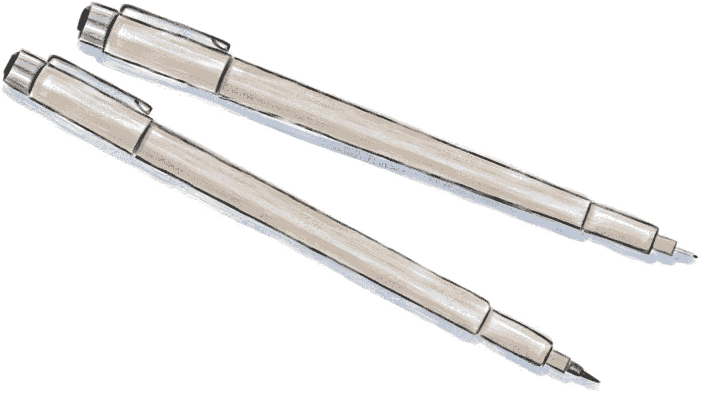

**光箱。** 使用光箱将粗略的草图转移到干净的纸上，可获得无多余痕迹的精美成品画。 （参见“光箱与模板” 显示于 此处。）

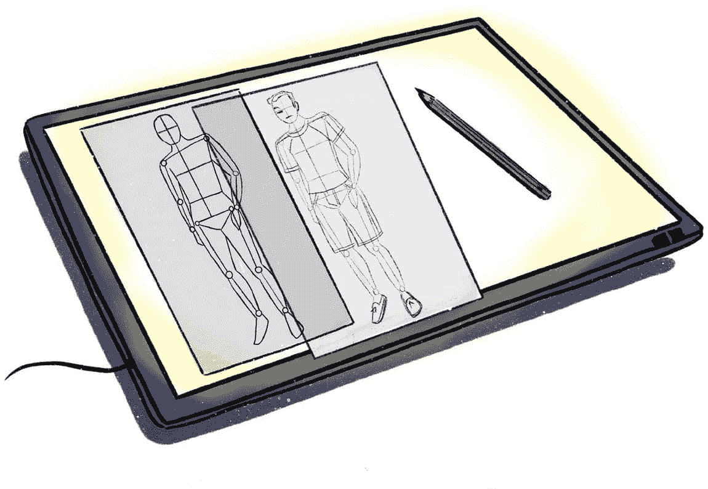

**水彩纸。** 冷压水彩纸具有粗糙的表面，非常适合水彩颜料。 其厚实的纸张可防止纸张起皱。

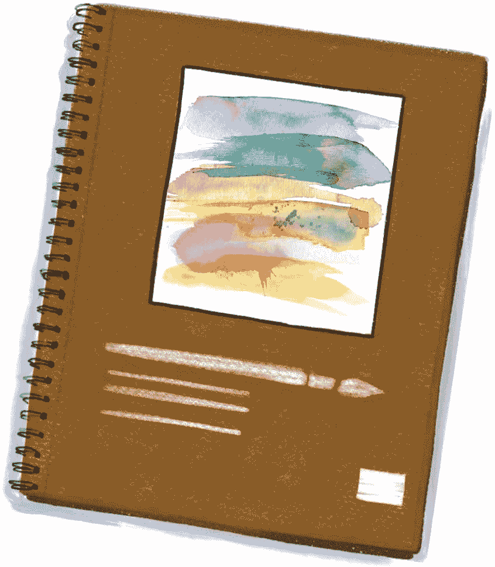

**深色粉彩纸。** 深色纸非常适合创作戏剧性的晚间时尚。 用白色铅笔绘制的婚纱、蕾丝和欧根纱面料在中色调和深色纸上显示得非常漂亮。

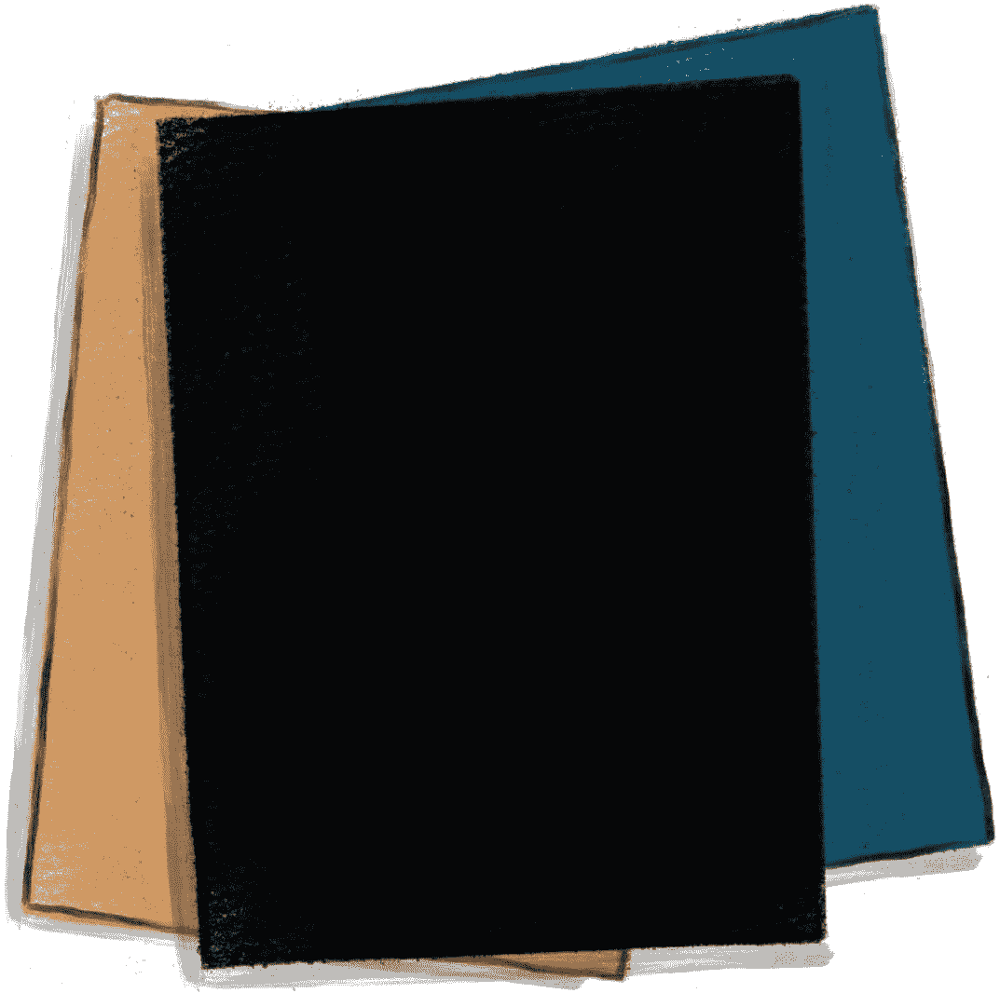

**蓝色制图铅笔。** 蓝色铅笔（或任何浅色或中色调彩色铅笔）是开始草图的好工具。 在蓝色中勾勒出基本轮廓后，换成黑色铅笔来完善绘画。

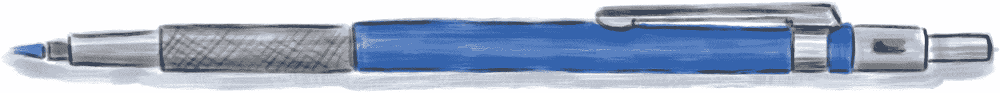

**水彩颜料。** 水彩是为你的设计上色的绝佳选择。 使用水彩来增强鲜艳度，创造纹理和晕染效果，并调配色调。

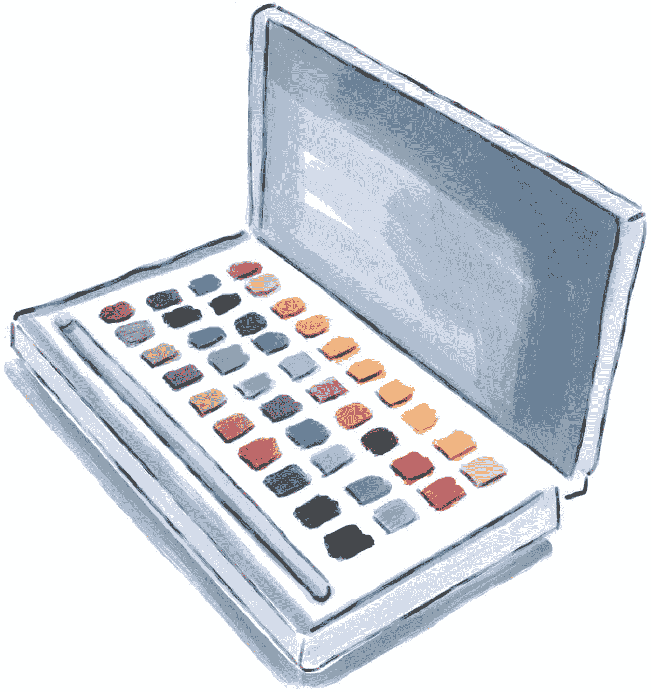

**水彩画笔。** 水彩画笔专门用于盛装水性颜料。 它们有多种尺寸，适合大面积渲染和细节描绘。

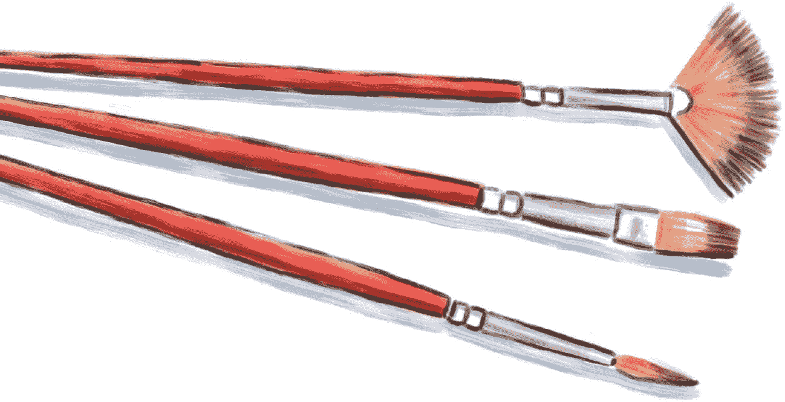

**水彩笔与画笔笔。** 无忧多功能性的终极工具是水彩笔。 笔杆是一个储水器。 注入水，然后轻轻挤压笔杆即可为你的颜料或墨水添加水分。 将笔尖蘸入颜色；然后用不同宽度的笔触涂在纸上。 画笔笔有多种颜色。 刷状笔尖可绘制出光滑的线条，非常适合图形设计。

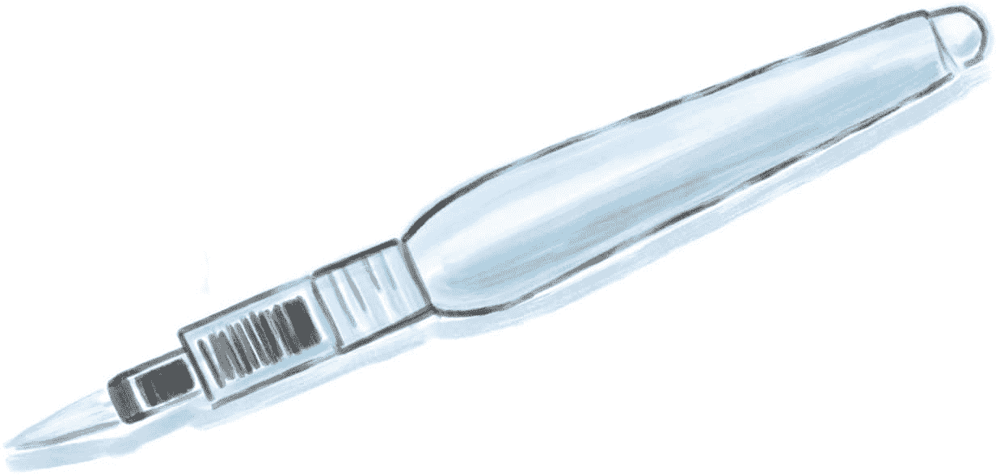

**遮盖液。** 这种橡胶状液体可以涂在水彩纸上作为抗水剂，防止水彩颜料渗入处理过的区域。 它非常适合创造图案和细节。 只需将遮盖液涂在纸张的所需区域，然后像平常一样涂上水彩。 整个区域干燥后，轻轻擦掉遮盖液，即可露出未被颜料触及的纸张。

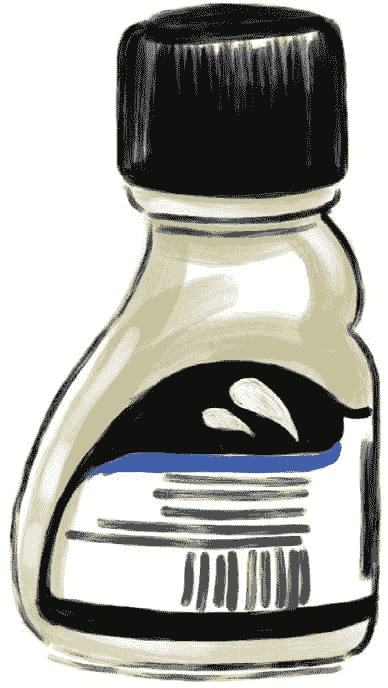

**和纸胶带。** 使用带图案的和纸胶带碎片制作金属装饰、点状包、发巾、拼布或其他创意设计。 它有多种图案和饰面，其粘性背面使应用变得轻松。

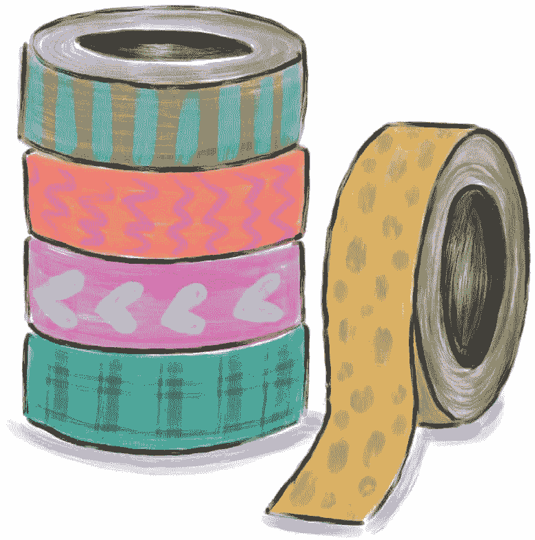

**金属漆笔。** 用这种易于使用的工具为任何设计添加金色、铜色或银色光泽。 没有什么能比它更好地捕捉光泽，而且金属漆笔几乎可以在任何其他媒介上使用。

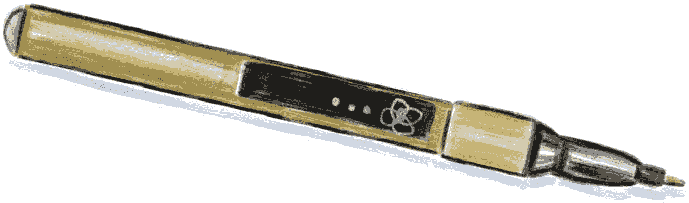

**凝胶笔。** 用凝胶笔即可轻松为任何插画添加不透明细节。 白色不透明凝胶笔非常适合添加高光、光泽表面和闪亮斑点。

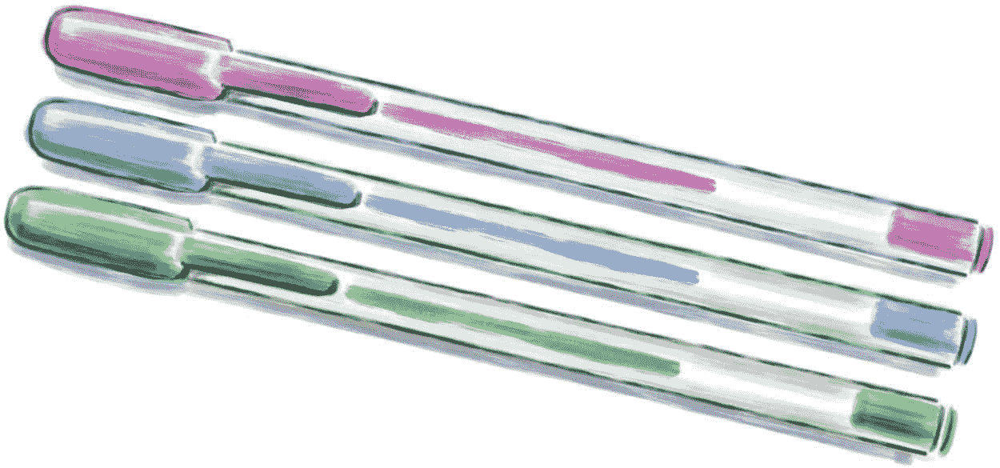

**白色铅笔。** 白色铅笔标记在深色纸上能产生美丽的效果。 可用于婚纱设计、面纱、蕾丝或任何其他精致设计。

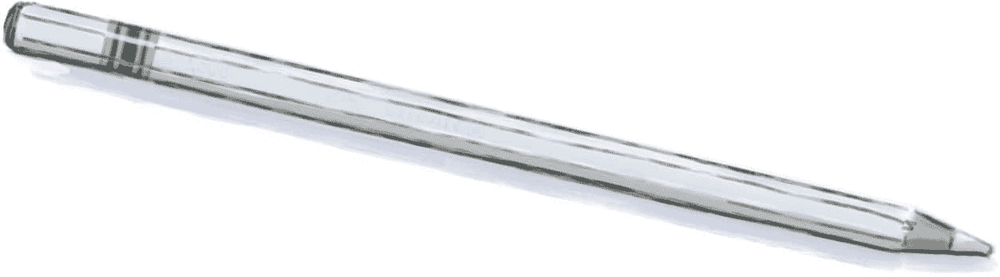

**拼贴纸。** 剪贴簿纸或手工绘制的碎片非常适合为裙子、连衣裙、帽子等添加图案点缀。

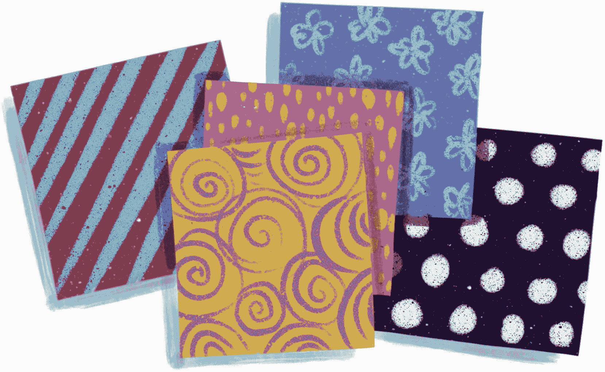

**3D 材料。** 花朵、丝带、羽毛——甚至食物——都能为你的设计增添一丝古怪的乐趣。 务必拍摄你的插画，以便将你的创意保存以供将来使用！

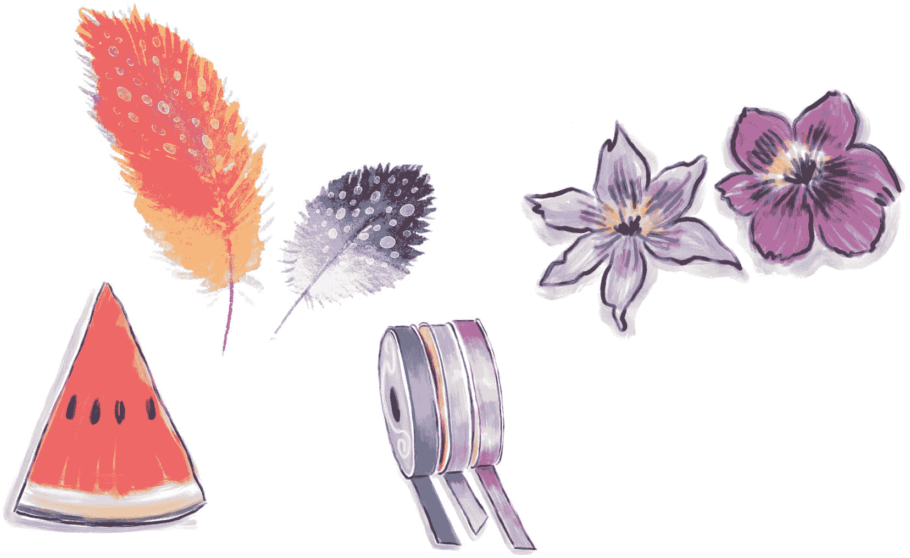

### 基础人物绘画

在设计服装之前，你必须先画出模特。 这对许多有抱负的设计师来说可能是最大的障碍。 人物绘画乍一看似乎很难，但别担心！ 有几种不同的方法可以绘制人物。

#### 光箱与模板

使用模板是开始绘画的绝佳方式！扫描或复印此处所示的一个或多个模板。将模板放在灯箱上，上面覆盖你选择的纸张。打开灯箱，使模板在干净的纸张下方被照亮。轻轻描摹人形到纸上，将模板转移到页面上。

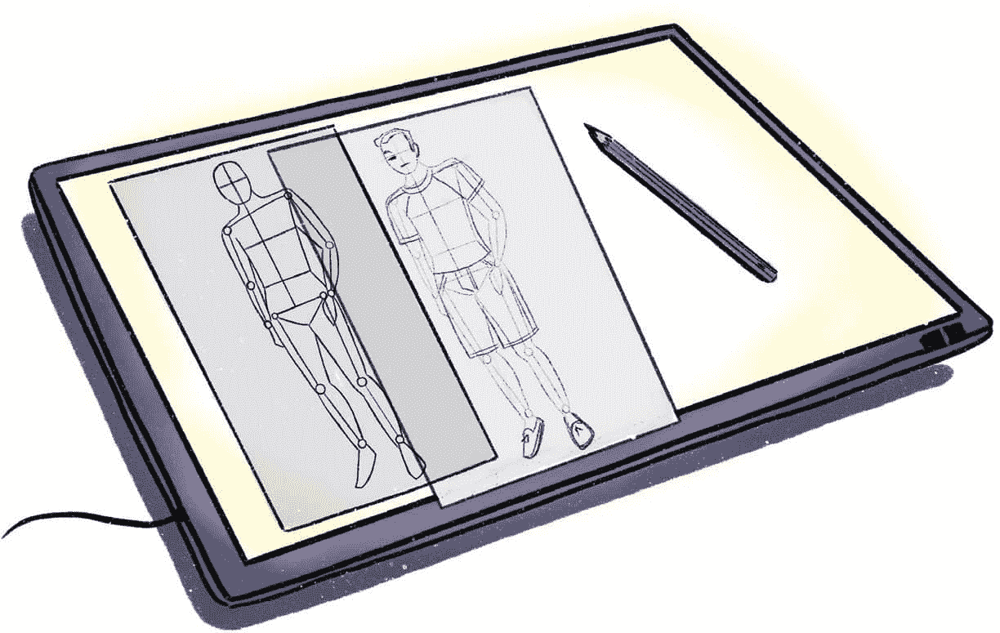

使用一个模板即可创作出无限的设计！你还可以将现有的模板（图 1）适配到任何体型。通过沿着模板在所示线条外描摹来创建更大的身形（图 2）。对于较窄的肩膀或纤细的体型，沿着模板在内侧线条内描摹（图 3）。

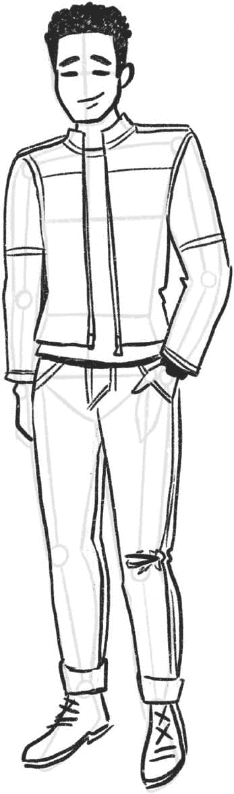

**图 1**

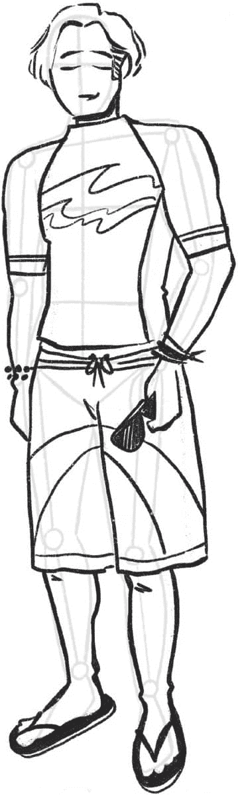

**图 2**

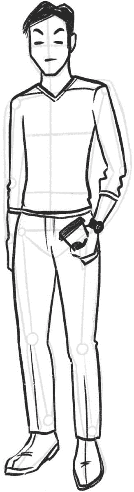

**图 3**

### 姿势绘画
如果你喜欢草图的质感，姿势绘画适合你。姿势绘画注重形状和体积。这种方法要求在铅笔上快速作画，不擦除，同时在主体（或参考照片）和绘画页面之间来回瞥视。唯一的目的是达到良好的平衡和比例。这样制作的绘画通常反映出艺术家独特的笔触和风格。可能有尖锐的线条和角度，也可能有流畅的曲线和柔和的边缘。一旦你对草图满意，就加深最终的形状，使绘画更突出。

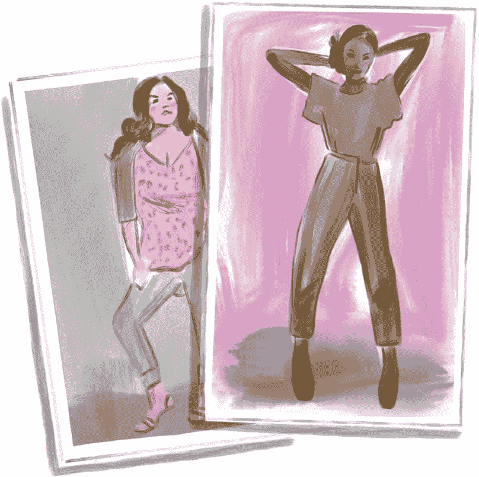

1
练习姿势绘画时，选择几张参考照片。

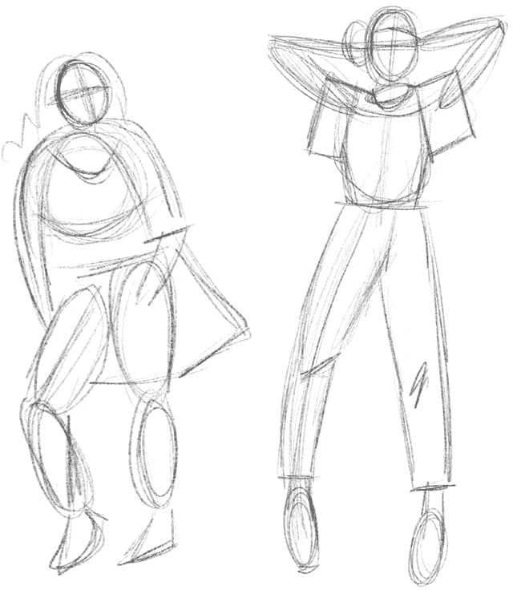

2
从照片中快速素描，重点关注形状、比例和平衡。

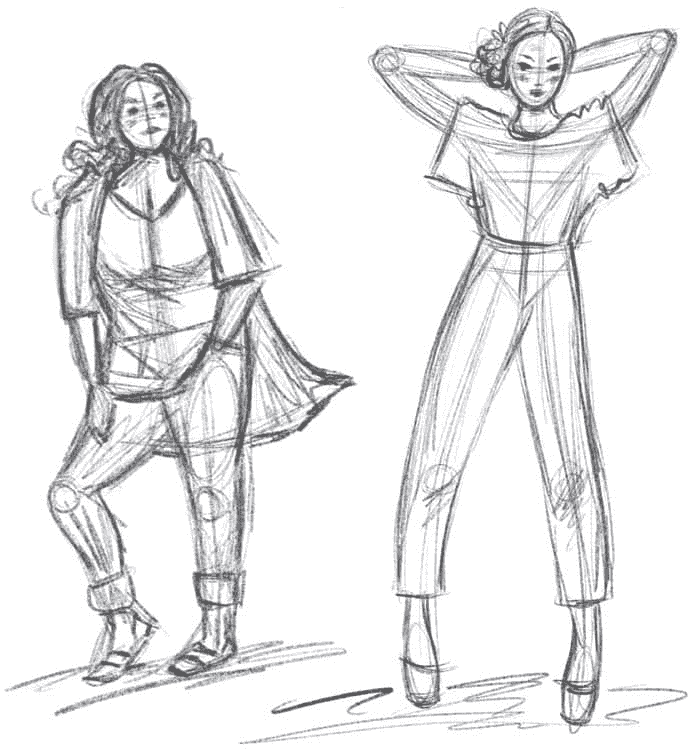

3
加深最好的线条，然后添加一些细节和阴影。

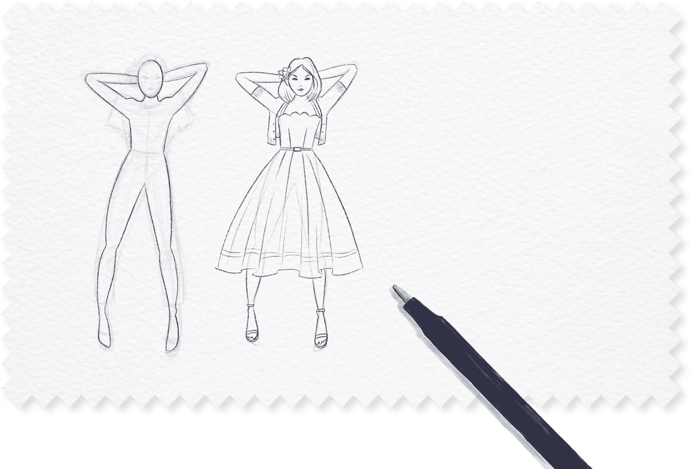

要从姿势绘画中创建模板，将绘画放在灯箱上并在干净的纸上描摹主要的人形线条。然后在空白模板上勾勒新的时装！

### 建筑式人形构建
建筑式人形构建是实现准确比例的有用技巧。（它也是本书中逐步项目中使用的技巧。）建筑式人形构建要求你使用简单的线条和角度作为关键参考点开始绘制人形，如对面页面的步骤所示。

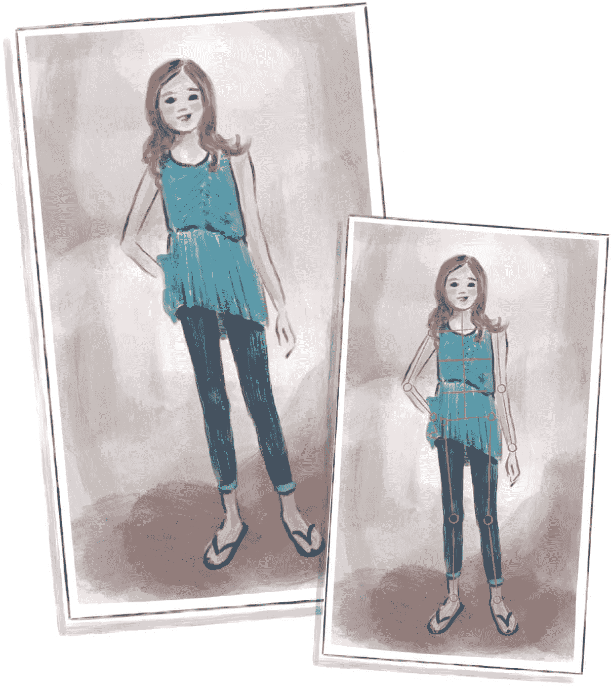

每个身形设计都始于一个基本的类似棍子的形状，但还有其他需要考虑的因素。
• 手是否靠在臀部？手臂是否抬起？如果是，肘部与头部对齐的位置在哪里？在这种有条理的方法中，真实地视觉化和绘制这些细节有助于在最终插图中建立准确的比例。
• 关注表示肩膀、胸部、腰部和臀部的水平线。注意中线（想象成脊柱）是垂直还是倾斜的。还要注意臀线是否倾斜。通常，模特会站立时一侧臀部突出，这会产生角度倾斜。走秀的模特也会有倾斜的臀线。
• 用小点或圆圈标示关节。这是在检查比例方面的一个很好的工具。肘部通常在腰部位置。手腕通常位于臀部和膝盖之间三分之一处。

一旦你训练眼睛看到人形的底层结构，你就能为任何体型和形状创建模板。

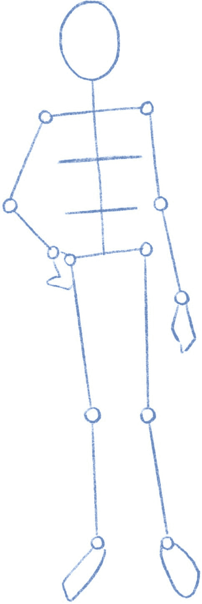

1
建立人形的内部框架。首先为头部勾勒一个椭圆，然后添加“动作线”，或中线，以创建躯干的中心。接下来，添加水平线以开始建立人形。你应该有界定肩部、胸部、腰部和臀部的线条。随着你勾勒这些线条，你将确定姿势。添加手臂和腿部的线条。

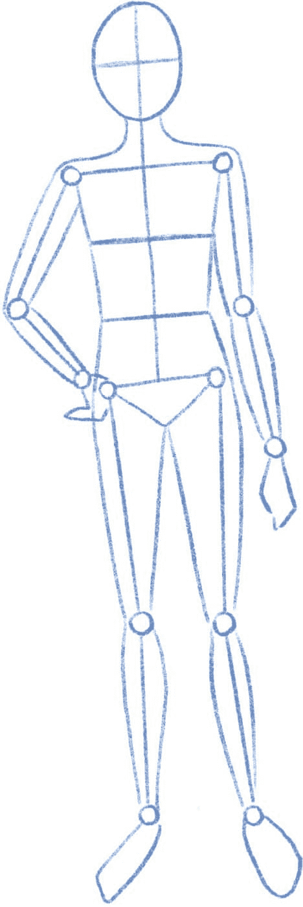

2
一旦基本的人形轮廓就位，就开始填充模型在任何所需大小或形状上的形态和体积。

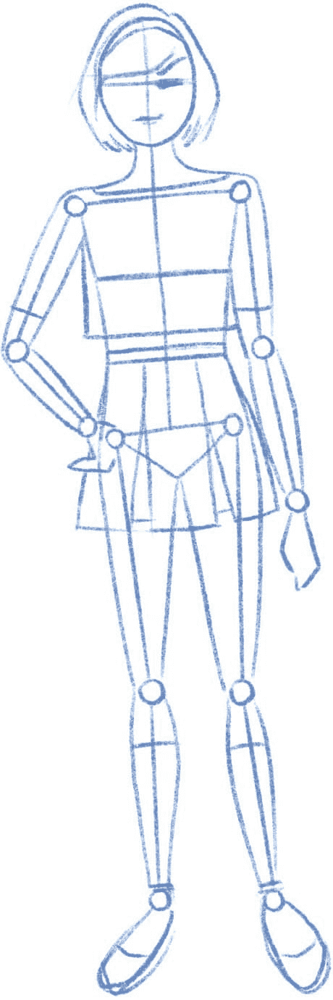

3
开始创建你想要设计的时装。为了使其更具视觉趣味，添加发型和配饰，并勾勒一些面部特征。

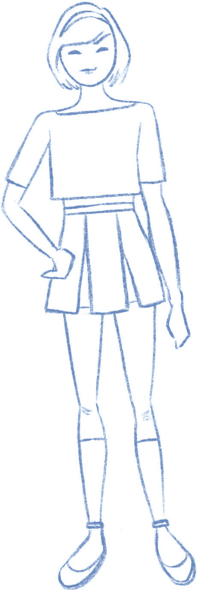

4
用可塑橡皮清理线条并细化细节。

### 在平板上绘画
在平板上数字绘画方便且便携，使你在任何地方都能轻松设计！文件易于清理并制作成可打印格式，而且还有工具可供你尝试颜色和图案。

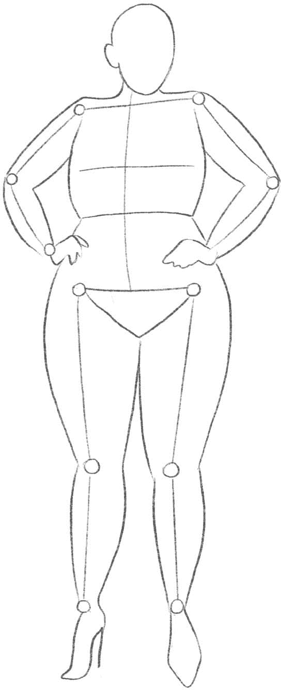

1
在平板屏幕上勾勒你的身形，或从书中扫描模板并导入到你的绘图程序中。

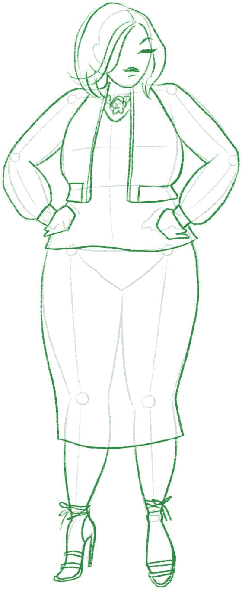

2
降低人形草图层的透明度。在人形草图层上方新建一个图层。像使用灯箱一样绘制你的时装设计。当你完成设计后，关闭人形草图层以显示干净的绘画。

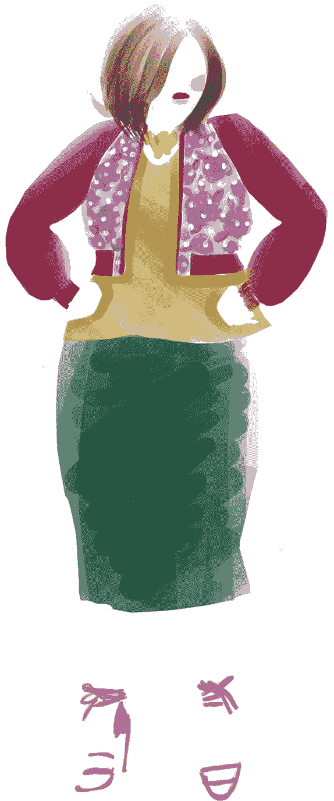

3
保持你的线稿设计图层在最上层并“正片叠底”该图层。接下来，在下方添加一个或多个图层来为服装上色。你可以使用各种不同的画笔纹理来满足你的喜好。可选择铅笔、油画、墨水等。

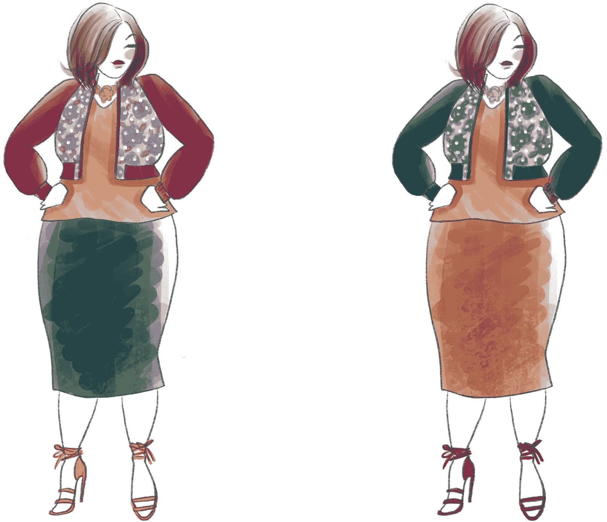

4
使用颜色编辑工具更改整个色彩故事或仅尝试其中一部分。这允许微调以使配色方案恰到好处，同时你的线稿图层保持完美完整！

**数字“墨水。”**
使用触控笔仅用灰色或黑色创建极简设计。这种效果具有现代感。

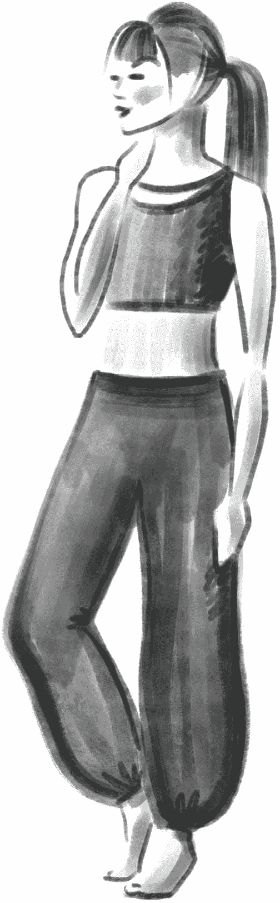

### 时装人人皆宜！
时装适合每个人——而且绝对不是“一刀切”的游戏！今天的设计师明白，时装的功能超出了仅仅为人们穿衣的实用功能。时装支持创造性表达、自信和个性。以下是一些帮助你开始为各种体型和大小的人设计时装的技巧！

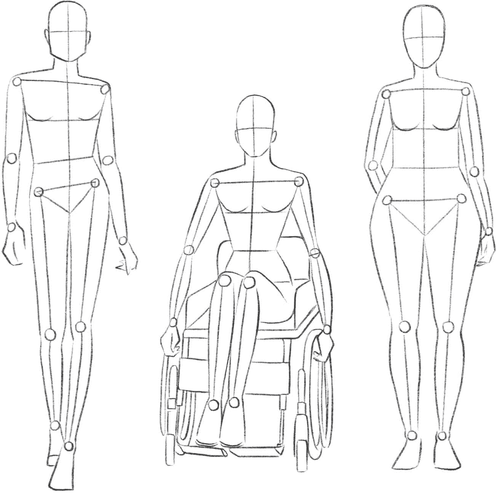

1
**为每个人和每个*身体*设计！** 练习绘制各种如上图所示的身形比例。从时尚和生活方式杂志、社交媒体以及电视上寻找灵感。红毯回顾尤其很棒，因为它们展示了各种体型和大小的名人全身姿势。

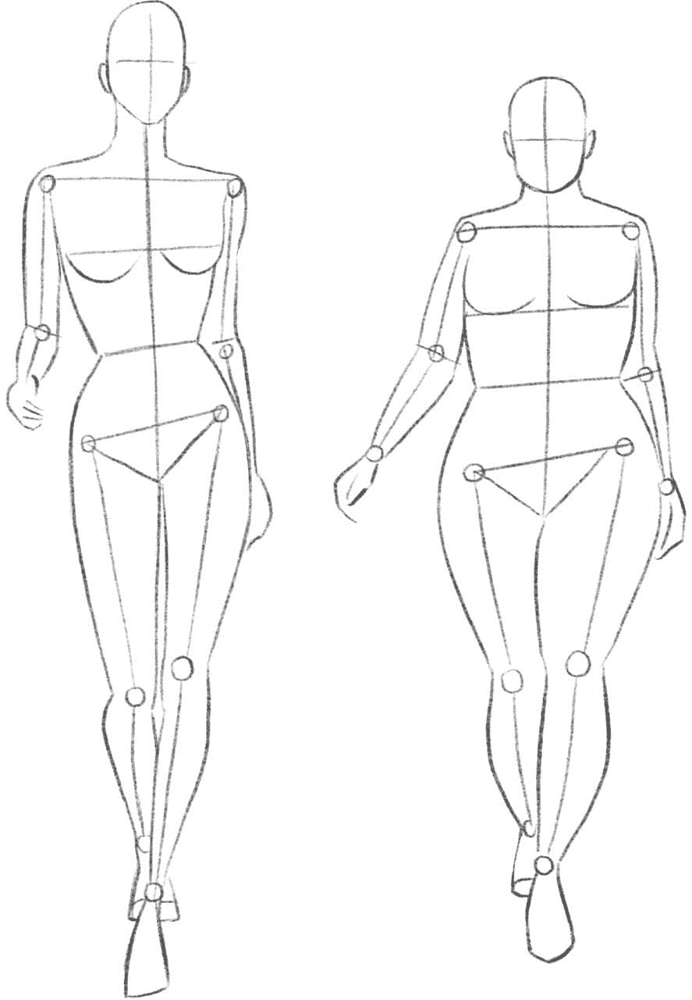

2
**从你的衣柜或杂志中挑选一件最喜欢的服装。** 将设计适配到各种体型。别忘了添加配饰！

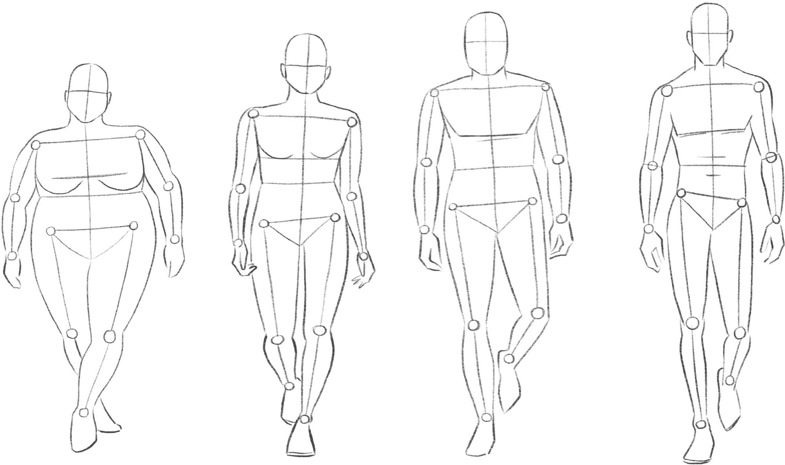

3
**设计一件原创时装。** 然后调整和改变你的设计以适应各种体型。添加能衬托你正在设计的身体的细节，如右侧示例所示。

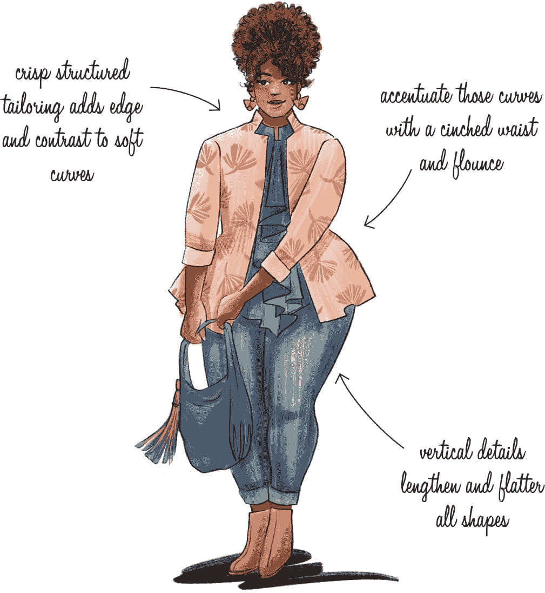

### 适应性服装
时装可以而且应该根据残疾人士的需求进行定制。越来越多的高端时装品牌推出系列，考虑到这些客户的需求，将接缝、拉链、纽扣等放置在易于管理的区域。其他考虑因素包括使用透气面料，在设计中加入魔术贴、磁性闭合件和其他易于使用的紧固件，以及为舒适度设计口袋、标签和其他细节。设计时装以衬托所有体型，同时也能适应行动辅助设备。

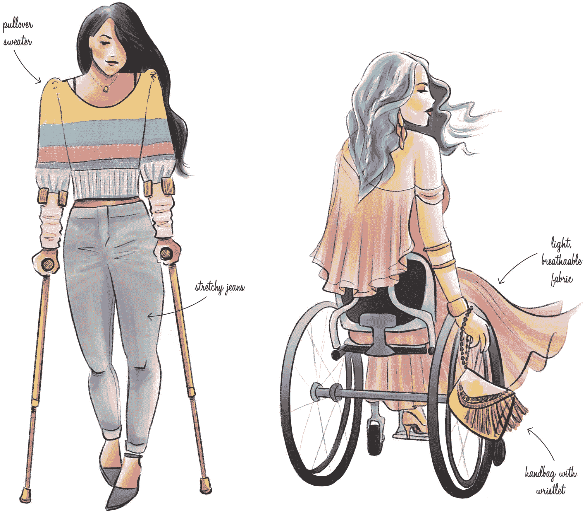

### 绘制面部

在时装设计中绘制人形时，重点通常放在服装上，因此绘制简单的面部和发型是很常见的。例如，画一只眼睛和一张嘴就足以表现表情，而不必担心比例是否准确。这并不意味着如果你喜欢就不能更详细。相信你的直觉，以适合你设计的方式绘制模特。同样，发型的处理可以简约也可以大胆。思考你设计的个性，并使发型和面部表情与之相匹配。

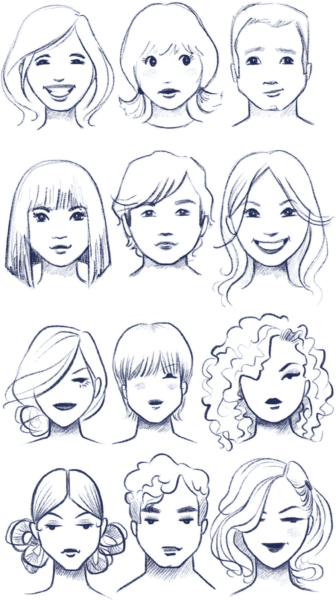

### 保持一本速写本

灵感可能随时降临，而可靠的速写本是最适合记录你精彩灵感的场所！记下可反穿夹克的想法，或为鞋子画一张示意图。也许街头艺术中的色彩会激发你创作一件古怪的印花 T 恤或一件舞会礼服。或者你可能想创建一个纹理库。随身携带速写本意味着当灵感来临时你能够捕捉到它！

#### 随意的速写
谁不想一窥时尚设计偶像的速写本呢？这些涂鸦般的点子和潦草的构思正是梦想的素材！用零碎的想法、灵光一现的瞬间和大量的铅笔速写填满一本笔记本！在灵感来临时迅速工作，魔力就发生在这里，而你的笔记本在创造力不那么充沛的日子里充当着创意工厂。如果心情合适，就用颜料添加色彩！

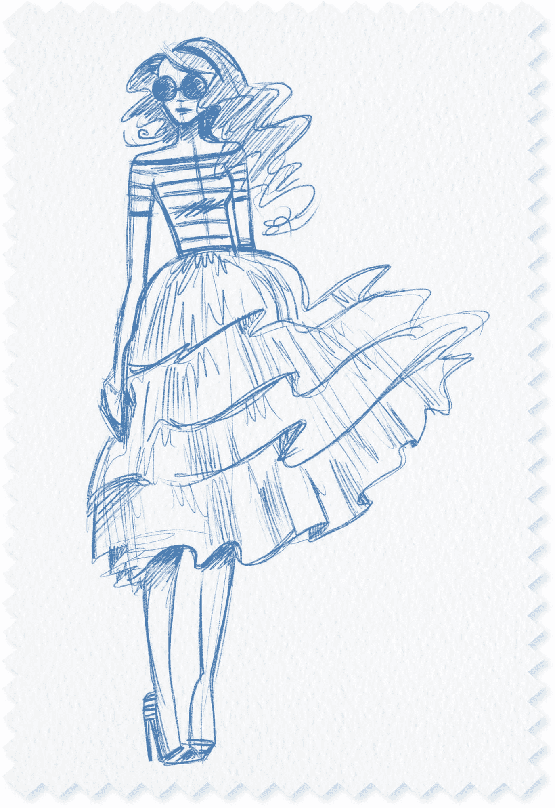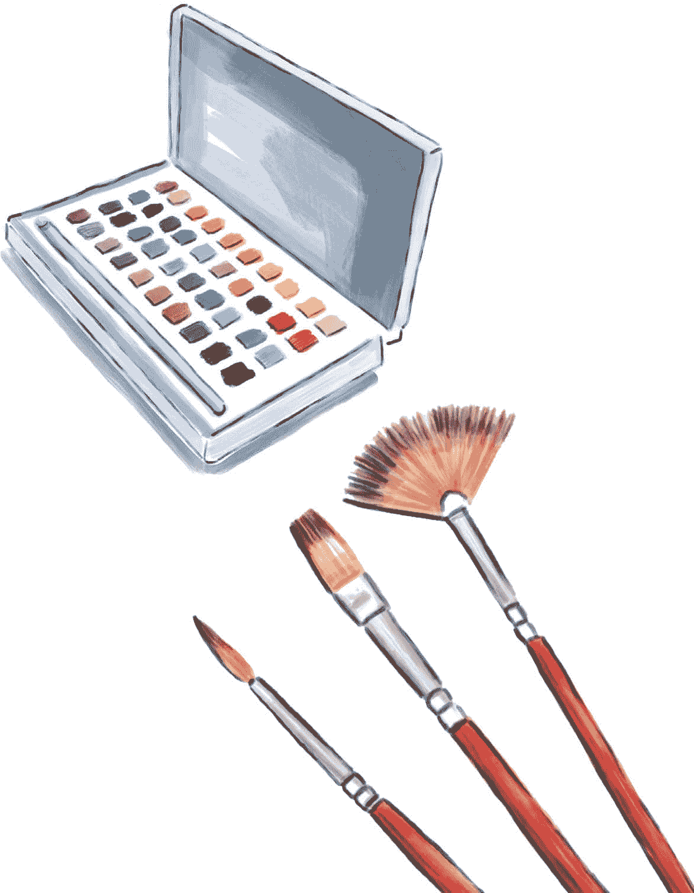

### 平铺时尚

偶尔，你可能会发现自己想跳过绘制人形，直接进入设计部分。创作手绘平铺时尚——将所有衣橱必备单品策划成一套完整造型——是激发创意的好方法。“平铺”一词指的是为一套完整的服装做造型——有点像你把衣物和配饰铺在床上搭配出造型那样。

要画一个平铺设计，先勾勒一件核心服饰——例如一件印花连衣裙——然后围绕它构建整套造型。你可以添加凉鞋或人字拖、太阳镜、草帽和夏日托特包，打造完美的海滩一日造型。你的速写本非常适合创作平铺设计。

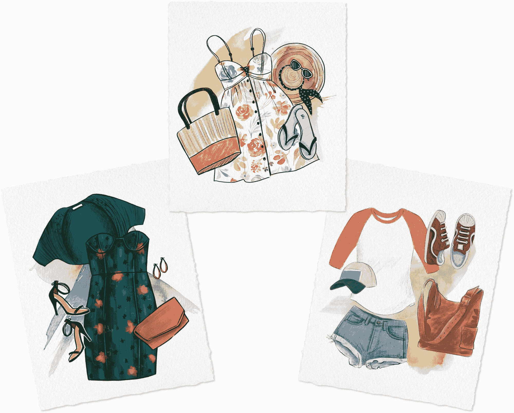

[*OceanofPDF.com*](https://oceanofpdf.com)
