# 第 2 章

## 表达自我

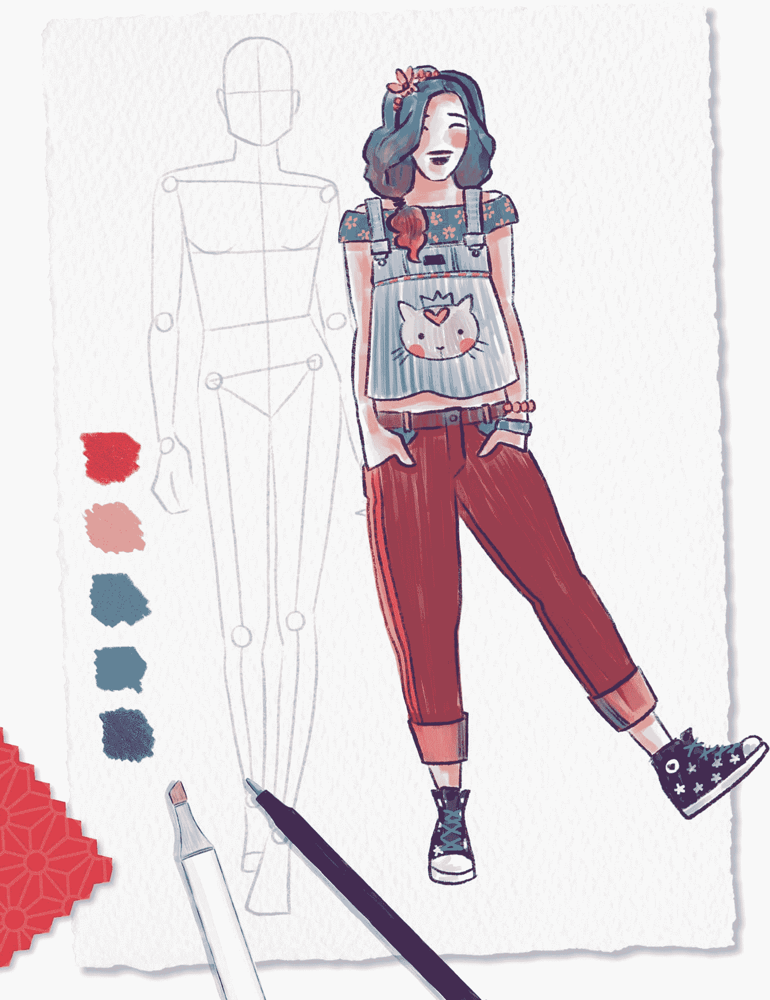

### 发掘你的风格

下面的测验旨在帮助揭示你在时尚方面关注的是什么。利用你的发现作为路线图，直接通往你个人风格的领域。遵循它来创造出精彩的东西——或者抛弃它，创造出完全超出你舒适区的东西！

#### 第一部分：问答

阅读下面的问题并在单独的纸张或笔记本上写下你的答案；然后思考你的回答如何帮助塑造你作为设计师的美学。请记住，没有“正确”或“错误”的答案！

1\. 你衣橱里出现最多的颜色是什么？

2\. 你不喜欢什么颜色？

3\. 你衣橱里出现最多的图案是什么（例如，条纹、波点、波斯纹等）？

4\. 你不喜欢什么图案？

5\. 你最喜欢哪位名人/设计师的风格？

6\. 你最常绘制哪种类型的时尚？（例如，休闲、正装、婚纱、配饰等）？

7\. 如果你能/可以自己做衣服，你最想做哪些单品？

8\. 你想象你的时尚会被穿在哪儿：大城市、小镇还是 T 台上？

9\. 你更喜欢连衣裙和裙子还是牛仔裤和卡其裤？

10\. 你更喜欢柔软飘逸还是结构化剪裁的衣服？

11\. 你喜欢通过时尚表达自我吗？

12\. 在服装方面，你最看重的是什么：a) 舒适 b) 风格 c) 良好合身 d) 实用性

13\. 你喜欢：a) 引领潮流 b) 跟上潮流 c) 做自己的事

14\. 你最喜欢什么风格或类型的服装？

15\. 你喜欢搭配统一，还是更喜欢混搭颜色和图案？

16\. 当你看到有人穿着独特的服装时，你的第一反应是：a) “那很酷！” b) “那很奇怪！”

17\. 如果你一生只能穿一件衬衫，你会选择什么类型的衬衫？

18\. 你喜欢印花或有态度的 T 恤吗？

19\. 哪个词最能描述你对自己的看法？

a) tough b) sweet c) rebellious d) cute e) sophisticated

20\. 你想设计符合你个人时尚风格的衣服，还是完全不同的风格？

21\. 每间衣橱都应该有什么服装单品？

22\. 每间衣橱都应该有什么配饰？

23\. 你最想与哪位设计师合作或向其学习？

24\. 你希望世界如何评价你的设计？

#### 第二部分：发现你的风格缪斯

查看此处所示的风格缪斯 here。根据测验中的答案，你的任何看法是否发生了变化？花更多时间回答下面的问题。

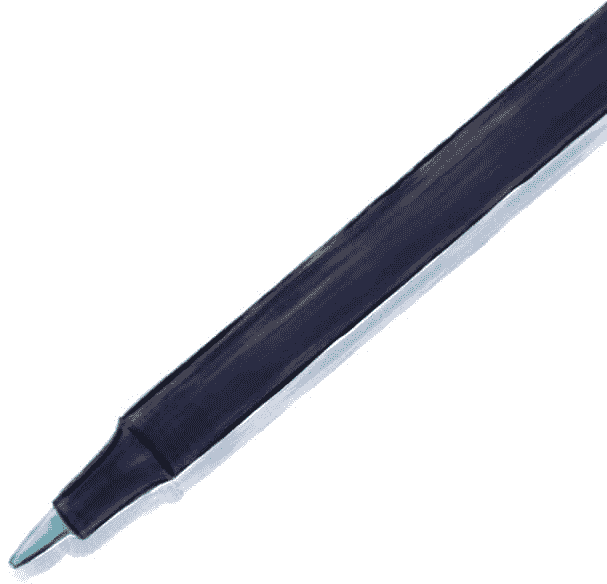

##### 柔美与浪漫（展示于此处）

你喜欢或不喜欢这种草图般、柔和阴影的风格吗？

##### 优雅与极简（展示于此处）

你喜欢或不喜欢这种简洁、大胆、图形化的风格吗？

##### 俏皮与可爱（展示于此处）

你喜欢或不喜欢这种奇思妙想的风格吗？

##### 先锋/高级定制（展示于此处）

你喜欢或不喜欢这种即兴、艺术化的风格吗？

##### 编辑风格（展示于此处）

你喜欢这种精心描绘的风格吗？

### 风格缪斯

接下来的几页展示了多种风格和技巧——我们称之为风格缪斯——帮助激发你的创造力。注意特定的绘画风格如何适合特定类型的时尚。例如，古怪俏皮的服装可以用松散的笔触绘制，而优雅精致的服装通常用干净、大胆的线条绘制。

#### 柔美与浪漫

如果你喜欢这种风格，你可能是一个梦想家、浪漫小说和历史的爱好者，或是喜欢柔和色彩、花朵和精致小细节的人。

你的缪斯温柔细语、甜美而温和。

##### 绘画风格：
草图般、富有质感的感觉

柔和阴影

细而均匀的线条

柔和色调，如棕褐色

##### 时尚风格：
流动的轮廓

轻薄面料

荷叶边

精致细节，如蕾丝和刺绣

花卉图案

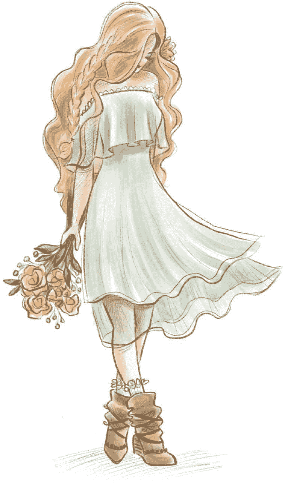

#### 优雅与极简

如果你喜欢这种风格，你可能是一个务实、重视成果和效率的人。你在意整体得体，但不想纠结于无数小细节。

你的缪斯是一位具有强烈个性与自信的领导者。

##### 绘画风格：
黑白造型

大胆的形状

图形化细节

深色马克笔或墨水

##### 时尚风格：
简约而自信

干净利落

强烈的轮廓

舒适与精致相结合

极简细节

定制剪裁外观

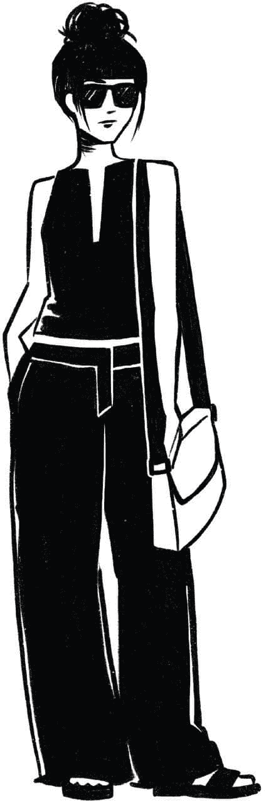

#### 俏皮与可爱

如果你喜欢这种风格，你可能是一个热爱自由、喜欢玩乐的灵魂。你从一切事物中获得快乐，不太严肃看待自己。

你的缪斯拥有明亮、活泼的个性和永恒的微笑；他们是每个人的好朋友。

##### 绘画风格：
插画风格

充满活力的色彩和图案

粗犷的线条

亮色马克笔或彩色铅笔

##### 时尚风格：
奇思妙想的图形

-   意想不到的服装搭配
-   充满乐趣且怀旧
-   俏皮的角色
-   俗艳的配饰

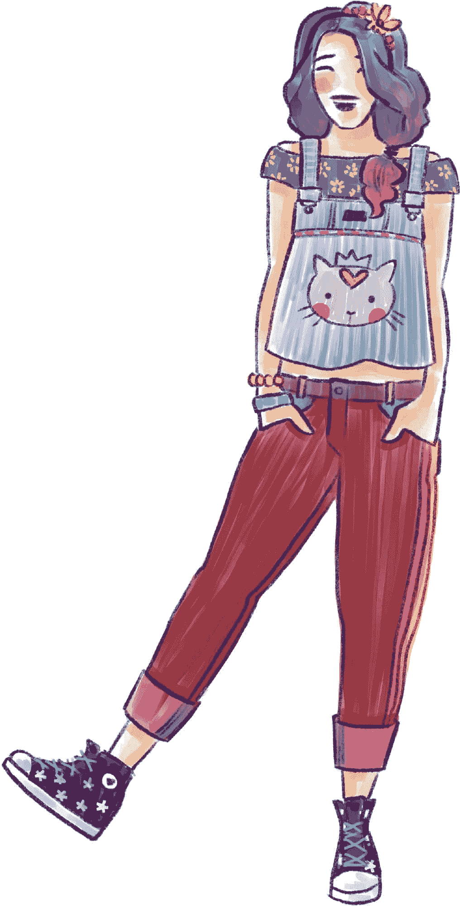

#### 先锋/高级定制
如果这种风格吸引你，你很可能是一个突破界限的人，热爱实验和高艺术。你喜欢挑战主流，让人多看一眼。
你的缪斯是一个自由思想者、思想挑衅者，不介意被展出。

##### 绘画风格：
-   随意的、松散的线条
-   未完成的曲线
-   抽象且略显夸张
-   大胆的彩色笔触

##### 时尚风格：
-   形式重于功能
-   极具独特性和创造力
-   艺术气息
-   不寻常的造型和轮廓

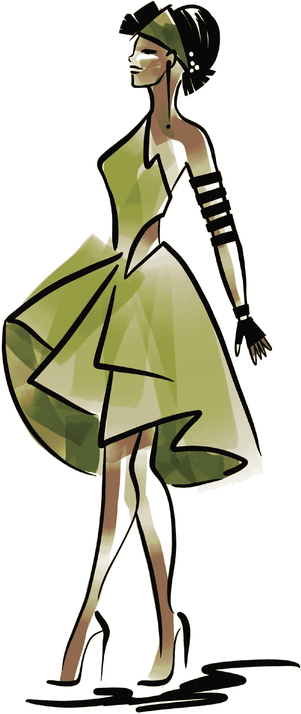

#### 编辑风格
如果这种风格吸引你，你拥有丰富的想象力，喜欢用服装和配饰来讲述故事。你眼光独到，总是寻找具有历史或真正特别的单品。你从电影和生活中的角色中汲取灵感。你可能是一名有志成为服装设计师的人！
你的缪斯是好莱坞的“It”女孩——过去或现在——她可以变成任何角色；她总会在高档时尚杂志中获得精致的专题报道。

##### 绘画风格：
-   用绘图铅笔精心描绘
-   细节丰富且精致
-   带有阴影和轮廓的写实绘画风格
-   可见的草图线条

##### 时尚风格：
-   富有创造力和戏剧性
-   受故事或角色启发
-   戏剧性且有意为之
-   领先时尚
-   深思熟虑的编辑，注重细节

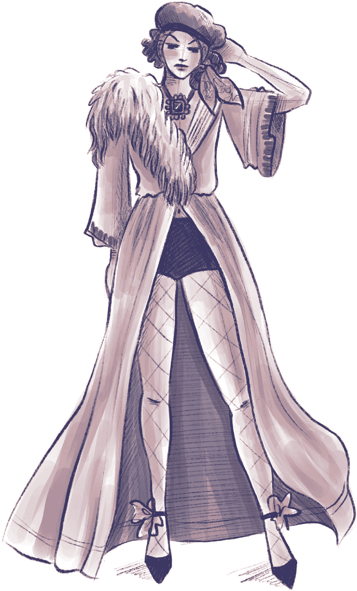

### 捕捉你的愿景
现在你已经学习了一些基础知识，并花了一些时间练习时装插画的技巧，你准备好使用各种艺术工具发挥创意，将你的愿景变为现实！让乐趣开始吧！

#### 铅笔与粉彩
当你在外出速写且无法使用颜料时，彩色铅笔和粉彩铅笔可以带来浓郁、奶油般的色彩冲击。这些工具非常适合创作你在俏皮可爱或编辑风格设计主题中可能看到的大胆图案和鲜艳的色彩组合。

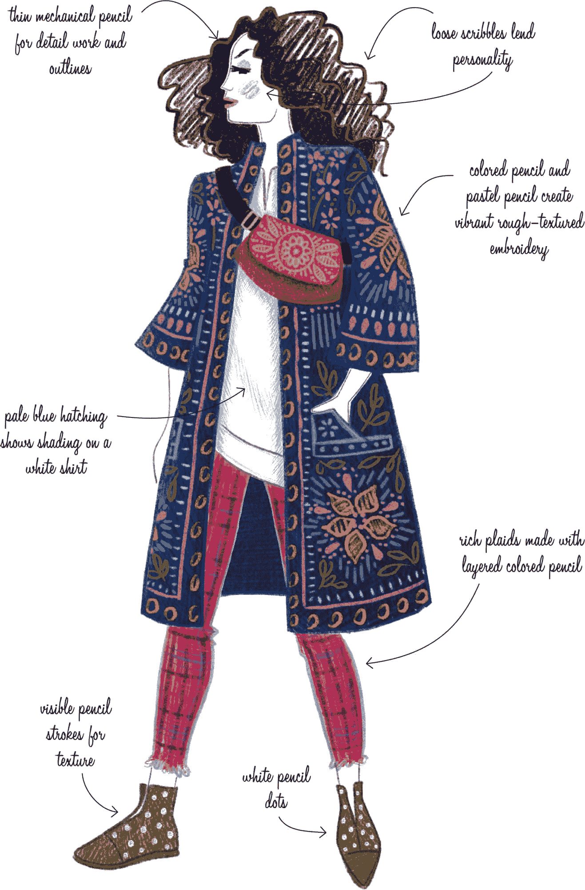

#### 马克笔
许多时装插画师在工作中依赖艺术马克笔和水性马克笔。马克笔是一种多用途工具，可有效用于几乎任何时装设计插画。由于可用的颜色范围广泛，马克笔在俏皮可爱和先锋设计上尤其有趣使用。精致的色彩选择调色板使得叠加条纹、圆点、波浪线和饱和色调变得容易。

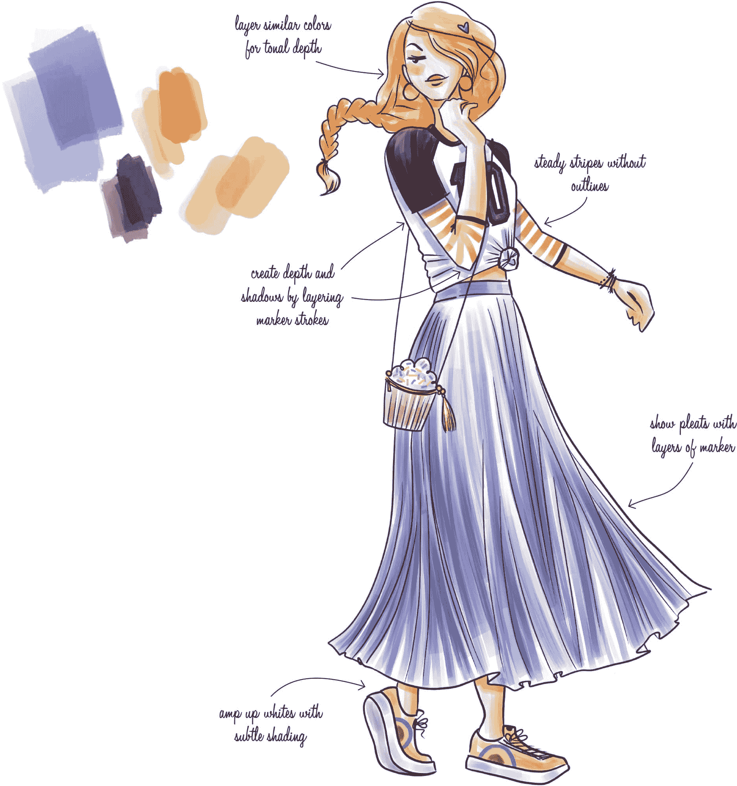

#### 深色纸与金属漆笔或白铅笔
没有什么比金属漆笔和深色纸更适合为你的设计增添光泽了。

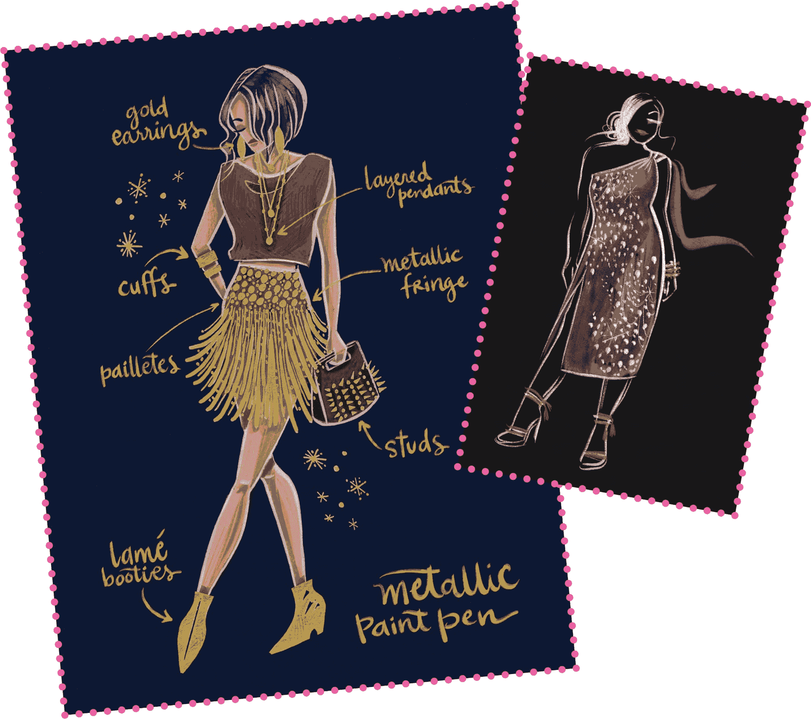

#### 墨水
墨水笔提供干净、专业的对比度和强度效果。尝试不同类型，看看哪种最适合你的风格！墨水工具非常适合创作优雅与极简的设计。

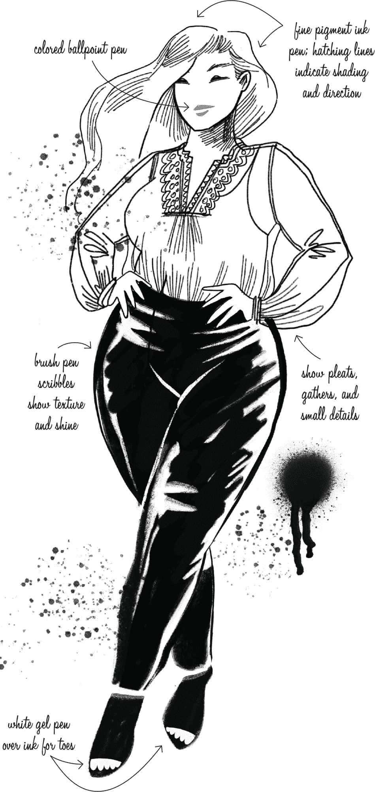

##### 墨水戏剧感
高对比度的墨水插画搭配夸张的比例显得前卫而酷。用白纸上的纯黑色墨水创作大胆设计，可瞬间营造戏剧感并带有一丝高级时尚。这种技巧非常适合都市风格和不拖泥带水的时尚，尤其当轮廓或垂坠感设计是主要焦点时。

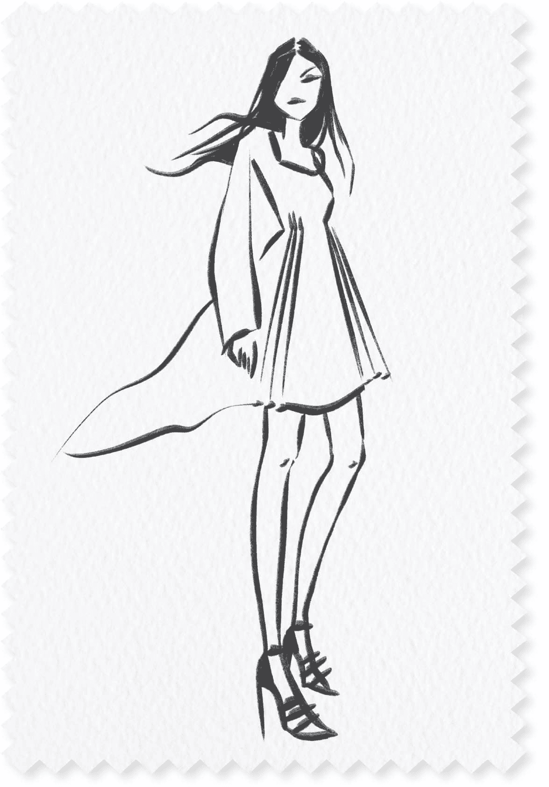

#### 画笔与可变线条粗细
在时装插画中强调线条粗细会使绘画看起来更有趣、更专业。线条粗细绘画非常适合先锋/高级定制设计风格。较细的线条让眼睛得到休息，而较粗的线条则吸引视线关注强烈的曲线和角度，并传达人物或物体的重量。平衡绘画中线条粗细的多样性会让即使是最简单的设计看起来也更生动！

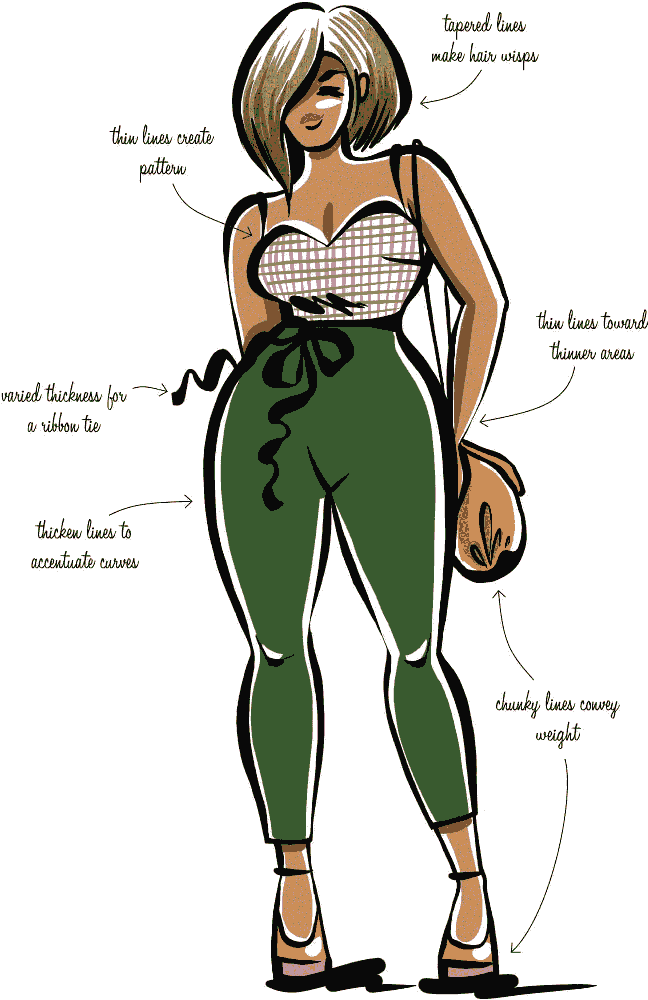

#### 混合媒介与拼贴
如果你不擅长绘制印花和图案，或想真正混搭一番，就使用拼贴纸为你的时装插画增添质感元素。先绘制你的设计，然后使用灯箱将其转移到拼贴纸上。你也可以使用多种混合媒介来创作真正独特的时尚！

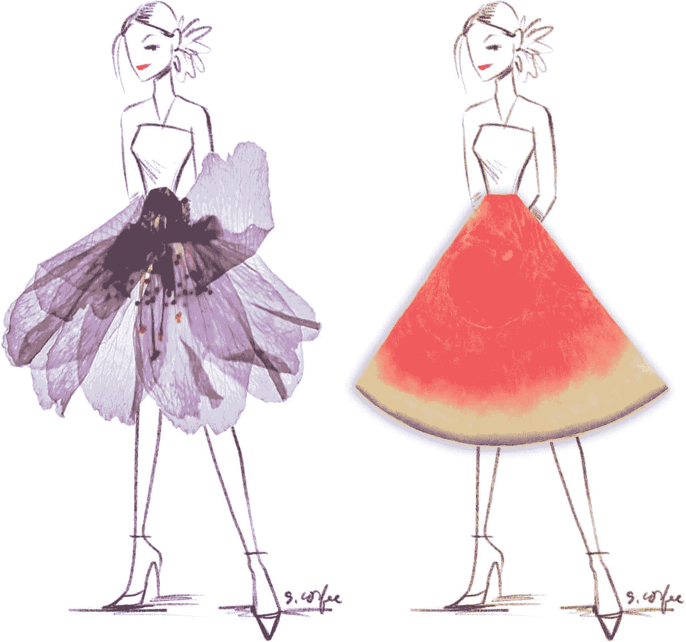

##### 用寻找到的物件增添乐趣
布料、花朵、亮片、闪粉、彩绘纸，甚至食物都能为你的时尚增添趣味和创意！想想压花添加到婚纱上，或细丝带粘在流苏裙上。真实的亮片和闪粉添加到绘制在黑纸上的鸡尾酒裙设计上会带来最大光泽。而印花布料可用于展示拼布和图案。

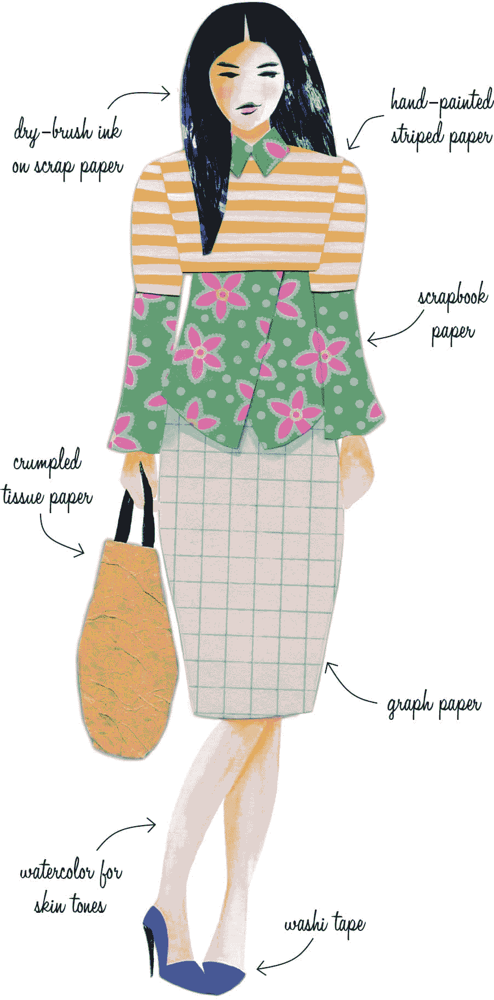

#### 水彩
水彩无疑是最通用多样的绘画媒介之一。它湿润上色，但干得快。水彩易于分层。它可以无限混合，并根据上色方式留下美丽的“闪烁”效果。它可以为墨水画增添一抹色彩，也可单独用于创作整幅插画！水彩非常适合柔和浪漫的设计。

##### 管装水彩
管状颜料非常适合制作水洗效果和分层。它们也往往显得更透明。颜料在调色板中干了后，可用少量水重新激活——因此不会浪费！使用画笔搭配管装颜料。

##### 干盘水彩
非常适合旅行或现场作画。用水笔或画笔用水激活干颜料，并在调色板盖中混合。较少的水会使上色更粉质、更不透明；更多的水会增加颜料的透明度。

##### 技巧
**湿上干。** 将水彩涂在干纸上以获得精确效果；效果类似于使用马克笔。
**湿上湿。** 将水彩涂在湿纸上会让颜料流入湿润区域并形成图案和渐变，例如对面页示例中展示的彩色头发。
**喷溅。** 用水和颜料装载画笔；然后在页面上弹拨以增添闪光、飞溅和活力。效果营造出动感，能让你的插画更生动。
**点戳。** 用颜料装载画笔，然后点戳到页面上形成小水洼以有趣的方式干燥。这是在创造美丽纹理的另一种独特方式。
**分层。** 将湿颜料叠加在干颜料上可形成色调叠加，增加深度和丰富感；这对于褶皱裙和礼服尤其有效。
**飞溅与喷溅。** 流动的水彩与精细绘制的墨水插画相结合，创造出硬线与软线的完美融合。使用线稿创作你的设计；然后添加流痕、喷溅、滴落和透明水彩的覆盖层。

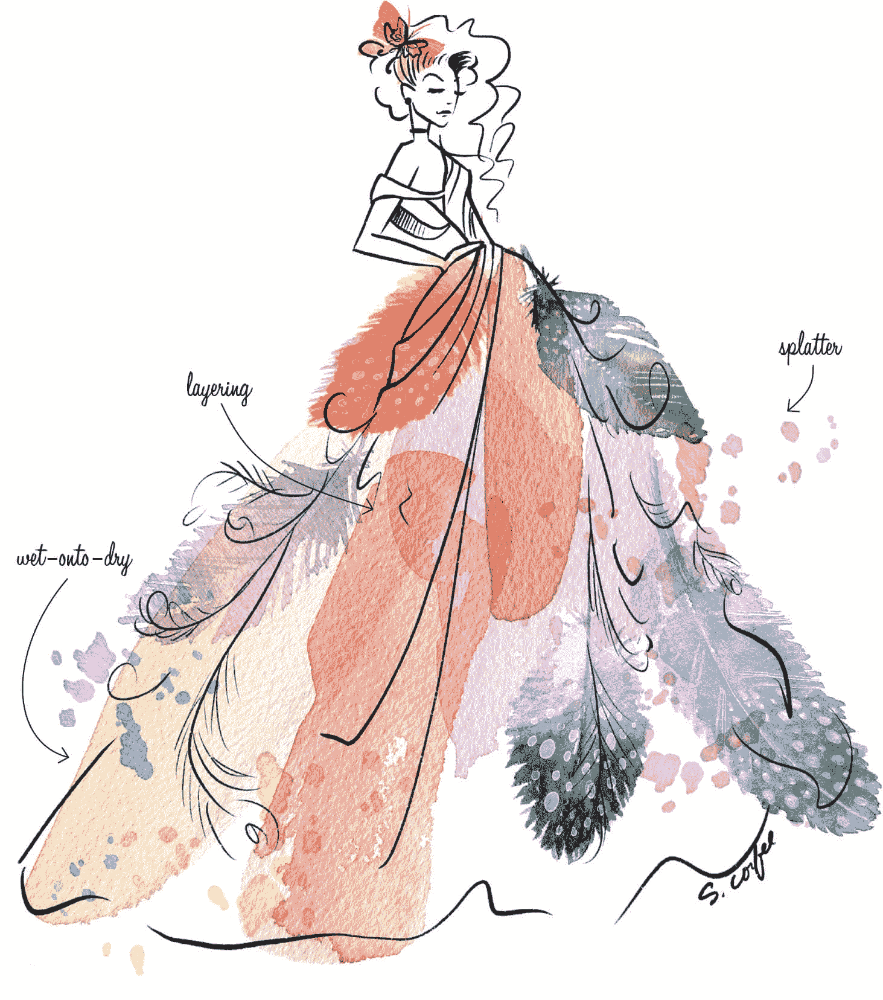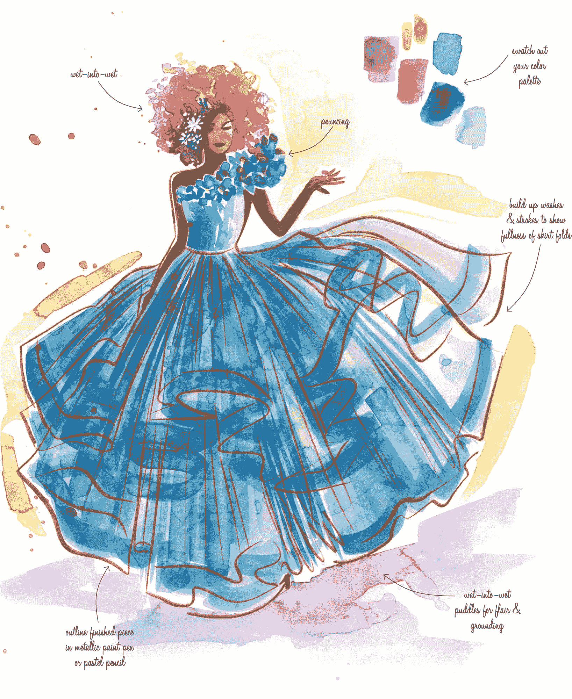

[*OceanofPDF.com*](https://oceanofpdf.com)
