# 第 3 章

## 标志性设计：逐步项目

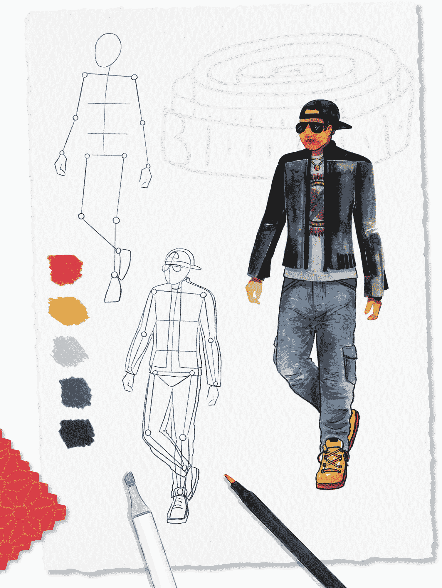

### 流行文化的灵感
到目前为止，你可能已经更了解自己的个人设计风格，发现了哪些类型的时尚激励着你，并学会了如何使用各种工具在插画中创造特殊效果。你正朝着成为有前瞻性的设计师迈进！为了获得更多灵感和想法，有助于关注流行文化中的标志性人物——过去和现在——看看他们的风格如何进一步影响你的作品。毕竟，专业时装设计师以某些名人缪斯为灵感创作完整服装并不罕见！

#### 开创性艺术家

### 受弗里达·卡洛启发

对于这幅草图，简单直接的姿势最能展现服装和头饰。

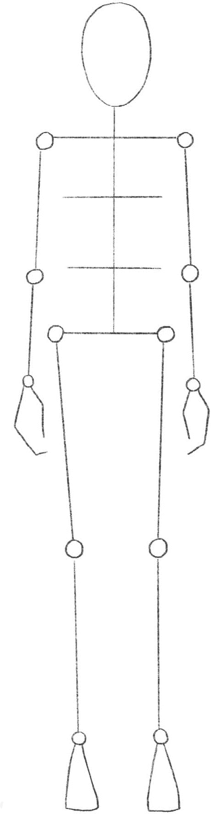

1
画一个椭圆形作为头部，并用线条和圆圈画一个简笔画人形。

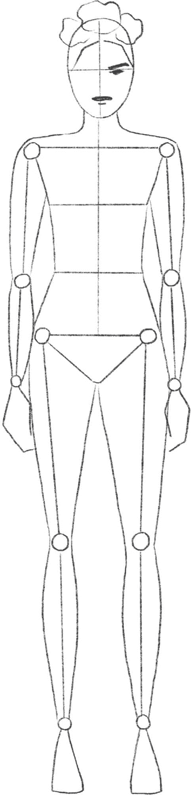

2
通过从关节到关节勾勒简笔画人形来增加体积。在面部添加中线和眼线，以及她头顶的花朵。

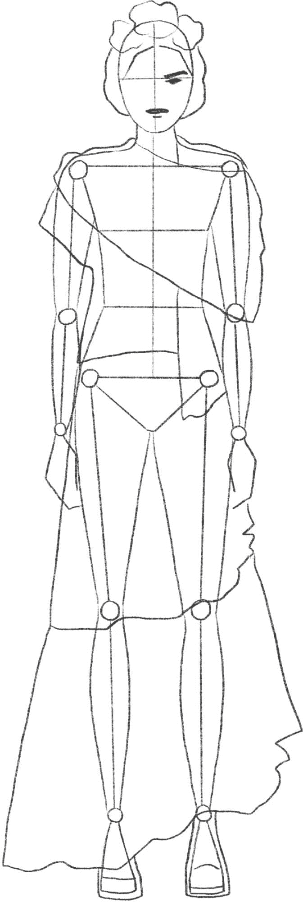

3
勾勒服装，包括方形的衬衫、上肩披肩、蓬松裙子和靴子。

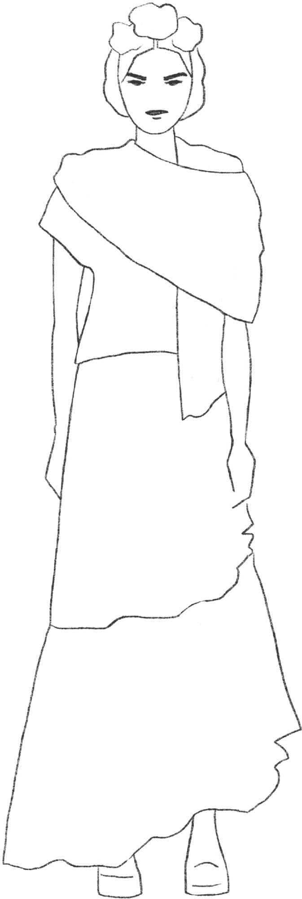

4
擦除不必要的线条，只保留基本服装。

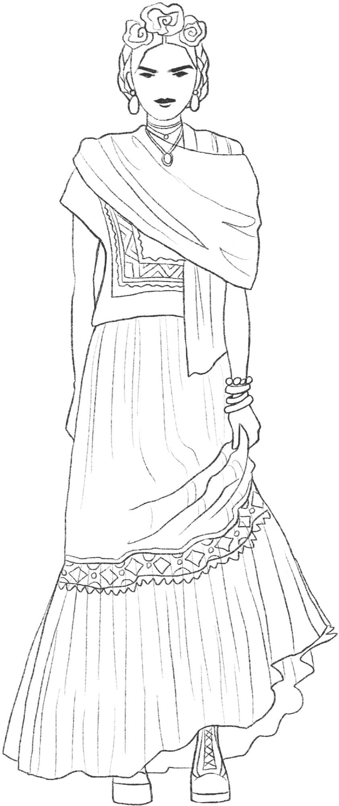

5
添加细节！由于这款时尚灵感来源于一位标志性艺术家，尝试使用符合她风格的图案，例如衬衫上方形丝带装饰边和裙子上装饰性饰带的带子。添加厚重的[content]
### 受弗里达·卡洛启发

对于这幅草图，简单直接的姿势最能展现服装和头饰。

1
画一个椭圆形作为头部，并用线条和圆圈画一个简笔画人形。

2
通过从关节到关节勾勒简笔画人形来增加体积。在面部添加中线和眼线，以及她头顶的花朵。

3
勾勒服装，包括方形的衬衫、上肩披肩、蓬松裙子和靴子。

4
擦除不必要的线条，只保留基本服装。

5
添加细节！由于这款时尚灵感来源于一位标志性艺术家，尝试使用符合她风格的图案，例如衬衫上方形丝带装饰边和裙子上装饰性饰带的带子。添加厚重的[content]
### 受弗里达·卡洛启发

对于这幅草图，简单直接的姿势最能展现服装和头饰。

1
画一个椭圆形作为头部，并用线条和圆圈画一个简笔画人形。

2
通过从关节到关节勾勒简笔画人形来增加体积。在面部添加中线和眼线，以及她头顶的花朵。

3
勾勒服装，包括方形的衬衫、上肩披肩、蓬松裙子和靴子。

4
擦除不必要的线条，只保留基本服装。

5
添加细节！由于这款时尚灵感来源于一位标志性艺术家，尝试使用符合她风格的图案，例如衬衫上方形丝带装饰边和裙子上装饰性饰带的带子。添加厚重的[content]
### 受弗里达·卡洛启发

对于这幅草图，简单直接的姿势最能展现服装和头饰。

1
画一个椭圆形作为头部，并用线条和圆圈画一个简笔画人形。

2
通过从关节到关节勾勒简笔画人形来增加体积。在面部添加中线和眼线，以及她头顶的花朵。

3
勾勒服装，包括方形的衬衫、上肩披肩、蓬松裙子和靴子。

4
擦除不必要的线条，只保留基本服装。

5
添加细节！由于这款时尚灵感来源于一位标志性艺术家，尝试使用符合她风格的图案，例如衬衫上方形丝带装饰边和裙子上装饰性饰带的带子。添加厚重的[content]
### 受弗里达·卡洛启发

对于这幅草图，简单直接的姿势最能展现服装和头饰。

1
画一个椭圆形作为头部，并用线条和圆圈画一个简笔画人形。

2
通过从关节到关节勾勒简笔画人形来增加体积。在面部添加中线和眼线，以及她头顶的花朵。

3
勾勒服装，包括方形的衬衫、上肩披肩、蓬松裙子和靴子。

4
擦除不必要的线条，只保留基本服装。

5
添加细节！由于这款时尚灵感来源于一位标志性艺术家，尝试使用符合她风格的图案，例如衬衫上方形丝带装饰边和裙子上装饰性饰带的带子。添加厚重的声明性珠宝来增强效果。

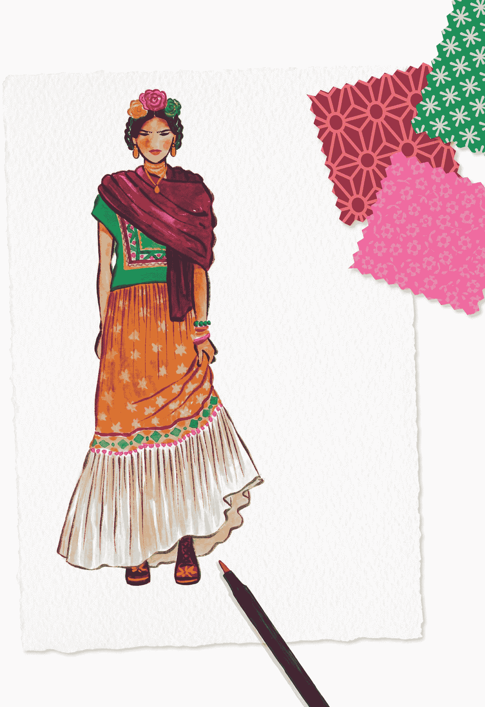

使用你选择的任何艺术工具，添加深色并带有大量纹理。在这种情况下，手绘艺术用炭笔轻轻勾勒。彩绘的装饰丝带在明亮的颜色中闪耀，而粉红色的脸颊和鲜红色的嘴唇完成了弗里达·卡洛的形象。

### 好莱坞经典

*受奥黛丽·赫本启发*

描绘受名人或偶像启发的形象需要一个适合其个性和同时突出服装的姿势和造型。

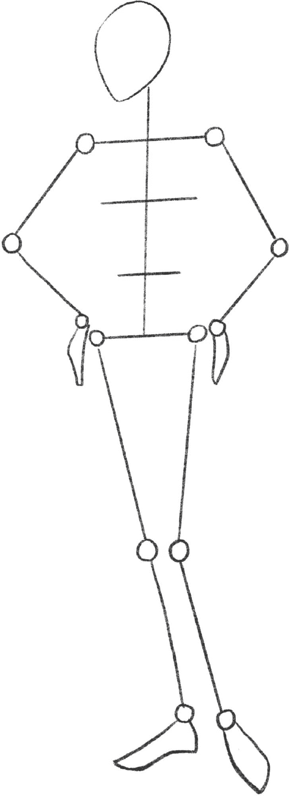

1
用线条和关节画出基本形态。手脚使用简单形状。

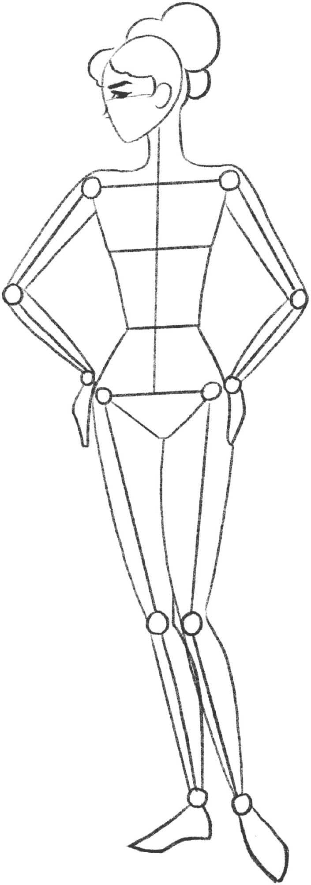

2
开始填充简笔画人形。

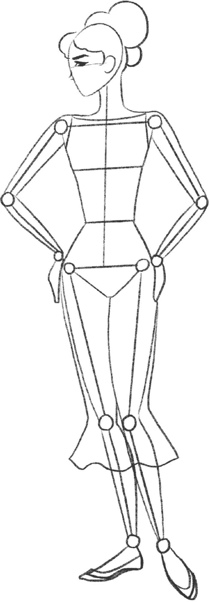

3
添加服装和鞋子。

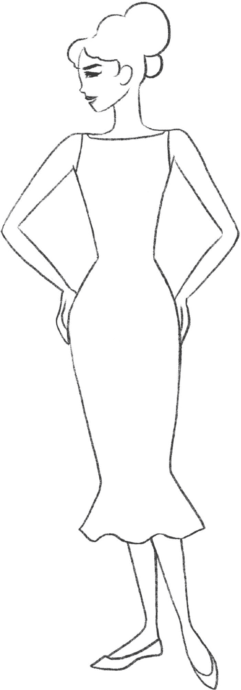

4
擦除任何不需要的草图线条。

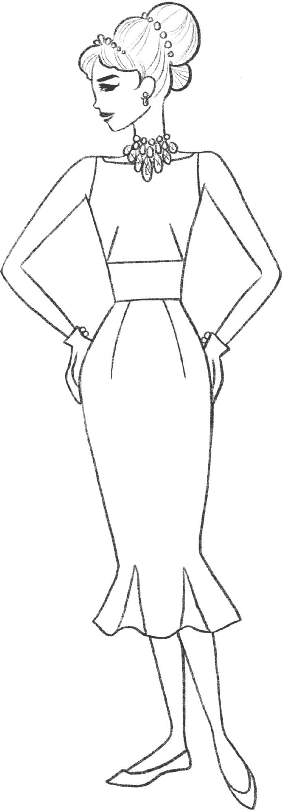

5
添加使造型独特的定义细节。这里展示了定制的缝线，以及腕部手套和珠宝！

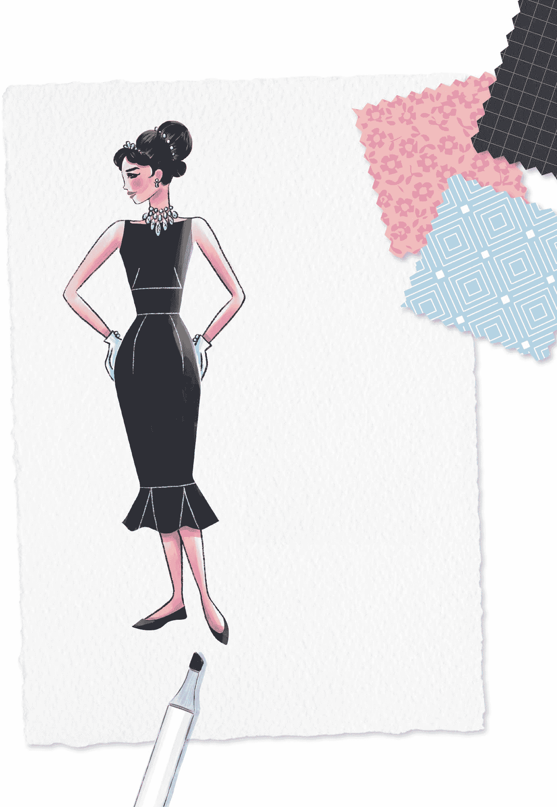

名人和其他著名人物通常因其标志性造型而为人所知，这使他们几乎可以立即被识别。许多时装设计师梦想有一天名人会穿上他们的作品。小黑裙、平底鞋、手套和闪亮的珠宝都是奥黛丽·赫本的标志。加上红唇、王冠和流线型的裁剪即可达到效果。

### 音乐大亨与表演者

*受 Jay-Z 启发*

随意的行走姿势似乎非常适合这位具有酷炫都市风格的时尚偶像。

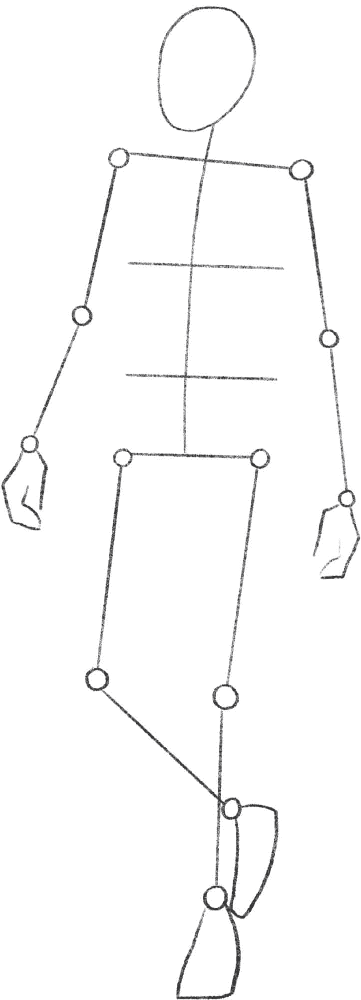

1
用肩部、胸部、腰部和臀部的水平线勾勒姿势。接下来，添加线条和圆圈来表示关节。

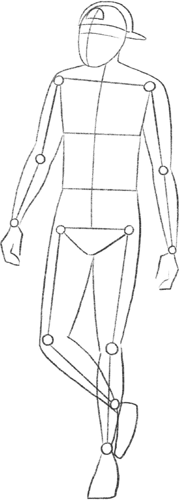

2
开始填充人物，包括宽阔的肩膀和躯干。

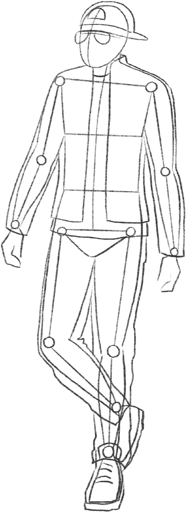

3
为服装添加基本轮廓。

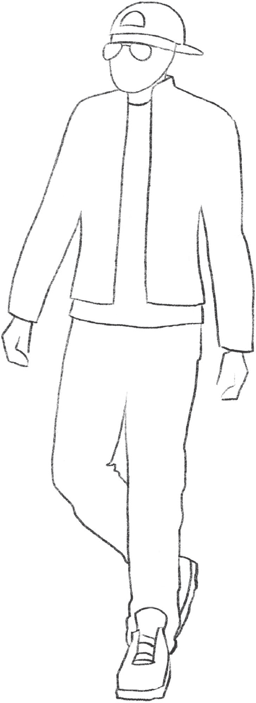

4
清理你的草图并擦除任何不必要的铅笔痕迹。

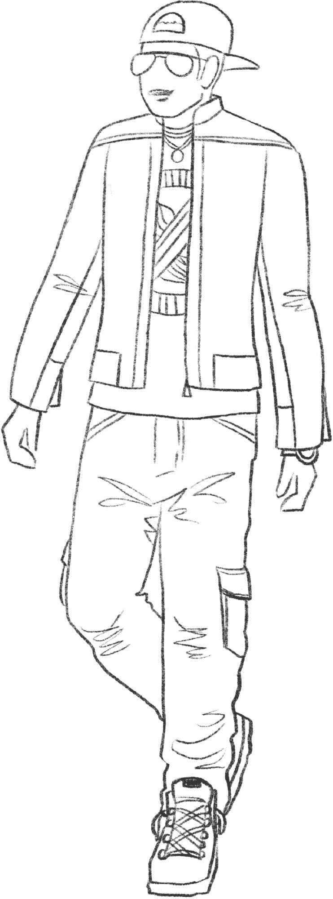

5
把它风格化！现代皮夹克、图形 T 恤和宽松牛仔裤搭配墨镜、棒球帽和工装风格靴子，营造出酷炫休闲的造型。

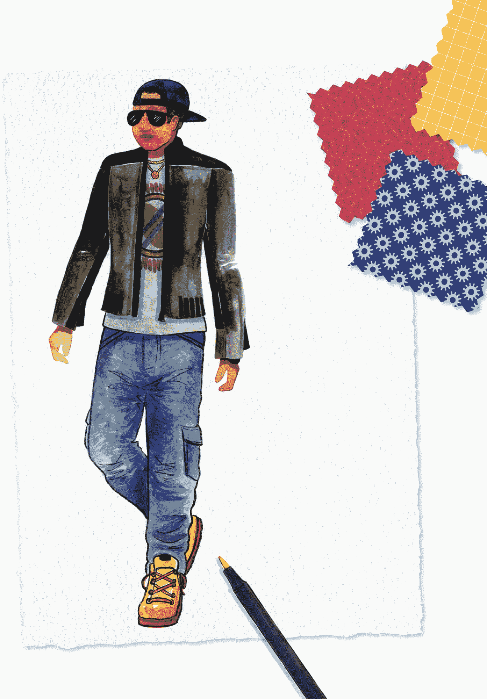

通过更换与人物整体衣橱基础和个性相匹配的配饰、鞋子和夹克，来尝试这种造型（以及本节中展示的其他名人灵感造型）。每次都不要复制相同的造型。

### 皇家时尚

*受苏塞克斯公爵夫人梅根·马克尔启发*

随意的行走姿势对于一个时刻处于全球关注下的名人来说很常见！

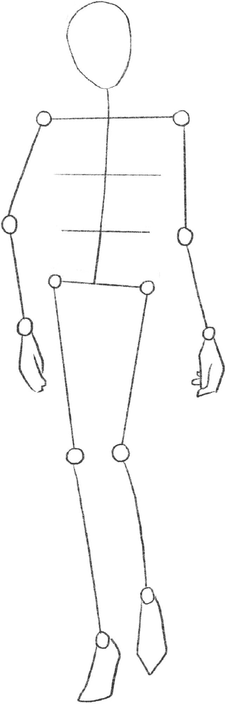

1
从典型的简笔画人形开始。用椭圆形作为头部并添加肩部、胸部、腰部和臀部的水平线。添加更多线条和圆圈以显示肢体位置。

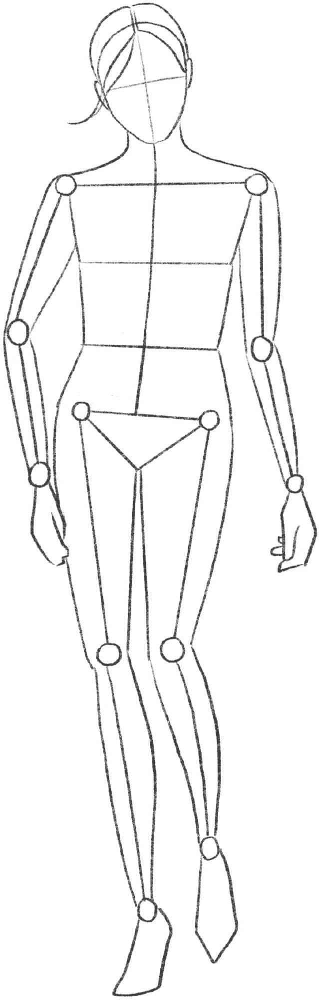

2
为人物增加体积并勾勒发型开始部分。

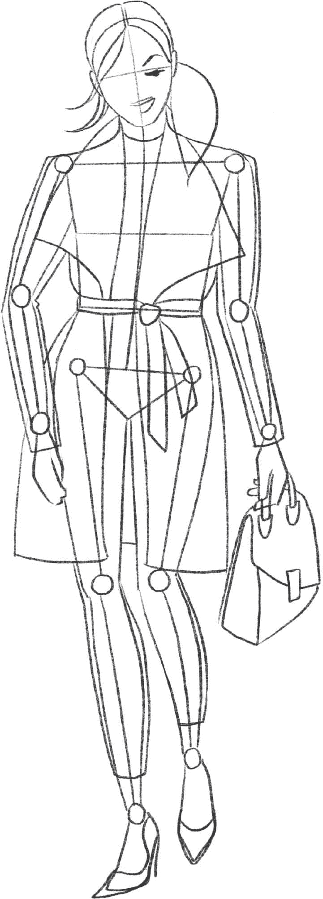

3
尽可能简单地绘制服装。指示设计的[content]
### 受弗里达·卡洛启发

对于这幅草图，简单直接的姿势最能展现服装和头饰。

1
画一个椭圆形作为头部，并用线条和圆圈画一个简笔画人形。

2
通过从关节到关节勾勒简笔画人形来增加体积。在面部添加中线和眼线，以及她头顶的花朵。

3
勾勒服装，包括方形的衬衫、上肩披肩、蓬松裙子和靴子。

4
擦除不必要的线条，只保留基本服装。

5
添加细节！由于这款时尚灵感来源于一位标志性艺术家，尝试使用符合她风格的图案，例如衬衫上方形丝带装饰边和裙子上装饰性饰带的带子。添加厚重的声明性珠宝来增强效果。

使用你选择的任何艺术工具，添加深色并带有大量纹理。在这种情况下，手绘艺术用炭笔轻轻勾勒。彩绘的装饰丝带在明亮的颜色中闪耀，而粉红色的脸颊和鲜红色的嘴唇完成了弗里达·卡洛的形象。

### 好莱坞经典

*受奥黛丽·赫本启发*

描绘受名人或偶像启发的形象需要一个适合其个性和同时突出服装的姿势和造型。

1
用线条和关节画出基本形态。手脚使用简单形状。

2
开始填充简笔画人形。

3
添加服装和鞋子。

4
擦除任何不需要的草图线条。

5
添加使造型独特的定义细节。这里展示了定制的缝线，以及腕部手套和珠宝！

名人和其他著名人物通常因其标志性造型而为人所知，这使他们几乎可以立即被识别。许多时装设计师梦想有一天名人会穿上他们的作品。小黑裙、平底鞋、手套和闪亮的珠宝都是奥黛丽·赫本的标志。加上红唇、王冠和流线型的裁剪即可达到效果。

### 音乐大亨与表演者

*受 Jay-Z 启发*

随意的行走姿势似乎非常适合这位具有酷炫都市风格的时尚偶像。

1
用肩部、胸部、腰部和臀部的水平线勾勒姿势。接下来，添加线条和圆圈来表示关节。

2
开始填充人物，包括宽阔的肩膀和躯干。

3
为服装添加基本轮廓。

4
清理你的草图并擦除任何不必要的铅笔痕迹。

5
把它风格化！现代皮夹克、图形 T 恤和宽松牛仔裤搭配墨镜、棒球帽和工装风格靴子，营造出酷炫休闲的造型。

通过更换与人物整体衣橱基础和个性相匹配的配饰、鞋子和夹克，来尝试这种造型（以及本节中展示的其他名人灵感造型）。每次都不要复制相同的造型。

### 皇家时尚

*受苏塞克斯公爵夫人梅根·马克尔启发*

随意的行走姿势对于一个时刻处于全球关注下的名人来说很常见！

1
从典型的简笔画人形开始。用椭圆形作为头部并添加肩部、胸部、腰部和臀部的水平线。添加更多线条和圆圈以显示肢体位置。

2
为人物增加体积并勾勒发型开始部分。

3
尽可能简单地绘制服装。指示设计的[content]
### 受弗里达·卡洛启发

对于这幅草图，简单直接的姿势最能展现服装和头饰。

1
画一个椭圆形作为头部，并用线条和圆圈画一个简笔画人形。

2
通过从关节到关节勾勒简笔画人形来增加体积。在面部添加中线和眼线，以及她头顶的花朵。

3
勾勒服装，包括方形的衬衫、上肩披肩、蓬松裙子和靴子。

4
擦除不必要的线条，只保留基本服装。

5
添加细节！由于这款时尚灵感来源于一位标志性艺术家，尝试使用符合她风格的图案，例如衬衫上方形丝带装饰边和裙子上装饰性饰带的带子。添加厚重的声明性珠宝来增强效果。

使用你选择的任何艺术工具，添加深色并带有大量纹理。在这种情况下，手绘艺术用炭笔轻轻勾勒。彩绘的装饰丝带在明亮的颜色中闪耀，而粉红色的脸颊和鲜红色的嘴唇完成了弗里达·卡洛的形象。

### 好莱坞经典

*受奥黛丽·赫本启发*

描绘受名人或偶像启发的形象需要一个适合其个性和同时突出服装的姿势和造型。

1
用线条和关节画出基本形态。手脚使用简单形状。

2
开始填充简笔画人形。

3
添加服装和鞋子。

4
擦除任何不需要的草图线条。

5
添加使造型独特的定义细节。这里展示了定制的缝线，以及腕部手套和珠宝！

名人和其他著名人物通常因其标志性造型而为人所知，这使他们几乎可以立即被识别。许多时装设计师梦想有一天名人会穿上他们的作品。小黑裙、平底鞋、手套和闪亮的珠宝都是奥黛丽·赫本的标志。加上红唇、王冠和流线型的裁剪即可达到效果。

### 音乐大亨与表演者

*受 Jay-Z 启发*

随意的行走姿势似乎非常适合这位具有酷炫都市风格的时尚偶像。

1
用肩部、胸部、腰部和臀部的水平线勾勒姿势。接下来，添加线条和圆圈来表示关节。

2
开始填充人物，包括宽阔的肩膀和躯干。

3
为服装添加基本轮廓。

4
清理你的草图并擦除任何不必要的铅笔痕迹。

5
把它风格化！现代皮夹克、图形 T 恤和宽松牛仔裤搭配墨镜、棒球帽和工装风格靴子，营造出酷炫休闲的造型。

通过更换与人物整体衣橱基础和个性相匹配的配饰、鞋子和夹克，来尝试这种造型（以及本节中展示的其他名人灵感造型）。每次都不要复制相同的造型。

### 皇家时尚

*受苏塞克斯公爵夫人梅根·马克尔启发*

随意的行走姿势对于一个时刻处于全球关注下的名人来说很常见！

1
从典型的简笔画人形开始。用椭圆形作为头部并添加肩部、胸部、腰部和臀部的水平线。添加更多线条和圆圈以显示肢体位置。

2
为人物增加体积并勾勒发型开始部分。

3
尽可能简单地绘制服装。指示设计的[content]
### 受弗里达·卡洛启发

对于这幅草图，简单直接的姿势最能展现服装和头饰。

1
画一个椭圆形作为头部，并用线条和圆圈画一个简笔画人形。

2
通过从关节到关节勾勒简笔画人形来增加体积。在面部添加中线和眼线，以及她头顶的花朵。

3
勾勒服装，包括方形的衬衫、上肩披肩、蓬松裙子和靴子。

4
擦除不必要的线条，只保留基本服装。

5
添加细节！由于这款时尚灵感来源于一位标志性艺术家，尝试使用符合她风格的图案，例如衬衫上方形丝带装饰边和裙子上装饰性饰带的带子。添加厚重的声明性珠宝来增强效果。

使用你选择的任何艺术工具，添加深色并带有大量纹理。在这种情况下，手绘艺术用炭笔轻轻勾勒。彩绘的装饰丝带在明亮的颜色中闪耀，而粉红色的脸颊和鲜红色的嘴唇完成了弗里达·卡洛的形象。
### 好莱坞经典
*受奥黛丽·赫本启发*
描绘受名人或偶像启发的形象需要一个适合其个性和同时突出服装的姿势和造型。

1
用线条和关节画出基本形态。手脚使用简单形状。

2
开始填充简笔画人形。

3
添加服装和鞋子。

4
擦除任何不需要的草图线条。

5
添加使造型独特的定义细节。这里展示了定制的缝线，以及腕部手套和珠宝！

名人和其他著名人物通常因其标志性造型而为人所知，这使他们几乎可以立即被识别。许多时装设计师梦想有一天名人会穿上他们的作品。小黑裙、平底鞋、手套和闪亮的珠宝都是奥黛丽·赫本的标志。加上红唇、王冠和流线型的裁剪即可达到效果。
### 音乐大亨与表演者
*受 Jay-Z 启发*
随意的行走姿势似乎非常适合这位具有酷炫都市风格的时尚偶像。

1
用肩部、胸部、腰部和臀部的水平线勾勒姿势。接下来，添加线条和圆圈来表示关节。

2
开始填充人物，包括宽阔的肩膀和躯干。

3
为服装添加基本轮廓。

4
清理你的草图并擦除任何不必要的铅笔痕迹。

5
把它风格化！现代皮夹克、图形 T 恤和宽松牛仔裤搭配墨镜、棒球帽和工装风格靴子，营造出酷炫休闲的造型。

通过更换与人物整体衣橱基础和个性相匹配的配饰、鞋子和夹克，来尝试这种造型（以及本节中展示的其他名人灵感造型）。每次都不要复制相同的造型。
### 皇家时尚
*受苏塞克斯公爵夫人梅根·马克尔启发*
随意的行走姿势对于一个时刻处于全球关注下的名人来说很常见！

1
从典型的简笔画人形开始。用椭圆形作为头部并添加肩部、胸部、腰部和臀部的水平线。添加更多线条和圆圈以显示肢体位置。

2
为人物增加体积并勾勒发型开始部分。

3
尽可能简单地绘制服装。指示设计的[content]
### 受弗里达·卡洛启发
对于这幅草图，简单直接的姿势最能展现服装和头饰。

1
画椭圆形作头部，用线条和圆圈画简笔画人形。

2
从关节到关节勾勒简笔画增加体积。面部加中线和眼线，以及头顶花朵。

3
勾勒服装，包括方衬衫、肩披、蓬裙和靴子。

4
擦除多余线条，只留基本服装。

5
加细节！因灵感来自标志性艺术家，可用符合她风格的图案，如衬衫方形丝带饰边和裙子装饰饰带。加厚重[content]
### 受弗里达·卡洛启发
对于这幅草图，简单直接的姿势最能展现服装和头饰。

1
画一个椭圆形作为头部，并用线条和圆圈画一个简笔画人形。

2
通过从关节到关节勾勒简笔画人形来增加体积。在面部添加中线和眼线，以及她头顶的花朵。

3
勾勒服装，包括方形的衬衫、上肩披肩、蓬松裙子和靴子。

4
擦除不必要的线条，只保留基本服装。

5
添加细节！由于这款时尚灵感来源于一位标志性艺术家，尝试使用符合她风格的图案，例如衬衫上方形丝带装饰边和裙子上装饰性饰带的带子。添加厚重的声明性珠宝来增强效果。

使用你选择的任何艺术工具，添加深色并带有大量纹理。在这种情况下，手绘艺术用炭笔轻轻勾勒。彩绘的装饰丝带在明亮的颜色中闪耀，而粉红色的脸颊和鲜红色的嘴唇完成了弗里达·卡洛的形象。
### 好莱坞经典
*受奥黛丽·赫本启发*
描绘受名人或偶像启发的形象需要一个适合其个性和同时突出服装的姿势和造型。

1
用线条和关节画出基本形态。手脚使用简单形状。

2
开始填充简笔画人形。

3
添加服装和鞋子。

4
擦除任何不需要的草图线条。

5
添加使造型独特的定义细节。这里展示了定制的缝线，以及腕部手套和珠宝！

名人和其他著名人物通常因其标志性造型而为人所知，这使他们几乎可以立即被识别。许多时装设计师梦想有一天名人会穿上他们的作品。小黑裙、平底鞋、手套和闪亮的珠宝都是奥黛丽·赫本的标志。加上红唇、王冠和流线型的裁剪即可达到效果。
### 音乐大亨与表演者
*受 Jay-Z 启发*
随意的行走姿势似乎非常适合这位具有酷炫都市风格的时尚偶像。

1
用肩部、胸部、腰部和臀部的水平线勾勒姿势。接下来，添加线条和圆圈来表示关节。

2
开始填充人物，包括宽阔的肩膀和躯干。

3
为服装添加基本轮廓。

4
清理你的草图并擦除任何不必要的铅笔痕迹。

5
把它风格化！现代皮夹克、图形 T 恤和宽松牛仔裤搭配墨镜、棒球帽和工装风格靴子，营造出酷炫休闲的造型。

通过更换与人物整体衣橱基础和个性相匹配的配饰、鞋子和夹克，来尝试这种造型（以及本节中展示的其他名人灵感造型）。每次都不要复制相同的造型。
### 皇家时尚
*受苏塞克斯公爵夫人梅根·马克尔启发*
随意的行走姿势对于一个时刻处于全球关注下的名人来说很常见！

1
从典型的简笔画人形开始。用椭圆形作为头部并添加肩部、胸部、腰部和臀部的水平线。添加更多线条和圆圈以显示肢体位置。

2
为人物增加体积并勾勒发型开始部分。

3
尽可能简单地绘制服装。标明设计的基本要素，包括形状、长度和配饰。
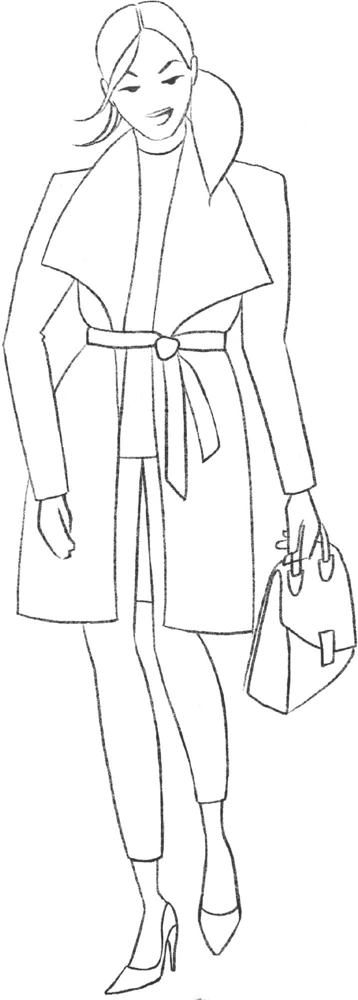
4
擦除草图痕迹，给自己一个干净的画。
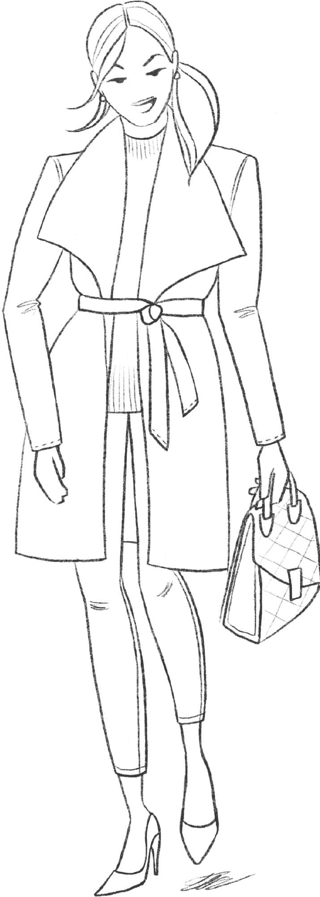
5
现在细化并添加细微细节。这位时尚偶像不需要太多，因为她的风格全是简单造型，几乎没有繁琐。
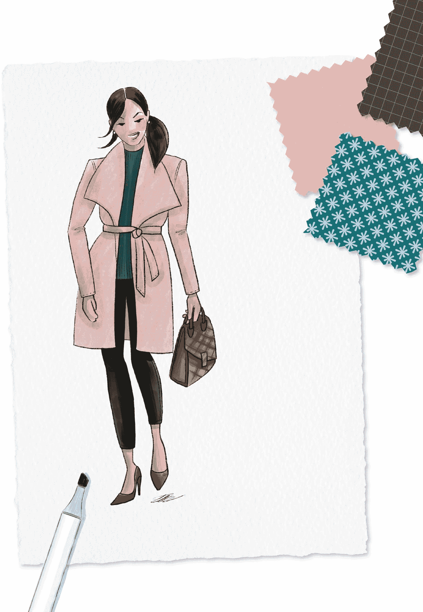
干净的线条和自信的形状定义了这种造型，几乎与以中性色调为主、点缀少量单色大地色调的配色方案一样重要。这是一种适合皇室和苏塞克斯公爵夫人简约风格的造型。
[*海洋 PDF.com*](https://oceanofpdf.com)
# 第 4 章
## 日常时尚：分步项目
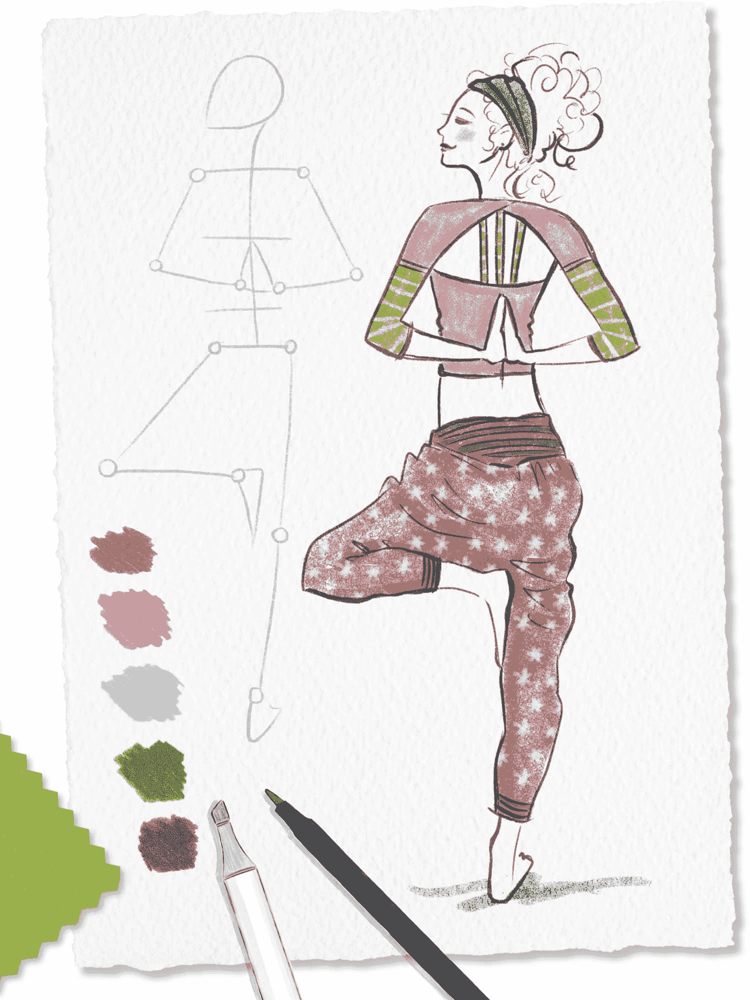
### 当代时尚设计
时尚无处不在！从穿着前卫风格的 aspiring 音乐人到咖啡店里酷酷读诗的嬉皮士，时尚的影响不容否认。无论是在海滩、瑜伽馆、夜晚外出还是舞会，都有适合每个场合和个人风格的时尚。以下是一些项目创意，帮助你开始想象为来自不同背景和体型的人设计时尚的各种方式。
#### 三种风格的瑜伽服
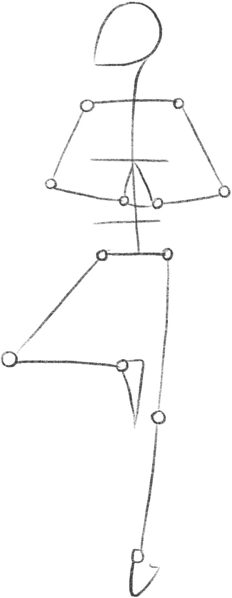
1
画一个简笔画人形，包括关节的圆圈。使用能最好展示你计划设计的瑜伽姿势。
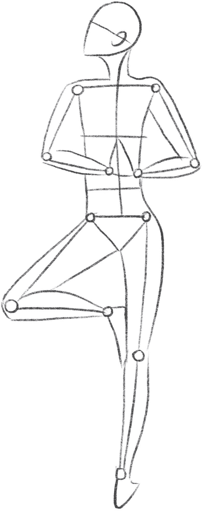
2
通过从关节到关节“连点成线”来增加人物的体积。在面部加一条显示眼睛位置的线。用简化形状表示手脚。
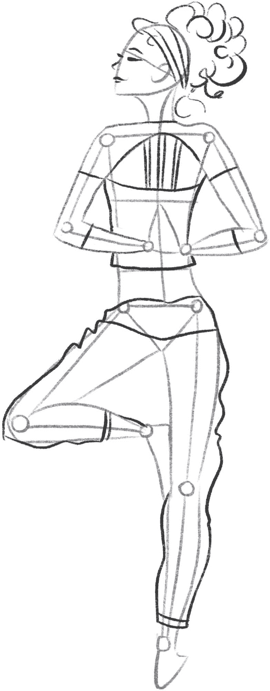
3
添加设计的松散细节，如袖长或轮廓。加几条草图线显示发型，并用几笔铅笔标记面部特征。快速自信地工作效果最好。
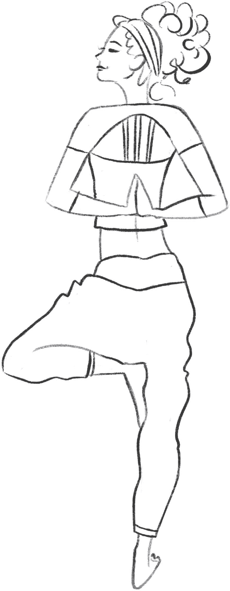
4
通过擦除不需要的线条清理插图。加深最强的曲线和细节。
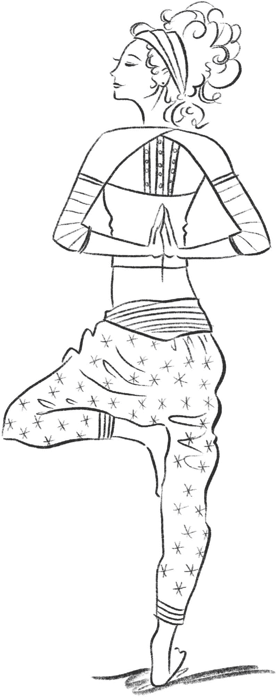
5
为服装添加细节。勾勒缝线、 hem、图案、褶皱和褶裥。完成服装结构和任何其他风格要点。
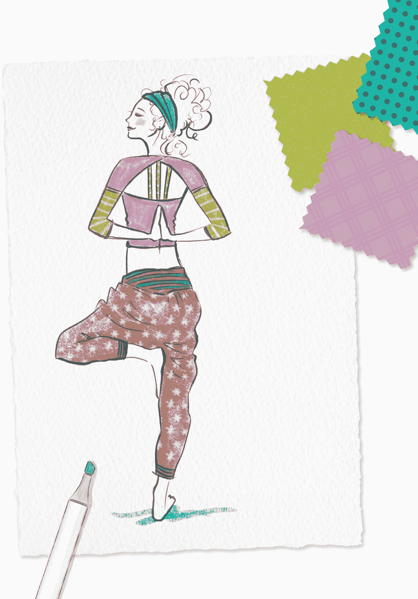
绘画风格的创意选择影响很大。这里人物仍用铅笔画，而只有服装着色和图案化，这更突出了时尚。最终插图是数字绘制的，在平板上用[content]
### 受弗里达·卡洛启发
对于这幅草图，简单直接的姿势最能展现服装和头饰。

1
画椭圆作头部，用线条和圆圈画简笔画人形。

2
从关节到关节勾勒简笔画增加体积。面部加中线和眼线，以及头顶花朵。

3
勾勒服装，包括方衬衫、肩披、蓬裙和靴子。

4
擦除多余线条，只留基本服装。

5
加细节！因灵感来自标志性艺术家，可用符合她风格的图案，如衬衫方形丝带饰边和裙子装饰饰带。加厚重声明性珠宝增强效果。

用任意艺术工具加深色和纹理。此例手绘艺术用炭笔轻描。彩绘丝带明亮，粉颊红唇完成弗里达·卡洛形象。
### 好莱坞经典
*受奥黛丽·赫本启发*
描绘名人或偶像形象需姿势和造型契合其个性并突出服装。

1
用线条和关节画基本形态。手脚用简单形状。

2
开始填充简笔画人形。

3
添加服装和鞋子。

4
擦除不需要的草图线条。

5
添加定义造型的细节。此处展示定制缝线、腕部手套和珠宝！

名人常因标志性造型为人熟知，易于识别。许多设计师梦想名人穿上作品。小黑裙、平底鞋、手套和闪亮珠宝都是奥黛丽·赫本标志。加红唇、王冠和流线裁剪即可。
### 音乐大亨与表演者
*受 Jay-Z 启发*
随意的行走姿势很适合这位酷炫都市风格的时尚偶像。

1
用肩、胸、腰、臀水平线勾勒姿势，再加线条和圆圈表示关节。

2
开始填充人物，包括宽肩和躯干。

3
为服装添加基本轮廓。

4
清理草图，擦除不必要的铅笔痕迹。

5
风格化！现代皮夹克、图形 T 恤、宽松牛仔裤配墨镜、棒球帽和工装靴，营造酷炫休闲感。

通过更换与人物衣橱基础和个性匹配的配饰、鞋子和夹克来尝试此造型及本节其他名人灵感造型。每次不要复制相同造型。
### 皇家时尚
*受苏塞克斯公爵夫人梅根·马克尔启发*
随意的行走姿势对时刻受全球关注的名人很常见！

1
从典型简笔画开始。用椭圆作头部，加肩、胸、腰、臀水平线。再加线条和圆圈显示肢体位置。

2
为人物增加体积并勾勒发型开始部分。

3
尽可能简单绘制服装。标明设计基本要素，包括形状、长度和配饰。

擦除草图痕迹，得到干净画稿。

5
现在细化并添加细微细节。这位时尚偶像不需要太多，因其风格以简洁造型为主。

干净线条和自信形状定义此造型，与以中性色为主、点缀少量单色大地色调的配色同样重要。适合皇室和苏塞克斯公爵夫人简约风格。
[*海洋 PDF.com*](https://oceanofpdf.com)
# 第 4 章
## 日常时尚：分步项目

### 当代时尚设计
时尚无处不在！从穿前卫风格的音乐人到咖啡店读诗的嬉皮士，时尚影响不容否认。无论海滩、瑜伽馆、夜出或舞会，都有适合每个场合和个人风格的时尚。以下项目创意帮助你想象为不同背景和体型的人设计时尚。
#### 三种风格的瑜伽服

1
画简笔画人形，关节用圆圈。用能最好展示设计的瑜伽姿势。

2
从关节到关节连点成线增加体积。面部加显示眼睛位置的线。用简化形状表示手脚。

3
添加设计松散细节，如袖长或轮廓。加几条线显示发型，几笔铅笔标记面部特征。快速自信工作效果最好。

4
擦除不需要线条清理插图。加深最强曲线和细节。

5
为服装添加细节。勾勒缝线、裙摆、图案、褶皱和褶裥。完成服装结构和其它风格要点。

绘画风格选择影响很大。此处人物仍铅笔画，仅服装着色和图案化，更突出时尚。最终插图为平板数位绘制，可选任意工具。
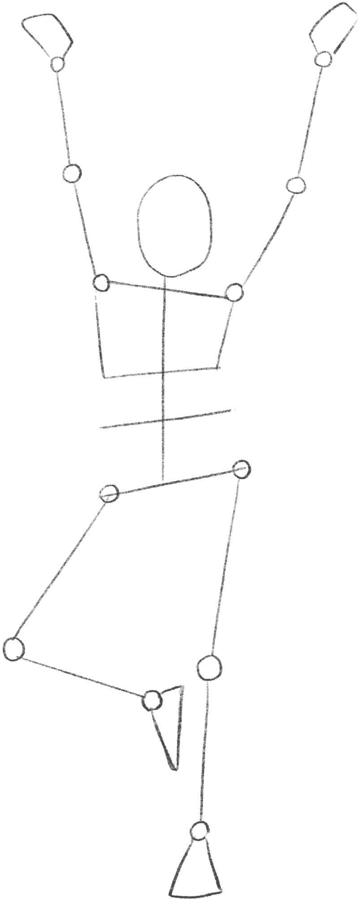
1
以简笔画为模型姿势基础。用椭圆作头部，肩、胸、腰、臀用简单水平线。
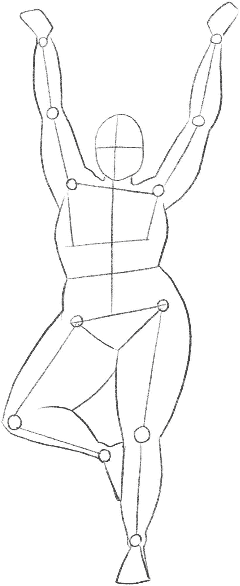
2
为线稿增加体积。 fuller 人物在每个关节周围留更多空间，线条更弯曲。注意模型腰宽与臀宽关系，以此指导。
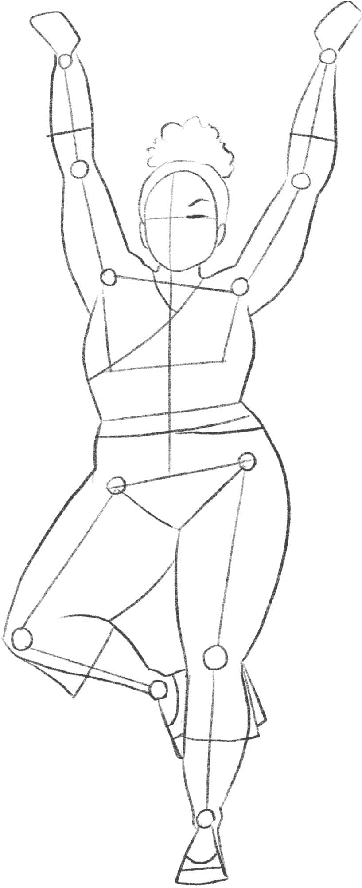
3
创建服装轮廓和基本形状。标记领口、袖长及关键设计，如开衩裤脚和裹身毛衣。选发型，松散勾勒形状。
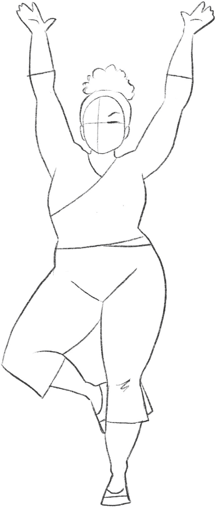
4
擦除原线和杂乱草图。干净轮廓有助于选择最终细节和配饰。
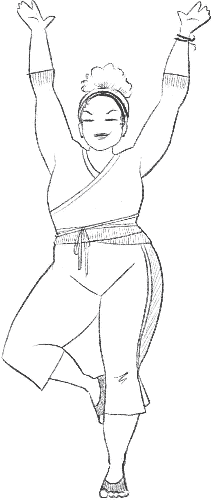
5

精炼艺术细节，添加腰带、针织衫罗纹、紧身裤条纹、发带和瑜伽袜。记住风格在于细节，因此在添加美丽且实用的点缀时要深思熟虑。

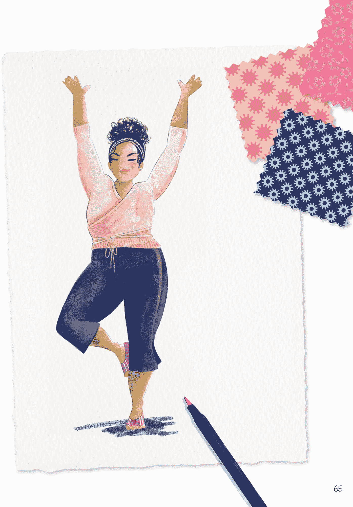

这是一幅更紧凑、传统的绘画，使用铅笔起稿，随后用水彩和彩色铅笔完成。画面干净，细节清晰可见。

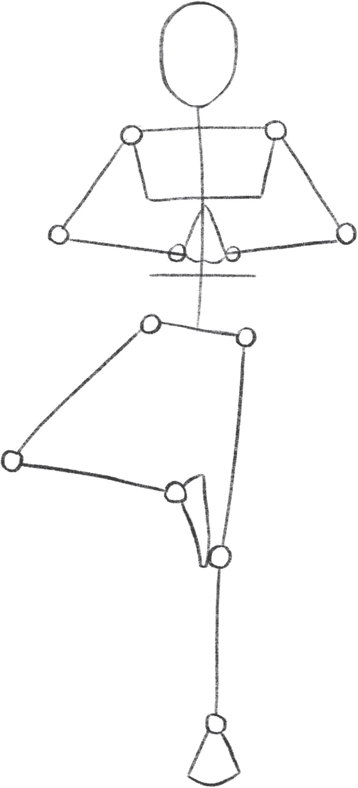

1
勾画出所需姿势的基础棍棒人形。

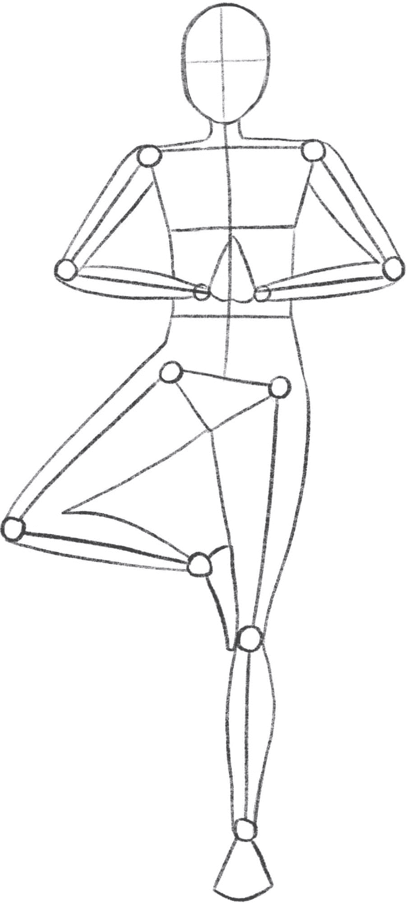

2
继续如前所述填充形体。

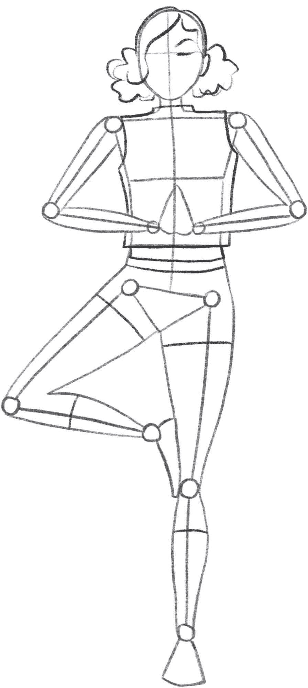

3
为人物添加基础服装形状。想象这个人穿着这些衣服。他们的发型会是什么样？在本步骤中确定这些细节。

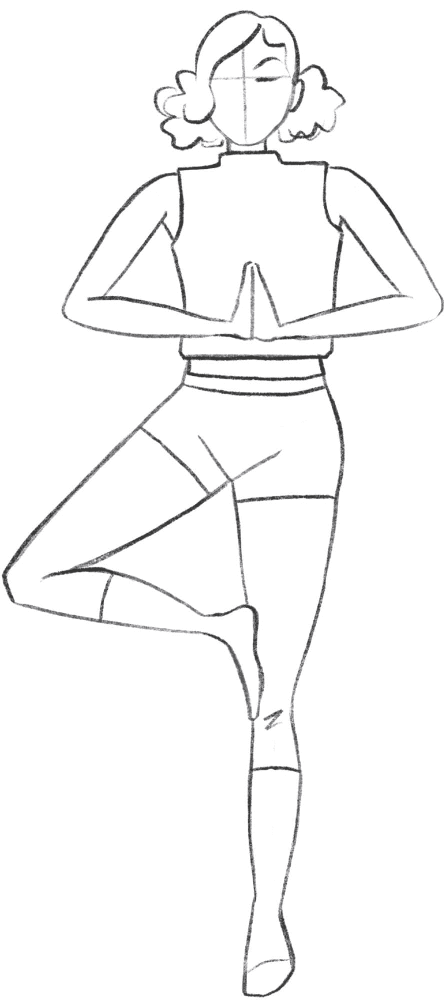

4
清理你的草图！

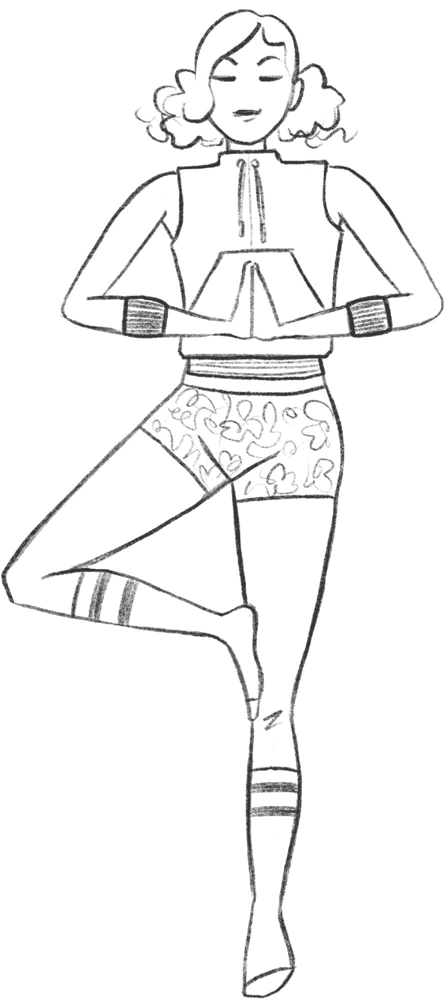

5
添加能让你的服装脱颖而出的细节。作为设计师，你的任务是在你创作的每件物品上体现独特的个人观点。确保你的设计反映出你是谁——这正是让它们脱颖而出的原因。

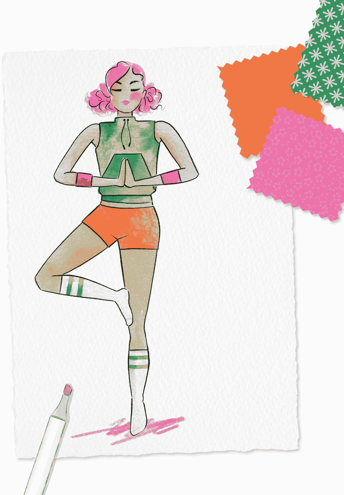

对于这幅最终插图，干净的草图被放在灯箱上，上面覆盖水彩纸。水彩以水洼的形式涂抹，随后用彩色铅笔绘制短裤上的图案。细细的黑色墨水轮廓为整体增色。

## 休闲氛围

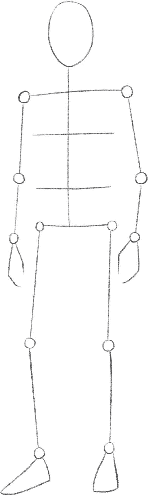

1
从休闲姿势开始。为头部画一个椭圆，肩线，以及显示松弛姿态的棍棒状四肢。

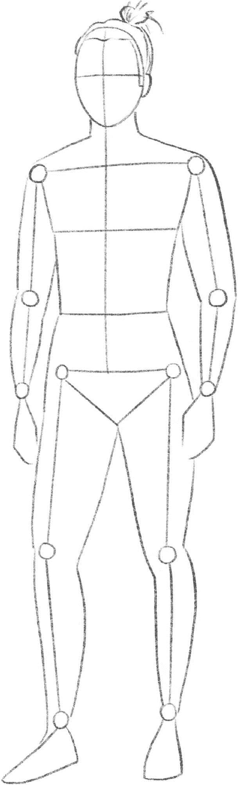

2
用适合你设计的体型填充形体。

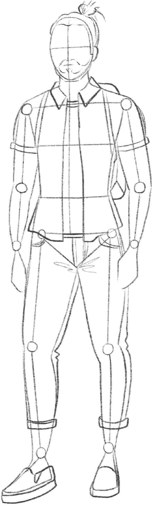

3
开始勾勒服装轮廓。一件休闲 T 恤搭配短袖衬衫、卷起的紧身牛仔裤和便鞋，时尚感十足。几笔淡淡的铅笔线条暗示了一些胡须。

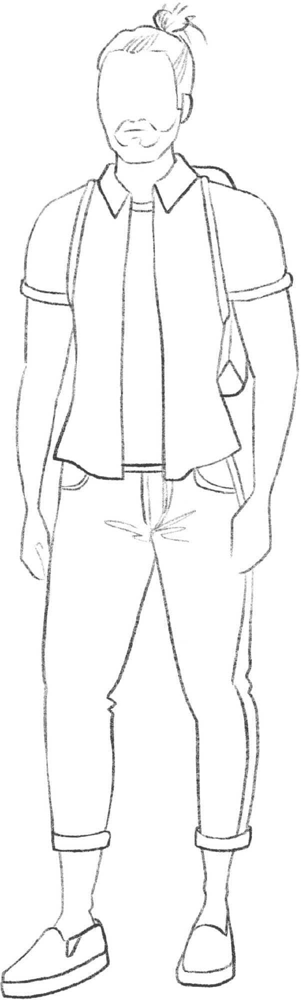

4
擦除不需要的铅笔线条以清理草图。

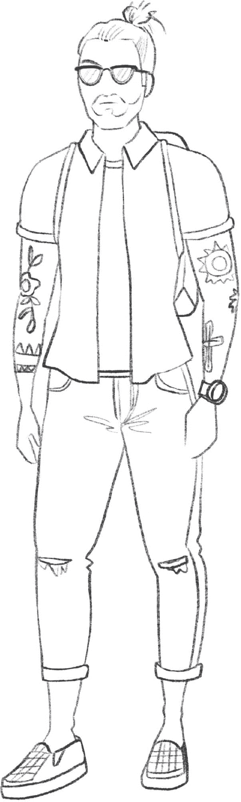

5
尽情添加细节和配饰，享受乐趣。这位潮人背着背包，戴着太阳镜、厚重手表，穿着棋盘格运动鞋，还有一些纹身。几条编织手链，让这个家伙真正体现了“潮”这个词。

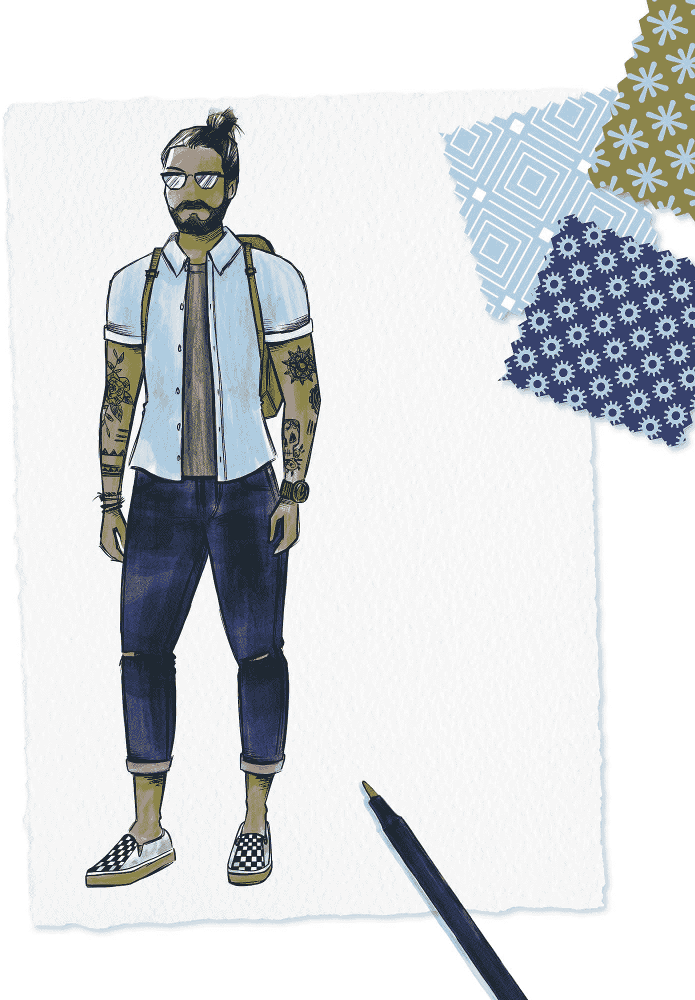

最终插图具有休闲、艺术化的风格，与该设计的都市氛围相呼应。让你的想象力自由驰骋，并请你的缪斯来影响这里未体现的其他创意。

## 冲浪与沙滩

1
这位冲浪者似乎渴望动起来，头发在风中飘扬。从所需姿势的棍棒人形开始。

2
为人物增加重量感。这个姿势是侧脸，因此勾勒下巴有助于确定比例。快速草绘凌乱的波浪状头发，并画一条水平线表示眼睛位置。

3
继续构建形体，体现你选择的时尚。比基尼底裤搭配收腰防晒衣是经典组合。

4
擦除不必要的草图线条和标记。

5
现在让它成为你的专属！在上衣正面添加大胆的图案，并在袖子上加一条条纹。松散的海滩风辫子、脚踝饰品和图案冲浪板让整体造型完整。

使用松散的水彩渲染和笔触为这个有趣而清新的设计上色。

## 深夜时分

1
模特姿势与你设计的时尚基调和主题相符非常重要。这套夜店服装是对称的，模特正面站立、肩膀方正时会显得格外醒目。

2
填充形体并添加几笔铅笔线条，指示与服装相匹配的发型。

勾勒服装的结构轮廓。上衣包括薄纱叠层和宽松袖子。裙子在裙摆处有交叉设计。添加高跟绑带凉鞋，打造有趣、时尚的造型。

4
通过擦除旧草图线条来清理你的插图。为这个夜晚造型暗示一个大胆的唇色。

5
添加几个最后的细节。记住简单形状往往自成一格，不需要太多繁琐的装饰。在这种情况下，裙子上的褶皱臀部、厚重耳环和包，以及鞋上的脚踝带就足够了。

虽然这套服装可以用多种颜色呈现，但黑色增添了醒目、高对比度的魅力，与薄纱风格相得益彰。戏剧性的黑色服装也非常适合在其他地方点缀色彩。这位模特展示了彩色渐变发色，以及与之相配的金色手拿包、耳环和鞋子。这绝对是一个引人注目的造型，适合一夜狂欢和尽情舞蹈！

## 摇滚

1
从棍棒人形开始，尝试与该设计相匹配的姿势。如果你喜欢，可以参考一张展示该造型强势姿势的照片。

2
填充形体，并画上简单的眼睛、嘴唇和头发的涂鸦。

3
使用简单线条绘制服装，体现形状、体积、裙摆和层次。紧身项圈是这一时尚宣言的重要部分，因此在本步骤中加入它——或添加任何你喜欢的其他配饰。

4
擦除任何多余线条和结构线。

5
现在添加摇滚细节来展现你的风格！在牛仔裤上添加破洞，为鞋子添加钉饰鞋带，穿上渔网袜，并搭配一件图案背心。

使用马克笔或其他你喜欢的工具添加大胆、图形化的色彩。紫色头发、黑色西装夹克和李子色牛仔裤恰到好处。

## 在雪坡上

1
从一个建立良好比例和平衡姿势的棍棒人形开始。

2
构建形体，然后在头部添加垂直中心线和水平视线。

3
是时候设计滑雪服了！这幅插图展示了复古风格的两件套轮廓，配有仿毛皮装饰靴子和毛球针织帽。别忘了护目镜或时尚太阳镜，它们是成品造型的重要部分。

4
擦除任何不必要的铅笔线条。检查你的作品并不断完善形状和比例，直到得到一幅干净的画作。

5
这套滑雪服包括一件 70 年代风格条纹的短款羽绒夹克和配套滑雪裤。添加配套手套、腰部罗纹装饰、抓绒上的拉链以及一些滑雪板，使其更具真实感。

阴影在纸上传达你的设计方面起着重要作用。如果没有每条接缝线的阴影，这件羽绒夹克看起来就像只是有条纹。注意高光区域如何向前突出，而暗部则后退。瞬间蓬松！罗纹针织帽和腰带也受益于深色阴影与浅色的对比。最后，注意夹克如何在裤子和抓绒上投下阴影。利用这种简单技巧让你的设计看起来更逼真。

## 都市混搭

1
使用基本线条和每个关节处的圆圈勾勒这个姿势。

2

构建人物形象。按照你的喜好绘制四肢。

3

勾勒出设计的结构。在本例中，它是一件合身的夹克搭配休闲衬衫和及踝休闲裤。

4

使用可塑橡皮擦清理旧的草图线条。细化剩余的线条和曲线，确保你对比例满意。

5

尽情享受细节！添加条纹、波点、袖口处的夹克衬里，以及鞋面上的时尚设计。别忘了像口袋和闭合件这样的功能性细节。

将最终草图转化为全彩设计是你将自己的美学和独特视角注入艺术的机会。在本例中，氛围是奇思妙想且古怪的。使用细黑墨线增加个性，并用大胆色调的水彩营造质感和趣味。这种时尚是为个性十足的人准备的，因此绘画风格充满活力。

### Tennis Pro

1

首先画一个稳健的站姿。用简单的水平线堆叠肩膀、胸部、腰部和臀部。从那里开始，在每个关节处加上圆形，并为手脚添加简单形状。

2

开始为人物增加体积，注意这位运动员强壮结实的四肢和宽阔的肩膀。在脸上添加中线和视线。

3

设计服装！即使是像网球裙或其他运动服这样简单的单品，你也可以让创意自由流淌。不对称的裙摆和单肩设计搭配撞色，看起来自信而有能力。束起的发型适合运动，运动鞋必不可少。

4

擦除旧的草图线条并细化绘画，直到它平衡得当。

5

添加小细节，如条纹、缝线、一条手臂上的配套护腕，以及获胜的袜子。网球拍完成了整体造型！

对于这种大胆、强劲、不拖泥带水的设计，选择干净、图形化的插画风格是合理的。在本例中，最终作品是在平板上数字绘制的。醒目的平面色彩被添加到干净的黑线稿上。这种技巧与时尚的感觉相契合。

### Boho Chic

1

画一个符合设计想法的姿势的人物。在本例中，无忧无虑的姿势非常适合自由奔放的音乐节参与者。

2

通过勾勒结构填充木棍人形。根据体型创建曲线，并在脸上添加中线和视线。

3

设计衣服！添加简单轮廓以显示服装中每件单品的形状。对于这位音乐节时尚达人来说，这是一套奇思妙想的组合，包括吊带上衣、破洞牛仔裤、一件系在上方的薄纱裹裙，以及松垮的麂皮质感靴子。

4

擦除结构线以获得设计的干净版本。

5

装饰并添加细节！这套服装是多多益善、充满乐趣的。在靴子上添加珠饰，并在裙子上添加有趣的花卉图案。勾勒出雏菊链发带、飞行员墨镜，以及系在一臂上的印花围巾。长编织双马尾完成了这一造型。

这位波西米亚美女值得一种与她个性相匹配的插画风格。用焦赭色铅笔勾勒人物轮廓增添了泥土般的效果。使用遮盖液“绘制”裙子上的花卉图案。接下来，添加半透明的水彩渲染，使裙子具有浪漫、空灵的感觉。待颜料干后，轻轻擦去遮盖液，露出“花朵”空隙，然后可以用鲜艳的红粉色填充。添加一些淡色的背景细节，为人物营造出空间感——这是设计师常用的艺术技巧。

[*OceanofPDF.com*](https://oceanofpdf.com)
