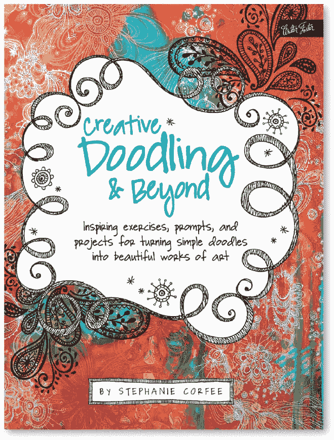

# 关于艺术家
关于艺术家

**Stephanie Corfee** is an artist, designer, and author who works from her home studio in Malvern, Pennsylvania.
**Stephanie Corfee** 是一位艺术家、设计师和作者，在宾夕法尼亚州马尔文的家庭工作室工作。She and her husband have three sons, plus one brand-new baby girl.
她和丈夫有三个儿子，外加一个刚出生的小女儿。Stephanie has written and illustrated several art books and a coloring book, and she licenses her paintings and surface designs for gifts, apparel, and home accessories.
Stephanie 写过并插画了多本艺术书和一本涂色书，并将她的绘画和表面设计授权用于礼品、服装和家居饰品。Stephanie also teaches online classes available on her website, as well as on Skillshare.com.
Stephanie 还在她的网站以及 on Skillshare.com 上教授在线课程。“The most rewarding part of my job is hearing from students or customers who have used my books. When they tell me they feel encouraged and inspired to create, it makes my whole day.”
“我工作中最有回报的部分是听到使用过我书籍的学生或顾客的声音。当他们告诉我他们感到受到鼓励和启发去创作时，我整天都会感到开心。”Learn more at [www.stephaniecorfee.com](http://www.stephaniecorfee.com).
了解更多请访问 [www.stephaniecorfee.com](http://www.stephaniecorfee.com)。

## 作者的其他作品
本艺术家其他作品

978-1-60058-229-5

978-1-60058-247-9

**Visit [www.QuartoKnows.com](http://www.quartoknows.com)**
**访问 [www.QuartoKnows.com](http://www.quartoknows.com)**

[*OceanofPDF.com*](https://oceanofpdf.com)

© 2020 Quarto Publishing Group USA Inc.

Artwork and text © 2020 Stephanie Corfee

First published in 2020 by Walter Foster Publishing, an imprint of The Quarto Group.
首次于 2020 年由 Walter Foster Publishing 出版，该出版社为 The Quarto Group 的印记。

26391 Crown Valley Parkway, Suite 220, Mission Viejo, CA 92691, USA.

**T** (949) 380-7510 **F** (949) 380-7575 **[www.QuartoKnows.com](http://www.quartoknows.com)**

All rights reserved. No part of this book may be reproduced in any form without written permission of the copyright owners.
版权所有。未经版权所有者书面许可，本书的任何部分不得以任何形式复制。All images in this book have been reproduced with the knowledge and prior consent of the artists concerned, and no responsibility is accepted by producer, publisher, or printer for any infringement of copyright or otherwise, arising from the contents of this publication.
本书中的所有图像均在相关艺术家的知情和事先同意下复制，制作方、出版方或印刷方对因本出版物内容而产生的任何版权或其他侵权行为不承担责任。Every effort has been made to ensure that credits accurately comply with information supplied.
已尽一切努力确保署名准确符合所提供的信息。We apologize for any inaccuracies that may have occurred and will resolve inaccurate or missing information in a subsequent reprinting of the book.
对于可能出现的任何不准确之处，我们深表歉意，并在本书后续再版时解决不准确或缺失的信息。

Walter Foster Publishing 的图书也可为零售、批发、促销和批量采购提供折扣。详情请联系特价销售经理，电子邮件为 specialsales@quarto.com，或邮寄至 The Quarto Group，收件人：特价销售经理，100 Cummings Center, Suite 265D, Beverly, MA 01915, USA。

数字版：978-1-63322-829-0

平装版：978-1-63322-828-3

数字版于 2020 年出版

[*OceanofPDF.com*](https://oceanofpdf.com)
