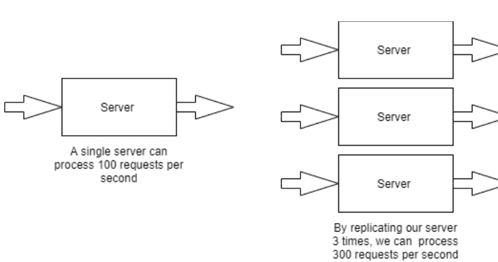
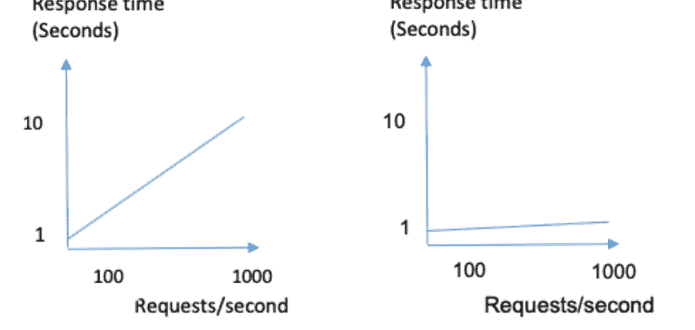

## 第 1 章. 可扩展系统简介

### 早期发布读者的说明

使用 Early Release 电子书，您可以在这些书籍正式发布之前很久就获得书籍的最早形式——作者在写作时的原始未编辑内容——从而能够利用这些技术。

这将是最终书籍的第 1 章。

如果您对如何改进本书的内容和/或示例有任何意见，或者如果您注意到本章中缺少材料，请联系编辑 vwilson@oreilly.com。

过去 20 年见证了软件系统规模、复杂性和容量的前所未有的增长。这种增长速度在未来 20 年不太可能放缓——这些未来系统会是什么样子现在几乎难以想象。我们唯一可以保证的是，越来越多的软件系统需要在不断增长——更多请求、更多数据、更多分析——作为主要设计驱动因素的情况下构建。

*可扩展* 是软件工程中用来描述能够适应增长的软件系统的术语。在本章中，我将探讨可扩展性所指的精确含义——不出所料，被称为可扩展性。我还将描述一些例子，用硬数字说明当代应用的能力和特征，并简要回顾我们今天常规构建的庞大系统的起源。最后，我将描述实现可扩展性的两个一般原则，即复制和优化，它们将在本书其余部分以各种形式反复出现，并审视可扩展性与其他软件架构质量属性之间不可磨灭的联系。

### 什么是可扩展性？

直观上，可扩展性是一个相当直接的概念。如果我们向维基百科询问定义，它告诉我们“可扩展性是系统通过向系统添加资源来处理日益增长的工作量的属性。”我们都知道如何扩展高速公路系统——我们增加更多车道，以便它能处理更多车辆。我最喜欢的一些人知道如何扩展啤酒生产——他们通过增加酿造容器的数量和尺寸、执行和管理酿造过程的员工数量，以及可以装满美味新鲜啤酒的桶数来增加产能。想想任何物理系统——交通系统、机场、建筑物中的电梯——以及我们如何增加容量是相当明显的。

与物理系统不同，软件系统是有些模糊的。它们不是你可以指着、看到、触摸、感受的东西，从外部观察就能感觉到其内部行为。它是一个数字制品。其核心，构成可执行代码和数据的 1 和 0 的流，对任何人来说都很难区分。那么，可扩展性在软件系统方面意味着什么？

非常简单地说，并且不陷入定义之争，可扩展性定义了软件系统处理其操作某维度增长的能力。操作维度的例子是：

- 系统可以处理的并发用户或外部（例如传感器）请求的数量
- 系统可以有效处理和管理的數據量
- 可以从系统存储的数据中获得的价值
- 随着请求负载增长，保持稳定、一致响应时间的能力

例如，想象一家大型超市连锁店正在迅速开设新店，并在每家店增加自助结账亭的数量。这要求核心超市软件系统：

- 处理来自商品扫描的增加的流量，而不会降低响应时间。对商品扫描的即时响应对于保持客户满意是必要的。
- 处理和存储来自销售增加产生的大量数据。这些数据对于库存管理、会计、规划以及可能许多其他功能都是必需的。
- 从每家商店、地区和国家/地区导出“实时”（例如每小时）销售数据汇总并与历史趋势进行比较。这种趋势数据可以帮助突出地区中的异常事件（例如意外的天气条件、活动中的大量人群等），并帮助受影响的商店快速响应。
- 随着商店和客户数量的增长，使库存订购预测子系统能够正确预测销售（从而需要重新订购库存）

这些维度有效地是系统的可扩展性需求。如果在一年内，超市连锁店开设了 100 家新店，销售额增长了 400 倍（其中一些新店很大！），那么软件系统需要扩展以提供必要的处理能力，使超市能够高效运营。如果系统无法扩展，我们可能会因客户不满意而失去销售。我们可能会持有不会很快售出的库存，增加成本。我们可能会错过通过对当地情况做出特别优惠来增加销售的机会。所有这些都会降低客户满意度和利润。对业务来说都不是好事。

因此，成功扩展对于我们想象中的超市的业务增长至关重要，同样也是许多现代互联网应用的生命线。但对于大多数企业和政府系统而言，可扩展性在开发和部署的早期阶段并不是主要的质量要求。增强可用性和实用性的新功能成为我们开发周期的驱动因素。只要在正常负载下性能足够，我们就会继续添加面向用户的功能以增强系统的业务价值。事实上，在没有明确需求的情况下引入我将在本书中描述的一些复杂的分布式技术实际上会阻碍项目，额外的复杂性会导致开发停滞。

尽管如此，系统演进到增强性能和可扩展性变得紧迫，甚至关乎生存的状态并不少见。吸引人的特性和高实用性带来成功，这会带来更多需要处理的请求和更多需要管理的数据。这通常预示着一个转折点，在轻负载下合理的设计决策现在突然成为技术债务。外部触发事件通常会造成这些转折点——查看 2020 年 3 月/4 月的媒体，就可以看到许多关于政府失业和超市在线订购网站因冠状病毒大流行造成的需求而崩溃的报道。

通过增加资源在某个维度上增加系统的容量称为 *扩展* 或 *扩展*——我稍后会探讨这两者之间的区别。此外，与物理系统不同，能够 *缩小* 系统的容量以降低成本往往同样重要。

这一经典例子是 Netflix，它需要处理可预测的区域昼夜负载。简单地说，任何地理区域在晚上 9 点观看 Netflix 的人比凌晨 5 点多得多。这使 Netflix 能够在负载较低时减少其处理资源。这节省了在 Amazon 云中运行处理节点的成本，以及社会上有价值的事情，例如减少数据中心电力消耗。将此与高速公路相比。夜间路上车辆很少时，我们不会收回车道（除维修外）。完整的道路容量可供少数司机随意快速行驶。在软件系统中，我们可以在几秒钟内扩展和收缩处理容量以满足即时负载。与物理系统相比，我们部署的策略非常、非常不同。

关于软件系统中的可扩展性，还有很多需要考虑的问题，但在审视了大约2021年的一些当代软件系统的规模之后，我们再回到这些问题。

### 2020年代初期系统规模：示例

在技术竞赛中预测未来总是充满风险。2008年我写道 [1]：

> 对于数据密集型应用而言，PB级数据集和Gb级数据流是当今的前沿，无疑10年后我们会怀念这个规模的问题，并为即将到来的 exascale 应用带来的困难而担忧。

这种说法是合理的，但 exascale？在今天的世界里，这几乎已是司空见惯。Google 在2014年报告了多个 exabytes 的 Gmail，到现在，所有 Google 服务是否管理着一 yottabyte 或更多？我不知道。我甚至不确定我知道 yottabyte 是什么！Google 不会告诉我们他们的存储情况，但我不会对此打赌。同样，Amazon 在各种 AWS 数据存储中为其客户存储了多少数据。以及比如说，DynamoDB 每秒总共为所有客户端应用处理多少请求？多想想这些事情，你的头就会炸掉。

一个有时能提供当代运营规模见解的绝佳信息来源是主要互联网公司的技术博客。还有分析互联网流量的网站，能很好地说明流量量级。让我们举几个“特定时间点”的例子来说明我们今天确实知道的一些事情。请记住，这些在一年或四年后看起来几乎会显得过时。

- Facebook 的工程博客描述了 Scribe，这是他们用于收集、聚合和传输每小时 PB 级日志数据的解决方案，具有低延迟和高吞吐量。Facebook 的计算基础设施由数百万台机器组成，每台机器都会生成记录系统和应用健康相关重要事件的日志文件。处理这些日志文件，例如来自 Web 服务器，可以为开发团队提供对其应用行为和性能的洞察，并支持故障查找。Scribe 是一种定制的缓冲队列解决方案，可以以每秒数 TB 的速率从服务器传输日志，并将它们传递给下游分析和数据仓库系统。那，我的朋友们，这就是大量的数据！
- 你可以在 www.internetlivestats.com 查看众多服务的实时互联网流量。深入挖掘，你会发现诸如 Google 每天处理约 35 亿次搜索请求，Instagram 每天上传约 6500 万张照片，以及大约有 17 亿个网站等统计数据。这是一个有趣的网站，充满了让你惊叹的信息。请注意数据并非真正“实时”，只是基于对多个数据源的统计分析得出的估计。
- 2016年 Google 发表了一篇描述其代码库特征的论文。其中报告的众多惊人事实之一是：“该仓库包含 86TB 的数据，包括大约二十亿行代码，分布在九百万个唯一的源文件中。”请记住，这是2016年。

尽管如此，关于主要互联网网站提供的服务的规模的真实、具体数据仍然笼罩在商业机密的保密之中。幸运的是，我们可以通过一家科技公司的年度使用报告深入了解互联网规模的请求和数据量。你可以浏览他们从2019年开始的极其详细的统计数据。这是对大规模系统能力的迷人一瞥。注意，这可是 Pornhub.com。¹

### 我们是如何走到今天的？系统增长简史

我相信许多读者会难以相信没有互联网搜索、YouTube 和社交媒体也能有文明生活。事实上，YouTube 的第一个视频上传发生在2005年。是的，即使我也很难相信。所以，让我们简要回顾一下我们是如何达到今天系统规模的。以下是一些值得注意的历史里程碑：

#### 1980年代

一个由分时大型机和小型机主导的时代。PC 在1980年代初期出现，但很少联网。到1980年代末，开发实验室、大学以及日益增多的企业拥有了电子邮件和对原始互联网资源的访问。

#### 1990-95

网络变得更加普及，为万维网（WWW）的创建创造了环境，WWW 使用在1980年代由 Tim Berners-Lee 在 CERN 开创的 HTTP/HTML 技术。到1995年，网站数量很少，但未来的种子已经播下，1994年的 Yahoo! 以及1995年的 Amazon 和 eBay 就是例子

#### 1996-2000

网站数量从大约 10,000 个增长到 1000 万个，这是一个真正爆炸性的增长期。网络带宽和访问也迅速增长。像 Amazon、eBay、Google、Yahoo! 等公司正在开创我们今天所知和使用的大量可扩展系统的高级技术的设计原则和早期版本。日常企业纷纷涌入利用电子商务带来的新机会，这使得系统可扩展性变得突出，如侧边栏所述。

#### 2000-2006

在此期间，网站数量从大约 1000 万增长到 8000 万，并出现了新的服务和商业模式。2005年，YouTube 推出。2006年，Facebook 对公众开放。同年，Amazon Web Services 在2004年低调起步后重新推出其 S3 和 EC2 服务。

#### 2007-至今

我们现在生活在一个大约有 20 亿个网站的世界，其中约 20% 处于活跃状态。互联网用户大约有 40 亿。由 AWS、GCP 和 Azure 等公共云运营商运营的庞大数据中心，以及 Twitter 运营基础设施等无数私有数据中心，散布在地球各地。云托管着数百万个应用，工程师使用复杂的云管理门户来配置和运营他们的计算和数据存储系统。强大的云服务使我们能够用鼠标的几次点击就能构建、部署和扩展我们的系统。您所要做的就是月底支付云服务提供商的账单。

这就是本书所针对的世界。一个我们的应用需要利用构建可扩展系统的关键原则并利用高度可扩展的基础设施平台的世界。请记住，在现代应用中，大部分执行的代码并非由您的组织编写。它是容器、数据库、消息系统和其他组件的一部分，这些组件通过 API 调用和构建指令组合成您的应用。这使得这些组件的选择和使用至少与您自己的业务逻辑的设计和开发一样重要。它们是难以更改的架构决策。

### 规模如何影响业务系统

1990年代互联网用户的激增为企业带来了新的在线盈利机会。企业纷纷涌向通过 Web 浏览器向用户公开业务功能——销售、服务——这标志着我们构建系统的方式发生了深刻变化。

以零售银行为例。在提供在线服务之前，可以准确预测银行业务系统将承受的负载。您知道银行有多少员工使用内部系统，有多少终端/PC 连接到银行网络，您需要支持多少台 ATM，以及与其他金融机构的连接数量和性质。凭借这些知识，我们可以构建支持例如最多 3000 个并发用户的系统，并且确信这个数字不会被超过。增长也会相对缓慢，而且大部分时间（例如非营业时间）负载会远低于峰值。这使得我们的软件设计决策和硬件配置变得容易得多。

现在想象我们的零售银行决定让所有客户都可以使用网上银行服务。而银行有 500 万客户。我们现在的最高负载是多少？负载在工作日如何分散？高峰期是什么时候？如果我们开展限时促销活动来尝试吸引新客户会怎样？我们相对简单且受限的业务系统环境突然被互联网用户群体带来的更高平均负载和峰值负载以及不可预测性所破坏。

### 可扩展性基本设计原则

扩展系统的基本目标是在某个应用特定维度上提高其容量。常见维度是增加

number of requests that a system can process in a given time period. This is known as the system’s throughput. Let’s use an analogy to explore two basic principles we have available to us for scaling our systems and increasing throughput: replication and optimization.

In 1932, one of the world’s great icons, the Sydney Harbor Bridge, was opened. Now it is a fairly safe assumption that traffic volumes in 2021 are somewhat higher than in 1932. If by any chance you have driven over the bridge at peak hour in the last 30 years, then you know that its capacity is exceeded considerably every day. So how do we increase throughput on physical infrastructures such as bridges?

This issue became very prominent in Sydney in the 1980s, when it was realized that the capacity of the harbor crossing had to be increased. The solution was the rather less iconic Sydney Harbor tunnel, which essentially follows the same route underneath the harbor. This provides 4 more lanes of traffic, and hence added roughly 1/3rd more capacity to harbor crossings. In not too far away Auckland, their harbor bridge also had a capacity problem as it was built in 1959 with only 4 lanes. In essence, they adopted the same solution as Sydney, namely, to increase capacity. But rather than build a tunnel, they ingeniously doubled the number of lanes by expanding the bridge with the hilariously named 'Nippon Clipons', which widened the bridge on each side.

These examples illustrate the first strategy we have in software systems to increase capacity. We basically replicate the software processing resources to provide more capacity to handle requests and thus increase throughput, as shown in Figure 1-1. These replicated processing resources are analogous to the traffic lanes on bridges, providing a mostly independent processing pathway for a stream of arriving requests. Luckily, in cloud-based software systems, replication can be achieved at the click of a mouse, and we can effectively replicate our processing resources thousands of times. We have it a lot easier than bridge builders in that respect. Still, we need to take care to replicate resources in order to alleviate bottlenecks, otherwise our resources will simply cause needless costs and give no scalability benefit.

Figure 1-1. Increasing Capacity through Replication

The second strategy for scalability can also be illustrated with our bridge example. In Sydney, some observant person realized that in the mornings a lot more vehicles cross the bridge from north to south, and in the afternoon we see the reverse pattern. A smart solution was therefore devised – allocate more of the lanes to the high demand direction in the morning, and sometime in the afternoon, switch this around. This effectively increased the capacity of the bridge without allocating any new resources – we optimized the resources we already had available.

We can follow this same approach in software to scale our systems. If we can somehow optimize our processing, by maybe using more efficient algorithms, adding extra indexes in our databases to speed up queries, or even rewriting our server in a faster programming language, we can increase our capacity without increasing our resources. The canonical example of this is Facebook’s creation of (the now discontinued) HipHop for PHP, which increased the speed of Facebook’s web page generation by up to 6 times by compiling PHP code to C++.

I’ll revisit these two design principles – namely replication and optimization - many times in the remainder of this book. You will see that there are many complex implications of adopting these principles that arise from the fact that we are building distributed systems. Distributed systems have properties that make building scalable systems ‘interesting’, where interesting in this context has both positive and negative connotations.

### Scalability and Costs

Let’s take a trivial hypothetical example to examine the relationship between scalability and costs. Assume we have a Web-based (e.g. web server and database) system that can service a load of 100 concurrent requests with a mean response time of 1 second. We get a business requirement to scale up this system to handle 1000 concurrent requests with the same response time. Without making any changes, a simple load test of this system reveals the performance shown in Figure 1-2 (left). As the request load increases, we see the mean response time steadily grow to 10 seconds with the projected load. Clearly this does not satisfy our requirements in its current deployment configuration. The system doesn’t scale.

Figure 1-2. Scaling an application. (Left) – non-scalable performance. (Right) – scalable performance

Clearly some engineering effort is needed in order to achieve the required performance. Figure 1-2 (right) shows the system’s performance after this effort has been modified. It now provides the specified response time with 1000 concurrent requests. Hence, we have successfully scaled the system. Party time!

A major question looms however. Namely, how much effort and resources were required to achieve this performance? Perhaps it was simply a case of

running the Web server on a more powerful (virtual) machine. Performing such reprovisioning on a cloud might take 30 minutes at most. Slightly more complex would be reconfiguring the system to run multiple instances of the Web server to increase capacity. Again, this should be a simple, low-cost configuration change for the application, with no code changes needed. These would be excellent outcomes.

However, scaling a system isn’t always so easy. The reasons for this are many and varied, but here’s some possibilities:

- 1. The database becomes less responsive with 1000 requests per second, requiring an upgrade to a new machine
- 2. The Web server generates a lot of content dynamically and this reduces response time under load. A possible solution is to alter the code to more efficiently generate the content, thus reducing processing time per request.
- 3. The request load creates hot spots in the database when many requests try to access and update the same records simultaneously. This requires a schema redesign and subsequent reloading of the database, as well as code changes to the data access layer.
- 4. The Web server framework that was selected emphasized ease of development over scalability. The model it enforces means that the code simply cannot be scaled to meet the request load requirements, and a complete rewrite is required. Use another framework? Use another programming language even?

There’s a myriad of other potential causes, but hopefully these illustrate the increasing effort that might be required as we move from possibility (1) to possibility (4).

Now let’s assume option (1), upgrading the database server, requires 15 hours of effort and a thousand dollars extra cloud costs per month for a more powerful server. This is not prohibitively expensive. And let’s assume option (4), a rewrite of the Web application layer, requires 10,000 hours of development due to implementing in a new language (e.g. Java instead of

Ruby). Options (2) and (3) fall somewhere in between options (1) and (4). The cost of 10,000 hours of development is seriously significant. Even worse, while the development is underway, the application may be losing market share and hence money due to its inability to satisfy client requests loads. These kinds of situations can cause systems and businesses to fail.

This simple scenario illustrates how the dimensions of resource and effort costs are inextricably tied to scalability. If a system is not designed intrinsically to scale, then the downstream costs and resources of increasing its capacity to meet requirements may be massive. For some applications, such as Healthcare.gov, these (more than $2 billion) costs are borne and the system is modified to eventually meet business needs. For others, such as Oregon’s health care exchange, an inability to scale rapidly at low cost can be an expensive ($303 million) death knell.

We would never expect someone would attempt to scale up the capacity of a suburban home to become a 50 floor office building. The home doesn’t have the architecture, materials and foundations for this to be even a remote possibility without being completely demolished and rebuilt. Similarly, we shouldn’t expect software systems that do not employ scalable architectures, mechanisms and technologies to be quickly evolved to meet greater capacity needs. The foundations of scale need to be built in from the beginning, with the recognition that the components will evolve over time. By employing design and development principles that promote scalability, we can more rapidly and cheaply scale up systems to meet rapidly growing demands. I’ll explain these principles in Part 2 of this book.

Software systems that can be scaled exponentially while costs grow linearly are known as hyperscale systems, defined as:

> Hyper scalable systems exhibit exponential growth in computational and storage capabilities while exhibiting linear growth rates in the costs of resources required to build, operate, support and evolve the required software and hardware resources.

You can read more about hyperscale systems in this article [3].

### 可扩展性与架构权衡

可扩展性只是众多质量属性或非功能性需求中的一个，而这些正是软件架构学科的通用语言。软件架构持久的复杂性之一在于必须进行质量属性权衡。基本上，偏向某一质量属性的设计可能会对其他属性产生负面或正面的影响。例如，我们可能希望在服务中发生某些事件时写入日志消息，以便进行取证和支持代码调试。然而，我们必须小心捕获的事件数量，因为日志会带来开销并负面影响性能。

经验丰富的软件架构师不断在微妙的界线上行走，精心设计以满足优先级高的质量属性，同时尽量减少对其他质量属性的负面影响。

可扩展性也不例外。当我们将聚光灯对准系统扩展能力时，我们必须仔细考虑我们的设计如何影响其他非常期望的属性，例如性能、可用性、安全性和经常被忽视的可管理性。我将在下面简要讨论其中一些固有的权衡。

#### 性能

思考性能与可扩展性之间的差异有一个简单的方法。当我们针对性能时，我们尝试满足单个请求的期望指标。这可能是平均响应时间小于 2 秒，或最坏情况的性能目标，例如 99 分位响应时间小于 3 秒。

总体而言，改进性能对可扩展性是有利的。如果我们改进单个请求的性能，我们就在系统中创造了更多容量，这有助于可扩展性，因为我们可以使用未使用的容量来处理更多请求。

然而，这并不总是那么简单。我们可以通过多种方式减少响应时间。我们可能会仔细优化代码，例如
删除不必要的对象复制，使用更快的 JSON 序列化库，甚至完全用更快的编程语言重写代码。这些方法在不增加资源使用量的情况下优化了性能。

另一种方法可能是通过将常用访问的状态保存在内存中而不是每次请求都写入数据库来优化单个请求。消除一次数据库访问几乎总是会加快速度。然而，如果我们的系统在较长时间内在内存中维护大量状态，我们可能必须（并且在负载很重的系统下将会）仔细管理系统可以处理的请求数量。这可能会降低可扩展性，因为我们针对单个请求的优化方法使用了比原始解决方案更多的资源（在本例中为内存），从而降低了系统容量。

我们将在本书中不断看到性能与可扩展性之间的这种紧张关系。事实上，有时明智的做法是让单个请求稍微变慢一些，以便我们能够利用额外的系统容量。当我在下一章讨论负载均衡时，我将描述一个很好的例子。

#### 可用性

总体而言，可用性和可扩展性是高度兼容的伙伴。当我们通过复制资源来扩展系统时，我们创建了可以用于处理任何用户请求的服务的多个实例。如果我们的一个实例失败，其他实例仍然可用。系统只是由于失败的、不可用的资源而容量降低。对网络链路、网络路由器、磁盘以及计算系统中几乎任何资源的复制也适用类似的思考。

当涉及状态时，可扩展性和可用性开始变得复杂。想想数据库。如果我们的单个数据库服务器过载，我们可以复制它并将请求发送到任一实例。这也提高了可用性，因为我们可以容忍一个实例的故障。如果我们的数据库是只读的，这种方案效果很好。但是一旦我们
更新一个实例，我们就必须以某种方式弄清楚如何以及何时更新另一个实例。这就是副本一致性问题抬头的地方。

事实上，每当为可扩展性和可用性复制状态时，我们都必须处理一致性。当我在本书第 3 部分讨论分布式数据库时，这将是一个主要话题。

### 安全

安全是一个复杂且高度技术性的主题，值得一本书来专门讨论。没有人想使用不安全的系统，而被黑客攻击并泄露用户数据的系统会导致首席技术官辞职，在极端情况下会导致公司倒闭。

安全系统的基本要素是身份验证、授权和完整性。我们需要确保数据在网络传输过程中无法被拦截，并且静态数据（持久存储）无法被没有权限访问该数据的人访问。基本上我不希望任何人看到我的信用卡号码在系统之间通信时或存储在公司数据库中。

因此，安全是任何面向互联网系统的必要质量属性。构建安全系统的成本无法避免，所以让我们简要检查这些成本如何影响性能和可扩展性。

在网络层，系统通常利用传输层安全²（TLS）协议，该协议运行在 TCP/IP 之上（参见第 3 章）。TLS 使用非对称加密³提供加密、身份验证和完整性。建立安全连接会带来性能成本，因为双方需要生成和交换密钥。TLS 连接建立还包括交换证书以验证服务器（以及可选客户端）的身份，并选择算法来检查数据在传输过程中未被篡改。一旦连接建立，飞行中的数据使用对称加密进行加密，其性能惩罚可以忽略不计，因为现代 CPU 具有专用加密硬件。

连接建立通常需要在客户端和服务器之间进行两次消息交换，因此相对较慢。尽可能重用连接可以最大限度地减少这些性能开销。

保护静态数据有多种选择。流行的数据库引擎如 SQL Server 和 Oracle 具有透明数据加密（TDE）等功能，可提供高效的文件级加密。在金融等受监管行业中，更细粒度的加密机制，甚至到字段级，需求日益增加。云提供商也提供各种功能，确保存储在基于云的数据存储中的数据安全。静态数据安全的开销只是为了实现安全而必须承担的成本——研究表明开销在 5-10% 范围内。⁴

安全性的另一个视角是 CIA 三元组，⁵ 代表机密性、完整性和可用性。前两者基本上就是我上面描述的内容。可用性是指系统在遭受对手攻击时可靠运行的能力。此类攻击可能是试图利用系统设计弱点使系统瘫痪的尝试。另一种攻击是经典的分布式拒绝服务（DDOS），对手控制大量系统和设备并协调请求洪水，有效地使系统不可用。

总体而言，安全性和可扩展性是相悖的力量。安全必然会引入性能下降。系统涵盖的安全层越多，对性能的负担就越大，从而影响可扩展性。这最终会影响底线——需要更强大、更昂贵的资源来实现系统的性能和可扩展性要求。

### 可管理性

随着我们构建的系统变得更加分布式且交互更加复杂，其管理和运营变得突出。我们需要关注确保每个组件按预期运行，并且性能继续满足期望。

我们用来构建系统的平台和技术提供了多种基于标准和专有的监控工具，可用于这些目的。监控仪表盘可用于检查每个系统组件的持续健康状况和行为。这些仪表盘使用高度可定制且开放的工具（如 Grafana）构建，可以显示系统指标，并在发生需要操作员注意的各种阈值或事件时发送警报。用于这种复杂的监控能力的术语是 *observability*。

工程师可以利用各种 API，例如 Java 的 MBeans、AWS CloudWatch 和 Python 的 AppMetrics，来为其系统捕获自定义指标——一个典型例子是请求响应时间。使用这些 API，监控仪表盘可以定制以提供实时图表和图形，从而深入了解系统的行为。这样的洞察对于确保持续运营并突出可能需要优化或复制的系统部分非常宝贵。

扩展系统不可避免地意味着添加新的系统组件——硬件和软件。随着组件数量的增长，我们有更多需要监控和管理的活动部件。这永远不是没有成本的。它增加了系统运营的复杂性，以及开发所需的监控代码和可观测性平台演进方面的成本。

控制扩展时可管理性的成本和复杂性的唯一方法是通过自动化。这就是 *Devops* 出现的场景。*Devops* 是一套将软件开发和系统运营相结合的实践和工具。Devops 缩短了新功能开发生命周期，并自动化了系统的持续测试、部署、管理、升级和监控。它是任何成功的可扩展系统的不可或缺的一部分。

### Summary and Further Reading

能够快速且经济高效地扩展应用程序应该是当代面向互联网应用程序软件架构的决定性质量。我们有两种基本方法来实现可扩展性，即增加系统容量，通常通过复制实现，以及系统组件的性能优化。

像任何软件架构质量属性一样，可扩展性不能孤立实现。它不可避免地涉及需要根据应用程序需求进行调整的复杂权衡。我将在本书的其余部分讨论这些基本权衡，事实上从下一章开始，当我描述实现可扩展性的具体架构方法时就会开始。

### References

[1] Ian Gorton, Paul Greenfield, Alex Szalay, and Roy Williams. 2008. Data-Intensive Computing in the 21st Century. Computer 41, 4 (April 2008), 30–32.

[2] Rachel Potvin and Josh Levenberg. 2016. Why Google stores billions of lines of code in a single repository. Commun. ACM 59, 7 (July 2016), 78–87.

[3] Ian Gorton (2017). Chapter 2. Hyperscalability – The Changing Face of Software Architecture. 10.1016/B978-0-12-805467-3.00002-8.
