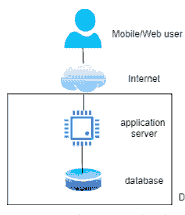
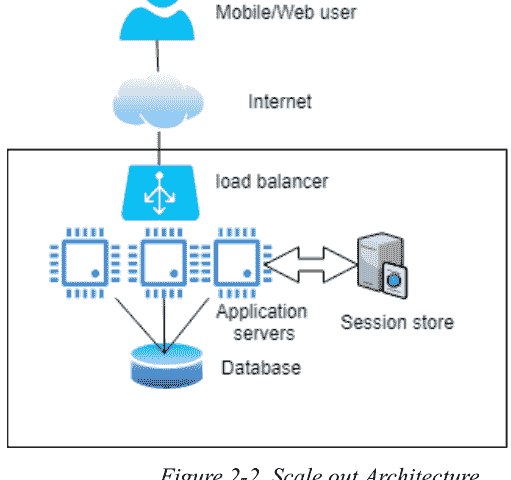
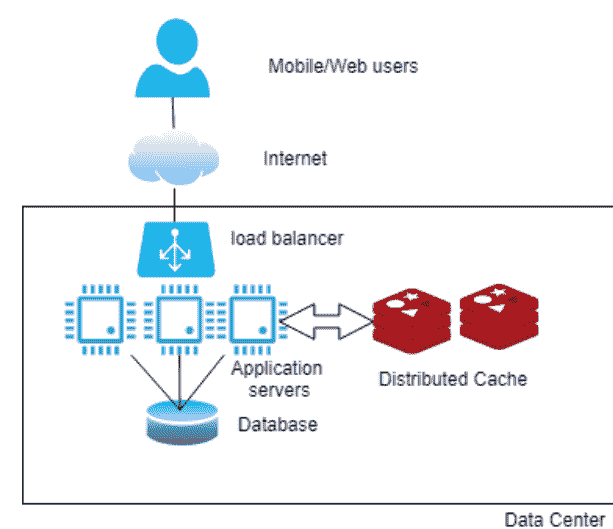
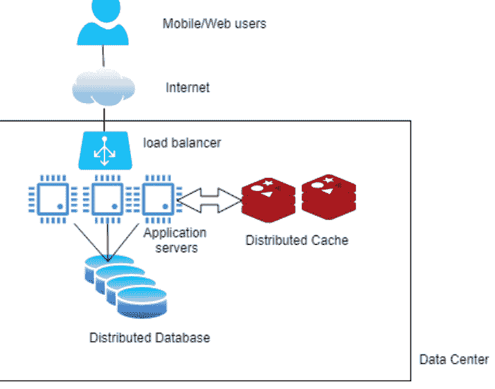
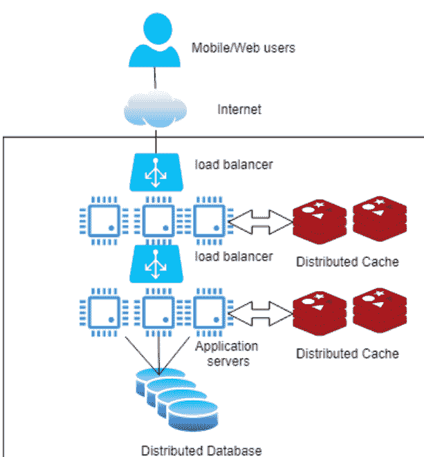
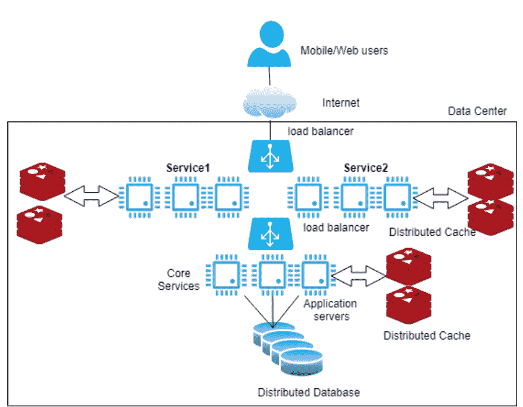
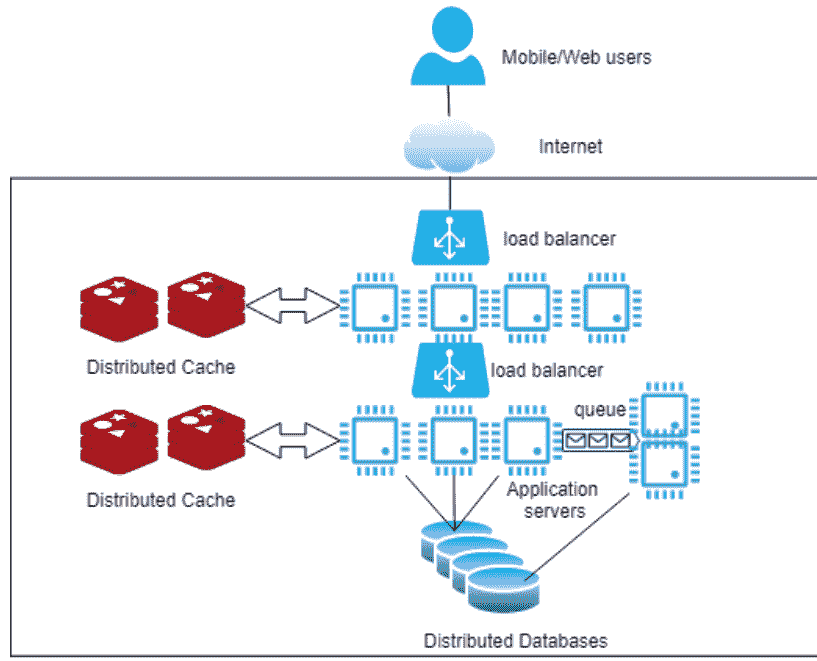
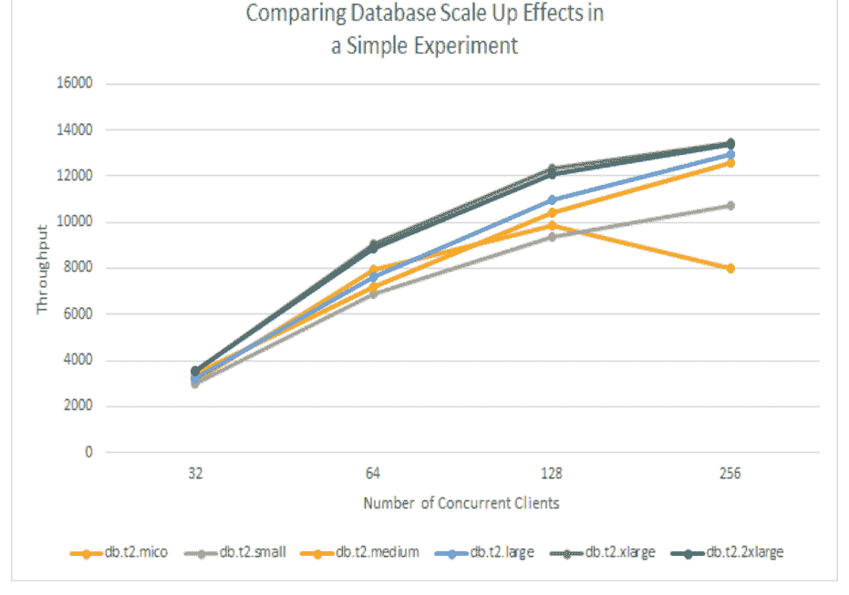

## Chapter 2. Distributed Systems Architectures: An Introduction

### A NOTE FOR EARLY RELEASE READERS

With Early Release ebooks, you get books in their earliest form—the author’s raw and unedited content as they write—so you can take advantage of these technologies long before the official release of these titles.

This will be the 2nd chapter of the final book.

If you have comments about how we might improve the content and/or examples in this book, or if you notice missing material within this chapter, please reach out to the editor at vwilson@oreilly.com.

In this chapter I’ll broadly cover some of the fundamental approaches to scaling a software system. You can regard this as a 30,000 feet view of the content that is covered in Parts 2, 3 and 4 of this book. I’ll take you on a tour of the main architectural approaches used for scaling a system, and give pointers to later chapters where these issues are dealt with in depth. You can regard this as a “Why” we need these architectural tactics, and the remainder of the book explaining the “How”.

The type of systems this book is oriented towards are the internet-facing systems we all utilize every day. I’ll let you name your favorite. These systems accept requests from users through Web and mobile interfaces, store and retrieve data based on user requests or events (e.g. a GPS-based system), and have some intelligent features such as providing recommendations or notifications based on previous user interactions.

I’ll start with a simple system design and show how it can be scaled. In the process, I’ll introduce several concepts that will be covered in much more detail later in this book. Hence this chapter just gives a broad overview of these concepts and how they aid in scalability – truly a whirlwind tour!

### Basic System Architecture

Virtually all massive scale systems start off small and grow due to their success. It’s common, and sensible, to start with a development framework such as Ruby on Rails or Django or equivalent, which promotes rapid development to get a system quickly up and running. A typical, very simple software architecture for ‘starter’ systems which closely resembles what you get with rapid development frameworks is shown in Figure 2-1. This comprises a client tier, application service tier, and a database tier. If you use Rails or equivalent, you also get a framework which hardwires a Model-View-Controller (MVC) pattern for Web application processing and an Object-Relational Mapper (ORM) that generates SQL queries.

With this architecture, users submit requests to the application from their mobile app or Web browser. The magic of Internet networking (see Chapter 3) delivers these requests to the application service which is running on a machine hosted in some corporate or commercial cloud data center. Communications uses a standard application-level network protocol, typically HTTP.

The application service runs code that supports an application programming interface (API) that clients use to format data and send HTTP requests to. Upon receipt of a request, the service executes the code associated with the requested API. In the process, it may read from or write to a database or some other external system, depending on the semantics of the API. When the request is complete, the service sends the results to the client to display in their app or browser.

Figure 2-1. Basic Multi-Tier Distributed Systems Architecture

Many, if not most systems conceptually look exactly like this. The application service code exploits a server execution environment that enables multiple requests from multiple users to be processed simultaneously. There’s a myriad of these application server technologies – JEE and Spring for Java, Flask for Python¹ – that are widely used in this scenario.

This approach leads to what is generally known as a monolithic architecture.² Monoliths tend to grow in complexity as the application becomes more feature rich. All API handlers are built into the same server code body. This eventually makes it hard to modify and test rapidly, and the execution footprint can become extremely heavyweight as all the API implementations run in the same application service.

Still, if request loads stay relatively low, this application architecture can suffice. The service has the capacity to process requests with consistently low latency. But if request loads keep growing, this means latencies will increase as the service has insufficient CPU/memory capacity for the concurrent request volume and hence requests will take longer to process. In these circumstances, our single server is overloaded and has become a bottleneck.

In this case, the first strategy for scaling is usually to ‘scale up’ the application service hardware. For example, if your application is running on AWS, you might upgrade your server from a modest t3.xlarge instance with 4 (virtual) CPUs and 16GBs of memory to a t3.2xlarge instance which doubles the number of CPUs and memory available for the application.³

Scale up is simple. It gets many real-world applications a long way to supporting larger workloads. It obviously just costs more money for hardware, but that’s scaling for you.

It’s inevitable however that for many applications the load will grow to a level which will swamp a single server node, no matter how many CPUs and how much memory you have. That’s when you need a new strategy – namely scaling out, or horizontal scaling, that I touched on in Chapter 1.

### Scale Out

Scaling out relies on the ability to replicate a service in the architecture and run multiple copies on multiple server nodes. Requests from clients are distributed across the replicas so that in theory, if we have N replicas, each server node processes {requests/N}. This simple strategy increases an application’s capacity and hence scalability.

To successfully scale out an application, you need two fundamental elements in our design. As illustrated in Figure 2-2, these are:

- *Load balancer*

All user requests are sent to a load balancer, which chooses a service replica target to process the request. Various strategies exist for choosing a target service, all with the core aim of keeping each resource equally busy. The load balancer also relays the responses from the service back to the client. Most load balancers belong to a class of Internet components known as reverse proxies,⁴ which control access to server resources for client requests. As an intermediary, reverse proxies add an extra network hop for a request, and hence need to be extremely low latency to minimize the overheads they introduce. There are many off-the-shelf load balancing solutions as well as cloud-provider specific

ones, and I’ll cover the general characteristics of these in much more detail in Chapter 5.

### 无状态服务

要使负载均衡有效并均匀分发请求，负载均衡器必须能够自由地将来自同一客户端的连续请求发送到不同的服务实例进行处理。这意味着服务中的 API 实现不得保留与单个客户端会话相关的任何知识或状态。当用户访问应用程序时，服务会创建一个用户会话，并在内部管理一个唯一的会话以识别用户交互的序列并跟踪会话状态。会话状态的经典示例是购物车。为了有效使用负载均衡器，表示用户购物车当前内容的 数据必须存储在某个地方——通常是数据存储——以便任何服务副本在接收到用户会话的一部分请求时都可以访问此状态。在图 2-2 中，这被标记为 Session Store。

Figure 2-2. Scale out Architecture

Scale out is attractive as, in theory, you can keep adding new (virtual) hardware and services to handle increased request loads and keep request latencies consistent and low. As soon as you see latencies rising, you deploy another server instance. This requires no code changes with stateless services and hence is relatively cheap – you just pay for the hardware you deploy.

Scale out has another highly attractive feature. If one of the services fails, the requests it is processing will be lost. But as the failed service manages no session state, these requests can be simply reissued by the client and sent to another service instance for processing. This means the application is resilient to failures in the service software and hardware, thus enhancing the application’s availability.

Unfortunately, as with any engineering solution, simple scaling out has limits. As you add new service instances, the request processing capacity grows, potentially infinitely. At some stage however, reality will bite and the capability of your single database to provide low latency query responses will diminish. Slow queries will mean longer response times for clients. If requests keep arriving faster than they are being processed, some system component will become overloaded and fail due to resource exhaustion, and clients will see exceptions and request timeouts. Essentially your database has become a bottleneck that you must engineer away in order to scale your application further.

### Scaling the Database with Caching

Scaling up by increasing the number of CPUs, memory and disks in a database server can go a long way to scaling a system. For example, at the time of writing Google Cloud Platform can provision a SQL database on a *db-n1-highmem-96* node, which has 96 vCPUs, 624GB of memory, 30TBs of disk and can support 4000 connections. This will cost somewhere between $6K and $16K per year, which sounds a good deal to me! Scaling up is a very common database scalability strategy.

Large databases need constant care and attention from highly skilled database administrators to keep them tuned and running fast. There’s a lot of wizardry in this job – e.g. query tuning, disk partitioning, indexing, on-node caching – and hence database administrators are valuable people that you want to be very nice to. They can make your application services highly responsive indeed.

In conjunction with scale up, a highly effective approach is querying the database as infrequently as possible from your services. This can be achieved by employing *distributed caching* in the scaled out service tier. Caching stores recently retrieved and commonly accessed database results in memory so they can be quickly retrieved without placing a burden on the database. For example, the weather forecast for the next hour won’t change, but may be queried by 100s or thousands of clients. You can use a cache to store the forecast once it is issued. All client requests will read from the cache until the forecast expires.

For data that is frequently read and changes rarely, your processing logic can be modified to first check a distributed cache, such as a Redis⁵ or memcached⁶ store. These cache technologies are essentially distributed Key-Value stores with very simple APIs. This scheme is illustrated in Figure 2-3. Note that the *Session Store* from Figure 2-2 has disappeared. This is because you can use a general-purpose distributed cache to store session identifiers along with application data.

Accessing the cache requires a remote call from your service. If the data you need is in the cache, on a fast network you can expect sub-millisecond cache reads. This is far less expensive than querying the shared database instance, and also doesn’t require a query to contend for typically scarce database connections.

Introducing a caching layer also requires your processing logic to be modified to check for cached data. If what you want is not in the cache, your code must still query the database and load the results into the cache as well as return it to the caller. You also need to decide when to remove or invalidate cached results – this depends on the nature of your data (e.g. weather forecasts expire naturally) and your application’s tolerance to serving out of date, known as stale, results to clients.

Figure 2-3. Introducing Distributed Caching

A well-designed caching scheme can be absolutely invaluable in scaling a system. Caching works great for data that rarely changes and is accessed frequently, such as inventory catalogs, event information and contact data. If you can handle a large percentage, like 80% or more, of read requests from your cache, then you effectively buy extra capacity at your databases as they never see a large proportion of requests.

Still, many systems need to rapidly access terabyte and larger data stores that make a single database effectively prohibitive. In these systems, a distributed database is needed.

### Distributing the Database

There are more distributed database technologies around in 2020 than you probably want to imagine. It’s a complex area, and one I’ll cover extensively later in the chapters in Part 3 of this book. In very general terms, there are two major categories:

- Distributed SQL stores from major vendors such as Oracle and IBM. These enable organizations to scale out their SQL database relatively seamlessly by storing the data across multiple disks that are queried by multiple database engine replicas. These multiple engines logically appear to the application as a single database, hence minimizing code changes. There is also a class of ‘born distributed’ SQL databases that are commonly known as NewSQL stores that fit in this category.
- Distributed so-called NoSQL stores from a whole array of vendors. These products use a variety of data models and query languages to distribute data across multiple nodes running the database engine, each with their own locally attached storage. Again, the location of the data is transparent to the application, and typically controlled by the design of the data model using hashing functions on database keys. Leading products in this category are Cassandra, MongoDB and Neo4j.

Figure 2-4. Scaling the Data Tier using a Distributed Database

Figure 2-4 shows how our architecture incorporates a distributed database. As the data volumes grow, a distributed database has features to enable the number of storage nodes to be increased. As nodes are added (or removed), the data managed across all nodes is rebalanced to attempt to ensure the processing and storage capacity of each node is equally utilized.

Distributed databases also promote availability. They support replicating each data storage node so if one fails or cannot be accessed due to network problems, another copy of the data is available. The models utilized for replication and the trade-offs these require (spoiler – consistency) are covered in later chapters.

If you are utilizing a major cloud provider, there are also two deployment choices for your data tier. You can deploy your own virtual resources and build, configure, and administer your own distributed database servers. Alternatively, you can utilize cloud-hosted databases. The latter simplifies the administrative effort associated with managing, monitoring and scaling the database, as many of these tasks essentially become the responsibility of the cloud provider you choose. As usual, the no free lunch principle applies.

### Multiple Processing Tiers

Any realistic system that you need to scale will have many different services that interact to process a request. For example, accessing a Web page on the Amazon.com web site can require in excess of 100 different services being called before a response is returned to the user.⁷

The beauty of the stateless, load balanced, cached architecture I am elaborating in this chapter is that it’s possible to extend the core design principles and build a multi-tiered application. In fulfilling a request, a service can call one or more dependent services, which in turn are replicated and load-balanced. A simple example is shown in Figure 2-5. There are many nuances in how the services interact, and how applications ensure rapid responses from dependent services. Again, I’ll cover these in detail in later chapters.

Figure 2-5. Scaling Processing Capacity with Multiple Tiers

此设计还促进在架构的每个层级拥有不同的、负载均衡的服务。例如，Figure 2-6 说明了两个复制的面向互联网的服务，它们都使用了一个提供数据库访问的核心服务。每个服务都经过负载均衡并采用缓存以提供高性能和高可用性。这种设计通常用于为 Web 客户端和移动客户端提供服务，两者可以根据各自承受的负载独立扩展。它通常被称为 Backend For Frontend (BFF) 模式。8

Figure 2-6. Scalable Architecture with Multiple Services

此外，通过将应用程序拆分为多个独立的服务，你可以根据服务需求对每个服务进行扩展。例如，如果你看到来自移动用户的请求量增加而来自 Web 用户的请求量减少，则可以为每个服务配置不同数量的实例以满足需求。这是将单体应用程序重构为多个独立服务的主要优势，这些服务可以分别构建、测试、部署和扩展。我将在第 9 章中探讨基于此类服务的设计，即微服务中的一些主要问题。

### Increasing Responsiveness

大多数客户端应用程序请求都期望得到响应。用户可能想要查看某个产品类别的所有拍卖商品，或查看某个位置可供出售的房地产。在这些示例中，客户端发送请求并等待接收响应。发送请求到接收结果之间的时间间隔即为该请求的响应时间。你可以通过使用缓存和预计算响应来减少响应时间，但许多请求仍会导致数据库访问。

对于更新应用程序中数据的请求也存在类似的情况。如果用户在下单前立即更新其送货地址，则新的送货地址必须被持久化，以便用户在点击“购买”按钮前确认地址。在这种情况下，响应时间包括数据库写入的时间，该写入通过用户收到的响应得到确认。

然而，一些更新请求可以在不完全将数据持久化到数据库的情况下成功响应。例如，你们中滑雪者和单板滑雪者会熟悉缆车票扫描系统，该系统检查你当天是否有有效的通行证可以乘坐缆车。它们还会记录你乘坐的缆车、登车时间等。nerdy 的滑雪者/单板滑雪者随后可以使用度假村的移动应用查看他们一天乘坐了多少次缆车。

当一个人等待登缆车时，扫描设备使用 RFID 芯片读卡器验证通行证。关于骑手、缆车和时间的信息随后通过互联网发送到滑雪度假村运营的数据捕获服务。缆车乘客不必等待此过程发生，因为响应时间可能会减慢缆车装载过程。此外，缆车乘客也没有期望能够立即使用其应用来确保此数据已被捕获。他们只需登上缆车，与朋友聊天，并计划下一次滑行。

服务实现可以利用这种类型的场景来提高响应能力。事件数据被发送到服务，服务确认收到并并发地将数据存储在远程队列中以供后续写入数据库。分布式队列平台可用于可靠地将数据从一个服务发送到另一个服务，通常但不总是以先进先出 First-In First-Out (FIFO) 模式。

将消息写入队列通常比写入数据库快得多，这使得请求可以更快地得到成功确认。另一个服务被部署来从队列中读取消息并将数据写入数据库。当用户检查他们的缆车乘坐记录时——也许是 3 小时或 3 天后——数据已成功持久化到数据库中。

实现此方法的[content]

Figure 2-5. Scaling Processing Capacity with Multiple Tiers

此设计还促进在架构的每个层级拥有不同的、负载均衡的服务。例如，Figure 2-6 说明了两个复制的面向互联网的服务，它们都使用了一个提供数据库访问的核心服务。每个服务都经过负载均衡并采用缓存以提供高性能和高可用性。这种设计通常用于为 Web 客户端和移动客户端提供服务，两者可以根据各自承受的负载独立扩展。它通常被称为 Backend For Frontend (BFF) 模式。 8

Figure 2-6. Scalable Architecture with Multiple Services

此外，通过将应用程序拆分为多个独立的服务，你可以根据服务需求对每个服务进行扩展。例如，如果你看到来自移动用户的请求量增加而来自 Web 用户的请求量减少，则可以为每个服务配置不同数量的实例以满足需求。这是将单体应用程序重构为多个独立服务的主要优势，这些服务可以分别构建、测试、部署和扩展。我将在第 9 章中探讨基于此类服务的设计，即微服务中的一些主要问题。

### Increasing Responsiveness

大多数客户端应用程序请求都期望得到响应。用户可能想要查看某个产品类别的所有拍卖商品，或查看某个位置可供出售的房地产。在这些示例中，客户端发送请求并等待接收响应。发送请求到接收结果之间的时间间隔即为该请求的响应时间。你可以通过使用缓存和预计算响应来减少响应时间，但许多请求仍会导致数据库访问。

A similar scenario exists for requests that update data in an application. If a user updates their delivery address immediately prior to placing an order, the new delivery address must be persisted so that the user can confirm the address before they hit the ‘purchase’ button. The response time in this case includes the time for the database write, which is confirmed by the response the user receives.

Some update requests however can be successfully responded to without fully persisting the data in a database. For example, the skiers and snowboarders amongst you will be familiar with lift ticket scanning systems that check you have a valid pass to ride the lifts that day. They also record which lifts you take, the time you get on, and so on. Nerdy skiers/snowboarders can then use the resort’s mobile app to see how many lifts they ride in a day.

As a person waits to get on a lift, a scanner device validates the pass using an RFID chip reader. The information about the rider, lift, and time are then sent over the Internet to a data capture service operated by the ski resort. The lift rider doesn’t have to wait for this to occur, as the response time could slow down the lift loading process. There’s also no expectation from the lift rider that they can instantly use their app to ensure this data has been captured. They just get on the lift, talk smack with their friends, and plan their next run.

Service implementations can exploit this type of scenario to improve responsiveness. The data about the event is sent to the service, which acknowledges receipt and concurrently stores the data in a remote queue for subsequent writing to the database. Distributed queueing platforms can be used to reliably send data from one service to another, typically but not always in a First-In First-Out (FIFO) mode.

Writing a message to a queue is typically much faster than writing to a database, and this enables the request to be successfully acknowledged much more quickly. Another service is deployed to read messages from the queue and write the data to the database. When the user checks their lift rides – maybe 3 hours or 3 days later – the data has been persisted successfully in the database.

The basic architecture to implement this approach is illustrated in Figure 2-7.

Figure 2-7. Increasing Responsiveness with Queueing

Whenever the results of a write operation are not immediately needed, an application can use this approach to improve responsiveness and hence scalability. Many queueing technologies exist that applications can utilize, and I’ll discuss how these operate in Chapter 7. These queueing platforms all provide asynchronous communications. A producer service writes to the queue, which acts as temporary storage, while another consumer service removes messages from the queue and makes the necessary updates to, in our example, a database that stores skier lift ride details.

The key is that the data *eventually* gets persisted. Eventually typically means a few seconds at most but use cases that employ this design should be resilient to longer delays without impacting the user experience.

### Systems and Hardware Scalability

Even the most carefully crafted software architecture and code will be limited in terms of scalability if the services and datastores run on inadequate hardware. The open source and commercial platforms that are commonly deployed in scalable systems are designed to utilize additional hardware resources in terms of CPU cores, memory and disks. It’s a balancing act between achieving the performance and scalability you require, and keeping your costs as low as possible.

That said, there are some cases where upgrading the number of CPU cores and available memory is not going to buy you more scalability. For example:

A code is single threaded. Running this on a node with more cores is not going to improve performance. It’ll just use one core at any time. The rest are simply not utilized.

A multithreaded code contains many serialized sections, meaning that only one thread can proceed at a time to ensure the results are correct. This phenomena is described by Amdahl’s Law. This gives us a way to calculate the theoretical speedup of a code when adding more CPU cores based on the amount of code that executes serially.

Two data points from Amdahl’s Law are:

- If only 5% of a code executes serially, the rest in parallel, adding more than 2048 cores has essentially no effect
- If 50% of a code executes serially, the rest in parallel, adding more than 8 cores has essentially no effect

This demonstrates why efficient multithreaded code is essential to achieving scalability. If your code is not running as highly independent tasks implemented as threads, then not even money will buy you scalability. That’s why I devote Chapter 4 to the topic of multithreading - it’s a core knowledge component for building scalable distributed systems.

To illustrate the effect of upgrading hardware, Figure 2-8 shows how the throughput of a benchmark system improves as the database is deployed on more powerful (and expensive) hardware.⁹ The benchmark employs a Java service which accepts requests from a load generating client, queries a database and returns the results to the client. The client, service and database run on different hardware resources deployed in the same regions in the AWS cloud.

In the tests, the number of concurrent requests grows from 32 to 256 (x-axis) and each line represents the system throughput (y-axis) for a different hardware configuration on the AWS EC2’s Relational Database Service (RDS). The different configurations are listed at the top of the chart, with the least powerful on the left and most powerful on the right. Each client sends a fixed number of requests synchronously over HTTP, with no pause between receiving results from one request and sending the next. This consequently exerts a high request load on the server.

From this chart, it’s possible to make some straightforward observations:

- 1. In general, the more powerful hardware selected for the database, the higher the throughput. That is good
- 2. The difference between the db.t2.xlarge and db.t2.2xlarge instances in terms of throughput is minimal. This could be because the service tier is becoming a bottleneck, or our data base model and queries are not exploiting the additional resources of the db.t2.2xlarge RDS instance. Regardless - more bucks, no bang.
- 3. The two least powerful instances perform pretty well until the request load is increased to 256 concurrent requests. The dip in throughput for

这两个实例表明它们已过载，如果请求负载增加，情况只会变得更糟。

图 2-8. 数据库服务器扩展的示例

希望这个简单的例子能说明为什么通过简单升级硬件来扩展需要谨慎对待。增加硬件总是会提高成本，但可能并不总是能带来你期望的性能提升。运行简单的实验并进行测量对于评估硬件升级的影响至关重要。它为指导你的设计提供了可靠的数据，并向利益相关者证明成本的合理性。

### 总结和进一步阅读

在本章中，我提供了利用通信服务和分布式数据库的集合来扩展系统的各种主要方法的快速概览。许多细节已被忽略，而正如你毫无疑问已经意识到的那样——在软件系统中，魔鬼在于细节。

因此，后续章节将逐步开始探索这些细节，从第 3 章开始介绍每个人都应该了解的分布式系统的一些基本特征。

本章回避的另一个领域是软件架构的主题。我使用了 *services* 这个术语来指代在架构中实现应用程序业务逻辑和数据库访问的分布式组件。这些服务是独立部署的进程，使用 HTTP 等远程通信机制进行通信。在架构术语中，这些服务最接近于面向服务架构（SOA）模式中的服务，这是一种构建分布式系统的成熟架构方法。这种方法的更现代演进围绕微服务展开。这些服务往往更具内聚性和封装性，促进持续的开发和部署。

如果你想对这些问题以及软件架构概念进行更深入的讨论，那么 Mark Richards 和 Neal Ford 的书¹⁰ 是一个极好的起点。

最后，有一类 *大数据* 软件架构解决了在非常大的数据集合中出现的一些问题。其中最突出的是数据再处理。这发生在已经存储和分析的数据由于代码或业务规则更改需要重新分析时。这种再处理可能由于软件修复发生，也可能由于引入了新的算法，可以从原始数据中得出更多见解。Jay Krepps 的文章《Questioning the Lambda Architecture》中对 Lambda 和 Kappa 架构进行了很好的讨论，这两者在这个领域都很突出。

+   5 https://redis.io/
+   6 https://memcached.org/
+   7 https://www.allthingsdistributed.com/2019/08/modern-applications-at-aws.html
+   8 https://samnewman.io/patterns/architectural/bff/
+   9 结果由来自西雅图东北大学的 Ruijia Xiao 友情提供
+   10 Mark Richards 和 Neal Ford, *Fundamentals of Software Architecture: An Engineering Approach*, 1st Edition, O’Reilly Media, 2020
