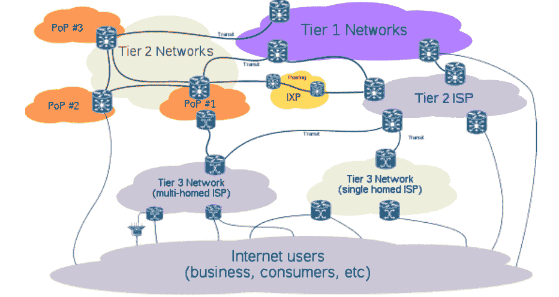
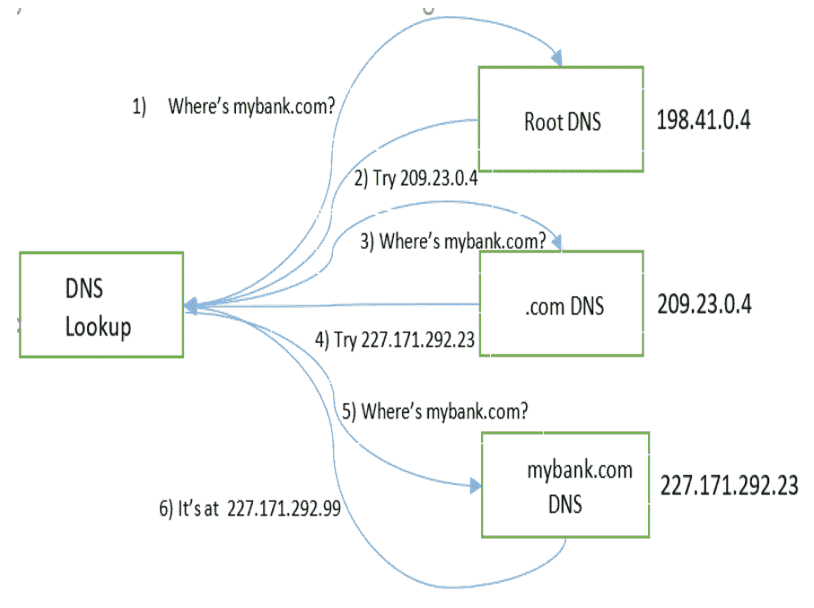
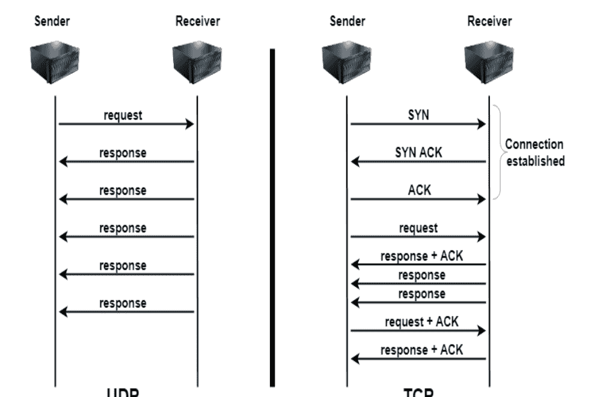
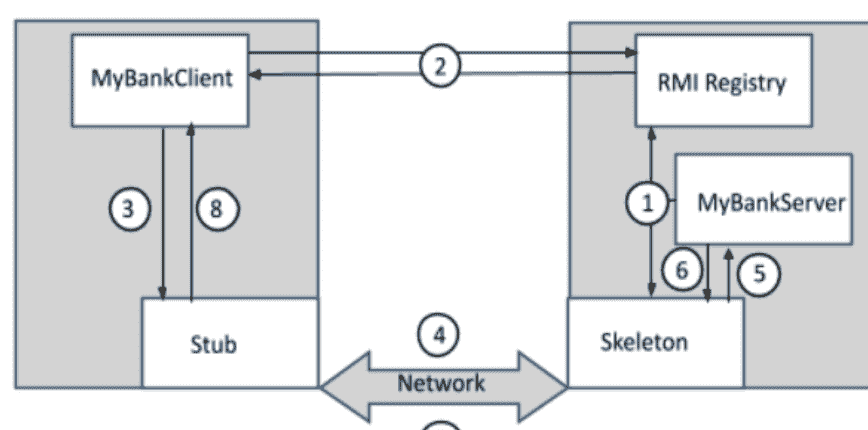
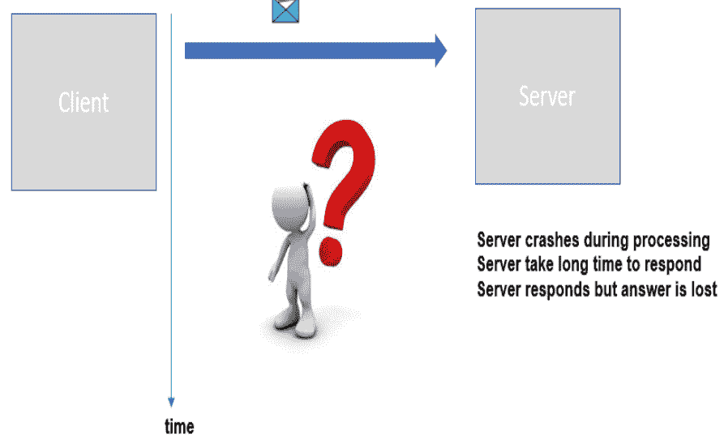
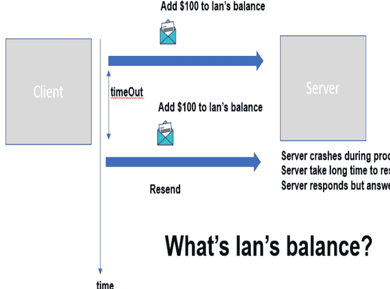
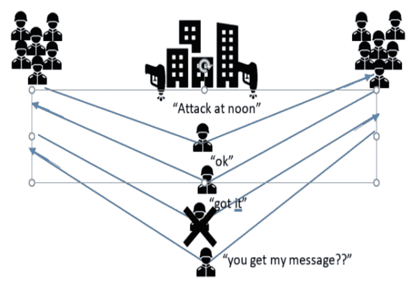
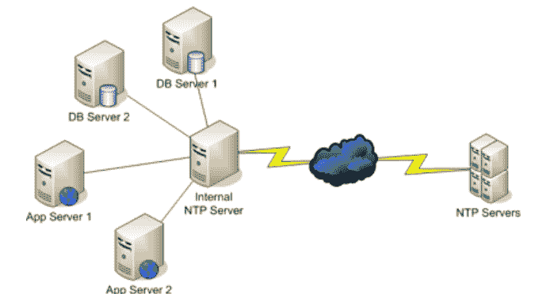

## 第 3 章. 分布式系统基础

### 早期发布读者须知

使用 Early Release 电子书，你可以在这些标题正式发布之前很久就利用这些技术——作者在写作时提供的原始和未经编辑的内容。

这将是最终书籍的第 3 章。

如果你对我们如何改进本书的内容和/或示例有任何评论，或者如果你注意到本章中缺少材料，请联系编辑 vwilson@oreilly.com。

正如我在第 2 章中描述的那样，扩展系统自然涉及添加多个独立移动的部件。我们在多台机器上运行软件组件，并在多个存储节点上运行数据库，所有这些都是为了增加更多处理能力。因此，我们的解决方案分布在多个位置的多个机器上，每台机器并发处理事件，并在网络上交换消息。

分布式系统的这种基本特性对我们设计、构建和运营解决方案的方式具有深远的影响。本章提供了你需要了解的基本“野兽本质”信息，以便欣赏分布式软件系统的各种问题和复杂性。我们简要介绍了通信网络硬件和软件、远程方法调用、如何处理通信故障的影响、分布式协调，以及分布式系统中时间这一棘手问题。

### 通信基础

每个分布式系统都有通过网络通信的软件组件。如果移动银行应用程序请求用户当前的银行账户余额，就会发生一系列（非常简化的）通信，大致如下：

-   1. 移动银行应用程序通过蜂窝网络向银行发送请求，地址为检索用户的银行余额。
-   2. 请求通过互联网路由到银行的 Web 服务器所在位置。
-   3. 银行的 Web 服务器对请求进行身份验证（检查它是否来自 supposed 用户）并向数据库服务器发送请求以获取账户余额。
-   4. 数据库服务器从磁盘读取账户余额并将其返回给 Web 服务器
-   5. Web 服务器将余额发送到发往应用程序的回复消息中，该消息通过互联网和蜂窝网络路由，直到余额神奇地出现在移动设备的屏幕上

当你阅读以上内容时，它几乎听起来很简单，但在现实中，这一通信序列之下隐藏着巨大的复杂性。让我们在以下各节中检查其中的一些复杂性。

#### 通信硬件

上面的银行余额请求示例最终会遍历多种不同的网络技术和设备。全球互联网是一个异构机器，由不同类型的网络通信信道和设备组成，这些设备每秒在网络间穿梭数百万条消息，将其发送到预期目的地。

存在不同类型的通信信道。最明显的分类是有线与无线。对于每个类别，都有多种网络传输硬件技术可以将位从一台机器传输到另一台机器。每种技术都有不同的特性，我们通常关心的特性是速度和范围。

对于物理有线网络，最常见的两种类型是局域网（LAN）和广域网（WAN）。LAN 是可以连接“建筑规模”设备的网络，能够在少量（例如 1-2）公里范围内传输数据。当代 LAN 可以传输每秒 100 兆比特（Mbps）到 1 千兆比特（Gbps）的数据。这称为网络的带宽或容量。跨 LAN 传输消息所需的时间——网络的延迟——在现代 LAN 技术下为亚毫秒级。

WAN 是横跨全球并构成我们统称为互联网的网络。这些长距离连接是连接城市、国家和大陆的光纤电缆构成的高速数据“管道”。这些电缆支持一种称为波分复用¹ 的网络技术，这使得能够在 400 个不同通道上传输高达 171 Gbps，从而为单根光纤链路提供超过 70 太比特每秒（Tbps）的总带宽。横跨世界的光纤电缆通常包含四根或更多根光纤，为每根电缆提供数百 Tbps 的带宽容量。

然而 WAN 的延迟更为复杂。WAN 在数百到数千公里范围内传输数据，而数据在光纤电缆中能够达到的最大速度是光速的理论速度。实际上，这些电缆无法达到光速，但在我们可以在表 3-1 中看到的那样，已经非常接近了。

表 3-1. WAN 速度


| 路径 | 光传播距离 | 时间 - 光速 | 时间 - 光纤电缆 |
|---|---|---|---|
| 纽约到旧金山 | 4,148 km | 14 ms | 21 ms |
| 纽约到伦敦 | 5,585 km | 19 ms | 28 ms |
| 纽约到悉尼 | 15,993 km | 53 ms | 80 ms |

实际时间会比这更慢，因为数据需要经过被称为路由器²的网络设备。全球互联网具有复杂的枢纽-辐射拓扑结构，网络节点之间存在许多潜在路径。因此路由器负责在物理网络连接上传输数据，以确保数据从源到目的地在互联网上传输。

路由器是专门的高速度设备，可以处理数百 Gbps 的网络流量，将数据从传入连接中取出，并根据目的地将其发送到不同的传出网络连接。互联网核心的路由器由这些设备的机架组成，因此可以处理 10s 到数百 Tbps。这就是你和数千名朋友能够同时观看 Netflix 稳定的视频流的方式。

无线技术具有不同的范围和带宽特性。我们在家中和办公室里都很熟悉的 Wi-Fi 路由器是无线以太网网络，使用 802.11 协议发送和接收数据。应用最广泛的 Wi-Fi 协议 802.11ac，允许最高（理论）数据速率高达 5,400Mbps。最新的 802.11ax 协议，也称为 Wi-Fi 6，是 802.11ac 技术的演进，承诺吞吐速度最高可达 9.6Gbps。Wi-Fi 路由器的范围约为 10s 米，当然会受到墙壁和地板等物理障碍的影响。

蜂窝无线技术使用无线电波将数据从我们的手机发送到安装在基站上的路由器，这些基站通常通过有线连接到核心互联网进行消息路由。每种蜂窝技术都引入了改进的带宽和其他性能维度。截至撰写时最常见的技术是 4G LTE 无线宽带。4G LTE 比旧的 3G 快约 10 倍，能够处理约 10 Mbps 的持续下载速度（峰值下载速度接近 50 Mbps）和 2 到 5 Mbps 的上传速度。

新兴的 5G 蜂窝网络承诺比现有的 4G 提供 10 倍的带宽提升，设备与基站之间的延迟为 1-2 毫秒。这比 4G 延迟 20-40 毫秒范围内的延迟有了很大改善。代价是范围。5G 基站范围最大约为 500m，而 4G 在 10-15kms 的距离提供可靠接收。

所有这些不同类型的网络硬件集合在一起构成了全球互联网。互联网是一个异构网络，全球有许多不同的运营商和各种各样的硬件。图 3-1 显示了构成互联网的主要组件的简化视图。Tier 1 网络是全球高速互联网骨干。约有 20 家 Tier 1 互联网服务提供商（ISP）管理并控制全球流量。Tier 2 ISP 通常是区域性的（例如一个国家），带宽低于 Tier 1 ISP，并通过 Tier 3 ISP 向客户提供内容。Tier 3 ISP 是每月向你收取高昂家庭互联网费用的那些提供商。



图 3-1. 互联网的简化视图

互联网的工作方式比这里描述的要复杂得多。这种网络和协议复杂性超出了本章的范围。从分布式系统软件的角度来看，我们需要了解更多关于‘魔术’的知识，即所有这些硬件如何将消息从例如我的手机路由到我的银行并返回。这就是 IP 协议发挥作用的地方。

### 通信软件

互联网上的软件系统使用互联网协议套件进行通信。³ 互联网协议套件指定主机寻址、数据传输格式、消息路由和交付特性。它包含四个抽象层，其中包含支持该层所需功能的相关协议。它们从低到高为：

- 1. 数据链路层，指定在单个网络段上进行数据通信的方法。这由存在于你的设备内部的设备驱动程序和网卡实现。
- 2. 互联网层指定寻址和路由协议，使流量能够穿越构成互联网的独立管理和控制的网络。这就是互联网协议套件中的 IP 协议。
- 3. 传输层，指定可靠和尽力而为的主机到主机通信的协议。这就是众所周知的 TCP 和 UDP 协议所在的地方。
- 4. 应用层，包含多个应用层协议，如 HTTP 和 SCP。

每个更高层的协议都建立在较低层的功能之上。在下面，我将简要介绍用于主机发现和消息路由的 IP 协议，以及分布式应用程序可以利用的 TCP 和 UDP 传输协议。

### 互联网协议（IP）

IP 定义了主机如何在互联网上分配地址以及如何在知道彼此地址的两个主机之间传输消息。

互联网上的每个设备都有自己的地址。这些被称为互联网协议（IP）地址。IP 地址的位置可以使用被称为域名系统（DNS）的互联网范围目录服务找到。DNS 是一个广泛分布的、层次化的数据库，是互联网的地址簿。

目前用于分配 IP 地址的技术，被称为互联网协议版本 4（IPv4），最终将被其继任者 IPv6 取代。IPv4 是一个 32 位寻址方案，由于连接互联网的设备数量，地址很快就会用完。IPv6 是一个 128 位方案，将提供（几乎）无限数量的 IP 地址。作为一个指标，在 2020 年 7 月，约 33% 的 Google.com⁴ 处理的流量是 IPv6。

DNS 服务器是分层组织的。少量根 DNS 服务器，经过高度复制，是解析 IP 地址的起点。当互联网浏览器尝试查找网站时，由你的雇主或 ISP 管理的本地 DNS 服务器，即网络主机，会联系根 DNS 服务器并请求主机名。根服务器会回复一个指向所谓的 *权威* DNS 服务器的引用，该服务器管理名称解析，例如在我们的银行示例中，.com 地址。每个顶级互联网域（例如 .com、.org、.net 等）都有一个权威名称服务器。

接下来，本地 DNS 服务器将查询 .com DNS 服务器，后者将回复管理 mybank.com 的所有 IP 地址的 DNS 服务器的地址。此 DNS 被查询，并返回我们需要与应用程序通信的实际 IP 地址。整体方案如图 3-2 所示。



图 3-2. mybank.com 的示例 DNS 查找

整个 DNS 数据库高度地理复制，因此没有单点故障，并且请求分布在多个物理服务器上。本地 DNS 服务器还记住最近联系的主机的 IP 地址，这是可能的，因为 IP 地址很少更改。这意味着并非每次我们联系站点时都会发生完整的名称解析过程。

有了目标 IP 地址后，主机就可以开始以一系列 IP 数据包的形式在网络上传输数据。IP 的任务是根据数据包头中的 IP 地址将数据从源交付到目标主机。IP 定义了一个数据包结构，其中包含要交付的数据，以及包括源和目标 IP 地址在内的头数据。应用程序发送的数据被分解为一系列数据包，这些数据包独立地在互联网上传输。

IP 被称为尽力而为的交付协议。这意味着它不会尝试补偿数据包传输过程中可能发生的各种错误条件。可能的传输错误包括数据损坏、数据包丢失和重复。此外，每个数据包都独立地从源路由到互联网上的目的地。将每个数据包独立处理被称为分组交换。这允许网络动态响应网络链路故障和拥塞等情况，因此是互联网的决定性特征。这也意味着不同的数据包可能通过不同的网络路径交付到同一目的地，导致接收方乱序交付。

由于这种设计，IP 是不可靠的。如果两个主机需要可靠的数据传输，它们需要添加额外功能来实现这一点。这就是 IP 协议套件中下一层、传输层登场的地方。

### 传输控制协议（TCP）

一旦应用程序或浏览器发现了它希望通信的服务器的 IP 地址，它就可以使用传输协议 API 发送消息。这是通过传输控制协议（TCP）实现的


或用户数据报协议（UDP），它们是 IP 网络栈的既定标准传输协议。

分布式应用程序可以选择使用这些协议中的哪一个。主流编程语言（如 Java、Python 和 C++）中广泛提供实现。实际上，这些 API 的使用并不常见，因为更高层的编程抽象将细节隐藏在大多数应用程序之外。事实上，IP 协议套件的应用层包含若干这些应用级 API，其中包括 HTTP，它在主流分布式系统中被广泛使用。

尽管如此，了解 TCP、UDP 及其差异仍然很重要。互联网上的大多数请求都是使用 TCP 发送的。TCP 是：

- 面向连接的
- 面向流的
- 可靠的

我将在下面解释每一点。

TCP 被称为面向连接的协议。在应用程序之间交换任何消息之前，TCP 使用 3 步握手在客户端和服务器应用程序之间建立双向连接。连接保持打开状态，直到 TCP 客户端调用 close 以终止与 TCP 服务器的连接。服务器通过确认关闭请求后连接才会被丢弃。

一旦建立连接，客户端会将一系列请求作为数据流发送给服务器。当数据流通过 TCP 发送时，它会被拆分为单独的网络数据包，最大数据包大小为 65535 字节。每个数据包包含源地址和目标地址，由底层的 IP 协议用于在网络中路由消息。

互联网是一个分组交换网络，这意味着每个数据包在网络中单独路由。每个数据包经过的路由可以根据网络状况（如链路拥塞或故障）动态变化。这意味着数据包可能不会以客户端发送的相同顺序到达服务器。为了解决这个问题，TCP 发送方在每个数据包中包含一个序列号，以便接收方可以将数据包重新组装成与发送顺序相同的流。

在传输过程中，网络数据包可能会丢失或延迟，因此需要可靠性。为了实现可靠的数据包传输，TCP 使用累积确认机制。这意味着接收方会定期发送确认数据包，其中包含收到的最高序列号，且数据包流中没有间隙。这隐式确认了所有具有更低序列号的数据包，即所有数据包均已成功接收。如果发送方在超时时间内未收到确认，则会重发数据包。

TCP 还有许多其他特性，例如用于检查数据包完整性的校验和，以及动态流量控制以确保发送方不会因发送数据过快而使缓慢的接收方不堪重负。连同连接建立和确认，这使得 TCP 成为一种相对重量级的协议，它以效率换取可靠性。

这就是 UDP 登场的地方。UDP 是一种简单的无连接协议，它将用户程序暴露给底层网络的任何不可靠性。它不保证按序交付，甚至不保证交付。可以将其视为底层 IP 协议之上的薄薄一层，并有意以可靠性换取原始性能。

然而，这对于许多现代应用程序来说非常合适，因为偶尔丢失的数据包影响很小。想想流媒体电影、视频会议和游戏，丢失一个数据包不太可能被用户察觉。



图 3-3. 比较 TCP 和 UDP

图 3-3 描述了 TCP 和 UDP 之间一些主要差异。TCP 采用连接建立的 3 数据包握手（SYN、SYN ACK），并搭载数据包的确认（ACK），以便协议可以处理任何数据包丢失。还有一个未在图中显示的 TCP 连接关闭阶段，涉及 4 次握手。UDP 则省去了连接建立、拆除、确认和重试。因此，使用 UDP 的应用程序需要能够容忍数据包丢失以及客户端或服务器故障并相应地表现。

### 远程方法调用

使用直接与传输层协议 TCP 和 UDP 交互的低级 API 编写分布式应用程序是完全可行的。最常见的方法是标准化的套接字库 - 请参阅侧边栏中的简要概述。你希望永远不需要这样做，因为套接字复杂且容易出错。从本质上讲，套接字在两个节点之间创建双向管道，可用于发送数据流。幸运的是，有更好的方法来构建分布式通信，正如本节所述。这些方法抽象掉了使用套接字的许多复杂性。然而套接字潜藏在底层，因此需要一些知识。

### 套接字的概述

套接字是客户端和服务器之间双向网络连接的一个端点。套接字由节点的 IP 地址和一个称为端口的抽象组合标识。端口是一个唯一的数字标识符，允许节点为在节点上运行的多个应用程序支持通信。每个 {IP 地址，端口} 组合可以与一个应用程序相关联。此组合形成一个唯一地址，由传输层用于将数据传递给正确的应用程序。

每个节点可以支持 65,535 个 TCP 端口和另外 65,535 个 UDP 端口。连接由源套接字和目标套接字地址的组合标识。一旦连接创建，客户端以流的形式向服务器发送数据，服务器以结果响应。套接字库支持两种协议，使用 SOCK_STREAM 选项用于 TCP，以及用于 UDP 的 SOCK_DGRAM。

你可以直接向套接字 API 编写分布式应用程序，套接字 API 是操作系统核心组件。所有主流编程语言都提供套接字 API。然而套接字库是一个低级、难以使用的 API，除非你有真正需要编写系统级代码，否则应避免使用。

使用套接字，在我们的移动银行示例中，客户端可能会请求用户支票账户的余额。忽略特定语言问题（以及安全！！），客户端可以通过与服务器的连接发送如下消息负载：

```
{"balance", "000169990"}
```

在此消息中，“balance” 表示我们希望服务器执行的操作，“000169990”是银行账号。

在服务器中，我们需要知道消息中的第一个字符串是操作标识符，并且基于此值为“balance”，第二个是银行账号。服务器然后使用这些值来查询数据库、检索余额并发送回结果，可能以如下格式的消息，包含账号和当前余额：

```
{"000169990", "220.77"}
```

在任何复杂系统中，服务器将支持许多操作。在 mybank.com 中，可能例如有“login”、“transfer”、“address”、“statement”、“transactions”等。每个操作后面都会跟随不同的消息负载，服务器需要正确解释以满足客户端请求。

我们在这里定义的是一个特定于应用程序的协议。只要我们以正确的顺序为每个操作发送必要的值，服务器就能正确响应。如果我们有一个不符合应用程序协议的错误客户端，嗯，我们的服务器需要进行彻底的错误检查。

套接字库为客户端-服务器通信提供了一种原始、低级的方法。它提供高效的通信，但难以正确实现并演进应用程序协议以处理所有可能性。存在更好的机制。

退一步说，如果我们用面向对象的语言如 Java 定义 mybank.com 服务器接口，我们将把每个可以处理的操作作为一个方法。每个方法都会传入该操作适当的形参列表，如下示例代码所示。

// Simple mybank.com server interface
public interface MyBank {
    public float balance (String accNo);
    public boolean statement(String month) ;


// 其他操作
}

拥有此类接口有几个优点，即：

- 编译器可以静态检查客户端对服务器的调用，以确保其格式正确且参数类型正确
- 服务器接口的更改（例如添加新参数）会强制客户端代码更改以符合新的方法签名
- 接口由类定义明确定义，因此客户端程序员易于理解和使用

显式接口的这些好处当然在软件工程中众所周知。面向对象设计的整个学科几乎完全基于这些基础，其中接口在调用者和被调用者之间定义了契约。与使用套接字需要编程的隐式应用程序协议相比，其优势是显著的。

这一事实在分布式系统的创建早期就被认识到。自 1990 年代初以来，我们见证了技术的演进，这些技术使我们能够定义显式的服务器接口，并使用与在顺序程序中几乎相同的语法通过网络调用它们。表 3-2 给出了主要方法概述。它们统称为远程过程调用（RPC）或远程方法调用（RMI）技术。

### 表 3-2. 主要 RPC/RMI 技术概述

| 技术 | 日期 | 主要特点 |
|---|---|---|
| **分布式计算环境 (DCE)**<br>*a* | 1990 年代初 | DCE RPC 为客户端-服务器系统提供了一种标准化方法。主要语言为 C/C++。 |
| **通用对象请求代理体系结构 (CORBA)**<br>*b* | 1990 年代初 | 基于面向对象的接口定义语言（IDL）促进语言中立的客户端-服务器通信。主要语言支持包括 C/C++、Java、Python、Ada。 |
| **Java 远程方法调用 (RMI)**<br>*c* | 1990 年代末 | 一种纯 Java 基于的远程方法调用，它以与 Java 对象相同的语义促进分布式客户端-服务器系统。 |
| **XML Web 服务** | 2000 | 基于 HTTP 和 XML 支持客户端-服务器通信。服务器在 Web 服务描述语言（WSDL）中定义其远程接口 |

*a* http://www.opengroup.org/dce/
*b* http://www.corba.org

虽然这些 RPC/RMI 技术的语法和语义各不相同，但其运作的本质是相同的。让我们继续使用 mybank.com 的 Java 示例作为整个类别方法的示例。Java 提供了一个远程方法调用（RMI）API 用于构建客户端-服务器应用程序。

使用 Java RMI，我们可以轻松地将上面的 MyBank 接口示例制作成远程接口，如下所示。

```
import java.rmi.*;
// Simple mybank.com server interface
public interface MyBank extends Remote{
    public float balance  (String accNo)
        throws RemoteException;
    public boolean statement(String month)
        throws RemoteException ;
    // other operations
}
```

java.rmi.Remote 接口充当标记，用于告知 Java 编译器我们正在创建 RMI 服务器。此外，每个方法必须抛出 java.rmi.RemoteException。这些异常表示在通过网络调用两个对象之间的分布式调用时可能发生的错误。导致此类异常的最常见原因是通信故障或服务器对象崩溃。

然后我们必须提供一个实现此远程接口的类。下面的示例代码显示了服务器实现的摘录 - 此示例的完整代码位于本书的代码 github 仓库中。

```
public class MyBankServer extends UnicastRemoteObject
                        implements MyBank {
    // constructor/method implementations omitted
    public static void main(String args[]){
        try{
            MyBankServer server=new MyBankServer();
            // create a registry in local JVM on default port
            Registry registry = LocateRegistry.createRegistry(1099);
            registry.bind("MyBankServer", server);
            System.out.println("server ready");
```
```
}catch(Exception e){
    // code omitted for brevity}
}
```

需要注意的要点是：

- 服务器扩展了 UnicastRemoteObject 类。这本质上提供了实例化可远程调用对象的功能。
- 一旦服务器对象构造完成，其可用性必须向远程客户端公布。这是通过将对象引用存储在称为 RMI 注册表的系统服务中并与其关联一个逻辑名称来实现的 - 在此示例中为 MyBankServer。注册表是一个简单的目录服务，使客户端能够通过仅提供其在注册表中关联的逻辑名称来查找 RMI 服务器的位置（网络地址和对象引用）并获得对该服务器的引用。

下面显示了连接到服务器的客户端代码的摘录。它通过在 RMI 注册表中执行查找操作（第 3 行）并指定标识服务器的逻辑名称来获得对远程对象的引用。查找操作返回的引用然后可用于以与本地对象相同的方式调用服务器对象。然而存在一个区别 - 客户端必须准备捕获 RemoteException，当服务器对象无法到达时 Java 运行时会抛出该异常。

```
// obtain a remote reference to the server
MyBank bankServer=
    (MyBank)Naming.lookup("rmi://localhost:1099/MyBankServer");
//now we can call the server
System.out.println(bankServer.balance("00169990"));
```

图 3-4 描述了构成 RMI 系统的组件之间的调用序列。Stub 和 Skeleton 是由编译器从 RMI 接口定义生成的对象，它们促进了实际的远程通信。Skeleton 实际上是一个 TCP 网络端点（主机、端口），它监听对关联服务器的调用。

操作序列如下：

- 1. 当服务器启动时，其逻辑引用存储在 RMI 注册表中。此条目包含可用于向服务器进行远程调用的 Java 客户端 stub。
- 2. 客户端查询注册表，并返回服务器的 stub。
- 3. 客户端 stub 接受来自 Java 客户端实现的对服务器接口的方法调用。
- 4. stub 将请求转换为一个或多个发送到服务器主机的网络数据包。此转换过程称为编组。
- 5. skeleton 接受来自客户端的网络请求，并将网络数据包数据解组为对 RMI 服务器对象实现的合法调用。解组是编组的相反过程 - 它将一系列网络数据包转换为对对象的调用。
- 6. skeleton 等待方法返回响应。
- 7. skeleton 将方法结果编组为发送给客户端的网络回复数据包
- 8. stub 解组数据并将结果传递给 Java 客户端调用站点



图 3-4. 描述建立连接并调用 RMI 服务器对象的调用序列的示意图

此 Java RMI 示例说明了用于实现任何 RPC/RMI 机制的基础，即使在像 Erlang⁵ 和 Go⁶ 这样的现代语言中也是如此。你最有可能在 Java 企业版（JEE）的企业 Java Bean（EJB）技术中使用 Java RMI。EJB 是建立在 RMI 之上的服务器端组件模型，在过去 20 年左右的企业系统中得到了广泛使用。

无论具体实现如何，RPC/RMI 方法的基本吸引力在于提供一种抽象的调用机制，支持客户端进行远程服务器调用时的位置透明性。位置透明性由注册表提供，或通常由任何使客户端能够通过目录服务定位服务器的机制提供。这意味着服务器可以在不影响客户端实现的情况下在目录中更新其网络位置。

RPC/RMI 并非没有缺陷。编组和解组对于复杂的对象参数可能变得效率低下。跨语言编组 - 客户端使用一种语言，服务器使用另一种语言 - 可能导致问题，因为类型在不同语言中的表示方式不同，从而导致细微的不兼容。如果远程方法签名发生变化，


所有客户端都需要获取一个新的兼容存根，在大规模部署中这可能会很麻烦。

因此，大多数现代系统都是围绕基于 HTTP 且使用 JSON 进行参数表示的更简单协议构建的。与操作名称不同，HTTP 动词（PUT、GET、POST 等）具有关联的语义，这些语义映射到特定的 URL。这种方法起源于 Roy Fielding 关于 REST 方法的工作⁷。REST 具有构成 RESTful 架构风格的一组语义，而实际上，大多数系统并不遵循这些。我们将在第 5 章讨论 REST 和 HTTP API 机制。

### 部分故障

分布式系统的组件通过网络进行通信。在通信技术术语中，我们的系统通信所使用的共享局域网和广域网被称为 *异步* 网络。

对于异步网络：

- 节点可以随时选择向其他节点发送数据
- 网络是 *半双工* 的，这意味着一个节点发送请求后必须等待另一个节点的响应。这两次是单独的通信。
- 节点之间数据通信所需的时间是可变的，原因包括网络拥塞、动态数据包路由和瞬时网络连接故障。
- 接收节点可能由于软件或机器崩溃而不可用。
- 数据可能会丢失。在无线网络中，由于信号弱或干扰，数据包可能会损坏从而被丢弃。互联网路由器在拥塞期间可能会丢弃数据包。
- 节点没有相同的内部时钟，因此它们不同步

（这与同步网络形成对比，同步网络本质上是全双工，同时在两个方向上传输数据，并且每个节点都有相同的时钟用于同步⁸。）

这对我们的应用程序意味着什么？简单来说，当客户端向服务器发送请求时，它需要等待多久才能收到回复？服务器节点只是很慢吗？网络是否拥塞并且数据包已被路由器丢弃？如果客户端没有收到回复，它应该怎么做？

让我们详细探讨这些场景。这里的核心问题，即是否以及何时收到响应，被称为处理部分故障，总体情况如图 3-5 所示。



图 3-5. 处理部分故障

一旦客户端节点建立了 TCP 连接，它就可以向服务器节点发送请求并等待响应。在这种情况下，可能出现以下结果：

- 1. 请求成功并且迅速收到响应。一切正常。（实际上，这种结果几乎适用于每个请求。这里的关键词是“几乎”。）
- 2. 目标 IP 地址查找可能失败。在这种情况下，客户端会迅速收到错误消息并可以相应地采取行动。
- 3. IP 地址有效但目标节点或目标服务器进程已失败。发送方同样会收到错误消息并可以通知用户。
- 4. 请求被目标服务器接收，服务器在处理请求时失败并且从未发送响应。
- 5. 请求被目标服务器接收，服务器负载很重。它处理了请求但响应时间很长（例如 34 秒）。
- 6. 请求被目标服务器接收并且发送了响应。然而，由于网络故障，客户端未收到响应。

编号 (1) 到 (3) 对客户端来说很容易处理，因为响应会迅速收到。来自服务器的结果或错误消息——都可以让客户端继续进行。可以快速检测到的故障很容易处理。

编号 (4) 到 (6) 对客户端来说是个问题。它们无法提供任何关于为何未收到响应的原因的线索。从客户端的角度来看，这三种结果看起来完全相同。客户端无法知道，除非无限期等待，否则响应最终会到达还是永远不会到达。而无限期等待并不能完成太多工作。

更隐蔽的是，客户端无法知道操作是否成功而服务器或网络故障导致结果从未到达，还是请求正在路上——仅仅由于网络/服务器拥塞而延迟。这些故障统称为 *崩溃故障*⁹。

客户端处理崩溃故障的典型解决方案是在配置的超时时间后重新发送请求。然而这充满危险，如图 3-6 所示。客户端向服务器发送请求，将钱存入银行账户。在超时后未收到响应时，它重新发送请求。 resulting 余额是多少？服务器可能已应用存款，也可能未应用，这取决于部分故障场景。



图 3-6. 客户端在超时后重试请求

存款可能发生两次的机会对客户来说是很好的结果。银行却不太可能对这种可能性感到高兴。因此，我们需要在服务器操作实现中确保客户端重试的重复请求只会导致请求被应用一次。这对于保持正确的应用程序语义是必要的。

此属性称为幂等性。幂等操作可以多次应用，而不会改变超出初始应用的结果。这意味着对于图 10 中的示例，客户端可以随意重试请求，账户只会增加 $100。

不产生持久状态更改的请求自然是幂等的。这意味着所有读取请求本质上都是安全的，服务器无需额外工作。更新则不同。系统需要设计一种机制，以便服务器可以检测到重复的客户端请求，并且它们不会导致任何状态更改。在 API 术语中，这些端点会导致服务器状态突变，因此必须是幂等的。

构建幂等操作的通用方法如下：

- 客户端在所有会改变状态的请求中包含唯一的幂等键。该键标识来自特定客户端或事件源的单个操作。它通常由用户标识符（如会话键）和唯一值（如本地时间戳、UUID 或序列号）组成。
- 当服务器收到请求时，它会通过读取专门为实现幂等性而设计的数据库来检查是否之前见过该幂等键值。如果键不在数据库中，则这是新请求。因此服务器执行业务逻辑以更新应用程序状态。它还将幂等键存储在数据库中以表明操作已成功应用。
- 如果幂等键在数据库中，则表明此请求是客户端的重传，因此不应处理。在这种情况下，服务器返回操作的有效响应，以便（希望）客户端不会再次重试。

用于存储幂等键的数据库可以实现为，例如：

- 用于应用程序数据的事务数据库中的单独数据库表或集合。
- 提供极低延迟查找的专用数据库，例如简单的键值存储。

与应用程序数据不同，幂等键不需要永久保留。一旦客户端收到对单个操作的成功确认，幂等键就可以丢弃。实现此目的最简单的方法是在特定时间段后自动从存储中删除幂等键，例如 60 分钟或 24 小时，具体取决于应用程序需求和请求量。

此外，幂等 API 实现必须确保应用程序状态被修改，**并且** 幂等键被存储。两者都必须发生才算成功。如果应用程序状态被修改，但由于某种故障幂等键未被存储，则重试将导致操作被应用两次。如果幂等键被存储但由于某种原因应用程序状态未被修改，则操作未被应用。如果重试到来，它将被过滤为重复，因为幂等键已存在，更新将被丢失。

这里的含义是，对应用程序状态和幂等键存储的更新必须 **同时** 发生，或 **同时** 不发生。如果你了解数据库，你会认识到这是对事务语义的要求。我们将在第 12 章讨论如何实现分布式事务。本质上，事务确保操作的 *精确一次语义*，这保证了所有消息始终恰好被处理一次——这正是我们对幂等性所需要的。

精确一次并不意味着没有消息传输故障、重试和应用程序崩溃。这些都是不可避免的。重要的是重试最终会成功并且结果始终相同。

我们将在后面的章节中再次讨论通信交付保证。如图 3-7 所示，存在一系列语义，每种都有不同的保证和性能特征。*至多一次*


delivery is fast and unreliable – this is what the UDP protocol provides. *At least once* delivery is the guarantee provided by TCP/IP, meaning duplicates are inevitable. *Exactly-once* delivery, as we’ve discussed here, requires guarding against duplicates and hence trades off reliability against slower performance.

As we’ll see, some advanced communications mechanisms can provide our applications with exactly once semantics. However, these don’t operate at Internet scale because of the performance implications. That is why, as our applications are built on the at least once semantics of TCP/IP, we must implement exactly once semantics in our APIs that cause state mutation.

### at-most-once delivery

means that for each message sent, that message is delivered zero or one times. ie messages may be lost.

unreliable

Fire and forget

### at-least-once delivery

means that for each message sent, potentially multiple attempts are made at delivering it, such that at least one succeeds; ie messages may be duplicated but not lost.

Retransmission
Acknowledgement

### exactly-once delivery

means that for each message sent, exactly one delivery is made to the recipient; the message can neither be lost nor duplicated.

Retransmission
Acknowledgement
Filter out duplicates

Reliable slow

Figure 3-7. Communications Delivery Guarantees

### Consensus in Distributed Systems

Crash faults have another implication for the way we build distributed systems. This is best illustrated by the Two Generals Problem 10, which is illustrated in Figure 3-8.

Imagine a city under siege by two armies. The armies lie on opposite sides of the city, and the terrain surrounding the city is difficult to travel through

and visible to snipers in the city. In order to overwhelm the city, it’s crucial that both armies attack at the same time. This will stretch the city’s defenses and make victory more likely for the attackers. If only one army attacks, then they will likely be repelled.

Given these constraints, how can the two generals reach agreement on the exact time to attack, such that both generals know for certain that agreement has been reached? They both need certainty that the other army will attack at the agreed time, or disaster will ensue.

To coordinate an attack, the first general sends a messenger to the other, with instructions to attack at a specific time. As the messenger may be captured or killed by snipers, the sending general cannot be certain the message has arrived unless they get an acknowledgement messenger from the second general. Of course, the acknowledgement messenger may be captured or killed, so even if the original messenger does get through, the first general may never know. And even if the acknowledgement message arrives, how does the second general know this, unless they get an acknowledgement from the first general?

Hopefully the problem is apparent. With messengers being randomly captured or extinguished, there is no guarantee the two generals will ever reach consensus on the attack time. In fact, it can be proven that it is not possible to *guarantee* agreement will be reached. There are solutions that increase the likelihood of reaching consensus. For example, *Game of Thrones* style, each general may send 100 different messengers every time, and even if most are killed, this increases the probability that at least one will make the perilous journey to the other friendly army and successfully deliver the message.



Figure 3-8. The Two Generals Problem

The Two Generals problem is analogous to two nodes in a distributed system wishing to reach agreement on some state, such as the value of a data item that can be updated at either. Partial failures are analogous to losing messages and acknowledgements. Messages may be lost or delayed for an indeterminate period of time – the characteristics of asynchronous networks, as I described earlier in this chapter.

In fact it can be demonstrated that consensus on an asynchronous network in the presence of crash faults, where messages can be delayed but not lost, is impossible to achieve within bounded time. This is known as the FLP Impossibility Theorem¹¹.

Luckily, this is only a theoretical limitation, demonstrating it’s not possible to guarantee consensus will be reached with unbounded message delays on an asynchronous network. In reality, distributed systems reach consensus all the time. This is possible because while our networks are asynchronous, we

can establish sensible practical bounds on message delays and retry after a timeout period. FLP is therefore a worst-case scenario, and as I’ll discuss algorithms for establishing consensus in distributed databases in Chapter 12.

Finally, we should note the issue of Byzantine failures. Imagine extending the Two Generals problem to N Generals, who need to agree on a time to attack. However, in this scenario, traitorous messengers may change the value of the time of the attack, or a traitorous general may send false information to other generals.

This class of *malicious* failures are known as Byzantine faults and are particularly sinister in distributed systems. Luckily, the systems we discuss in this book typically live behind well-protected, secure enterprise networks and administrative environments. This means we can in practice exclude handling Byzantine faults. Algorithms that do address such malicious behaviors exist, and if you are interested in a practical example, take a look at Blockchain technologies¹² and BitCoin¹³.

### Time in Distributed Systems

Every node in a distributed system has its own internal clock. If all the clocks on every machine were perfectly synchronized, we could always simply compare the timestamps on events across nodes to determine the precise order they occurred in. If this were reality, many of the problems I’ll discuss with distributed systems would pretty much go away.

Unfortunately, this is not the case. Clocks on individual nodes *drift* due to environmental conditions like changes in temperature or voltage. The amount of drift varies on every machine, but values like 10-20 seconds a day are not uncommon. Or with my current coffee machine at home, about 5 minutes a day!

If left unchecked, clock drift would render the time on a node meaningless – like my coffee machine if I don’t correct it every few days. To address this problem, a number of *time services* exist. A time service represents an

accurate time source, such as a GPS or atomic clock, which can be used to periodically reset the clock on a node to correct for drift on packet-switched, variable-latency data networks.

The most widely used time service is NTP¹⁴, which provides a hierarchically organized collection of time servers spanning the globe. The root servers, of which there are around 300 worldwide, are the most accurate. Time servers in the next level of the hierarchy (approximately 20,000) synchronize to within a few milliseconds of the root server periodically, and so on throughout the hierarchy, with a maximum of 15 levels. Globally there are more than 175,000 NTP servers.

Using the NTP protocol, a node in an application running an NTP client can synchronize to an NTP server. The time on a node is set by a UDP message exchange with one or more NTP servers. Messages are time stamped and through the message exchange the time taken for message transit is estimated. This becomes a factor in the algorithm used by NTP to establish what the time on the client should be reset to. A simple NTP configuration is shown in Figure 3-9. On a LAN, machines can synchronize to an NTP server within a small number of milliseconds accuracy.



Figure 3-9. Illustrating using the NTP Service

One interesting effect of NTP synchronization for our applications is that the resetting of the clock can move the local node time forwards or backwards. This means that if our application is measuring the time taken for events to occur (e.g. to calculate event response times), it is possible that


如果 NTP 协议将本地时间调回，则事件的结束时间可能早于开始时间。

事实上，一个计算节点有两个时钟。它们是：

### 时间时钟

它表示从 1970 年 1 月午夜起的毫秒数。在 Java 中，你可以使用 System.currentTimeMillis() 获取当前时间。这是可以被 NTP 重置的时钟，因此如果它与 NTP 时间相差很远，则可能向前或向后跳跃。

### 单调时钟

它表示从过去的某个不确定点，例如系统上次重启的时间起经过的时间（以秒和纳秒为单位）。它只会向前移动，然而它可能也不是经过时间的完全准确度量，因为它会在虚拟机挂起等事件期间停滞。在 Java 中，你可以使用 System.nanoTime() 获取当前的单调时钟时间。

应用程序可以使用 NTP 服务来确保系统中每个节点的时钟紧密同步。应用程序通常会在一小时到一天的时间间隔内重新同步时钟。这确保时钟保持接近的值。尽管如此，如果应用程序确实需要精确地知道发生在不同节点上的事件的顺序，时钟漂移会使这充满危险。

还有其他时间服务提供比 NTP 更高的精度。Chrony¹⁵ 支持 NTP 协议，但提供比 NTP 高得多的精度和更大的可扩展性——这就是它最近被 Facebook¹⁶ 采用的原因。Amazon 在其数据中心安装了 GPS 和原子钟，构建了 Amazon Time Sync Service。该服务可免费提供给所有 Amazon 云客户。

从这次讨论中得到的结论是，我们的应用程序不能依赖不同节点上事件的时间戳来表示这些事件的实际顺序。即使一两秒的时钟漂移也会使跨节点时间戳的比较失去意义。当我们开始详细讨论分布式数据库时，其影响将会变得清晰。

### 总结和进一步阅读

本章涵盖了大量内容，以解释分布式系统中通信和时间的一些基本特征。这些特征对于应用程序设计师和开发人员来说很重要。

本章应引起共鸣的关键问题如下：

- 分布式系统中的通信可以透明地遍历许多不同类型的底层物理网络——例如 Wi-Fi、无线、广域网和局域网。因此通信延迟高度可变，并受节点之间的物理距离、物理网络属性和瞬时网络拥塞的影响。在大规模下，应用程序组件之间的延迟是应该尽可能最小化的，当然在物理定律允许范围内
- IP 协议栈通过 IP 和 TCP 协议的组合确保在异构网络上可靠通信。通信可能由于使节点不可用的网络通信结构和路由器故障以及单个节点故障而失败。你的代码会经历各种 TCP/IP 开销，例如连接建立，以及网络故障发生时的错误。因此，了解 IP 套件的基础知识对于设计和调试很重要。
- RMI/RPC 技术构建 TCP/IP 层以提供客户端-服务器通信的抽象，其镜像本地方法/过程调用。然而，这些更抽象的编程方法仍需要对网络问题（如故障和重传）具有弹性。这在会改变服务器状态的应用程序 API 中最为明显，并且必须设计为幂等的。
- 在异步网络上，在有崩溃故障的情况下，在有界时间内实现多个节点之间状态的一致性或共识是不可能的。幸运的是，实际网络，尤其是局域网，速度快且大多可靠，这意味着我们可以设计出在实践中实现共识的算法。我将在本书第 3 部分讨论分布式数据库时介绍这些内容。
- 没有可靠的全局时间源，应用程序节点可以依赖它来同步其行为。单个节点上的时钟各不相同，不能用于有意义的比较。这意味着应用程序无法有意义地比较不同节点的时钟来确定事件的顺序。

这些问题将贯穿本书其余部分的讨论。分布式系统中采用的许多独特问题和解决方案都源于这些基础。无法逃避它们！

关于分布式系统所有方面的更详细、更理论性的覆盖的优秀来源是 *George Coulouris et al., Distributed Systems: Concepts and Design, 5th Edition, Pearson, 2011.*

同样，对于计算机网络，你可以在 *James Kurose, Keith Ross, Computer Networking: A Top-Down Approach, 7th Edition, Pearson 2017.* 中找到你想知道的一切以及更多。

- 7 Fielding, Roy Thomas (2000). “Architectural Styles and the Design of Network-based Software Architectures”. Dissertation. University of California, Irvine.
- 8 https://study.com/academy/lesson/synchronous-asynchronous-networks-in-wan.html#:~:text=Synchronous%20Networks,accomplished%20with%20a%20signal%20clock
- 9 https://medium.com/baseds/modes-of-failure-part-1-6687504bfed6#
- 10 https://en.wikipedia.org/wiki/Two_Generals%27_Problem
- 11 Michael J. Fischer, Nancy A. Lynch, and Michael S. Paterson. 1985. Impossibility of distributed consensus with one faulty process. J. ACM 32, 2 (April 1985), 374–382.
- 12 https://medium.com/@chrshmmmr/consensus-in-blockchain-systems-in-short-691fc7d1fefe
- 13 https://ieeexplore.ieee.org/abstract/document/8123011
- 14 www.ntp.org
- 15 https://chrony.tuxfamily.org/
- 16 https://engineering.fb.com/production-engineering/ntp-service/
