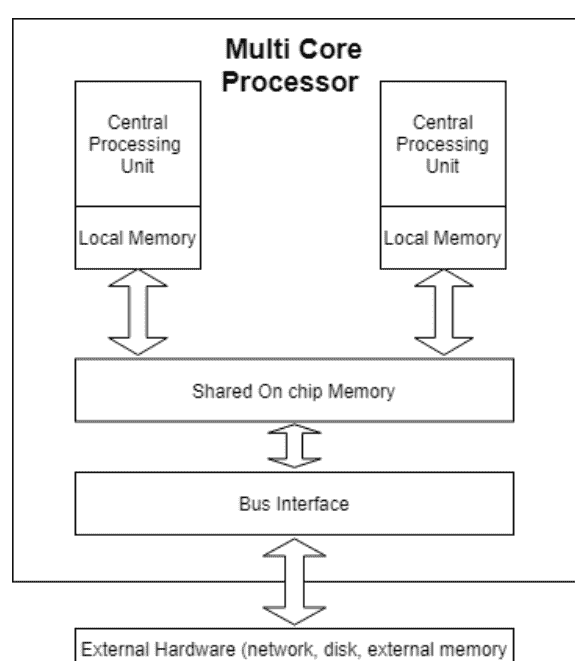
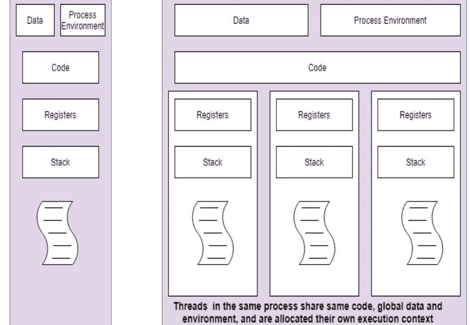
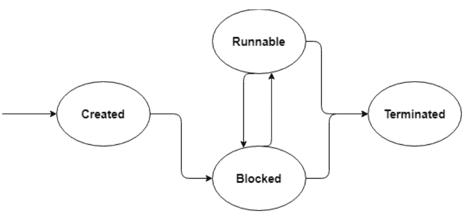
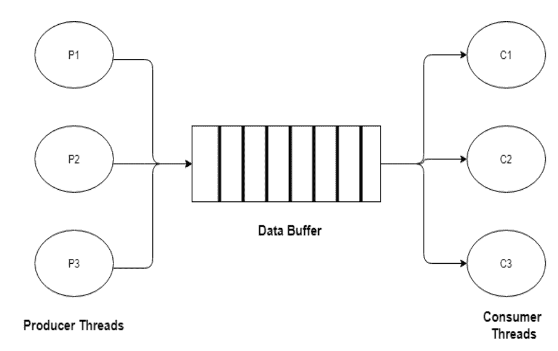
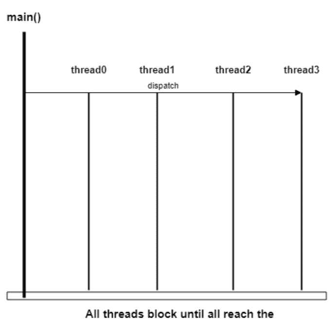

## 第 4 章 并发系统的概述

### 早期发布读者的说明

使用 Early Release 电子书，你可以在官方发布这些标题之前很久就利用这些技术——作者在写作时的原始未编辑内容。

这将是最终书籍的第 4 章。

如果你对我们如何改进本书的内容和/或示例有评论，或者如果你注意到本章中缺少材料，请联系编辑 vwilson@oreilly.com。

分布式系统由在多个位置的多个处理节点上并行或并发执行的多个独立代码片段组成。因此，任何分布式系统本质上都是并发系统，即使每个节点一次只处理一个事件。当然，各个节点的行为必须协调，以便应用程序按预期运行。

正如我在第 3 章中描述的那样，在分布式系统中协调节点充满危险。幸运的是，我们的行业已经成熟到足以提供复杂、强大的软件框架，这些框架在大多数情况下将许多这些分布式系统危险隐藏在我们的应用程序之外。本书的大部分内容侧重于描述我们如何利用这些框架构建可扩展的分布式系统。

然而，本章关注的是单个节点上系统的并发行为。通过显式编写软件以并发执行多个操作，我们可以优化单个节点的处理和资源利用，从而提高本地和系统范围内的处理能力。

我将使用 Java 7.0 并发功能作为示例，因为这些功能比 Java 8.0 中引入的功能抽象层次更低。了解并发系统“更接近机器”的运行方式是构建并发和分布式系统的基本基础知识。一旦你理解了构建并发系统的底层机制，更抽象的方法就更容易得到最佳利用。而且虽然本章特定于 Java，但并发系统的基本问题在你用其他语言编写系统时不会改变。处理并发的机制存在于所有主流编程语言中。侧边栏 *Concurrency Models* 提供了有关替代方法和它们在现代语言中实现方式的更多详细信息。

最后一点。本章是并发入门。它不会教你构建复杂、高性能并发系统所需的一切。如果你编写并发程序的经验生疏，或者你对另一种编程语言中的并发代码有一些了解，这也将很有用。本章末尾的进一步阅读部分将为希望深入研究该主题的人提供更全面的覆盖。

### 为什么需要并发？

想象一家繁忙的咖啡店。如果每个人都点一杯简单的咖啡，那么咖啡师可以快速、稳定地提供每杯饮料。突然，前面的那个人点了一杯豆奶、香草、不加糖、四倍浓缩冰酿。队伍里的人都叹了口气，开始阅读社交媒体。两分钟后，队伍排到了门外。

在 Web 应用程序中处理请求与我们的咖啡例子类似。在咖啡店，我们会请一位新咖啡师帮忙，同时在不同的机器上制作咖啡，以控制队伍长度并快速为顾客服务。在软件中，为了使应用程序响应迅速，我们需要


以某种方式以重叠的方式处理我们在服务器上的请求，并并发地处理请求。

在计算的旧时代，每个 CPU 在任何瞬间只能执行一条机器指令。如果我们的服务器应用程序在这样的 CPU 上运行，为什么我们需要构建软件系统以潜在地并发执行多条指令呢？这看起来有点毫无意义。

实际上有一个非常好的理由。几乎每个程序做的不仅仅是执行机器指令。例如，当程序尝试从文件读取或在网络上发送消息时，它必须与 CPU 周边的硬件子系统（磁盘、网卡）进行交互。从现代硬盘读取数据大约需要 10 毫秒（ms）。在这段时间内，程序必须等待数据可用以供处理。

现在，即使是像 1988 年左右的 Intel 80386¹ 这样古老的 CPU 也能每秒执行超过 1000 万条指令（mips）。10ms 是 1/100 秒。我们的 80386 在 1/100 秒内能执行多少条指令。算一下。很多！事实上是大量浪费的处理能力。

这就是像 Linux 这样的操作系统能够在一台 CPU 上运行多个程序的方式。当一个程序等待输入-输出（I-O）事件时，操作系统会调度另一个程序执行。通过明确地将我们的软件结构化为可以并行执行的多个活动，操作系统可以调度在其他程序等待 I-O 时有工作要做的任务。我们将在本章后面更详细地看到 Java 中是如何工作的。

2001 年，IBM 引入了世界上第一个多核处理器，一块具有两个 CPU 的芯片——图 4-1 显示了简化图示。今天，即使我的笔记本电脑也有 16 个 CPU，或通常所知的核心。有了多核芯片，结构化为具有多个并行活动的软件系统可以并发地在每个核心上执行，最多可达可用核心的数量。这样，我们可以充分利用多核芯片上的处理资源，从而提高应用程序的处理能力。



图 4-1. 多核处理器的简化视图

将软件系统结构化为并发活动的主要方式是使用 *线程*。几乎每种编程语言都有自己的线程机制。所有这些机制的底层语义相似——主流使用的主要线程模型只有几种——但显然语法因语言而异。在下面的章节中，我将解释 Java 中如何支持线程，以及我们如何设计程序使其在并行执行时是安全的（即正确）和高效的。掌握了这些知识后，跃入其他语言支持的并发特性就不算太困难了。

### 并发模型

本章描述了一种并发系统的模型，基于使用锁独立执行线程来操作共享可变资源。并发模型在计算机科学中已研究和探索了大约 50 年。提出了许多理论提案，其中一些已在现代编程语言中实现。这些模型为在程序中结构化和协调并发活动提供了替代方法。以下是你在工作中可能会遇到的一些示例。

- **Go：** 通信顺序进程（CSP）模型构成了 Go 并发特性的基础。² 在 CSP 中，进程通过使用称为通道的通信抽象发送消息来同步。在 Go 中，并发单元是 goroutine，goroutine 通过使用无缓冲或有缓冲的通道发送消息进行通信。无缓冲通道用于同步发送者和接收者，因为通信只有在两个 goroutine 都准备好交换数据时才会发生。
- **Erlang：** Erlang 实现并发的 Actor 模型³。Actor 是没有共享状态的轻量级进程，通过异步向其他 actor 发送消息进行通信。Actor 使用邮箱或队列来缓冲消息，并可以使用模式匹配来选择要处理的消息。
- **Node.js：** Node.js 摒弃了任何类似多线程的东西，而是利用单线程、非阻塞模型，由事件循环管理。⁴ 这意味着当需要输入-输出（IO）操作时，例如访问数据库，Node.js 发起操作但不会等待其完成。操作被委托给操作系统异步执行，完成后的结果作为回调放置在主线程的栈上。这些回调随后在事件循环中执行。这种模型对于执行频繁 IO 请求的代码效果很好，因为它避免了与线程创建和管理相关的开销。然而，如果你的代码需要执行 CPU 密集型操作，例如排序一个大列表，你只有一个线程。这将阻塞所有其他请求，直到排序完成。很少是理想的情况。

希望这能让你感受到现代编程语言中并发模型和原语的多样性。幸运的是，当你了解基础知识和一种模型后，其余的就很容易学习了。

### 线程

每个软件进程默认都有一个执行线程。这是操作系统在调度进程执行时管理的线程。在 Java 中，例如，你指定的作为代码入口点的 main() 函数定义了此线程的行为。此单个线程可以访问程序的环境和资源，例如打开的文件句柄和网络连接。随着程序在代码中实例化的对象中调用方法，程序的运行时栈用于传递参数和管理变量作用域。标准的编程语言运行时内容，我们都熟悉且热爱。这是一个顺序过程。

在你的系统中，你可以使用编程语言特性创建和执行额外的线程。每个线程都是独立的执行序列，并且有自己的运行时栈来管理本地对象创建和方法调用。每个线程也可以访问进程的全局数据和环境。这种方案的简单描述如图所示 4-2。

#### 单线程进程

#### 多线程进程



同一进程中的线程共享相同的代码、全局数据和环境，并分配自己的执行上下文

图 4-2. 比较单线程和多线程进程

在 Java 中，我们可以使用实现 Runnable 接口并定义 run() 方法的类来定义线程。下面的示例中给出了一个简单示例：

```
class NamingThread implements Runnable {

    private String name;

        public NamingThread(String threadName) {
            name = threadName ;
        System.out.println("Constructor called: " + threadName) ;
    }

    public void run() {
        //Display info about this thread
    System.out.println("Run called : " + name);
    System.out.println(name + " : " + Thread.currentThread());
    // and now terminate ....
```

要执行线程，我们需要使用我们的 Runnable 的实例构造一个 Thread 对象并调用 start() 方法以在其自己的执行上下文中调用代码。这在下面的代码示例中显示，同时以粗体文本显示运行代码的输出。请注意此示例有两个线程——main() 线程和 NamingThread。主线程启动 NamingThread，后者异步执行，然后等待 1 秒以给 NamingThread 中的 run() 方法充足的时间完成。

```
public static void main(String[] args) {

    NamingThread name0 = new NamingThread("My first thread");

    //Create the thread
    Thread t0 = new Thread (name0);

    // start the threads
    t0.start();

    //delay the main thread for a second (1000 milliseconds)
    try {
        Thread.currentThread().sleep(1000);
    } catch (InterruptedException e) {}

        //Display info about the main thread and terminate
        System.out.println(Thread.currentThread());

}
```

```
===EXECUTION OUTPUT===
Constructor called: My first thread
Run called : My first thread
My first thread : Thread[Thread-0,5,main]
Thread[main,5,main]
```

为了说明，我们还调用了静态 currentThread() 方法，它返回一个包含以下内容的字符串：

- 系统生成的线程标识符


- 线程优先级，默认情况下所有线程均为 5。我们稍后会介绍线程优先级。
- 父线程的标识符——在此示例中，两个父线程都是主线程

注意要实例化一个线程，我们调用 `start()` 方法，而不是我们在 `Runnable` 中定义的 `run()` 方法。`start()` 方法包含创建单独线程执行所需的内部系统魔法来创建执行上下文。如果我们直接调用 `run()`，代码会执行，但不会创建新线程。`run()` 方法将作为主线程的一部分执行，就像你所熟悉和喜爱的任何其他 Java 方法调用一样。你仍然只有一个线程的代码。

在示例中，我们使用 `sleep()` 来暂停主线程的执行，并确保它在 `NamingThread` 之前不会终止。这种方法，即通过延迟绝对时间段（例如示例中的 1 秒）来协调两个线程，并不是一个非常健壮的机制。如果由于某种原因——CPU 较慢、读取磁盘延迟较长、方法中额外的复杂逻辑——我们的线程没有在预期时间内终止，会怎样？在这种情况下，主线程会先终止——这不是我们想要的。一般来说，如果你使用绝对时间进行线程协调，你就是做错了。几乎总是如此。就像 99.99999% 的时间一样。

一个简单且健壮的机制，让一个线程等待另一个线程完成其工作，是使用 `join()` 方法。我们可以用以下内容替换上面的示例中的 try-catch 块：

```
t0.join();
```

此方法会导致调用线程（在本例中为主线程）阻塞，直到 `t0` 引用的线程终止。如果在调用 `join()` 之前引用的线程已终止，则方法调用会立即返回。这样我们就可以协调或同步多个线程的行为。事实上，多个线程的同步正是本章其余部分的重点。

### 线程执行的顺序

系统调度程序（在 Java 中位于 JVM 中）控制线程执行的顺序。从程序员的角度来看，执行顺序是非确定性的。习惯这个术语，我会经常使用它。非确定性的概念是理解多线程代码的基础。

我将通过在之前的 `NamingThread` 示例基础上进行构建来说明这一点。不是创建一个 `NamingThread`，我将创建并启动几个。事实上是三个，如以下代码示例所示。同样，运行代码的示例输出以粗体文本显示在其下方。

```
NamingThread name0 = new NamingThread("thread0");
NamingThread name1 = new NamingThread("thread1");
NamingThread name2 = new NamingThread("thread2");

//Create the threads
Thread t0 = new Thread (name0);
Thread t1 = new Thread (name1);
Thread t2 = new Thread (name2);

// start the threads
t0.start();
t1.start();
t2.start();
```

```
===EXECUTION OUTPUT===
Run called : thread0
thread0 : Thread[Thread-0,5,main]
Run called : thread2
Run called : thread1
thread1 : Thread[Thread-1,5,main]
thread2 : Thread[Thread-2,5,main]
Thread[main,5,main]
```

所示的输出只是单次执行的样本。你可以看到代码按顺序启动三个线程，即 t0、t1 和 t2（第 11-13 行）。查看输出，我们看到线程 t0 在其他线程启动之前完成（第 17 行）。接下来调用 t2 的 `run()` 方法（第 18 行），然后调用 t1 的 `run()` 方法，即使 t1 在 t2 之前启动。线程 t1 然后在 t2 之前运行完成

（第 20 行），最终主线程和程序终止。

这只是执行顺序的一种可能。如果我们再次运行此程序，我们几乎肯定会看到不同的执行跟踪。这是因为 JVM 调度程序决定执行哪个线程以及执行多长时间。非常简单地说，一旦调度程序为线程在 CPU 上分配了执行时间片，它就可以在指定时间后中断该线程并安排另一个线程运行。这种中断称为抢占。抢占确保每个线程都有机会取得进展。因此线程独立且异步地运行直到完成，而调度程序根据调度算法决定何时运行哪个线程。

线程调度不仅仅如此，我将在本章后面解释使用的基本调度算法。但就目前而言，对程序员来说有一个主要影响，即无论线程执行的顺序如何，而你无法控制它，你的代码都应产生正确的结果。听起来很容易？

继续阅读。

### 线程的问题

并发编程中的基本问题是协调多个线程的执行，以便无论它们以何种顺序执行，都能产生正确答案。鉴于线程可以非确定性地启动和抢占，任何中等复杂度的程序都将本质上具有无限数量的可能执行顺序。这些系统不容易测试。

所有并发程序都需要避免的两个基本问题是竞态条件和死锁，这些主题将在接下来的两个小节中介绍。

### 竞态条件

线程的非确定性执行意味着构成线程的代码语句：

- 将按每个线程内部定义的顺序顺序执行
- 可以以任何顺序在线程之间重叠。这是因为每个线程执行时段执行的语句数量由调度程序决定。

因此，当多个线程在单个处理器上执行时，它们的执行是*交错的*。CPU 执行一个线程的一些步骤，然后执行另一个线程的一些步骤，依此类推。如果我们在多核 CPU 上执行，则可以每个核心执行一个线程。每个线程执行的语句仍然以非确定性的方式交错。

现在，如果每个线程只是做自己的事情，并且完全独立，这就不是问题。每个线程执行直到终止，就像我们在简单的 `NamingThread` 示例中一样。这很容易！为什么这些线程东西注定要复杂？

不幸的是，完全独立的线程并不是大多数多线程系统的行为方式。如果你参考图 4-2，你会看到多个线程共享进程中的全局数据。在 Java 中，这既是全局数据也是静态数据。

线程可以使用共享数据结构来协调工作并在线程之间通信状态。例如，我们可能有处理来自 Web 客户端请求的线程，每个请求一个线程。我们还想保留每天处理的请求总数的运行总数。当线程完成请求时，它会递增所有线程共享并在每次请求后更新的全局 *RequestCounter* 对象。到了当天结束时，我们就知道处理了多少请求。这是一个简单而优雅的解决方案。嗯，也许？

下面的代码显示了一个非常简单的实现，模仿请求计数器示例场景。它创建 50k 个线程来更新共享计数器。请注意，我们使用 lambda 函数来简洁地创建线程，

并且在 main 中有一个“非常糟糕的主意”⁵ 5 秒延迟以允许线程完成。

```
public class RequestCounter {
    final static private int NUMTHREADS = 50000;
    private int count = 0;

    public void inc() {
        count++;
    }

    public int getVal() {
        return this.count;
    }

    public static void main(String[] args) throws InterruptedException {
        final RequestCounter counter = new RequestCounter();

        for (int i = 0; i < NUMTHREADS; i++) {
            // lambda runnable creation
            Runnable thread = () -> {counter.inc(); };
            new Thread(thread).start();
        }

        Thread.sleep(5000);
        System.out.println("Value should be " + NUMTHREADS + "It is: " + counter.getVal());
    }
}
```

你可以在家做的就是从书籍 github 仓库克隆此代码，运行几次代码，看看你得到什么结果。在 10 次执行中我的平均值为 49995。我一次也没有得到正确的答案 50000。奇怪。

为什么？

答案在于抽象、高级编程语言语句在机器上的执行方式，在本例中为 Java。在此示例中，要执行计数器的递增，CPU 必须 (1) 将当前值加载到寄存器中，(2) 递增寄存器值，以及 (3) 将结果写回原始内存位置。这个简单的递增实际上是一系列三个机器级操作。


如图 4-3 所示，在机器级别，这三个操作是独立的，并未被当作单个 *原子* 操作处理。 所谓原子，我们指的是一个不能被中断的操作，因此一旦开始就会执行到完成。

由于自增操作在机器级别不是原子的，一个线程可以从内存中将计数器的值加载到 CPU 寄存器中，但在它写回自增后的值之前，调度器会抢占该线程并允许另一个线程开始。 该线程从内存中加载计数器的旧值并写回自增后的值。 最终原始线程再次执行，并写回其自增后的值，该值恰好与内存中已有的值相同。

这意味着我们丢失了一次更新。 从上面计数器代码的 10 次测试来看，我们发现平均在 50000 次自增中会发生约 5 次。 因此此类事件很少见，但即使每 1000 万次发生 1 次，结果仍然是错误的。

| Thread 1 | Thread 2 |
|---|---|
| Reads (x) into register | |
| Register value + 6 | |
| Writes register value to (x) | |
| | Reads (x) into register |
| | Register value + 1 |
| | Writes register value to (x) |

| Thread 1 | Thread 2 |
|---|---|
| Reads (x) into register | |
| Register value + 6 | |
| | Reads (x) into register |
| | Register value + 1 |
| | Writes register value to (x) |
| Writes register value to (x) | |


*Figure 4-3. Increments are not atomic at the machine level*

当我们以这种方式丢失更新时，就称为竞争条件。 每当多个线程对某些共享状态进行更改时，就会发生竞争条件，在此例中是一个简单的计数器。 本质上，线程的不同交错会导致不同的结果。

竞争条件是阴险的、邪恶的错误，因为它们的发生通常很罕见，而且很难检测，因为大多数时候答案是正确的。 尝试使用 1000 个线程而不是 50000 运行多线程计数器代码示例，你就会亲眼看到这一点。 我十次中有九次得到了正确答案。

因此，这个情况可以概括为“相同代码，偶尔不同结果”。 就像我说的——竞争条件很邪恶！ 好在如果你采取一些预防措施，根除它们是相当直接的。

关键是识别并保护 *临界区*。 临界区是更新共享数据结构的代码段，因此如果被多个线程访问，必须以原子方式执行。 自增共享计数器的例子就是临界区的例子。 另一个例子是从列表中删除一个项目。 我们需要删除列表的头节点，并将对列表头的引用从被删除的节点移动到列表中的下一个节点。 这两个操作必须以原子方式执行以维护列表的完整性。 这是一个临界区。

在 Java 中，`synchronized` 关键字定义了临界区。 如果用它来修饰一个方法，那么当多个线程尝试在同一个共享对象上调用该方法时，只允许一个线程进入临界区。 所有其他线程都会阻塞，直到线程退出 synchronized 方法，届时调度器会选择下一个线程来执行临界区。 我们说临界区的执行是串行的，因为一次只有一个线程可以执行其中的代码。

要修复计数器示例，你只需将 `inc()` 方法识别为临界区并使其成为 synchronized 方法，即：

```
synchronized public void inc() {
    count++;
}
```

尽情测试吧。 你总是会得到正确答案。 稍微正式地说，这意味着调度器抛给我们的线程的任何交错都会始终产生正确的结果。

synchronized 关键字也可以应用于方法内的语句块。 例如，我们可以将上面的例子重写为：

```
public void inc() {
synchronized(this){
    count++;
}
}
```

在底层，每个 Java 对象都有一个 *监视器锁*，有时也称为内部锁，作为其运行时表示的一部分。 监视器就像长途巴士上的卫生间——一次只允许（也应该！）一个人进入，使用时门锁会阻止其他人进入。

在我们这个完全卫生的 Java 运行时环境中，线程必须获取监视器锁才能进入 synchronized 方法或 synchronized 语句块。 任何时候只有一个线程可以拥有该锁，因此执行是串行的。 这就是 Java 和类似语言实现临界区的基本方式。

作为经验法则，你应该尽可能保持临界区尽可能小，以使串行化代码最小化。 这对性能和可扩展性都有积极影响。 我稍后会再次讨论这个话题，但我其实又在谈论阿姆达尔定律，如第 2 章中介绍的那样。 Synchronized 块是阿姆达尔所描述的系统的串行部分，而它们执行的时间越长，我们对系统可扩展性的潜力就越小。

### 死锁

为了确保多线程代码的正确结果，我解释说我们必须限制固有的非确定性以串行化对临界区的访问。 这可以避免竞争条件。 然而，如果我们不小心，我们可能会编写出限制非确定性太多以至于程序停止的代码。 而且永远不会继续。 这正式被称为死锁。

死锁发生在两个或多个线程永远阻塞且都无法继续时。 这发生在线程需要对共享资源集进行独占访问，并且线程以不同顺序获取锁时。 这在下面的示例中有所说明，其中两个线程需要对临界区 A 和 B 进行独占访问。 线程 1 获取临界区 A 的锁，线程 2 获取临界区 B 的锁。 然后两者都永远阻塞，因为它们无法获取继续所需的锁。

*Two threads sharing access to two shared variables via synchronized blocks*

- 1. thread 1: enters critical section A
- 2. thread 2: enters critical section B
- 3. thread 1: blocks on entry to critical section B
- 4. thread 2: blocks on entry to critical section A
- 5. Both threads wait forever

死锁，也称为致命拥抱，会导致程序停止。 不需要丰富的想象力就能意识到这会造成各种不良后果。 我正愉快地发着短信，而我的自动驾驶汽车正载着我去酒吧。 突然间，车辆代码死锁了。 结果不会好。

死锁发生在比上面简单示例更微妙的情况下。 经典的例子是哲学家进餐问题。 故事是这样的。

五位哲学家围坐在共享的桌子旁。 作为哲学家，他们花了很多时间深入思考。 在深思熟虑之间，他们通过吃面前盘子里的食物来补充大脑功能。 因此，哲学家要么在吃饭，要么在思考，要么在两者之间转换。

此外，哲学家们必须身体非常接近、极其灵巧并且接种了 Covid19 疫苗，因为他们共用筷子吃饭。 桌上只有五双筷子，放在每位哲学家之间。 当一位哲学家想吃饭时，他们会遵循先拿起左筷子，然后拿起右筷子的协议。 一旦准备好再次思考，他们会先放下右筷子，然后放下左筷子。

### Figure 4-4. The Dining Philosophers Problem

图 4-4 描绘了我们的哲学家，每人都有唯一的编号。 由于每个人都在并发地进食或思考，我们可以将每个哲学家建模为一个线程。 代码如示例 4-7 所示。 共享的筷子由 Java Object 类的实例表示。 由于一次只有一个对象可以持有对象的监视器锁，因此它们被用作哲学家获取进食所需筷子的临界区的进入条件。 吃完后，筷子会被放回桌上，并在每个筷子上释放锁，以便邻近的哲学家在准备好时进食。

### Example 4-7. The Philosopher Thread

```
1  public class Philosopher implements Runnable {
2
3      private final Object leftChopStick;
4      private final Object rightChopStick;
5
6      Philosopher(Object leftChopStick, Object rightChopStick) {
7          this.leftChopStick = leftChopStick;
8          this.rightChopStick = rightChopStick;
9      }
10     private void LogEvent(String event) throws
InterruptedException {
11       System.out.println(Thread.currentThread()
12                             .getName() + " " + event);
13       Thread.sleep(1000);
14     }
15
16     public void run() {
17         try {
18             while (true) {
19                 LogEvent(": Thinking deeply");
20                 synchronized (leftChopStick) {
21                     LogEvent(" : Picked up left chop stick");
22                     synchronized (rightChopStick) {
23                         LogEvent(": Picked up right chopstick - eating");
24                         LogEvent(": Put down right chopstick");
25                     }
26                     LogEvent(": Put down left chopstick. Ate too much");
27                 }
28             } // end while
```


```
29      } catch (InterruptedException e) {
30          Thread.currentThread().interrupt();
31      }
32  }
33 }
```

要让示例 4-7 中描述的哲学家活起来，我们必须为每个哲学家实例化一个线程，并让每个哲学家都能访问其相邻的筷子。这是通过示例 4-8 中第 16 行的线程构造函数调用完成的。在 for 循环中我们创建了五个哲学家并将其作为独立线程启动，其中每根筷子可被两个线程访问，一个作为左筷子，一个作为右筷子。

### 示例 4-8. 哲学家就餐问题 - 死锁版本

```
private final static int NUMCHOPSTICKS = 5 ;
private final static int NUMPHILOSOPHERS = 5;
public static void main(String[] args) throws Exception {

    final Philosopher[] ph = new Philosopher[NUMPHILOSOPHERS];
    Object[] chopSticks = new Object[NUMCHOPSTICKS];

    for (int i = 0; i < NUMCHOPSTICKS; i++) {
        chopSticks[i] = new Object();
    }

    for (int i = 0; i < NUMPHILOSOPHERS; i++) {
        Object leftChopStick = chopSticks[i];
        Object rightChopStick = chopSticks[(i + 1) % chopSticks.length];

        ph[i] = new Philosopher(leftChopStick, rightChopStick);
    }

    Thread th = new Thread(ph[i], "Philosopher " + (i + 1));
    th.start();
}
}
```

运行此代码在我第一次尝试时产生了以下输出。如果你运行代码，你几乎肯定会看到不同的输出，但最终结果会相同。

```
Philosopher 4 : Thinking deeply
Philosopher 5 : Thinking deeply
Philosopher 1 : Thinking deeply
Philosopher 2 : Thinking deeply
Philosopher 3 : Thinking deeply
Philosopher 4 : Picked up left chop stick
Philosopher 1 : Picked up left chop stick
Philosopher 3 : Picked up left chop stick
Philosopher 5 : Picked up left chop stick
Philosopher 2 : Picked up left chop stick
```

10 行输出，然后……什么都没有！我们发生了死锁。这是一个经典的循环等待死锁。想象以下场景：

- 1. 每个哲学家都沉浸在一场漫长的思考中
- 2. 同时，他们都决定自己饿了并伸手去拿自己的左筷子。
- 3. 没有一个哲学家能吃到东西，因为没有人能拿起自己的右筷子

现实中的哲学家在这种情况下会想办法通过放下筷子或两根筷子来继续前进，直到一个或多个同事可以进食。我们有时也可以在软件中通过对阻塞操作使用超时来实现这一点。当超时到期时，线程释放临界区并重试，从而让其他被阻塞的线程有机会继续前进。但这并不理想，因为被阻塞的线程会损害性能，而且设置超时值是一门不精确的科学。

因此，更好的做法是设计一个无死锁的解决方案。这意味着一个或多个线程将始终能够取得进展。对于循环等待死锁，可以通过对共享资源施加资源分配协议来实现，这样线程就不会总是以相同的顺序请求资源。

在哲学家就餐问题中，我们可以通过确保我们的其中一个哲学家先拿起右筷子来实现这一点。让我们假设我们指示哲学家 4 先这样做。这导致了如下所示的可能操作序列：

Philosopher 0 picks up left chopstick (chopStick[0]) then right (chopStick[1])
Philosopher 1 picks up left chopstick (chopStick[1]) then right (chopStick[2])
Philosopher 2 picks up left chopstick (chopStick[2]) then right (chopStick[3])
Philosopher 3 picks up left chopstick (chopStick[3]) then right (chopStick[4])
Philosopher 4 picks up right chopstick (chopStick[0]) then left (chopStick[4])

在此示例中，哲学家 4 必须阻塞，因为哲学家 0 已经获得了对 chopstick[0] 的访问权。随着哲学家 4 被阻塞，哲学家 3 可以确保获得对 chopstick[4] 的访问权，然后继续满足其食欲。

哲学家就餐问题的修复方案显示在示例 4-10 中。

### 示例 4-10. 解决哲学家就餐死锁

```
if (i == NUMPHILOSOPHERS - 1) {
    // The last philosopher picks up the right fork first
    ph[i] = new Philosopher(rightChopStick, leftChopStick);
} else {
    // all others pick up the left chop stick first
    ph[i] = new Philosopher(leftChopStick, rightChopStick);
}
```

更正式地说，我们对共享资源的获取施加了排序，使得：

```
chopStick[0]< chopStick[1]< chopStick[2]< chopStick[3]<
chopStick[4]
```

这意味着每个线程将始终尝试先获取 chopstick[0]，然后再获取 chopstick[1]，然后再获取 chopstick[2]，依此类推。对于哲学家 4 来说，这意味着它将尝试先获取 chopstick[0] 再获取 chopstick[4]，从而打破了循环等待死锁的可能性。

死锁是一个复杂的话题，本节只是触及了表面。你会在许多分布式系统中看到死锁。例如，一个

用户请求获取对 *Students* 数据库表中某些数据的锁，然后必须更新 *Classes* 表中的行以反映学生的出勤情况。同时，另一个用户请求获取对 *Classes* 表的锁，然后必须更新 *Students* 表中的一些信息。如果这些请求以重叠的方式获取锁的方式交错，我们就会发生死锁。

我将在本书第 3 部分讨论并发数据库访问和锁定时再次讨论死锁。

### 线程状态

多线程系统有一个系统调度程序，决定何时运行哪些线程。在 Java 中，调度程序被称为抢占式、基于优先级的调度程序。简而言之，这意味着它选择执行希望运行的最高优先级线程。

每个线程都有一个优先级，默认为 5，范围为 0 到 10。线程从其父线程继承优先级。较高优先级的线程比较低优先级的线程更频繁地被调度，但在大多数应用程序中，将所有线程设为默认优先级就足够了。

调度程序根据线程的行为将线程循环通过四种不同的状态。这些是：

*Created*

线程对象已被创建，但其 `start()` 方法尚未被调用。一旦 `start()` 被调用，线程进入可运行状态。

*Runnable*

线程能够运行。调度程序将以先进先出 FIFO 方式选择要执行的线程 - 每个节点中的每个核心一次可以分配一个线程。线程然后执行，直到它们阻塞，例如在 `synchronized` 语句上，执行

yield()、suspend() 或 sleep() 语句，run() 方法终止，或被调度程序抢占。抢占发生在更高优先级线程变为可运行时，或当系统特定的时间段，即时间片，到期时发生。基于时间片的抢占允许调度程序确保所有线程最终都有机会执行 - 没有执行饥饿的线程可以占用 CPU。

#### Blocked

线程被阻塞，如果它正在等待锁、通知事件发生，例如 sleep 计时器到期、resume() 方法执行，或正在等待网络或磁盘请求完成。当被阻塞线程等待的具体事件发生时，它会回到可运行状态。

#### Terminated

线程的 run() 方法已完成或它已调用 stop() 方法。线程将不再被调度。

该方案的说明见图 4-5。调度程序有效地为每个线程优先级维护可运行状态的 FIFO 队列。高优先级线程通常用于响应事件，例如紧急计时器，并执行很短的时间。低优先级线程用于后台、持续的任务，如通过重新计算校验和来检查磁盘上文件的损坏。后台线程基本上利用空闲的 CPU 周期。



图 4-5. 线程状态和转换

### 线程协调

有很多问题需要具有不同角色的线程协调其活动。想象一个线程集合，每个线程都从用户接受文档，对文档进行一些处理，例如生成 pdf，然后将处理后的文档发送到共享打印机池。每台打印机一次只能打印一份文档，因此它们从共享打印队列中读取，按到达顺序抓取并打印文档。

这个打印问题是经典的生产者-消费者问题的例证。生产者通过共享 FIFO 缓冲区向消费者发送消息。消费者检索这些消息，处理它们，然后从缓冲区请求更多工作。这个问题的简单说明见图 4-6。它有点像 24 小时、365 天的自助餐厅 - 厨房不断生产，服务员收集食物并放在自助餐台上，饥饿的食客自行取用。永远如此。

像几乎所有真实资源一样，缓冲区具有有限的容量。生产者生成新项目，但如果缓冲区已满，他们必须等待某些项目被消费后才能将新项目添加到缓冲区。同样，如果消费者消费的速度比生产者生产的速度快，那么当缓冲区中没有项目时，他们必须等待，并以某种方式在新项目到达时得到通知。




Figure 4-6. The Producer Consumer Problem

生产者等待缓冲区有空间，或消费者等待有项目的一种方式是不断重试操作。生产者可以休眠一秒，然后重试 put 操作直到成功。消费者也可以同样操作。

这种解决方案称为轮询，或忙等待。它工作正常，但正如第二个名字所暗示的，每次重试失败时，每个生产者和消费者都在使用资源（CPU、内存，也许网络？）。如果这不是问题，那很好，但在可扩展系统中我们始终致力于优化资源使用，而轮询可能很浪费。

更好的解决方案是让生产者和消费者在各自期望的操作 put 或 get 分别能够成功之前阻塞。被阻塞的线程不消耗资源，因此提供了一种高效的解决方案。为此，线程编程模型提供了阻塞操作，使线程能够在事件发生时向其他线程‘发出信号’。对于生产者-消费者问题，基本方案如下：

- 当生产者向缓冲区添加项目时，它向任何被阻塞的消费者发送信号，通知它们缓冲区中有项目
- 当消费者从缓冲区检索项目时，它向任何被阻塞的生产者发送信号，通知它们缓冲区有容量可供新项目使用。

在 Java 中，有两个基本原语，即 wait() 和 notify()，可用于实现这种信号方案。简要来说，它们的工作方式如下：

- 如果线程在 synchronized 块内需要的某些条件不成立，则线程可以调用 wait()。例如，线程可能尝试从缓冲区检索消息，但如果缓冲区没有可检索的消息，它会调用 wait() 并阻塞，直到另一个线程添加消息，将条件设为 true，并在同一对象上调用 notify()。
- notify() 唤醒已在该对象上调用 wait() 的线程。

这些 Java 原语用于实现 guarded blocks。Guarded blocks 使用条件作为保护，只有在条件成立时线程才会恢复执行。下面的代码片段展示了如何使用保护条件 empty 来阻塞尝试从空缓冲区检索消息的线程。

```
while (empty) {
    try {
        System.out.println("Waiting for a message");
        wait();
    } catch (InterruptedException e) {}
}
```

当另一个线程向缓冲区添加消息时，它执行 notify()，如下面的代码片段所示。

```
// Store message.
this.message = message;
empty = false;
// Notify consumer that message is available
notify();
```

此示例的完整实现在书的 git 仓库中的代码示例中给出。wait() 和 notify() 方法有许多变体，但这超出了我在本概述中可以涵盖的范围。幸运的是，Java 为我们提供了线程安全的抽象，隐藏了这种复杂性。

与生产者-消费者问题相关的示例是 java.util.concurrent.BlockingQueue 中的 BlockingQueue 接口。BlockingQueue 实现提供了一个线程安全的对象，可用作生产者-消费者场景中的缓冲区。BlockingQueue 接口有 5 种不同的实现。我将使用其中一种 LinkedBlockingQueue 来实现生产者-消费者。这在示例 4-13 中显示。

### Example 4-13. Producer-Consumer with a LinkedBlockingQueue

```
class ProducerConsumer {
    public static void main(String[] args)
        BlockingQueue buffer = new LinkedBlockingQueue();
        Producer p = new Producer(buffer);
        Consumer c = new Consumer(buffer);
        new Thread(p).start();
        new Thread(c).start();
    }
}

class Producer implements Runnable {
    private boolean active = true;
    private final BlockingQueue buffer;
    public Producer(BlockingQueue q) { buffer = q; }
    public void run() {
        try {
            while (active) { buffer.put(produce()); }
        } catch (InterruptedException ex) { // handle exception}
    }
    Object produce() { // details omitted, sets active=false }
}

class Consumer implements Runnable {
    private boolean active = true;
    private final BlockingQueue buffer;
    public Consumer(BlockingQueue q) { buffer = q; }
    public void run() {
```

```
try {
    while (active) { consume(buffer.take()); }
} catch (InterruptedException ex) { // handle exception }
}
void consume(Object x) { // details omitted, sets active=false
}
}
```

这种解决方案使程序员不必担心协调对共享缓冲区的访问的实现，并大大简化了代码。

`java.util.concurrent`⁶ 包是构建多线程 Java 解决方案的宝库。在以下各节中，我将简要介绍其中一些强大且非常有用的功能。

### Thread Pools

许多多线程系统需要创建和管理一组执行类似任务的线程。例如，在生产者-消费者问题中，我们可以有一组生产者线程和一组消费者线程，同时添加和移除项目，并协调对共享缓冲区的访问。

这些集合称为线程池。线程池包含多个工作线程，它们通常执行类似的目的并作为集合进行管理。我们可以创建一个生产者线程池，所有线程都等待要处理的项目，将最终产品写入缓冲区，然后等待接受另一个要处理的项目。当我们停止生产项目时，池可以安全地关闭，这样就不会因意外异常而丢失部分处理的项目。

在 `java.util.concurrent` 包中，线程池由 `ExecutorService` 接口支持。这扩展了基础 Executor 接口，提供了一组用于管理和终止池中线程的方法。示例 4-14 和示例 4-15 显示了一个使用固定大小线程池的简单生产者-消费者示例。示例 4-14 中的 `Producer` 类是一个 `Runnable`，它向缓冲区发送一条消息然后终止。Consumer 只需从缓冲区获取消息，直到接收到空字符串，然后终止。

### Example 4-14. Producer and Consumer for thread pool implementation

```
class Producer implements Runnable {
    private final BlockingQueue buffer;
    public Producer(BlockingQueue q) { buffer = q; }
    @Override
    public void run() {
        try {
            sleep(1000);
            buffer.put("hello world");
        } catch (InterruptedException ex) {
            // handle exception
        }
    }
}
class Consumer implements Runnable {
    private final BlockingQueue buffer;
    public Consumer(BlockingQueue q) { buffer = q; }
    @Override
    public void run() {
        boolean active = true;
        while (active) {
            try {
                String s = (String) buffer.take();
                System.out.println(s);
                if (s.equals("")) active = false;
            } catch (InterruptedException ex) {
                / handle exception
            }
        } /
        System.out.println("Consumer terminating");
    }
}
```

在示例 4-15 中，我们创建一个单一消费者从缓冲区获取消息。然后我们创建一个大小为 5 的固定大小线程池来管理我们的生产者。这导致 JVM 预分配五个线程，可用于执行池执行的任何 Runnable 对象。

在 for() 循环中，我们然后使用 ExecutorService 运行 20 个生产者。由于线程池中只有 5 个线程可用，因此最多只有 5 个生产者会同时执行。所有其他生产者都放置在由线程池管理的等待队列中。当一个生产者终止时，等待队列中的下一个 Runnable 会使用池中任何可用的线程执行。

一旦我们请求所有生产者由线程池执行，我们就在池上调用 shutdown() 方法。这告诉 ExecutorService 不再接受任何要运行的任务。接下来我们调用 awaitTermination() 方法，该方法阻塞调用线程，直到由线程池管理的线程都处于空闲状态并且等待队列中没有更多工作为止。一旦 awaitTermination() 返回，我们就知道所有消息都已发送到缓冲区，因此向缓冲区发送一个空字符串，该字符串将作为消费者的终止值。

### Example 4-15. Thread pool-based Producer Consumer solution

```
public static void main(String[] args) throws InterruptedException
{
    BlockingQueue buffer = new LinkedBlockingQueue();

    //start a single consumer
    (new Thread(new Consumer(buffer))).start();

    ExecutorService producerPool = Executors.newFixedThreadPool(5);
    for (int i = 0; i < 20; i++)
    {
        Producer producer = new Producer(buffer);
        System.out.println("Producer created");
        producerPool.execute(producer);
    }

    producerPool.shutdown();
    producerPool.awaitTermination(10, TimeUnit.SECONDS);

    //send termination message to consumer
    buffer.put("");
}
```

像本章大多数主题一样，Executor 框架中有许多更复杂的特性可用于创建多线程


programs. 这个描述仅涵盖了基础知识。线程池很重要，因为它们使我们的系统能够合理化线程资源的利用。每个线程都会消耗内存，例如线程的栈大小通常约为 1MB。此外，当我们切换执行上下文以运行新线程时，这会消耗 CPU 周期。如果我们的系统以无纪律的方式创建线程，我们最终会耗尽内存并且系统会崩溃。线程池允许我们控制创建的线程数量并高效地利用它们。

我将在本书的剩余部分讨论线程池，因为它们是高效且可扩展地管理服务器必须满足的不断增加的请求负载的关键概念。

### Barrier Synchronization

我有一个高中朋友，他的家人，在用餐时间，不允许任何人在全家人都坐在桌边之前开始进食。我认为这很奇怪，但多年后它成为一个很好的类比，用于概念 barrier synchronization。进食仅在所有家庭成员到达桌边后才开始。

多线程系统通常需要遵循这种行为模式。想象一个多线程图像处理系统。一张图像到达，每个线程都会接收到图像的一个不同片段来执行某些转换——想想类固醇版的 Instagram 滤镜。只有当所有线程都完成时，图像才算完全处理完毕。在软件系统中，我们使用一种称为 barrier synchronization 的机制来实现这种线程协调方式。

总体方案如图 4-7 所示。在此示例中，main() 线程创建了四个新线程，并且所有线程独立进行，直到它们到达 barrier 定义的执行点为止。随着每个线程的到达，它会被阻塞。当所有线程都到达此点时，barrier 被释放，每个线程可以继续其处理。



Figure 4-7. Barrier Synchronization

Java 提供了三种 barrier synchronization 原语。我将在此处展示其中一种，即 CountDownLatch 的工作原理。基本概念适用于其他 barrier synchronization 原语。

当你创建 CountDownLatch 时，你将一个值传递给其构造函数，该值表示必须在 barrier 处阻塞的线程数量，然后它们才能全部继续。这是在管理系统 barrier 点的线程中调用的——在图 4-7 中这将是 main()。

```
CountDownLatch nextPhaseSignal = new CountDownLatch(numThreads);
```

接下来你创建将执行某些操作然后在 barrier 处阻塞直到全部完成的 worker 线程。为此，你需要将 CountDownLatch 的引用传递给每个线程。

```
for (int i = 0; i < numThreads; i++) {
    Thread worker = new Thread(new
WorkerThread(nextPhaseSignal);
    worker.start();
}
```

启动 worker 线程后，main() 线程将调用 .await() 方法阻塞，直到 latch 被 worker 线程触发。

```
nextPhaseSignal.await();
```

每个 worker 线程将完成其任务，并在退出前在 latch 上调用 .countDown() 方法。这会递减 latch 值。当最后一个线程调用 .countDown() 并且 latch 值变为零时，所有已在 latch 上调用 .await() 的线程将从阻塞状态转换到可运行状态。在此阶段我们确信所有 worker 都已完成其分配的任务。

```
nextPhaseSignal.countDown();
```

对 .countDown() 的任何后续调用都会立即返回，因为 latch 已被有效触发。请注意 .countDown() 是非阻塞的，这对于在到达 barrier 后仍有更多工作要做的应用程序来说是一个有用的属性。

此示例说明了使用 CountDownLatch 阻塞单个线程，直到一组线程完成其工作。你可以通过将 latch 的初始值初始化为一来反转此用例。多个线程可以调用 .await() 并阻塞，直到另一个线程调用 .countDown() 来释放所有等待的线程。此示例类似于一个简单的门，一个线程打开它以允许其他线程继续。

CountDownLatch 是一个简单的 barrier synchronizer。它是一个一次性工具，因为初始化值无法重置。更复杂的功能由 Java 中的 CyclicBarrier 和 Phaser 类提供。掌握了本节中 barrier synchronization 的工作原理后，这些将很容易理解。

### Thread-Safe Collections

许多 Java 程序员，一旦深入多线程程序的奇妙之处，就会惊讶地发现 java.util 包⁷ 中的集合不是线程安全的。为什么，我听到你问？答案，幸运的是，很简单。这与性能有关。调用 synchronized 方法会产生开销。因此为了获得单线程程序的更快执行，集合不是线程安全的。

如果你想在多个线程之间共享一个 ArrayList、Map 或 '你最喜欢的数据结构' 来自 java.util，你必须确保对结构的修改放在临界区中。这种方法将安全地进行更新的负担放在集合的客户端上，因此容易出错——程序员可能会忘记在 synchronized 块中进行修改。

在多线程代码中始终更安全地使用固有的线程安全集合。出于这个原因，Java 集合框架提供了一个工厂方法来创建 java.util 集合的线程安全版本。以下是创建线程安全列表的示例。

```
List<String> list = Collections.synchronizedList(new ArrayList<>())
```

实际上发生的是你正在围绕基础集合类创建一个包装器，该包装器具有 synchronized 方法。这些方法以线程安全的方式当然将实际工作委托给原始类。你可以对 java.util 包中的任何集合使用这种方法，其一般形式为：

```
Collections.synchronized...(new collection<>())
```

其中“...”是 List、Map、Set 等。

当然，使用 synchronized 包装器时，你会为获取监视器锁和序列化来自多个线程的访问而付出性能代价。这意味着整个集合在单个线程进行修改时被锁定，大大限制了并发性能（再次是 Amdahl 定律）。出于这个原因，Java 5.0 包含了 concurrent collections 包，即 java.util.concurrent。它包含专门为高效多线程访问而设计的丰富的类集合。

事实上我们已经看到其中一个类——LinkedBlockingQueue。它使用一种锁定机制，使项目能够并行地添加到队列中并从队列中移除。这种更细粒度的锁定机制利用 java.util.concurrent.lock.Lock 类而不是监视器锁方法。这允许在同一集合上使用多个锁，从而实现安全的并发访问。

另一个提供这种更细粒度锁定的非常有用的集合是 ConcurrentHashMap。它提供了与非线程安全的 HashMap 相同的类似方法，但允许基于你可以传递给构造函数的 concurrencyLevel 值进行非阻塞读取和并发写入（默认值是 16）。

```
ConcurrentHashMap (int initialCapacity, float loadFactor,
    int concurrencyLevel)
```

内部，哈希表被划分为可单独锁定的段，通常称为 shards。锁与每个 shard 相关联而不是整个集合。这意味着可以并发地对集合中不同 shard 的哈希表条目进行更新，从而提高性能。

出于性能原因，检索操作是非阻塞的，这意味着它们可以与多个并发更新重叠。这意味着检索仅反映在检索执行时已完成的最新更新操作的结果。

出于类似原因，ConcurrentHashMap 的迭代器是所谓的 weakly consistent。这意味着迭代器包含哈希映射的副本，反映了迭代器创建时的状态。在迭代器使用期间，新的节点可能被添加到底层哈希映射中，并且现有节点可能被移除。然而，这些状态更改不会反映在迭代器中。


如果需要一个迭代器，它始终反映当前哈希映射状态，同时被多个线程更新，那么就需要付出性能代价，而 `ConcurrentHashMap` 并不是正确的方法。这是优先考虑性能而非一致性的一个例子——这是一个经典的设计权衡。

### 总结与进一步阅读

我将在本书的其余部分贯穿本章介绍的主要概念。线程本质上是我们在构建可扩展分布式系统时所使用的數據处理和数据库平台的组成部分。在许多情况下，你可能不会显式地编写多线程代码。然而，你编写的代码将在多线程环境中被调用，这意味着你需要意识到线程安全。许多平台还通过配置参数公开其并发性，这意味着为了调整系统的性能，你需要理解更改各种线程和线程池设置的影响。基本上，在可扩展分布式系统的世界里，无法逃避并发。

最后，值得一提的是，虽然并发编程原语在不同编程语言中有所不同，但基础问题并没有改变，需要精心设计多线程代码以避免竞态条件和死锁。无论你使用的是 C/C++ 中的 `pthreads`⁸ 库，还是经典的受 Communicating Sequential Processes⁹ (CSP)启发的 Go 并发模型¹⁰，你需要避免的问题都是一样的。你从本章获得的知识无论你使用什么语言都将对你大有裨益。

本章仅触及了并发的一般性以及 Java 对其支持的表面。继续学习并发基本概念的最佳书籍是 Brian Goetz 等人撰写的经典著作 *Java Concurrency in Practice* (JCiP)。如果你理解了 JCiP 中的所有内容，你就能编写出相当出色的并发代码。

不过，自 Java 5 以来，Java 的并发支持已经有了很大的发展。在 Java 12 的世界里（或你在阅读本文时当前使用的版本），有诸如 `CompletableFutures`、lambda 表达式和并行流等新特性。Java 8.0 中引入的函数式编程风格使得无需直接创建和管理线程即可创建并发解决方案变得容易。关于 Java 8.0 特性的一个良好知识来源是 Javier Fernández González 的 *Mastering Concurrency Programming with Java 8*。

其他优秀的资料包括：

- Doug Lea, *Concurrent Programming in Java: Design Principles and Patterns*, 2nd Edition
- Raoul-Gabriel Urma, Mario Fusco, and Alan Mycroft, *Java 8 in Action: Lambdas, Streams, and functional-style programming*, Manning Publications, 1st Edition, 2014.

1 http://www.computinghistory.org.uk/det/6192/Introduction-of-Intel-386/

2 http://www.golang-book.com/books/intro/10

3 https://erlang.org/doc/getting_started/conc_prog.html

4 https://nodejs.org/en/docs/guides/blocking-vs-non-blocking/

5 正确处理这些问题的方法，即屏障同步，将在本章后面介绍。

6 https://docs.oracle.com/javase/7/docs/api/java/util/concurrent/package-summary.html

7 除 Vector 和 HashTable 外，它们是遗留类，线程安全且缓慢！

8 https://en.wikipedia.org/wiki/POSIX_Threads#:~:text=POSIX%20Threads%2C%20usually%20referred%20to,work%20that%20overlap%20in%20time.

9 https://en.wikipedia.org/wiki/Communicating_sequential_processes

10 https://www.golang-book.com/books/intro/10
