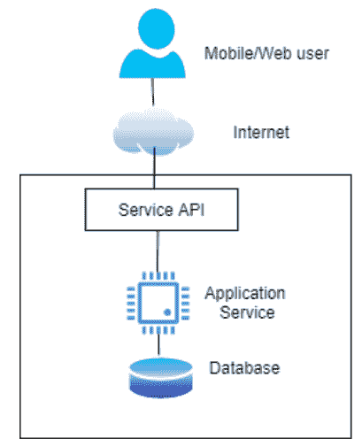
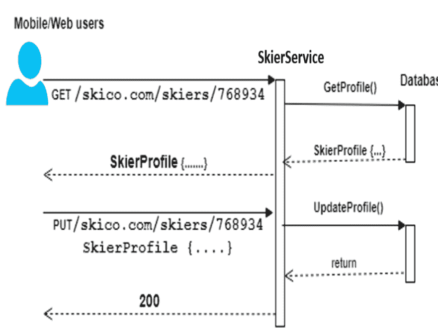
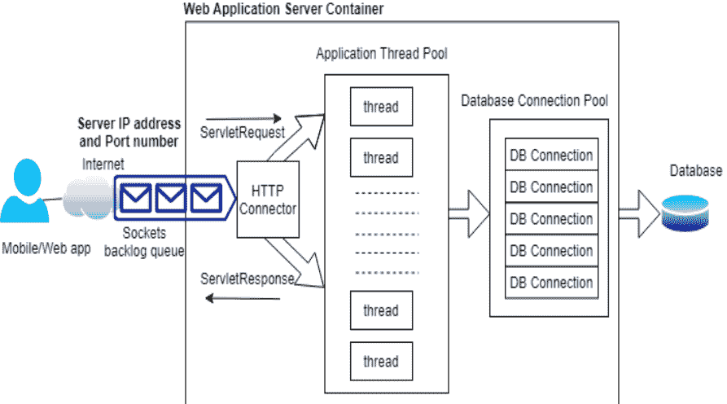
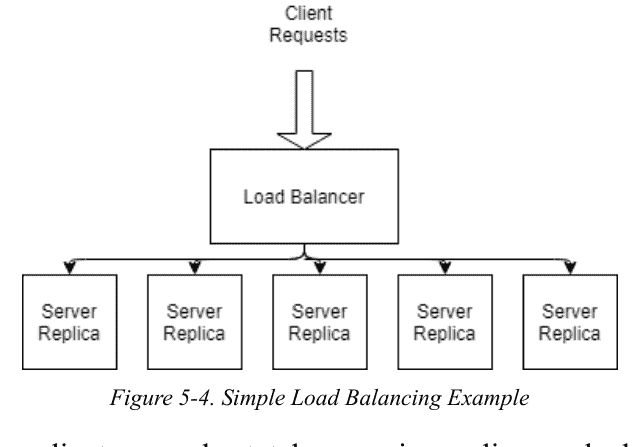
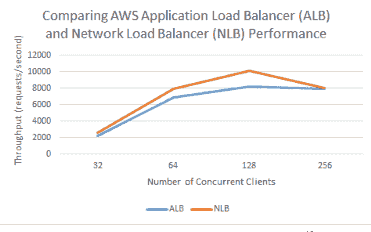
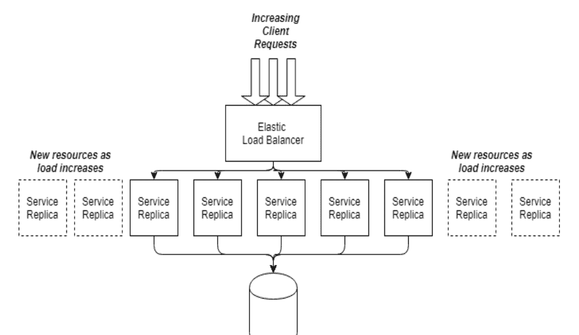
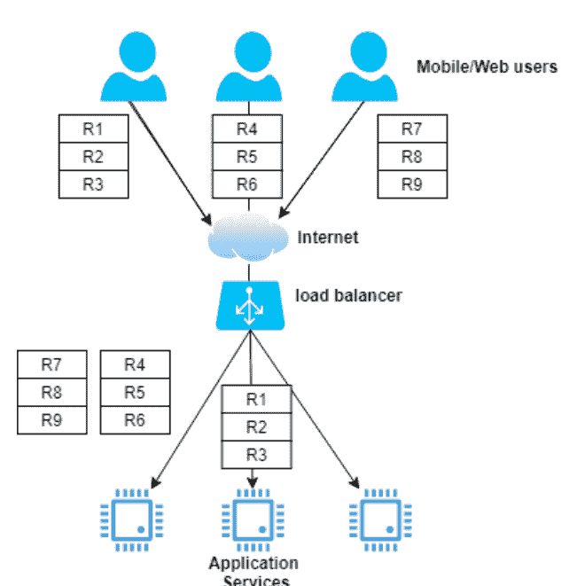

## Chapter 5. 应用服务

### A NOTE FOR EARLY RELEASE READERS

使用 Early Release 电子书，你可以在这些技术正式发布之前很久就获得书籍的早期形式——作者在撰写时的原始未编辑内容。

这将是最终书籍的第 5 章。

如果你对如何改进本书的内容和/或示例有任何评论，或者如果你注意到本章中缺少材料，请联系编辑 vwilson@oreilly.com。

任何系统的核心都在于实现应用需求的独特业务逻辑。在分布式系统中，这通过应用程序编程接口 (API) 向客户端公开，并在为高效支持并发远程调用而设计的运行时环境中执行。API 及其实现构成了应用程序支持的服务的根本要素。

在本章中，我将重点关注实现应用程序服务层可扩展性的相关问题。我将解释 API 和服务设计，并描述提供服务执行环境的应用程序服务器的显著特征。我还将阐述我在第 2 章中简要介绍的诸如水平扩展、负载均衡和状态管理等主题。

### Service Design

在最简单的情况下，一个应用程序包含一个面向互联网的服务，该服务将数据持久化到本地数据存储，如图 5-1 所示。客户端

通过其发布的 API 与服务交互，该 API 可通过互联网访问。

让我们更详细地了解 API 和服务实现。



Figure 5-1. A Simple Service

### Application Programming Interface (API)

API 在客户端和服务器之间定义了一个契约。API 指定了可能发生的请求类型、随请求一起提供的数据以及将获得的结果。API 有许多不同的变体，正如我在第 3 章 RPC/RMI 讨论中解释的那样。虽然现代应用程序中仍然存在一些 API 多样性，但主要风格依赖于 HTTP API。这些通常被归类为 RESTful，尽管并不特别准确。

REST 实际上是一种架构风格，由 Roy Fielding 在他的博士论文¹中定义。关于 RESTful API 以及 Web 技术可以被利用的各种程度的绝佳知识来源是 Jim Webber 等人撰写的 REST in Practice (O’Reilly)。在这里，我将简要介绍 HTTP CRUD API 模式。该模式并未完全实现 REST 的原则，但在当今的互联网系统中被广泛采用。它

利用了四个代码 HTTP 动词，即 POST、GET、PUT 和 DELETE。

CRUD 代表 *Create, Read, Update, Delete*。CRUD API 指定客户端如何在特定业务上下文中执行这些操作。例如，用户可以 *create* 一个个人资料 (POST)、*read* 目录项 (GET)、*update* 他们的购物车 (PUT) 并 *delete* 他们订单中的商品 (DELETE)。

一个使用这四个核心 HTTP 动词的示例 HTTP CRUD API，用于在第 2 章中简要介绍的示例滑雪度假村系统，如表 5-1 所示。在此示例中，参数值作为请求地址的一部分传递，并由 {} 标记标识。

#### Table 5-1.
HTTP CRUD Verbs

| Verb | Uniform Resource Identifier Example | Purpose |
|------|--------------------------------------|---------|
| POST | /skico.com/skiers/ | 创建新的滑雪者个人资料，滑雪者详细信息在 JSON 请求负载中提供。新的滑雪者个人资料在 JSON 响应中返回 |
| GET | /skico.com/skiers/{skierID} | 获取滑雪者的个人资料信息，以 JSON 响应负载返回 |
| PUT | /skico.com/skiers/{skierID} | 更新滑雪者个人资料 |
| DELETE | /skico.com/skiers/{skierID} | 删除滑雪者的个人资料，因为他们没有续订通行证！ |

附加参数值可以分别在 HTTP 请求和响应体中传递和返回。例如，对以下内容的成功请求：

```
GET /skico.com/skiers/12345
```

将返回 HTTP 200 响应代码和以下以 JSON 格式化的结果：

```
{
  "username": "Ian123",
  "email":"i.gorton@somewhere.com"
  "city": "Seattle"
}
```

要更改滑雪者的城市，客户端可以向同一 URI 发出以下 PUT 请求，并附带表示更新后滑雪者个人资料的请求体。


```
PUT  /skico.com/skiers/12345
{
    "username": "Ian123",
    "email":"i.gorton@somewhere.com",
    "city": "Wenatchee"
}
```

更正式地说，HTTP CRUD API 在由统一资源标识符（URIs）标识的 *资源* 上应用 HTTP 动词。例如在表 5-1 中，标识滑雪者 768934 的 URI 将是：

/skico.com/skiers/768934

对该资源发起的 HTTP GET 请求会在响应负载中返回滑雪者的完整个人资料信息，例如姓名、地址、到访天数等。如果客户端随后向该 URI 发送 HTTP PUT 请求，我们就表达了更新滑雪者 768934 资源——在此示例中即滑雪者个人资料——的意图。PUT 请求会提供与 GET 请求返回相同的滑雪者个人资料的完整表示。同样，这也是作为请求负载发送的。负载通常以 JSON 格式格式化，尽管 XML 和其他格式也是可能的。如果客户端向同一 URI 发送 DELETE 请求，则滑雪者个人资料将被删除。

因此，HTTP 动词与 URI 的组合定义了 API 操作的语义。资源由 URI 表示，在概念上类似于面向对象设计（OOD）中的对象或实体-关系（ER）模型中的实体。因此资源标识和建模遵循与 OOD 和 ER 建模类似的方法。然而重点在于需要在 API 中向客户端公开的资源。本章末尾的进一步阅读部分指出了资源设计的有用信息来源。

HTTP API 可以使用一种称为 OpenAPI² 的记法来指定。截至撰写时最新版本为 3.0。名为 SwaggerHub³ 的工具是使用 OpenAPI 指定 API 的事实标准。规范以 YAML 定义，示例显示在图 5-2 中。它定义了对 URI /resorts 的 GET

操作。如果操作成功，将返回 200 响应代码以及按规范后面出现的 JSON 模式定义格式的度假村列表。如果出于某种原因查询 skico.com 运营的度假村列表未返回任何条目，则会返回 404 响应代码以及由 JSON 模式定义的错误消息。

### 示例 5-1. 图 5-2 OpenAPI 示例

```
paths:
  /resorts:
    get:
      tags:
        - resorts
      summary: get a list of ski resorts in the database
      operationId: getResorts
      responses:
        '200':
          description: successful operation
          content:
            application/json:
              schema:
                $ref: '#/components/schemas/ResortsList'
        '404':
          description: Resorts not found. Unlikely unless we go broke
          content:
            application/json:
              schema:
                $ref: '#/components/schemas/responseMsg'
```

API 设计本身就是一个复杂的话题，深入探讨超出了本书范围。从可扩展性角度来看，仍有一些问题应牢记在心：

- 每个 API 请求都需要往返服务，这会产生网络延迟。一种常见的反模式被称为啰嗦 API，即使用多个 API 请求来执行一个逻辑操作。这通常发生在 API 按照纯面向对象设计方法设计时时发生。想象一下将 get() 和 set() 方法对单个资源属性作为 HTTP API 公开。访问一个

资源将需要多个 API 请求，每个属性一个。这不可扩展。使用 GET 检索整个资源，并使用 PUT 发送回更新后的资源。你也可以使用 HTTP PATCH 动词⁴ 来更新资源的单个属性。PATCH 允许对资源表示进行部分修改，而与之相对，PUT 用新值替换完整的资源表示。

- 传递大负载的 HTTP API 应考虑使用压缩。所有现代 Web 服务器和浏览器都支持使用 HTTP Accept-Encoding 和 Content-Encoding 头⁵ 的压缩内容。特定的 API 请求和响应可以通过指定用于内容压缩算法来利用这些头——例如 gzip。压缩可以将网络带宽和延迟减少 50% 或更多。权衡成本是压缩和解压缩内容的计算周期。与网络传输时间的节省相比，这通常很小。

### 设计服务

应用程序服务器容器接收请求并将其路由到适当的处理器函数以处理请求。处理器由应用程序服务代码定义，并实现生成请求结果所需的业务逻辑。随着多个并发请求到达服务实例，每个请求通常⁶ 分配一个单独的线程上下文来执行请求。我将在本章后面更详细地讨论应用程序服务器中的线程处理问题。

路由功能的复杂程度因技术平台和语言而大不相同。例如，在 Express.js 中，容器为匹配 API 签名——称为路由路径——和 HTTP 方法的请求调用指定函数。下面的代码示例说明了这一点，其中一个方法将在客户端发送 GET 请求以获取特定滑雪者个人资料时被调用，该个人资料由 :skierID 的值标识。

```
app.get('/skiers/:skierID', function (req, res) {
    // process the GET request
```

```
ProcessRequest(req.params)
})
```

在 Java 中，广泛使用的 Spring 框架提供了同样复杂的路由技术。它利用一组注解来定义依赖关系并实现依赖注入以简化服务代码。下面的代码片段显示了注解用法的示例：

```
@RestController
public class SkierController {
    @GetMapping("/skiers/{skierID}",
        produces = "application/json")
    public Profile GetSkierProfile(
        @PathVariable String skierID,
    ) {
        // DB query method omitted for brevity
        return GetProfileFromDB(skierID);
    }
}
```

这些注解提供以下功能：

```
@RestController
```

标识该类为实现 API 的控制器，并自动将返回对象序列化为 API 返回的 HttpResponse。

```
@GetMapping
```

将 API 签名映射到特定方法，并定义响应体的格式

```
@PathVariable
```

标识该参数为源自映射到此方法的 URI 路径中的值

另一种 Java 技术 JEE servlet 也提供注解，如图 5-3 所示，但与 Spring 和其他更高级别框架相比，这些注解较为简单。`@WebServlet` 注解标识应导致特定 servlet 被调用的 URI 基础模式。在我们的示例中为 `/skiers`。实现 API 方法的类必须扩展 `javax.servlet.http` 包中的 `HttpServlet` 抽象类并重写至少一个实现 HTTP 请求处理程序的方法。四个核心 HTTP 动词映射到方法如下：

- `doGet`
  HTTP GET 请求
- `doPost`
  HTTP POST 请求
- `doPut`
  HTTP PUT 请求
- `doDelete`
  用于 HTTP DELETE 请求

每个方法传递两个参数，即 `HttpServletRequest` 和 `HttpServletResponse` 对象。Servlet 容器创建 `HttpServletRequest` 对象，其中包含表示传入 HTTP 请求组件的成员。该对象包含调用的完整 URI 路径，解析和验证该路径并在有效时提取路径和查询参数是 servlet 的责任。同样，servlet 必须使用 `HttpServletResponse` 对象显式设置响应的属性。

因此，Servlet 需要应用程序服务程序员编写更多代码来实现。然而，由于生成的代码‘管道’更少，它们可能提供更高效的实现


与 Spring 等更强大的注解方法相比，参与请求处理的程度更低。这是一个经典的性能与易用性之间的权衡。你会在本书中看到很多这样的例子。

### 示例 5-2. JEE Servlet 示例

```
import javax.servlet.http.*;
@WebServlet(
    name = "SkiersServlet",
    urlPatterns = "/skiers"
)
public class SkierServlet extends HttpServlet {
protected void doGet(HttpServletRequest request,
    HttpServletResponse response) {
    // handles requests to /skiers/{skierID}
    try {
        // extract skierID from the request URI (not shown for brevity)
        String skierID = getSkierIDFromRequest(request);
        if(skierID == null) {
            // request was poorly formatted, return error code
            response.setStatus(HttpServletResponse.SC_BAD_REQUEST);
        }
        else {
            // read the skier profile from the database
            Profile profile = GetSkierProfile (skierID);
            // add skier profile as JSON to HTTP response and return
            response.setContentType("application/json");
            response.getWriter().write(gson.toJson(profile));
            response.setStatus(HttpServletResponse.SC_OK);
        }
    } catch(Exception ex) {
        response.setStatus(HttpServletResponse.SC_INTERNAL_SERVER_ERROR);
    }
}
}
```

### 状态管理

状态管理是一个棘手且细微的话题。归根结底，需要扩展的服务实现应避免存储会话状态。这到底是什么意思？

让我们从 HTTP 的状态管理主题开始探讨。

HTTP 被称为无状态协议。这意味着每个请求都是独立执行的，没有任何关于同一客户端之前执行过的请求的知识。无状态意味着每个请求都必须是自包含的，客户端提供足够的信息供 Web 服务器满足请求，而不管该客户端之前的活动如何。

然而，实际情况比这个简单的描述所描绘的要复杂一些。例如：

- 客户端和服务器之间的底层套接字连接保持打开状态，以便将连接创建的开销分摊到来自客户端的多个请求中。这是 HTTP/1 及以上版本的默认行为。
- HTTP 支持 cookie，被称为 HTTP 状态管理机制⁷。名字就说明了一切！
- HTTP/2 支持流、压缩和加密，所有这些都需要状态管理。

所以，最初 HTTP 是无状态的，但也许不再是了？带着这种困惑（！），我将继续讨论构建在 HTTP 之上的应用程序服务 API 中的状态管理。

当用户或应用程序连接到服务时，它通常会发送一系列请求来检索和更新信息。*会话状态* 表示在请求之间保留的任何信息，使得后续请求可以假定服务保留了关于之前交互的知识。我将在一个简单的示例中探讨这意味着什么。

在滑雪者服务 API 中，用户可以通过向以下 URI 提交 GET 请求来请求其个人资料：

```
GET /skico.com/skiers/768934
```

然后他们可以使用其应用程序修改其城市属性并发送 PUT 请求来更新资源：

```
PUT /skico.com/skiers/
{
    "username": "Ian123",
    "email":"i.gorton@somewhere.com"
    "city": "Wenatchee"
}
```

由于此 URI 未标识滑雪者，服务必须知道要更新的资源的唯一标识符，即 768934。因此，要使此更新操作成功，服务必须从之前的 GET 请求中保留会话状态。

实现这种方法相对简单。当服务收到初始 GET 请求时，它会创建一个唯一标识客户端连接的会话状态对象。实际上，这通常是在用户首次连接到服务或登录服务时执行的。服务可以从数据库读取滑雪者个人资料并利用会话状态对象来存储会话状态——在我们的示例中，这将是 skierID 以及可能与滑雪者个人资料关联的值。当后续 PUT 请求从客户端到达时，它使用会话状态对象查找与此会话关联的 skierID 并用它来更新滑雪者的家乡城市。

维护会话状态的服务被称为有状态服务。从设计角度来看，有状态服务具有吸引力，因为它们可以最大限度地减少服务从数据库检索数据（状态）的次数并减少客户端和服务之间传递的数据量。

对于请求负载较轻的服务，它们非常有意义，并且许多框架都在推广它们以使服务易于构建和部署。例如，JEE servlet 使用 HttpSession 对象支持会话管理，ASP.NET 中的 Session 对象也提供类似功能。

然而，随着服务实现的扩展，有状态方法变得有问题。对于单个服务实例，你需要考虑两个问题：

- 1. 如果你有多个客户端会话都在维护会话状态，这将使用服务可用内存。使用的内存量将与服务维护状态的客户端数量成正比。如果突然出现请求激增，你如何确定我们不会耗尽可用内存并导致服务失败？
- 2. 你还必须注意会话状态保留多长时间。客户端可能停止发送请求但未干净地关闭其连接以允许回收状态。所有会话管理方法都支持默认会话超时。如果你将其设置为较短的时间间隔，客户端可能会看到其状态意外消失。如果你将会话超时时间设置得太长，你可能会因资源不足而降低服务性能。

相比之下，无状态服务不假定任何来自先前调用的会话状态已被保留。服务不应保留来自早期请求的任何知识，以便每个请求都可以单独处理。这要求客户端提供服务处理请求并提供响应的所有必要信息。事实上，滑雪者 API 正是在表 5-1 中以这种方式指定的，即：

```
PUT /skico.com/skiers/768934
{
  "username": "Ian123",
  "email":"i.gorton@somewhere.com"
  "city": "Wenatchee"
}
```

说明这种无状态设计的序列图如图 5-2 所示。



图 5-2. 无状态 API 示例

任何可扩展的服务都需要无状态 API。原因将在本章后面解释水平扩展时变得清晰。现在，最重要的设计含义是，对于需要保留与客户端会话相关的状态的服务——经典的购物车示例——此状态必须存储在服务外部。这无一例外意味着外部数据存储。

### 应用服务器

应用服务器是可扩展应用程序的核心，托管构成应用程序的业务服务。其基本作用是接收来自客户端的请求，对请求应用应用程序逻辑，并向客户端回复请求结果。客户端可能是外部的，也可能是内部的，例如应用程序中需要使用特定服务功能的其他服务。

应用服务器的技术格局广泛而复杂，取决于你想要使用的语言以及每个语言提供的特定功能。在 Java 中，Java 企业版（JEE）⁸ 定义了用于应用服务器的全面、功能丰富的基于标准的平台，具有多个不同的厂商和开源实现。

在其他语言中，Express.js⁹ 服务器支持 Node，Flask 支持 Python¹⁰，而在 GoLang 中，可以通过集成 net/http 包来创建服务。这些实现比 JEE 更简洁、更轻量，通常被归类为 Web 应用程序框架。在 Java 中，Apache Tomcat 服务器¹¹ 是某种程度上等效的技术。Tomcat 是 JEE 平台子集的开源实现，即 Java Servlet、JavaServer Pages、Java 表达式语言和 Java WebSocket 技术。

图 5-3 描绘了 Tomcat 解剖结构的简化视图。Tomcat 实现了一个 servlet 容器，即应用程序定义 servlet 的执行环境。Servlet 动态加载到此容器中，容器提供生命周期管理和多线程运行时环境。

请求到达服务器的 IP 地址，服务器在特定端口监听流量。例如，默认情况下 Tomcat 在端口 8080 监听 HTTP 请求，在端口 8443 监听 HTTPS 请求。传入请求由一个或多个监听线程处理。这些线程在客户端和服务器之间创建 TCP/IP 套接字连接。如果网络请求到达的频率无法由 TCP 监听器处理，未处理的请求将在 Sockets Backlog 中排队。回退队列的大小取决于操作系统。在大多数 Linux 版本中，默认值为 100。

一旦建立连接，TCP 请求将被，例如 HTTP Connector 封送，在此示例中生成 servlet 可以处理的 HTTP 请求（图 5-2 中的 HttpServletRequest 对象）。HTTP 请求随后被分派给应用程序容器线程进行处理。


应用程序容器线程在线程池中管理，本质上是一个 Java Executor，默认情况下在 Tomcat 中最小为 25 个线程，最大为 200 个。如果没有可用的线程来处理请求，容器会将它们维护在可运行任务的队列中，并在线程可用时立即调度这些任务。该队列默认大小为 Integer.MAX_VALUE —— 即本质上是无界的¹²。默认情况下，如果线程空闲 60 秒，则会被杀死以释放 Java 虚拟机中的资源。



图 5-3. Web 应用程序服务器的解剖结构

对于每个请求，对应于 HTTP 请求的方法都会在一个线程中被调用。Servlet 方法处理 HTTP 请求头，执行业务逻辑，并构建一个响应，该响应由容器编组回 TCP/IP 数据包并通过网络发送给客户端。

在处理业务逻辑时，Servlet 通常需要查询外部数据库。这要求执行 Servlet 方法的每个线程获取数据库连接并执行数据库查询。在许多数据库中，尤其是关系型数据库中，连接是有限的资源，因为它们在客户端和数据库服务器中都消耗内存和系统资源。

因此，通常会使用固定大小的数据库连接池。池根据需求向请求线程发放打开的连接。

当 Servlet 希望向数据库提交查询时，它会从池中请求连接。如果有可用连接，则会将连接的访问权限授予 Servlet，直到它表明已完成工作为止。此时，连接将被归还到池中，供另一个 Servlet 使用。由于容器线程池通常大于数据库连接池，因此 Servlet 可能在没有可用连接时请求连接。为此，连接池维护一个请求队列，并按 FIFO 原则发放打开的连接，队列中的线程将被阻塞，直到有可用资源或发生超时。

因此，像 Tomcat 这样的应用程序服务器框架对于不同的工作负载高度可配置。例如，线程池和数据库连接池的大小可以在启动时读取的配置文件中指定。

完整的 Tomcat 容器环境在单个 JVM 中运行，因此处理能力受可用 vCPU 数量和分配为堆大小的内存量的限制。每个分配的线程都会消耗内存，请求处理管道中的各种队列在请求等待时会消耗资源。这意味着请求响应时间将同时受 Servlet 业务逻辑中的请求处理时间以及等待线程和连接可用的队列时间的支配。

在负载很重的服务器上分配了大量线程时，上下文切换可能会开始降低性能，并且可用内存可能会变得有限。如果性能下降，队列会随着请求等待资源而增长。这会消耗更多内存。如果收到的请求多于服务器可以排队和处理的请求，则新的 TCP/IP 连接将被拒绝，客户端将看到错误。最终，超载的服务器可能会耗尽资源并开始抛出异常并崩溃。

因此，花时间调整配置参数以高效处理预期负载的时间很少是浪费的。系统往往在达到 100% 利用率之前性能就开始下降。¹³ 一旦任何资源 - CPU 利用率、内存使用率、网络、磁盘访问 - 接近完全利用，系统就会表现出更不可预测的性能。这是因为花费更多时间，例如线程上下文切换和内存垃圾回收。这不可避免地会影响延迟和吞吐量。因此，具有利用率目标至关重要。这些阈值应该是什么，极其依赖于应用程序。

Web 应用程序框架提供的监控工具使工程师能够收集一系列重要指标，包括延迟、活动请求、队列大小等等。这些对于进行数据驱动的实验以实现性能优化非常宝贵。

Java 应用程序框架如 Tomcat 支持 JMX¹⁴（Java 管理扩展）框架，这是 Java 标准版平台的标准组成部分。JMX 使框架能够基于 MBeans（托管 Bean）的功能公开监控信息，MBeans 代表感兴趣的资源（例如，线程池、数据库连接使用情况）。这使得工具生态系统能够为监控 JMX 支持的平台提供功能。这些范围从默认情况下随 Java 开发工具包提供的 JConsole¹⁵，到强大的开源技术如 JavaMelody¹⁶ 以及许多昂贵的商业产品。

### 水平扩展

扩展系统的核心原则是能够轻松添加新的处理能力以处理增加的负载。对于大多数系统，一个简单而有效的方法是部署多个无状态服务器资源实例，并使用负载均衡器在这些实例之间分配请求。这称为水平扩展，并在图 5-4 中说明。



图 5-4. 简单负载均衡示例

这两种要素，即无状态服务副本和负载均衡器，都是水平扩展所必需的。我将解释原因。

服务副本部署在其自己的（虚拟）硬件上。因此，如果我们有两个副本，我们就将处理能力翻倍。如果我们有十个副本，我们就有潜在的 10 倍容量。这使我们的系统能够处理增加的负载。水平扩展的目标是创建一个系统处理能力，该能力是可用总资源的总和。

服务器需要是无状态的，以便任何请求都可以发送到任何服务副本进行处理。此决定由负载均衡器做出，负载均衡器可以使用各种策略来分发请求。如果负载均衡器可以使每个服务副本保持同样繁忙，那么我们就有效地利用了服务副本提供的处理能力。

如果我们的服务是有状态的，负载均衡器需要始终将来自同一服务器的请求路由到同一服务副本。由于客户端会话持续时间不确定，这可能导致一些副本比其他副本负载更重。这会造成不平衡，并且不能有效地在副本之间均匀使用可用容量。我将在下一节关于负载均衡的讨论中更详细地回到这个问题。

NOTE
像 Spring Session 和 Tomcat 的 Clustering 平台的插件这样的技术允许会话状态在 Redis 和 Memcached 等通用分布式缓存中外部化。这有效地使我们的服务无状态。负载均衡器可以在不考虑状态管理的情況下将请求分发到所有复制的服务。我将在第 6 章介绍分布式缓存的主题。

水平扩展也增加了可用性。有一种服务实例，如果它失败，服务将不可用。这被称为单点故障（SPoF）——一件坏事，并且是任何可扩展分布式系统都应避免的。多个副本增加了可用性。如果一个副本失败，请求可以被定向到任何——它们是无状态的，记住——副本。系统在失败的服务器被替换之前处理能力会降低，但它仍然可用。这很重要。可扩展性至关重要，但如果系统不可用，那么有史以来最可扩展的系统仍然是无效的！

### 负载均衡

负载均衡旨在有效利用一组服务的容量，以优化每个请求的响应时间。这是通过在可用服务之间分发请求来实现的，理想情况下利用集体服务容量。目标是避免某些服务过载而其他服务未充分利用。

客户端将请求发送到负载均衡器的 IP 地址，负载均衡器将请求重定向到目标服务，并将结果中继回客户端。这意味着客户端永远不会直接联系目标服务，这对于安全也有益，因为服务可以位于安全边界之后而不暴露于互联网。

负载均衡器可在 *网络层* 或 *应用层* 运行。这些通常分别称为 *第 4 层* 和 *第 7 层* 负载均衡器。名称指的是开放系统互连（OSI）参考模型¹⁷ 中的第 4 层网络传输层，以及应用层


第 7 层。OSI 模型将网络功能定义为七个抽象层。每一层都定义了数据如何打包和传输的标准。

网络层负载均衡器在网络连接层分发请求，在单个 TCP 或 UDP 数据包上运行。路由决策基于客户端 IP 地址做出。一旦选择了目标服务，负载均衡器就会使用一种称为网络地址转换（NAT）的技术。这会将客户端请求数据包中的目标 IP 地址从负载均衡器的地址更改为所选目标的地址。当从目标接收到响应时，负载均衡器会将数据包头中记录的源地址从目标的 IP 地址更改为自己的地址。网络负载均衡器相对简单，因为它们在单个数据包级别运行。这意味着它们速度极快，因为它们提供的功能很少，超出选择目标服务和执行 NAT 功能之外。

相比之下，应用层负载均衡器重新组装完整的 HTTP 请求，并基于 HTTP 头的值以及消息的实际内容做出路由决策。例如，可以配置负载均衡器将所有 POST 请求发送到可用服务的一个子集，或根据 URI 中的查询字符串分发请求。应用负载均衡器是复杂的反向代理。它们提供的更丰富的功能意味着它们比网络负载均衡器稍慢，但它们提供的强大功能可以弥补由此产生的开销。

为了让你了解网络和应用层负载均衡器之间原始性能差异的程度，图 5-5 在一个简单的应用场景中比较了两者。正在测试的负载均衡技术是 AWS 应用和网络弹性负载均衡器¹⁸。每个负载均衡器将请求路由到 4 个副本之一。这些副本执行业务逻辑并通过负载均衡器将结果返回给客户端。客户端负载从轻载的 32 个并发客户端变化到中等负载的 256 个并发客户端。每个客户端发送一系列请求，在接收到一个请求的响应结果和发送下一个请求到服务器之间没有延迟。

你可以看到从图 5-5 中，网络负载均衡器在 32、64 和 128 客户端测试中平均提供了约 20% 更高的性能。这验证了来自不太复杂的网络负载均衡器的预期更高性能。对于 256 个客户端，两个负载均衡器的性能基本相同。这是因为 4 个副本的容量已被超过，系统存在瓶颈。此时负载均衡器对系统性能没有影响。你需要向负载均衡组添加更多副本以增加系统容量，从而提高吞吐量。



图 5-5. 比较负载均衡器性能¹⁹

一般来说，负载均衡器具有以下将在以下章节中解释的功能：

- 负载分发策略
- 健康监控
- 弹性
- 会话亲和性

### 负载分发策略

负载分发策略规定负载均衡器如何选择目标服务来处理请求。任何称职的负载均衡器都会提供多种负载分发策略——HAProxy 实际上提供了 10 种²⁰。以下是在所有负载均衡器中得到最常见支持的四种：

#### round-robin

负载均衡器以轮询方式将请求分发给可用服务器

#### least connections

负载均衡器将新请求分发给打开连接最少的服务器

#### HTTP header field

负载均衡器根据特定 HTTP 头字段的内容定向请求。例如，所有具有头字段 X-Client-Location:US,Seattle 的请求都可以路由到特定的一组服务器。

#### HTTP operation

负载均衡器根据请求中的 HTTP 动词定向请求

负载均衡器还允许为服务分配权重。例如，负载均衡池中的标准服务实例可能有 4 个 vCPU，每个分配权重为 1。如果添加了一个在 8 个 vCPU 上运行的服务副本，可以为其分配权重 2，以便负载均衡器向其发送两倍多的请求。

### 健康监控

负载均衡器会定期发送 ping 并尝试连接以测试负载均衡池中每个服务的健康状况。这些测试称为健康检查。如果服务变得无响应或连接尝试失败，它将被从负载均衡池中移除，不会向该主机发送任何请求。如果服务连接出现瞬时故障，负载均衡器将在其变得可用且健康后重新纳入该服务。然而，如果它已失败，服务将被从负载均衡器目标池中移除。

### 弹性

请求负载的峰值可能导致负载均衡器可用的服务容量饱和，导致响应时间变长，最终导致请求和连接失败。*弹性*是应用程序动态配置新服务容量以处理请求增加的能力。随着负载增加，会启动新的副本，负载均衡器将请求定向到这些副本。随着负载下降，负载均衡器会停止不再需要的服务。

弹性要求负载均衡器与应用程序监控紧密集成，以便可以定义扩展策略来确定何时扩展和缩减。策略可以例如指定当所有实例的平均服务 CPU 利用率超过 70% 时应增加服务的容量，并在平均 CPU 利用率低于 40% 时减少容量。扩展策略通常可以使用监控系统提供的任何指标来定义。

弹性负载均衡的一个例子是亚马逊网络服务（AWS）自动扩展组。自动扩展组是可供负载均衡器使用的服务实例集合，其定义了最小和最大大小。负载均衡器将确保组始终具有最小数量的服务可用，并且组永远不会超过最大数量。该方案如图 5-6 所示。



*图 5-6. 弹性负载均衡*

通常，有两种方法可以控制组中副本的数量。第一种是基于计划，当请求负载的增加和减少是可预测的。例如，你可能有一个在线娱乐指南，并在周四晚上 6 点发布一组主要城市的周末活动。这会在周日中午之前产生更高的负载。自动扩展组可以轻松配置为在周四晚上 6 点配置新服务，并在周日中午将组大小减少到最小。

如果增加的负载峰值不可预测，弹性可以通过基于应用程序指标（如平均 CPU 和内存使用率以及队列中的消息数量）的定义扩展策略动态控制。如果超过策略的上阈值，负载均衡器将启动一个或多个新的服务实例，直到性能下降到低于指标阈值。实例需要时间启动——通常一分钟或更长时间——因此可以定义一个*预热*期，直到新实例被认为对组的容量做出贡献。当观察到的指标值下降到扩展策略中定义的下阈值以下时，*缩容*或*缩减*开始，实例将被自动停止并从池中移除。

弹性是允许服务随着需求增长而动态扩展的关键功能。对于具有波动工作负载的高可扩展系统，它几乎是提供必要容量以实现最低成本的强制性能力。

### 会话亲和性

会话亲和性，或粘性会话，是负载均衡器为有状态服务提供的功能。使用粘性会话，负载均衡器将来自同一客户端的所有请求发送到同一服务实例。这使服务能够在内存中维护有关每个特定客户端会话的状态。

实现粘性会话的方法有多种。例如，HAProxy 提供了全面的功能，以在服务添加、移除和故障的情况下保持客户端请求在同一服务上²¹。AWS 弹性负载均衡生成一个标识客户端会话关联的服务副本的 HTTP cookie。该 cookie 返回给客户端，客户端必须在后续请求中发送它以确保会话亲和性得以维护。

粘性会话对于高可扩展系统可能存在问题。它们会导致负载不平衡问题，随着时间的推移，客户端无法均匀分布在各服务上。这如图 5-7 所示，其中两个客户端连接到一个服务，而另一个服务保持空闲。




图 5-7. 使用粘性会话的负载不均衡

负载不均衡的发生是因为客户端会话持续时间各不相同。即使会话初始分配均匀，其中一些会迅速终止，而另一些会持续存在。在负载较轻的系统中，这通常不是问题。然而，在数百万个会话不断创建和销毁的系统中，负载不均衡是不可避免的。这会导致某些服务副本利用率不足，而其他副本则不堪重负，并可能因资源耗尽而失败。为了缓解负载不均衡，负载均衡器通常提供诸如将新会话发送到连接数最少或响应速度最快的实例等策略。这些策略有助于将新会话导向远离负载过重的服务。

有状态服务还有其他缺点。当某个服务不可避免地发生故障时，连接到该服务器的客户端如何恢复正在管理的状态？如果服务实例因负载过高而变慢，客户端如何响应？总体而言，有状态服务器会产生在大型系统中难以设计和管理的复杂问题。

无状态服务没有这些缺点。如果其中一个服务失败，客户端会收到异常并重试，其请求会被路由到另一个可用的服务副本。如果服务因瞬时网络中断而变慢，负载均衡器会将其从服务组中移除，直到它通过健康检查或失败为止。所有应用程序状态要么被外部化，要么由客户端在每次请求中提供，因此服务故障可以由负载均衡器轻松处理。

无状态服务增强了可扩展性，简化了故障场景并减轻了服务管理的负担。对于可扩展的应用程序，这些优势远远超过了缺点，因此在 Netflix 等大多数大型互联网网站中得到采用。22

最后，请记住，通过负载均衡扩展一组服务可能会使负载均衡服务所依赖的下游服务或数据库不堪重负。就像高速公路一样，为 50 英里路段增加 8 条车道，如果高速公路在另一侧以一组交通灯和一条单车道道路结束，只会造成更大的交通混乱。我们都经历过这种情况，我相信。我将在第 9 章中讨论这些问题。

### 总结和进一步阅读

服务是可扩展软件系统的核心。它们定义了作为 API 的契约，指定其对客户端的能力。服务在应用程序服务器容器环境中执行，该环境托管服务代码并将传入的 API 请求路由到适当的处理逻辑。应用程序服务器高度依赖编程语言，但通常提供多线程编程模型，允许服务同时处理许多请求。如果容器线程池中的线程全部被利用，应用程序服务器会将请求排队，直到有线程可用。

随着服务上的请求负载增长，我们可以使用负载均衡器在多个实例之间分发请求来水平扩展它。这种架构还提供了高可用性，因为多服务配置意味着应用程序可以容忍单个实例的故障。服务实例由负载均衡器作为池管理，负载均衡器利用负载分配策略为每个请求选择目标服务副本。无状态服务易于扩展并简化故障场景，因为负载均衡器只需将请求重新发送到有响应的目标。虽然大多数负载均衡器会使用称为粘性会话的功能支持有状态服务，但有状态服务使负载均衡和处理故障变得更加复杂。因此，它们不建议用于高度可扩展的服务。

API 设计是一个复杂且有争议的话题。关于基本 API 设计和资源建模的优秀概述是 https://www.thoughtworks.com/insights/blog/rest-api-design-resource-modeling。

Java 企业版（JEE）是一种成熟且广泛部署的服务器端技术。它具有构建丰富而强大的服务的广泛抽象。Oracle 教程是了解该平台的绝佳起点 - https://docs.oracle.com/javaee/7/tutorial/。

有关负载均衡器的许多知识和信息都隐藏在技术供应商提供的文档中。你选择负载均衡器然后深入阅读手册。关于负载均衡完整领域的优秀、广泛的视角，《Server Load Balancing》 by Tony Bourke（O’Reilly）是一本不错的资源。

- 1 Fielding, Roy Thomas (2000). “Architectural Styles and the Design of Network-based Software Architectures”. Dissertation. University of California, Irvine
- 2 https://app.swaggerhub.com/help/tutorials/openapi-3-tutorial
- 3 https://app.swaggerhub.com
- 4 https://developer.mozilla.org/en-US/docs/Web/HTTP/Methods/PATCH
- 5 https://developer.mozilla.org/en-US/docs/Web/HTTP/Compression
- 6 Node.js is a notable exception here as it is single threaded. However, it employs an asynchronous programming model for blocking input-output that supports handling many simultaneous requests.
- 7 https://tools.ietf.org/html/rfc6265
- 8 https://www.oracle.com/java/technologies/java-ee-glance.html
- 9 https://expressjs.com/
- 10 https://palletsprojects.com/p/flask/
- 11 http://tomcat.apache.org/
- 12 See https://tomcat.apache.org/tomcat-9.0-doc/config/executor.html for default Tomcat Executor configuration settings
- 13 https://sre.google/sre-book/monitoring-distributed-systems/
- 14 https://www.oracle.com/java/technologies/javase/javamanagement.html
- 15 https://docs.oracle.com/javase/8/docs/technotes/guides/management/jconsole.html
- 16 https://github.com/javamelody/javamelody/wiki
- 17 https://www.networkworld.com/article/3239677/the-osi-model-explained-and-how-to-easily-remember-its-7-layers.html
- 18 https://aws.amazon.com/elasticloadbalancing/?whats-new-cards-elb.sort-by=item.additionalFields.postDateTime&whats-new-cards-elb.sort-order=desc
- 19 Experimental results due to Ruijie Xiao, from Northeastern University’s MS in Computer Science in Seattle.
- 20 http://cbonte.github.io/haproxy-dconv/2.3/intro.html#3.3.5
- 21 http://cbonte.github.io/haproxy-dconv/2.3/intro.html#3.3.6
- 22 https://www.nginx.com/blog/microservices-at-netflix-architectural-best-practices/
