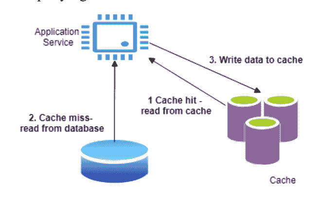
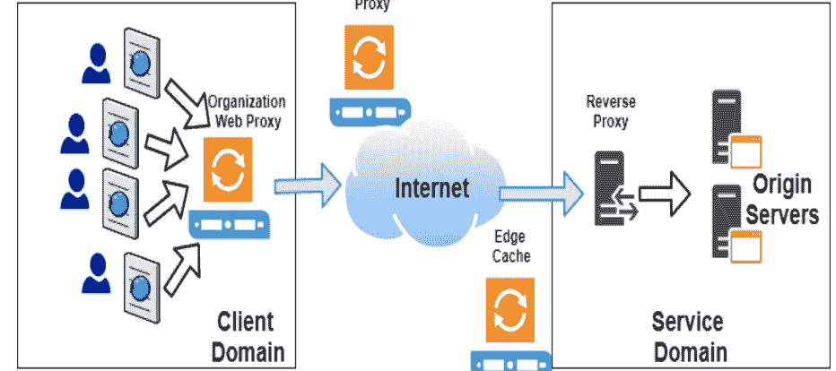

## 第 6 章. 分布式缓存

### 早期发布读者的说明

使用 Early Release 电子书，您可以在这些标题正式发布之前很久就利用这些技术——作者在撰写时提供的原始和未编辑内容，以便您在这些技术正式发布之前很久就能利用它们。

这将是最终书籍的第 6 章。

如果您对如何改进本书的内容和/或示例有任何评论，或者如果您注意到本章中缺少材料，请联系编辑 vwilson@oreilly.com。

缓存存在于应用程序的许多地方。运行应用程序的 CPU 具有多级、快速的硬件缓存，以减少相对较慢的主内存访问。数据库引擎可以利用主内存来缓存数据存储的内容在内存中，以便在许多情况下查询不必访问相对较慢的磁盘。

分布式缓存是可扩展系统的必备要素。缓存使昂贵查询和计算的结果能够以低成本供后续请求重复使用。通过不必为每个请求重建缓存结果，系统的容量得以增加，从而能够扩展以处理更大的工作负载。

本章我将介绍两种缓存类型。应用程序缓存需要包含使用分布式缓存进行缓存和访问预计算结果的业务逻辑。Web 缓存利用 HTTP 协议内置的机制，使互联网提供的基础设施内能够缓存结果。当有效使用时，两者都会保护您的服务和数据库免受繁重的读流量负载。


#### 应用缓存

应用缓存旨在通过将查询和计算的结果存储在内存中来提高请求的响应性，以便后续请求可以直接使用。举例来说，想象一个在线报纸网站，读者可以在上面发表评论。文章一旦发布，几乎就不再更改。如果有新评论，通常会在文章发布后不久出现，但随着文章年龄的增长，频率会迅速下降。因此，文章可以在首次访问时被缓存，并在文章更新、新评论发布或无人再阅读之前，被所有后续请求重复使用。

总体而言，缓存可以减轻数据库的读取压力，因为许多查询可以直接从缓存中提供服务。它还能降低构建成本高昂的对象（如需要跨多个不同数据库查询的对象）的计算成本。净效果是降低我们服务和数据库的计算负载，并创造出处理更多请求的余地或容量。

缓存需要额外的资源来存储缓存结果，因此会产生成本。然而，与升级数据库和服务节点以应对更高请求负载相比，设计良好的缓存方案成本较低。作为缓存价值的一个指标，Twitter 约有 3% 的基础设施用于应用级缓存。¹ 在 Twitter 的规模下，运营数百个集群，这已是大量基础设施！

应用级缓存利用专用的分布式缓存引擎。该领域两种主要的[content]

#### 应用缓存

应用缓存旨在通过将查询和计算的结果存储在内存中来提高请求的响应性，以便后续请求可以直接使用。例如，想象一个在线报纸网站，读者可以在上面发表评论。文章一旦发布，几乎就不再更改。新评论通常在文章发布后不久出现，但随着文章年龄的增长，频率会迅速下降。因此，文章可以在首次访问时被缓存，并在文章更新、新评论发布或无人再阅读之前，被所有后续请求重复使用。

总体而言，缓存可以减轻数据库的读取压力，因为许多查询可以直接从缓存中提供服务。它还能降低构建成本高昂的对象的计算成本，例如需要跨多个不同数据库查询的对象。净效果是降低我们服务和数据库的计算负载，并创造出处理更多请求的余地或容量。

缓存需要额外的资源来存储缓存结果，因此会产生成本。然而，与升级数据库和服务节点以应对更高请求负载相比，设计良好的缓存方案成本较低。作为缓存价值的一个指标，Twitter 约有 3% 的基础设施用于应用级缓存。¹ 在 Twitter 的规模下，运营数百个集群，这已是大量基础设施！

应用级缓存利用专用的分布式缓存引擎。该领域两种主要技术是 memcached² 和 Redis。³ 两者本质上都是为数据库查询结果或下游服务 API 调用的结果而设计的、用于任意数据（字符串、对象）的分布式内存哈希表。缓存的常见用例是存储用户会话数据、动态网页和数据库查询结果。缓存对应用服务而言表现为单一存储区，对象通过对对象键的哈希函数分配到单个缓存服务器。

基本方案如图 6-1 所示。服务首先检查缓存，看所需数据是否可用。如果可用，则将缓存内容作为结果返回——这称为 *缓存命中*。如果数据不在缓存中——*缓存未命中*——服务会从数据库检索请求的数据并将查询结果写入缓存，以便后续客户端请求无需查询数据库即可使用。



图 6-1. 应用级缓存

例如，在一个繁忙的冬季度假村，滑雪者和滑板者可以使用他们的移动应用获取度假村各处缆车等待时间的估算。这使他们能够规划路线并避开拥挤区域，在那里他们可能需要等待 15 分钟（有时更久！）才能乘坐缆车。

每次滑雪者乘坐缆车时，都会向公司的服务发送一条消息，该服务收集滑雪者交通模式的数据。利用这些数据，系统可以根据乘坐缆车的滑雪者数量和到达率来估算缆车等待时间。这是一个昂贵的计算，在繁忙时可能需要一秒或更长时间，因为它需要汇总可能数万条缆车乘坐记录并执行等待时间计算。因此，一旦结果计算出来，就被认为在五分钟内有效。仅在此时间过去后才会进行新的计算并产生结果。

图 6-2 显示了无状态 LiftWaitService 可能的工作方式示例。当请求到达时，服务首先检查缓存，看最新的等待时间是否可用。如果可用，结果会立即返回给客户端。如果结果不在缓存中，服务会调用下游服务执行缆车等待时间计算并将其作为 List 返回。这些结果随后会被存储到缓存中，然后返回给客户端。

缓存访问需要一个键来关联结果。在此示例中，键由字符串 “liftwaittimes:” 与客户端传递给服务的度假村标识符拼接而成。然后缓存通过哈希该键来识别缓存值所在的服务器。我将在第 13 章描述大多数分布式缓存通常如何工作哈希算法，因为相同的方法在分布式数据库中用于键分布时也很常见。

当向缓存写入新值时，会将 300 秒的值作为参数传递给 put 操作。这称为生存时间，或 TTL 值。它告诉缓存，在 300 秒后，该键值对应被从缓存中驱逐，因为该值不再是当前的——也称为陈旧。

在缓存值有效期间，所有请求都会使用它。这意味着无需为每次调用都执行昂贵的缆车等待时间计算。快速网络上的缓存命中可能只需一毫秒——比缆车等待时间计算快得多。当缓存值在 300 秒后被驱逐时，下一次请求将导致缓存未命中。这将导致计算新的值以存储在缓存中。因此，如果我们在 5 分钟内收到 N 个请求，则有 N-1 个请求从缓存中提供服务。想象一下如果 N 是 10000？这节省了大量昂贵的计算，并将 CPU 周期留给数据库处理其他查询。

##### 示例 6-1. 图 6-2 缓存示例

```
public class LiftWaitService {
    public List getLiftWaits(String resort) {
        List liftWaitTimes = cache.get("liftwaittimes:" + resort);
        if (liftWaitTimes == null) {
            liftWaitTimes = skiCo.getLiftWaitTimes(resort);
            // add result to cache, expire in 300 seconds
            cache.put("liftwaittimes:" + resort, liftWaitTimes, 300);
        }
        return liftWaitTimes;
    }
}
```

使用如 TTL 的过期时间是一种常见的使缓存内容失效的方式。它确保服务不会向客户端提供陈旧、过时的结果。它还使系统能够对缓存内容进行一定程度的控制，而缓存内容通常是有限的。如果缓存项不定期刷新，缓存可能会填满。在这种情况下，缓存会采用诸如最近最少使用或最少访问等策略来选择要驱逐的缓存条目，为更新、及时的结果腾出空间。

应用缓存可以提供显著的吞吐量提升、降低延迟和提高客户端应用响应性。实现这些理想品质的关键是尽可能多地从缓存中满足请求。一般设计原则是最大化缓存命中率并最小化缓存未命中率。当发生缓存未命中时，请求必须通过查询数据库或下游服务来满足。请求的结果随后可以写入缓存，以便进一步访问。

缓存命中率应为多少并没有硬性规定，因为它取决于构建缓存内容成本和缓存项更新率。理想的缓存设计读操作远多于更新操作。这是因为当一项必须更新时，应用程序需要使因更新而变得陈旧的缓存条目失效。这意味着下一次请求将导致缓存未命中。⁴

当项目定期更新时，缓存未命中的成本可能会抵消缓存的好处。因此，服务设计者需要仔细考虑应用程序经历的查询和更新模式，并构建能带来最大收益的缓存机制。一旦服务投入生产，监控缓存使用情况以确保命中率和未命中率符合设计预期也至关重要。缓存将提供管理实用程序和 API 以实现缓存使用特征的监控。

例如，memcached 提供了大量统计信息，包括下面的输出片段中显示的命中和未命中计数。

```
STAT get_hits 98567
STAT get_misses 11001
STAT evictions 0
```

应用级缓存也称为 *cache-aside* 模式。⁵ 该名称指的是如果所需结果在缓存中可用，应用程序代码有效地绕过数据存储系统。 这与应用程序始终从缓存读取和写入缓存的其他缓存模式形成对比。这些被称为 *read-through*、*write-through* 和 *write-behind* 缓存，如下所述：

##### Read-through

应用程序通过访问缓存来满足所有请求。如果所需数据在缓存中不可用，则会调用加载器访问数据系统并将结果加载到缓存中供应用程序使用。

##### Write-through

应用程序始终将更新写入缓存。当缓存更新时，会调用写入器将新的缓存值写入数据库。当数据库更新时，应用程序可以完成请求。

##### Write-behind

与 write-through 类似，只是应用程序不会等待值从缓存写入数据库。这提高了请求的响应性，但以可能丢失更新为代价，如果缓存服务器在数据库更新完成前崩溃。这也称为写回缓存，内部上是大多数数据库引擎使用的策略。


这些缓存方法的美妙之处在于它们简化了应用逻辑。应用始终利用缓存进行读写，而缓存提供“魔法”来确保缓存与后端存储系统进行适当的交互。这与旁路缓存模式形成对比，在该模式中，应用逻辑必须意识到缓存未命中。

读穿透、写穿透和写回策略需要一种可以增强应用特定处理器(cache technology that can be augmented with an application-specific handler)的缓存技术，以便在应用访问缓存时执行数据库读写。例如，NCache⁶ 支持 *provider interfaces*，由应用实现。这些接口会在读穿透缓存的缓存未命中时以及写穿透缓存的写入时自动被调用。其他此类缓存本质上是专用的数据库缓存，因此要求缓存访问与底层数据库模型相同。一个例子是亚马逊的 DynamoDB Accelerator (DAX)。⁷ DAX 位于应用代码和 DynamoDB 之间，并透明地充当高速内存缓存以减少数据库访问时间。

缓存旁路策略的一个显著优势是它对缓存故障具有弹性。在这种情况下，由于缓存不可用，所有请求本质上都被视为缓存未命中。性能会下降，但服务仍能够满足请求。此外，由于其简单、分布式的哈希表模型，像 Redis 和 Memcached 这样的缓存旁路平台的扩展非常简单。因此，缓存旁路模式是大规模可扩展系统中主要采用的方法。

### Web Caching

网站响应速度如此之快的一个原因在于，互联网上布满了 Web 缓存。Web 缓存存储给定资源的副本，例如网页或图像，存储一段定义的时间。缓存拦截客户端请求，如果它们在本地缓存了所请求的资源，则返回副本而不是将请求转发到目标服务。因此，许多请求可以在不给服务带来负担的情况下得到满足。此外，由于缓存物理上更靠近客户端，请求将具有更低的延迟。

图 6-2 给出了 Web 缓存架构的概述。存在多个层级的缓存，从客户端的 Web 浏览器缓存和基于本地组织的缓存开始。互联网服务提供商也会实现通用 Web 代理缓存，并且可以在应用服务执行域内部署反向代理缓存。Web 浏览器缓存也称为私有缓存（供单个用户使用）。组织和 ISP 代理缓存是共享缓存，支持来自多个用户的请求。

边缘缓存，也称为 CDN（内容分发网络），位于全球各地的各种战略地理位置，以便将频繁访问的数据缓存到靠近客户端的位置。例如，视频流媒体提供商可能会在澳大利亚悉尼配置一个边缘缓存，以向大洋洲用户提供视频内容，而不是从美国的源服务器跨越太平洋流式传输内容。边缘缓存由 CDN 提供商在全球部署。例如 Akamai，原来的 CDN 提供商，拥有超过 2000 个位置，并在全球交付多达 30% 的互联网流量。⁸ 对于具有全球用户的媒体丰富站点，边缘缓存是必不可少的。

缓存通常仅存储 GET 请求的结果，并且缓存键是相关 GET 的 URI。当客户端发送 GET 请求时，它可能会被请求路径上的一个或多个缓存拦截。任何具有所请求资源的新鲜副本的缓存都可以响应请求。如果未找到缓存内容，则请求由服务端点提供服务，在 Web 技术术语中也称为源服务器。



图 6-2. 互联网中的 Web 缓存

服务可以通过使用 HTTP 缓存指令来控制哪些结果被缓存以及存储多长时间。服务在各种 HTTP 响应头中设置这些指令，如图 6-4 所示的简单示例。我将在以下小节中描述这些指令。

#### Example 6-2. Figure 6-4 Example HTTP Response with caching directives

```
Response:
HTTP/1.1 200 OK Content-Length: 9842
Content-Type: application/json
Cache-Control: public
Date: Fri, 26 Mar 2019 09:33:49 GMT
Expires: Fri, 26 Mar 2019 09:38:49 GMT
```

### Cache-Control

Cache-Control HTTP 头可以由客户端请求和服务响应使用，以指定对感兴趣资源的缓存应如何使用。可能的值为：

- no-store

指定请求响应的资源不应被缓存。这通常用于敏感数据，需要在每次请求时从源服务器检索。

- no-cache

指定缓存的资源在使用前必须与源服务器重新验证。我将在下面的 Etag 小节中讨论重新验证。

- Private

指定资源只能由用户特定的设备（如 Web 浏览器）缓存

- Public

指定资源可以由任何代理服务器缓存

- max-age

定义缓存的资源副本应保留的时间长度（以秒为单位）。过期后，缓存必须通过向源服务器发送请求来刷新资源。

### Expires and Last-Modified

Expires 和 Last-Modified HTTP 头与 max-age 指令交互以控制缓存数据保留多长时间。

缓存具有有限的存储资源，因此必须定期从内存中驱逐项目以腾出空间。为了影响缓存驱逐，服务可以指定资源在缓存中应保持有效或新鲜的时间。当请求到达新鲜资源时，缓存会在不联系源服务器的情况下提供本地存储的结果。一旦缓存资源的指定保留期过期，它就会变得陈旧并成为驱逐的候选对象。

新鲜度是使用组合的头值计算的。"Cache-Control: max-age=N" 头是主要指令，此值指定以秒为单位的新鲜期。

如果未指定 max-age，则接下来检查 Expires 头。如果此头存在，则使用它来计算新鲜期。Expires 头指定资源应被视为陈旧的明确日期和时间。例如：

```
Expires: Wed, 26 Oct 2022 09:39:00 GMT
```

作为最后的手段，可以使用 Last-Modified 头来计算资源保留期。此头由源服务器设置以指定资源最后更新的时间，并使用与 Expires 头相同的格式。缓存服务器可以使用 Last-Modified 根据缓存支持的启发式计算来确定资源的新鲜生命周期。该计算使用 Date 头，该头指定响应消息从源服务器发送的时间。资源保留期随后等于 Date 头的值减去 Last-Modified 头的值除以 10。

### Etag

HTTP 提供了另一个可用于控制缓存项新鲜度的指令。这就是 Etag。Etag 是一个不透明的值，可由 Web 缓存用来检查缓存资源是否仍然有效。我将用另一个冬季运动的例子来解释这一点。

回到我们的冬季度假村的例子，度假村在冬季季节每天早上 6 点制作一份天气报告。如果天气在白天发生变化，度假村会更新报告。有时这每天会发生两到三次，有时如果天气稳定则根本不会发生。当请求到达天气报告时，服务会响应一个最大年龄来定义缓存新鲜度，并提供一个 Etag 来表示最后发布的天气报告的版本。这在图 6-5 中显示，它告诉缓存将天气报告资源视为至少新鲜 3600 秒，即 60 分钟。Etag 值，即“blackstone-weather-03/26/19-v1”，只是使用服务为此特定资源定义的一个标签简单生成。在此示例中，


the Etag 代表 2019 年 3 月 26 日 Blackstone 度假村报告的第一个版本。另一种常见策略是使用哈希算法（如 MD5）生成 Etag。

### Example 6-3. Figure 6-5 HTTP Etag Example

```
Request:GET /skico.com/weather/Blackstone

Response:
HTTP/1.1 200 OK Content-Length: ...
Content-Type: application/json
Date: Fri, 26 Mar 2019 09:33:49 GMT
Cache-Control: public, max-age=3600
ETag: "blackstone-weather-03/26/19-v1"
<!-- Content omitted -->
```

在接下来的一个小时里，Web 缓存只需将此缓存的天气报告提供给所有发出 GET 请求的客户端。这意味着源服务器无需处理这些请求——这是我们从有效缓存中想要的结果。然而，一小时后，资源变得陈旧。现在，当对陈旧资源的请求到达时，缓存会将其转发给源服务器，并附带 If-None-Match 指令以及 Etag，以询问资源，即我们这里的天气报告，是否仍然有效。这被称为重新验证。

对此请求有两种可能的响应。

- 如果请求中的 Etag 与服务中资源关联的值匹配，则缓存的值仍然有效。因此源服务器可以返回 304（Not Modified）响应，如图 6-6 所示。无需响应正文，因为缓存的值仍然是最新的，从而节省带宽，尤其是在大型资源的情况下。响应还可能包含新的缓存指令以更新缓存资源的新鲜度。

- 源服务器可能忽略重新验证请求，并以 200 OK 响应代码、响应正文和代表天气报告最新版本的 Etag 进行响应。

### Example 6-4. Figure 6-6 Validating an Etag

```
Request:
GET /upic.com/weather/Blackstone
If-None-Match: "blackstone-weather-03/26/19-v1"
Response:
HTTP/1.1 304 Not Modified
Cache-Control: public, max-age=3600
```

在服务实现中，需要一种机制来支持重新验证。在我们的天气报告示例中，一种策略如下：

1. 生成新的每日报告：天气报告被构建并存储在数据库中，以 Etag 作为属性。
2. GET 请求：当任何 GET 请求到达时，服务返回天气报告和 Etag。这也会在网络响应路径上的 Web 缓存中填充。
3. 条件 GET 请求：对于带有 If-None-Match: 指令的条件请求，在数据库中查找 Etag 值，如果值未更改则返回 304。如果存储的 Etag 已更改，则返回 200 以及最新的天气报告和新的 Etag 值。
4. 更新天气报告：天气报告的新版本存储在数据库中，并且 Etag 值被修改以代表此新版本的响应。

当有效使用时，Web 缓存可以显著减少延迟并节省网络带宽。这对于图像和文档等大型项目尤其如此。此外，由于 Web 缓存处理请求而不是应用程序服务，这减少了源服务器上的请求负载，创造了额外的容量。

代理缓存如 Squid⁹ 和 Varnish¹⁰ 在互联网上被广泛部署。Web 缓存在部署于静态内容（图像、视频和音频流）以及不经常更改的数据（如天气报告）时效果最佳。因此，HTTP 缓存提供的强大功能与代理和边缘缓存相结合，是构建可扩展应用程序不可或缺的工具。

### Summary and Further Reading

缓存是任何可扩展分发的必备组件。缓存将由许多客户端请求的信息存储在内存中，并将此信息作为结果提供给客户端请求。只要信息仍然有效，它就可以在无需重新创建成本的情况下被提供数百万次。

使用分布式缓存的应用程序缓存是可扩展系统中缓存最常见的方法。这种方法要求应用程序逻辑在客户端请求到达时检查缓存值，并在可用时返回这些值。如果缓存命中率很高，大多数请求都由缓存结果满足，则后端服务和数据库的负载可以大大减少。

互联网还具有内置的多级缓存基础设施。应用程序可以通过使用 HTTP 头部中的缓存指令来利用这一点。这些指令使服务能够指定可以缓存哪些信息，应缓存多长时间，并采用一种协议来检查陈旧的缓存条目是否仍然有效。明智使用时，HTTP 缓存可以显著减少对下游服务和数据库的请求负载。

缓存是软件和系统的一个成熟领域，文献往往分散在许多通用和产品特定的来源中。关于 *all-things-caching* 的绝佳来源是 Gerardus Blokdyk 的 *Memcached Third Edition, 2018*。虽然标题表明其产品为中心的内容，但其中包含的知识可以轻松地转化为使用其他竞争技术的缓存设计。

关于 HTTP/2 的一般信息的绝佳来源是 Stephen Ludin 和 Javier Garza 的 *Learning HTTP/2: A Practical Guide for Beginners 1st Edition, O’Reilly Media, 2017*。而且虽然年代久远，但 Duane Wessels 的 *Web Caching, O’Reilly Media, 2001* 包含足够的通用智慧，使其仍然是一个非常有用的参考。

CDN 本身就是一个相当复杂、特定于供应商的话题。它们在媒体丰富的网站上发挥作用，这些网站的用户地理分布广泛，需要快速的内容交付。对于一个高度可读的概述，Ogi Djuraskovic 的网站（https://firstsiteguide.com/cdn-guide/）非常值得一看。

- 1 https://blog.twitter.com/engineering/en_us/topics/infrastructure/2017/the-infrastructure-behind-twitter-scale.html
- 2 https://memcached.org/
- 3 https://redis.io/
- 4 一些应用程序用例可能使在更新时同时创建新的缓存条目成为可能。如果某些键是“热门”的，并且在下一次更新之前很可能再次被访问，这将很有用。这被称为 eager cache update。
- 5 https://www.ehcache.org/documentation/3.3/caching-patterns.html#cache-aside
- 6 https://www.alachisoft.com/resources/docs/ncache/prog-guide/server-side-api-programming.html
- 7 https://aws.amazon.com/dynamodb/dax/
- 8 https://www.globaldots.com/resources/blog/content-delivery-network-explained/
- 9 http://www.squid-cache.org/
- 10 https://varnish-cache.org/
