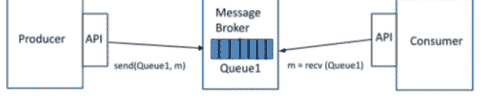
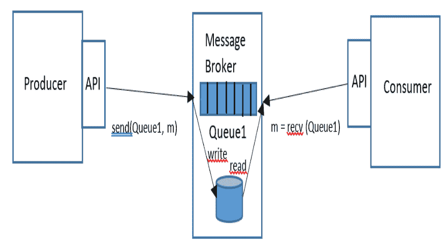
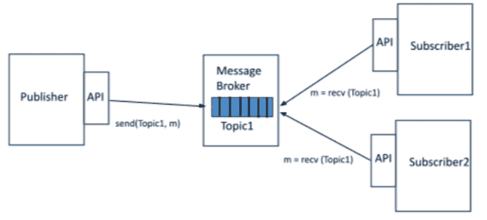
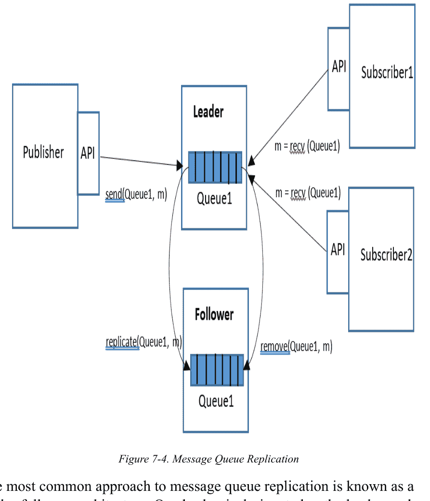
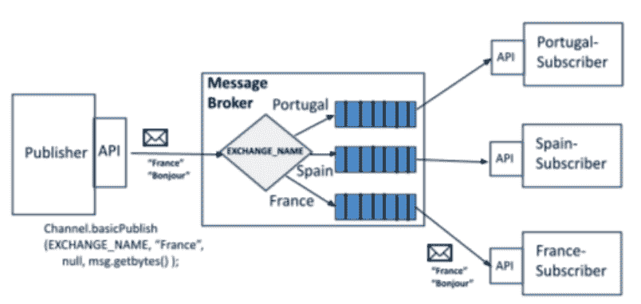
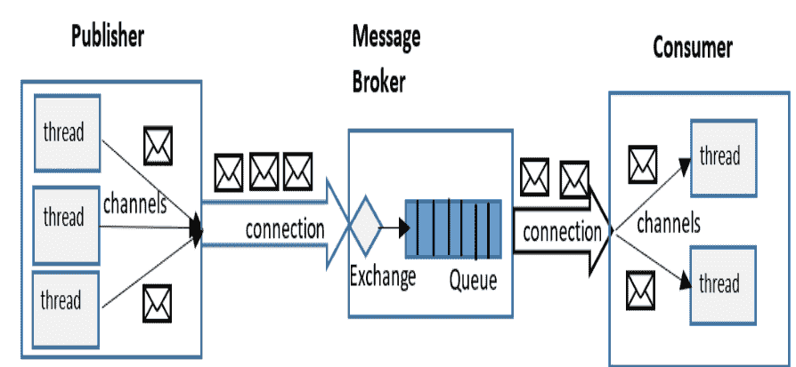
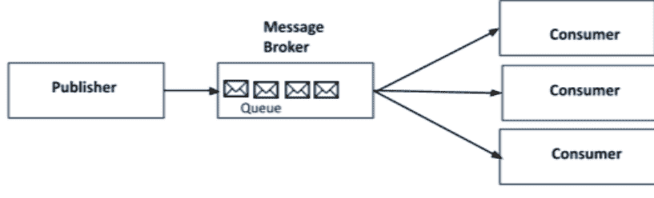

## Chapter 7. Asynchronous Messaging

### A NOTE FOR EARLY RELEASE READERS

对于早期发布的电子书，您可以在作者撰写时获得书籍的最原始形式——作者未经编辑的原始内容，以便您在这些标题的正式发布之前就能利用这些技术。

这将是最终书籍的第 7 章。请注意，GitHub 仓库将在稍后激活。

如果您对如何改进本书的内容和/或示例有任何意见，或者如果您注意到本章中缺少材料，请联系编辑 vwilson@oreilly.com。

不可避免地，对于一本分布式系统书籍，我在前几章中花费了相当多的时间讨论通信问题。通信是分布式系统的基础，也是架构师需要将其纳入系统设计的主要问题。

到目前为止，这些讨论假设了一种同步消息样式。客户端发送响应并等待服务器响应。这就是大多数分布式通信的设计方式，因为客户端需要即时响应才能继续。

并非所有系统都有此要求。例如，当我退回在线购买的商品时，我会将它们带到当地的 UPS 或 FedEx 店。他们扫描我的二维码，我把包裹交给他们处理。我不会在店里等待确认产品已被供应商成功接收并且我的付款已退回。那样会很无聊且无生产力。我信任运输服务会将我的


将不需要的商品退回给卖家，并期望在几天后收到一条已处理的通知。

我们可以设计分布式系统来模拟这种行为。使用异步通信风格，客户端，也称为生产者，将其请求发送到中间消息服务。该服务充当传递机制，将请求中继到处理所需的目标，即消费者。生产者发送请求后即忘。请求一旦交付给消息服务，生产者就会继续执行逻辑中的下一步，自信地认为它发送的请求最终会被处理。这提高了系统响应性，因为生产者不必等待请求处理完成。

在本章中，我将描述异步消息系统支持的基本通信机制。我还将讨论吞吐量与数据安全之间的固有权衡——基本上确保你的系统不会丢失消息。我还将介绍在高度可扩展的分布式系统中常见部署的三种关键消息模式。

为了使这些概念具体化，我将描述 RabbitMQ（https://www.rabbitmq.com/），一种广泛部署的开源消息系统。在介绍该技术的基础知识后，我将重点介绍设计高吞吐量消息系统时需要了解的核心功能集。

### 消息介绍

异步消息平台是技术领域中成熟的领域，拥有多种产品。¹  venerable IBM MQ Series 于 1993 年出现，至今仍是企业系统的支柱。Java Messaging Service 是一种 API 级规范，由多个 Java Enterprise Edition 厂商实现支持。RabbitMQ，我将在本章后面用作示例， arguably 是最广泛部署的开源消息系统。在消息领域，你永远不会缺少选择。

虽然这些竞争产品的具体功能和 API 各不相同，但基础概念几乎完全相同。我将在以下小节中介绍这些内容，然后在下一节中描述它们在 RabbitMQ 中的实现。一旦你理解了某个消息平台的工作原理，了解竞争对手的相似性和差异就相对直接。

### 消息原语

从概念上讲，消息系统包含以下内容：

- **消息队列**：队列存储一系列消息
- **生产者**：向队列发送消息
- **消费者**：从队列检索消息
- **消息代理**：管理一个或多个队列

该方案在图 7-1 中有所说明。



图 7-1. 一个简单的消息系统

消息代理是一种管理一个或多个队列的服务。当消息从生产者发送到队列时，代理会按到达顺序将消息添加到队列中——基本上是 FIFO 方法。代理负责在高效管理消息接收和保留，直到一个或多个消费者检索消息，然后将其从队列中移除。管理许多队列和许多请求的代理可以有效地利用多个 vCPU 和内存来提供低延迟访问。

生产者向代理上的命名队列发送消息。多个生产者可以向同一队列发送消息。生产者在从代理收到确认消息之前，发送操作才被视为完成。

多个消费者可以从同一队列取消息。每个消息正好由一个消费者检索。消费者检索消息有两种行为模式，称为 *pull* 或 *push*。虽然确切机制是产品特定的，但基本语义在各技术中是共通的。

- 在 pull 模式下，也称为轮询，消费者向代理发送请求，代理用下一个可供处理的可用消息进行响应。如果没有可用消息，消费者必须轮询队列直到消息到达。
- 在 push 模式下，消费者通知代理它希望从队列接收消息。消费者提供一个回调函数，当消息可用时应被调用。消费者然后阻塞（或执行其他工作），消息代理在消息可用时将消息传递给回调以供处理。

通常，利用可用的 push 模式效率更高且推荐。它避免了代理可能被多个消费者的请求淹没，并使在代理中更高效地实现消息传递成为可能。

消费者也会确认消息接收。在消费者确认后，代理可以自由地将消息标记为已交付并将其从队列中移除。确认可以自动或手动完成。

如果使用自动确认，消息在交付给消费者后立即被确认，并在处理之前。这提供了最低延迟的消息传递，因为确认可以在消息处理之前发送回代理。

通常消费者希望在确认之前确保消息已完全处理。在这种情况下它将使用手动确认。这可防止消息交付给消费者但由于消费者崩溃而未被处理的情况。当然这会增加消息确认延迟。无论选择哪种确认模式，未确认的消息实际上仍保留在队列中，并将在稍后时间交付给另一个消费者进行处理。

### 消息持久化

消息代理可以在同一硬件上管理多个队列。默认情况下，消息队列通常基于内存，以便为生产者和消费者提供最快的服务。在内存中管理队列开销最小，只要内存充足即可。然而，如果服务器崩溃，则存在消息丢失的风险。

为了防止消息丢失，即数据安全，队列可以配置为持久化。当生产者将消息放入队列时，操作不会完成，直到消息写入磁盘。该方案如图 7-2 所示。现在，如果消息代理发生故障，在重新启动时它可以恢复队列内容到故障前的状态，并且不会丢失任何消息。许多应用程序无法承受消息丢失，因此持久队列对于提供数据安全和容错是必要的。



图 7-2. 将消息持久化到磁盘

持久队列在发送操作的响应时间上存在固有增加，权衡是增强的数据安全。代理通常会在磁盘上以及内存中维护队列内容，以便在正常操作期间以最小开销将消息交付给消费者。

### 发布-订阅

消息队列将每个消息交付给恰好一个消费者。对于许多用例，这正是你想要的——我的在线购买退货只需要由原始卖家消费一次——这样我就能拿回我的钱。

让我们扩展这个用例。假设在线零售商希望分析所有购买退货，以便检测退货率高的卖家并采取补救措施。为此，你可以简单地将所有购买退货消息交付给各自的卖家和新的分析服务。这创建了一个一对多的消息需求，这被称为发布-订阅架构模式。在发布-订阅

系统中，消息队列被称为 *topics*。主题基本上是一个消息队列，它将每个发布的消息交付给一个或多个订阅者，如图 7-3 所示。

使用发布-订阅，你可以创建高度灵活和动态的系统。发布者与订阅者解耦，订阅者数量可以动态变化。这使架构高度可扩展，因为可以在不更改现有系统的情况下添加新订阅者。它还使消息处理可以由多个消费者并行执行，从而提高性能。

发布-订阅给消息代理带来额外的性能负担。代理有义务将每个消息交付给所有活动订阅者。由于订阅者不可避免地在不同时间处理和确认消息，代理需要保持消息可用，直到所有订阅者都消费了每条消息。利用 push 模型进行消息消费为发布-订阅架构提供了最有效率的解决方案。



*图 7-3. 一个发布-订阅代理架构*

发布-订阅消息是构建分布式、事件驱动架构的关键组件。在事件驱动架构中，多个服务可以使用消息代理主题发布与某些状态更改相关的事件。服务可以通过订阅


一个主题。发布到该主题上的每个事件随后都会被传递给所有感兴趣的消费者服务。我将在第 9 章介绍微服务时²再次讨论事件驱动架构。

### 消息复制

在异步系统中，消息代理可能是单点故障。系统或网络故障可能导致代理不可用，从而使系统无法正常运行。这很少是理想的情况。

因此，大多数消息代理能够将逻辑队列和主题在多个代理之间进行物理复制，每个代理都在自己的节点上运行。如果一个代理失败，则生产者和消费者可以使用其中一个副本继续处理消息。这种架构如图 7-4 所示。发布到 leader 的消息会被镜像到 follower，而从 leader 消费的消息会从 follower 中移除。



### 图 7-4. 消息队列复制

最常见的消息队列复制方法被称为 leader-follower 架构。一个代理被指定为 leader，生产者和消费者分别从该 leader 发送和接收消息。在后台，leader 会将收到的所有消息复制或镜像到 follower，并移除成功传递的消息。这在图 7-4 中以 replicate 和 remove 操作显示。这种方案的确切实现方式及其对代理性能的影响本质上取决于实现，因此取决于产品。

在 leader-follower 消息复制中，follower 被称为热备，本质上是 leader 的副本，在 leader 失败时可用。在这种故障场景下，生产者和消费者可以通过切换到访问 follower 来继续运行。这也称为 *故障转移*。故障转移在消息代理的客户端库中实现，因此对生产者和消费者来说是透明的。

实现执行队列复制的代理是一件复杂的事情。代理在复制消息时需要处理许多微妙的故障情况。我将在第 10 章和第 11 章讨论可扩展数据管理时开始提出这些问题并描述一些解决方案。

> **注意**
> 
> 一些建议 - 不要考虑 *自己动手* 构建复制方案，或任何其他复杂的分布式算法。软件世界充斥着构建特定于应用的分布式系统基础设施的失败尝试，只是因为现有的解决方案“对我们的需求来说不够合适”或“成本太高”。相信我——你的解决方案不会像现有解决方案那样有效，开发成本也会超出你的预期。而且你很可能会最终丢弃你的代码。这些算法在规模上正确实现起来非常困难。

### 示例：RabbitMQ

RabbitMQ 是分布式系统中应用最广泛的消息代理之一。你会在所有应用领域遇到其部署，从金融到电信和建筑环境控制系统。它最早于 2009 年左右发布，已发展成为一个功能齐全的开源分布式消息代理平台，支持使用大多数主流语言构建客户端。

RabbitMQ 代理是用 Erlang 构建的，主要³提供对高级消息队列协议（AMQP）开放标准的支持。

AMQP 源于金融行业，是一个合作的协议定义工作。它是一种二进制协议，提供实现该协议的不同产品之间的互操作性。开箱即用，RabbitMQ 支持 AMQP v0-9-1，通过插件支持 v1.0。

### 消息、交换机和队列

在 RabbitMQ 中，生产者和消费者使用客户端 API 从代理发送和接收消息。代理为消息提供存储转发功能，这些消息使用队列以 FIFO 方式处理。代理实现了一种基于交换机概念的消息模型，交换机提供创建消息拓扑的灵活机制。

交换机是一种抽象，它从生产者接收消息并将其传递给代理中的队列。生产者只会将消息写入交换机。消息包含消息负载和各种属性，称为消息元数据。其中一个元数据元素是 *路由键*，它是一个由交换机用来将消息传递到目标队列的值。

交换机可以配置为将消息传递到一个或多个队列。消息传递算法取决于交换机类型和称为绑定(bindings)的规则，该规则使用路由键在交换机和队列之间建立关系。最常用的三种交换机类型如表 7-1 所示。

### 表 7-1. 交换机类型

| 交换机类型 | 消息路由行为 |
|---|---|
| Direct | 根据与每条消息一起发布的路由键值匹配，将消息传递到队列 |
| Topic | 根据路由键与用于将队列绑定到交换机的模式匹配，将消息传递到一个或多个队列。 |
| Fanout | 将消息传递到绑定到交换机的所有队列，路由键被忽略。 |

Direct 交换机通常用于根据路由键⁴匹配将每条消息传递到一个目标队列。Topic 交换机是一种基于模式匹配的更灵活的机制，可用于实现复杂的发布-订阅消息拓扑。Fanout 交换机提供了一种简单的一对多广播机制，其中每条消息都会发送到所有附加的队列。

图 7-5 描绘了 direct 交换机的运行方式。队列由消费者使用三个值“France”、“Spain”和“Portugal”绑定到交换机。当消息从发布者到达时，交换机使用附加的路由键将消息传递到三个附加队列中的一个。



图 7-5. RabbitMQ Direct 交换机的示例

以下代码显示了在 Java 中如何配置和使用 direct 交换机的片段。RabbitMQ 客户端，即生产者和消费者进程，使用 channel 抽象与代理建立通信（下一节将详细介绍 channels）。生产者创建代理中的交换机并使用路由键设置为“France”发布消息到交换机。消费者在代理中创建一个匿名队列，将队列绑定到发布者创建的交换机，并指定使用路由键“France”发布的消息应传递到此队列。

#### 生产者：

```
channel.exchangeDeclare(EXCHANGE_NAME, "direct");
channel.basicPublish(EXCHANGE_NAME, "France", null,
message.getBytes());
```

#### 消费者：

```
String queueName = channel.queueDeclare().getQueue();
channel.queueBind(queueName, EXCHANGE_NAME, "France");
```

### 分布式与并发

要充分利用 RabbitMQ 的性能和可扩展性，你必须了解平台在底层的工作原理。关注的问题与客户端和代理如何通信以及线程如何管理有关。

每个 RabbitMQ 客户端使用 RabbitMQ 连接连接到代理。这基本上是 TCP/IP 的抽象，可以使用用户凭据或 TLS 进行保护。创建连接是一项开销较大的操作，需要客户端和服务器之间进行多次往返，因此每个客户端使用一个长期连接是常见的用法模式。

为了发送或接收消息，客户端使用连接创建 RabbitMQ channel。Channels 是客户端和代理之间的逻辑连接，仅存在于 RabbitMQ connection 的上下文中，如以下代码片段所示

```
ConnectionFactory connFactory = new ConnectionFactory();
Connection rmqConn = connFactory.createConnection();
Channel channel = rmqConn.createChannel();
```

可以在同一个客户端中创建多个 channel 以建立多个逻辑代理连接。这些 channel 上的所有通信都复用在同一个 RabbitMQ（TCP）连接上，如图 7-6 所示。创建 channel 需要一次网络往返到代理。因此出于性能原因，channel 理想情况下应该是长期的，应避免 channel 频繁创建和销毁，即 channel churn。




图 7-6. RabbitMQ 连接和通道

为了提高 RabbitMQ 客户端的吞吐量，一种常见策略是实现多线程生产者和消费者。然而，通道不是线程安全的，这意味着每个线程都需要对通道拥有独占访问权。如果你的客户端拥有长生命周期的有状态线程，并且可以为每个线程创建一个通道，则这不是问题，如图 7-6 所示。你启动一个线程，创建通道然后进行发布或消费。这是一种每个线程一个通道的模型。

在 Tomcat 或 Spring 等应用服务器中，解决方案却没那么简单。线程的生命周期和调用由服务器平台控制，而不是你的代码。解决方案是在服务器初始化时创建一个全局通道池。这个预先创建的通道集合可以在不产生每次请求创建和删除通道的开销的情况下，按需被服务器线程使用。每次请求到达处理时，服务器线程执行以下步骤：

- 从池中检索一个通道
- 将消息发送到代理
- 将通道归还池以供后续重用

虽然 RabbitMQ 没有原生能力来实现这一点，但在 Java 中你可以使用 Apache Commons Pool 库⁵ 来实现通道池。此实现的完整代码包含在本书的随附代码库中。以下代码片段展示了服务器线程如何使用 Apache GenericObjectPool⁶ 类的 borrowObject() 和 returnObject() 方法。你可以使用 setter 方法调整此对象池的最小和最大大小，以提供应用程序所需的吞吐量。

```
private boolean sendMessageToQueue(JsonObject message) {
    try {
        Channel channel = pool.borrowObject();
        channel.basicPublish(// arguments omitted for brevity)
        pool.returnObject(channel);
        return true;
    } catch (Exception e) {
        logger.info("Failed to send message to RabbitMQ");
        return false;
    }
}
```

在消费者端，客户端创建可用于接收消息的通道。消费者可以使用 basicGet() API 按需从队列中显式检索消息，如以下示例所示：

```
boolean autoAck = true;
GetResponse response = channel.basicGet(queueName, autoAck);
if (response == null) {
    // No message available. Decide what to do ...
} else {
    // process message
}
```

这种方法使用拉取模型，也称为轮询。轮询效率低下，因为它涉及忙等待，迫使消费者不断请求消息，即使没有消息可用。在高性能系统中，这不是应采用的方法。

替代且更优选的方法是推送模型。消费者指定一个回调函数，当 RabbitMQ 代理发送或推送消息给消费者时会被调用。消费者调用 basicConsume() API。当队列中有消息可供消费者使用时，消费者上的 RabbitMQ 客户端库会在与通道关联的另一个线程中调用回调。以下代码示例展示了如何使用传递给 basicConsume() 以建立连接的 DefaultConsumer 类型对象接收消息：

```
boolean autoAck = true;
channel.basicConsume(queueName, autoAck, "tag",
    new DefaultConsumer(channel) {
        @Override
        public void handleDelivery(String consumerTag,
                                    Envelope envelope,
                                    AMQP.BasicProperties
properties,
                                    byte[] body)
            throws IOException
        {
            // process the message
        }
    });
```

在单个通道上接收消息是单线程的。这使得有必要创建多个线程并分配每个线程一个通道或通道池，以便获得高消息消费速率。以下 Java 代码片段展示了如何实现这一点。每个线程创建并配置自己的通道，并指定当 RabbitMQ 客户端交付新消息时应调用的回调函数 – threadCallback()。

```
Runnable runnable = () -> {
    try {
        final Channel channel = connection.createChannel();
        channel.queueDeclare(QUEUE_NAME, true, false, false, null);
        // max one message per receiver

        final DeliverCallback threadCallback = (consumerTag,
 delivery)
            -> {
                String message =
                    new String(delivery.getBody(),
 StandardCharsets.UTF_8);
                // process the message
            };
        channel.basicConsume(QUEUE_NAME,
```

```
false, threadCallback, consumerTag ->
{});    //
} catch (IOException e) {
    logger.info(e.getMessage());
}
```

为了获得高性能和可扩展性，了解 RabbitMQ 使用的消息代理线程模型也很重要。在代理中，每个队列由单个线程管理。这意味着如果你的队列数量至少与底层节点上的核心数一样多，你可以在多核节点上提高吞吐量。反之，如果你的代理节点上高度利用的队列数量远多于核心数，你可能会看到性能下降。

像大多数消息代理一样，RabbitMQ 在消费速率跟上生产速率时表现最佳。当队列变长，达到数万条消息的量级时，管理队列的线程会产生更多开销。默认情况下，代理将使用其运行节点上 40% 的可用内存。当达到此限制时，代理将开始限制生产者，减慢代理接受消息的速率，直到内存使用量降至 40% 阈值以下。内存阈值是可配置的，再次，这是一个可以根据工作负载进行调整以优化消息吞吐量的设置。⁷

### 数据安全与性能权衡

所有消息系统都围绕性能与可靠性权衡呈现两难境地。在这种特定情况下，核心问题是消息传递的可靠性，通常称为数据安全。你希望消息在生产者与消费者之间以最小延迟传输，当然你也不希望在途中丢失任何消息。永远不要。记住，这些是分布式系统。

当消息从生产者传输到消费者时，你必须理解并在设计中考虑多种故障场景。这些是：

- 生产者向代理发送消息，但消息未被代理成功接受
- 消息在队列中，而代理崩溃
- 消息成功交付给消费者，但消费者在完全处理消息之前失败

如果你的应用程序可以容忍消息丢失，那么你可以选择最大化性能的选项。如果偶尔丢失即时消息应用程序中的消息可能无关紧要。在这种情况下，你的系统可以忽略消息安全问题并全速运行。这对于例如采购系统来说并非如此。如果采购订单丢失，企业会损失金钱和客户。你需要建立保障措施以确保数据安全。

RabbitMQ 与几乎所有消息代理一样，都有可用于保证端到端消息传递的功能。这些是：

#### 发布者确认

发布者可以指定希望从代理接收确认，表明消息已成功接收。这不是默认的发布者行为，必须通过调用 `confirmSelect()` 方法将其设置为通道属性。发布者可以同步等待确认，或通过注册回调函数异步等待。

#### 持久化消息和消息队列

如果消息代理失败，则存储在每个队列内存中的所有消息都会丢失。为了在代理崩溃后存活，队列需要配置为持久化，或持久。 这意味着消息在从发布者到达后立即写入磁盘。当代理在崩溃后重新启动时，它会恢复所有持久队列和消息。在 RabbitMQ 中，队列和单个消息都需要配置为持久化，以提供高水平的数据安全。


### 消费者手动确认

代理需要知道何时可以将消息视为已成功传递给消费者，以便将其从队列中移除。在 RabbitMQ 中，这要么发生在消息写入 TCP 套接字之后立即发生，要么在代理收到明确的客户端确认时发生。这两种模式分别称为自动确认和手动确认。自动确认存在数据安全风险，因为连接或消费者可能在消费者处理消息之前就已失败。因此，为了数据安全，重要的是利用手动确认，以确保消息在从队列中移除之前已被接收并处理。

简而言之，你需要发布者确认、持久队列和消息，以及手动消费者确认才能实现完整的数据安全。你的系统几乎肯定会受到性能影响，但你不会丢失消息。

### 可用性与性能权衡

另一个经典的消息系统权衡是在可用性和性能之间。单个代理是单点故障，因此如果代理崩溃或遇到瞬时网络故障，系统将不可用。解决方案，如提高可用性所典型的做法，是代理和队列复制。

RabbitMQ 提供了两种支持高可用性的方法，称为镜像队列和仲裁队列。虽然实现细节有所不同，但基本原理相同，即：

- 需要部署并配置两个或多个 RabbitMQ 代理作为集群。
- 每个队列都有一个领导者版本，以及一个或多个跟随者。
- 发布者将消息发送给领导者，领导者负责将每条消息复制到跟随者。
- 消费者也连接到领导者，并且当消息在领导者处被成功确认时，它们也会从跟随者中移除。
- 由于所有发布者和消费者活动都由领导者处理，仲裁队列和镜像队列都增强了可用性，但不支持负载均衡。消息吞吐量受限于领导者副本所能实现的性能。

仲裁队列和镜像队列所支持的确切功能存在许多差异。⁸ 然而关键区别在于消息如何被复制，以及在领导者故障时如何选择新的领导者。在此上下文中，仲裁本质上意味着多数。如果有 5 个队列副本，则至少需要 3 个副本——领导者和 2 个跟随者——来持久化新发布的消息。仲裁队列实现了一种称为 RAFT 的算法来管理复制，并在领导者变得可用时选举新的领导者。我将在第 12 章中详细介绍 RAFT。

仲裁队列必须是持久的，因此设计用于在数据安全和可用性优先于性能的用例中使用。它们在故障处理方面相比镜像队列实现具有其他优势。出于这些原因，镜像队列实现将在未来版本中被弃用。

### 消息模式

在企业系统中拥有悠久的使用历史，存在一个全面的设计模式目录⁹，用于利用消息的应用。虽然其中许多关注的是系统构建和修改的易用性最佳设计实践，以及消息安全，但其中一些直接适用于分布式系统中的可扩展性。我将在本节中解释三种最常用的模式。

### 竞争消费者

消息系统的一个常见需求是尽可能快地从队列中消费消息。通过竞争消费者¹⁰ 模式，这是通过运行多个并发处理消息的消费者线程和/或进程来实现的。这使得应用程序可以通过按需水平扩展消费者来扩展消息处理。总体设计如图 7-7 所示。



图 7-7. 竞争消费者模式

使用此模式，消息可以使用推送或拉取模型在消费者之间动态分发。使用推送方法，代理负责选择向其传递消息的消费者。一种常见方法，例如在 RabbitMQ 和 ActiveMQ 中实现，是简单的轮询分发算法。这确保了消息在消费者之间均匀分布。

使用拉取方法，消费者只需尽可能快地消费它们可以处理的消息。假设消费者是多线程的，如果一个消费者运行在 8 核节点上，另一个运行在 2 核节点上，我们预计前者处理的量大约是后者的 4 倍。因此负载均衡在拉取方法中自然发生。

此模式有三个关键优势，即：

Availability

如果一个消费者失败，系统仍然可用，其消息份额将简单地分发给其他竞争消费者。

#### 故障处理

如果消费者失败，未确认的消息将被传递给另一个队列消费者。

#### 动态负载均衡

在高负载期间可以启动新的消费者，在负载降低时停止，而无需更改任何队列或消费者配置。

对竞争消费者的支持可以在任何生产质量的消息平台中找到。它是从单个队列扩展消息处理的一种强大方式。

### 精确一次处理

正如我在第 3 章中所讨论的，瞬时网络故障和延迟响应可能导致客户端重新发送消息。这可能导致服务器收到重复消息。为缓解此问题，我们需要采取措施确保幂等处理。

在异步消息系统中，处理重复消息有两个来源。第一个是发布者的重复，第二个是消费者多次处理同一消息。两者都需要解决，以确保每条消息都精确一次处理。

发布者部分的问题源于发布者在未收到消息代理的确认时重试消息。如果原始消息已被接收而确认丢失或延迟，这可能导致队列中出现重复。幸运的是，一些消息代理为此重复检测提供支持，从而确保重复不会发布到队列。例如，ActiveMQ Artemis 版本可以移除¹¹ 从发布者发送到代理的重复。该方法基于我在第 3 章中描述的解决方案，使用客户端生成的、唯一的 *idempotent-key* 值作为每条消息。发布者只需将特定消息属性设置为唯一值，如以下代码所示：

```
ClientMessage msg = session.createMessage(true);
UUID idKey = UUID.randomUUID();  // use as idempotence key
msg.setStringProperty(HDR_DUPLICATE_DETECTION_ID, idKey.toString()
);
```

代理利用缓存存储 idempotent-key 值并检测重复。这有效地消除了队列中的重复消息，解决了问题的第一部分。

在消费者端，重复发生在代理将消息传递给消费者，消费者处理它然后未能发送确认时（消费者崩溃或网络丢失确认）。因此代理会重新传递消息，如果应用程序使用竞争消费者模式，可能传递给不同的消费者。

防止重复处理是消费者的义务。同样，机制是我在第 3 章中描述的，即维护已处理消息的 idempotent-keys 缓存或数据库。大多数代理会设置一个消息头来指示消息是否为重传。这可以在消费者幂等实现中使用。它不能保证消费者已经看到该消息。它只是告诉你代理已交付该消息并且消息仍未被确认。

### 有毒消息

有时传递给消费者的消息无法被处理。可能有许多原因。其中最常见的是生产者错误，发送了消费者无法处理的无效消息。这可能是由于诸如格式错误的 JSON 有效载荷或一些未预期的状态更改等原因，例如消息中 *StudentID* 字段对应一名刚刚退学的学生，该学生已不再活跃


in the database. 无论原因如何，这些 *poison messages* 具有两种影响之一：

- 它们导致消费者崩溃。这在开发和测试系统中最为常见。有时这些问题也会悄悄进入生产环境，而失败的消费者肯定会带来一些严重的运维头痛。
- 它们导致消费者拒绝该消息，因为它无法成功处理负载。

在任何一种情况下，假设需要消费者确认，消息将保持在队列中未确认状态。经过某种经纪人特定的机制，通常是超时或负确认，poison message 将被传递给另一个消费者进行处理——结果可预测且不理想。

如果 poison messages 没有以某种方式被检测到，它们可以无限期地被传递。这在最好情况下会占用处理能力，从而降低系统吞吐量。在最坏情况下，它会使系统瘫痪，因为每次接收到 poison message 时都会导致消费者崩溃。

处理 poison message 的解决方案是限制消息可以重递送的次数。当重递送限制达到时，消息会自动移动到一个收集有问题请求的队列中。该队列传统上以一种相当阴森的方式被称为 *dead-letter queue*。

正如你现在所预料的那样，实现 poison message 处理的确切机制因消息平台而异。例如，亚马逊的 Simple Queueing Service（SQS）定义了一个策略，指定与应用程序定义的队列关联的死信队列。策略还说明在多少次重递送后应将消息自动从应用程序队列移动到死信队列。此值称为 `maxReceiveCount`。

在 SQS 中，每个消息都有一个 `ReceiveCount` 属性，当消息未被消费者成功处理时会递增。

当 `ReceiveCount` 超过队列定义的 `maxReceiveCount` 值时，SQS 会将消息移动到死信队列。重递送的合理值因应用程序特征而异，但 3 到 5 的范围很常见。

处理 poison message 的最后部分是诊断消息被重定向到死信队列的原因。首先，你需要设置某种形式的监控警报，在消息处理失败时向工程师发送通知。在那之后，诊断将包括检查导致处理失败的异常日志，并分析消息内容以识别生产者或消费者问题。

### Summary and Further Reading

异步消息传递是可扩展系统架构的组成部分。消息传递在请求出现高峰和低谷的系统中特别有吸引力。在高峰时段，生产者可以将请求添加到队列中并快速响应客户端，而无需等待请求被处理。

消息传递将生产者与消费者解耦，使得可以独立扩展它们。架构可以通过弹性扩展生产者和消费者以匹配流量模式，并在消息吞吐量需求与成本之间取得平衡来利用这一点。消息队列可以分布在多个代理上以扩展消息吞吐量。队列也可以被复制以增强可用性。

消息传递并非没有危险。队列中可能会放置重复项，如果队列保存在内存中，消息可能会丢失。向消费者的传递可能会丢失，如果确认丢失，消息可能会被消费多次。这些数据安全问题需要在设计中注意细节，以便对重复消息和消息丢失的容忍度与系统要求相匹配。

如果你有兴趣获得对消息架构和系统的广泛而深入的知识，经典书籍 *Enterprise Integration Patterns*

由 Gregor Hohpe 和 Bobby Woolf（Addison-Wesley Professional）撰写应该是你的第一站。其他优秀的知识来源往往是特定于消息平台的，由于存在大量竞争平台，可供选择的书籍也很多。我最喜欢的 RabbitMQ 书籍，用于通用消息智慧和 RabbitMQ 特定信息是 *RabbitMQ Essentials, 2nd Edition* 由 Lovisa Johansson 和 David Dosset（Packt）撰写，以及 *RabbitMQ In Depth* 由 Gavin Roy（Manning）撰写。

最后一点说明，异步通信的主题及其随之而来的优势和问题将贯穿本书的其余部分。消息传递是基于微服务的架构的关键组件（第 9 章），也是分布式数据库功能的基础。而且当我在第 4 部分介绍流系统和事件驱动处理时，你肯定会认出本章的主题。

- 1 Overview of messaging technologies landscape (https://www.g2.com/categories/message-queue-mq)
- 2 Chapter 14 of *Fundamentals of Software Architecture* by Mark Richards and Neal Ford is an excellent source of knowledge for Event-Driven architectures.
- 3 Other protocols such STOMP and MQTT are supported via plugins.
- 4 Consumers can call queueBind() multiple times to specify that their destination should receive messages for more than one routing key value. This approach can be used to create one-to-many message distribution. Topic exchanges are more powerful for one to many messaging.
- 5 Documentation for the Apache Commons library (https://commons.apache.org/proper/commons-pool/index.html)
- 6 Generic Object Pool documentation (https://javadoc.io/doc/org.apache.commons/commons-pool2/latest/org/apache/commons/pool2/impl/GenericObjectPool.html)
- 7 A complete description of how the RabbitMQ server memory can be configured (https://www.rabbitmq.com/memory.html)
- 8 Detailed Quorum Queues feature descriptions (https://www.rabbitmq.com/quorum-queues.html#feature-comparison)
- 9 Messaging patterns main Web site (https://www.enterpriseintegrationpatterns.com/patterns/messaging/)
- 10 An general overview of the Competing Consumers pattern (https://www.enterpriseintegrationpatterns.com/patterns/messaging/CompetingConsumers.html)
- 11 A full description of how ActiveMQ handles duplicates can be found at this link https://activemq.apache.org/components/artemis/documentation/latest/duplicate-detection.html
