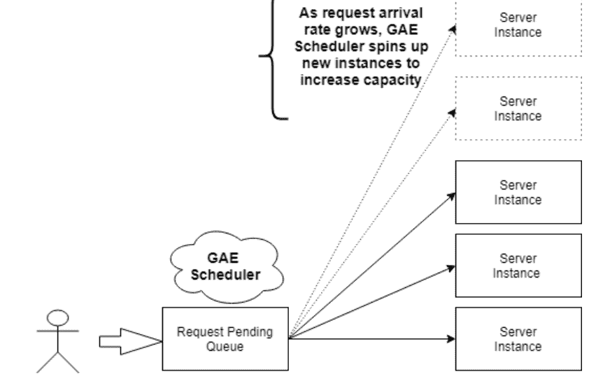
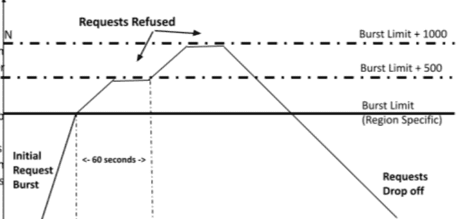

## Chapter 8. Serverless Processing Systems

### A NOTE FOR EARLY RELEASE READERS

对于早期发布读者的一则说明

使用 Early Release 电子书，你可以在这些书籍正式发布之前很久就利用这些技术——作者在撰写时的原始未编辑内容，以便你可以在这些标题的官方发布之前利用这些技术。

这将是最终书籍的第 8 章。请注意，GitHub 仓库将在稍后激活。

如果你对如何改进本书的内容和/或示例有任何评论，或者如果本章中缺少材料，请联系编辑 vwilson@oreilly.com。

可扩展系统会经历广泛不同的使用模式。对于某些应用程序，负载可能在工作时间很高，而在非工作时间很低或不存在。其他应用程序，例如在线演唱会门票销售系统，99% 的时间背景流量都很低。但当主要系列演出门票发布时，需求可能会在数小时内飙升至平均负载的 10000 倍，然后再回落到正常水平。

如第 5 章所述，弹性负载平衡是处理这些峰值的一种方法。另一种是无服务器计算，我将在本章中探讨。

### The Attractions of Serverless

主要组织 IT 系统从本地部署向公共云平台部署的转变似乎不可阻挡。从初创公司到政府机构再到跨国公司，组织将云视为数字转型平台和改善业务连续性的基础技术。

云平台的两个巨大吸引力是其按需付费计费和能够快速扩展（和缩减）虚拟资源以满足波动的工作负载和数据量。当然，这种扩展能力并非免费。你的应用程序需要被设计为利用云平台提供的可扩展服务¹。并且正如我在第 1 章中所讨论的，成本和规模是不可分割的。系统利用资源的时间越长，你月底的云账单就越大。

月度云账单可能很大。真的很大。更糟糕的是，出人意料地大！云超支的“价格冲击”案例比比皆是——在一项调查²中，69% 的受访者经常超支云预算超过 25%。一个知名案例在被注意到之前花费了 50 万美元用于一个 Azure³ 任务。归因于超支的原因有很多，包括缺乏自动扩展解决方案的部署、长期容量规划不佳，以及未能充分利用云架构导致系统占用膨胀。

在云平台上，架构师面临着无数的架构决策。这些决策既广泛，涉及系统采用的整体架构模式或风格——例如微服务、n 层、事件驱动——也狭窄，特定于各个组件和系统构建所基于的云服务。

从这个意义上说，架构上重要的决策渗透到云上系统设计和部署的各个方面。而所有这些决策的集体后果在你收到月度云支出账单时变得非常明显。

传统上，云应用程序部署在基础设施即服务（IaaS）平台上，利用虚拟机（VMs）。在这种情况下，你为部署的资源付费，无论它们利用率高低。如果负载增加，弹性应用程序可以启动新的虚拟机以增加容量，通常使用云提供的负载平衡服务。你的成本本质上与你选择的 VM 类型、它们部署的持续时间以及应用程序存储和传输的数据量成正比。


主要云服务提供商提供了一种替代显式预配虚拟处理资源的方案。被称为 *serverless* 平台，它们不需要任何计算资源进行静态预配。使用 AWS Lambda 或 Google App Engine (GAE) 等技术，应用程序代码会在请求到达时按需加载并执行。如果没有活动请求，基本上没有资源在使用，也不会产生费用。

Serverless 平台还会为你管理自动扩缩容（向上和向下）。当同时有请求到达时，会创建额外的处理能力来处理请求，并理想情况下提供稳定较低的响应时间。当请求负载下降时，额外的处理能力会被停用，且不会产生费用。

每个 serverless 平台在实现细节上各不相同。例如，通常只支持有限数量的主流编程语言和应用服务器框架。平台提供多种配置设置，可用于平衡性能、可扩展性和成本。总的来说，成本与以下因素成正比：

- 用于执行请求的处理器实例的类型，
- 请求的数量以及每个请求的处理持续时间，
- 每个应用服务器实例在 serverless 基础设施上驻留的时间。

然而，各厂商使用的确切参数差异很大。每个平台都是专有的，并在细微之处有所不同。正如常言所说，魔鬼藏在细节里。所以让我们具体探索一下这些“魔鬼细节”，尤其是针对 Google App Engine 和 AWS Lambda 平台。

### Google App Engine

Google App Engine (GAE) 是 Google 提供的首个产品，现属于 Google Cloud Platform。它自 2011 年起进入通用发布，使开发者能够将基于 HTTP 的应用程序服务上传并在 Google 管理的云基础设施上执行。

#### The Basics

GAE 支持使用 Go、Java、Python、Node.js、PHP、.NET 和 Ruby 开发应用程序。要在 GAE 上构建应用程序，开发者可以利用基于 Google 提供的 GAE 运行时库构建的通用 HTTP 应用框架。例如，在 Python 中，应用程序可以使用 Flask、Django 和 web2py，而在 Java 中，主要支持的平台是基于 Jetty JEE Web 容器的 servlet。

应用程序的执行由 GAE 动态管理，它会根据请求需求水平启动计算资源。应用程序通常访问受管理的持久存储平台，如 Google 的 Firestore (https://cloud.google.com/firestore) 或 Google Cloud SQL (https://cloud.google.com/sql)，或与 Google 的 Cloud PubSub (https://cloud.google.com/pubsub) 等消息服务交互。

GAE 有两种版本，称为标准环境和灵活环境。基本区别在于标准环境由 GAE 更紧密地管理，在支持的语言版本方面对开发有一定限制。这种严格管理使得服务能够快速响应增加的负载进行扩容。相比之下，灵活环境本质上是 Google Compute Engine 服务的定制版本，在 VM 上运行应用程序的 Docker 容器 (https://www.docker.com/)。顾名思义，它在可使用的开发能力方面提供了更多选项，但不适合快速扩容。

在本章的其余部分，我将重点关注高度可扩展的标准环境。

#### GAE Standard Environment

在标准环境中，开发者将应用程序代码上传到与基础项目 URL 关联的 GAE 项目中。该代码必须定义可由向 URL 发出请求的客户端调用的 HTTP 端点。当收到请求时，GAE 会将其路由到处理实例以执行应用程序代码。这些被称为应用程序的驻留实例，是使用 GAE 所产生的成本的主要组成部分。

每个项目配置都可以指定一组参数来控制 GAE 何时加载新实例或调用驻留实例。两个最简单的设置控制 GAE 在任何时刻驻留的最小和最大实例数。最小值可以为零，这对于长时间处于非活动状态的应用程序非常理想，因为这样不会产生成本。

当请求到达且没有驻留实例时，GAE 会动态加载一个应用程序实例并调用端点的处理。多个同时请求可以发送到同一个实例，直到达到某个配置的限制（稍后在讨论自动扩缩容时我会详细介绍）。GAE 然后会按需加载更多实例，直到达到指定的最大实例值。通过设置最大值，应用程序可以限制成本，尽管如果负载继续增长，可能会导致延迟增加。

标准环境应用程序可以用 Go、Java、Python、Node.js、PHP 和 Ruby 构建。由于 GAE 本身负责为应用程序加载运行时环境，因此它将支持的版本⁴限制为每种编程语言的少数几个。所使用的语言也会影响在 GAE 上加载新实例所需的时间。例如，像 Go 这样轻量级的运行时环境在新实例上启动时间不到一秒。相比之下，更庞大的 Java 虚拟机的平均启动时间约为 1-3 秒。此加载时间还受应用程序所包含的外部库数量的影响。

因此，虽然不同语言之间存在差异，但加载新实例相对较快。无论如何都比启动虚拟机快得多。这使得标准环境非常适合于经历快速负载峰值的应用程序。GAE 能够在请求量增加时快速添加新的驻留实例。请求会根据负载动态路由到实例，因此假设应用程序采用纯无状态模型以支持有效的负载分配。随后，一旦负载下降，实例会很快被释放，从而降低成本。

GAE 的标准环境是一个极其强大的可扩展应用程序平台，我将在本章后面的案例研究中更详细地探讨它。

#### AutoScaling

Autoscaling 是你在 `app.yaml` 文件中指定的一个选项，该文件在你上传服务器代码时传递给 GAE。自动扩缩容的应用程序由 GAE 根据一组默认参数值进行管理，你可以在 `app.yaml` 中覆盖这些值。基本方案如图 8-1 所示。

GAE 基本上根据传入的流量负载管理应用程序部署的处理实例数量。如果没有传入请求，GAE 不会调度任何实例。当请求到达时，GAE 会部署一个实例来处理请求。

部署一个实例所需的时间取决于所使用的编程语言，可能在几百毫秒到几秒之间⁵。这意味着如果没有驻留实例，初始请求的延迟可能很高。为了减轻实例加载延迟的影响，你可以指定要保持可用于处理请求的最小实例数。当然这会花费金钱。

随着请求负载的增长，GAE 调度程序会动态加载更多实例来处理请求。三个参数精确控制扩缩容的运行方式，即：

#### Target CPU Utilization

设置 CPU 利用率阈值，高于该阈值时会启动更多实例来处理流量。范围为 0.5（50%）到 0.95（95%）。默认值为 0.6（60%）。

#### Maximum Concurrent Requests

设置实例在调度程序生成新实例之前可以接受的最大并发请求数。默认值是 10，最大值为 80。文档⁶未说明允许的最小值，但推测 1 将定义一个单线程服务。

#### Target Throughput Utilization

这与为最大并发请求指定的值一起使用，以指定何时启动新实例。范围为 0.5（50%）到 0.95（95%）。默认值为 0.6（60%）。其工作原理如下：当


当实例的并发请求数达到等于最大并发请求值乘以目标吞吐量利用率的值时，调度器会尝试启动一个新实例。

明白了吗？正如 hopefully 所显而易见的，这三个设置相互作用，使得配置变得有些复杂。默认情况下，一个实例会在创建新实例之前处理 10 x 0.6 = 6 个并发请求。而且如果这 6 个（或更少）请求导致实例的 CPU 利用率超过 60%，调度器也会尝试创建新实例。



图 8-1. GAE 自动扩缩容

但等等，还有更多！

你还可以指定值来控制 GAE 何时基于请求在请求待处理队列中花费的时间来添加新实例 - 见图 8-1 - 等待被分派到实例进行处理。max-pending-latency 参数指定 GAE 允许请求在待处理队列中等待的最长时间，然后再启动额外实例来处理请求并降低延迟。默认值是 30ms。值越低，应用程序扩展得越快。而且它可能花费的也就越多。⁷

这些自动扩缩容参数设置使我们能够微调服务的行为以平衡性能和成本。修改这些参数将如何影响应用程序的行为当然取决于服务的具体功能。这些参数之间存在微妙的相互作用，这使得这种调优练习有些复杂。不过，我将在本章后面的案例研究部分重返此主题，并解释一种可用于服务调优的简单、平台无关的方法。

### AWS Lambda

AWS Lambda 是 Amazon 的无服务器平台。其底层设计原则和主要功能与 GAE 和其他无服务器平台相似。开发人员上传代码，该代码作为称为 Lambda 函数的服务部署。当被调用时，Lambda 提供特定语言的执行环境来执行函数代码。

以下代码展示了一个简单的 Python Lambda 函数示例。此函数只是从输入事件中提取一条消息，并将其原样作为 HTTP 200 响应的一部分返回。一般来说，你实现一个接受事件和上下文参数的函数。事件是一个 JSON 格式的文档，封装了 Lambda 函数处理的数据。例如，如果 Lambda 函数处理 HTTP 请求，事件将包含 HTTP 头和请求体。上下文包含有关函数和运行时环境的元数据，例如函数版本号和执行环境中的可用内存。

```
import json
def lambda_handler(event, context):
    event_body = json.loads(event['body'])
    response = {
        'statusCode': 200,
        'body': json.dumps({ event_body['message'] })
    }
    return response
```

Lambda 函数可以由外部客户端通过 HTTP 调用。它们也可以与其它 AWS 服务紧密集成。例如，这使得 Lambda 函数能够在新数据写入 AWS S3 存储服务时或监控事件发送到 AWS CloudWatch 服务时动态触发。如果你的应用程序深度嵌入 AWS 生态系统，Lambda 函数在设计和部署架构时可以非常有用。

鉴于无服务器平台之间的核心相似性，在本节中我将只关注 Lambda 从可扩展性和成本角度的差异化特性。

### Lambda 函数生命周期

Lambda 函数可以用多种语言构建，并支持常见的服务容器，如 Java 的 Spring 和 Python 的 Flask。对于每种受支持的语言，即 Node.js、Python、Ruby、Java、Go 和基于 .NET 的代码，Lambda 支持多个运行时版本。运行时环境版本在部署时与代码一起指定，代码以压缩格式上传到 Lambda。⁸

Lambda 函数必须设计为无状态，以便 Lambda 运行时环境能够按需扩展服务。当第一个请求到达 Lambda 函数定义的 API 时，Lambda 会下载函数的代码，初始化运行时环境以及任何实例特定初始化（例如创建数据库连接），最后调用函数代码处理程序。

这种初始调用称为冷启动，所花费的时间取决于所选的语言环境、函数代码的大小以及初始化函数所需的时间。与 GAE 一样，像 Node.js 和 Go 这样的轻量级语言通常需要几百毫秒来初始化，而 Java 或 .NET 则更重，可能需要一秒或更长时间。

一旦 API 执行完成，Lambda 就可以为后续请求使用已部署的函数运行时环境。这意味着不会产生冷启动成本。然而，如果同时到达请求突发，多个运行时实例将被初始化，每个请求一个。⁹ 与 GAE 不同，Lambda 不会向同一运行时实例发送多个并发请求。这意味着这些同时请求由于冷启动成本而都会产生额外的响应时间。

如果没有新请求到达并且驻留的运行时实例未立即重用，Lambda 会冻结执行环境。如果后续请求到达，环境将被解冻并重用。如果函数长时间没有更多请求到达，在平台控制的几分钟后，Lambda 将停用冻结的实例，使其不再消耗平台资源。¹⁰

冷启动成本可以通过使用预置并发来缓解。这告诉 Lambda 保持最少数量的运行时实例常驻并准备好处理请求，无需冷启动开销。当然“没有免费的午餐”原则适用，费用会根据预置实例的数量而增加。你也可以使 Lambda 函数成为 AWS Application Load Balancer 的目标，与第 5 章中讨论的方式类似。例如，可以定义一个负载均衡器策略，在指定时间增加函数的预置并发，以预期流量的增加。

### 执行考虑

当你定义 Lambda 函数时，你指定应分配给其运行时环境的内存量。与 GAE 不同，你不指定要使用的 vCPU 数量。相反，计算能力会按比例分配给指定的内存，范围在 128MB 到 10GB 之间。

Lambda 函数按每次执行的毫秒数计费。每次毫秒的成本会随着分配给运行时环境的内存量而增长。例如，在撰写本文时，2GB 实例每次毫秒的成本是 1GB 实例的两倍。¹¹ Lambda 并未精确说明这种额外的内存为你的函数带来了多少计算能力。然而，分配的内存越多，你的 Lambda 函数执行的速度就越快。¹²

这种情况造成了性能与成本之间的微妙权衡。让我们以上面提到的 1GB 和 2GB 实例的成本为基础，举一个简单的例子，并假设在 1GB 实例上执行 1 毫秒会产生 1 个神话成本单位，而在 2GB 实例上执行 1 毫秒会产生 2 个单位。

在 1GB 内存下，我假设此函数执行时间为 40 毫秒，因此产生 40 个成本单位。在分配 2GB 内存并相应地分配更多 CPU 后，相同函数耗时 10 毫秒，这意味着你从 AWS 电子钱包中支出 20 个成本单位。因此，你的账单将减少 50%，并且通过为函数分配更多内存，你将获得 4 倍更快的执行。调优肯定会带来回报。

这显然非常依赖于 Lambda 函数实际执行的处理。尽管如此，如果你的服务每月执行数十亿次，这种有些反直觉的调优练习可能会带来显著的成本节约和更大的可扩展性。

找到这种“甜点”，在相似或更低的成本下提供更快的响应时间，是一种性能调优实验，在大规模下可以获得高回报。Lambda 使这成为一个相对简单的实验，因为只有一个参数，即内存分配，需要变化。本章后面的案例研究将解释一种可用于 GAE 等平台的方法，这些平台具有多个相互依赖的参数来控制可扩展性和成本。

#### 可扩展性

随着函数并发请求数的增加，Lambda 会部署更多运行时实例来扩展处理。如果请求负载继续增长，Lambda 会重用可用实例并根据需要创建新实例。最终，当请求负载下降时，Lambda 会通过停止未使用的实例来缩减规模。这就是简单的版本。实际上，它稍微复杂一些。

所有 Lambda 函数都有内置的请求突发并发限制。有趣的是，此默认突发限制因函数部署的 AWS 区域而异。例如，在美国西部（俄勒冈）


可以扩展到 3000 个实例来处理请求突发，而在欧洲（法兰克福）该限制为 1000 个实例。¹³

无论区域如何，一旦达到突发限制，函数以每分钟 500 个实例的速度扩展。这会一直持续到需求得到满足并且请求开始下降。如果请求负载超过每分钟 500 个额外实例可以处理的容量，Lambda 会限制该函数并向客户端返回 HTTP 429，客户端必须重试请求。

此行为在图 8-2 中有所说明。在请求突发期间，实例数量迅速增长至区域定义的突发限制。之后，每分钟只能部署 500 个新实例。在此期间，无法由可用实例满足的请求将被限制。随着请求负载下降。实例将被从平台中移除，直到恢复到稳定的流量状态。

函数可以处理的并发客户端请求的确切数量取决于函数的处理时间。例如，假设我们部署了 3000 个实例，并且每个请求平均需要 100 毫秒处理。这意味着每个实例每秒可以处理 10 个请求，最大吞吐量为：

(3000x10) = 30000 requests per second.



图 8-2. 扩展 AWS Lambda 函数

为了完整说明，你需要知道突发并发限制实际上适用于与单个 AWS 账户关联的该区域中的所有函数。因此，如果你在同一区域下同一账户中部署 3 个不同的 Lambda 函数，它们的已部署实例的总体数量受决定扩展行为的突发限制控制。这意味着如果一个函数突然意外地负载很重，它可能会消耗突发限制并对希望同时扩展的其他函数的可用性产生负面影响。

为了解决这种潜在冲突，你可以微调与在同一 AWS 账户中同一区域部署的每个单独 Lambda 函数关联的并发级别。¹⁴ 这称为预留并发。每个单独的函数可以关联一个小于突发限制的值。¹⁵ 该值定义了可以并发执行的该函数实例的最大数量。

预留并发有两个影响：

- 具有预留并发的 Lambda 函数始终为其自己的调用保留专用的执行容量。它不会被该区域中其他函数的并发调用意外饿死。
- 预留容量限制了该函数的驻留实例的最大数量。当实例数量达到预留值时无法处理的请求将以 HTTP 429 错误失败。

从本讨论中可以明显看出，AWS Lambda 提供了一个强大且灵活的无服务器环境。只要谨慎配置，运行时环境就可以有效扩展以处理高负载、突发请求。它已成为许多组织内部和面向客户应用程序的 AWS 工具箱的重要组成部分。¹⁶

### 案例研究：平衡吞吐量和成本

几乎总是需要调整运行时参数设置，才能以最低成本从无服务器平台获得所需的性能和可扩展性。当你的应用程序每天可能处理数百万个

请求时，即使 10% 的成本降低也可能带来显著的货币节省。肯定足以让你的老板和客户高兴。

所有无服务器平台在可调参数设置方面各不相同。有些相对简单，例如 AWS Lambda，其中为函数选择内存量是主要调优参数。另一个极端可能是 Azure Functions，它有多个参数设置和部署限制，具体取决于选择的三种托管计划中的哪一种。17

Google App Engine 介于两者之间，有少数几个参数控制自动扩展行为。我将以此为例说明如何进行应用程序调优。

### 选择参数值

有三个主要参数控制 GAE 如何自动扩展应用程序，如本章前面所述。表 8-1 列出了这些参数以及可能的值范围。

表 8-1. Google App Engine 自动扩展参数

| 参数名称 | 最小值 | 最大值 | 默认值 |
|---|---|---|---|
| target_throughput_utilization | 0.5 | 0.95 | 0.6 |
| target_cpu_utilization | 0.5 | 0.95 | 0.6 |
| max_concurrent_requests | 1 | 80 | 10 |

鉴于这些范围，软件架构师的问题很简单，你如何选择提供所需性能和可扩展性且成本最低的参数值？可能最困难的部分是弄清楚从哪里开始。

即使只有三个参数，也存在大量可能的设置组合，可能相互作用。你怎么知道你的参数设置是否尽可能接近地同时服务于你的用户和你的预算？有一些很好的通用建议可用，¹⁸ 但你仍然面临为你的应用程序选择参数值的问题。

仅就表 8-1 中列出的三个参数而言，大约有 170K 种不同的配置。你不可能全部测试。如果戴上工程学的帽子，只考虑吞吐量和 cpu 利用率以 0.05 的增量，以及最大并发请求以 10 的增量，你仍然得到大约 648 种可能的配置。这完全不切实际，特别是在我们事先并不知道我们的服务行为对任何参数值设置的敏感程度时。那么，你能做什么？

一种调优系统的方法是进行参数研究。¹⁹ 也称为参数化研究，该方法包括三个基本步骤：

- 1. 提名待评估的参数
- 2. 定义参数范围以及该范围内的离散值
- 3. 分析并比较每个参数变化的结果

为了说明这种方法，我将带你通过一个基于表 8-1 中三个参数的示例。目标是找到提供理想情况下最高吞吐量且成本最低的参数设置。测试的应用程序是一个执行对 Google FireStore 数据库的读写操作的 GAE Go 服务。应用程序逻辑很简单，基本上执行 3 个步骤：

- 1. 输入参数验证
- 2. 数据库访问
- 3. 格式化并返回结果

写请求与读请求的比例为 80%-20%，因此定义了一个写密集型负载。我还使用了一个负载测试工具，该工具在峰值负载下从 512 个并发客户端线程生成不间断的请求流，并在短暂的预热和冷却阶段使用 128 个客户端线程。

### GAE 自动扩展参数研究设计

对于一个定义良好的参数研究，你需要：

- 选择感兴趣的参数范围。
- 在每个参数的定义范围内，选择一个或两个中间值

对于具有简单业务逻辑和数据库访问的示例 Go 应用程序，直觉似乎指向默认的 GAE CPU 利用率和并发请求设置偏低。因此，我选择了这两个参数进行变化，值如下：

target_cpu_utilization: {0.6, 0.7. 0.8},

max_concurrent_requests: {10, 35, 60, 80}

这定义了 12 种不同的应用程序配置，如表 8-2 中的条目所示。

表 8-2. 参数研究选定值

| 参数名称 | max_concurrent_requests |
|---|---|
| cpu_utilization | |
| 0.6 | 10 | 35 | 60 | 80 |
| 0.7 | 10 | 35 | 60 | 80 |
| 0.8 | 10 | 35 | 60 | 80 |

下一步是在 12 种配置中的每一种上运行负载测试。这很简单，花了两天中的几个小时。你的负载测试工具将捕获各种测试统计数据。在此示例中，你最感兴趣的是获得的总体平均吞吐量以及执行每次测试的成本。后者


应该可以从可用的无服务器监控工具中直接获得

现在，我将进入真正有趣的部分——结果。

### Results

表 8-3 显示了每种测试配置的平均吞吐量。吞吐量最高的 6178 请求/秒 由 (CPU80, max10) 配置提供。该值比默认设置 (CPU60, max10) 提供的吞吐量高出 1.7%，并且比最低吞吐量 5605 请求/秒 高出约 9%。因此，结果显示从最低到最高吞吐量大约有 10% 的变化。相同的代码。相同的请求负载。不同的配置参数。

表 8-3. 每个测试的平均吞吐量

| Throughput | max10 | max35 | max60 | max80 |
|---|---|---|---|---|
| CPU60 | 6006 | 6067 | 5860 | 5636 |
| CPU70 | 6064 | 6121 | 5993 | 5793 |
| CPU80 | 6178 | 5988 | 5989 | 5605 |

现在我将计入成本。在表 8-4 中，我已将每次测试运行的成本按默认 GAE 配置 {CPU60, max10} 的成本进行了归一化。例如，{CPU70, max10} 配置的成本比默认配置高出 18%，而 {CPU80, max80} 配置的成本比默认配置低 45%。

表 8-4. 每个测试条件的平均成本

| Normalized Instance Hours | max10 | max35 | max60 | max80 |
|---|---|---|---|---|
| CPU60 | 100% | 72% | 63% | 63% |
| CPU70 | 118% | 82% | 63% | 55% |
| CPU80 | 100% | 72% | 82% | 55% |

从这些结果中我们可以得出几个相当有趣的观察：

- 默认设置 {CPU60, max10} 既不是性能最高也不是成本最低。这种配置让 Google 高兴，但也许对你的客户来说不一定如此。
- 我们使用 {CPU80, max10} 配置在与默认配置相同的成本下获得了 3% 更高性能。
- 与默认配置设置相比，使用 {CPU70, max35} 配置，我们获得了略微（大约 2%）更高的性能，同时成本降低了 18%。
- 使用 {CPU70, max80} 测试配置，我们获得了默认配置性能的 96%，成本为 55%。这对于略低的吞吐量来说是一个相当不错的成本节约。

有了这些信息，你可以选择最能平衡成本和性能需求的配置设置。对于多个相互依赖的配置参数，你不太可能通过直觉和专业知识找到“最佳”设置。存在太多相互交织的因素，无法实现这一点。参数研究让你能够快速、严格地探索一系列参数设置。使用两个或三个参数，每个参数有三个或四个值，你可以快速、廉价地探索参数空间。这使你能够看到值组合的效果，并就如何部署你的应用程序做出明智的决策。

### Summary and Further Reading

无服务器平台是构建可扩展应用程序的强大工具。它们消除了与管理更新显式分配的虚拟机集群相关的许多部署复杂性。部署与开发服务的代码并将其连同配置文件一起上传到平台一样简单。你使用的无服务器平台会处理其余工作。

至少在理论上是这样。

在实践中，当然，有一些重要的旋钮和控件可供你使用，以调整底层无服务器平台管理你的函数的方式。这些都是特定于平台的，但许多与性能和可扩展性有关，最终影响你支付的金额。本章中的案例研究说明了这种关系，并为你提供了一种方法，你可以利用它来找到那个难以捉摸的“最佳点”，该点在成本低于默认平台参数设置提供的情况下提供所需的性能。

利用无服务器计算的好处需要你购买云服务提供商。有很多可供选择，但所有选择都伴随着供应商锁定以及如果你决定迁移到新平台时随之而来的下游痛苦和折磨。

有开源无服务器平台，如 Apache OpenWhisk (https://openwhisk.apache.org/)，可以部署到本地硬件或云提供的虚拟资源上。还有诸如 Serverless Framework (https://www.serverless.com/) 之类的解决方案，它们是提供商无关的。这使得将编写为无服务器的应用程序部署到多个主流云提供商成为可能，包括所有通常的嫌疑人。这提供了代码可移植性，但并不能使系统免受不同提供商部署环境复杂性的影响。不可避免地，在新平台上实现所需的性能、可扩展性和安全性不会是一件轻而易举的事。

关于无服务器计算的一个很好的信息来源是 Jason Katzer 的 *Learning Serverless* (2020, O’Reilly Media)。我还推荐两篇极其有趣的文章，讨论了无服务器计算的当前技术水平和未来可能性。这些是：

- D. Taibi, J. Spillner and K. Wawruch, “Serverless Computing-Where Are We Now, and Where Are We Heading?,” in IEEE Software, vol. 38, no. 1, pp. 25-31, Jan.-Feb. 2021, doi: 10.1109/MS.2020.3028708.
- J. Schleier-Smith et al, 2021. What serverless computing is and should become: the next phase of cloud computing. Commun. ACM 64, 5 (May 2021), 76–84.

最后，无服务器平台是实现 *microservices architectures* 的常见技术。微服务是一种将应用程序分解为多个独立部署和可扩展的“部分”的架构模式。这种设计方法非常适合无服务器实现，而且方便的是，它们是我们下一章要介绍的主题。

1 可扩展服务的简要概述可以在此链接找到 https://medium.com/@i.gorton/six-rules-of-thumb-for-scaling-software-architectures-a831960414f9
2 云账单的调查是一篇有趣的阅读 - https://www.prnewswire.com/news-releases/survey-enterprises-overspending-by-millions-on-cloud-bills-300968100.html
3 意外的云账单示例见 https://www.infotech.com/software-reviews/research/unexpected-cloud-costs-are-rocking-the-enterprise
4 此链接详细说明了受支持的运行时环境 - https://cloud.google.com/appengine/docs/the-appengine-environments
5 GAE 语言比较说明了加载时间 - 见 https://medium.com/dev-genius/scalability-and-cost-analysis-for-cloud-based-software-systems-part-1-472012435b26
6 请参阅此链接获取文档 - https://cloud.google.com/appengine/docs/standard/java/config/appref#automatic_scaling_max_concurrent_requests
7 还有一个可选的 min-pending-latency 参数，默认值为零。如果你够勇敢，最小值和最大值如何协同工作在这里有解释。 https://cloud.google.com/appengine/docs/standard/python/config/appref#scaling_elements
8 截至 2021 年，Lambda 还支持使用 Docker 容器构建的服务。这使开发人员在创建容器镜像时可以选择语言运行时。
9 关于冷启动行为的良好描述见此链接 https://medium.com/hackernoon/im-afraid-you-re-thinking-about-aws-lambda-cold-starts-all-wrong-7d907f278a4f
10 此实验描述了空闲函数在冷启动之前保留多长时间 - https://acloudguru.com/blog/engineering/how-long-does-aws-lambda-keep-your-idle-functions-around-before-a-cold-start?utm_source=medium_blog&utm_medium=redirect&utm_campaign=medium_blog
11 https://aws.amazon.com/lambda/pricing/
12 “在 1,769 MB 时，一个函数相当于一个 vCPU（每秒一个 vCPU-秒的积分）。” 来自 https://docs.aws.amazon.com/lambda/latest/dg/configuration-function-common.html
13 已建立的客户可以与 AWS 谈判以提高这些限制。
14 或者，如果 lambda 使用跨不同应用程序，可以将其分离到不同的账户。AWS 账户设计和使用超出了本书的范围。
15 实际上，该函数的最大预留并发量为 (Burst Limit -100)。AWS 为所有未关联显式并发限制的函数保留 100 个并发实例。这确保所有函数都有访问一些备用容量以执行。


16 有趣的 Lambda 用户精选案例集请参阅 https://serverlessfirst.com/real-world-serverless-case-studies/。

17 Azure Functions 的扩缩容在此链接中有介绍 - https://docs.microsoft.com/en-us/azure/azure-functions/functions-scale

18 https://www.youtube.com/watch?v=eUXUY7QFfAI

19 此链接是对参数研究的良好概述 - http://wiki.analytica.com/Parametric_analysis
