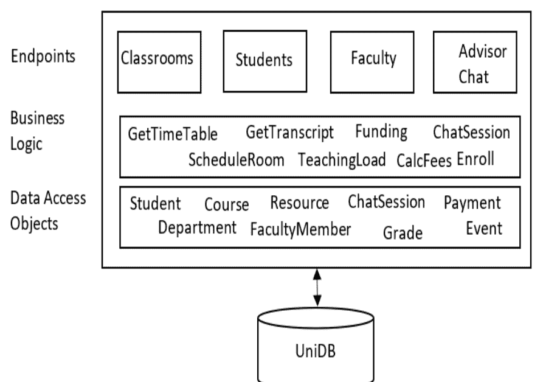
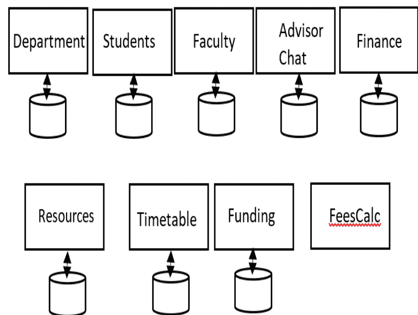
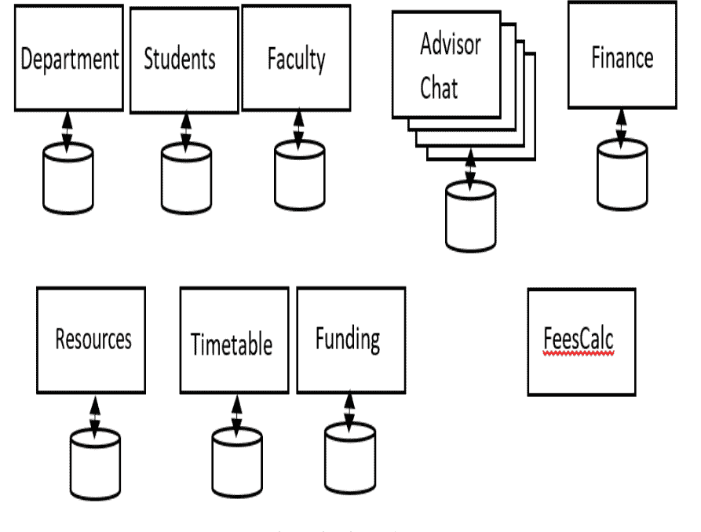
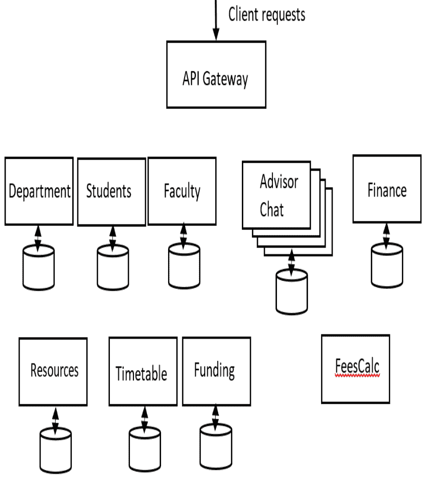
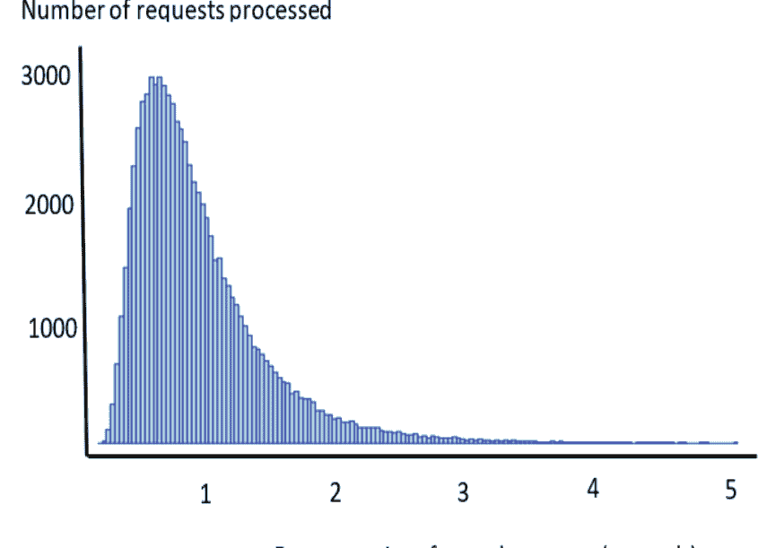
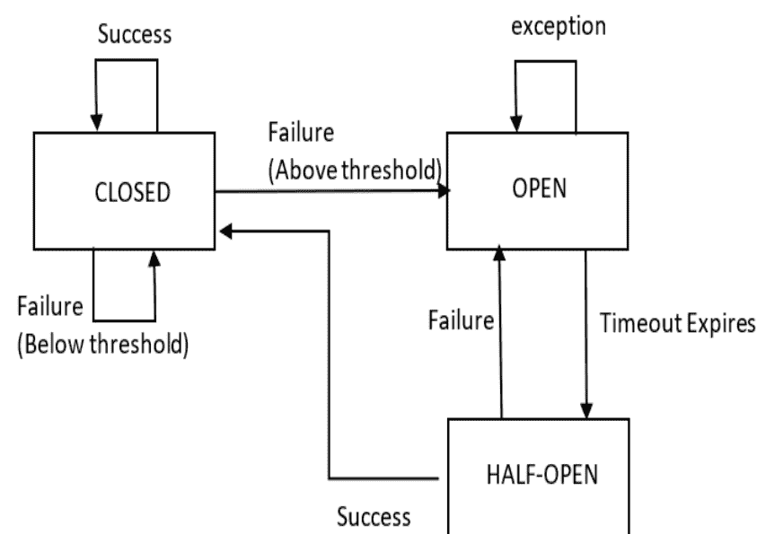

## 第 9 章. 微服务

### 致早期发布读者的说明

通过 Early Release 电子书，您可以在官方发布这些书名之前很久就利用这些技术——作者在写作时提供的原始未编辑内容。

这将是最终书籍的第 9 章。请注意，GitHub 仓库将在稍后激活。

如果您对如何改进本书中的内容和/或示例有任何意见，或者如果您注意到本章中缺少材料，请联系编辑 vwilson@oreilly.com。

您很少会看到主流软件架构风格与源自意大利、全球流行的美食之间存在紧密联系。然而，微服务和披萨就是这种情况。微服务的根源可以追溯到大约 2008 年，当时这种方法由我们都熟知的互联网巨头在规模上进行了开创。在亚马逊，“双披萨规则”作为单个系统组件团队规模的指导原则而出现，随后被称为微服务。¹ 什么是双披萨规则？非常简单，每个内部团队都应小到可以用两块披萨喂饱。

然而，认为微服务在某种意义上“比服务更小”是一种误解。微服务的决定性特征是其范围，围绕业务能力组织。² 非常简单地说，微服务是设计和部署细粒度、高内聚、松耦合服务的方法，这些服务被组合以满足系统的需求。这些细粒度服务，即微服务，是独立部署的，并且在必要时必须通信和协调以处理单个系统请求。因此，从本质上讲，微服务架构是分布式系统，并且必须处理我在前几章中描述的各种可扩展性、性能和可用性问题。

微服务是一种流行的现代架构风格，在合适的环境下具有充足的工程优势。例如，具有单个微服务职责的小型敏捷团队可以快速迭代和演进功能，并独立部署更新版本。每个微服务对系统其余部分来说都是黑盒，可以在内部选择最适合团队和应用需求的架构和技术栈。新的主要系统功能可以作为微服务构建，并以最小的影响组合到应用架构中。

在本章中，我将简要描述微服务并解释其关键特征。我将涉及微服务方法背后的主要工程和架构原则，并提供优秀的通用设计知识来源的指针。鉴于本书的主题，本章的重点是微服务的固有分布式特性以及它们在规模上的行为。我将描述一些在耦合的微服务承受负载时出现的问题，以及您需要设计到架构中以构建可扩展、 resilient 应用的解决方案。

### 向微服务的转变

在许多方面，基于微服务的架构受益于过去十年中出现的软件工程和技术创新的汇聚。小型敏捷团队、持续开发和集成实践以及部署技术共同为微服务体现的细粒度架构方法提供了肥沃的土壤。基于微服务的架构是利用这些进步来部署灵活、可扩展和可扩展系统的催化剂。让我们检查它们的起源和一些特征。

### 单体应用

从 21 世纪之交左右开始，面向服务的架构（SOA）风格主导了企业应用。本质上，SOA 风格将应用分解为多个独立服务，这些服务通常作为单个应用构建和部署。服务提供可由外部客户端调用的端点。这些端点提供安全性和输入验证，然后将请求委托给共享业务逻辑，后者反过来将通过数据访问对象（DAO）层访问持久存储。此设计在图 9-1 中描绘了一个示例大学管理系统，该系统具有处理学生课程分配和时间表、房间调度、费用支付以及教师和顾问交互的能力。

这种架构鼓励创建可重用的业务逻辑和 DAO，这些逻辑和 DAO 可以在服务实现之间共享。DAO 映射到数据库实体，所有服务实现共享单个数据库。



图 9-1. 示例 SOA 风格应用

IBM WebSphere 和 Microsoft .NET 等流行的 SOA 平台使所有服务都可以作为单个可执行包构建和部署。这就是单体——完整应用——术语的由来。API、业务逻辑、数据访问等都封装在单个部署工件中。

单体应用，出乎意料地鉴于该方法的使用寿命，具有许多优势。架构方法已被充分理解，并为新应用提供了坚实的基础。它在许多语言的开发框架中享有广泛的自动化。测试很直接，部署也很简单，因为只需管理单个应用包。系统和错误监控也得以简化，因为应用运行在一台、可能相当强大的服务器上。

对于单体应用，纵向扩展是最简单的方式来提高响应能力和容量。横向扩展也是可能的。可以配置两个或多个单体副本，并利用负载均衡器来分发请求。这适用于有状态和无状态服务，只要负载均衡器支持有状态设计所需的会话亲和性。

随着系统功能和请求量增长，单体开始变得有问题。这个问题有两个基本要素：

### 代码库复杂性

随着应用规模和工程团队的增长，添加新功能、测试和重构变得越来越困难。技术债务不可避免地累积，如果没有在工程上的大量投入，代码会变得越来越脆弱。没有持续和集中的重构工作来维护架构完整性和代码质量，工程变得更困难。推出新功能的开发节奏加快。

### 横向扩展

您可以通过在多个节点上复制应用来横向扩展以增加容量。但这意味着每次都要复制整个应用——单体——。在大学管理系统中，假设在向学生发布移动设备支持后，AdvisorChat 服务的使用突然激增。您可以部署新副本来处理聊天消息量，但新节点必须足够强大和众多以运行完整的应用。您无法轻松地仅提取聊天服务功能并独立扩展它。

这就是微服务登场的地方。它们为单体在请求量快速增长时几乎不可避免地面临的工程和横向扩展挑战提供了解决方案。

### 打破单体

微服务架构将应用功能分解为多个独立服务，这些服务在必要时进行通信和协调。图 9-2 显示了大学管理系统如何从


Figure 9-1 可能是使用微服务设计的。每个微服务都是完全自包含的，根据需要封装自己的数据存储，并提供 API 用于通信。



Figure 9-2. A Microservice Architecture Example

随着系统代码规模和请求负载的增长，微服务提供以下优势：

### Code base

遵循“两披萨规则”，单个服务不应比一个小型团队能够构建、演进和管理更复杂。由于微服务是一个黑盒，团队可以完全自主选择自己的开发技术栈和数据管理平台。³ 鉴于设计良好的微服务所支持的功能范围更窄、内聚性更高，这应能带来更低的代码复杂度和更高的新功能开发节奏。此外，微服务的修订可以根据需要独立部署。如果微服务支持的 API 稳定，变更对依赖服务是透明的。

### Scale Out

单个微服务可以扩展以满足请求量和延迟要求。例如，为了满足不断要求且爱聊天的学生，AdvisorChat 微服务可以在其专属负载均衡器后面按需复制，以提供低响应时间。这在 Figure 9-3 中有所体现。负载较轻的其他服务可以简单地在单个节点上运行，或以低成本复制以消除单点故障并增强可用性。



Figure 9-3. Independently Scaling a Microservice

转向微服务架构时，关键的设计决策之一是如何将系统功能分解为单个服务。领域驱动设计（DDD）⁴ 提供了一种合适的微服务识别方法，因为微服务必然自包含的特性与 DDD 中有界上下文的概念非常契合。这些主题超出了本章的范围，但对于微服务架构应用的架构师而言是必备知识。

不过总是有权衡。微服务本质上是分布式的。通常，领域模型的纯粹性需要被分析和调整以适应分布式通信成本的现实以及系统管理和监控的复杂性。你需要考虑请求负载以及为满足这些请求所需的交互，以避免因微服务之间多次交互而产生过高的延迟。

例如，Faculty 和 Funding 是微服务的优秀候选。但如果满足诸如“按院系获取资助”或“查找院系的资助机会”等请求会产生过多的通信，性能和可靠性可能会受影响。在这种情况下，合并微服务可能是明智的选择。另一种常见做法是在耦合的微服务之间复制数据。这使服务能够本地访问所需数据，简化设计并降低数据访问响应时间。

复制数据当然是一种权衡。它需要额外的存储容量和开发工作来确保所有复制的数据收敛到一致状态。可以在数据更改时立即启动重复更新，以尝试最小化副本不一致的时间间隔。或者，如果业务上下文允许，可以进行周期性复制（例如每小时或每天），也许由在请求负载较低时调用的计划任务执行。随着应用程序对性能和可扩展性的需求增长，复制数据的成本和复杂性通常与对系统进行大规模重构所带来的问题相比微不足道。

### Deploying Microservices

为了支持频繁更新并受益于小型团队带来的敏捷性，你需要能够轻松快速地部署新的微服务版本。这就是我们开始触及持续部署和 DevOps 世界的地方，这远超本书范围（请参阅本章末尾的“Summary and Further Reading”获取阅读建议）。尽管如此，部署选项会影响微服务可扩展性的难易程度。我只在本节中描述一种常见的微服务部署方法。

如我在第 8 章所述，无服务器处理平台是吸引人的微服务部署方式。微服务可以构建以在你选择的无服务器平台上公开其 API。无服务器选项具有三个优势：

- Deployment is simple – just upload the new executable package for your microservice to the endpoint that you have configured for your function.
- Pay by usage – if your service has periods of low volume requests, your costs are low, even zero.
- Ease of Scaling – the platform you choose handles scaling of your function. You control precisely how this works through configuration parameters, but the serverless option takes the heavy lifting out of scalability.

当你将所有微服务部署在无服务器平台上时，你会向客户端公开多个需要调用的端点。这引入了复杂性，因为客户端需要能够发现每个微服务的位置——主机 IP 地址和端口。 如果你决定通过合并两个微服务来消除网络调用而重构微服务？或将 API 实现从一个微服务移动到另一个？甚至更改 API 的端点——IP 地址和端口？

直接向客户端公开后端变更从来都不是好主意。Gang of Four 书⁵ 多年前就用面向对象系统中的外观模式教会了我们这一点。在微服务中，你可以使用 API 网关模式⁶ 利用类似的方法。API 网关本质上充当所有客户端请求的单一入口点，如 Figure 9-4 所示。它将客户端与实现应用程序功能的微服务的底层架构隔离开。现在，如果你重构底层 API，甚至选择在私有云等完全不同的平台上部署，客户端对变更毫无察觉。



Figure 9-4. The API Gateway Pattern

你可以在系统中利用多种 API 网关实现。这些范围从强大的开源解决方案，如 NGINX Plus 和 Kong API 网关⁷，到云厂商特定的托管服务。总体功能范围如下所列，基本相似：

- Proxy incoming client API requests with low millisecond latencies to backend microservices that implement the API. Mapping between client-facing APIs, handled by the API Gateway, and backend microservice APIs is performed through admin tools or configuration files. Capabilities and performance vary across products, sometimes quite significantly, especially under high request loads.⁸
- Provide authentication and authorization for requests
- Define rules for throttling each API. Setting the maximum number of requests a microservice can handle per second can be used to ensure backend processing is not overwhelmed
- Support a cache for API results so that requests can be handled without invoking backend services
- Integrate with monitoring tools to support analysis of API usage, latencies and error metrics.

在高请求峰值下，API 网关当然有成为瓶颈的危险。这如何处理取决于你的 API 网关产品。例如，AWS API Gateway 有 10K 请求/秒的限制⁹，另外还有最高 5K 请求/秒的突发配额。Kong API 网关是无状态的，因此可以部署多个实例并使用负载均衡器分发请求。

### Principles of Microservices

设计、部署和演进微服务架构的艺术和科学远不止于此。我在本章迄今的讨论中只是触及了皮毛。在我继续讨论微服务的某些可扩展性和可用性挑战之前


必须解决由于其分布式特性，值得简要说明从微服务 C 到 ... 的时间增加，这会在 B 上产生反压，导致其对 A 的响应变慢。

如果负载增加持续一段时间，微服务 A 和 B 中的线程会被阻塞，等待下游处理处理请求。假设微服务 C 变得过载——也许请求模式导致频繁更新的键上出现数据库死锁，或者 C 数据库的网络连接变得不稳定。在过载状态下，响应时间增加，B 的线程会被阻塞等待结果。记住第 2 章的内容，应用服务器具有固定大小的线程池。一旦 B 中的所有线程都忙于调用 C，如果请求继续以高流量到达，它们将被排队等待线程可用。B 对 A 的响应时间开始增长，瞬间 A 的所有线程都会被阻塞等待 B 响应。

在这一阶段，事情很可能会开始崩溃。TCP 请求会超时并向调用方抛出错误。当依赖服务过载时，新连接将被拒绝。微服务如果内存耗尽可能会失败，或者增加的负载会暴露在测试期间未被发现的微妙错误。这些错误会涟漪式地、或级联地沿调用链向后传播。在图 9-5 中的示例中，C 的缓慢响应可能导致 A 和 B 的请求失败。

级联故障的阴险之处在于，它们是由依赖服务的响应时间变慢触发的。如果下游服务简单地失败或不可用——系统崩溃或瞬时网络故障——调用方会立即收到错误并可以相应地响应。对于逐渐变慢的服务则并非如此。请求会返回结果，只是响应时间更长。如果不堪重负的组件继续被请求轰炸，它就没有时间恢复，响应时间会继续增长。

这种情况通常会因客户端在请求失败时立即重试操作而加剧，如以下代码片段所示：

```
int retries = RETRY_COUNT;
while (retries > 0) {
    try {
        callDependentService();
        return true;
    } catch (RemoteCallException ex) {
        logError(e);
        retries = retries - 1;
    }
    return false;
```

立即重试只是维持了对不堪重负的微服务的负载，其结果非常可预测，即再次抛出异常。过载情况不会在几毫秒内消失。事实上，它们很可能持续数秒甚至数分钟。重试只是保持压力。

重试示例可以通过诸如指数退避¹²等技术来改进，即在重试之间插入不断增长的延迟。这有可能有助于缓解下游过载，但延迟会成为调用方感受到的延迟的一部分，这通常无助于解决问题。

级联故障在分布式系统中很常见。无论是由过载的服务引起，还是由错误条件如 bug 或网络问题引起，都需要你明确采取措施来防范它们。

#### Fail Fast Pattern


慢速服务的核心问题在于它们在较长时间内占用系统资源来处理请求。请求线程会一直阻塞，直到收到响应。例如，假设我们有一个 API，通常在 50ms 内响应。这意味着每个线程每秒可以处理大约 20 个请求。如果一个请求由于异常响应时间而被阻塞 3 秒，那么这就是 (3*20)-1=59 个本可以处理的请求。

即使是为微服务设计得最好的 API，也会出现异常响应。实际工作负载表现出长尾响应时间分布，如图 9-6 所示。少量请求耗时明显更长——有时比平均响应时间长 20 倍或 100 倍。这可能有多种原因。服务器的垃圾回收、数据库争用、过度的上下文切换、系统页面错误以及网络请求丢失都是导致这种长尾的常见原因。



图 9-6. 典型的长尾响应时间

正如你从这张图表中可以观察到的，大多数请求的响应时间都很低，这很好。然而，相当数量的请求超过一秒，而少量请求要慢得多，实际上超过 4 秒。

我们可以使用百分位来量化慢请求的百分比。
百分位比平均值提供了更丰富、更准确的微服务响应时间视图。例如，如果我们在预期负载下测量响应时间并计算百分位，我们可能会得到以下结果：

P50 – 200 毫秒

P95 – 1200 毫秒

P99 – 3000 毫秒

这意味着 50% 的请求在 200 毫秒以内得到处理，95% 在 1200 毫秒以内得到处理，99% 在 3000 毫秒以内得到处理。这些数字总体上看起来相当不错。但假设我们的 API 每天处理 2 亿个请求（大约每秒 2314 个请求）。这意味着 1%，即 200 万个请求，耗时超过 3 秒，是第 50 百分位——中位数的 15 倍慢。而且鉴于图 9-6 中看到的长尾响应时间模式，一些请求的耗时会明显超过 3 秒。

长响应时间在技术上或对客户参与度来说从来都不是好事。事实上，许多研究表明，更长的响应时间对系统使用有负面影响。例如，BBC 报道称，每增加一秒页面加载时间，其用户就会减少 10%。¹³ 快速、稳定的响应时间对业务非常有利，而实现这一点的一种方法是减少长尾。这也有降低服务整体平均响应时间的效果，因为平均值受少数慢速响应的严重影响。

消除长时间响应的一种常见方法是快速失败。有两种主要方法可以实现此目的：¹⁴

- 当请求耗时超过某个预定义的时间限制时，而不是等待其完成，客户端会向其调用者返回错误。

这会释放与请求关联的线程和其他资源。

- 在服务器上启用节流。如果请求负载超过某个阈值，则立即使用 HTTP 503 错误失败请求。这表明客户端服务不可用。

这些策略具体如何实施极其依赖技术。例如，发出 HTTP 请求的客户端可以配置 TCP 读取超时。¹⁵ 这指定客户端应等待多长时间才能从服务器接收响应。在图 9-6 的示例中，我们可以将读取超时配置为 p99 值，即 3 秒或稍高一些。然后如果客户端在读取超时期间未收到任何响应，就会引发异常——在 Java 中，它是

```
java.net.SocketTimeoutException.
```

节流或速率限制是许多负载均衡器和 API 网关技术中可用的功能。当达到某些定义限制时，负载均衡器将简单地拒绝请求，从而保护其控制的资源免受过载。这使得服务能够以一致的低响应时间处理请求。还可以在微服务内部实现一些轻量级监控逻辑来实现节流。你可以保留进行中请求的计数，如果计数超过定义的上限，则拒绝新请求。一种稍微更复杂的方法可以使用滑动窗口算法跟踪平均响应时间或 p99 等指标。如果感兴趣的指标在增加，或超过某个定义阈值，则请求可以立即被拒绝。

在使请求失败时还有一件事需要考虑。微服务的原则之一是故障隔离。这意味着系统的一部分出现故障并不会使整个应用程序不可用。请求可以继续处理，但功能会有所下降。

需要考虑的一个关键问题是，是否需要将错误传播回原始调用者？还是可以发送一些预先准备好的、默认的响应来掩盖请求未正确处理这一事实。例如，当你登录流媒体视频服务时，第一页会显示你的观看列表，以便你能尽快返回喜爱的节目。然而，如果检索观看列表的请求失败或耗时过长，则可以返回一个默认的热门节目集合，“这些是你可能喜欢的节目”。应用程序仍然可用。

这种方法对于瞬时、短暂的故障非常有效。到用户再次需要请求时，问题很可能已经解决。而且用户可能甚至没有注意到。一些瞬时错误 however 并不会在一两秒内解决。那时你需要更稳健的方法。

### 熔断器模式

如果微服务由于过载情况或不稳定的网络开始抛出错误，继续尝试向 API 发送请求就毫无意义。与快速失败相比，后者仍会产生超时延迟，更好的做法是立即停止发送进一步请求并留出一些时间让错误情况得以解决。这可以通过熔断器模式来实现，该模式在出现某些错误条件时保护远程端点免受过载。

就像电气系统一样，客户端可以使用熔断器来保护服务器免受过载。熔断器被配置为监控某些条件，例如来自端点的错误响应率，或每秒发送的请求数。如果达到配置的阈值，例如 25% 的请求抛出错误，则会触发熔断器。这会使熔断器进入 OPEN 状态，在此状态下所有调用都会立即返回错误，并且不会尝试调用不稳定或不可用的端点。

熔断器然后拒绝所有调用，直到经过一段合适的配置超时时间。在此阶段，熔断器进入 HALF_OPEN 状态。现在熔断器允许客户端调用被发出到受保护的端点。如果请求仍然失败，则会重置超时时间，熔断器保持打开状态。然而，如果请求成功，

熔断器将转换到 CLOSED 状态，请求开始流向目标端点。该方案如图 9-7 所示。



图 9-7. 熔断器模式

熔断器对于减少几乎肯定会失败的操作所使用的资源至关重要。客户端快速失败，并且 OPEN 熔断器通过确保请求不会到达它来减轻过载服务器的负载。这为过载服务创造了稳定化的机会。当服务（希望）恢复时，熔断器会自动重置，正常操作恢复。

有许多可用的库可用于将熔断器纳入你的应用程序。Python 的一个流行库¹⁶ 在以下代码示例中进行了说明。你只需用 @circuit 装饰你想要保护的外部调用，并指定你希望设置的参数值来自定义熔断器行为。在此示例中，我们在检测到 20 次连续失败后触发熔断器，并且熔断器保持打开状态 5 秒，直到它转换到半开状态。


```
from circuitbreaker import circuit
@circuit(failure_threshold=20,expected_exception=RequestException,
        recovery_timeout=5)
def api_call():
```

熔断器对于故障隔离非常有效。它们可以保护客户端免受依赖服务故障操作的影响，并允许服务恢复。在读多场景中，当熔断器打开时，请求通常可以返回默认值或缓存结果。这有效地将故障隐藏在客户端之外，并且不会降低服务的吞吐量和响应时间。确保将熔断器触发集成到你的监控和日志基础设施中，以便可以诊断故障原因。

### Bulkhead Pattern

术语 bulkhead 源自大型船舶建造实践。内部船舶被划分为几个物理隔间，确保当船体某一部分发生泄漏时，只有单个隔间进水，而船只，至关重要的是，仍能继续漂浮。基本上，舱壁是一种限制损害的策略。

想象一个具有两个端点的微服务。一个允许客户端请求其通过该服务下达的当前订单状态。另一个允许客户端为产品创建新订单。在正常运行期间，大多数请求都是状态请求，涉及快速的缓存或数据库读取。偶尔，当新热门产品发布时，可能会同时涌入大量新订单请求。这些请求开销更大，需要数据库插入和向队列写入。

这两个端点的请求在微服务部署的应用程序服务器平台上共享一个公共线程池。当新订单激增到来时，线程池中的所有线程都被新订单创建占用，状态请求基本上无法获得资源。这导致不可接受的响应时间，并且如果使用快速失败方法，客户端调用可能会看到异常。

舱壁帮助我们解决这个问题。我们可以为微服务中处理特定请求的线程预留数量。在我们的示例中，我们可以指定新订单请求最多可以使用共享线程池中的 150 个线程供其独占使用。这确保了当新订单请求突发发生时，我们仍然可以用可接受的响应时间处理状态请求，因为线程池中仍有额外容量。

Java Resilience4j 库¹⁷ 提供了舱壁模式的实现，使用 Java 8 及以后的函数式编程功能。舱壁模式将远程资源调用隔离在其自己的线程池中，以便单个过载或失败的服务不会消耗应用程序服务器中所有可用的线程。

以下示例代码展示了如何创建一个允许最多 150 个并发请求的舱壁。如果为你希望使用舱壁限制的服务使用了 150 个线程，请求将最多等待 1 秒，然后抛出默认的 BulkheadFullException 异常。

```
// configure the bulkhead
BulkheadConfig config = BulkheadConfig.custom()
    .maxConcurrentCalls(150)
    .maxWaitDuration(Duration.ofSeconds(1))
    .build();
BulkheadRegistry registry = BulkheadRegistry.of(config);
// create the bulkhead
Bulkhead newOrderBulkhead = registry.bulkhead("newOrder");
```

接下来，你指定 OrderService.newOrder() 方法应使用舱壁装饰。这确保最多 150 次此方法的调用可以并发发生。

```
// decorate the OrderService.newOrder method with the bulkhead
Supplier<OrderOutcome> orderSupplier = () ->
    OrderService.newOrder(OrderInfo);
// decorate NewOrder with the bulkhead configuration
Supplier<OrderOutcome> bulkheadOrderSupplier =
    bulkhead.decorateSupplier(bulkhead, orderSupplier);
```

Spring-boot 利用其依赖注入功能简化了舱壁的创建。你可以在 application.yml 文件中指定舱壁的配置，如下所示：

```
server:
    tomcat:
        threads:
            max: 200
resilience4j.bulkhead:
    instances:
        OrderService:
            maxConcurrentCalls: 150
            maxWaitDuration: 1000ms
```

在代码中，你只需使用 @Bulkhead 装饰器指定应受舱壁行为影响的方法。在以下示例中，还指定了一个回退方法。当舱壁容量达到且请求等待超过一秒时，将调用该方法。

```
@Bulkhead(name = "OrderService", fallbackMethod = "newOrderBusy")
    public OrderOutcome newOrder(OrderInfo inf) {// details omitted}
```

### IN THE WILD: SCALING MICROSERVICES

亚马逊和 Netflix 是大约在 2009 年左右大规模采用微服务架构的早期先驱之一。从那时起，学到了很多东西，当然，建立在微服务之上的系统的规模也增长得惊人。为了应对现代系统的规模，Uber 已将其微服务架构演进为基于相关服务集合，即域，如这篇优秀的技术博客文章所述 (https://eng.uber.com/microservice-architecture/)。

Sam Newton 的书章节 ‘Microservices at scale’ (https://www.oreilly.com/radar/microservices-at-scale/) 包含一个案例研究，说明了快速失败、熔断器和舱壁模式的重要性。它是对级联故障如何发生时的法医描述，当遇到缓慢的服务响应时。

最后必须强调的是，有时微服务并不总是正确的方法。描述 Istio 中微服务的好处如何增加不必要复杂性的案例研究 (https://ieeexplore.ieee.org/document/9520758) 非常值得一读。

### Summary and Further Reading

拥抱微服务要求你采用新的设计和开发实践，以创建满足应用程序需求的细粒度、内聚的组件集合。此外，你还需要面对分布式系统的新机遇和复杂性。如果你采用微服务，你别无选择。

本章简要概述了微服务的动机及其可以提供的优势。在本书的上下文中，独立扩展单个微服务以匹配不断增长的需求的能力通常是无价的。

微服务经常耦合，需要相互通信以满足单个请求。这使它们容易受到级联故障的影响。这些故障发生在微服务开始以增加的响应时间返回请求时——例如由请求过载或瞬态网络错误引起。缓慢的响应时间会在调用服务中造成反压，最终一个服务的故障可能导致所有依赖服务崩溃。

避免级联故障的模式包括使用超时和熔断器快速失败。这基本上给了受压的微服务恢复时间并阻止级联故障发生。舱壁模式意图相似。它可用于确保对微服务中一个 API 的请求在请求突发期间不会使用所有可用资源。通过为特定 API 在应用程序服务器中可以需求的线程数设置最大限制，可以保证其他 API 的处理能力。

微服务是软件架构中的一个主要主题。对于该主题的完整和全面覆盖，没有比 Sam Newman 的 *Building Microservices, 2nd Edition* 更好的来源了。它将带你深入了解微服务系统的设计、开发和部署之旅。

微服务需要开发过程的广泛自动化。2010 年的经典著作 *Continuous Delivery: Reliable Software Releases through*

*Build, Test, and Deployment Automation* 由 David Farley 和 Jez Humble 所著，是全面介绍该主题的理想起点。另一个优秀的信息来源是 *DevOps: A Software Architect’s Perspective* 由 Len Bass、Ingo Webber 和 Liming Zhu 所著。DevOps 世界是一个快速发展且技术丰富的领域，你最喜欢的搜索引擎是找到构成现代 DevOps 管道的各种构建、配置、测试、部署和监控平台信息的最佳位置。

本书的第 3 部分重点关注存储层主题。我将描述确定我们如何分发数据存储以实现可扩展性、可用性和一致性的核心原则和算法。理论将通过检查许多广泛使用的数据库在分布式系统中的运行方式以及它们采取的各种方法和架构权衡来补充。

- 1. 本文简要描述了 Amazon、Netflix 和 Uber 向微服务的转变，并涵盖了两披萨规则的起源 - https://www.hys-enterprise.com/blog/why-and-how-netflix-amazon-and-uber-migrated-to-microservices-learn-from-their-experience/
- 2. 对此问题的优秀描述在这里 - https://martinfowler.com/articles/microservices.html
- 3. 跨微服务标准化开发堆栈当然有优势，正如 Susan Fowler 在 Production Ready Microservices 中解释的那样，(*O’Reilly Media, 2016*)
- 4. https://martinfowler.com/bliki/DomainDrivenDesign.html
- 5. Design Patterns: Elements of Reusable Object-Oriented Software by ErichGamma, Richard Helm, Ralph Johnson, and John Vlissides, Addison Wesley Professional (November 10, 1994)
- 6. https://microservices.io/patterns/apigateway.html
- 7. 这些产品的文档位于 - https://www.nginx.com/products/nginx/api-gateway/ 和 https://konghq.com/kong/ 分别
- 8. 这是一项出色的研究，基准测试了 API 网关的性能。它由其中一家供应商执行，因此在解释结果时需要谨慎。像这样的研究对于评估潜在解决方案很有价值 - https://www.nginx.com/blog/benchmarking-api-management-solutions-nginx-kong-amazon-real-time-apis/
- 9. 此限制可以增加。参见 https://docs.aws.amazon.com/apigateway/latest/developerguide/limits.html


10 https://samnewman.io/books/building_microservices/
11 Netflix’s Conductor is described here - https://netflixtechblog.com/netflix-conductor-a-microservices-orchestrator-2e8d4771bf40
12 https://dzone.com/articles/understanding-retry-pattern-with-exponential-back
13 https://www.creativebloq.com/features/how-the-bbc-builds-websites-that-scale
14 https://wa.aws.amazon.com/wat.question.REL_5.en.html
15 http://www.allenlipeng47.com/blog/index.php/2020/01/05/timeouts/
16 https://pypi.org/project/circuitbreaker/
17 https://resilience4j.readme.io/
