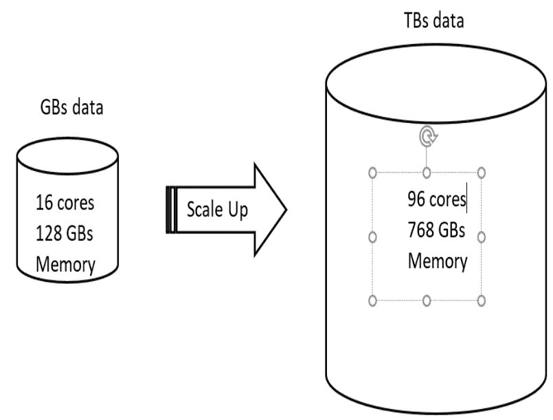
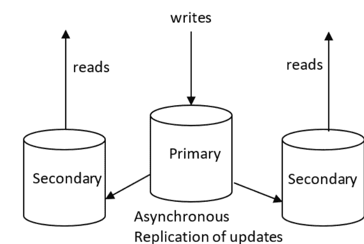
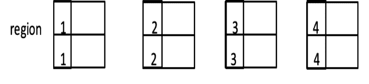
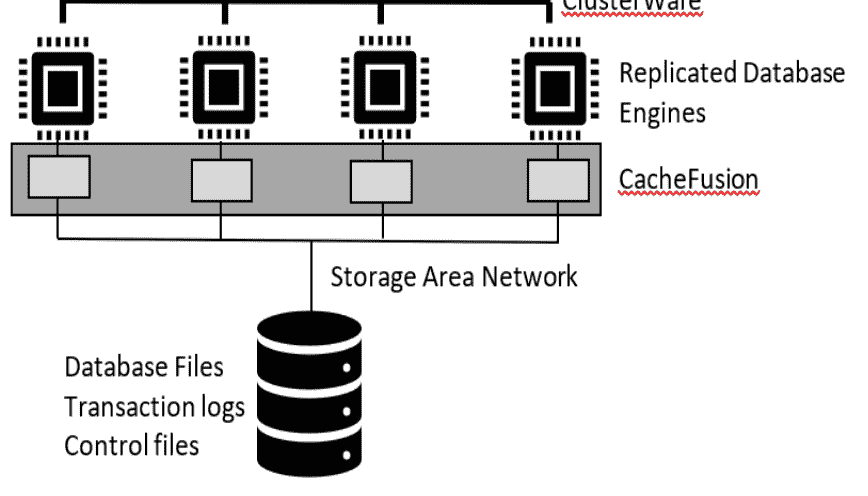
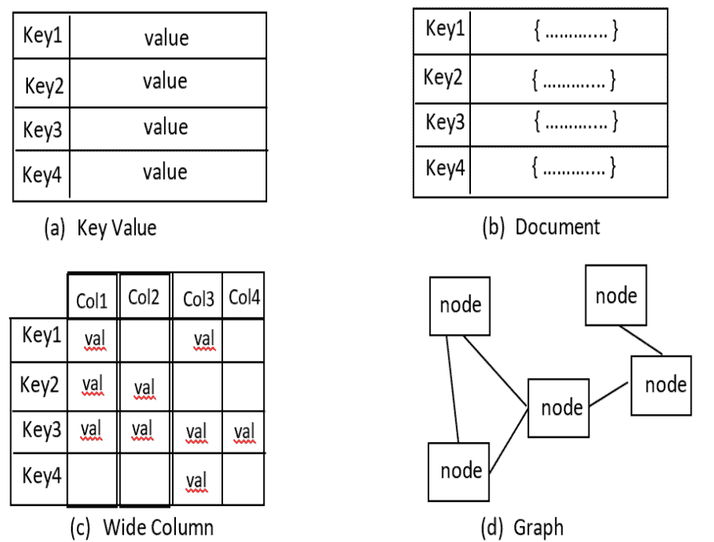
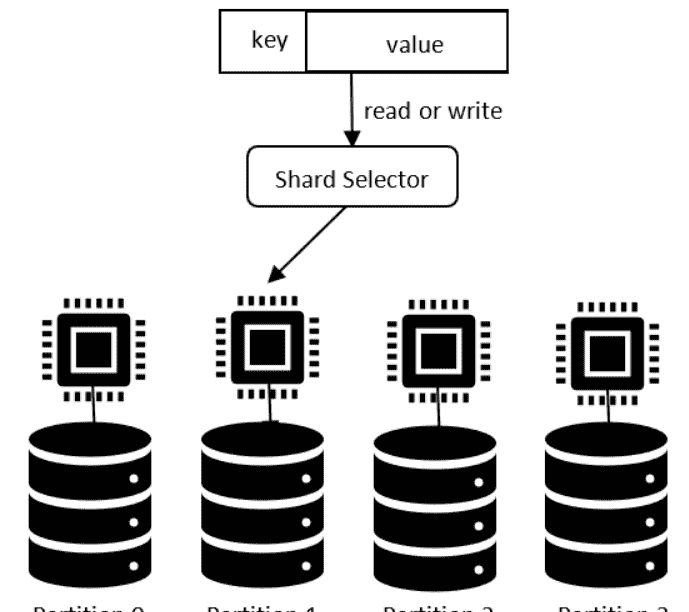
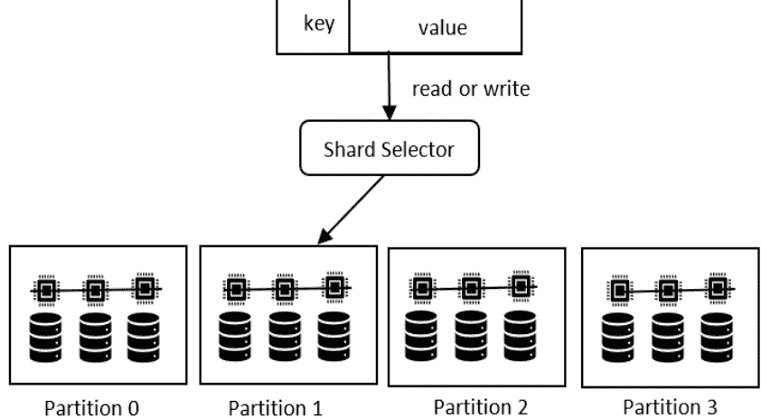

## 第10章 可扩展数据库基础

### 早期发布读者须知

通过 Early Release 电子书，您可以在正式发布这些书名之前很久就利用这些技术——作者在写作时提供的原始未编辑内容。

这将是最终书籍的第10章。请注意，GitHub 仓库将在稍后激活。

如果您对如何改进本书的内容和/或示例有任何意见，或者如果您注意到本章中缺少材料，请联系编辑 vwilson@oreilly.com。

在2000年代初期，数据库的世界相对平静和直接。 有一些例外，但绝大多数应用程序都是基于关系数据库技术构建的。 系统利用了少数主要厂商的关系数据库中的一个，这些数据库至今仍占据数据库市场份额排名前十的位置。¹

如果您能跳进时光机并查看2001年的类似排名，您可能会发现当前前十名中的七个——都是关系数据库——在2022年占据的位置相似。 但如果您检查2022年的前二十名，至少有十个当前列出的数据库引擎在20年前并不存在，其中大多数不是关系型的。 市场已经扩展并多样化。

本章是本书第3部分中四个章节中的第一个，重点关注数据或持久存储层。 我将介绍不断变化和发展的可扩展数据库格局，包括分布式非关系和关系方法，以及支撑这些技术的根本方法。

在本章中，我将解释传统的数据库如何演进以采用分布式架构来解决可扩展性问题。 然后我将介绍新一代数据库的主要特征，这些数据库已出现以原生支持分布。 最后，我将描述用于在多个数据库节点之间分发数据的架构以及这些方法固有的权衡，无论它们支持的数据模型如何。

### 分布式数据库

我们今天构建的数据系统远远超过了二十年前关系数据库统治地球的时代。 数据集大小和复杂性的增长是由互联网规模的应用程序驱动的。 这些应用程序为数千万用户创建和管理大量异构数据。 这包括，例如，用户资料、用户偏好、行为数据、图像和视频、销售数据、广告、传感器读数、监控数据等等。 许多数据集实在太大，无法容纳在一台机器上。

这就需要数据库引擎演进以管理庞大的分布式数据集合。 新一代关系和非关系数据库平台已经出现，具有广泛的竞争能力，旨在满足不同的用例和可扩展性要求。 同时，低成本、功能强大的硬件的发展使得能够以成本有效的方式在数百甚至数千个节点和磁盘上分发数据成为可能。 这增强了可扩展性，并通过复制数据提高了可用性。

数据库引擎创新的另一个主要驱动因素是今天充斥互联网的应用程序需求性质的变化。 关系数据库的固有优势，即事务和一致性，会带来性能成本，而在像 Twitter 和 FaceBook 这样的网站上这种成本并不总是合理的。 这些网站不需要每个用户始终看到相同版本的，例如我的推文或时间线更新。 谁会在意我美味晚餐的最新照片是否立即被我的一些关注者和朋友看到，而其他人则需要等待几秒钟来欣赏我正在享用的精美菜肴？

随着数万到数百万的用户，可以放宽关系数据库支持的各种数据约束，从而获得增强的性能和可扩展性。 这使得创建新的、非关系数据模型和原生分布式数据库引擎成为可能，旨在支持当今应用程序的各种用例。 当然也有权衡。 这些体现在数据库支持的功能范围及其编程模型的复杂性上。

### 扩展关系数据库

支持关系模型和 SQL 查询语言的数据库代表了今天存在的最成熟、稳定和强大的软件平台之一。 您会在您能想象到的每种类型的应用领域系统中找到关系数据库。 它们是极其复杂且令人惊讶成功的技术。

关系数据库技术是在数据集相对较小、数据库可以在单台机器上运行的今天标准下设计和成熟的。 随着数据集的增长，扩展数据库的方法已经出现。 我将在以下小节中简要介绍这些方法并举例说明。

#### 扩展向上

关系数据库被设计为在单台机器上运行，这使得可以利用共享内存和磁盘来存储数据和处理查询。 这使得数据库引擎能够定制在具有多 CPU、磁盘和大共享内存的机器上运行。 数据库引擎可以利用这些资源并行执行数千个查询，以提供极高的吞吐量。

图10-1描绘了扩展向上场景。 数据库迁移到新的、更强大的（虚拟）硬件。 虽然需要数据库管理魔法来执行迁移并调整数据库配置以有效利用新资源，但应用程序代码不应需要更改。

这种方法有三个主要缺点：

#### 成本

随着提供的计算资源增长，硬件成本往往呈指数增长。

#### 可用性

您仍然只有一个数据库节点，尽管它很强大。 如果它变得不可用，您的系统就会宕机。 存在大量高可用性（HA）解决方案，提供检测不可用并故障转移到数据库备份副本的机制。 许多 HA 解决方案依赖于数据库厂商。

#### 增长

如果您的数据库继续增长，迁移到更强大的硬件是不可避免的。



图10-1. 示例关系数据库扩展向上场景

扩展向上在许多应用程序中确实很有吸引力。 然而，在高容量应用程序中，有两种常见场景使扩展向上变得有问题。 首先，数据库增长到超过单个节点的处理能力。 其次，需要低延迟的数据库访问来为全球分布的客户端提供服务。 跨洲际网络传输根本不够。

在这两种情况下，分发数据库都是必要的。

#### 扩展向外：读副本

增加数据库处理能力的一个常见第一步是使用读副本扩展向外。 您将一个或多个节点配置为主数据库的读副本。 主数据库节点称为主节点，读副本称为从节点。 从节点维护主数据库的副本。 写入只能对主节点进行，所有更改然后异步复制到从节点。 从节点可能物理位于不同的数据中心或不同的大洲，以支持全球客户端。

该架构如图10-2所示。




Figure 10-2. Distribution through Read Replication

这种方法通过将所有读操作都定向到读副本来增强可扩展性。² 因此对于必须支持读密集型工作负载的应用程序来说非常有效。可以通过添加更多从库来扩展读操作，从而减轻主库的负载。这使其能更高效地处理写操作。此外，如果主库因瞬时故障而不可用，定向到从库的读请求也不会中断。

由于数据写入主库后成功复制到从库之间存在延迟，因此客户端可能会从从库读取到陈旧数据。应用程序必须因此意识到这种可能性。在正常操作中，更新主库和从库之间的时间应很短，例如几毫秒。这个时间窗口越小，陈旧读发生的可能性就越低。

读复制和主-从基于数据库架构是本章及后续章节中我将更详细讨论的话题。

### Scale Out: Partitioning Data

将数据拆分或分区到关系数据库中是一种将数据库分布到多个独立磁盘分区和数据库引擎上的技术。分区支持的具体方式高度依赖于产品。具体而言，通常有两种策略，即水平分区和垂直分区。

水平分区将逻辑表拆分为多个物理分区。单个行根据某种分区策略分配到分区。常见的分区策略是根据行中的某个值将行分配到分区，或对主键使用哈希函数。如图 10-3 所示，你可以根据每行中 region 字段的值将行分配到分区。

```
SELECT ......
FROM Suppliers
```



#### Suppliers Table with 4 Partitions

> Figure 10-3. Horizontal Database Partitioning

垂直分区，也称为行拆分，按行中的列对表进行分区。与规范化类似，垂直分区将行拆分为一个或多个部分，但出于物理而非概念上的优化目的。常见策略是将行在静态只读数据和动态数据之间进行分区。图 10-4 显示了一个库存系统采用此方案的简单垂直分区示例。

```
Inventory = {SKU#, description, size, color, price, in_stock, avail_date, location}
```

```
Inventory_Static = {SKU#, description, size, color}
```

```
Inventory_Dynamic = {SKU#, price, in_stock, avail_date, location}
```

> Figure 10-4. Vertical Database Partitioning

关系数据库引擎对数据分区支持程度各不相同。有些便于在磁盘上分区表。其他则支持跨节点分区数据以在分布式系统中水平扩展。

无论如何，关系模式的本质——数据分散在多个表——使得为分发设计通用分区策略变得棘手。数据水平分区理想情况下会将表分布到多个节点上。然而，如果单个请求需要访问来自多个节点的数据，或连接来自分布式分区表的数据，则需要高水平网络流量和请求协调。这可能无法带来预期的性能收益。这些问题在 Distributed Joins 侧边栏中简要介绍。

### DISTRIBUTED JOINS

SQL JOINs 在分布式关系数据库中实现起来很复杂。SQL 引擎的长期存在意味着它们针对单数据库上的 JOIN 进行了高度优化，正如 Franck Pachot 在其出色的 *The myth of NoSQL (vs. RDBMS)* “joins don’t scale” 博客文章³ 中所述。然而，当关系表被分区并分布在大型机器集群中时，分布式 JOIN 需要仔细设计以最小化数据移动，从而降低延迟。实现此目的的常见策略有：

- 定义相对较小、很少更改且需要频繁连接的引用表。这些引用表可以复制到每个节点，以便连接操作可以在每个分区节点上本地并行执行。然后将每个分区的连接结果发送到请求协调器以合并并返回结果集
- 在连接中使用分区键或二级索引。同样，这允许连接使用索引字段在每个分区上本地并行执行。
- 确保连接的一侧具有高度选择性的过滤器，将行集减少到少量集合。然后可以将该集合发送到每个分区节点，连接按引用表连接的方式进行。这种方法可最小化数据移动。

涉及连接两侧的大量数据、未在分区键上连接、并产生大型结果集的连接需要数据在节点之间进行洗牌和移动。这是为了将数据移动到节点以执行分区，随后收集和合并结果。这些是最难扩展的连接。

归根结底，高吞吐量查询需要仔细设计模式并选择合适的连接算法。一个很好的例子是 Google 的 Cloud Spanner 分布式关系数据库。Spanner 具有多种连接算法并会自动选择算法。但正如文档所述：⁴

> “Join operations can be expensive. This is because JOINs can significantly increase the number of rows your query needs to scan, which results in slower queries. Google advises you to test with different join algorithms. Choosing the right join algorithm can improve latency, memory consumption, or both. For queries that are critical for your workload, you are advised to specify the most performant join method and join order in your SQL statements for more consistent performance.”

### Example: Oracle RAC

尽管关系模型分区存在固有问题且大规模 SQL 查询复杂，厂商在过去二十年中仍致力于水平扩展关系数据库。一个值得注意的例子是 Oracle 的 Real Applications Cluster (RAC) 数据库。

Oracle 的 RAC 数据库⁵ 于 2001 年发布，以提供 Oracle 数据库引擎的分布式版本，用于高容量、高可用系统。本质上，Oracle 使部署多达 100 个 Oracle 数据库引擎的集群成为可能，这些引擎都可以访问同一个物理数据库。RAC 系统概述如图 10-5 所示。

为避免数据分区问题，Oracle RAC 是共享一切数据库的示例。集群数据库引擎访问由数据文件、日志和配置文件组成的单个共享数据存储，即 Oracle 数据库。对数据库客户端而言，集群部署是透明的，看起来像单个数据库引擎。

物理存储需要使用一种称为存储区域网络 (SAN) 的网络可访问存储解决方案，使所有节点都能访问。SAN 提供对 Oracle 数据库的高速网络访问。SAN 还必须提供硬件级磁盘镜像，以创建应用程序和系统数据的多个副本以便在磁盘故障时存活。在高负载下，SAN 可能会成为瓶颈。高端 SAN 是极其专业的存储设备，获取成本高昂。

Oracle RAC 部署需要两个专有软件组件，即：

- ClusterWare: 支持集群数据库引擎之间的通信和协调。它管理例如集群节点成员资格、节点故障转移和高可用性。
- Cache Fusion: 使每个集群数据库节点中的各个缓存能够有效地共享，从而最大限度地减少对持久存储的访问。



Figure 10-5. Oracle RAC Overview


Oracle RAC 说明了一种架构方法，即共享一切，用于扩展关系数据库。它在不要求（至少在理论上）更改应用程序代码的情况下，为 Oracle 部署增加了处理能力和高可用性。数据库需要多个专有的 Oracle 软件组件，以及昂贵的冗余存储和互连硬件。再加上 Oracle 许可成本，你绝不会得到一个低成本的解决方案。

过去 20 年里，许多 Oracle 客户都采用了这项技术。它成熟且经过验证，但从当今技术格局的角度来看，其基于的架构在高成本下提供的按需可扩展性有限。替代方案，即利用广泛可用的低成本商品计算节点和存储的共享无架构，是我今后将重点关注的方法。

### 向 NoSQL 的转变

我没有勇气尝试构建一个连贯的叙述来描述导致新一代 NoSQL 数据库技术诞生的力量。我的个人倾向是，这种创新是由多种原因共同推动的，这些原因在 2000 年代初开始积聚势头。没有特定顺序，其中一些原因包括：

- 强大的低成本商品硬件的开发，包括多核 CPU、更快更大磁盘和更快的网络速度
- 处理非结构化数据类型以及快速发展的业务和数据模型的应用出现。关系派的“一种尺寸适合所有”方法不再适用于这些新用例。
- 面向互联网的应用对可扩展性和可用性的需求增加
- 收集原始数据并将其用于新的业务洞察和分析的新机会

结合本章中我描述的为海量数据集扩展关系数据库的复杂性，新的数据库范式应运而生的时机已成熟。实现此类创新的数据库和分布式系统理论大部分已被知晓，这为大量新数据库平台的出现创造了肥沃的土壤。

为应对 2000 年代初不断演变的业务和技术格局而蓬勃发展的 NoSQL 数据库生态系统绝非同质化的地方。出现了几种不同的方法，并在各种、主要是开源数据库中或多或少地得到实现。然而总体而言，NoSQL 运动的核心特征是：

- 简化的、可轻松演进的数据模型
- 专有的查询语言，对连接的支持有限或无
- 在低成本商品硬件上实现水平扩展的原生支持

我将在以下小节中逐一查看这些特征。但在此之前，请考虑 NoSQL 数据库如何在没有执行类似连接查询的能力的情况下生存？答案在于你如何使用 NoSQL 模型化数据。

#### NoSQL JOIN 支持

作为说明，并且截至撰写时，CouchBase、Oracle NoSQL 和 MongoDB 支持某种形式的连接，通常有限制。Oracle NoSQL 的连接仅限于层级相关的表。MongoDB 的 $lookup 操作仅允许集合之一被分区。Cassandra、DynamoDB、Riak 和 Redis 没有对连接操作的支持。像 Neo4j 和 OrientDB 这样的图数据库使用图遍历算法和操作，因此不需要连接。

数据模型规范化，如关系数据库所鼓励的，（参见侧边栏简要概述）提供了一种对问题域进行建模的经过验证的技术。它创建了每个数据项的单一条目模型，可以在需要时引用。更新只需修改规范数据引用，更新就会对引用该数据的所有查询可用。由于 SQL 和连接的强大功能，你不必太费心思考数据将被访问的各种奇特方式，无论是立即还是将来。你的规范化模型应该（在理论上）支持应用程序域的任何合理查询，而 SQL 使其成为可能。

对于 NoSQL，重点从问题域建模转向解决方案域建模。解决方案域建模要求你思考应用程序必须支持的常见数据访问模式，并设计一个支持这些访问的数据模型。对于读取数据，这意味着你的数据模型必须预先连接服务请求所需的数据。从本质上讲，你产生了关系建模者认为的非规范化数据模型。你是在用灵活性换取效率。

另一种思考解决方案域建模的方法是为每个用例创建“一张表”。例如，滑雪者和单板滑雪者喜欢使用他们的应用程序列出他们每个季节访问喜爱的雪山的天数，他们乘坐了多少次缆车以及天气如何。使用规范化，你可能会产生如下所示的逻辑数据模型并创建实现该模型的表。

```
SnowSportPerson = {ssp_id, ssp_name, address, dob, .......}
Resort = {resort_id, resort_name, location, ....}
Visit = {ssp_id, resort_id, date, numLifts, vertical, ....}
Weather = {resort_id, date, maxtemp, mintemp, wind, ...}
```

使用 SQL，通过连接进行简单的操作即可生成特定人员的访问列表，如下所示：

Summary Ian Gorton Number of days: 2

| Date | Resort | Number of Lifts | Total Vertical Feet | Max/Min Temperature (F) | Wind Speed (mph) |
|---|---|---|---|---|---|
| Dec 2nd 2021 | 49 Degrees North | 17 | 27200 | 27/19 | 11 |
| Dec 9th | Silver Mt | 14 | 22007 | 32/16 | 3 |

在 NoSQL 数据建模中，你创建一个数据模型，将查询所需的结果全部放在一张表中。如以下所示，VisitDay 包含生成上面列表中每一行所需的所有数据项。你只需对结果集中的 VisitDay 对象数量求和即可计算出单个人员的访问天数。

```
VisitDay = {date, resort_name, ssp_id, ssp_name, numLifts, vertical, maxtemp, mintemp, wind}
```

SnowSportPerson、Resort 和 Weather 表将保持不变，与你的原始模型相同。这意味着我们在逻辑表之间复制了数据。在此示例中，这些表中的大部分数据是一次性写入且永不更改（例如特定日期的天气状况），因此复制只是占用更多磁盘空间——在现代系统中不是大问题。

不过，想象一下如果度假村名称更改——这种情况偶尔确实会发生。此更新必须检索该度假村的所有 VisitDay 条目，并在每个条目中更新度假村名称。在非常大的数据库中，此更新可能需要几十秒或更长时间，但由于它是数据维护操作，可以在某个漆黑的夜晚运行，以便用户第二天就能神奇地看到新名称。

所以就是这样。如果你设计数据模型以高效处理基于主要用例的请求，复杂的连接操作就变得不必要了。再加上数据更容易分区和分发的好处，在规模上优势开始累积。权衡是通常读取更快而写入更慢。你还必须仔细思考如何实现对重复数据的更新并维护数据完整性。

### 规范化

关系数据库的设计鼓励规范化。规范化将业务域数据结构化以消除数据冗余并支持数据完整性。

规范化是一个复杂的话题，超出了本书的范围。简而言之，规范化的结果是一个遵循六种——没错，六种——主要范式之一所描述规则的数据模型。每种范式都定义了域数据应如何组织成表和列集合的规则。

实际上，我多年来见过的许多数据库都是按照第三范式（3NF）定义的规则设计的。我听说过第四范式数据库的传闻，但怀疑任何更高范式从未离开过学术界的范围。

本质上，3NF 数据模型旨在简化数据管理。域数据在多个关系之间拆分，使得每个数据项都有一个单一条目，可以通过唯一标识符在需要时引用。3NF 数据模型中的数据可以机械地转换为关系模式并由关系数据库引擎实例化。然后应用程序可以使用 SQL 查询语言从数据库中 INSERT、UPDATE、SELECT 和 DELETE 数据。

然而，将关系数据模型非规范化以增强查询性能和应用程序可扩展性并不少见。这一见解是 NoSQL 数据库所支持的更简单数据模型的基础支柱之一。

### NoSQL 数据模型

如图 10-6 所示，有四种主要的 NoSQL 数据模型，所有这些都比关系模型更简单。




图 10-6. NoSQL 数据模型

从根本上说，这些模型之间存在细微的重叠。但忽略这些细微差别，四者为：

### Key-Value

Key-Value（KV）数据库本质上是一个哈希映射。数据库中的每个对象都有一个唯一的键，用于检索与该键关联的数据。对数据库而言，与键关联的数据通常对数据库引擎是不透明的。它可以是字符串、JSON、图像——无论业务问题需要什么。KV 数据库的例子包括 Redis⁹ 和 Oracle NoSQL。¹⁰

### Document

文档数据库在 KV 模型的基础上构建，同样数据库中的每个文档都需要一个唯一键。与键关联的值对数据库而言并非不透明。相反，它通常以 JSON 编码，使得可以在查询中引用文档中的单个元素，并使数据库能够在文档字段上构建索引。文档通常组织成逻辑集合，类似于关系表，但集合中并非所有文档都必须具有相同格式。领先的文档数据库是 MongoDB¹¹ 和 CouchBase¹²。

### Wide Column

宽列数据库通过将与键关联的数据组织成命名列来扩展 KV 模型。它本质上是一个二维哈希映射，使行内的列能够通过列名唯一标识并排序。与文档数据库一样，集合中的每一行可以有不同的列。Apache Cassandra¹³ 和 Google BigTable¹⁴ 是宽列数据库的例子。

### Graph

图是用于存储和查询高度连接数据的成熟数据结构。想想你在 FaceBook 上的朋友，或航空公司在机场之间的航线。图将数据库对象之间的关系视为一等公民，因此能够高效实现各种基于图的算法。从概念上最接近关系数据库，著名例子是 neo4j¹⁵ 和 Amazon Neptune。¹⁶

无论数据模型如何，NoSQL 数据库通常被称为无模式数据库。与关系数据库不同，写入数据库的每个对象的格式不必提前定义。这使得数据对象格式能够轻松演进，因为逻辑集合中的每个对象不必具有相同的格式。

这种灵活性的必然权衡是，应用程序有责任发现其读取的数据的结构。这要求数据对象在存储到数据库时连同元数据一起存储——基本上是字段名称——使结构发现成为可能。你经常会看到这两种方法被称为 schema-on-write（定义模式）和 schema-on-read（无模式）。

### Query Languages

NoSQL 数据库查询语言几乎总是专属于特定数据库，并且在基于显式 API 的功能和类 SQL 声明式语言之间有所不同。供应商以及第三方提供的各种语言的客户端库可用于应用程序中使用。例如，MongoDB 官方支持十二个客户端库¹⁷ 用于不同语言，并且还有许多第三方产品。¹⁸

KV 数据库可能仅提供基于单个键值的 CRUD 操作的 API。文档数据库通常支持对单个文档字段的索引。这使得能够高效实现检索结果集并对满足各种搜索条件的文档应用更新的查询。例如，以下是 MongoDB 查询，检索 skiers 数据库集合中所有年龄大于 16 岁且未续订滑雪通行证的文档。

```
db.skiers.find( {
  age: { $gt: 16 },
  renew: { $exists: false }
})
```

宽列数据库具有多种查询功能。HBase 支持 Java CRUD API¹⁹ 并能够使用过滤器检索结果集。Cassandra 的 CQL 以 SQL 为模型并提供访问底层宽列存储的声明式语言。如果你熟悉 SQL，CQL 看起来会非常熟悉。CQL 远非实现完整的 SQL 功能集。例如，CQL SELECT 语句只能应用于单个表且不支持连接或子查询。

图数据库支持更丰富的查询功能。OrientDB 使用 SQL 作为基本查询语言并实现扩展以支持图查询。²⁰ 另一个例子是 Cypher，最初为 neo4j 图数据库设计，并通过 openCypher²¹ 项目开源。Cypher 提供了匹配图中节点和关系模式的能力，具有与 SQL 类似的强大查询和插入语句。以下示例返回所有具有 *visited* 关系指向名称属性为 *Mission Ridge* 的滑雪胜地节点的个人的电子邮件。

```
MATCH (p:Person)-[rel:VISITED]->(c:Skiresort)
WHERE c.name = 'Mission Ridge'
RETURN p.email
```

### Data Distribution

NoSQL 数据库通常设计为原生水平扩展到配备本地存储的分布式计算节点。这是一种 *shared-nothing* 架构，与我用 Oracle RAC 描述的 *shared-everything* 方法相反。没有共享状态，瓶颈和单点故障被消除²²，性能、可扩展性和可用性得到增强。有一个值得注意的例外，那就是图数据库，如我在 *Distributing Graph Databases* 侧边栏中所述。

### DISTRIBUTING GRAPH DATABASES

图数据库通常包含在 NoSQL 数据库分类中。它们 however 有点像局外人。图数据库实现的图数据结构明确表示图节点之间的关系。这意味着，就像关系数据库一样，如何分区数据并不明显。

问题的核心是如何将图划分为可以分布在多个节点上并支持高效查询处理的子图。这在理论上和实践上都是一个难题，尤其是在当代图规模达到数十亿个节点和关系的情况下。解决方案例如必须考虑访问模式，以尽量确保查询不会不断跟随指向远程数据的关系。

因此，分区图数据库需要人工指导。例如，neo4j 的 Fabric²³ 扩展允许手动分区图。Fabric 创建本质上是一个代理数据库，以支持跨不同服务器节点遍历关系的查询。

总之，图数据库扩展规模以提高性能并非易事。但给它足够的计算资源、内存和磁盘在一个单一的大型服务器上，图数据库引擎可以做一些了不起的事情。

分区，通常称为分片，需要一种算法将逻辑数据库集合中的数据对象分布到多个服务器节点。理想情况下，分片算法应均匀地将数据分布到可用资源上。也就是说，如果你有一亿个对象和十台相同的数据库服务器，每个分片将有 1 千万个对象驻留在本地。

分片需要一个分片键或分区键，用于将给定数据对象分配到特定分区。当创建新对象时，分片键将对象映射到驻留在服务器上的特定分区。当查询需要访问对象时，它提供分片键，以便数据库引擎可以在其驻留的服务器上定位对象。这在图 10-7 中有所说明。



图 10-7. 数据分区

存在三种主要的分片技术，所有分布式数据库都会实现其中一种或多种方法：

- Hash key：任何给定数据对象的分区是应用哈希函数于分片键的结果所选定的。哈希结果随后映射到分区。实现此方法有两种主要方式，使用模数方法或称为一致性哈希的算法。我将在第 13 章中更详细地介绍这些内容。
- Value-based：分区是基于分片键的值选择的。例如，你可能希望基于客户的居住国家对数据进行分区。选择国家字段作为分片键将确保居住在中国的所有客户数据对象驻留在同一分区，所有芬兰客户分配到同一分区，以此类推
- Range-based：分区托管分片键位于分片键值特定范围内的对象。例如，你可能会使用邮政编码/邮政区划范围将居住在同一地理区域的所有客户对象分配到同一分区。

分区使得通过添加处理和磁盘容量并将数据分布到这些额外资源上来扩展数据库成为可能。然而，如果由于网络错误或磁盘崩溃导致其中一个分区不可用，则数据库的一块就无法访问。


解决此可用性问题需要引入复制。每个分区中的数据对象通常复制到两个或更多节点。如果一个节点变得不可用，应用程序可以通过访问其中一个副本继续执行。这种分区、复制的架构如图 10-8 所示。每个分区有三个副本，每个副本托管在不同的节点上。



图 10-8. 每个分区具有三个副本的数据分区和复制

复制增强了可用性和可扩展性。存储副本的额外资源可用于处理来自应用程序的读写请求。

然而，正如分布式系统总是会遇到的那样，这里有一个需要解决的复杂性。当发生数据更新请求时，数据库需要更新所有副本。这确保副本保持一致，并且无论客户端访问哪个副本，所有客户端都会读取相同的值。

管理分布式数据库复制有两种基本架构。它们是：

#### Leader- follower

一个副本被指定为 leader，并且它始终保存任何数据对象的最新值。所有写操作都定向到 leader，leader 负责将更新传播到副本。follower 是只读副本。应用程序读取可以跨 follower 负载均衡以扩展读取性能。

#### Leaderless

任何副本都可以处理读取和更新。当更新发送到一个副本时，它成为该更新的请求协调者，并负责确保其他副本得到正确更新。由于写入可以由任何副本处理，因此 leaderless 方法对于写入密集型应用程序来说往往更具可扩展性。

副本一致性最终成为一个棘手的分布式系统问题。问题的核心在于如何以及何时将更新传播到副本以确保它们具有相同的值。不同延迟以及网络和硬件故障的常见问题使这个问题完全非平凡。

如果数据库能确保所有副本始终具有相同的值，则称其提供 *强一致性*，因为所有客户端访问将为每个数据对象返回相同的值。这意味着客户端必须等待所有副本被修改后，更新才会被确认成功。

相比之下，客户端可能只想等待一个副本被更新，并信任数据库尽快更新其他副本。这意味着存在一个副本不一致的时间窗口，读取可能返回最新值也可能不返回。允许副本不一致的数据库被称为 *最终一致*。强一致性和最终一致性之间的权衡以及设计选择如何影响可扩展性和可用性将在接下来的 3 章中详细讨论。

### CAP 定理

Eric Brewer 著名的 CAP 定理²⁴ 优雅地概括了在利用分布式数据库时你对副本一致性和可用性的选择。它描述了数据库系统在网络分区时面临的选择，即当网络在数据库节点之间丢弃或延迟消息时。

基本上，如果网络正常运行，系统可以同时具有一致性和可用性。如果发生网络分区，系统可以是一致的（CP）或可用的（AP）

这种情况出现是因为网络分区意味着数据库中的某些节点对其他节点不可访问——分区将数据库拆分为两组节点。如果发生更新并且更新数据对象的副本位于分区的两侧，则数据库可以：

- 返回错误，因为它无法确保副本一致性（CP）
- 将更新应用于可见的副本子集（AP）。这意味着在分区愈合并且数据库能够使所有副本一致之前存在副本不一致。在不一致得到解决之前，客户端可能会看到同一数据对象的不同值。

你会看到 AP 或 CP 分类用于不同的 NoSQL 数据库。它很有用，但并不完全有意义，因为大多数数据库，如我在第 13 章中将要解释的那样，使配置参数可调以实现 AP 或 CP 以满足应用程序需求成为可能。

### IN THE WILD: INTERNET-SCALE DATABASE EXAMPLES

Facebook 以使用 MySQL 管理 PB 级社交相关活动（如用户评论和点赞）而闻名。基本架构基于副本集，具有一个处理所有写入的单个主节点。更新异步复制到地理分布的只读副本。Facebook 工程对 MySQL 代码库进行了多次更新，包括构建自己的存储技术 MyRocks，²⁵ 用以取代 MySQL 的 InnoDB 默认存储引擎。MyRocks 提高了写入性能并使用比压缩 InnoDB 数据库少 50% 的存储。在 Facebook 规模下，这提供了重大的存储节省。将 MySQL 8.0 移植到 MyRocks 花费了 2 年时间并应用了 1500 个代码补丁。²⁶

MongoDB 有许多大规模部署。其中最引人注目的是中国最大的互联网服务公司百度。它自 2012 年起使用 MongoDB，现在使用 MongoDB 管理地图、消息传递和照片共享等多个服务的数据。总体而言，这相当于 2000 亿个文档和超过一 PB 的数据。这由 600 个节点管理，并分布在多个位置以实现可用性。²⁷

### Summary and Further Reading

随着系统规模的增长，数据库领域发生了革命。数据库需要存储海量数据，为全球分布的客户端提供快速查询响应时间，并且 24x7 可用。这要求数据库技术变得分布式并采用更适合现代应用程序所需的不结构化、不断变化的数据类型的新数据模型。

在本章中，我解释了关系数据库和 SQL 在扩展时可能变得有问题的原因。相比之下，NoSQL 数据库采用简单的数据模型，可以复制和分区以支持海量数据集和请求量。同样，存在权衡。NoSQL 数据库不支持 SQL 的丰富查询功能，给应用程序带来更大负担。分布式数据库设计者也需要意识到 CAP 定理所列举的一致性和可用性权衡。

有了这些基础，接下来的三章将重点关注 CAP 定理所暗示的权衡的复杂性。我将解释在各种数据库中设计和实现的方法，以使应用程序能够在一致性、可用性和性能之间取得平衡以满足其需求。

对于 NoSQL 数据库的优秀入门，至今仍很难超越 Pramod Sadalaga 和 Martin Fowler 的 *NoSQL Distilled: A Brief Guide to the Emerging World of Polyglot Persistence (Addison-Wesley 2012)*。对于数据库格局的更广泛覆盖，包括 SQL 和 NoSQL，Andreas Meier 和 Michael Kaufmann 的 *SQL and NoSQL Databases: Models, Languages, Consistency Options and Architectures for Big Data Management 1st ed. 2019 Edition* 非常值得一读。最后，如果本章激发了你深入了解数据库工作原理的兴趣，Alex Petrov 的 *Database Internals*，O’Reilly Media 2019 强烈推荐。

- 1 https://db-engines.com/en/ranking
- 2 主节点通常可以配置为同时处理读取和写入。这完全取决于应用程序。
- 3 这是对单机数据库 JOIN 性能的优秀分析 - https://blog.dbi-services.com/the-myth-of-nosql-vs-rdbms-joins-dont-scale/
- 4 摘自 Spanner 文档 https://cloud.google.com/spanner/docs/sql-best-practices
- 5 https://docs.oracle.com/cd/E11882_01/rac.112/e41960/admcon.htm
- 6 NoSQL 可能代表 Not Only SQL，但这有些空洞。最好将 NoSQL 视为一个简单的标签而不是缩写。
- 7 大多数 NoSQL 数据库支持嵌入式或嵌套数据对象。这使得为一个人的度假村访问创建一个单一的数据库对象成为可能，并在每次新访问发生时更新该对象。这简化了读取，因为查询只需检索包含所有所需访问数据的单个对象。根据数据库的不同，更新可能不如插入高效。这是非常依赖数据库的问题。
- 8 C.Date, Database Design and Relational Theory: Normal Forms and All That Jazz, 2nd Edition, 2019
- 9 https://redis.io/
- 10 https://www.oracle.com/database/technologies/related/nosql.html
- 11 https://www.mongodb.com/
- 12 https://www.couchbase.com/
- 13 https://cassandra.apache.org/
- 14 https://cloud.google.com/bigtable/docs
- 15 https://neo4j.com/
- 16 https://aws.amazon.com/neptune/
- 17 https://docs.mongodb.com/drivers/
- 18 https://docs.mongodb.com/drivers/community-supported-drivers/
- 19 https://www.baeldung.com/hbase
- 20 https://orientdb.com/docs/last/sql/SQL-Introduction.html
- 21 https://opencypher.org/
- 22 再次，这实际上取决于数据库实现。共享无架构理论上消除了单点故障和瓶颈，但某些实现又将其添加回来！
- 23 https://neo4j.com/developer/neo4j-fabric-sharding/
- 24 Eric Brewer, “CAP twelve years later: How the ‘rules’ have changed”, Computer, Volume 45, Issue 2 (2012), pg. 23–29.
- 25 MyRocks 在此处描述 - https://engineering.fb.com/2016/08/31/core-data/myrocks-a-space-and-write-optimized-mysql-database/
- 26 关于迁移到 MyRocks 和 MySQL 8.0 的故事非常值得花几分钟阅读 - https://engineering.fb.com/2021/07/22/data-infrastructure/mysql/
- 27 MongoDB 在百度的使用在此简要描述，并链接到一份包含更多细节的优秀演示文稿 - https://www.mongodb.com/blog/post/mongodb-at-baidu-powering-100-apps-across-600-nodes-at-pb-scale


