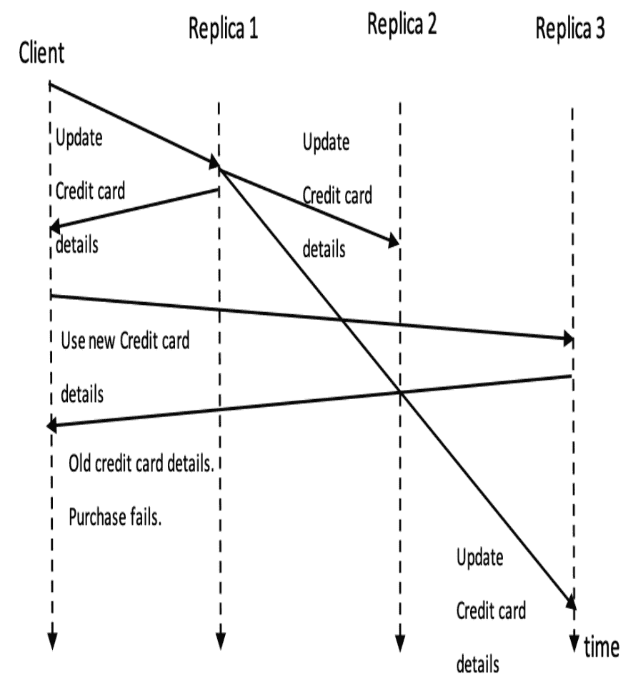
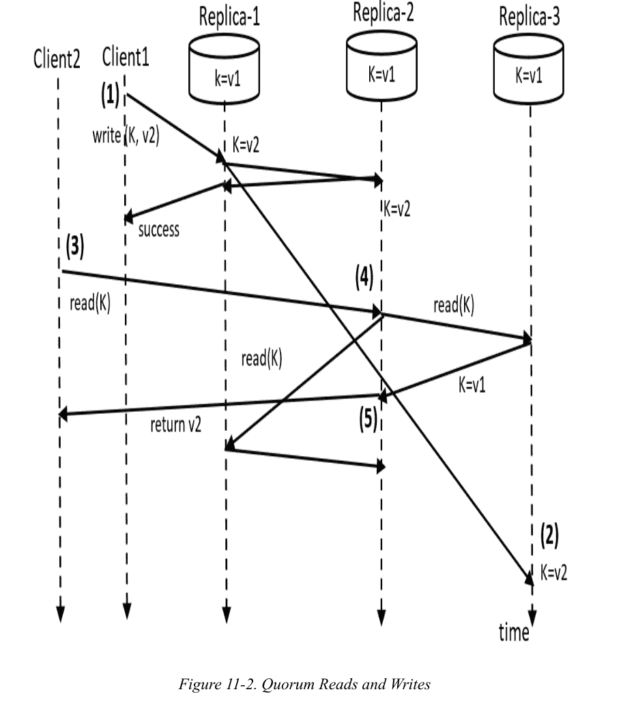
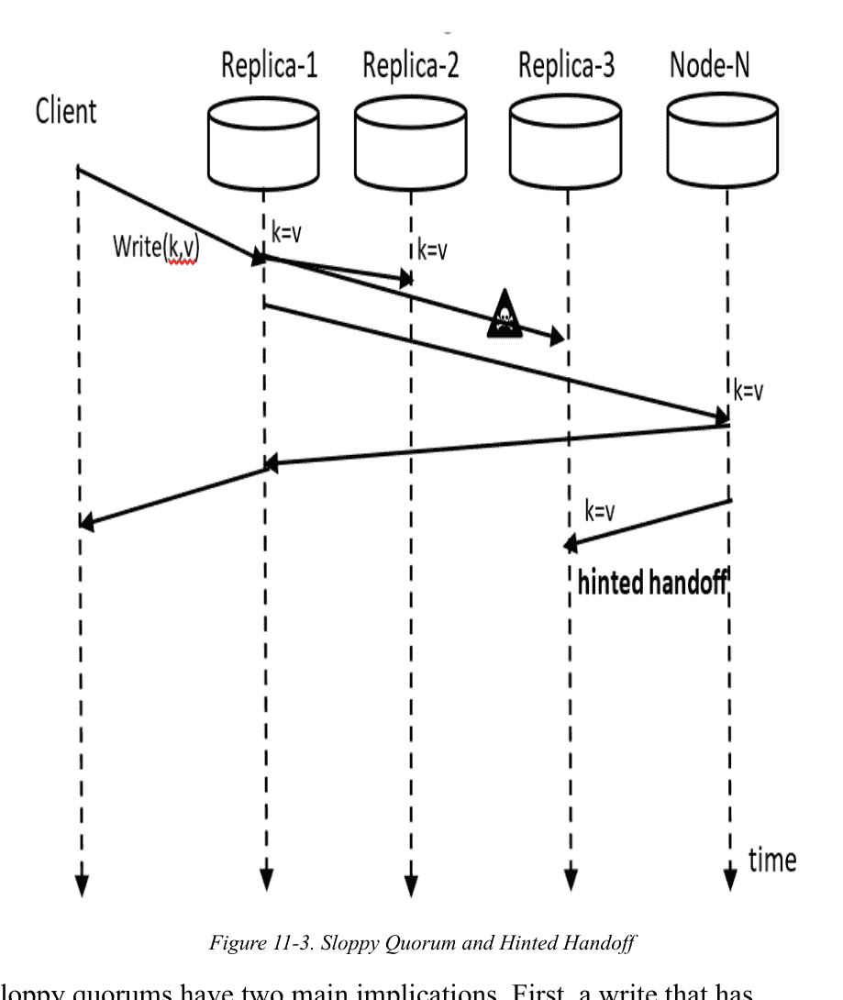
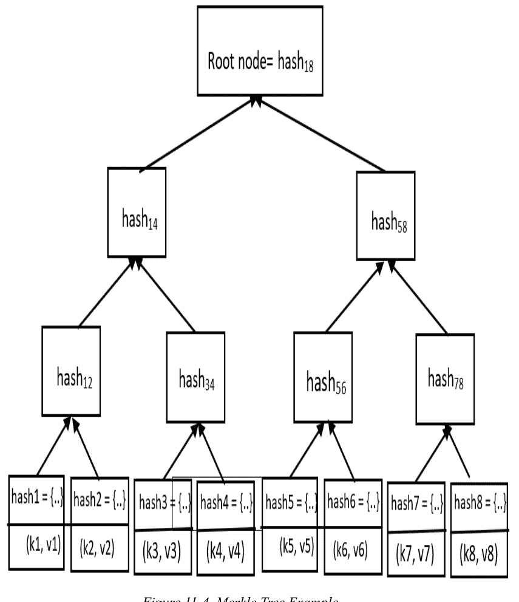
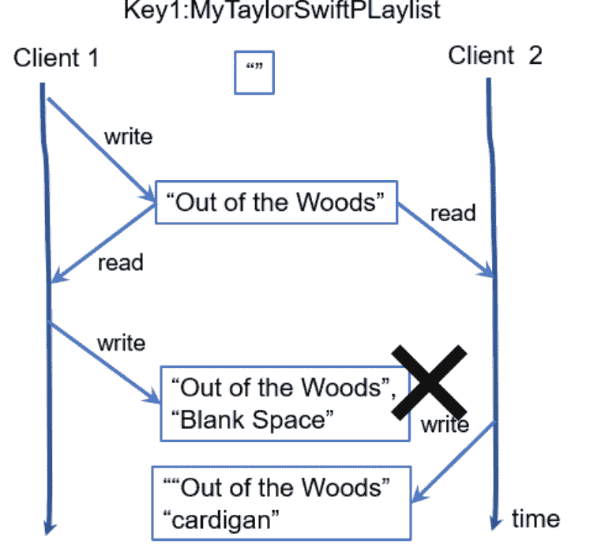
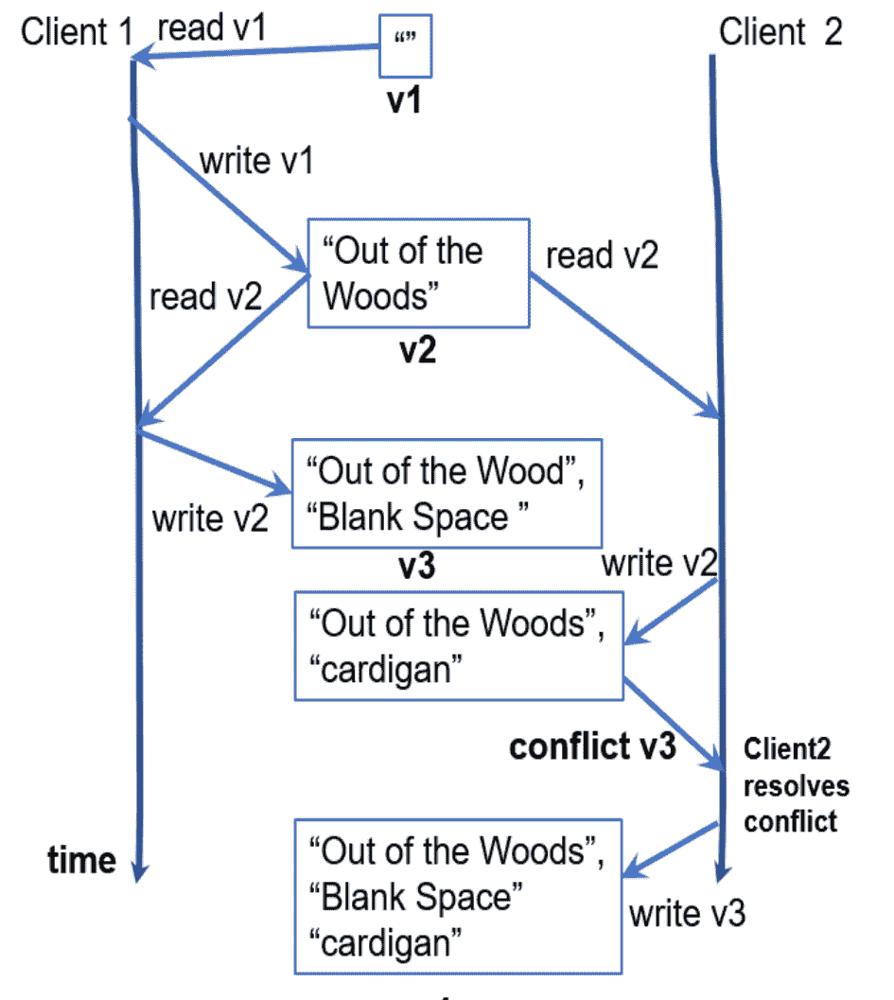

## 第11章. 最终一致性

### 给早期阅读者的说明

使用 Early Release 电子书，您可以在官方发布这些书名之前很久就利用这些技术——作者在写作时提供的原始未编辑内容。

这将是最终书籍的第11章。请注意，GitHub 仓库将在稍后激活。

如果您对如何改进本书的内容和/或示例有任何意见，或者如果您注意到本章中缺少材料，请联系编辑 vwilson@oreilly.com。

随着分布式、NoSQL 数据库的出现，最终一致性变得越来越重要。这仍然是一个对某些人来说具有异端性质的概念，它诞生于关系数据库事务的时代。在某些应用领域，通常以银行和金融为例，最终一致性根本不合适。至少争论是这样。

事实上，最终一致性在银行业已被使用了多年。有人还记得写支票吗？支票在您的账户上结算需要几天时间，您可以轻松开出超过账户余额的支票。当支票被处理， consistency 建立后，您可能会看到一些后果。

ATM 交易也是如此。如果 ATM 与网络分区且无法检查您的余额，您通常仍然可以取出现金，尽管限额很小。此时您的账户余额是不一致的。当分区恢复时，ATM 将把交易发送到后端系统进行处理，您的账户的正确值将被计算出来。

在可扩展的互联网系统时代，最终一致性找到了许多合适的用例。在本章中，我将深入探讨在构建使用分布式数据库的大规模最终一致性系统时，您需要了解的主要问题。

### 什么是最终一致性？

在过去的好日子里，当系统对所有数据项只有一个事实来源——即数据库——时，副本一致性不是问题。根本没有副本。但正如我在第10章中所解释的，许多系统需要将数据库扩展到多个节点，以提供必要的处理和存储容量。此外，为了确保每个节点的数据高度可用，您还需要复制每个节点的内容以消除单点故障。

突然间，您的数据库变成了一个分布式系统。当数据库节点和网络可靠且快速运行时，您的用户根本不知道他们正在与分布式系统交互。副本似乎会即时更新，用户请求以低响应时间处理。不一致的读取很少见。

但正如您现在所知，分布式系统需要能够处理各种故障模式。这意味着数据库必须处理高度可变的网络延迟以及通信和机器故障所固有的所有问题。这些故障意味着您的数据库副本可能保持不一致的时间比您的应用程序希望容忍的时间更长。这会产生您需要理解并能够解决的问题。

### 不一致窗口

在最终一致性系统中，不一致窗口是指更新传播到所有副本所需的时间。在基于 leader 的系统中，leader 协调其他副本的更新。在无 leader 系统中，任何副本（或可能任何数据库节点——这取决于实现）协调更新。不一致窗口在所有副本具有相同值时结束。

有几个因素会影响不一致窗口的持续时间。如下所述。

#### 副本数量

副本越多，需要协调的副本更新就越多。不一致窗口仅在所有副本完全相同后才关闭。如果您有三个副本，则只需要三次更新。副本越多，其中一个副本响应缓慢并延长不一致窗口的可能性就越大。

#### 运行环境

任何瞬时的运行故障，例如瞬时网络故障或丢包，都可能延长不一致窗口。副本更新延迟的主要原因可能是节点上的重读/写负载。这会导致副本过载并引入额外的传播延迟。因此，您的数据库负载越大，不一致窗口可能就越长。

#### 副本之间的距离

如果所有副本都在同一个局域网子网中，通信延迟可以低于毫秒。如果您的其中一个副本位于大陆另一侧或世界另一侧，不一致窗口的最小值将是副本之间的往返时间。随着地理分布，这可能相对较大，实际上是几十毫秒。¹ 这完全取决于距离，正如我在第3章中所解释的。

所有这些问题意味着您无法控制不一致窗口的持续时间。您无法提供或知道上限。对于使用异步通信状态更改的最终一致性系统，这是您必须接受的事实。

### 读取自己的写入

不久前，在预订航班时，我必须更新我的信用卡信息，因为一家大型商店被黑客攻击后发给我一张新卡。我 duly 添加了我的新卡信息，保存后继续结账流程以支付航班费用。令我惊讶的是，付款被拒绝，因为我没有更新我的信用卡信息。等等，我想，然后检查了我的个人资料。新卡详细信息已在我的个人资料中标记为默认卡。因此，我再次尝试交易，一切都正常。

我不知道这个系统是如何实现的，但我敢打赌它使用的是最终一致性数据库，并且不支持 *read your own writes (RYOWs)*。RYOWs 是系统的属性，确保如果客户端对数据进行持久更改，则任何后续来自同一客户端的读取都保证返回更新后的数据值。

在最终一致性系统中，不一致窗口使得客户端可能出现以下情况：
- 向数据库对象键发出更新
- 对同一数据库对象键发出后续读取，并在访问尚未持久化先前更新的副本时看到旧值

这在图 11-1 中有所说明。客户端请求更新其信用卡详细信息由 *Replica 1* 协调，后者将新卡详细信息异步发送给其他副本。然而，对 *Replica 3* 的更新却出现了延迟。在更新应用之前，同一客户端发出读取请求，该请求被定向到 *Replica 3*。结果是陈旧读取。



#### 图 11-1. 最终一致性导致陈旧读取

为了避免这种情况，系统需要提供读取您自己的写入一致性。² 这保证了对于单个用户，用户所做的任何更新都将在后续读取中可见。该保证不适用于其他用户。如果我向在线文章添加评论，刷新页面时我会看到我的评论。同一时间加载页面的其他用户可能立即看到我的评论，也可能看不到。他们最终会看到。

使用 leader-follower 复制，实现读取您自己的写入一致性非常简单。对于需要 RYOWs 的用例，您只需确保后续读取由 leader 副本处理。这保证持有最新的数据对象值。

RYOWs 的实现，如果受支持，则因数据库平台而异。对于 MongoDB，我将在第13章中更详细地描述的数据库，这是通过访问主副本实现的默认行为。³ 在 Neo4j 集群中，⁴ 所有写入都由 leader 处理，后者异步更新只读 follower。读取 however 可能由副本处理。为了实现读取您自己的写入一致性，任何写入事务都可以请求返回一个唯一标识该更新的书签。后续读取请求将书签传递给 Neo4j，使集群能够确保只有接收到书签事务的副本才处理读取。

### 可调一致性

许多最终一致性数据库提供配置选项和 API 参数，使您能够定制数据库的最终一致性行为。这使得可以根据用例可以容忍的最终副本一致性水平，在单个读取和写入操作的性能之间进行权衡。基本方法称为可调一致性。

可调一致性基于指定请求必须访问的副本数量才能完成数据库请求。为了解释其工作原理，让我们定义以下内容：

N = 副本总数

W = 在向客户端确认更新之前需要更新的副本数量

R = 在返回值之前需要读取的副本数量


作为示例，假设 N=3，并且存在一个无 leader 的数据库，其中任何单个请求都可由任意一个副本处理。处理请求的副本称为协调器。你可以通过指定 W 值来调整写操作性能以及不一致窗口的范围，如以下示例所示：

W=3

请求协调器将等待所有三个副本都被更新后才向客户端返回成功。

W=1

请求协调器将本地确认更新并向客户端返回成功。其他两个副本将异步更新。

这意味着如果 W=3，写入完成后所有副本都将保持一致。这有时被称为即时一致性。在这种情况下，客户端可以使用 R=1 的值（或法定人数 - 见下一节）发出读取，并且只要读取不与副本更新并发，它们应该会收到最新值。在副本正在更新时发生的读取仍可能根据访问的副本看到不同的值。只有在副本值收敛后，所有读取才会看到相同的值。因此，即时一致性与强一致性（见第 12 章）并不相同，因为陈旧读取仍然可能发生。⁵

如果 W=1，则存在不一致窗口，因为只有请求协调器（在我们的示例中）保证具有最新值。如果你发出 R=1 的读取，结果可能有最新值，也可能没有。

还记得第 10 章的 CAP 定理吗？这里有一些一致性-可用性权衡需要考虑。如果我们设置 W=N，则会有两个后果：

- 所有副本都保持一致。此选项有利于副本一致性。请注意，写入会变慢。客户端必须等待所有副本确认更新，这会增加写入的延迟，尤其是在某个副本响应缓慢的情况下。
- 如果副本无法访问，写入可能会失败。这将使请求协调器无法更新所有副本，从而请求会抛出异常。这会负面影响可用性（但请注意 - 稍后本章将介绍提示传递）。

在 CAP 术语中，此选项为 CP。

或者，如果我们设置 W=1，写入在任何副本可用时就会成功。存在一个不一致窗口，该窗口将持续到所有副本都被更新为止。即使一个或多个副本被分区或发生故障，写入也会成功。因此此选项更偏向可用性而非副本一致性，或在 CAP 用语中为 AP。

为了对抗这个不一致窗口，客户端可以指定在返回结果之前应读取多少个副本。如果我们设置 R=N，则请求协调器将从所有副本读取，确定哪个是最新的更新并将该值返回给客户端（我将在本章后面详细说明协调器如何确定哪个副本持有最新值。现在只需假设这是可能的）。结果是，通过从所有副本读取，你可以保证访问到持有最新更新值的副本。

另一种看待所涉及权衡的方法是读优化与写优化。 (W=N, R=1) 设置有利于一致性和读取延迟，因为只需要访问一个副本。权衡是写入时间更长。 (W=1, R=N) 选项有利于可用性和写入延迟，因为在任何副本更新后写入即可成功。权衡是读取变慢。

这些设置使你能够调整单个数据库请求以匹配你的需求。如果不一致读取不可取，选择 W=N 且 R=1，这会增加写入延迟但使读取尽可能快。或者，选择 W=1 且 R=N，以优化写入而牺牲读取。如果你的用例可以容忍不一致，设置 W=R=1

即可从快速读取和写入中受益。或者，如果你想在性能和一致性之间取得平衡，还有另一种选择，我将在下一节中解释。

### Quorum Reads and Writes

在上一节讨论的替代方案之间存在一个选项。这些被称为法定人数读取和写入。法定人数简单地意味着多数，即 (N/2)+1。⁶ 对于我们的 3 个副本，多数为 2。对于 5 个副本，多数为 3，依此类推。

如果我们将 W 和 R 值都配置为法定人数，我们可以在提供对数据对象最新更新值的访问的同时平衡读取和写入的性能。图 11-2 说明了法定人数的工作原理。对于三个副本，法定人数意味着写入必须在 2 个副本上成功，读取必须访问两个副本。最初三个副本都具有值为 v1 的数据对象 K，然后发生以下一系列操作：

- 1. Client1 将对象更新为值 v2，并且在法定人数（在本例中为 Replica-1 和 Replica-2）被更新后，写入被确认成功。
- 2. 更新 Replica-3 的命令被延迟（网络缓慢？节点繁忙？）。
- 3. Client2 对对象 K 发出读取。
- 4. Replica-2 充当请求协调器并向其他两个副本发送读取请求以获取其 K 的值。Replica-3 最先响应 K=v1。
- 5. Replica-2 将其 K 的值与 Replica-3 返回的值进行比较，并确定 v2 是最近更新的值。它将值 v2 返回给 Clients2。



图 11-2. Quorum Reads and Writes

法定人数的基本直觉是，通过始终从副本的多数读取和写入，读取请求将看到数据库对象的最新版本。这是因为写入的多数和读取的多数必须重叠。在图 11.2 中，即使在读取发生之前 Replica-3 未被更新，读取也会访问持有更新值的 Replica-2。请求协调器然后可以确保将最新值返回给客户端。

那么，这里不可避免的权衡是什么？简单地说，如果法定人数的节点不可用，写入和读取将失败。网络故障将一组副本分区，使得客户端可见的分区不包含法定人数，这将导致该客户端的请求失败。

在一些旨在优先考虑可用性而非一致性的数据库系统中，支持松散法定人数的概念。松散法定人数首次在 Amazon 的原始 Dynamo 论文中描述，7 并已在包括 DynamoDB、Cassandra、Riak 和 Voldemort 在内的多个数据库中实现。

这个想法很简单。如果由于副本节点不可用而无法实现给定写入的法定人数，则更新可以临时存储在另一个可达节点上。当副本的 home 节点再次可用时，存储更新的节点会执行所谓的提示传递。提示传递会将副本的最新值从其临时位置发送到 home 节点。

该方案在图 11-3 中描述。客户端向 Replica-1 发送更新。Replica-1 试图通过更新 Replica-2 和 Replica-3 来实现法定人数，但由于瞬态网络分区，Replica-3 不可用。因此 Replica-1 将更新发送到另一个数据库节点 Node-N，后者临时存储更新。稍后，Node-N 将更新发送到 Replica-3，并且更新对象的<|message|>值在所有副本中变得一致。



图 11-3. Sloppy Quorum and Hinted Handoff

松散法定人数有两个主要影响。首先，实现松散法定人数的写入保证在 W 个节点上的持久性，但 W 个节点并不是持有更新数据对象副本值的所有节点。这意味着即使配置了法定人数（即 R+W>N），客户端仍可能读取陈旧值，因为它可能访问了 R 个节点，而这些节点尚未被之前的写入操作更新。

其次，松散法定人数增加了系统的写入可用性。权衡是提示传递发生之前可能出现陈旧读取。支持这些功能的数据库通常允许系统设计者根据应用程序需求打开或关闭这些功能。

### Replica Repair

在分布式、复制的数据库中，你期望每个副本都保持一致。最终也许如此，但无论如何都应保持一致。不幸的是，在运行的数据库中，副本漂移会发生。网络故障、节点停滞、磁盘崩溃，或天呐，数据库代码中的 bug 都可能导致副本随时间变得不一致。

热力学中的一个术语，熵，被用来描述这种情况。基本上，系统倾向于随时间趋向熵或无序。由于熵，数据库需要采取主动措施来确保副本保持一致。这些措施统称为反熵修复。

反熵修复基本上有两种策略。一种是主动策略，在对象被访问时应用。这对于被合理频繁读取的数据库对象非常有效。对于不常访问的对象，最可能的是你的绝大多数数据，会使用被动修复策略。这在后台运行并搜索不一致的副本以进行修复。

#### Active Repair

也称为读取修复，主动副本修复是在数据库读取请求响应时发生的。当读取到达协调器节点时，它会请求每个副本的最新值。如果任何值不一致，协调器会发送回最新值以更新陈旧的副本。这可以以阻塞或非阻塞模式完成。阻塞模式在响应客户端之前等待副本确认更新，而非阻塞模式会立即将最新值返回给客户端并异步更新陈旧副本。


精确的读修复工作方式取决于实现。需要考虑的因素包括每次读取时访问多少个副本——可能是全部、法定人数或特定的 R 值——以及如何检测和修复副本分歧。对于检测，与请求并比较一个完整、可能很大且结构复杂的对象相比，可以使用对象的哈希值。如果副本哈希值匹配，则无需执行修复操作。读取哈希值，也称为摘要读取，可以减少网络流量和延迟。你会在多个 NoSQL 数据库中找到摘要读取的实现，例如 SyllaDB⁸ 和 Cassandra。

### 被动修复

被动反熵修复是一种通常定期运行的过程，旨在修复很少被访问的副本。本质上，该方法为每个复制的对象集合构建一个哈希值，并比较每个集合的哈希值。如果哈希值匹配，则无需修复。如果不匹配，则说明集合中的某些副本不一致，需要进一步操作。

为了创建对可能非常大的数据对象集合的高效哈希表示，通常会使用一种称为 Merkle 树⁹ 的数据结构。Merkle 树是一个二叉哈希树，其叶节点是单个数据对象的哈希值。树中的每个父节点都存储其一对子节点的哈希值，使得根节点哈希值能够提供整个数据集合的紧凑表示。图 11-5 显示了一个简单的 Merkle 树的表示。



图 11-4. Merkle 树示例

一旦为一组对象构建了 Merkle 树，就可以用它高效地比较每个副本集合的 Merkle 树。两个节点可以交换根节点哈希值，如果根节点值相等，则分区中存储的对象是一致的。如果不相等，则必须比较根节点的两个子节点。根节点哈希值不同，意味着一个或可能两个子节点哈希值必须不同。遍历和数据交换算法基本上会继续向下遍历树，沿着副本树之间哈希值不相等的分支，直到识别出叶节点。一旦识别出来，过时的对象就可以在适当的副本节点上更新。

Merkle 树的构建是 CPU 和内存密集型操作。因此，该过程是在按需启动，由管理工具发起，或定期安排。这使得反熵修复可以在数据库请求负载较低时发生，因此不会在生产期间对数据库访问造成增加的延迟。实现反熵修复的 NoSQL 数据库示例有 Riak¹⁰ 和 Cassandra。

### 处理冲突

到目前为止，本章中我假设数据库有某种机制来辨别任何给定复制数据库对象的最新值。例如，从三个副本读取时，数据库将“以某种方式”能够决定哪个副本是最新的，并将该值作为查询结果返回。

在无 leader 系统中，写入可以由任何副本处理。这使得两个客户端可以并发地对不同副本上的同一数据库键应用独立的更新。当这种情况发生时，更新应该按什么顺序应用？所有副本最终应该持有什么值？你需要某种机制来使这种决策成为可能。

#### 最后写入者胜出

一种决定方法是使用时间戳。为更新请求生成时间戳，并且数据库确保当并发写入发生时，具有最新时间戳的更新成为最终版本。这对数据库来说简单且快速。

不幸的是，这种方法存在问题。更新的实际发生顺序是什么？正如我在第 3 章中描述的那样，机器上的时钟会漂移。这意味着一个节点的时钟可能领先于其他节点，使得比较时间戳毫无意义。实际上，我们无法确定事件的顺序。它们由两个或多个独立进程在同一数据对象的不同副本上执行。这些更新必须被视为同时发生，或并发发生。附加到更新上的时间戳只是为了冲突解决而对更新施加一个任意顺序。

其后果是，当使用最后写入者胜出时并发更新发生，更新将被静默丢弃。图 11-5 描述了一个使用共享播放列表作为示例的场景，其中更新会丢失。Client1 首先向播放列表写入条目，随后该条目在稍后被 Client1 和 Client2 读取。两个客户端随后都向播放列表写入新条目，但由于 Client2 的更新时间戳晚于 Client1，Client1 所做的更新丢失了。



图 11-5. 并发写入导致最后写入者胜出时更新丢失

使用最后写入者胜出冲突解决策略的数据丢失是不可避免的。有缓解策略，例如对单个字段使用时间戳和条件写入，我将在第 13 章中讨论，这些策略可以最小化或减轻数据丢失的可能性。然而，安全使用采用纯最后写入者胜出策略的数据库的唯一方法，是确保所有写入都存储具有唯一键的数据对象，并且对象随后是不可变的。对数据库中数据的任何更改都需要读取现有数据对象，并将新内容写入数据库，使用新的键。

### 版本向量

为了处理并发更新而不丢失数据，我们需要一种识别和解决冲突的方法。图 11-6 显示了针对单个副本使用版本控制实现此目的的方法。每个唯一的数据库对象都存储在其版本号旁边。读取和写入数据库的数据按如下方式进行：

- 当客户端读取数据库对象时，对象及其版本会被返回。
- 当客户端更新数据库对象时，它写入新的数据值以及从上次读取中收到的对象的版本。
- 数据库检查写入请求中的版本是否与数据库中对象的版本相同，如果相同，则接受写入并递增版本号。
- 如果随写入一起的版本号与数据库对象版本不匹配，则发生了冲突，数据库必须采取补救措施以确保数据不丢失。它可能会向客户端返回错误并使其重新读取新版本。或者，它可能会存储两个更新并通知客户端发生了冲突。

#### Key1:MyTaylorSwiftPlaylist



图 11-6. 使用版本控制进行冲突识别

在图 11-6 中，所示的补救措施基于 Riak¹¹ 数据库。当 Riak 中发生冲突时，数据库会存储数据库对象的两个版本并将冲突返回给客户端。在此示例中，解决办法是客户端简单地合并两个更新，在 Riak 中称为 *siblings*。

然而，对于多个副本而言，情况比图 11-6 中显示的要复杂一些。由于写入可能由任何副本处理，我们需要为每个唯一对象和每个副本维护版本号。副本在处理写入时维护自己的版本，并跟踪其看到的其他副本的版本。这就创建了所谓的 *version vector*。

当副本接受来自客户端的写入时，它会更新自己的版本号，并将更新请求连同其版本向量发送给其他副本。版本向量由副本用来决定是否应接受更新或是否应创建 siblings。

版本向量的管理是数据库的责任。数据库客户端只需在更新时提供最新版本，并在发生冲突时能够处理冲突。侧边栏“逻辑时钟”简要概述了版本向量所代表的冲突解决方法的理论基础。


### 逻辑时钟

物理的、由 CPU 测量的时间在分布式系统中并不是可靠的参考来源（参见第 3 章）。因此，你需要另一种方法来理清数据库访问发生的顺序。这就是逻辑时钟登场的地方。

逻辑时钟最早由 Leslie Lamport 在其开创性论文中描述。¹² 其核心工作是定义了 *happens-before* 关系。这意味着：

- 如果一个进程发出操作 *a*（例如一次数据库请求），并在完成后发出操作 *b*，那么 *a happens-before b*。这表示为 a→b。
- 如果一个进程向另一个进程发送消息 m，则发送 *happens-before* 接收。
- 如果两个独立进程执行操作 a→b 和 c→d，则无法在 {a, b} 和 {c, d} 之间定义顺序。在这种情况下，操作是并发的。
- *happens-before* 关系是传递的，即如果 a→b 且 b→c，则 a→c。

系统可以使用逻辑时钟来捕获 *haps-before* 关系。这使用简单的计数器和算法实现。每个进程都有一个本地时钟，在启动时初始化为零。以下显示了进程向另一个进程发送消息时的伪代码：

```
#### increment local clock
local_clock ++;

#### send message to another process
send(msg, local_clock);
```

当接收进程接受消息时，它按如下方式设置自己的本地时钟：

```
(msg, clock_msg) = receive();
local_clock = max(clock_msg, local_clock) + 1;
```

这确保接收进程中 local_clock 的值大于消息中发送的值。这反映了发送操作 happens-before 接收操作。每当两个事件之间存在因果关系或因果联系，即 a→b 时，则 clock(a)<clock(b)。

Lamport 时钟在事件之间定义了偏序，因为它们无法区分没有因果关系的并发请求。因此，它们不能用于检测数据库冲突。这就是版本向量登场的地方。版本向量定义了一个逻辑时钟数组，每个数据库对象副本一个元素。以下显示了具有三个副本的新创建对象的示例

```
r1, r2, r3 = [ [r1, 0], [r2,0], [r3,0] ]
```

当更新由协调节点处理时，在以下示例中为副本 2，它会递增向量中的自己的时钟，并将更新后的向量发送给其他副本。

```
r2 = [ [r1, 0], [r2,1], [r3,0] ]
```

当副本从协调器接收到更新和版本向量时，它会将向量与其本地副本进行比较。如果更新的对象版本向量的每个时钟值都大于或等于副本存储的时钟值，则写入被接受。所有副本同步并将具有相同的版本向量。

如果在副本二和三发生并发更新，如下所示，每个副本将更新自己的时钟。

```
r2 = [ [r1, 0], [r2,2], [r3,0] ]
r3 = [ [r1, 0], [r2,1], [r3,1] ]
```

当版本向量被副本 2 和 3 交换和比较时，冲突被检测到，因为并非所有时钟值都遵守 *greater than or equal to* 规则。这就是版本向量如何在复制数据库中实现冲突检测的方式。

如图 11-6 所示，当数据库检测到冲突时，客户端通常需要做一些工作来解决它。如果数据库抛出错误，客户端可以重新读取数据库对象的最新版本并再次尝试更新。如果返回了兄弟版本，客户端必须执行某种形式的合并。这些情况非常具体于用例，因此不可能概括。

幸运的是，在某些情况下数据库可以自动解决冲突。一些数据库，包括 Redis、Cosmos DB 和 Riak，利用了研究社区的最新成果来支持一组称为 CRDTs（无冲突复制数据类型）的数据类型。CRDTs 的语义使其可以并发更新，任何冲突都可以由数据库合理地解决。CRDT 的值将始终收敛到在所有副本上一致的最终状态。

CRDT 的一个简单示例是计数器，可用于维护社交媒体网站上用户的关注者数量。对计数器的递增和递减可以在不同副本上以任何顺序应用，最终值应在所有副本上收敛。

常见的 CRDT 包括集合、哈希表、列表和日志。这些数据结构的行为（在一些小的警告¹³下）与它们的非分布式对应物相同。重要的是它们减轻了应用程序处理冲突的负担。这简化了应用程序逻辑，为你节省时间和金钱，并且可能会使你的应用程序更不易出错。

### 在野外：最终一致性

最终一致性数据库在大型系统中被广泛使用。例如，在 Netflix，Cassandra 数据库支撑了观看内容时的用户体验。2019 年，Netflix 报告称 Cassandra 中有超过六 PB 的订阅者相关内容，存储在数万个数据库实例和数百个全球分布式集群中。¹⁴ Cassandra 的低写入延迟为写入与读取比例为 9:1 的用例提供了极佳的解决方案。Netflix 还利用 Cassandra 的可调一致性和全球数据复制来支持其超过 1 亿订阅者的最关键时间用例。¹⁵

Netflix 从 Cassandra 测试中得出的基准结果对于量化最终一致性技术可实现的延迟非常有用。¹⁶ 例如，一项基准测试实现了每秒 100 万次写入，平均延迟为 6 毫秒，p95 为 17 毫秒。这些结果使用了一个包含 285 个节点的 Cassandra 集群产生。像所有基准研究一样，你需要深入 Netflix 技术博客的细节才能充分理解结果。

在线博彩和游戏行业依赖高可用性和低延迟。很难想象当在世界冠军拳击比赛或足球世界杯等重大赛事上投下大量赌注时，停机和缓慢响应的影响。bet365 是最大的在线赌博网站之一，他们基于 Riak KV 数据库构建了网站。¹⁷ 为数百万并发用户计算赔率、下注以及管理账户和交易数据，每秒产生数 GB 的数据进行处理。赔率不断变化，必须以低延迟重新计算以捕捉比赛中变量的影响。写入 Riak KV 的数据会自动写入全球分布式集群中的多个副本，并具有可调一致性。这提供了高

可用性和低延迟，通过使用户能够访问与其位置物理接近的副本来实现。

### 总结和进一步阅读

最终一致性数据库已成为可扩展分布式系统格局中不可或缺的一部分。简单、可演进的数据模型自然分区和复制以实现可扩展性和可用性，为许多互联网规模的系统提供了极佳的解决方案。

最终一致性不可避免地为系统提供陈旧读取创造了机会。因此，大多数数据库提供可调一致性。这允许系统设计者在读取和写入的延迟之间取得平衡，并在可用性和一致性之间进行权衡以满足应用程序需求。

对同一数据库对象的不同副本的并发写入可能导致冲突。这会导致数据库具有不一致的副本并静默丢失更新，这两种情况在大多数系统中都是不可取的。为了解决这个问题，需要冲突解决机制。这些通常需要应用程序逻辑（和/或用户）来解决冲突并确保更新不会丢失。这可能导致额外的应用程序复杂性。然而，新研究正在提供帮助，一些数据库支持具有自动解决冲突语义的数据类型。

关于最终一致性数据库的经典参考以及当今许多实现的灵感来源是原始的 Dynamo 论文。即使在 2007 年发表后十多年，它仍然是一篇很棒的读物。

> Giuseppe DeCandia et al, 2007. Dynamo: amazon’s highly available key-value store. SIGOPS Oper. Syst. Rev. 41, 6 (December 2007), 205–220.

如果你想了解最终一致性数据库以及大规模数据存储的一般构建方式，我认为没有比 Designing Data Intensive Applications by Martin Kleppman（2017，O’Reilly Media）更好的来源了。我也喜欢 NoSQL for Mere Mortals by Dan Sullivan（2015，Addison Wesley Professional）提供的扎实基础信息。而且如果


你想了解更多关于 CRDTs 的内容，这篇综述论文是一个很好的起点：

> *Marc Shapiro, Nuno Preguiça, Carlos Baquero, Marek Zawirski. A comprehensive study of Convergent and Commutative Replicated Data Types. [Research Report] RR-7506, Inria –Centre Paris-Rocquencourt; INRIA. 2011, pp.50.*

+   1 未来量子通信系统也许能够克服距离带来的延迟 - https://futurism.com/chinese-physicists-measure-speed-of-quantum-entanglement-2
+   2 有关最终一致性模型的优秀描述，请参阅 https://www.allthingsdistributed.com/2007/12/eventually_consistent.html
+   3 MongoDB 允许你调整哪个副本处理读请求。参见 https://docs.mongodb.com/manual/core/read-preference/
+   4 Neo4j 集群的描述在此链接 - https://neo4j.com/docs/operations-manual/current/clustering/introduction/
+   5 立即可见的一致性不应与本章后面描述的强一致性混淆。优先可用性而非一致性并使用 W=N 进行写入的数据库仍然存在不一致窗口。此外，如果一个或多个副本无法访问，写入可能不会完成于每个副本。要了解原因，请参阅本章后面的 Hinted Handoffs。
+   6 此公式使用整数除法，小数部分会被丢弃。例如，5/2=2。
+   7 Giuseppe DeCandia, Deniz Hastorun, Madan Jampani, Gunavardhan Kakulapati, Avinash Lakshman, Alex Pilchin, Swami Sivasubramanian, Peter Vosshall and Werner Vogels, “Dynamo: Amazon’s Highly Available Key-Value Store”, in the Proceedings of the 21st ACM Symposium on Operating Systems Principles, Stevenson, WA, October 2007.
+   8 SyllaDB 中读修复的详细描述在此 - https://docs.scylladb.com/architecture/anti-entropy/read-repair/
+   9 Merkle 树在许多用例中很有用，包括 Bitcoin/Blockchain 交易验证。此链接有极佳的解释 - https://decentralizedthoughts.github.io/2020-12-22-what-is-a-merkle-tree/
+   10 Riak 关于反熵修复的文档位于 https://docs.riak.com/riak/kv/latest/learn/concepts/active-anti-entropy/index.html
+   11 Riak 关于冲突解决的文档在此链接 - https://docs.riak.com/riak/kv/latest/developing/usage/conflict-resolution/index.html
+   12 奠基性论文是 Lamport, Leslie (1978). “Time, Clocks and the Ordering of Events in a Distributed System”, Communications of the ACM, 21(7), 558-565.

13 例如，如果一个进程并发地从集合中移除一个元素，而另一个节点同时添加相同的元素，则“添加获胜”。

14 关于 Netflix 使用 Cassandra 的优秀演示文稿位于 https://www.slideshare.net/VinayKumarChella/how-netflix-manages-petabyte-scale-apache-cassandra-in-the-cloud

15 这篇 Netflix 技术博客文章解释了基于 Cassandra 的用户观看历史数据库扩展解决方案如何随时间演进 - https://netflixtechblog.com/scaling-time-series-data-storage-part-i-ec2b6d44ba39

16 Cassandra 基准测试体现了最终一致性数据存储的能力 - https://netflixtechblog.com/revisiting-1-million-writes-per-second-c191a84864cc

17 bet365 如此严重依赖 Riak KV，他们甚至买下了这项技术！其业务挑战概述描述于此 - https://riak.com/content/uploads/2015/05/Riak-RiakSolutionforGaming-WEB.pdf
