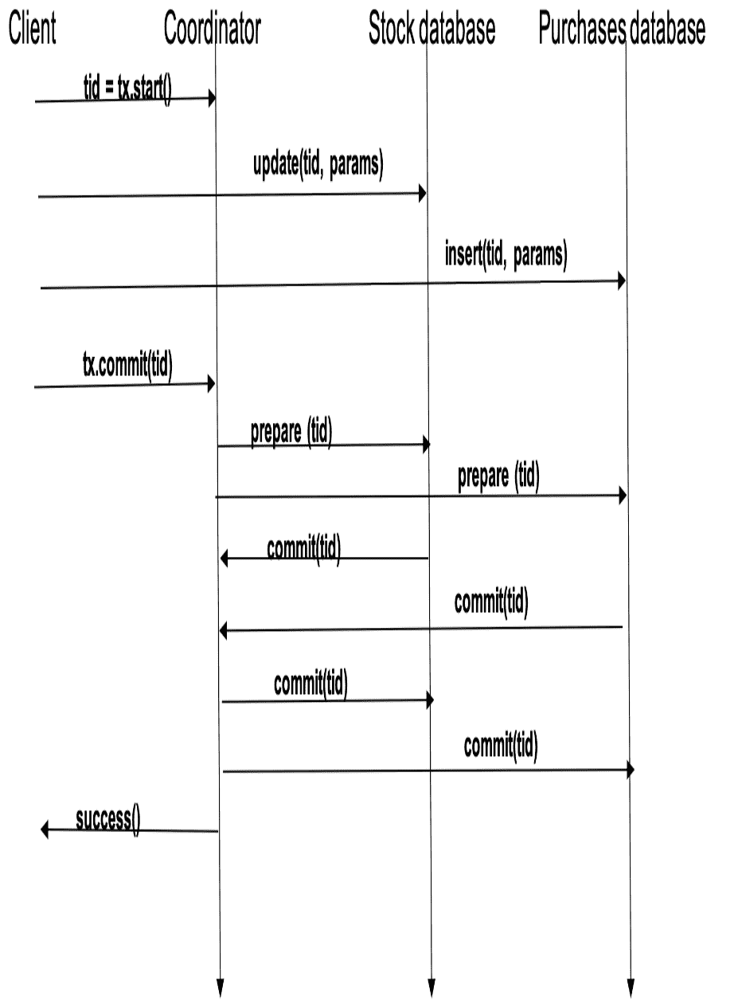
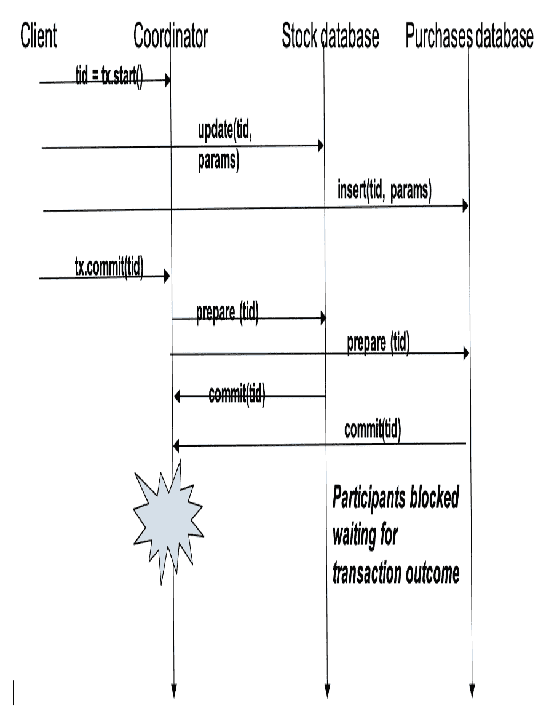
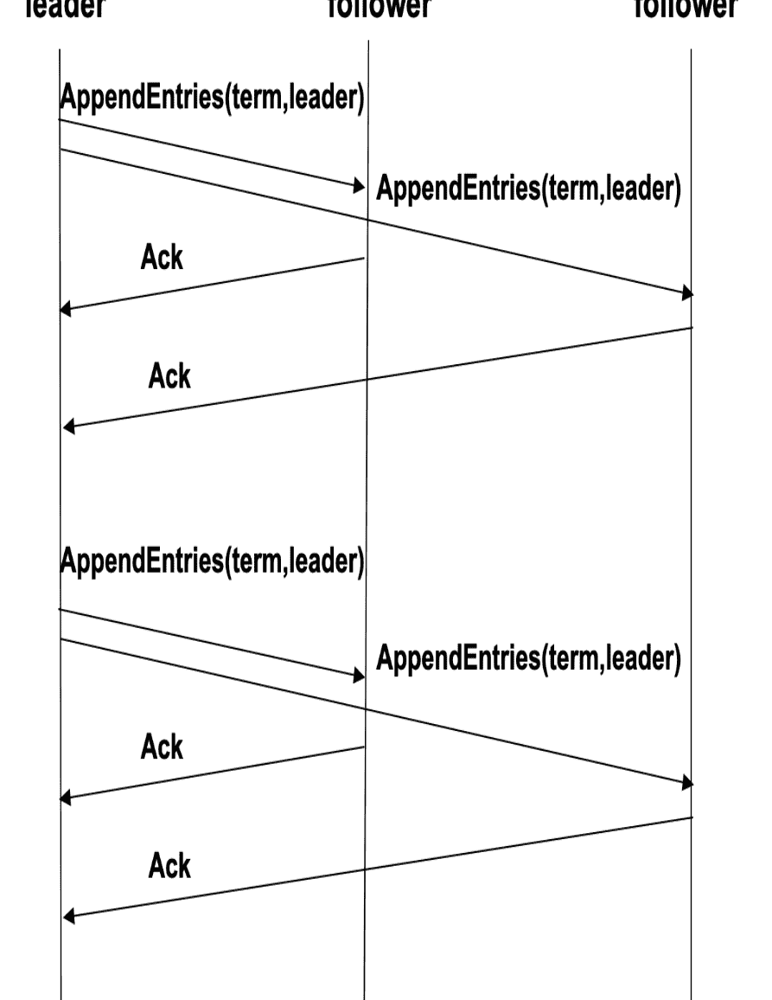
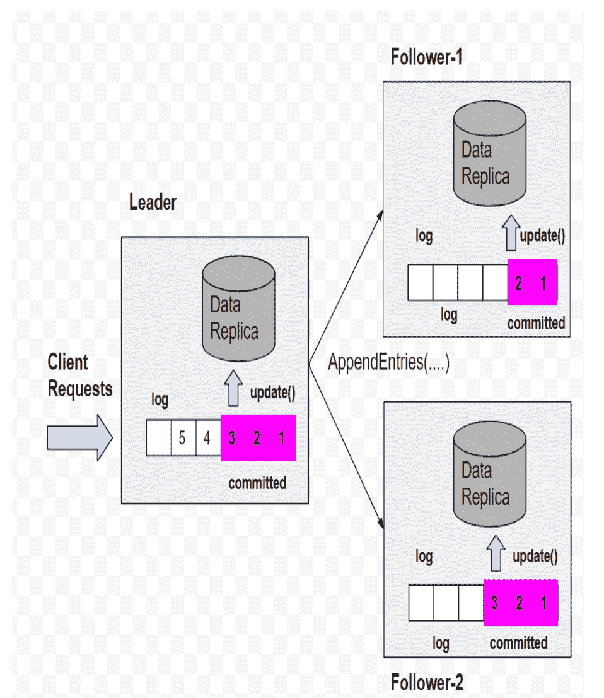
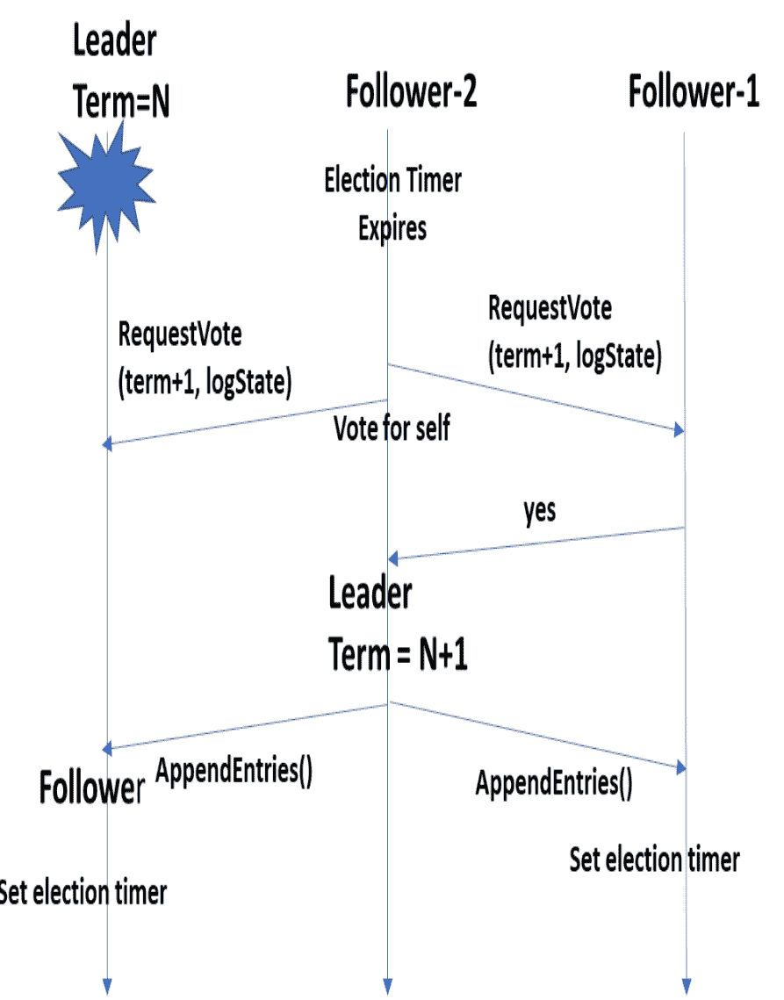
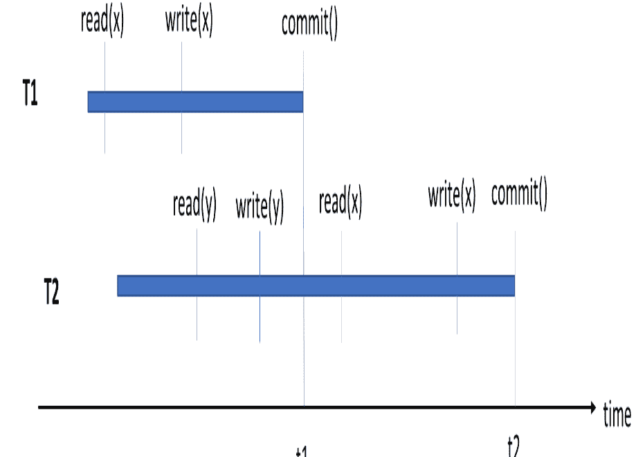

## 第 12 章. 强一致性

### 致早期发布读者的一则说明

凭借 Early Release 电子书，你可以在这些书籍正式发布之前就获得书籍的最早形式——作者在写作时的原始未编辑内容——从而让你能够在这些技术正式发布前就利用它们。

这将是最终书籍的第 12 章。请注意 GitHub 仓库将在稍后激活。

如果你对如何改进本书的内容和/或示例有任何意见，或者如果你注意到本章中缺少材料，请联系编辑 vwilson@oreilly.com。

正如我在第 11 章中所描述的，最终一致性数据库旨在通过允许数据集被分区并复制到多台机器上来实现扩展。扩展性是以牺牲跨副本维护强数据一致性并允许冲突写入为代价实现的。

这些权衡的后果是双重的。首先，在数据对象被更新后，不同的客户端在所有副本收敛到最新值之前可能会看到对象的旧值或新值。其次，当多个客户端并发更新对象时，应用程序负责确保数据不丢失并且最终对象状态反映并发更新操作的意图。根据系统的需求，处理不一致和冲突可能很简单，也可能给应用程序代码增加相当大的复杂性。

另一类分布式数据库提供了一种替代模型，即强一致性数据系统。也称为 NewSQL 或最近的 Distributed SQL，强一致性系统试图确保一旦数据对象被更新，所有客户端看到的都是相同且一致的值。它们还提供大家熟悉的 ACID 数据库事务的好处来处理冲突更新。

事务和数据一致性，即现有单节点关系数据库中每个人都熟悉的特性，消除了最终一致性系统中固有的许多复杂性。它们一起可以显著简化应用程序逻辑。正如 Google 原始 Spanner 分布式数据库论文中所说：

> “我们认为，让应用程序程序员在出现瓶颈时处理因事务过度使用而导致的性能问题，比总是围绕缺乏事务进行编码要好。”¹

对于互联网规模的系统，诀窍当然是提供强一致性数据库的好处，同时实现最终一致性系统可以达到的性能和可用性。这是 Distributed SQL 数据库正在解决的挑战。在本章中，我将解释这些强一致性系统的特征以及使一致数据系统能够被分区和复制以实现扩展性和可用性所需的算法。

### 强一致性简介

在顺序程序中，一旦你将一个值 (x) 写入变量，你期望所有后续读取都会返回 (x)。如果这个保证不成立，就像在没有仔细线程同步的并发程序中一样，编写软件系统会困难得多。

然而，这就是使用最终一致性数据库系统时的情况。客户端可能认为它已将新值写入数据对象，但其他客户端可能访问同一对象并在不一致窗口关闭且所有副本值收敛之前收到陈旧值。事实上，正如我在第 11 章中所描述的，除非支持读己写一致性，否则客户端甚至可能访问它成功更新的对象并收到陈旧值。

在基于最终一致性数据库的系统上，应用程序必须了解底层数据存储的确切一致性保证，并据此设计。处理不一致的读取和并发写入冲突会给代码库和测试用例增加相当大的复杂性。如果你不采取适当的措施，很难重现的错误可能会潜入应用程序。根据墨菲定律，这些错误不可避免地只会在系统经历高负载或意外故障时才显现出来。

相比之下，强一致性数据库旨在提供与单节点系统相同的 consistency 保证。强一致性下，你可以编写应用程序并确信一旦数据库确认更新，所有后续由所有客户端的读取都会看到新值。而且如果并发客户端尝试更新同一对象，更新的行为就好像一个发生在另一个之前。它们不会并发发生并导致数据丢失或损坏。

有点令人困惑的是，技术社区使用强一致性来描述分布式数据库中两个细微不同的概念。这些是：

- **事务一致性：** 这是 ACID 事务中的 C（见侧边栏），由关系数据库支持。在支持 ACID 事务的分布式数据库中，你需要一种算法，使在单个事务中更新来自不同物理数据分区和节点的 data 对象时保持一致成为可能。在这种情况下，一致性由事务中执行的业务逻辑的语义定义。
- **副本一致性：** 强副本一致性意味着客户端在数据对象被更新后无论访问哪个副本都看到相同的值。基本上，这消除了我在第 11 章中介绍的最终一致性系统中的不一致窗口。支持强副本一致性存在各种细微差别，我将在本章后面探讨。

用于事务一致性和副本一致性的算法被称为 *共识算法*。这些算法使分布式


系统以达成共识，或就某些共享状态的值达成一致。对于事务一致性，事务中的所有参与者必须同意提交或中止在事务中执行的更改。对于副本一致性，所有副本都需要就复制数据对象的更新的相同顺序达成一致。

事务一致性和副本一致性的解决方案由不同的技术社区在不同的时间开发。对于事务一致性，两阶段提交算法源于数据库系统先驱 Jim Gray 于 1978 年的工作。² 经典的副本一致性算法 Paxos 最早由 Leslie Lamport 于 1998 年描述。³ 我将在本章剩余部分探讨事务和副本一致性，以及这些算法在分布式 SQL 数据库中的使用方式。

### ACID 事务

数据库系统中的事务可能会修改多个数据库对象。此类事务支持 ACID 属性，即：

- **原子性**：对数据库的所有更改必须作为单一操作执行。这意味着所有更新必须成功（提交），或全部失败（回滚）。例如，对于我在网上进行的购买，如果我的信用卡成功扣款，我的订单详情将被记录并发送进行处理。如果我没有信用，我的购买将被拒绝。
- **一致性**：事务会使数据库保持一致状态。如果我的网上购买成功，我所购买产品的库存数量将减少我所选的数量。该属性由事务执行的特定业务逻辑定义。
- **隔离性**：在事务进行期间，事务修改的任何数据对其他并发事务都是不可见的。竞争资源的事务彼此隔离，并且在事务完成之前，其他并发事务无法访问该事务的结果。数据库通过在事务访问的数据对象上获取锁，并在事务完成后释放锁来实现这一点。
- **持久性**：如果事务提交，更改是永久的，并且在系统故障的情况下可以恢复。

ACID 中的隔离属性要求事务像序列化一样执行。⁴ 可序列化性保证并发事务看起来以某种顺序或总顺序执行。

### 一致性模型

数据库和分布式系统社区已研究一致性超过四十年。每方都开发了几种不同的一致性模型，其语义和保证略有不同。这导致定义和术语重载的景观有些令人困惑和复杂。如果你对完整细节感兴趣，Jepsen 网站上有一个关于不同模型及其关系的优秀图示，按层次组织。⁵ 我在本章中只关注最强的一致性模型。它被各种称为严格一致性、严格可序列化或外部一致性，并意味着数据库和分布式系统社区定义的两个最严格的一致性模型的组合。它们分别是可序列化和线性化，如下所述：

- 可序列化通常被称为事务一致性，即 ACID 中的“C”。事务对多个数据对象执行一个或多个读和写。可序列化性保证对多个项目的一组并发事务的执行等同于事务的某种顺序执行顺序。
- 线性化关注对单个数据对象的读写。基本上，它说所有客户端应始终看到数据对象的最新值。一旦对数据对象的写入成功，所有在写入之后发生的后续读取必须返回该写入的值，直到对象再次被修改为止。线性化使用挂钟时间定义操作的顺序，使得具有较新挂钟时间的操作发生在具有较低挂钟时间的任何操作之后。在具有多个数据对象副本的分布式数据库中，可线性化一致性关注副本一致性，本质上是 CAP 定理中的‘C’。

将这两个模型结合起来可获得最强的数据一致性。基本效果是事务以串行顺序执行（可序列化），并且该顺序由事务的挂钟时间定义（线性化）。为简单起见，我将此称为强一致性。

无论如何，这就是理论的总结。为了在分布式 SQL 数据库中支持这些一致性模型，我们需要共识算法，如我在本章剩余部分所解释的那样。

### 分布式事务

从应用程序开发人员的角度来看，思考事务的最简单方式是将其作为简化分布式系统中故障场景的工具。应用程序只需定义必须使用 ACID 属性执行的哪些操作，数据库就会完成其余工作。这大大减少了应用程序的复杂性，因为你可以忽略微妙且众多的故障可能性。你的代码只需等待数据库通知其事务结果，提交或中止，并据此行为。

图 12-1 显示了使用 YugabyteDB 的⁶ SQL 变体进行购买事务的简单示例。事务修改库存表以反映客户订购的商品数量，并在购买表中插入新行以表示客户的订单。这些操作使用事务边界定义，由 BEGIN/END TRANSACTION 语法标记。

示例 12-1. 示例 YugabyteDB SQL 事务

```
BEGIN TRANSACTION
UPDATE stock SET in_stock = in_stock - purchase_amount
WHERE stock_id = purchase_stock_id;
    INSERT INTO purchases (cust_id, stock_id, amount)
            VALUES (customer, purchase_stock_id, purchase_amount);
END TRANSACTION;
```

事务语义确保两个操作要么都成功，要么都失败。如果数据库不支持事务，如大多数 NoSQL 数据库，应用程序程序员就必须有效地将事务分解为两个单独的更新并定义可能复杂的异常处理。基本上这意味着：

- 分别执行每个更新，并检查每个是否成功。
- 如果在 UPDATE 成功后 INSERT 失败，必须使用另一个 SQL 语句撤消库存表更新。这称为补偿操作。
- 如果补偿操作失败，或执行代码的服务失败，你需要采取补救措施。这就是事情开始变得真正复杂的地方！

在单节点数据库中，提交事务相对简单。数据库引擎确保事务修改和状态持久化到磁盘上的事务日志文件。如果数据库引擎失败，事务日志可以在重启时用于将数据库恢复到一致状态。然而，如果图 12-1 中的购买和库存表位于不同的数据库或分布式数据库中的不同分区中，过程就复杂一些。你需要一个算法来确保两个节点就事务结果达成一致。

### 两阶段提交

两阶段提交（2PC）是经典的分布式事务共识算法。它广泛实现于成熟的关系数据库，如 SQL Server 和 Oracle，以及当代的分布式 SQL 平台，包括 VoltDB 和 Cloud Spanner。2PC 也由外部中间件平台支持，如 Java 企业版，其中包括 Java 事务 API（JTA）和 Java 事务服务（JTS）。⁷ 这些外部协调器可以使用 XA 协议⁸ 跨异构数据库驱动分布式事务。

图 12-1 说明了基于图 12-1 中的示例的基本 2PC 协议的示例。该协议由协调器或领导者驱动。协调器可以是外部服务，例如 JTS，或内部数据库服务。在分布式 SQL 数据库中，协调器可以是作为多分区事务更新的一部分而被更新的分区之一。


当数据库客户端开始一个事务（例如图 12-1 中的 BEGIN TRANSACTION 语句）时，会选出一个协调器。协调器分配一个全局唯一的事务标识符（*tid*）并将其返回给客户端。*tid* 标识协调器维护的一种数据结构，即事务上下文。事务上下文记录参与该事务的数据库分区，或参与者，以及它们通信的状态。上下文由协调器持久化，以便它能够持久地维护事务的状态。

客户端随后执行事务定义的操作，将 *tid* 传递给执行数据库操作的每个参与者。每个参与者都在被修改的对象上获取锁并在本地执行操作。它还在本地事务日志中持久地将 *tid* 与更新关联起来。这些数据库更新在此阶段尚未完成——只有在事务提交时才会发生。



图 12-1. 两阶段提交

一旦事务中的所有操作都成功完成，客户端就会尝试提交事务。这时协调器上的 2PC 算法开始，它会按照以下描述与参与者进行两轮投票：

- **准备阶段：** 协调器向所有参与者发送消息，告知它们准备提交事务。当参与者成功准备后，它保证能够提交事务并使其持久化。此后，它就不能单方面决定中止事务。如果参与者无法准备，即如果它无法保证提交事务，则必须中止。每个参与者随后通过返回包含其决定的消息来通知协调器其提交或中止的决定。

- **决议阶段：** 当所有参与者都对 *prepare* 阶段作出回复后，协调器会检查结果。如果所有参与者都可以提交，则整个事务可以提交，协调器向每个参与者发送提交消息。如果任何参与者决定必须中止事务，或在指定时间内未回复协调器，协调器会向每个参与者发送中止消息。

### 2PC 故障模式

2PC 有两种主要故障模式。这些是参与者故障和协调器故障。像往常一样，故障可能是由系统崩溃或与应用程序其余部分分区引起。从 2PC 的角度来看，崩溃和参与者是无法区分的。

- **参与者故障：** 当参与者在 *prepare* 阶段完成之前崩溃时，事务会被协调器中止。这是直接的故障场景。参与者也可能对 *prepare* 消息作出回复后才发生故障。在任何一种情况下，当参与者重新启动时，它需要与协调器通信以发现事务结果。协调器可以使用其事务日志查找结果并相应地通知恢复的参与者。参与者随后在本地完成事务。因此，参与者故障不会威胁一致性，因为正确的事务结果会被达成。

- **协调器故障：** 如果协调器在发送 *prepare* 消息后发生故障，参与者就会陷入两难。已投票提交的参与者必须阻塞，直到协调器通知它们事务结果。如果协调器在发送提交消息之前或期间崩溃，参与者就无法继续，因为协调器已失败，并且在恢复之前不会发送事务结果。这在图 12-2 中有所说明，其中协调器在收到 *prepare* 阶段的参与者响应后崩溃。



图 12-2. 协调器故障导致事务结果不确定且参与者阻塞

这个问题没有简单的解决方法。参与者不能自主决定提交，因为它不知道其他参与者如何投票。如果一个参与者投票回滚，而其他参与者投票提交，这将违反事务语义。唯一的实用解决方法⁹是参与者等待协调器恢复并检查其事务日志。日志使协调器能够解决所有未完成的事务。如果它为未完成的事务记录了提交条目，它将通知参与者提交。否则它将回滚事务。

事务协调器恢复和事务日志使得能够完成未完成的事务并确保系统保持一致性。缺点是参与者在协调器恢复期间必须阻塞。这需要多长时间取决于实现，但至少可能需要几秒钟。这会负面影响可用性。

此外，在此期间，参与者必须持有事务所修改的数据对象的锁。锁是确保事务隔离所必需的。如果其他并发事务尝试访问这些被锁定的数据项，它们将被阻塞。这会导致响应时间增加，并可能导致请求超时。在负载很重或请求激增的系统上，这可能导致级联故障、断路器打开，以及根据系统设计特征的其他通常不期望的结果。

总之，2PC 的弱点在于它不能容忍协调器故障。一种可能的修复方法，与所有单点故障问题一样，是在参与者之间复制协调器和事务状态。如果协调器发生故障，参与者可以被提升为协调器并完成事务。走这条路会导致一个需要分布式共识算法的解决方案，我将在下一节中描述

### 分布式共识算法

实现副本一致性，使所有客户端都能看到数据对象副本值的一致视图，需要对每个副本值达成共识，或一致。对象的所有副本更新必须以相同的顺序应用于每个副本。实现这一点需要分布式共识算法。

在过去大约 40 年里，人们投入了大量智力努力来研究分布式共识算法。虽然共识在概念上很简单，但由于参与者之间的消息可能会丢失或延迟，且参与者可能在不方便的时候崩溃，因此出现了许多微妙的问题。

作为共识需求的一个例子，想象一下在线拍卖结束时可能发生的情况，当多笔最后时刻的出价被提交时。这相当于多个客户端发送更新请求，这些请求可以由同一个 *auction* 数据对象的不同副本处理。在最终一致的系统中，这可能导致副本具有不同的出价值，并可能导致最高出价丢失。

共识算法确保此类问题不会发生。更具体地说：

- 所有副本必须同意相同的获胜出价。这是正确性，或安全属性。安全属性确保 *不会发生坏事*。在这种情况下，两个获胜出价就是坏事。
- 最终会选出一个获胜出价。这是活性属性。活性确保 *会发生好事* 且系统取得进展。在这种情况下，最终就单个获胜出价达成共识。保证活性的共识算法被称为容错共识算法。
- 获胜出价是已提交的出价之一。这确保算法不能简单地硬编码为同意预定值。

容错共识方法的基石是一类称为原子广播、总序广播或复制状态机的算法。¹⁰ 这些算法保证一组值或状态被精确地交付给多个节点一次，并且顺序相同。两阶段提交也是一种共识算法。然而，正如我在本章前面解释的那样，它不是容错的，因为当事务协调器或领导者发生故障时，它无法取得进展。

存在许多众所周知的共识算法。例如，Raft¹¹ 是一种基于领导者的原子广播算法。单个领导者接收客户端请求，建立其顺序，并对跟随者执行原子广播以确保更新的一致顺序。

相比之下，Leslie Lamport 的 Paxos，也许是最著名的共识算法，是无领导者的。这，加上其他复杂性，使其 notoriously 难以实现。¹² 因此，开发了一种称为 Multi-Paxos¹³ 的变体。Multi-Paxos 与 Raft 等基于领导者的方法有许多共同点，是 Google Cloud Spanner 等分布式关系数据库实现的基础。

为了容错，共识算法必须在领导者和跟随者故障的情况下取得进展。当领导者发生故障时，必须选举出单个新领导者，并且所有跟随者必须同意相同的领导者。新领导者选举方法在不同算法之间有所不同，但其核心需要：

- 检测到故障的领导者
- 一个或多个跟随者提名自己为领导者
- 投票，可能有多轮，以选出新领导者
- 恢复协议，以确保在选出新领导者后所有副本达到一致状态

当然，不仅领导者可能不可用。因此，容错共识算法被设计为仅使用参与者的法定人数，或多数即可运行。法定人数用于确认原子


broadcasts and leader election. 只要参与节点的多数派可用并达成一致，算法就能继续推进。我将在下面的小节中更详细地探讨这些问题，并以 Raft 算法为例来说明这些问题。

### Raft

Raft 是对 Paxos 算法固有复杂性的一种直接回应，被称为“一种可理解的共识算法”，首次发表于 2013 年。¹⁴ 重要的是，还发布了参考实现。它为 Raft 中的概念提供了具体的描述，并为实现者在自己的系统中借鉴提供了基础。

Raft 是一种基于领导者的算法。领导者接受所有更新并定义其执行的顺序。然后它负责以定义的顺序将这些更新发送给所有副本，以使所有副本保持相同的提交状态。更新以日志的形式维护，Raft 本质上是将此日志复制到系统的所有成员。

Raft 集群具有奇数个节点，例如三个或五个。这使得共识可以基于多数派进行。在任何时刻，每个节点要么是领导者，要么是跟随者，要么是在检测到领导者故障时成为领导者候选者。领导者会向跟随者发送周期性心跳消息以表明自己仍然存活。基本 Raft 集群架构中的消息流如图 12-3 所示。领导者心跳的时间间隔通常约为 300-500 毫秒。

每个领导者都与一个单调递增的值相关联，该值称为任期。任期是一个逻辑时钟，每个有效的任期值都与单个领导者相关联。当前任期值由集群中的每个节点本地持久化，对于领导者选举至关重要，正如我很快会解释的那样。每个心跳消息都包含当前任期值和领导者身份，并使用 AppendEntries() 消息传递。AppendEntries() 也用于将新条目传递到日志上进行提交。在空闲期间，当领导者没有来自客户端的新请求时，空的 AppendEntries() 就足以作为心跳。



图 12-3. Raft 集群中的消息交换，一个领导者和两个跟随者

在正常操作期间，所有客户端更新都发送给领导者。领导者对更新进行排序并将其附加到本地日志。最初所有日志条目都标记为未提交。领导者随后使用 AppendEntries 消息将更新发送给所有跟随者，该消息还标识了任期和日志中更新的位置。当跟随者收到此消息时，它会将更新持久化到其本地日志中作为未提交状态，并向领导者发送确认。一旦领导者收到多数跟随者的积极确认，它就会将更新标记为已提交并将该决定通知所有跟随者。

该协议如图 12-4 所示。日志条目 1 和 2 已在所有三个副本上提交，并且相应的变更已应用于数据库分区以对客户端可见。日志条目 3 仅在领导者和一个跟随者上提交。Follower-1 最终会提交此更新，但在它提交之前，客户端将对该变更更新的数据对象进行陈旧读取。

客户端还向领导者发送了表示为日志条目 4 和 5 的更新。领导者将这些写入其本地日志并标记为未提交。然后它将向跟随者发送 AppendEntries() 消息，如果没有异常发生，跟随者将确认这些更新，并且它们将在所有副本上提交。



### 图 12-4. Raft 中的日志复制

只需要多数跟随者即可在日志上提交条目。这意味着在任何瞬间，已提交的日志条目可能并不在每个跟随者处完全相同。如果跟随者落后或被分区，并且未对 AppendEntries 请求进行确认，领导者将继续重发

消息直到跟随者做出响应。发送给跟随者的重复消息可以使用消息中的任期和序列号来识别并安全丢弃。

### Leader Election

Raft 中的领导者会向跟随者发送周期性心跳消息。每个跟随者维护一个选举计时器，在收到心跳消息后启动。如果在收到另一个心跳之前计时器过期，跟随者将开始选举。选举计时器是随机的，以最大程度地降低多个跟随者同时超时并发起选举的可能性。

如果跟随者的选举超时过期，它将状态更改为候选者，增加选举任期值，并向所有节点发送 RequestVote 消息。它也为自己投票。RequestVote 消息包含候选者的标识符、新任期值以及有关候选者日志中已提交条目状态的信息。候选者然后等待接收回复。如果它收到多数积极投票，它将转变为领导者，并开始发送心跳以通知集群中的其他节点其新获得的状态。如果未收到多数投票，它将保持候选者状态并重置其选举计时器。

当跟随者收到 RequestVote 消息时，它们执行以下操作之一。

- 如果传入消息中的任期大于本地持久化的任期，并且候选者的日志至少与跟随者的日志一样最新，则为候选者投票
- 如果任期小于或等于本地任期，或跟随者的日志具有候选者日志中不存在的已提交日志条目，则拒绝领导请求。

例如，图 12.5 中的 Follower-1 不能成为领导者，因为其已提交的日志条目不是最新的。Follower-2 拥有所有已提交的日志条目，可以成为领导者。为了说明这一点，

图 12-5 显示了 Follower-2 如何在选举计时器过期时转变为领导者。



图 12-5. Raft 中的领导者选举

Raft 领导者选举的这些条件确保任何当选的领导者都拥有其日志中来自之前任期的所有已提交条目。如果候选者的日志中不包含所有已提交条目，它就无法从更新更及时的跟随者那里获得积极投票。候选者随后会退让，另一次选举将被启动，最终拥有最新日志条目的候选者将获胜。

选举计时器也可能同时过期两个或多个跟随者。当这种情况发生时，每个跟随者都会转变为候选者，增加任期并发送 RequestVote 消息。Raft 强制执行一条规则，即任何节点在一个任期内只能投票一次。因此当多个候选者开始选举时：

- 其中一个可能获得多数投票并赢得选举
- 没有一个可能获得多数。在这种情况下，候选者重置其选举计时器并将发起另一次选举。最终将选出领导者。

Raft 因其相对的简单性而引起了相当大的兴趣。它已在需要共识的多个生产系统中实现。这些包括数据库，如 Neo4j 和 YugabyteDB 数据库、etcd 键值存储，以及 Hazelcast，一个分布式内存对象存储。

### Strong Consistency in Practice

分布式 SQL 数据库自 2011 年左右“NewSQL”一词首次出现以来¹⁵ 经历了快速演变。这些数据库支持强一致性的方式在这类技术中差异相当大，因此深入研究往往模糊的细节以了解提供的<|message|> 一致性保证是值得的。在下面，我将简要介绍两种当代示例所采用的不同方法。

### VoltDB

VoltDB¹⁶ 是原始 NewSQL 数据库之一。它建立在共享无架构之上，其中关系表使用分区键进行分片并在节点之间复制。通过将表保存在内存中并异步将数据快照写入磁盘来实现低延迟。这将数据库大小限制为 VoltDB 节点集群中可用的总内存。VoltDB 的主要部署在电信行业。

每个 VoltDB 表分区都与单个 CPU 核心相关联。核心负责在与其关联的分区上执行所有读写请求，并且这些请求由在核心上运行的单分区发起者 Single Partition Initiator (SPI) 进程按顺序排序。这意味着每个核心以严格的单线程方式在其关联的分区上执行数据库请求。单线程执行缓解了争用问题和锁的开销，并且是促进 VoltDB ACID 一致性支持的重要机制。分区的 SPI 还确保对每个分区副本的写请求按相同顺序执行。

客户端以 SQL 存储过程的形式提交请求。存储过程被视为事务单元。当客户端请求到达 VoltDB 时，SQL 查询分析器根据数据库模式以及表可用的分区键和索引生成执行计划。基于此执行计划，VoltDB 将请求发送到查询需要访问的分区或分区。

重要的是，VoltDB 以完全相同的顺序将查询传递给每个分区副本以供执行。与分区关联的 SPI 只需将请求接受到本地命令日志中，并一次执行一个，如图 12-6 所示。查询分析器确定存储过程希望访问哪个表。然后它将存储过程分派给与执行事务所需的表分区相关联的 CPU 核心以进行串行执行。


Figure 12-6. VoltDB 单分区事务执行架构

这对写事务有重要影响，取决于事务是否修改一个或多个分区中的数据。如果事务仅修改单个分区中的数据，如图 12-6 所示，它可以在每个 SPI 上执行，并在每个副本上不受阻碍地提交。由于 VoltDB 以完全相同的顺序将事务发送到每个分区副本执行，这保证了可串行化，而无需数据对象锁定和 2PC。简单地说，在单线程系统中你无需担心隔离问题。因此，单分区事务可以以极低的延迟执行。

然而，如果查询规划器确定事务修改了两个或更多分区中的数据，VoltDB 会将请求发送到多个核心进行协调。单个集群范围内的多分区发起器（MPI）充当协调器并驱动 2PC 算法，以确保事务在所有分区中原子地提交或中止。这带来了更高的开销，因此多分区事务的性能更低。

由于 VoltDB 是内存数据库，它必须采取额外措施来提供数据安全性和持久性。你可以配置两种机制，即周期性命令日志和分区快照，以满足应用程序性能和安全要求，如下所述：

- 每个 SPI 将其命令日志中的条目写入持久存储。如果节点发生故障，VoltDB 可以通过读取分区的最新快照并顺序执行命令日志中的命令来恢复分区。因此，命令日志的持久性有助于可恢复性。命令日志持久化的频率由系统定义的间隔值控制。间隔越短，例如几毫秒，如果节点崩溃则丢失更新的风险越低。这里在性能和安全性之间存在固有的权衡。

- 每个分区还定义了快照间隔。这定义了本地分区数据写入磁盘的频率。通常根据事务负载将其配置在秒到分钟范围内。

这两个设置有重要的交互。当 VoltDB 成功将分区写入持久存储时，命令日志可以被截断。这是因为命令日志中所有事务的结果都已在最新的分区快照中持久化，因此可以丢弃这些命令。

最后，自 6.4 版本以来，VoltDB 支持线性一致性，从而在同一数据库集群内实现最强的一致性级别。VoltDB 实现线性一致性是因为它在所有分区上就写操作的顺序达成共识，并且事务不会交错，因为它们是顺序执行的。然而，直到该版本之前，过期读是可能的，因为只读事务并未严格与写事务排序，并且可能由过时的副本提供服务。该问题的根本原因是试图在分区间负载均衡读操作的优化。你可以在 Jepsen 网站上阅读所有关于暴露这些问题以及修复的测试细节。17

### Google Cloud Spanner

2013 年，Google 发布了 Spanner 数据库论文。18 Spanner 被设计为强一致的、全球分布式的 SQL 数据库。它提供强一致性，Google 将其称为外部一致性。从程序员的角度来看，Spanner 的行为与单机数据库无法区分。Spanner 通过 Cloud Spanner 服务向 Google 客户端公开。Cloud Spanner 是一个基于云的数据库即服务平台。

为了扩展，Cloud Spanner 将数据库表划分为拆分（分片）。拆分包含表的连续键范围，一个机器可以托管多个拆分。拆分还跨多个可用区复制以提供容错。Cloud Spanner 使用 Paxos 共识算法保持副本一致。与 Raft 类似，Paxos 使一组副本能够就一系列更新的顺序达成一致。Cloud Spanner 的 Paxos 实现具有长期选举的领导者，并在副本集多数投票后提交副本更新。

Cloud Spanner 将表分区的细节隐藏在程序员之外。它会随着数据量的增长或缩小而动态地在机器间重新分区数据，并将数据迁移到新位置以平衡负载。*API 层*处理用户请求。它利用优化的、容错的查找服务来查找托管查询访问的键范围的机器。

Cloud Spanner 支持 ACID 事务。如果事务仅更新单个拆分中的数据，则该拆分的 Paxos 领导者处理请求。它首先获取被修改行的锁，并将变更通知每个副本。当大多数副本投票提交时，领导者并行响应客户端并指示副本将更改应用到持久存储。

修改多个拆分中的数据的事务更复杂，并产生更多开销。当客户端尝试提交事务时，选择其中一个被修改拆分的领导者作为事务协调器来驱动 2PC 算法。其他拆分领导者成为事务的参与者。该架构如图 12-7 所示。*Purchases* 表领导者被选为 2PC 协调器，并与被修改的 *Stock-West* 和 *Stock-East* 表拆分的领导者作为 2PC 参与者进行通信。Cloud Spanner 使用 Paxos 来确保每个副本组内副本更新顺序的一致性。

#### Stock-East

R1

paxos

R3

R2

leader

#### Stock-West

R2

paxos

R3

R1

leader

#### Purchases

leader

R1

paxos

R3

R2

2PC coordinator

### Figure 12-7. Cloud Spanner Two Phase Commit

协调器将客户端请求传达给每个参与者。由于每个参与者都是拆分的 Paxos 领导者，它在拆分副本的多数上获取被修改行的锁。当所有参与者确认已获取必要的锁时，协调器选择一个提交时间戳并指示参与者提交。参与者随后将提交决策和时间戳传达给各自的副本，所有副本将更新应用到数据库。如果参与者无法准备提交，协调器将指示所有参与者中止事务。

重要的是，2PC 实现表现得像一个 Paxos 组。协调器使用 Paxos 将事务状态复制到参与者。如果协调器发生故障，其中一个参与者可以接管作为领导者并完成事务。这消除了本章前面描述的协调器故障导致事务阻塞的问题，以使用 Paxos 进行额外协调为代价。

Cloud Spanner 还支持事务的线性一致性。这基本上意味着如果事务 T1 在事务 T2 之前提交，则事务 T2 只能在更晚的时间提交，从而强制实时排序。T2 在 T1 提交后也可以观察到 T1 的结果。

图 12-8 演示了 Spanner 中是如何工作的。事务 T1 读取并修改数据对象 (x)。它随后成功提交，提交发生在时间 t1。事务 T2 在 T1 之后开始但在 T1 提交之前开始。T2 读取并修改数据对象 (y)，然后读取并修改 (x)，最后在时间 t2 提交。当 T2 读取 (x) 时，它看到 T1 对 (x) 的影响，因为读取发生在 T1 提交之后。

Cloud Spanner 使用事务的提交时间对事务范围内修改的所有对象进行时间戳。这意味着事务的所有效果似乎都在同一瞬间发生。此外，事务的顺序反映在提交时间戳中，因为 t1 < t2。




Figure 12-8. Linearizability of Transactions in Cloud Spanner

实现线性一致性需要在所有节点之间拥有可靠的时间源¹⁹。这无法通过 NTP 风格的时间服务来实现，因为节点间的时钟偏差可能达到数百毫秒。从 Figure 12.9 可见，如果 T2 使用的时间源落后于 T1，事务 T2 可能在事务 T1 之前提交。

Cloud Spanner 对此问题实现了一种独特的解决方案，即 TrueTime 服务。TrueTime 为 Google 数据中心配备了卫星连接的 GPS 和原子钟，并提供紧密同步的时钟，且具有已知的时钟偏差上限——据报道约为 7 毫秒。Spanner 中的所有数据对象都关联一个 TrueTime 时间戳，表示最后修改该对象的事务的提交时间。

由于 TrueTime 仍存在固有的、 albeit 很小的时钟偏差，Cloud Spanner 引入了 *commit wait* 等待期。提交时间戳由 TrueTime 生成，然后协调器会等待一段等于已知时钟偏差上限的时间。通过引入此等待期，所有事务锁都被持有，且事务修改的数据在 TrueTime 保证所有节点都报告更高时间戳之前对其他事务不可见。这确保任何并发事务都会被锁阻塞，因此必须使用更高的提交时间戳，并且所有客户端始终看到的是过去的提交时间戳。

Cloud Spanner 中实现强一致性还需要一个额外的要素。由于更新通过 Paxos 复制，并在大多数节点达成一致时提交，因此客户端读请求可能访问到尚未接收到数据对象最新更新的副本。默认情况下，Cloud Spanner 提供强一致性读取。当副本接收到读请求时，它会与该副本分片的 Paxos 领导者通信，并检查其是否拥有读请求访问的所有对象的最新值。同样，此机制引入了开销以保证客户端不会看到陈旧数据。

Cloud Spanner 是 Google Cloud Platform 的核心组件。其客户遍布金融服务、零售和游戏等行业，都被其强一致性保证以及高可用性和全球分布式部署能力所吸引。有趣的是，Cloud Spanner 已启发了基于 Spanner 架构的开源实现，但无需定制 TrueTime 风格的硬件。当然，代价是一致性保证降低。²⁰ 值得注意的例子是 CockroachDB²¹ 和 YugaByteDB。²²

### Summary and Further Reading

对于许多应用领域而言，可扩展且高度可用的分布式数据库，同时具备单机数据库的一致性保证和易用性，是数据管理系统中的圣杯。构建这样的数据库证明相当困难。需要加入额外的协调和

共识机制，以提供顺序系统所期望的数据一致性。这些数据库平台构建起来很复杂，而且要使其高度可用并提供低响应时间则更加复杂。

一致性总体上是一个复杂的话题，数据库和分布式系统社区各自产生了术语过载。在本章中，我专注于来自这两个社区的两种最强一致性保证——可串行化和线性一致性，并解释了实现这些一致性级别的基础共识算法。以 VoltDB 和 Cloud Spanner 为例，我展示了大规模分布式数据库如何利用这些算法以及创新设计方法来实现强一致性。

分布式系统一致性仍然是活跃的研究和创新主题。Calvin²³ 数据库系统体现了一种强一致性数据库的独特方法。Calvin 预处理并排序事务，以便副本以相同顺序执行它们。这被称为确定性事务执行。它本质上减少了事务执行的协调开销，因为每个副本看到相同的输入，因此会产生相同的输出。Fauna²⁴ 是 Calvin 架构最著名的数据库实现。

如果你真的想深入了解一致性的世界，Jepsen²⁵ 网站是一个极好的资源。上面有大约 30 个关于多个分布式数据库对承诺一致性级别的遵守情况的详细分析。这些分析往往极具揭示性，并暴露出承诺与现实不符的领域。

4 A detailed description of serializability is here - https://jepsen.io/consistency/models/serializable

5 https://jepsen.io/consistency

6 yugabyteDB is distributed relational database - https://docs.yugabyte.com/

7 The documentation for JTA/JTS is here - https://docs.oracle.com/cd/E19644-01/817-5449/djjts.html

8 Support for XA is mixed across platforms and it is rarely used in large scale systems. If you want to learn more, yours truly wrote a book on it - Ian Gorton, Enterprise Transaction Processing Systems: Putting the Cobra OTS, Encina++ and OrbixOTM to Work (1st. ed.). Addison-Wesley Longman Publishing Co., Inc., USA. 2000

9 It is possible to introduce another phase of voting to get around the problem of 2PC blocking when the coordinator fails. This is known as Three Phase Commit. It however adds even more overheads to those already inherent in 2PC, and is hence rarely used in practice.

10 The elements replicated are the commands which cause transitions in the replicated state machines to execute in the same order at each replica.

11 Diego Ongaro and John Ousterhout. 2014. In search of an understandable consensus algorithm. In Proceedings of the 2014 USENIX conference on USENIX Annual Technical Conference (USENIX ATC’14). USENIX Association, USA, 305–320.

12 Tushar D. Chandra, Robert Griesemer, and Joshua Redstone. 2007. Paxos made live: an engineering perspective. In Proceedings of the twenty-sixth annual ACM symposium on Principles of distributed computing (PODC ’07). Association for Computing Machinery, New York, NY, USA, 398–407.

13 Robbert Van Renesse and Deniz Altinbuken. 2015. Paxos Made Moderately Complex. ACM Comput. Surv. 47, 3, Article 42 (April 2015), 36 pages. DOI:https://doi.org/10.1145/2673577

14 Diego Ongaro and John Ousterhout. 2014. In search of an understandable consensus algorithm. In Proceedings of the 2014 USENIX conference on USENIX Annual Technical Conference (USENIX ATC’14). USENIX Association, USA, 305–320.

15 NewSQL was characterized by the 451 Group - https://blogs.451research.com/information_management/2011/04/06/what-we-talk-about-when-we-talk-about-newsql/

16 https://www.voltDB.com/

17 Kyle Kingsbury provides distributed database consistency testing using the Jepsen test suite. The results for testing VoltDB 6.3 are at this link - https://aphyr.com/posts/331-jepsen-voltdb-6-3. It’s a fascinating read.

18 James C. Corbett, et al, 2013. Spanner: Google’s Globally Distributed Database. ACM Trans. Comput. Syst. 31, 3, Article 8 (August 2013),

19 Or serialized execution of transactions based on a globally agreed order - see VoltDB section in this chapter

20 This blog post is an excellent analysis of how Distributed SQL databases can approach the highest consistency guarantees with NTP-based clocks - https://www.cockroachlabs.com/blog/living-without-atomic-clocks/

21 https://www.cockroachlabs.com/

22 https://docs.yugabyte.com

23 Alexander Thomson, Thaddeus Diamond, Shu-Chun Weng, Kun Ren, Philip Shao, and Daniel J. Abadi. 2012. Calvin: fast distributed transactions for partitioned database systems. In Proceedings of the 2012 ACM SIGMOD International Conference on Management of Data (SIGMOD ’12). Association for Computing Machinery, New York, NY, USA, 1–12.

24 https://fauna.com/

25 https://jepsen.io/


