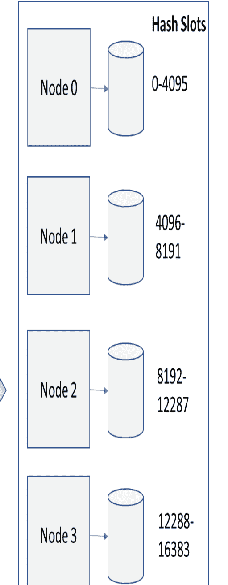
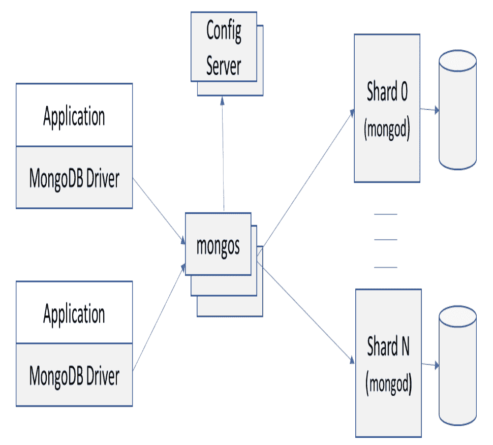
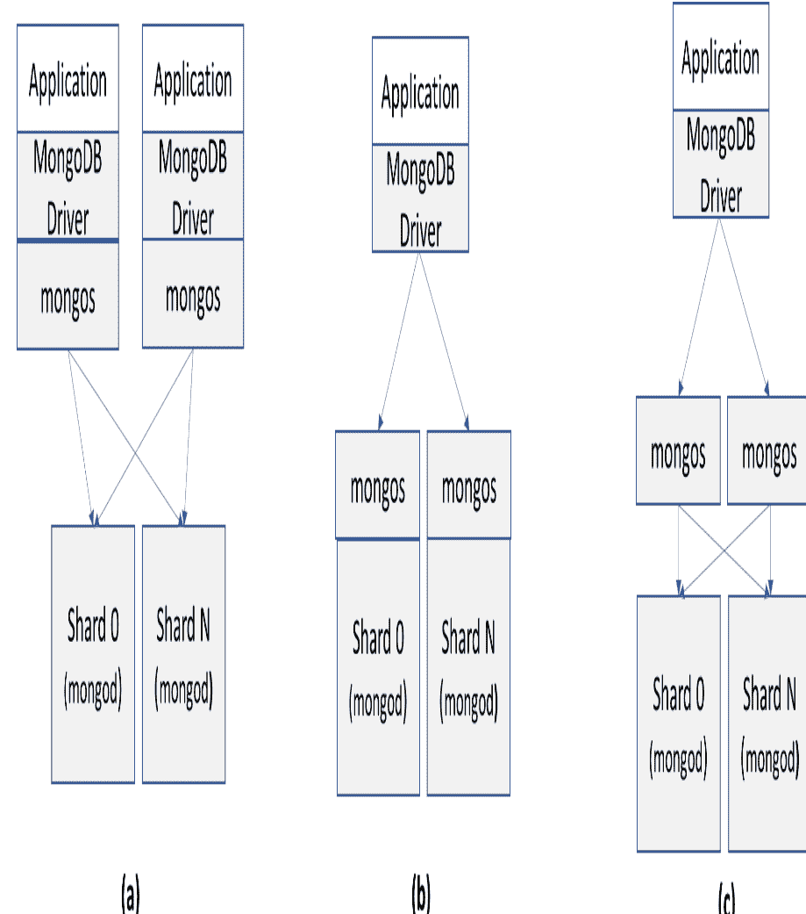
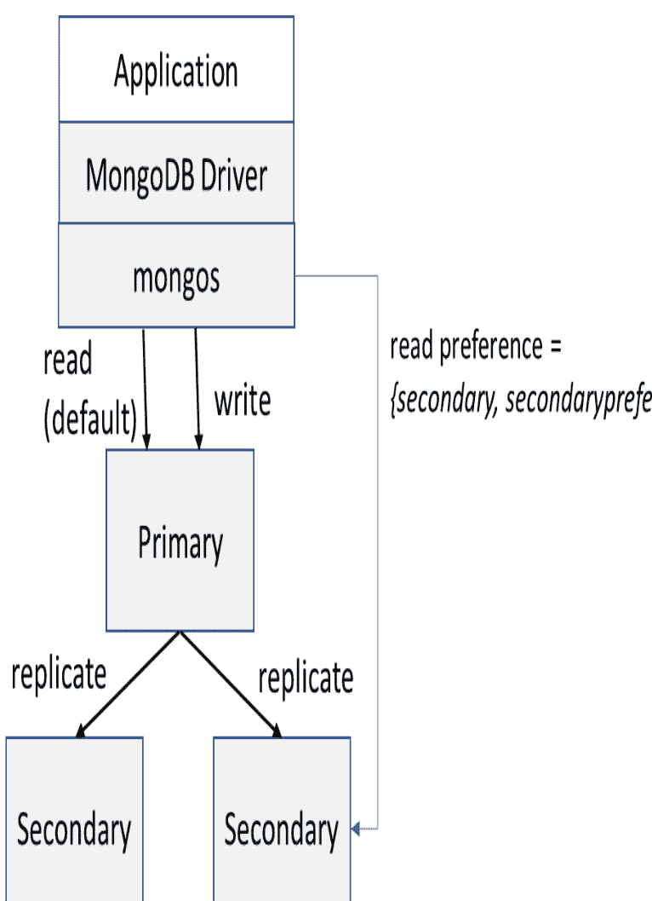
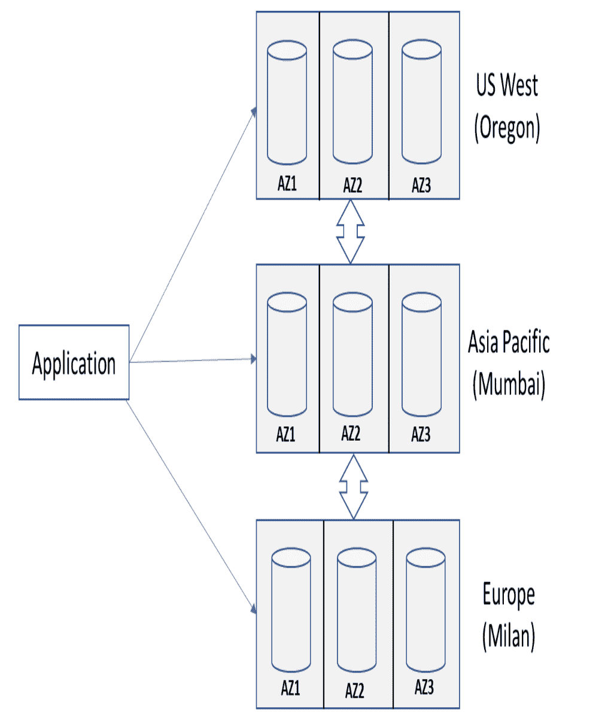

## 第13章 分布式数据库实现

### 早期发布读者须知

使用 Early Release 电子书，您可以在这些标题正式发布之前很久就利用这些技术——作者在写作时提供的原始未编辑内容。

这将是最终书籍的第13章。请注意，GitHub 仓库将在稍后激活。

如果您对如何改进本书的内容和/或示例有任何评论，或者如果您注意到本章中缺少材料，请联系编辑 vwilson@oreilly.com。

在之前的三章中，我描述了在可扩展分布式数据库中广泛采用的各种分布式系统原则和架构。这些使得能够在多个存储节点上分区和复制数据，并为复制的数据对象支持不同的一致性和可用性模型。

具体数据库如何基于这些原则构建高度依赖于数据库。不同的数据库在“挑选”已知的[content]
## 第13章 分布式数据库实现

### 早期发布读者须知

使用 Early Release 电子书，您可以在这些标题正式发布之前很久就利用这些技术——作者在写作时提供的原始未编辑内容。

这将是最终书籍的第13章。请注意，GitHub 仓库将在稍后激活。

如果您对如何改进本书的内容和/或示例有任何评论，或者如果您注意到本章中缺少材料，请联系编辑 vwilson@oreilly.com。

在之前的三章中，我描述了在可扩展分布式数据库中广泛采用的各种分布式系统原则和架构。这些使得能够在多个存储节点上分区和复制数据，并支持不同的一致性和可用性模型用于复制的数据对象。

具体数据库如何基于这些原则构建高度依赖于数据库。不同的数据库在“挑选”已知的


### Hash Slots

Node 0

0-4095

Node 1

4096-8191

Node 2

8192-12287

Node 3

12288-16383

Order[OrderNum]

Hash (OrderNum)
mod 16384

Invoice[InvNum]

Hash (InvNum)
mod 16384



Figure 13-1. Sharding in Redis using hash slots

集群中的每个节点都运行一个 Redis 服务器和一个额外的组件，用于处理集群中的节点间通信。Redis 使用一种名为 Cluster Bus 的协议来实现集群中每个节点之间的直接 TCP 通信。节点维护有关集群中所有其他节点的状态信息，包括每个节点服务的哈希槽。Redis 使用一种 gossip 协议来实现此功能，该协议能够高效地使节点跟踪集群中所有节点的状态。

客户端可以连接到集群中的任何节点并提交命令来操作指定的键。如果命令到达不管理给定对象的哈希槽的节点，它会查找托管所需哈希槽的服务器的地址。然后它会向客户端返回一个 MOVED 错误以及键所在的节点的地址。客户端必须随后将命令重新发送到正确的节点。通常 Redis 客户端驱动程序会维护一个内部目录，将哈希槽映射到服务器节点，以便在集群稳定时不会发生重定向。

这种架构的另一个影响是，命令和事务必须访问位于同一哈希槽中的键。Redis 没有在不同哈希槽和不同节点上驻留的对象上执行命令的能力。这需要仔细的数据建模来解决此限制。Redis 确实提供了使用一种称为 hash tags 的概念的变通方法支持，该概念基于键中对不同对象相同的子字符串强制键进入同一哈希槽。

您可以调整 Redis Cluster 的大小以添加新节点或从集群中删除节点。当这种情况发生时，哈希槽必须分配给新节点或从已删除的节点移动到现有节点。您使用 CLUSTER 管理命令执行此操作，该命令修改节点的集群配置信息。一旦哈希槽重新分配给不同的节点，Redis 就会自动迁移已迁移哈希槽中的对象。对象从其现有的主节点序列化并发送到新的主节点。当对象成功得到确认后，它将被

从原始主节点中删除并在其新位置对客户端可见。

您还可以使用主-副本架构复制集群中的每个节点。主节点异步更新副本以提供数据安全。为了扩展读工作负载，您可以配置副本来处理读命令。默认情况下，主节点在返回成功给客户端之前不会等待副本确认更新。

可选地，客户端可以在更新后发出 WAIT 命令。这指定应确认更新的副本数量以及 WAIT 应返回的超时时间。零的超时时间指定客户端应无限期阻塞。在以下示例中，客户端阻塞直到 2 个副本已确认更新，或五百毫秒超时到期。在任何一种情况下，Redis 都会返回已更新的副本数量。

```
WAIT 2 500
```

在主节点故障的情况下，副本会被提升为主节点。Redis 使用自定义的主节点选举算法。检测到其主节点已失败的副本会启动选举并尝试从集群中获得多数主节点的投票。如果它获得多数票，它会将自己提升为主节点并通知集群中的节点。选举算法使副本能够交换信息以尝试确定哪个副本是最新的。但是，不能保证最终会被提升为主节点的是最新副本。因此，如果过时的副本成为主节点，则可能发生数据丢失。

### Strengths and Weaknesses

一种思考 Redis 的方式，实际上也是大多数内存数据库的方式，是它本质上是一个具有滞后持久性的磁盘支持缓存。这种架构具有固有的性能与数据安全之间的权衡。我将在以下小节中深入探讨它在 Redis 中的体现。

### Performance

Redis 设计用于低延迟响应和高吞吐量。主数据存储是主内存，使得数据对象访问速度很快。有限的数据结构和操作集合也使 Redis 能够优化请求并使用节省空间的数据对象表示。只要您能在 Redis 数据类型的约束内设计您的数据模型，您应该会看到非常令人印象深刻的性能。

### Data Safety

Redis 以性能为代价换取数据安全。在默认配置中，AOF 写入之间存在一秒的时间窗口，在此期间崩溃可能导致数据丢失。您可以通过在每次写入时持久化 AOF 来提高数据安全性。然而，在重写负载下，此配置的性能损失是相当大的。

Redis 还使用专有的复制和主节点选举算法。未更新的副本可能被选为领导者，因此在之前的领导者处持久化的数据可能会丢失。

总之，如果数据丢失不是一个选项，您可能不希望使用 Redis，或可能任何内存数据库作为您主要的数据存储。但如果您能容忍偶尔的数据丢失，Redis 确实可以提供非常令人印象深刻的吞吐量。

### Scalability

Redis Cluster 是 Redis 的主要可扩展性机制。它允许最多 1000 个节点托管分片数据库，分布在 16384 个哈希槽中。每个主节点的副本也可以提供读请求，从而实现读工作负载的扩展。如果您需要超过 1000 个主节点，那么您必须相应地设计您的数据存储。

### Consistency

Redis 复制默认基于异步复制提供最终一致性。因此，从副本读取可能出现陈旧数据。使用 WAIT 命令，复制方法变得有效地同步，因为主节点在请求的副本数量确认更新之前不会响应客户端。WAIT 的权衡是更长的延迟。此外，它只保证数据驻留在副本的内存中。副本在下一次 AOF 写入快照之前崩溃可能会导致更新丢失。

### Availability

Redis Cluster 为单个数据库分片实现了经过验证的主-副本架构。写入可用性不可避免地会受到领导者故障的影响。在副本被提升为领导者之前，给定分片的写入将不可用。

网络故障可以将 Redis Cluster 部署分割为多数分区和少数分区。这对可用性和数据安全都有影响。只要它们至少有一个副本可用，客户端写入就可以继续到两个分区中的所有领导者节点。如果领导者与副本在少数分区中分离，写入最初对也位于少数分区中的客户端仍然可用。经过超时时间后，分区的领导者将停止接受写入，因为它无法向其副本发送更新。同时，多数分区中将发生领导者选举，副本将被提升为主节点。当分区恢复时，在分区期间对前任领导者所做的写入修改将会丢失。

### MongoDB

MongoDB 自 2009 年首次发布以来一直处于 NoSQL 数据库运动的最前沿。它直接解决了众所周知的对象-关系阻抗不匹配问题，通过本质上将数据库模型与对象模型协调一致。 resulting 文档数据库最好被视为 JSON 数据库。您可以将业务对象转换为


JSON 并直接以文档形式存储、查询和操作您的数据。无需复杂的对象关系映射器。结果直观且业务逻辑更简单。

MongoDB 最初的流行得益于其易于编程和使用。早期版本中的底层存储引擎，称为 MMAPv1，⁴ 却并不理想。MMAPv1 使用 mmap() 系统调用实现内存映射文件。同一逻辑分组中的文档，称为 *collections*，在磁盘上连续分配。这对顺序读取性能非常有利。但如果对象大小增长，就必须分配新空间并更新所有文档索引。这可能是一项昂贵的操作，并导致磁盘碎片。

为了最小化此成本，MMAPv1 最初会为文档分配额外空间以容纳增长。这确实是一种解决方案，但也许不是最节省空间和可扩展的。此外，更新文档锁是在非常粗粒度的级别上获取的（例如在各个版本中，服务器、数据库、集合），导致写入性能不佳。

大约在 2015 年，开发团队重新设计了 MongoDB 以支持可插拔的存储引擎架构。不久之后，一个新的存储引擎 WiredTiger 在 MongoDB v3.2 中成为默认。WiredTiger 解决了 MMAPv1 的许多不足。⁵ 它引入了乐观并发控制和文档级锁定、压缩、操作日志和用于崩溃恢复的检查点，以及用于提高性能的内部缓存。

### 数据模型和 API

MongoDB 文档基本上是 JSON 对象，其有一组在 Binary JSON (BSON) 规范中定义的扩展类型。文档以 BSON 格式存储，并组织在包含一个或多个集合的数据库中。集合相当于关系数据库表，但没有定义模式。这意味着 MongoDB 集合不对文档强制结构。具有不同结构的文档可以存储

在同一个集合中。这是一种无模式或读时模式的方法，要求应用程序在访问时解释文档结构。

MongoDB 文档由名称-值对组成。字段的值可以是任何 BSON 数据类型。文档还可以包含其他文档，称为嵌入式或嵌套文档，以及值或文档的数组。每个文档都有一个 _id 字段充当主键。应用程序可以在创建文档时设置此键值，或允许 MongoDB 客户端自动分配唯一值。您还可以在集合中的任何字段、子字段或多个字段上定义二级索引 - 一个复合键。

下面代码中显示了一个您可能在滑雪者管理系统中找到的示例文档。字段 skiresorts 表示为字符串数组，而每个不同的滑雪日由嵌套文档数组中的一个元素表示。

```
{
  _id: 6788321471
  name: { first: "Ian", last: "Gorton" }
  location: "USA-WA-Seattle",
  skiresorts: ["Crystal Mountain", "Mission Ridge"]
  numdays: 2
    season21 {
      {
        day: 1
        resort: "Crystal Mountain",
        vertical: 30701
        lifts: 27
        date: "12/1/2021"
      }
      {
        day: 2
        resort: "Mission Ridge",
        vertical: 17021
        lifts: 10
        date: "12/8/2021"
      }
    }
}
```

由于集合中没有统一的文档结构，存储引擎需要为每个文档持久化字段名称和值。对于小型文档，长字段名称可能最终占文档大小的大多数。较短的字段名称可以减小磁盘上的文档大小，⁶ 而在规模上，在包含数百万文档的集合中，这种节省将变得显著。优化的文档大小可减少磁盘使用、内存和缓存消耗以及网络带宽。像往常一样，在规模上，小的优化可以在最小化资源利用方面带来多倍回报。

为了操作文档，MongoDB 提供了基本 CRUD 操作的 API。集合有一个 .find() 方法，具有广泛的条件和运算符集，可模拟对单个集合中文档的 SQL SELECT 语句。MongoDB 支持使用 $match 和 $group 运算符进行聚合查询，而 $lookup 运算符提供跨同一数据库中集合的 SQL JOIN 类似行为。以下显示了一个查询集合的简单示例。 .find() 操作返回 skiers2021 集合中注册滑雪天数超过 20 天的滑雪者所有文档

```
db.skiers2021.find({ numdays: { $gt: 20 } })
```

对 MongoDB 中单个文档的写操作是原子的。因此，如果您对数据模型进行非规范化以大量使用嵌套文档，您可以避免在应用程序代码中更新多个文档和分布式事务的复杂性。在 MongoDB 4.0 版本之前，这基本上是在没有复杂应用程序逻辑来处理故障的情况下确保多文档更新一致性的唯一方法。

从 4.0 版本开始，已实现对 ACID 多文档事务的支持。MongoDB 事务使用两阶段提交⁷ 并利用底层 WiredTiger 存储引擎的快照隔离功能。快照隔离是一种比 ACID 语义所暗示的序列化更弱的保证。这使得性能高于序列化并避免了大多数但不是全部可序列化性避免的并发异常。快照隔离实际上是许多关系数据库的默认设置，包括 Oracle 和 PostgreSQL。

### 分布和复制

为了水平扩展，您可以选择 MongoDB 的两种数据分区或分片策略。这些是基于哈希和基于范围的分片。您为每个文档基于一个或多个字段值定义一个分片键。创建文档时，MongoDB 然后根据以下任一方式选择存储文档的数据库分片：

- 对分片键应用哈希函数的结果
- 定义为存储分片键所在的分片键范围的分片

MongoDB 中的分片部署要求您部署三种不同的数据库组件。*mongod* 进程是 MongoDB 数据库守护进程，必须在每个分片上运行。*mongos* 进程负责处理数据库客户端查询，通过将请求路由到目标分片并将结果返回给客户端。客户端使用 MongoDB 驱动程序发出 MongoDB API 调用。*Config Servers* 存储数据库集群配置元数据，*mongos* 使用它根据分片键值将查询路由到正确的分片。此架构如图 13-2 所示。



图 13-2. MongoDB 数据库分区架构

mongos 进程充当客户端的 MongoDB 驱动程序和数据库分片之间的代理。所有客户端请求必须通过 mongos 实例。mongos 没有持久状态，只是缓存其从 Config Servers 获取的集群配置信息。

mongos 进程是客户端唯一的查询接口。因此，对于性能和可扩展性而言，拥有足够的 mongos 处理能力至关重要。您如何配置 mongos 部署高度取决于您的应用程序需求，而 MongoDB 为您提供了灵活性来设计系统以满足所需的工作负载。有三种基本替代方案，如图 13-3 所示：

#### 配置 (a)

在每个充当 MongoDB 客户端的应用程序服务器上部署 *mongos*。这通过使每个客户端对 mongos 的请求成为本地调用来减少延迟。

#### 配置 (b)

在每个数据库分片上部署 *mongos*。在此配置中，*mongos* 可以与分片本地通信。

#### 配置 (c)

在自己的专用硬件上部署一组 *mongos*。您会因与客户端和数据库分片通信而产生额外的网络延迟。权衡是 *mongos* 负载从应用程序服务器和数据库节点中消除，并且 *mongos* 进程被分配更专用的处理能力。




图 13-3. MongoDB 数据库部署替代方案

在每个分片内，MongoDB 将文档存储在称为块的存储单元中。默认情况下，一个块最大为 64MB。当块增长超过其最大配置大小时，MongoDB 会自动将块拆分为两个或多个新块。块拆分是元数据更改，由插入或更新触发，并且不涉及任何数据移动。

随着集群中数据的增长，数据在分片间的分布可能变得不平衡。这会在分片上产生不均匀的负载，并可能产生热点——即对常用访问键的请求负载很重的分片。热点会损害查询性能。因此，MongoDB 在主 *Config Server* 上运行集群均衡器进程。集群均衡器监控分片间的数据分布，如果检测到达到（可配置的）迁移阈值，则触发块迁移。迁移阈值基于集合中块数最多的分片与块数最少的分片之间的数据块数量差异。

块迁移由均衡器发起。它向源分片发送 moveChunk 命令。源分片负责将块复制到目标分片。在迁移期间，源分片处理对该块的任何更新，并在迁移完成后确保这些更新同步到目标分片。最后，源分片在 *Config Server* 上更新集群配置元数据以记录迁移块的新位置，并删除其副本。

MongoDB 还通过分片复制支持增强的可用性和读查询容量。每个主分片可以有多个从节点，这些节点 collectively 称为副本集。所有客户端写入都由主节点处理，它会将所有更改记录到 *oplog* 数据结构中。定期，主节点会将其 oplog 发送到从节点，从节点进而将 oplog 中的修改应用到其本地数据库副本。这种方法在图 13-4 中有所说明。

副本集中的节点每隔两秒默认发送周期性心跳消息，以确认成员可用性。如果从节点在（默认）十秒时间内未收到主节点的心跳消息，则开始领导者选举。领导者选举算法基于 Raft。⁸ 此外，如果领导者被划分到少数派分区中，它将退位为领导者。随后将从多数派分区中选举出新领导者，或在分区恢复后选举。在任何一种情况下，在新领导者被选举出来之前，副本集的写入都不可用。

MongoDB 支持可调一致性。您可以使用 MongoDB *write concerns* 控制写入的副本一致性。在 5.0 版本中，默认值为 *majority*，这确保在副本集中大多数节点上写入持久化后才确认成功。在早期版本中，默认设置仅等待主节点使写入持久化，在性能与数据安全之间做出权衡。

同样，*read preferences* 使您可以配置副本集中哪些节点可以处理读取。默认情况下，请求发送到主节点，以确保读取一致。您可以修改此设置以在读取性能和一致性之间进行权衡。例如，您可以指定读取可以由任何副本处理，或由往返时间最短的最近副本处理。在任何一种情况下，都可能出现陈旧读取。从最近的副本读取在地理上广泛分布的部署中尤其有用。您可以将主节点定位在一个数据中心，并将副本放置在更靠近客户端请求读取请求源的其他数据中心位置。这可以降低副本读取的网络延迟成本。



图 13-4. MongoDB 副本集

### 优势与劣势

自初始发布以来，MongoDB 已大幅成熟。吸引人的编程模型推动了最初的流行，而核心平台在十多年里由 MongoDB 工程师不断演进，以提高性能、可用性、可扩展性和一致性。这造就了一个功能强大的分布式数据库平台，应用程序可以对其进行配置和调优以满足其需求。

#### 性能

最初的 MongoDB 版本写入性能较差。过去十年中，这已得到显著改善，很大程度上得益于 WiredTiger 存储层。与大多数数据库一样，每个节点的性能都极大地受益于为内部缓存分配的大量本地内存空间。您还可以选择有利于原始性能而非一致性的读取偏好和写入关注点，前提是应用程序需求允许。

#### 数据安全

默认的 *majority* 写入关注点确保更新在副本集中的多数节点上持久化。您可以通过指定更新只需在主节点上持久化来获得更高的写入性能。这会在主节点在更新复制之前崩溃时产生数据丢失的潜在风险。基于 Raft 的领导者选举算法确保只有最新的从节点才能被提升为主节点，再次防止数据丢失。

#### 可扩展性

您可以使用分片和部署多个 *mongos* 查询路由器进程来水平扩展数据集合。自动数据再平衡可在集群节点间均匀分配请求，利用集群容量。您可以添加新节点并退役现有节点，MongoDB 集群均衡器会自动在集群间移动块以利用容量。您可以通过启用对副本集从节点的读取来扩展读取负载。

#### 一致性

跨多个分片集合的 ACID 事务可用性为开发人员提供了事务一致性能力。您还可以使用适当的写入关注点设置来实现副本一致性。基于会话的因果一致性提供读写自一致能力。您也可以确保单个文档的线性一致读取和写入。这需要读取关注点设置为 *linearizable* 且写入关注点值为 *majority*。$^{9}$

#### 可用性

副本集是确保数据可用性的主要机制。您还应将 *Config Servers* 配置为副本集，以确保在节点故障和分区情况下集群元数据保持可用。您的配置还需要在部署足够的 *mongos* 查询路由器进程，因为如果无法访问 *mongos* 进程，客户端将无法查询数据库。

### Amazon DynamoDB

Amazon 的 DynamoDB 是 AWS 云中的核心服务。其起源可追溯到 Werner Vogels 及其团队发表的关于 Dynamo$^{10}$ 数据库的原始研究。Dynamo 是为亚马逊网站的使用而构建的。内部学到的经验教训，特别是关于易于管理的需要，导致 Dynamo 演进成为 2012 年公开发布的、完全托管的 DynamoDB 数据库服务。

作为完全托管的数据库，DynamoDB 将应用程序所需的数据库管理工作降至最低。DynamoDB 自动管理复制的数据库分区，并根据大小和性能要求重新分区数据。数据项基于用户定义的分区键哈希到分区中。单个数据项由嵌套的键值对组成，并为数据安全而复制三次。时间点恢复功能自动执行增量备份并将其存储为滚动 35 天的时间段。可以在任何时候运行完整备份，对生产系统的影响最小。

作为 AWS 的一部分，您将根据使用的存储量和应用程序的 DynamoDB 使用量付费。存储费用为


straightforward. 你基本上为每 GB 数据存储付费。对应用使用量计费更为复杂，并且会影响性能和可扩展性。基本上你为对数据库进行的每次读写操作付费。你可以选择两种模式，称为容量模式。*按需*容量模式适用于流量模式不可预测且出现快速峰值和低谷的应用。DynamoDB 采用其自适应容量能力，尝试确保数据库部署能够满足性能和可扩展性要求。你为每次操作付费。¹¹

对于负载模式更可预测的应用，你可以选择*预置*容量模式。你指定 DynamoDB 数据库应提供的每秒读数和写数，以读/写容量单位表示。如果你的应用超过此读/写容量，请求可能会被节流。DynamoDB 提供突发容量，基于最近未使用的预置容量，以尝试避免节流。你还可以定义数据库以基于最小和最大预置容量限制利用自动扩缩容。自动扩缩容会根据观察到的流量负载，在指定限制内代表你动态调整预置容量。

DynamoDB 具有许多可选功能，这些功能要么使你更容易编写应用，要么为你的应用提供更高级别的管理自动化。一般来说，经验法则是你要求 DynamoDB 为你做的越多，你付的钱就越多。例如，如果你启用了时间点备份，那么你按每 GB 每月付费。如果禁用此功能，你无需付费。这基本上就是所有基于云的管理服务的工作方式。在大规模使用这些选项时需要谨慎。但在大多数情况下，由于管理工作的减少，你的成本会大幅降低。

### 数据模型和 API

DynamoDB 将数据项组织在称为表的逻辑集合中。表包含多个项，这些项由主键唯一标识。每个项都有一组唯一标识的属性，这些属性可以可选地嵌套。单个项的大小限制为 400KB。DynamoDB 是无模式的——同一表中的项可以具有不同的属性集。

就数据类型而言，DynamoDB 限制相当多。支持的标量类型包括字符串、二进制、数字和布尔值。你可以使用列表和映射数据类型构建文档，并且这些可以嵌套最多 32 层。你还可以使用集合创建一个包含唯一值的命名属性。下面的代码展示了一个 DynamoDB 项作为示例。主键是 skierID。skiresorts 字段由列表表示，而 season21 是一个映射，包含表示滑雪者每次前往度假村的嵌套文档。

```
{
  "skierID": "6788321471",
  "Name": {
    "last": "Gorton",
    "first": "Ian"
  },
  "location": "USA-WA-Seattle",
  "skiresorts": [
    "Crystal Mountain",
    "Mission Ridge"
  ],
  "numdays": "2",
  "season21": {
    "day1": {
      "date": "12/1/2021",
      "vertical": 30701,
      "lifts": 27,
      "resort": "Crystal Mountain"
    },
    "day2": {
      "date": "12/8/2021",
      "vertical": "17021",
      "lifts": 10,
      "resort": "Mission Ridge"
    }
  }
}
```

项的主键值充当分区键，该键被哈希以将每个项映射到不同的数据库分区。你还可以通过在表中定义排序键来创建复合主键。这可以通过使用相同的主键和唯一的排序键，在同一分区中对逻辑相关的项进行分组来实现。DynamoDB 仍然对主键进行哈希以定位分区，然后它将具有相同分区键值的所有项一起存储，按排序键值排序。¹²

以上面代码中的滑雪者项为例，你可以使用 location 作为主键、skierID 作为排序键来创建唯一的复合键。这将把同一位置的所有滑雪者分组到同一分区中，并按排序顺序存储它们。

为了支持替代的高效查询路径，你可以在表上创建多个二级索引，称为基表。有两种类型的二级索引，分别称为本地和全局。

本地二级索引必须与基表具有相同的分区键，并具有不同的排序键。本地索引在与所引用项相同的分区上构建和维护。本地索引的读写会消耗分配给基表的容量单位。

全局二级索引可以与基表具有不同的主键和排序键。这意味着索引条目可以跨表的全部分区，因此得名全局。全局二级索引在其自己的分区中创建和维护，并且需要与基表分开预置容量。

对于数据访问，你在 DynamoDB 中有两种 API 选择。所谓的经典 API 使用四个核心操作的变体提供单项和多项 CRUD 能力，即 PutItem、GetItem、DeleteItem 和 UpdateItem 操作。下面的 Java 示例展示了 GetItem API。它检索由 API 中指定的 skierID 主键值标识的完整文档。

```
Table table = dynamoDB.getTable("Skiers");
Item item = table.getItem("skierID", "6788321471");
```

如果你想同时读取或写入多个项，你可以使用 BatchGetItem 和 BatchWriteItem 操作。这些本质上是分别围绕单个 GetItem 和 PutItem/DeleteItem/UpdateItem API 的包装器。使用这些批量版本的优点是所有请求都在单个 API 调用中提交。这减少了从客户端到 DynamoDB 的网络往返次数。你的性能也会受益，因为 DynamoDB 并行执行每个单独的读写操作。

最近可用的替代 API，称为 PartiQL，是一种源自 SQL 的方言。你使用 ExecuteStatement 和 BatchExecuteStatement API 提交 SQL 语句。DynamoDB 将你的 SQL 语句翻译成经典 API 中定义的单个 API 调用。

你还可以使用 ExecuteTransaction API 实现 ACID 事务能力。这使你能够将对多个项的多个 CRUD 操作分组到表内和表间，并保证全部成功或全部不成功。在幕后，DynamoDB 使用两阶段提交算法在分布式分区之间协调事务。

事务会影响容量预置。¹³ 在预置模式下，每个事务将为事务中访问的每个数据项产生两次读写。这意味着你必须相应地规划你的读写容量单位。如果事务中访问的任何表的预置容量不足，事务可能会失败。

### 分布和复制

作为一项托管服务，DynamoDB 从应用的角度简化了数据分发和复制。你为项定义分区键，DynamoDB 对键进行哈希以存储每个项的三个副本。为了增强可用性，托管每个分区的节点位于单个 AWS 区域内的不同可用区。可用区设计为在每个 AWS 区域内彼此独立故障。

每个分区有一个领导者和两个跟随者。当你向项发出更新请求时，当更新在领导者上持久化时，你会收到 HTTP 200 响应代码。更新随后异步传播到副本。

默认情况下，读操作可以访问任何副本，导致可能出现陈旧读。如果要确保读取项的最新值，可以将读 API 中的 ConsistentRead 参数设置为 true。这会将写入定向到具有最新值的领导者节点。强一致性读消耗的写容量单位比最终一致性读多，并且如果领导者分区不可用可能会失败。

DynamoDB 管理你的分区，其自适应容量能力将在以下情况下自动重新分区数据，同时保持可用性：

- 分区超过分区大小限制，约为 10GB
- 你增加表的预置吞吐量容量，需要的性能高于现有分区所能支持的。
- 配置为使用按需容量的表经历请求激增，超过其能够维持的吞吐量。

默认情况下，DynamoDB 表驻留在单个 AWS 区域。AWS 区域本质上是位于世界各地不同位置的物理资源，即数据中心。对于为大规模全球分布式用户群提供服务的应用程序，如果请求必须长途跋涉到你的 DynamoDB 数据库所在的区域，延迟可能会变得难以承受。

例如，想象一下本章前面提到的滑雪者管理系统在全球各地都有滑雪度假村，并使用位于美国西海岸区域（例如 us-west-1）的 DynamoDB 数据库。欧洲和澳大利亚度假村的滑雪者访问系统的延迟将比北美地区的滑雪者明显更长。


你可以通过使用 DynamoDB 全局表将表部署到多个区域来解决这些延迟问题。全局表在多个 AWS 区域中维护额外的副本，并将所有项目复制到你希望放置表的各个区域。 在一个区域中进行的更新会异步传播到其他副本。 你还需要在每个区域支付存储费用，从而增加整体应用成本。 该方案如图 13-5 所示，全局表位于美国、印度和意大利。



图 13-5. DynamoDB 全局表

重要的是，全局表是多主的，这意味着你可以在任何区域更新主副本。 如果同一项目在两个区域中并发更新，则会产生冲突的可能性。 在这种情况下，DynamoDB 使用最后写入者胜出的冲突解决策略使副本收敛到单个值。

全局表有一些你需要了解的微妙限制。 这些涉及强一致性读取和事务，两者都仅在单个区域范围内运行。

- 强一致性读取在读取发生的区域内返回项目的最新值。 如果同一项目键在另一个区域中最近被更新，则不会返回该值。 最新版本在区域间复制可能需要几秒钟。
- 事务的 ACID 属性仅在处理事务的区域内得到保证。 一旦事务在此源区域提交，DynamoDB 就会将 resulting 更新复制到其他区域。 更新使用标准复制协议流动，这意味着在事务的所有更新都被应用之前，你可能会在目标区域看到部分更新。

### 优势与劣势

很难将 DynamoDB 日益增长的流行度与 AWS 云不断增长的使用量分开。 DynamoDB 是强大的 AWS 工具和技术生态系统的一部分。 其带来的好处可能相当可观。 例如，AWS 使用 CloudWatch 为 DynamoDB 提供集成性能监控，并与 AWS Lambda 无服务器函数无缝集成。 如果你将系统部署到 AWS，DynamoDB 可以成为持久层的一个优秀候选。 当然像任何数据库一样，有一些事情你需要仔细评估。 而且正如公有云系统始终如此，你必须意识到你的应用程序产生的成本。

#### 性能

DynamoDB API 相对原始，因此通常可以用非常低的延迟执行。 你的数据模型还可以利用复合键和二级索引来提供对数据的有效访问。 利用索引而不是执行表扫描的查询将执行更快并消耗更少的容量单位，这也有助于降低成本。 设计一个支持低延迟查询的适当数据模型无疑不是一个简单的练习¹⁴，需要谨慎才能达到性能要求。 在额外成本下，你可以部署 DynamoDB Accelerator (DAX) 内存缓存，从而进一步降低查询延迟。¹⁵

#### 数据安全

当主分区使修改持久化时，更新就会得到确认，并且表中的所有项目在本地区域内都复制到三个分区。 使用全局表会增加复制因子，但如果同一项目在两个不同区域并发更新，则会引入数据丢失的可能性。 时间点备份和按需备份与 AWS 环境完全集成。

#### 可扩展性

DynamoDB 的自适应容量旨在重新平衡大型数据库，以提供足够的分区来匹配观察到的需求。 这为在分区上施加相对均匀负载的工作负载提供了出色的可扩展性

一个众所周知的问题是热点键。 预置容量按每个表分配。 这意味着如果你的应用程序有 10 个分区，每个分区将获得表总容量的 1/10。 如果请求不成比例地访问少量热点键，托管这些项目的分区可能会消耗表的预置容量。 这可能导致由于预置容量不足而拒绝请求。

在极端情况下，自适应容量可能会创建一个仅包含一个热点键的项目分区。 在这种情况下，对该项目的请求限制为单个分区可以提供的最大吞吐量，即每秒 3000 个读容量单位或 1000 个写容量单位。¹⁶

#### 一致性

副本是最终一致的，因此从非主副本读取过时数据是可能的。 你可以使用强一致性读取以额外容量单位使用和延迟的成本获得最新的副本值。 从全局索引的读取始终是最终一致的。 你也可以使用 ACID 事务执行多项目更新。¹⁷ 强一致性读取和事务都限定在区域范围内，因此不为全局表提供一致性保证。

#### 可用性

DynamoDB 为用户提供服务等级协议。 这基本上保证全局表的可用性为 99.999%，单区域表的可用性为 99.99%。 AWS 停机偶尔会发生，例如 2021 年 12 月的一次重大停机导致许多应用程序瘫痪¹⁸，并且 AWS 生态系统的一部分出现故障可能会使你的数据不可用。 这基本上是你在采用基于云的服务时承担的风险，也是混合和多云部署策略变得越来越流行的原因。

### 总结与进一步阅读

在本章中，我描述了三种知名 NoSQL 数据库，即 Redis、MongoDB 和 DynamoDB 的一些主要架构特性。 每一个都是其自身强大的分布式平台，具有庞大的用户社区。 在引擎盖下，实现差异很大。 这会影响在每个平台上构建的应用程序的性能、可扩展性、可用性和一致性。

Redis 更偏爱原始性能和简单性，而非数据安全和一致性。 MongoDB 具有更丰富的特性集，适用于需要未来增长的各种业务应用程序。 DynamoDB 是一种完全托管的服务，支持低延迟键值查找。 它深度集成到 AWS 云基础设施中，提供自动可扩展性和可用性保证。 同样，你可以使用主要云厂商支持的 MongoDB 和 Redis（以及其他几个数据库）的云托管实现来简化你的运营和管理。

实际上，没有完美的解决方案或方法来选择分布式数据库以匹配你的应用程序需求。 即使对于少量候选平台，评估的维度和特性也太多。 你大多数时候能做的最好的事情就是认真尽职调查，并且理想情况下构建一个技术验证原型，让你测试一两个平台。 总会有 *gotchas* 引发意外的障碍，让你诅咒你选择的平台。 大规模的软件工程是一个不完美的实践，我恐怕，但通过对所涉及问题的深入了解，你通常可以避免大多数灾难！

对于分布式数据库系统具有出色覆盖面、兼具广度和深度的书籍，M. Tamer Özsu 和 Patrick Valduriez 所著的《分布式数据库系统原理》（第 4 版 2020，Springer）是值得放在你书架上的书。

了解互联网上一些最大系统如何运行的绝佳场所是 highscalability.com。 例如，最近的文章描述了 Tinder（http://highscalability.com/blog/2022/1/17/designing-tinder.html）的设计，该设计在大量技术集合中使用了 DynamoDB，以及 Instagram（http://highscalability.com/blog/2022/1/11/designing-instagram.html），构建于 Cassandra 和 Neo4J 之上。

最后，管理大规模分布式数据库的复杂性正在推动许多企业使用托管服务，例如 DynamoDB。 为许多流行数据库提供等效“无服务器数据库”能力的平台正在出现。 示例有 MongoDB Atlas、Astra DB for Cassandra，以及 Yugabyte Cloud。


- 1 https://redis.io/
- 2 Redis Cluster 的详细规范位于 https://redis.io/topics/cluster-spec
- 3 Emil Koutanov 在 https://towardsdatascience.com/redis-unsafe-at-any-speed-f2731f738a25 对 Redis 数据安全性的分析非常出色
- 4 MMAPv1 已在 MongoDB 4.0 版本中被弃用。您可以在 https://docs.mongodb.com/v4.0/core/mmapv1/ 找到其文档
- 5 可以在 https://www.percona.com/blog/2019/01/03/mongodb-engines-mmapv1-vs-wiredtiger/ 找到这两种文件系统的良好比较
- 6 这篇博文说明了如何通过使用更短的字段名称来实现 25% 的文档大小减少：https://www.percona.com/blog/2016/03/24/percona-how-to-field-names-and-document-size-in-mongodb/
- 7 这个简短的视频描述了 MongoDB 中事务的实现方式 - https://www.youtube.com/watch?v=iuj4Hh5EQvo
- 8 Siyuan Zhou, Shuai Mu: Fault-Tolerant Replication with Pull-Based Consensus in MongoDB, NSDI 2021 - https://www.usenix.org/conference/nsdi21/presentation/zhou
- 9 这份 Jepsen 报告提供了对 MongoDB 一致性的略显过时但仍然引人入胜的分析 - https://jepsen.io/analyses/mongodb-4.2.6
- 10 Decandia, G.; Hastorun, D.; Jampani, M.; Kakulapati, G.; Lakshman, A.; Pilchin, A.; Sivasubramanian, S.; Vosshall, P.; Vogels, W. (2007). “Dynamo: Amazon’s Highly Available Key-value Store”. *Proceedings of twenty-first ACM SIGOPS symposium on Operating systems principles - SOSP ’07*. p. 205.
- 11 有关按需容量如何工作 的更多详细信息，请参阅 https://docs.aws.amazon.com/amazondynamodb/latest/developerguide/HowItWorks.ReadWriteCapacityMode.html#HowItWorks.OnDemand
- 12 有关排序键强大功能的更多示例，请参阅 https://aws.amazon.com/blogs/database/using-sort-keys-to-organize-data-in-amazon-dynamodb/
- 13 有关 DynamoDB 事务的详细报道可在以下位置找到 - https://aws.amazon.com/blogs/database/optimize-amazon-dynamodb-transaction-resilience/
- 14 数据建模的最佳实践描述于 https://docs.aws.amazon.com/amazondynamodb/latest/developerguide/best-practices.html
- 15 有关 DAX 的信息可在 https://aws.amazon.com/dynamodb/dax/ 找到
- 16 自适应容量和热键描述于 https://docs.aws.amazon.com/amazondynamodb/latest/developerguide/bp-partition-key-design.html#bp-partition-key-partitions-adaptive-boost
- 17 有关事务隔离级别的解释位于 https://docs.aws.amazon.com/amazondynamodb/latest/developerguide/transaction-apis.html
- 18 AWS 停机事件在此处描述
https://www.washingtonpost.com/business/2021/12/22/amazon-web-services-experiences-another-big-outage/

## 关于作者

**Ian Gorton** 拥有 30 年的软件架构师、作者、计算机科学教授和顾问经验。他自研究生时期起就专注于分布式技术，并曾在银行、电信、政府、医疗保健以及科学建模和仿真等领域从事大规模软件系统的工作。在此期间，他见证了软件系统演进到今天常规运行的庞大规模。

Ian 已撰写 3 本书籍，包括 *Essential Software Architecture* 和 *Data Intensive Computing*，并是关于软件架构和软件工程的 200 多篇科学和专业出版物的作者。在卡内基梅隆软件工程研究所，他领导了大数据和大规模可扩展系统方面的研发项目，并在 2015 年加入东北大学担任计算机科学教授后，继续在这些主题上工作、写作和演讲。他拥有英国谢菲尔德哈勒姆大学的博士学位，是 IEEE 计算机学会的高级会员。
