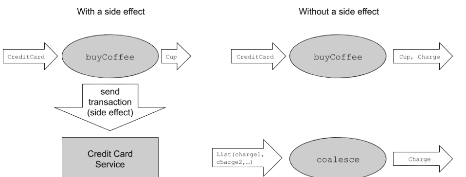
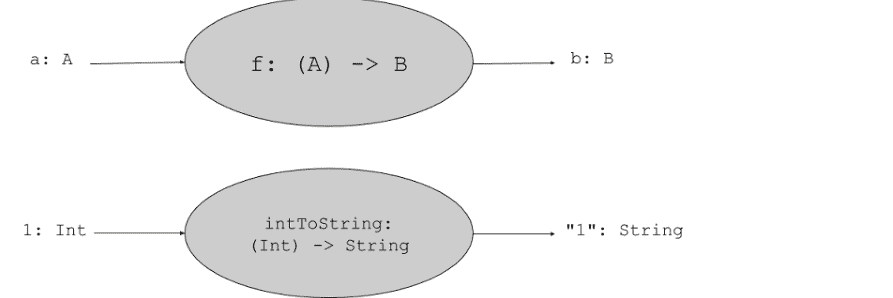
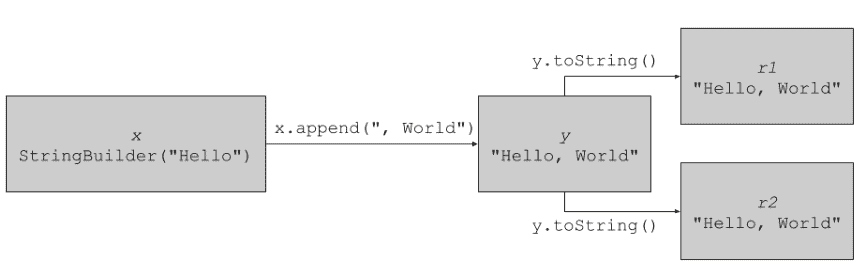
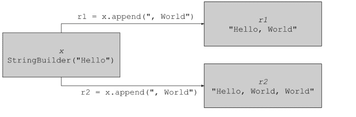

## 欢迎

感谢你加入 *用 Kotlin 进行函数式编程* 的早期访问计划。我希望你在和我一起学习这本激动人心但又具有挑战性的书时能获得很多乐趣。

为什么它是一本具有挑战性的书？本书是 Manning 的《Scala 函数式编程》向 Kotlin 的移植。原版（被称为“the Red Book”）拥有庞大的追随者，并在许多人眼中被视为 Scala 社区中关于函数式编程（FP）的权威文本。事实上，红皮书与其说是关于 Scala，不如说它是关于良好的 FP 技术和原则。它从第一性原理教授函数式编程，无论语言如何。

为什么这本书令人兴奋？Kotlin 是新晋的黑马，许多人将其视为 JVM 上的新语言选择。Kotlin 在后端开发者中越来越受欢迎，而不仅仅是移动（Android）开发者。Kotlin 还与 Scala 有惊人的相似之处；与 Scala 一样，它属于通用面向对象函数式语言的范畴。

由于 FP 和 Kotlin 的日益普及，我决定将这两个世界结合起来。到目前为止，关于 Kotlin 中的 FP 几乎没有被写过。这正是将《Scala 函数式编程》的成功带给所有渴望学习函数式编程的 Kotlin 开发者的绝佳机会。

本书紧密遵循《Scala 函数式编程》的文本，但所有代码示例都已改编并翻译为符合惯用法的 Kotlin 代码。有时我们会因语言不同而偏离原文，但本书尽可能忠实于原文。

本书的第一部分通过介绍一些基础 FP 概念缓慢地引入主题，然后探讨编写良好 FP 代码所需的 Kotlin 特性。然后我们将探讨如何处理数据结构、执行错误处理、使用惰性求值以及处理纯函数式状态。

第二部分涉及函数式设计，我们将探讨纯函数式并行、基于属性的测试以及构建解析器组合子库。

本书的第三部分涉及幺半群、单子(!)、适用函子和遍历函子。

最后一部分涉及高级主题，如外部和局部效应、处理可变状态、流处理和增量 IO。

话虽如此，让我们直接开始吧！我希望你能像我为你翻译它一样喜欢这本书。愿它激励你在未来从事的每个 Kotlin 项目中编写优美、纯粹的函数式代码。

如果你有任何问题、评论或建议，请在 Manning 的 liveBook 的讨论论坛中分享我的书籍。

—Marco Vermeulen

## 什么是函数式编程？


## 本章涵盖：

- 理解副作用及其带来的问题
- 通过消除副作用实现函数式解决方案
- 定义什么是纯函数
- 使用替换模型证明引用透明性和纯度

我们大多数人都是使用 *命令式风格* 开始编程的。这是什么意思？这意味着我们一次又一次地给计算机一组指令或命令。在此过程中，我们在每一步都在改变系统的状态。我们自然会被这种方法吸引，因为它最初很简单。另一方面，随着程序规模的增长变得更加复杂，这种看似简单的特性会导致完全相反的结果；复杂性出现并取代了我们最初想要做的事情。最终的结果是代码不可维护、难以测试、难以推理（可能最糟糕的是）充满了 bug。我们最初能够交付功能的初始速度大幅放缓，以至于对程序的简单增强也变得缓慢而费力。

*函数式编程* 是 *命令式* 的一种替代风格，解决了上述提到的问题。在本章中，我们将研究一个简单的例子，其中一段具有 *副作用* 的命令式代码（我们很快就会理解这意味着什么）通过一系列重构步骤被转换为函数式风格。消除这些副作用是函数式编程的核心概念之一，也是本章的亮点之一。我们将了解这些效应带来的危险，并看到如何从代码中提取它们，使我们回到最初踏上旅程时离开的安全简洁之地。

在这一点上，值得一提的是，本书关于函数式编程，使用 *以 Kotlin 为例* 来演示这种编程范式的原则。此外，重点不在于 Kotlin 作为一种语言，而在于推导出函数式编程中使用的概念。事实上，我们构建的许多构造甚至在 Kotlin 中都不可用，而只在第三方库（如 Arrow ¹）中可用。本书从 *第一性原理* 教你函数式编程，可应用于许多编程语言，而不仅仅是 Kotlin。

在阅读本书时需要记住的另一件事是我们将要学习的函数式编程的 *数学本质*。许多人写过关于函数式编程的主题，但我们在这本书中描述的那种有一点不同。它在很大程度上依赖于 Kotlin 等静态类型语言提供的 *类型系统*，通常被称为 *类型化函数式编程*。我们还将提到 *范畴论*，这是一个与这种编程风格非常紧密相关的数学分支。由于这种数学倾向，请准备好诸如 *代数*、*证明* 和 *定律* 等词汇。

顺着这个思路，这不是一本食谱或魔法咒语的书。它不会给你作为程序员日常问题的快速修复或快速实用解决方案。相反，它会教你并为你配备基础概念和理论，帮助你找到许多自己的实用解决方案。

函数式编程（FP）基于一个简单的前提，具有深远的影响：我们仅使用 *纯函数* 构建程序——换句话说，没有 *副作用* 的函数。什么是副作用？如果函数除了简单地返回结果之外做了其他事情，则它具有副作用，例如：

- 在更改发生的块范围之外修改变量
- 就地修改数据结构
- 在对象上设置字段
- 抛出异常或因错误而停止
- 打印到控制台或读取用户输入
- 从文件读取或向文件写入
- 在屏幕上绘图

我们将在本章后面提供副作用的更精确定义，但请考虑如果没有做这些事情的能力，或者对何时以及如何执行这些操作有重大限制，编程会是什么样子。这可能很难想象。怎么可能写出有用的程序呢？如果我们不能重新赋值变量，我们如何编写像循环这样的简单程序？那处理变化的数据或在不抛出异常的情况下处理错误呢？我们如何编写必须执行 IO 的程序，比如在屏幕上绘图或从文件读取？

答案是函数式编程是对 *如何* 编写程序的限制，而不是对 *什么* 程序可以表达的限制。在本书的进程中，我们将学习如何在没有副作用的情况下表达程序的核心，这包括执行 IO、处理错误的程序，

并修改数据。我们将学习遵循 FP 纪律为何极其有益，因为通过使用纯函数编程，我们获得了 *模块化* 的提升。由于其模块化，纯函数更容易测试、复用、并行化、泛化以及推理。此外，纯函数也远不易出现 bug。本章中，我们将查看一个带有副作用的简单程序，并通过移除它们来展示 FP 的一些好处。我们还更广泛地讨论 FP 的好处，并逐步定义两个重要概念——*引用透明性* 和 *替换模型*。

## 1.1 FP 的好处：一个简单示例

让我们看一个示例来展示使用纯函数编程的一些好处。这里的重点只是为了说明一些基本思想，我们将在本书中反复提到这些思想。不要太担心 Kotlin 语法。只要你对代码在做什么有一个基本的概念，那就是最重要的。

> **注意**
> 由于本书的重点在于 FP 而非 Kotlin，我们假设读者已具备该语言的工作知识。建议阅读 Manning 的 *Kotlin in Action* 以获得对该语言本身更全面的介绍。

### 1.1.1 带有副作用的程序

假设我们正在实现一个用于处理咖啡店购买的程序。我们将从一个在实现中使用副作用的 Kotlin 程序开始（也称为不纯程序）。

### 列表 1.1 带有副作用的 Kotlin 程序

```
class Cafe {
    fun buyCoffee(cc: CreditCard): Coffee {
        val cup = Coffee() ①
        cc.charge(cup.price) ②
        return cup ③
    }
}
```

- ① 实例化一个新的 Coffee 杯
- ② 用咖啡的价格扣款信用卡。副作用！
- ③ 返回 Coffee。

在信用卡的 `charge` 方法上进行方法调用导致了副作用。然后 `cup` 被传回给该方法的调用者。

行 `cc.charge(cup.price)` 是副作用的一个例子。扣款信用卡涉及与外部世界的某些交互——假设它需要通过某种 Web 服务联系信用卡提供商，授权交易，扣款（如果成功）并为以后参考而持久化交易记录。相比之下，我们的函数仅返回一个 Coffee，而这些其他操作都在旁边发生，因此术语为“副作用”。（同样，我们将在本章后面更正式地定义副作用。）

由于这个副作用，代码难以测试。我们不希望我们的测试实际联系信用卡提供商并扣款！这种可测试性的缺乏提示了设计变更：可以说，CreditCard 不应内置有关如何联系信用卡提供商来实际执行扣款的知识，也不应知道如何在我们的内部系统中持久化此扣款的记录。我们可以通过让 CreditCard 对这些问题保持不可知，并将 Payments 对象传递给 buyCoffee 来使代码更具模块化和可测试性。

### 列表 1.2 添加支付对象

```
class Cafe {
    fun buyCoffee(cc: CreditCard, p: Payments): Coffee {
        val cup = Coffee()
        p.charge(cc, cup.price)
        return cup
    }
}
```

尽管调用 p.charge(cc, cup.price) 时仍然会发生副作用，但我们至少恢复了一些可测试性。Payments 可以是一个接口，我们可以为测试编写该接口的模拟实现。但这也不是理想的。我们被迫让 Payments 成为一个接口，而如果其他情况可能一个具体类就足够了，而且任何模拟实现都 awkward 使用。例如，它可能包含一些内部状态，我们需要在调用 buyCoffee 之后检查它，并且我们的测试必须确保此状态已被调用 charge 适当修改（突变）。我们可以使用模拟框架或类似工具来为我们处理这个细节，但如果我们只想测试 buyCoffee 创建的扣款是否等于一杯咖啡的价格，这一切感觉像是过度设计。

除测试问题外，还有另一个问题：难以重用 buyCoffee。假设顾客 Alice 想订购 12 杯咖啡。理想情况下我们只需重用 buyCoffee，也许在一个循环中调用它 12 次。但按当前实现，这将涉及 12 次联系支付提供商，向 Alice 的信用卡授权 12 笔单独扣款！这会增加更多处理费用，对 Alice 和咖啡店都不利。

我们能做什么？我们可以编写一个全新的函数，buyCoffees，带有批量扣款的特殊逻辑。这里可能没那么大问题，因为 buyCoffee 的逻辑如此简单，但在其他情况下我们需要重复的逻辑可能非平凡，我们应该为代码重用和组合的损失而哀悼！

### 1.1.2 函数式解决方案：移除副作用

函数式解决方案是消除副作用，并让 `buyCoffee` 除了返回 `Coffee` 外，还以值形式返回扣款。处理扣款、将其发送到信用卡提供商、持久化其记录等关注点将在其他地方处理。



图 1.1 带和不带副作用的 buyCoffee 调用

Kotlin 中函数式解决方案可能看起来像这样：

### 列表 1.3 购买咖啡的更函数式方法

```kotlin
class Cafe {
    fun buyCoffee(cc: CreditCard): Pair<Coffee, Charge> {
        val cup = Coffee()
        return Pair(cup, Charge(cc, cup.price))
    }
}
```

这里我们将 *创建* 扣款的关注点与该扣款的 *处理* 或 *解释* 分开。`buyCoffee` 函数现在除了返回 `Coffee` 外，还以值形式返回 `Charge`。我们很快就会看到，这如何让我们更轻松地重用它以使用单笔交易购买多杯咖啡。但 `Charge` 是什么？它是我们刚刚发明的一种数据类型，包含一个 `CreditCard` 和一个 `amount`，配备了一个方便的函数 `combine`，用于组合具有相同 `CreditCard` 的扣款：

### 列表 1.4 Charge 作为数据类型

```kotlin
data class Charge(val cc: CreditCard, val amount: Float) {
    fun combine(other: Charge): Charge =
        if (cc == other.cc)
            Charge(cc, amount + other.amount)
        else throw Exception(
            "Cannot combine charges to different cards"
        )
}
```

- 1. 带有构造函数和不可变字段的数据类声明。
- 2. 一个 `combine` 方法，用于组合同一信用卡的扣款。
- 3. 确保是同一张卡，否则抛出异常。
- 4. 返回一个新的 `Charge`，合并此项和其他项的金额。

此数据类型负责保存 `CreditCard` 和 `Float` 金额的值。还公开了一个方便的方法，允许此 `Charge` 与另一个 `Charge` 实例组合。当尝试组合具有不同信用卡的两笔扣款时，将抛出异常。抛出异常并不理想，我们将在第 4 章讨论处理错误条件的更函数式方法。

现在让我们查看 `buyCoffees` 以实现购买 n 杯咖啡。与之前不同，这现在可以基于 `buyCoffee` 实现，正如我们所希望的那样。

### 列表 1.5 使用 buyCoffees 购买多杯

```
class Cafe {
    fun buyCoffee(cc: CreditCard): Pair<Coffee, Charge> = TODO()
    fun buyCoffees(
        cc: CreditCard,
        n: Int
    ): Pair<List<Coffee>, Charge> {
        val purchases: List<Pair<Coffee, Charge>> =
            List(n) { buyCoffee(cc) }
        val (coffees, charges) = purchases.unzip()
        return Pair(
            coffees,
            charges.reduce { c1, c2 -> c1.combine(c2) }
        )
    }
}
```

- 1. 创建一个自初始化的 `List`。
- 2. 将 `Pairs` 列表拆分为两个独立的列表。
- 3. 生成将 `coffees` 与合并后的单个 `Charge` 配对的输出。

该示例接受两个参数：一个 `CreditCard`，以及要购买的咖啡杯数 `Int`。在 `Coffees` 成功购买后，它们被放置到 `List` 数据类型中。列表使用 `List(n) { buyCoffee(cc) }` 语法初始化，其中 n 描述咖啡杯数，而 { buyCoffee(cc) } 是一个用于初始化列表每个元素的函数。

然后使用 `unzip` 将配对列表 *解构* 为两个独立的列表，每个列表代表 `Pair` 的一侧。解构是从复杂数据类型中提取值的过程。我们现在剩下 `coffees` 列表是一个 `List<Coffee>`，而 `charges` 是一个

List<Charge>。最后一步是将数据重构为所需的输出。这是通过构造一个 Pair，将 List<Coffee> 映射到列表中所有咖啡的合并 Charges 来完成的。reduce 是高阶函数的示例，将在第 2 章中正式介绍。

### 侧边栏 通过解构提取值

Kotlin 允许我们解构对象（也称为分解或提取）。当赋值（左侧）中的值从表达式（右侧）中提取时就会发生这种情况。当我们想要将 Pair 解构为其左右组件时，我们只需将包含的值赋给它们，用逗号分隔并用一对括号 ( 和 ) 包围：

```
val (left, right) = Pair(1, 2)
assert left == 1
assert right == 2
```

后续代码中，我们现在可以像在 Kotlin 中使用任何值一样使用这些解构后的值。也可以通过将其替换为下划线 _ 来忽略不需要的解构值：

```
val (_, right) = Pair(1, 2)
```

解构并不局限于 Pair 类型，也可用于其他许多类型，例如 List 甚至数据类。

总体而言，这一解决方案有了显著改进——我们现在可以直接重用 buyCoffee 来定义 buyCoffees 函数，并且这两个函数都可以轻松测试，而无需为某些 Payments 接口定义复杂的模拟实现！事实上，Cafe 现在完全不知道 Charge 值将如何被处理。当然，我们仍然可以拥有一个 Payments 类来实际处理费用，但 Cafe 不需要知道它。将 Charge 设为一等值还有其他我们可能没有预料到的好处：我们可以更轻松地组装用于处理这些费用的业务逻辑。例如，Alice 可能会带笔记本电脑到咖啡店工作几个小时，偶尔购买一些东西。如果咖啡店能够将 Alice 做的这些购买合并为一次收费，那就很好了，这样又可以节省信用卡处理费。由于 Charge 是第一等值，我们现在可以向 List<Charge> 添加以下扩展方法，以便合并任何同一卡的费用：

### 列表 1.6 合并费用

```
fun List<Charge>.coalesce() : List<Charge> =
    this.groupBy { it.cc }.values
        .map { it.reduce { a, b -> a.combine(b) } }
```

目前我们需要知道的是，我们正在通过使用扩展方法添加一些行为，在本例中是为 List<Charge> 添加一个 coalesce 函数。让我们关注此方法的正文。你会注意到我们正在将函数作为值传递给 `groupBy`、`map` 和 `reduce` 函数。如果你还不能，现在在接下来的几章中你将学会阅读和编写这种一行代码。语句 { `it.cc` } 和 { `a, b -> a.combine(b)` } 是匿名函数的语法，我们将在下一章介绍。你可能会发现这种代码难以阅读，因为记号非常紧凑。但随着你阅读本书，阅读和编写这种 Kotlin 代码会很快变得得心应手。该函数接收一个费用列表，按使用的信用卡分组，然后将它们合并为每个卡片的一笔费用。它完全可重用且可测试，无需任何额外的模拟对象或接口。试想用我们第一个 `buyCoffee` 实现来实现同样的逻辑！

这只是函数式编程具有所宣称的好处的一个小尝，而本示例是有意保持简单的。如果这里使用的重构系列看起来自然、显而易见、不引人注意或符合标准做法，那很好。FP 只是一种纪律，它将许多人认为的好主意推向其逻辑终点，即使在适用性不太明显的情况下也应用这种纪律。正如你在本书中将学到的那样，始终如一地遵循 FP 纪律的后果是深远的，其好处是巨大的。FP 是对程序在各个层面上组织方式的真正根本性转变——从最简单的循环到高级程序架构。由此产生的风格相当不同，但它是一种优美且连贯的编程方法，我们希望你能学会欣赏。

### 侧边栏 现实世界的情况如何？

我们在 `buyCoffee` 的例子中看到，我们如何将 `Charge` 的创建与该 `Charge` 的解释或处理分离。一般来说，我们将学习如何将这种转换应用于具有副作用的 *any* 函数，以将这些副作用推到程序的外层。函数式程序员经常谈论用纯核心和外部处理副作用的薄层来实现程序。

但即便如此，我们肯定在某个时刻必须对世界产生实际影响，并将 `Charge` 提交给某个外部系统进行处理。难道没有其他有用的程序需要副作用或可变性吗？我们如何编写这样的程序？在阅读本书的过程中，我们会发现许多看似需要副作用的程序都有某种函数式类比。在其他情况下，我们会找到结构化代码的方法，使副作用发生但不可 *observable*。（例如，如果我们确保它不能在该函数体之外被引用，我们可以修改在某个函数体中声明为本地的数据，或者只要封闭函数无法观察到这种情况发生，我们就可以写入文件。）

## 1.2 究竟什么是（纯）函数？

我们之前说过 FP 意味着使用纯函数编程，而纯函数是没有副作用的函数。在咖啡店示例的讨论中，我们基于副作用和纯度的非正式概念。这里我们将形式化这一概念，以便更精确地指出函数式编程的含义。这也将让我们更深入地了解函数式编程的一个好处：纯函数更容易推理。

具有输入类型 A 和输出类型 B 的函数 f（在 Kotlin 中写为单一类型：`(A) -> B`，读作“A 到 B”）是一种计算，它将类型 A 的每个值 a 关联到恰好一个类型 B 的值 b，使得 b 完全由 a 的值决定。内部或外部过程的任何状态变化与计算结果 `f(a)` 无关。例如，具有类型 `(Int) -> String` 的函数 `intToString` 将每个整数映射到相应的字符串。此外，如果它真的是一个函数，它不会做其他任何事情。



Figure 1.2 A pure function, does only what it states without side effect.

In other words, a function has no observable effect on the execution of the program other than to compute a result given its inputs; we say that it has no side effects. We sometimes qualify such functions as *pure functions* to make this more explicit, but this is somewhat redundant. Unless we state otherwise, we’ll often use *function* to imply no side effects².

换句话说，函数对程序执行的唯一可观察影响就是根据其输入计算结果；我们说它没有副作用。我们有时将此类函数限定为 *pure functions* 以使其更明确，但这有点冗余。除非另有说明，我们通常会使用 *function* 来暗示没有副作用²。

你应该已经熟悉很多纯函数了。考虑加法 (+) 运算符，它解析为所有整数上的 `plus` 函数。它接收一个整数值并返回另一个整数值。对于任意两个给定的整数，它总是返回相同的整数值。另一个例子是 Java、Kotlin 以及许多其他语言中 String 的 length 函数，其中字符串不可修改（是不可变的）。对于任何给定的字符串，总是返回相同的长度且不会发生其他事情。

我们可以利用引用透明性（RT）的概念来形式化纯函数的这一思想。这是对表达式的一般属性，而不仅仅是函数。为了我们的讨论，认为表达式是程序中可以求值得到结果的任何部分——任何你可以在 Kotlin 解释器中输入并得到答案的东西。例如，

2 + 3 is an expression that applies the pure function `plus` on 2 to 3 (which is also an expression). This has no side effect. The evaluation of this expression results in the same value 5 every time. In fact, if we saw 2 + 3 in a program we could simply replace it with the value 5 and it wouldn’t change a thing about the meaning of our program.

这就是表达式具有引用透明性的全部含义——在任何程序中，表达式都可以被其结果替换，而不会改变程序的含义。我们说一个函数是纯的，如果用 RT 参数调用它也是 RT。我们接下来会看一些例子。

> **SIDEBAR 引用透明性和纯度**
> 
> An expression `e` is referentially transparent if, for all programs `p`, all occurrences of `e` in `p` can be replaced by the result of evaluating `e` without affecting the meaning of `p`. A function `f` is pure if the expression `f(x)` is referentially transparent for all referentially transparent `x`.

## 1.3 引用透明性、纯度和替换模型

让我们看看 RT 的定义如何适用于我们原始的 `buyCoffee` 示例：

```
fun buyCoffee(cc: CreditCard): Coffee {
  val cup = Coffee()
  cc.charge(cup.price)
  return cup
}
```

Whatever the return type of `cc.charge(cup.price)`, even if it’s `Unit`, is discarded by `buyCoffee`. Thus, the result of evaluating `buyCoffee(aliceCreditCard)` will be merely `cup`, which is equivalent to a new `Coffee()`. For `buyCoffee` to be pure, by our definition of RT, it must be the case that `p(buyCoffee(aliceCreditCard))` behaves the same as `p(Coffee())`, for any `p`. This clearly doesn’t hold—the program `Coffee()` doesn’t do anything, whereas `buyCoffee(aliceCreditCard)` will contact the credit card provider and authorize a charge. Already we have an observable difference between the two programs.

Referential transparency enforces the rule that everything a function does should be represented by the value that it returns, according to the result type of the function. This constraint enables a simple and natural mode of reasoning about program evaluation called the substitution model. When expressions are referentially transparent, we can imagine that computation proceeds much like we’d solve an algebraic equation. We fully expand every part of an expression, replacing all variables with their referents, and then reduce it to its simplest form. At each step we replace a term with an equivalent one; computation proceeds by substituting equals for equals. In other words, RT enables equational reasoning about programs.

Let’s look at two more examples—one where all expressions are RT and can be reasoned about

使用替换模型，以及一些违反 RT 的表达式。这里没有什么复杂的；我们只是将你可能已经理解的东西形式化。

让我们在 Kotlin 解释器（也称为 Read-Eval-Print-Loop 或 REPL³）中尝试以下内容。请注意，在 Java 和 Kotlin 中，字符串是不可变的。“修改”后的字符串实际上是一个新字符串；旧字符串保持完整：

```
>>> val x = "Hello, World"
res1: kotlin.String = Hello, World

>>> val r1 = x.reversed() ①
res2: kotlin.String = dlroW ,olleH

>>> val r2 = x.reversed() ①
res3: kotlin.String = dlroW ,olleH
```

① r1 和 r2 计算结果相同

假设我们用 x 引用的表达式（其定义）替换术语 x 的所有出现情况，如下所示：

```
>>> val r1 = "Hello, World".reversed() ①
res4: kotlin.String = dlroW ,olleH

>>> val r2 = "Hello, World".reversed() ①
res5: kotlin.String = dlroW ,olleH
```

① r1 和 r2 仍然计算结果相同

这种转换不会影响结果。r1 和 r2 的值与之前相同，因此 x 是引用透明的。更重要的是，r1 和 r2 本身也是引用透明的，因此如果它们出现在更大程序的其他部分，就可以用它们的值在整个程序中替换，而不会对程序产生影响。

现在让我们看一个不是引用透明的函数。考虑 java.lang.StringBuilder 类上的 append 函数。此函数就地操作 StringBuilder。调用 append 后，StringBuilder 的先前状态将被销毁。让我们试试：

```
>>> val x = StringBuilder("Hello")
res6: kotlin.text.StringBuilder /* = java.lang.StringBuilder */ = Hello

>>> val y = x.append(", World!")
res7: java.lang.StringBuilder! = Hello, World

>>> val r1 = y.toString()
res8: kotlin.String = Hello, World

>>> val r2 = y.toString()
res9: kotlin.String = Hello, World
```



图 1.3 在 StringBuilder 上多次调用 toString() 总是产生相同的结果。

到目前为止一切正常。现在让我们看看这个副作用如何破坏 RT。假设我们像之前那样替换对 append 的调用，将 y 的所有出现情况替换为 y 引用的表达式：

```
>>> val x = StringBuilder("Hello")
res10: kotlin.text.StringBuilder /* = java.lang.StringBuilder */ = Hello

>>> val r1 = x.append(", World").toString()
res11: kotlin.String = Hello, World

>>> val r2 = x.append(", World").toString()
res12: kotlin.String = Hello, World, World
```



图 1.4 在 StringBuilder 上多次调用 append() 从不产生相同的结果。

这种程序转换导致了不同的结果。因此我们得出结论，StringBuilder.append 不是一个纯函数。这里发生的情况是，虽然 r1 和 r2 看起来是相同的表达式，但它们实际上引用的是同一个 StringBuilder 的两个不同值。到第二次调用 x.append 时，第一次调用已经改变了 x 引用的对象。如果这似乎难以思考，那是因为它确实很难！副作用使推理程序行为变得更加困难。

相反，替换模型很容易推理，因为求值的效果是纯粹局部的（它们只影响正在求值的表达式），我们无需在脑中模拟状态更新序列来理解代码块。理解只需要局部推理。我们无需在脑中跟踪函数执行前后可能发生的所有状态变化来理解函数会做什么；我们只需查看函数的定义并将其参数代入函数体。即使你没有使用过“替换模型”这个名称，你在思考代码时肯定也使用过这种推理模式。

以这种方式形式化纯度的概念有助于理解为什么函数式程序通常更具模块化。模块化程序由可以独立于整体理解和重用的组件组成，使得整体的含义仅取决于组件的含义及其组合的规则；也就是说，它们是可组合的。纯函数是模块化和可组合的，因为它将计算本身的逻辑与“对结果做什么”和“如何获取输入”分离；它是一个黑盒。输入只能通过一种方式获得：通过函数的参数（们）。输出只是简单地计算并返回。通过保持这些关注点的分离，计算的逻辑更具可重用性；我们可以在任何想要的地方重用逻辑，而不必担心对结果进行的副作用或请求输入的副作用在所有上下文中是否合适。我们在 buyCoffee 示例中看到了这一点——通过消除对输出进行支付处理的副作用，我们更容易重用函数的逻辑，既用于测试，也用于进一步组合（比如当我们编写 buyCoffees 和 coalesce 时）。

## 1.4 前方展望

这篇简短的介绍应该让你对函数式编程有了很好的初步了解。下一章将介绍高阶函数的使用、如何以函数式的方式编写循环、多态函数、传递匿名函数等。

在这一点上，再次提到这本书是为希望从第一性原理学习函数式编程的开发者准备的。重点是那些对面向对象和通用语言中的命令式编程有坚实掌握的人，最好有 Kotlin 的先前经验。再次强调，这不是一本关于 Kotlin 的书，而是一本关于函数式编程的书，使用 Kotlin 来说明所介绍的概念。话虽如此，这本书将极大地增强你将函数式编程技术和设计原则应用于未来编写的任何 Kotlin 代码的能力。

还值得注意的是，这本书具有挑战性，完成它需要你付出一些努力和勤奋。采用的是实践方法，每个章节都有练习来帮助你理解和内化所涵盖的材料。练习相互构建，在进入每个后续章节之前完成它们非常重要。

如果你坚持读完这本书，你在编码时将拥有多种新技术和技能可用：

- 学习编写良好 FP 代码的关键。
- 使用各种数据结构。
- 以函数式的方式处理错误。
- 利用惰性求值，并使用纯函数式状态。
- 将函数式设计应用于并行性、基于属性的测试和解析器组合库。
- 理解并使用幺半群、单子、 applicatives 和可遍历函子。
- 自信地使用高级特性，如外部和局部效应、可变状态、流处理和增量 IO。

## 1.5 总结

- 函数式编程导致 *代码模块化* 增加。
- 通过纯函数编程获得的模块化导致可测试性、代码重用、并行化和泛化得到改善。
- 模块化的函数式代码更容易推理。
- 函数式编程引导我们只使用 *纯* 函数。
- 纯函数可以定义为没有 *副作用* 的函数。
- 如果函数做了 *除了返回结果* 之外的事，则具有副作用。
- 如果函数所做的一切都由其返回值表示，则称该函数是 *引用透明* 的。
- *替换模型* 可用于证明函数的引用透明性。
