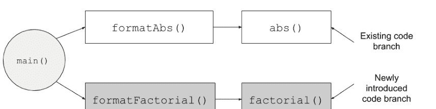
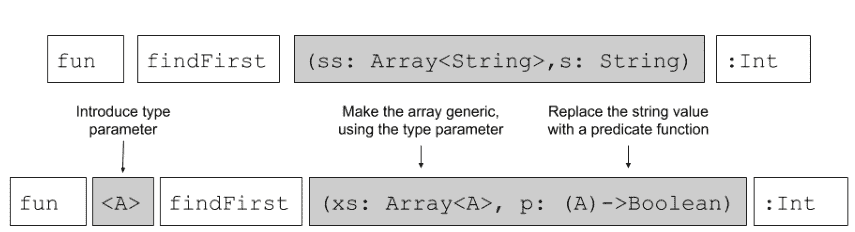

# 在 Kotlin 中开始函数式编程


### 本章涵盖：

- 定义高阶函数，将函数作为参数传递给其他函数
- 使用递归以函数式的方式编写循环
- 抽象高阶函数使其成为多态的
- 使用匿名函数调用高阶函数
- 跟随类型来实现多态函数

在第 1 章中，我们承诺只使用纯函数。从这一承诺中，自然会产生一个问题：我们如何编写最简单的程序？我们大多数人习惯于将程序视为按顺序执行的指令序列，其中每条指令都有某种效果。在本章中，我们开始学习如何仅通过组合纯函数在 Kotlin 语言中编写程序。

在本章中，我们将介绍编写函数式程序的一些基本技术。我们将讨论如何使用尾递归函数编写循环，并介绍高阶函数（HOF）。HOF 是将其他函数作为参数并可能返回函数作为输出的函数。我们还将查看一些多态 HOF 的示例，其中我们使用类型来指导我们实现。

本章有大量新材料。如果你在没有这种传递函数能力的语言中编程经验丰富，那么与 HOF 相关的一些材料可能会让人费解。请记住，完全内化本章的每一个概念或解决每一个练习并不是至关重要的。我们将在整本书中从不同角度再次回到这些概念，这里我们的目标只是给你一些初步的接触。


## 2.1 高阶函数：向函数传递函数

立即开始，我们先介绍编写函数式程序的一些基础知识。第一个新概念是：函数是值。就像其他类型的值——例如整数、字符串和列表——函数可以被赋给变量、存储在数据结构中，并作为参数传递给函数。

在编写纯函数式程序时，我们经常会发现编写接受其他函数作为参数的函数很有用。这被称为高阶函数（HOF），接下来我们将通过一些简单示例来说明这一点。在后面的章节中，我们将看到这种能力到底有多有用，以及它如何渗透到函数式编程风格中。但首先，假设我们想修改程序以同时打印一个数的绝对值和另一个数的阶乘。以下是此类程序的示例运行：

```
The absolute value of -42 is 42
The factorial of 7 is 5040
```

### 2.1.1 一个简短的插曲：以函数式的方式编写循环

为了使现有程序能够演示 HOF，我们应该引入一些新的行为。我们将通过添加一个计算第 n 个阶乘的新函数来实现这一点。为了编写这个简单的函数，我们需要做一个简短的插曲，展示循环如何在纯函数式的方式下编写。我们通过引入递归来实现这一点。

首先，让我们编写阶乘：

### 列表 2.1 一个阶乘函数

```
fun factorial(i: Int): Int {
    fun go(n: Int, acc: Int): Int =
        if (n <= 0) acc
        else go(n - 1, n * acc)
    return go(i, 1)
}
```

- 1. 一个内部或局部函数定义。
- 2. 调用局部函数。

注意 在另一个函数的函数体中编写局部函数是很常见的。在函数式编程中，我们不应该认为这比局部整数或字符串更奇怪。

我们以函数式的方式编写循环，而不改变循环变量，是使用递归函数。这里我们在阶乘函数的函数体内部定义了一个递归辅助函数。该函数通常会处理需要累加器参数的递归调用，或对封闭函数不具有的其他签名更改。这种辅助函数通常按惯例称为 `go` 或 `loop`。在 Kotlin 中，我们可以在任何块中定义函数，包括在另一个函数定义内部。由于它是局部的，`go` 函数只能从 `factorial` 函数体内部的范围内引用，就像局部变量一样。`factorial` 的定义最终只由对 `go` 的调用组成，并带有循环的初始条件。`go` 的参数是循环的状态。在这种情况下，它们是剩余值 `n`，以及当前累积的阶乘 `acc`。要推进到下一迭代，我们只需递归调用 `go` 并传入新的循环状态（这里是 `go(n-1, n*acc)`），要退出循环，我们在没有递归调用的情况下返回一个值（这里在 `n <= 0` 的情况下返回 `acc`）。

Kotlin *不* 手动检测这种自递归，但要求函数声明 `tailrec` 修饰符。这反过来会指示编译器发出与 while 循环⁴ 找到的同类字节码，前提是递归调用处于尾位置。有关此技术的技术细节，请参阅 *Kotlin 中的尾调用* 侧边栏，但基本思想是这种优化⁵（或尾调用消除）可以在递归调用返回后没有额外工作需要完成时应用。

## 侧边栏

### Kotlin 中的尾调用

如果调用者除了返回递归调用的值之外什么都不做，则称该调用处于尾位置。例如，我们之前讨论的对 `go(n-1,n*acc)` 的递归调用就处于尾位置，因为该方法直接返回此递归调用的值并且不对它做任何其他处理。另一方面，如果我们说 `1 + go(n-1,n*acc)`，`go` 就不再处于尾位置，因为当 `go` 返回其结果时，该方法仍有工作要做（即向其添加 1）。

如果函数所做的所有递归调用都处于尾位置，并且函数声明了 `tailrec` 修饰符，Kotlin 会将递归编译为不为每次迭代消耗调用栈帧的迭代循环。

```
fun factorial(i: Int): Int {
    tailrec fun go(n: Int, acc: Int): Int = ①
        if (n <= 0) acc
        else go(n - 1, n * acc) ②
    return go(i, 1)
}
```

- ① `tailrec` 修饰符指示编译器消除尾调用。
- ② 函数的最终声明处于尾位置

如果递归函数有处于尾位置的调用，但未声明为 `tailrec`，编译器不会消除尾调用，这反过来可能导致抛出 StackOverflowError。

在我们将 `tailrec` 修饰符应用于其最终声明不处于尾位置的函数的情况下，编译器会发出警告：

```
Warning: (19, 9) Kotlin: A function is marked as tail-recursive but no tail calls are found
```

即使警告总比没有好，在这种情况下，编译错误会更有帮助也更安全。

## 练习

### 2.1

编写一个递归函数来获取第 n 个斐波那契数（en.wikipedia.org/wiki/Fibonacci_number）。前两个斐波那契数是 0 和 1。第 n 个数始终是前两个之和——序列开始为 0, 1, 1, 2, 3, 5, 8, 13, 21。你的定义应使用局部尾递归函数。

```
fun fib(i: Int): Int = TODO()
```

> **NOTE** Kotlin 为我们提供了一种方便的方式来标记某物为 *待办*。提供了一个内置函数 `TODO()`，当求值时会抛出 `NotImplementedError`。结果是，这种未实现的代码始终可以编译，但只要在程序中求值就会抛出异常。这为我们在代码中放置提醒占位符提供了一种有用的方法，而不会影响代码的编译或破坏构建。

### 2.1.2 编写我们的第一个高阶函数

我们到目前为止编写的代码只有一个特定目的。我们如何将其改编以处理多种场景？在本节中，我们采用迭代方法，我们将粗略地引入一个新需求，然后逐步改进设计，直到我们得到一个使用 *高阶函数* 的函数式解决方案。



图 2.1 向我们的程序引入新行为，添加与阶乘相关的函数。

现在我们有一个计算 *第 n 个* 阶乘的函数 `factorial`，让我们将其引入之前的代码中。此外，我们将通过引入 `formatFactorial` 来进行一些天真的重复，就像我们对 `abs` 函数有 `formatAbs` 一样。然后新的 `formatFactorial` 函数将像我们对 `formatAbs` 所做的那样从 `main` 调用。

### 列表 2.2 包含阶乘函数的简单程序

```
object Example {
    private fun abs(n: Int): Int =
        if (n < 0) -n
        else n

    private fun factorial(i: Int): Int {
        fun go(n: Int, acc: Int): Int =
            if (n <= 0) acc
            else go(n - 1, n * acc)
        return go(i, 1)
    }

    fun formatAbs(x: Int): String {
        val msg = "The absolute value of %d is %d"
        return msg.format(x, abs(x))
    }

    fun formatFactorial(x: Int): String {
        val msg = "The factorial of %d is %d"
        return msg.format(x, factorial(x))
    }
}

fun main() {
    println(Example.formatAbs(-42))
    println(Example.formatFactorial(7))
}
```

① 添加 `factorial` 函数，使其为私有。
② 添加 `formatFactorial` 函数，默认为公开。
③ 从 `main` 方法调用 `formatFactorial`。

两个函数 `formatAbs` 和 `formatFactorial` 几乎相同。如果我们愿意，可以将它们概括为一个单一函数 `formatResult`，该函数接受要对其参数应用的函数作为参数：

```
fun formatResult(name: String, n: Int, f: (Int) -> Int): String {
    val msg = "The %s of %d is %d."
    return msg.format(name, n, f(n))
}
```

我们的 `formatResult` 函数是一个高阶函数（HOF），它接受另一个函数，称为 `f`（参见 *变量命名约定* 侧边栏）。我们为 `f` 提供类型，就像为任何其他参数一样。它的类型是 `(Int) -> Int`（读作“int to int”或“int arrow int”），这表明 `f` 预期一个整数参数并且也将返回一个整数。


## 侧边栏
### 变量命名约定

使用像 f、g 和 h 这样的名称作为高阶函数的参数是一种常见约定。在函数式编程中，我们倾向于使用非常短的变量名，甚至是单字母名称。这通常是因为 HOFs 非常通用，它们对参数实际应该做什么没有任何意见。它们所知道的关于参数的只是其类型。许多函数式程序员认为短名称使代码更易于阅读，因为它使代码的结构一目了然。

我们之前的函数 `abs` 与该类型匹配；它接受一个 `Int` 并返回一个 `Int`。同样，`factorial` 接受一个 `Int` 并返回一个 `Int`，这也与 `(Int) -> Int` 类型匹配。因此，我们可以将 `abs` 或 `factorial` 作为 `f` 参数传递给 `formatResult`，正如我们在 `main` 方法中以下两个案例中所做的那样：

```
fun main() {
    println(formatResult("factorial", 7, ::factorial))
    println(formatResult("absolute value", -42, ::abs))
}
```

添加了一个命名空间前缀 `::`，以便引用 `factorial` 和 `abs` 函数。你可以在 *函数作为值* 侧边栏中找到关于访问和命名空间函数引用的更多解释。

## 侧边栏
### 函数作为值

在 Kotlin 中存在多种传递函数参数的方式。其中一些涉及通过引用传递函数，而另一些则涉及匿名传递。这两种方式对于任何尝试过 Java 8 或更高版本的函数式编程的人来说都应该很熟悉。

第一种方法涉及传递对现有声明的可调用引用：在这种情况下，我们可以简单地传递对函数的命名空间引用，例如 this::abs（或简单地 ::abs）用于同一对象中的引用。对于伴生对象中超出范围的函数，可以使用完全限定引用例如 Example::abs。如果我们导入命名空间，我们就可以在调用 HOF 时直接从超出范围引用该函数，就像我们在工作示例中所做的那样：

```
import Example.factorial
...
formatResult("factorial", 7, ::factorial)
```

第二种方法可能对来自 Java 的人同样熟悉。这涉及匿名实例化并传递函数字面量（也称为匿名函数或 lambda）作为参数。以 abs 示例为例，它看起来像这样：

```
formatResult("absolute", -42,
    fun(n: Int): Int { return if (n < 0) -n else n }
)
```

这似乎有点笨拙，可以简化为更惯用的形式，如下所示：

```
formatResult("absolute", -42, { n -> if (n < 0) -n else n })
```

如果 lambda 函数只有一个参数，它甚至可以用隐式的便捷参数 it 替换。最终结果如下所示：

```
formatResult("absolute", -42, { if (it < 0) -it else it })
```

即使我们在上面的示例中省略了类型声明，类型仍然至关重要，并且在所有情况下都会被推断；lambda 必须仍然是类型 (Int) -> Int，否则编译会失败。

## 2.2 多态函数：抽象化类型

到目前为止，我们只定义了 *单态函数*，或仅操作一种类型数据的函数。例如，`abs` 和 `factorial` 特定于类型为 `Int` 的参数，而高阶函数 `formatResult` 也固定为操作接受类型为 `Int` 的参数的函数。通常，尤其是在编写高阶函数时，我们希望编写适用于其所提供 *任何* 类型的代码。这些称为 *多态函数*。在接下来的章节中，你将有大量编写此类函数的经验，所以在这里我们只介绍这个概念。

> **注意** 我们使用 *多态* 这个术语的方式与如果你熟悉面向对象编程时可能习惯的方式略有不同，在面向对象编程中，该术语通常暗示某种子类型或继承关系。在此示例中没有接口或子类型。我们在这里使用的多态类型有时称为 *参数化多态*，更类似于 Java 等语言中发现的泛型。
> 
> 当应用于函数时，我们称之为 *多态函数* 或 *泛型函数*，尽管从现在开始我们将把它们称为前者。

### 2.2.1 多态函数的示例

我们经常可以通过观察几个单态函数共享相似的结构来发现多态函数。例如，以下单态函数 `findFirst` 返回数组中键首次出现的索引，如果未找到则返回 -1。它专门用于在 `String` 的 `Array` 中搜索 `String` 值。

### 列表 2.3 在数组中查找字符串的单态函数

```
fun findFirst(ss: Array<String>, key: String): Int {
    tailrec fun loop(n: Int): Int =
        when {
            n >= ss.size -> -1
            ss[n] == key -> n
            else -> loop(n + 1)
        }
    return loop(0)
}
```

- 1. 如果在循环结束时仍未找到键，则返回 -1。
- 2. 如果找到键，则返回其位置。
- 3. 递归调用函数，增加计数器。
- 4. 使用计数 0 初始化循环。

代码的细节在这里并不太重要。重要的是，如果我们在 `Array<String>` 中搜索 `String`、在 `Array<Int>` 中搜索 Int，或在任何给定类型 A 的 `Array<A>` 中搜索 A，`findFirst` 的代码看起来几乎相同。我们可以通过接受一个用于测试特定 A 值的函数来更一般地为任何类型 A 编写 findFirst。

### 列表 2.4 在数组中查找元素的多态函数

```
fun <A> findFirst(xs: Array<A>, p: (A) -> Boolean): Int {
    tailrec fun loop(n: Int): Int =
        when {
            n >= xs.size -> -1
            p(xs[n]) -> n
            else -> loop(n + 1)
        }
    return loop(0)
}
```

- 1. 操作 A 的数组，接受一个操作 A 的单个元素的谓词函数。
- 2. 将谓词函数应用于数组元素。



### 图 2.2 通过引入抽象类型从单态函数转换到多态函数

这是一个多态函数的示例，有时称为泛型函数。我们正在抽象数组的类型和用于搜索它的函数。要将多态函数作为方法编写，我们引入一个逗号分隔的类型参数列表，用尖括号括起来（这里只有一个 <A>），放在函数名之后，在本例中为 findFirst。我们可以随意命名类型参数——<Foo, Bar, Baz> 和 <TheParameter, another_good_one> 都是有效的类型参数声明——不过按照惯例，我们通常使用短的、单字母、大写类型参数名称，如 <A,B,C>。

类型参数列表引入了可以在类型签名其余部分中引用的类型变量（完全类似于如何在函数体中引用在函数参数列表中引入的变量）。在 findFirst 中，类型变量 A 被引用在两个地方：数组的元素需要具有类型 A（因为它是 Array<A>），并且 p 函数必须接受类型为 A 的值（因为它是一个类型为 (A) -> Boolean 的函数）。类型签名中两个地方都引用同一个类型变量这一事实意味着两个参数的类型必须相同，并且编译器将在我们尝试调用 findFirst 的任何地方强制执行这一事实。例如，如果我们尝试在 Array<Int> 中搜索 String，我们将得到类型不匹配错误。

## 练习 2.2

实现 isSorted，它检查单链表 List<A> 是否根据给定的比较函数排序。该函数前面有两个扩展属性，它们为任何 List 值添加 head 和 tail。head 属性返回列表的第一个元素，而 tail 将所有后续元素作为另一个 List<A> 返回。有关扩展属性的复习，请参阅 扩展方法和属性 侧边栏。

```
val <T> List<T>.tail: List<T>
    get() = drop(1)

val <T> List<T>.head: T
    get() = first()

fun <A> isSorted(aa: List<A>, order: (A, A) -> Boolean): Boolean = TODO()
```

## 侧边栏
### 扩展方法和属性

Kotlin 为我们提供了一种方便的方式来为任何类型实例添加行为（或状态）。它通过扩展方法和属性来实现。

我们可以通过添加扩展方法如下轻松地为给定类型的所有实例添加行为：

```
fun Int.show(): String = "The value of this Int is $this"
```

新的 show 方法现在可用于 Int 的所有实例，允许我们进行以下调用：

```
>>> 1.show()
res1: kotlin.String = The value of this Int is 1
```

同样，我们可以在所有实例上公开属性：

```
val Int.show: String
    get() = "The value of this Int is $this"
```

如预期，我们可以按如下方式访问该字段：

```
>>> 1.show
res2: kotlin.String = The value of this Int is 1
```

这些扩展方法和属性是静态分派的，换句话说，我们实际上并没有修改底层类。被调用的扩展函数是由函数被调用的表达式的类型决定的，而不是由在运行时评估该表达式的结果的类型决定的。


### 2.2.2 使用匿名函数调用 HOF

使用 HOF 时，通常很方便能够使用函数字面量调用这些函数，而不必提供某个已存在的命名函数。例如，我们可以在 REPL 中按如下方式测试 findFirst 函数：

```
>>> findFirst(arrayOf(7, 9, 13), { i: Int -> i == 9 })
res0: kotlin.Int = 1
```

这里有一些新的语法。表达式 arrayOf(7, 9, 13) 是一个内置库函数，用于构建数组。它构造一个包含三个整数的新数组。我们还传入一个函数字面量作为谓词，检查该函数的隐式整数参数是否等于 9。语法 { i: Int -> i == 9 } 是一个函数字面量或匿名函数。不是将此函数定义为带名称的方法，我们可以使用这种方便的语法将其内联定义。这个特定函数接受一个名为 i 的 Int 类型参数，并返回一个布尔值，表示 i 是否等于 9。一般来说，函数的参数声明在 -> 箭头的左侧，然后我们可以在箭头右侧的函数体中使用它们。例如，如果我们想编写一个接受两个整数并检查它们是否相等 的相等函数，可以这样写：

```
>>> { x: Int, y: Int -> x == y }
res1: (kotlin.Int, kotlin.Int) -> kotlin.Boolean = (kotlin.Int, kotlin.Int) -> kotlin.Boolean
```

REPL 给出的 (kotlin.Int, kotlin.Int) -> kotlin.Boolean 记法表示 res1 的值是一个接受两个参数的函数。当 Kotlin 能从上下文推断出函数输入的类型时，函数参数上的类型注解可以省略，例如 { x, y -> x < y }。我们将在下一节看到此例，并在本书中看到更多示例。

## 2.3 跟随类型到实现

正如你在编写 isSorted 时可能已经看到的那样，在实现多态函数时，可能实现的范围会显著缩小。如果一个函数在某个类型 A 上是多态的，那么对该 A 能执行的操作仅限于作为参数传入函数的操作（或可以用这些给定操作定义的操作）。⁶在某些情况下，你会发现给定多态类型的可能性范围受限，以至于只有一种实现是可能的！让我们看一个只能以一种方式实现的函数签名的例子。它是一个用于执行所谓的偏应用的高阶函数。这个函数 partial1 接受一个值和一个双参数函数，并返回一个单参数函数作为其结果。名称来源于函数被应用于其所需参数中的一些但不是全部：

```
fun <A, B, C> partial1(a: A, f: (A, B) -> C): (B) -> C = TODO()
```

partial1 函数有三个类型参数：A、B 和 C。然后它接受两个参数。参数 f 本身是一个函数，它分别接受类型为 A 和 B 的两个参数，并返回类型为 C 的值。partial1 返回的值也将是一个函数，类型为 (B) -> C。我们该如何实现这个高阶函数？事实证明只有一个实现可以编译，并且它在逻辑上遵循类型签名。这就像一个有趣的小逻辑谜题。7让我们先看看我们必须返回的东西的类型。partial1 的返回类型是 (B) -> C，所以我们知道必须返回该类型的函数。我们可以开始编写一个接受类型为 B 的参数的函数字面量：

```
fun <A, B, C> partial1(a: A, f: (A, B) -> C): (B) -> C =
  { b: B -> TODO() }
```

如果你不习惯编写匿名函数，这开始时可能会很奇怪。那个 B 从哪里来？好吧，我们刚刚写道：“返回一个接受类型为 B 的值 b 的函数。”在 -> 箭头的右侧（现在是 TODO() 的位置）是该匿名函数的函数体。我们可以在那里引用值 b，原因与我们在 partial1 的函数体中允许引用值 a 相同。8继续吧。现在我们要求了一个类型为 B 的值，我们希望从匿名函数返回什么？类型签名说它必须是类型为 C 的值。而且获得这样一个值只有一种方法。根据签名，C 是函数 f 的返回类型。所以获得该 C 的唯一方法是将 A 和 B 传递给 f。这很容易：

```
fun <A, B, C> partial1(a: A, f: (A, B) -> C): (B) -> C =
  { b: B -> f(a, b) }
```

完成！结果是一个高阶函数，它接受一个双参数函数并对其进行偏应用。也就是说，如果我们有一个 A 和一个需要 A 和 B 才能产生 C 的函数，我们可以得到一个只需要 B 即可产生 C 的函数（因为我们已经有了 A）。这就像说：“如果我可以用一个苹果和一个香蕉换一个胡萝卜，而你已经给了我一个苹果，你只要给我一个香蕉我就给你一个胡萝卜。”请注意，这里不需要 b 的类型注解。由于我们告诉 Kotlin 返回类型将是 (B) -> C，Kotlin 可以从上下文知道 b 的类型，我们可以只写 { b -> f(a,b) } 作为实现。一般来说，如果 Kotlin 可以推断出函数字面量的类型注解，我们会省略它。最终结果为：

```
fun <A, B, C> partial1(a: A, f: (A, B) -> C): (B) -> C =
  { b -> f(a, b) }
```

### 练习 2.3

让我们看另一个例子，currying⁹，它将双参数函数 f 转换为一个单参数函数，该函数对 f 进行偏应用。这里同样只有一个实现可以编译。编写此实现。

```
fun <A, B, C> curry(f: (A, B) -> C) : (A) -> (B) -> C = TODO()
```

### 练习 2.4

实现 uncurry，它逆转 curry 的转换。请注意，由于 -> 右结合，(A) -> ((B) -> C) 可以写成 (A) -> (B) -> C。

```
fun <A, B, C> uncurry(f: (A) -> (B) -> C) : (A, B) -> C = TODO()
```

让我们看最后一个例子，*函数组合*，它将一个函数的输出馈送到另一个函数的输入。同样，该函数的实现完全由其类型签名决定。

### 练习 2.5

实现组合两个函数的高阶函数。

```
fun <A, B, C> compose(f: (B) -> C, g: (A) -> B) : (A) -> C = TODO()
```

像这样一起拼凑小的一行代码是很好的，但对于使用大型真实代码库的编程呢？在函数式编程中，结果完全相同。像 compose 这样的高阶函数并不关心它们是在操作由数百万行代码支持的庞大函数，还是简单的单行函数。多态高阶函数通常最终具有极广泛的适用性，正是因为它们对任何特定领域都不做假设，只是抽象出在许多上下文中出现的共同模式。因此，大规模编程与小规模编程的味道非常相似。在本书的进程中，我们将编写大量广泛适用的函数，本章的练习是你在编写此类函数时将采用的推理风格的体现。

## 2.4 摘要

- 一个 *高阶函数* 接受其他函数作为参数。
- 循环可以通过使用 *尾调用递归* 以函数式的方式编写。
- 如果 *尾调用消除* 未成功，编译器可以警告我们。
- 通过向函数引入 *类型变量* 可以编写通用 *多态函数*。
- *匿名函数* 可以作为参数传递给高阶函数。
- 方法签名中的类型可用于驱动多态函数的实现。
