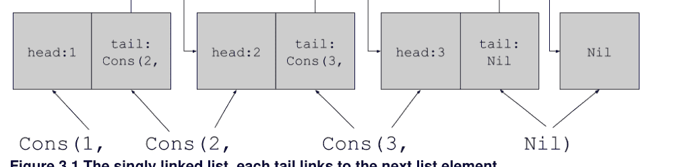
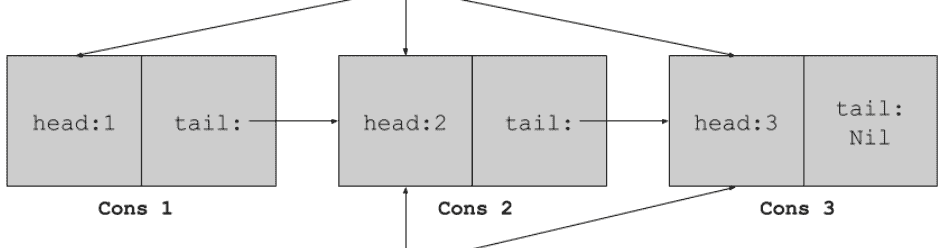
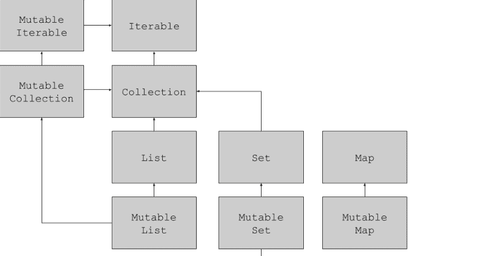

# 函数式数据结构


### 本章涵盖：

- 使用代数数据类型定义函数式数据结构
- 演示如何在一个表达式中编写分支逻辑
- 使用函数式数据结构共享数据
- 使用列表递归并推广到高阶函数
- 练习编写和泛化纯函数
- 从第一性原理实现 `List` 和 `Tree` 数据结构

我们在第 1 章中说过，函数式程序不会更新变量或修改可变数据结构。对保持变量不可变 的强调提出了紧迫的问题：在函数式编程中我们可以使用什么样的数据结构，如何在 Kotlin 中定义它们，以及如何操作它们？

在本章中，我们将通过编写自己的 *单链表* 和 *树* 的实现来学习函数式数据结构的概念。我们还将学习相关的处理技术 *匹配*，并大量练习编写和泛化纯函数。

本章有很多练习，特别有助于这一点——编写和泛化纯函数。其中一些练习可能具有挑战性。始终尽力自行解决它们，尽管有用的提示和指针可以在本书末尾的附录 A 中找到。当你真的卡住时，或想确认你的答案是否正确时，你可以查阅附录 B 获取完整解答。只有在绝对必要时才使用此资源！所有示例和练习的源代码也可在我们的 GitHub 仓库中获得 (github.com/fpinkotlin/fpinkotlin)。


## 3.1 定义函数式数据结构

函数式数据结构仅使用纯函数进行操作。正如你在第 1 章中可能回忆到的，纯函数不得就地修改数据或执行其他副作用。因此，函数式数据结构按定义是不可变的。空列表应像整数值 3 或 4 一样永恒且不可变。而且正如计算 3 + 4 会产生新的数字 7 而不修改 3 或 4，将两个列表连接在一起（此操作的语法为两个列表 a 和 b 的 a + b）会产生一个新列表，并保持两个输入不变。

这难道不意味着我们最终会进行大量额外的数据复制吗？也许令人惊讶的是，答案是否定的，我们将在本节后面讨论确切的原因。但首先让我们来看看可能是最普遍的函数式数据结构——单链表。由于其简单性，它是一个很好的例子，使得推理和理解不可变数据结构的底层原理变得容易。列表 3.1 引入了一些新的语法和概念，我们将详细讨论。

### 列表 3.1 单链表数据结构的定义

```
sealed class List<out A> {
    // helper functions
}

object Nil : List<Nothing>()

data class Cons<out A>(
    val head: A,
    val tail: List<A>
) : List<A>()
```

-   ① 数据类型的密封定义
-   ② List 的 Nil 实现
-   ③ List 的 Cons 实现

让我们首先看一下数据类型的定义，它以关键字 sealed class 开始。通常，我们使用 class 关键字引入数据类型。在这里，我们声明了一个名为 List 的类，它上面没有实例方法。在类声明前加上 sealed 意味着所有实现都必须声明在此文件中。sealed 类默认也是抽象的，因此不能单独实例化。接下来声明了 List 的两个实现，或数据构造函数，以表示 List 可能的两种形式。如图所示，List 可以为空，由数据构造函数 Nil 表示，也可以是非空的，由数据构造函数 Cons 表示（传统上是 construct 的简写）。一个非空列表由一个初始元素 head 组成，后跟一个 List（可能为空）作为剩余元素（尾部）。



图 3.1 单链表，每个尾部链接到下一个列表元素。

正如函数可以是多态的，数据类型也可以，通过在 sealed class List 后添加类型参数 <out A>，然后在 Cons 数据构造函数内部使用该 A 参数，我们声明 List 数据类型在其包含的元素类型上是多态的，这意味着我们可以使用此相同定义来表示 Int 元素的列表（表示为 List<Int>）、Double 元素的列表（表示为 List<Double>）、String 元素的列表（List<String>）等等（out 表示类型参数 A 是协变的——请参阅侧边栏“关于协变性的更多信息”了解更多信息）。

数据构造函数声明为我们提供了构造该形式数据类型的函数。以下是一些示例：

```
val ex1: List<Double> = Nil
val ex2: List<Int> = Cons(1, Nil)
val ex3: List<String> = Cons("a", Cons("b", Nil))
```

使用 object Nil，你可以写 Nil 来构造一个空 List，而 data class Cons 让你可以写 Cons(1, Nil)、Cons("a", Cons("b", Nil)) 等等来构建任意长度的单链表。请注意，因为 List 是在类型 A 上参数化的，这些是多态函数，可以用 A 的不同类型实例化。在这里，ex2 将 A 类型参数实例化为 Int，而 ex3 将其实例化为 String。ex1 示例很有趣——Nil 被实例化为类型 List<Double>，这是允许的，因为空列表不包含元素，可以被视为我们想要的任何类型的列表！

## 侧边栏
### 关于协变性的更多信息

在声明 `class List<out A>` 中，类型参数 `A` 前面的 `out` 是一个方差注解，表示 `A` 是 `List` 的协变或“正”参数。这意味着，例如，`List<Dog>` 被认为是对 `List<Animal>` 的子类型，前提是 `Dog` 是 `Animal` 的子类型。（更一般地，对于所有类型 `X` 和 `Y`，如果 `X` 是 `Y` 的子类型，则 `List<X>` 是 `List<Y>` 的子类型）。我们可以省略 `A` 前面的 `out`，这将使 `List` 在该类型参数上是不变的。

但请注意现在 `Nil` 扩展了 `List<Nothing>`。`Nothing` 是所有类型的子类型，这意味着结合方差注解，`Nil` 可以被视为 `List<Int>`、`List<Double>` 等，正是我们想要的。

关于方差的这些问题对于当前讨论并不是非常重要，更像是 Kotlin 通过子类型编码数据构造函数的产物，因此如果现在完全不清楚也不用担心。当然完全不使用方差注解编写代码也是可能的，并且函数签名有时会更简单（而类型推断通常会变差）。我们将在本书中在方便时使用方差注解，但你应该随意尝试这两种方法。

如果你想了解更多关于泛型的内容，包括 Kotlin 中的协变和逆变，欢迎阅读 Kotlin 文档 at bit.ly/2Op7bmh。

许多其他语言提供 *模式匹配* 功能来处理此类数据类型，如函数 `sum` 和 `product`。我们将在接下来更详细地探讨如何使用 `when` 表达式实现这一点。

## 3.2 使用函数式数据结构

到目前为止，我们的注意力集中在最基本的函数式数据结构——单链表的定义上。如果不实际开始*做*一些事情，这个定义并没有多大用处。在本节中，你将学习应用 *匹配* 技术，以便解释和处理在第 3.1 节中定义的 `List`。

### 列表 3.2 List 数据类型密封定义内部的伴生对象

```
sealed class List<out A> {
    companion object {
        fun <A> of(vararg aa: A): List<A> {
            val tail = aa.sliceArray(1 until aa.size)
            return if (aa.isEmpty()) Nil else Cons(aa[0], of(*tail))
        }

        fun sum(ints: List<Int>): Int =
            when (ints) {
                is Nil -> 0
                is Cons -> ints.head + sum(ints.tail)
            }

        fun product(doubles: List<Double>): Double =
            when (doubles) {
                is Nil -> 1.0
                is Cons ->
                    if (doubles.head == 0.0) 0.0
                    else doubles.head * product(doubles.tail)
            }
    }
}
```

-   ① List 数据结构的定义
-   ② 包含函数的伴生对象
-   ③ 工厂辅助函数

为了为 List 类型添加一些行为，在其定义的主体中添加了一个伴生对象。伴生对象块内定义的任何函数都可以像在 Java 中调用静态方法一样调用。例如，of 方法可以按以下方式使用来从传入的参数构造一个新的 List：

```
>>> List.of(1, 2)
res0: chapter3.List<kotlin.Int> = Cons(head=1, tail=Cons(head=2, tail=Nil))
```

此方法接受一个由 vararg 关键字限定的参数。这意味着该函数本质上是可变参数的，意味着我们可以传入任意数量的相同类型参数来代替该参数。这些值随后作为该类型的数组绑定到参数，并在方法体中访问。我们不需要知道更多关于此的内容，尽管我们在侧边栏中详细解释了它。

## 侧边栏
### Kotlin 中的可变参数函数

`List` 对象中的 `of` 函数是创建新的 `List` 实例的工厂方法。此方法也是一个 *可变参数函数*，意味着它接受零个或多个类型为 `A` 的参数。如果没有提供参数，它将产生一个 `List` 的 `Nil` 实例。如果参数*提供*，该方法将返回一个表示这些值的 `Cons`。

```
fun <A> of(vararg aa: A): List<A> {
    val tail = aa.sliceArray(1 until aa.size)
    return if (aa.isEmpty()) Nil else Cons(aa[0], List.of(*tail))
}
```

对于数据类型，在伴生对象中有一个可变参数的 `of` 方法是一种常见习惯用法，以便方便地构造数据类型的实例。通过调用此函数 `of` 并将其放在伴生对象中，我们可以用像 `List.of(1, 2, 3, 4)` 或 `List.of("hi", "bye")` 这样的语法调用它，用逗号分隔我们想要的任意多个值。

在示例中，方法参数 `aa` 用前置的 `vararg` 关键字标记，并且随后将作为类型 `Array<out A>` 可用，尽管其声明类型为 `A`。在这种情况下，我们使用 `Array` 类型的 `sliceArray` 方法将 `tail` 提取为一个新的 `Array`。

也可能通过使用前缀的 *展开运算符* `*` 将数组作为可变参数传递给方法。我们在示例中对 `of` 的递归调用中使用了 `*tail` 这样做了。

尽管在本次讨论的上下文中处理数组的细节并不重要，关于此主题的更多信息可以在 Kotlin 文档 at bit.ly/2VkgpSa 中找到。

让我们详细查看我们放在伴生对象中的函数 `sum` 和 `product`。这两个定义都使用 `when` 表达式的匹配技术：

### 列表 3.3 List 伴生对象中的函数定义

```
fun sum(ints: List<Int>): Int =
    when (ints) {
        is Nil -> 0
        is Cons -> ints.head + sum(ints.tail)
    }

fun product(doubles: List<Double>): Double =
    when (doubles) {
        is Nil -> 1.0
        is Cons ->
            if (doubles.head == 0.0) 0.0
            else doubles.head * product(doubles.tail)
    }
```


正如你所预期的那样，`sum` 函数规定空列表的和为 0，非空列表的和为第一个元素加上剩余元素的和。同样，`product` 函数规定空列表的积为 1.0，以 0.0 开头的任何列表的积为 0.0，任何其他非空列表的积为第一个元素乘以剩余元素的积。请注意，这些是递归定义，在编写操作递归数据类型（如 `List`（它在 `Cons` 数据构造函数中递归引用自身））的函数时很常见。

## 作为伴生对象的单例实现

类内部的 `companion object` 块声明并创建一个新的 Singleton 对象，它是一个仅有一个命名实例的 `class`。如果你熟悉 Java 中的 Singleton 对象，在 Kotlin 中声明一个要简洁得多。Kotlin 中的 Singleton 也比 Java 中的安全得多，无需双重检查锁定来保证对象体内的线程安全。Kotlin 没有 Java `static` 关键字的等价物，而在 Kotlin 中 `companion object` 通常用于 Java 中可能会使用带有静态成员的类的地方。

我们经常会在数据类型及其数据构造函数内部声明一个嵌套的伴生对象。这会产生一个与数据类型同名的对象（在本例中为 `List`），我们可以在其中放置各种用于创建或操作数据类型值的便捷方法。

例如，如果我们想要一个函数 `fun <A> fill(n: Int, a: A): List<A>` 来创建一个包含元素 `a` 的 `n` 个副本的 `List`，那么 `List` 伴生对象就是一个很好的放置位置。我们本可以创建一个对象 `Foo`，但使用 `List` 伴生对象可以清楚地表明所有函数都与操作列表相关。

在 Kotlin 中，匹配是通过使用 `when` 表达式实现的，其工作方式有点像花哨的 `switch` 语句。它按顺序将参数与所有分支匹配，直到某个分支条件得到满足。满足条件的分支的值成为整个表达式的值。如果没有其他分支条件得到满足，则会评估 `else` 分支。`else` 分支是强制性的，除非编译器能够证明所有可能的情况都已通过分支条件覆盖。

让我们更仔细地看看匹配。可以使用该构造的几种变体来实现匹配值的目的。这包括按常量值、表达式、范围和类型进行匹配。`when` 构造甚至可以用作改进的 `if-else` 表达式。对于我们学习函数式编程的目的来说，我们不需要所有这些变体，所以让我们只关注那些所需的内容。

### 3.2.1 用于按类型匹配的 when 构造

对于我们的目的来说，按类型匹配是最有用的方法。is 关键字用于按其具体类型匹配每个逻辑分支。额外的好处是，左侧匹配的类型也会被智能转换为分支右侧所需的实现。when 构造的这个有趣特性导致值被转换为匹配的类型，以便在分支的表达式侧进一步使用。让我们通过示例来解释这一点。

### 列表 3.4 when 构造使用智能转换将抽象类型转换为具体实现

```
val ints = List.of(1, 2, 3, 4)

fun sum(xs: List<Int>): Int =
    when (xs) {
        is Nil -> 0
        is Cons -> xs.head + sum(xs.tail)
    }

fun main() = sum(ints)
```

- ① 声明抽象 List 的语句
- ② 匹配 Nil 实现
- ③ 智能转换 Cons 实现
- ④ 使用列表调用 sum 函数

值 ints 的类型为 List。在本例中它将是一个 Cons，但在创建空 List 的情况下也可能是一个 Nil。当传递给 when 构造时，它假设 List 的抽象类型，直到被其中一个逻辑分支匹配。在此示例中，Nil 匹配只会返回一个 0，但 Cons 匹配会导致一些有趣的行为——当我们从分支的左侧过渡到右侧时，值 ints 会自动转换为 Cons，以便我们可以访问其成员 head 和 tail！这种被称为智能转换的特性在处理类层次结构中每个子类型可能具有包含特定字段的独立构造函数的 数据类型时变得非常宝贵。

我们必须始终按类型进行穷举匹配，在我们的例子中，这将是对基类 List 的所有密封实现进行匹配。如果我们的匹配证明不是穷举的（匹配非密封类，或未列出基类的所有密封变体），我们需要提供 else 条件作为兜底表达式。对于 List 来说，它是密封的，并且只有 Nil 和 Cons 实现，因此不需要这样做。

### 3.2.2 作为 if-else 逻辑替代方案的 when 构造

when 构造的另一个良好用途是编写更简单的 if-else 表达式。以这种方式使用时，when 关键字之后不需要提供参数，每个条件分支都充当匹配评估的谓词。与 if-else 一样，when 构造也是一个表达式，可以赋给一个值。作为示例，让我们看一个简单的 if 表达式：

### 列表 3.5 用于评估表达式的逻辑 if-else 链

```
val x = Random.nextInt(-10, 10)
val y: String = if (x == 0) {
    "x is zero"
} else if (x < 0) {
    "x is negative"
} else {
    "x is positive"
}
```

- ① 检查 x 是否为 0
- ② 检查 x 是否为负数
- ③ 否则 x 只能为正数

这段代码足够简单，但由于围绕逻辑的样板代码造成的[content]
正如你所预期的那样，`sum` 函数规定空列表的和为 0，非空列表的和为第一个元素加上剩余元素的和。同样，`product` 函数规定空列表的积为 1.0，以 0.0 开头的任何列表的积为 0.0，任何其他非空列表的积为第一个元素乘以剩余元素的积。请注意，这些是递归定义，在编写操作递归数据类型（如 `List`（它在 `Cons` 数据构造函数中递归引用自身））的函数时很常见。

## 作为伴生对象的单例实现

类内部的 `companion object` 块声明并创建一个新的 Singleton 对象，它是一个仅有一个命名实例的 `class`。如果你熟悉 Java 中的 Singleton 对象，在 Kotlin 中声明一个要简洁得多。Kotlin 中的 Singleton 也比 Java 中的安全得多，无需双重检查锁定来保证对象体内的线程安全。Kotlin 没有 Java `static` 关键字的等价物，而在 Kotlin 中 `companion object` 通常用于 Java 中可能会使用带有静态成员的类的地方。

我们经常会在数据类型及其数据构造函数内部声明一个嵌套的伴生对象。这会产生一个与数据类型同名的对象（在本例中为 `List`），我们可以在其中放置各种用于创建或操作数据类型值的便捷方法。

例如，如果我们想要一个函数 `fun <A> fill(n: Int, a: A): List<A>` 来创建一个包含元素 `a` 的 `n` 个副本的 `List`，那么 `List` 伴生对象就是一个很好的放置位置。我们本可以创建一个对象 `Foo`，但使用 `List` 伴生对象可以清楚地表明所有函数都与操作列表相关。

在 Kotlin 中，匹配是通过使用 `when` 表达式实现的，其工作方式有点像花哨的 `switch` 语句。它按顺序将参数与所有分支匹配，直到某个分支条件得到满足。满足条件的分支的值成为整个表达式的值。如果没有其他分支条件得到满足，则会评估 `else` 分支。`else` 分支是强制性的，除非编译器能够证明所有可能的情况都已通过分支条件覆盖。

让我们更仔细地看看匹配。可以使用该构造的几种变体来实现匹配值的目的。这包括按常量值、表达式、范围和类型进行匹配。`when` 构造甚至可以用作改进的 `if-else` 表达式。对于我们学习函数式编程的目的来说，我们不需要所有这些变体，所以让我们只关注那些所需的内容。

### 3.2.1 用于按类型匹配的 when 构造

对于我们的目的来说，按类型匹配是最有用的方法。is 关键字用于按其具体类型匹配每个逻辑分支。额外的好处是，左侧匹配的类型也会被智能转换为分支右侧所需的实现。when 构造的这个有趣特性导致值被转换为匹配的类型，以便在分支的表达式侧进一步使用。让我们通过示例来解释这一点。

### 列表 3.4 when 构造使用智能转换将抽象类型转换为具体实现

```
val ints = List.of(1, 2, 3, 4)

fun sum(xs: List<Int>): Int =
    when (xs) {
        is Nil -> 0
        is Cons -> xs.head + sum(xs.tail)
    }

fun main() = sum(ints)
```

- ① 声明抽象 List 的语句
- ② 匹配 Nil 实现
- ③ 智能转换 Cons 实现
- ④ 使用列表调用 sum 函数

值 ints 的类型为 List。在本例中它将是一个 Cons，但在创建空 List 的情况下也可能是一个 Nil。当传递给 when 构造时，它假设 List 的抽象类型，直到被其中一个逻辑分支匹配。在此示例中，Nil 匹配只会返回一个 0，但 Cons 匹配会导致一些有趣的行为——当我们从分支的左侧过渡到右侧时，值 ints 会自动转换为 Cons，以便我们可以访问其成员 head 和 tail！这种被称为智能转换的特性在处理类层次结构中每个子类型可能具有包含特定字段的独立构造函数的 数据类型时变得非常宝贵。

我们必须始终按类型进行穷举匹配，在我们的例子中，这将是对基类 List 的所有密封实现进行匹配。如果我们的匹配证明不是穷举的（匹配非密封类，或未列出基类的所有密封变体），我们需要提供 else 条件作为兜底表达式。对于 List 来说，它是密封的，并且只有 Nil 和 Cons 实现，因此不需要这样做。

### 3.2.2 作为 if-else 逻辑替代方案的 when 构造

when 构造的另一个良好用途是编写更简单的 if-else 表达式。以这种方式使用时，when 关键字之后不需要提供参数，每个条件分支都充当匹配评估的谓词。与 if-else 一样，when 构造也是一个表达式，可以赋给一个值。作为示例，让我们看一个简单的 if 表达式：

### 列表 3.5 用于评估表达式的逻辑 if-else 链

```
val x = Random.nextInt(-10, 10)
val y: String = if (x == 0) {
    "x is zero"
} else if (x < 0) {
    "x is negative"
} else {
    "x is positive"
}
```

- ① 检查 x 是否为 0
- ② 检查 x 是否为负数
- ③ 否则 x 只能为正数

这段代码足够简单，但由于围绕逻辑的样板代码造成的无谓繁琐而难以理解。使用 when 构造会得到类似这样的结果：

### 列表 3.6 when 构造用于评估表达式

```
val x = Random.nextInt(-10, 10)
val y: String = when {
    x == 0 ->
        "x is zero"
    x < 0 ->
        "x is negative"
    else ->
        "x is positive"
}
```

- ① 未向 when 提供参数
- ② 用逻辑分支替换 if / else 语句
- ③ 兜底 else 语句

该构造作用于当前作用域中的任何变量，在本例中为随机值 x。左侧的每个逻辑表达式都会产生一个布尔结果，从而导致右侧其中一个分支的求值。由于整个 when 构造是一个表达式，结果将被赋给 y。

这段代码更加优雅简洁，更易于阅读和推理。when 构造是我们 Kotlin 工具箱中最常用的工具之一，我们将在本书中不断返回使用它。话虽如此，它确实存在一些缺点，缺少其他同类语言支持的一些关键特性。

### 3.2.3 模式匹配及其与 Kotlin 匹配的差异

Kotlin 中的匹配并不完美，在这一领域不及其他语言提供的功能。诸如 Haskell、Scala 和 Rust 之类的语言为我们提供了称为模式匹配的特性。这与我们在 Kotlin 匹配中看到的非常相似，但与 Kotlin 的方法相比，具有更好的语义、更多能力以及更好的可用性。让我们在 Kotlin 的 when 构造提供的匹配方式与这些其他语言的处理方式之间进行比较，以突出这些缺陷。

模式匹配的特性使我们不仅能够在逻辑表达式上进行匹配，还能够从该表达式中提取值。这种提取，或解构，在函数式编程中发挥着重要作用，尤其是在处理代数数据类型时。为了充分理解模式匹配的工作原理，让我们仔细看看我们将如何使用 when 在 Kotlin 中编写这段代码，然后我们希望如何使用一些应用此模式匹配技术的 Kotlin 伪代码来编写它。

首先，让我们重新审视我们在 List 类的伴生对象中编写的 sum 函数：

### 列表 3.7 List 伴生对象中的简单 when 匹配

```
fun sum(xs: List<Int>): Int = when (xs) {
    is Nil -> 0
    is Cons -> xs.head + sum(xs.tail)
}
```

- ① 匹配 Cons 后，xs 被智能转换，因此 head 和 tail 变得可见

最明显的问题是我们通过成员 xs.head 和 xs.tail 在分支逻辑的求值中访问值 xs。请注意，xs 被声明为 List，而 List 没有 head 或 tail。List 已被智能转换为 Cons 这一事实从未被明确说明，这导致了关于 xs 的模糊类型感到困惑。

如果 Kotlin 支持其他语言提供的模式匹配，它将允许我们像以下 Kotlin 伪代码那样表达：
List 伴生对象中使用伪代码的模式匹配

```
fun sum(xs: List): Int = when(xs) {
    case Nil -> 0
    case Cons(head, tail) -> head + sum(tail)
}
```

- ① 第一个 case 模式，Nil 不提取任何内容
- ② 第二个 case 模式，Cons(head, tail) 提取 head 和 tail

最明显的是一个新的 case 关键字，后面跟着一个模式声明，在此

case Cons(head, tail)。此模式首先被匹配，然后应用。当代码执行时，每个分支模式会按顺序应用于 when 的对象参数。当分支不匹配时，它就被直接跳过。当找到匹配时，模式将被应用，提取该对象声明的任何字段，并使其在该特定分支的右侧可用。

考虑一个结构为 Cons(1, (Cons(2, Nil))) 的 List 对象被传入我们的模式匹配构造：由于 Nil 的第一个模式不匹配，我们会落到第二个模式。请记住 Cons 数据类具有以下带主构造函数的类定义：

```
data class Cons<out A>(val head: A, val tail: List<A>) : List<A>()
```

构造函数 (val head: A, val tail: List<A>) 现在被叠加到对象上，并且 head 和 tail 两个值将被提取。在这种情况下，它将是一个类型为 Int 且值为 1 的 head，以及一个类型为 List<Int> 且值为 Cons(2, Nil) 的 tail。这两个值现在被提取并在条件分支的右侧可用，在那里它们可以在不访问传入 when 构造的原始对象 xs 的情况下使用。

这种逻辑上的转变乍一看可能非常微妙，但对你处理此类匹配代码的方式有重大影响。这意味着我们不再直接访问匹配的对象 xs，也不要求进行任何智能转换来访问其字段。相反，我们直接与其提取的字段交互，在我们的求值中甚至不触及 xs。

尽管很多人要求在 Kotlin 语言 10 中加入模式匹配，但创建者对此持强烈反对态度，声称这会使语言过于复杂。我真诚希望它能在未来的某个时间被纳入语言。

## 3.3 函数式数据结构中的数据共享

当数据不可变时，我们如何编写例如向列表添加或删除元素的函数？答案很简单。当我们向现有列表，例如 xs 的前面添加元素 1 时，我们返回一个新列表，在本例中为 Cons(1,xs)。由于列表是不可变的，我们不需要真正复制 xs；我们可以直接重用它。这称为数据共享。共享不可变数据通常让我们能更高效地实现函数；我们可以始终返回不可变数据结构，而不必担心后续代码修改我们的数据。没有必要悲观地进行复制以避免修改或损坏，因为由于数据结构不可变，这样的复制是多余的。

> 注意 悲观复制在大程序中可能成为一个问题。当可变数据通过松散耦合的组件链传递时，每个组件都必须复制自己的数据，因为其他组件可能会修改它。不可变数据始终是安全的共享，因此我们永远不需要复制。我们发现在大规模上，FP 通常比依赖副作用的方法更高效，因为数据和计算的共享程度更高。

同样地，要从列表 `mylist = Cons(x,xs)` 的前面移除一个元素，我们只需返回其 `tail`，即 `xs`。实际上并没有移除操作。原始列表 `mylist` 仍然可用，未受损害。我们说函数式数据结构是持久的，意味着数据结构上的操作永远不会改变现有引用。

```
val cons1 = Cons(1, Cons(2, Cons(3, Nil)))
```



```
val cons2 = cons1.tail
```

### 图 3.2 由于共同的底层数据结构，单链表中的数据共享

让我们尝试以不同的方式实现一些修改列表的函数。

我们在练习中编写的函数可以用两种方式编写，两种方式都完全可以接受。第一种方法是将函数放在 `List` 伴生对象中，就像我们在示例中对 `sum` 和 `product` 所做的那样。在这种方法中，该方法以其作用的列表作为第一个参数：

```
fun <A> tail(xs: List<A>): List<A> = TODO()

>>> val xs = List.of(1, 2, 3, 4)
>>> List.tail(xs)
```

另一种方法涉及使用上一章介绍的扩展方法。这将为列表类型本身添加行为，因此我们可以按以下方式对其进行操作：

```
fun <A> List<A>.tail(): List<A> = TODO()
```

```
>>> xs.tail()
```

### 练习 3.1

实现函数 tail 以移除 List 的第一个元素。请注意，该函数花费恒定时间。如果 List 为 Nil，你在实现中可以做出哪些不同的选择？我们将在下一章回到这个问题。

```
fun <A> tail(xs: List<A>): List<A> = TODO()
```

### 练习 3.2

使用同样的思路，实现函数 setHead 以用不同值替换 List 的第一个元素。

```
fun <A> setHead(xs: List<A>, x: A): List<A> = TODO()
```

### 3.3.1 数据共享的效率

正如我们在第 2.3 节中所见，由于我们处理的基础数据结构的不可变性，数据共享通常让我们能更高效地实现操作。让我们看几个例子。

### 练习 3.3

将 tail 推广为函数 drop，它从列表中移除前 n 个元素。请注意，此函数花费的时间仅与被丢弃的元素数量成比例——我们不需要复制整个 List。

```
fun <A> drop(l: List<A>, n: Int): List<A> = TODO()
```

### 练习 3.4

实现 dropWhile，它只要前缀元素匹配谓词就从 List 中移除元素。

```
fun <A> dropWhile(l: List<A>, f: (A) -> Boolean): List<A> = TODO()
```

drop 和 dropWhile 都采用数据共享来实现其目的。数据共享的一个更令人惊讶的例子是这个将一个列表的所有元素添加到另一个列表末尾的函数：

### 列表 3.8 append 函数将一个列表的所有元素追加到另一个列表

```
fun <A> append(a1: List<A>, a2: List<A>): List<A> =
    when (a1) {
        is Nil -> a2
        is Cons -> Cons(a1.head, append(a1.tail, a2))
    }
```

请注意，此定义只复制值直到第一个列表耗尽，因此其运行时间和内存使用仅由 a1 的长度决定。剩余的列表然后只需指向 a2。如果我们要为两个数组实现相同的函数，我们将被迫将两个数组中的所有元素都复制到结果中。在这种情况下，不可变的链表比数组高效得多！

### 练习 3.5

并非所有情况都像将两个列表追加在一起那样顺利。实现一个函数 init，它返回一个仅包含 List 中除最后一个元素外的所有元素的 List。因此，给定 List(1, 2, 3, 4)，init 将返回 List(1, 2, 3)。为什么这个函数不能像 tail 那样以恒定时间实现？

```
fun <A> init(l: List<A>): List<A> = TODO()
```

由于单链表的结构，任何时候我们想要替换 Cons 的 tail，即使它是列表中的最后一个 Cons，我们也必须复制之前的所有 Cons 对象。编写支持不同操作高效执行的纯函数式数据结构，关键在于找到巧妙利用数据共享的方法。我们在这里不会介绍这些数据结构；目前，我们满足于使用他人编写的函数式数据结构。

## 3.4 列表上的递归及推广到高阶函数

让我们再次回顾 sum 和 product 的实现。这两个函数在它们所做的事情以及如何做的方式上看起来 remarkably 相似。接下来，我们将研究提取共同点以导出这两个函数的 higher-order 函数。

为了使这两个函数的实现更接近，我们稍微简化了 product 的实现，以便不包含检查 0.0 的“短路”逻辑：

### 列表 3.9 通过移除短路使 product 规范化使其与 sum 相似

```
fun sum(xs: List<Int>): Int = when (xs) {
    is Nil -> 0
    is Cons -> xs.head + sum(xs.tail)
}

fun product(xs: List<Double>): Double = when (xs) {
    is Nil -> 1.0
    is Cons -> xs.head * product(xs.tail)
}
```

这两个定义有多相似。它们操作的类型不同（List<Int> 与 List<Double>），但除此之外，唯一的区别是空列表情况下返回的值（sum 的情况为 0，product 的情况为 1.0），以及合并结果的操作（sum 的情况为 +，product 的情况为 *）。每当你遇到这种重复时，你可以通过将子表达式提取到函数参数中来将其泛化。如果子表达式引用任何局部变量（sum 中对两个值求和的 + 操作，以及 product 中对两个值相乘的 * 操作），则将子表达式转换为接受这些变量作为参数的函数。让我们现在就这样做。我们的函数将作为参数接收空列表情况下返回的值，以及非空列表情况下将元素添加到结果的函数。

### 列表 3.10 使用 foldRight 作为 product 和 sum 的泛化

```
fun <A, B> foldRight(xs: List<A>, z: B, f: (A, B) -> B): B =
    when (xs) {
        is Nil -> z
        is Cons -> f(xs.head, foldRight(xs.tail, z, f))
    }

fun sum2(ints: List<Int>): Int =
    foldRight(ints, 0, { a, b -> a + b })

fun product2(dbs: List<Double>): Double =
    foldRight(dbs, 1.0, { a, b -> a * b })
```

foldRight 不特定于任何一种元素类型，并且我们在泛化时发现，返回的值不必与列表元素的类型相同！描述 foldRight 的一种方法是它用 z 和 f 替换列表的构造器 Nil 和 Cons，这里使用我们在第 2 章学到的替换模型进行说明：

```
Cons(1, Cons(2, Nil))
f   (1, f   (2, z  ))
```

让我们看一个完整的例子，在其中我们系统地替换求值直到到达最终结果。我们将使用之前相同的方法来追踪以下声明的求值：

```
foldRight(Cons(1, Cons(2, Cons(3, Nil))),
    0, { x, y -> x + y })
```


我们将反复用其求值来替换 foldRight 的定义。这种替换技术将在整本书中反复使用：

```
foldRight(Cons(1, Cons(2, Cons(3, Nil))),
    0, { x, y -> x + y })
1 + foldRight(Cons(2, Cons(3, Nil)), 0,
    { x, y -> x + y })
1 + (2 + foldRight(Cons(3, Nil), 0,
    { x, y -> x + y }))
1 + (2 + (3 + (foldRight(Nil as List<Int>, 0,
    { x, y -> x + y }))))
1 + (2 + (3 + (0)))
6
```

请注意，foldRight 必须一直遍历到列表的末尾（在遍历过程中将帧压入调用栈），然后才能通过应用匿名函数开始将其折叠。

我们使用 lambda 语法将匿名函数参数 { x, y -> x + y } 作为 f 传递给 foldRight 的每次递归调用。f 的函数参数的所有类型都可以推断，因此我们不需要分别为 x 和 y 提供它们。

### 练习 3.6
使用 foldRight 实现的 product 是否可以在遇到 0.0 时立即停止递归并返回 0.0？为什么或为什么不？考虑如果使用大型列表调用 foldRight，任何短路操作可能会如何工作。这个问题有更深层的含义，我们将在第 5 章中再次讨论。

### 练习 3.7
看看当你将 Nil 和 Cons 本身传递给 foldRight 时会发生什么，像这样 11：

```
foldRight(
    List.of(1, 2, 3),
    List.empty<Int>(),
    { x, y -> Cons(x, y) })
```

你认为这说明了 foldRight 与 List 的数据构造器之间有什么关系？

### 注意
仅传递 `Nil` 是不够的，因为在此上下文中我们缺少类型信息 `A`。因此我们需要将其表示为 `Nil` as `List<Int>`。由于这非常冗长，可以在伴生对象中添加一个便捷方法来规避此问题：

```
fun <A> empty(): List<A> = Nil
```

此方法将在后续所有列表和练习中用于表示空的 `List`。

### 练习 3.8
使用 `foldRight` 计算列表的长度。

```
fun <A> length(xs: List<A>): Int = TODO()
```

### 警告
从现在开始，练习的难度会明显增加。以至于在许多情况下，它们会让你超出你已知的范围。如果你做不出某个练习，那完全没问题，也是可以预期的。只需尽力解决每一个练习，如果你*真的*没有成功，请参考附录 B 查找解决方案，以及在适用情况下如何解决问题的解释。如前所述，这只能在最后手段或验证最终解决方案时才这样做。此外，请不要跳过任何练习，因为每个练习都建立在前一个练习所获得的知识之上。只有通过完成每个练习，才能完全掌握本章的内容，这也是贯穿全书的反复主题。

### 练习 3.9
我们对 `foldRight` 的实现不是尾递归的，对于大型列表会导致 `StackOverflowError`（我们说它不是栈安全的）。请自行确认这一点，然后使用我们在上一章讨论的技术编写另一个通用的列表递归函数 `foldLeft`，它是尾递归的。以下是其签名：

```
tailrec fun <A, B> foldLeft(xs: List<A>, z: B, f: (B, A) -> B): B = TODO()
```

### 练习 3.10
使用 `foldLeft` 编写 `sum`、`product` 以及计算列表长度的函数。

### 练习 3.11
编写一个返回列表反转的函数（给定 `List(1,2,3)` 它返回 `List(3,2,1)`）。看看你是否能用折叠来编写它。

### 练习 3.12
你能用 `foldRight` 表示 `foldLeft` 吗？反过来呢？通过 `foldLeft` 实现 `foldRight` 是有用的，因为它让我们可以尾递归地实现 `foldRight`，这意味着即使对于大型列表也能工作而不会导致栈溢出。

### 练习 3.13
使用 `foldLeft` 或 `foldRight` 中的任一个实现 `append`。

### 练习 3.14
编写一个函数，将列表的列表连接成单个列表。其运行时间应与所有列表的总长度成线性关系。尝试使用我们已经定义过的函数。

### 3.4.1 用于操作列表的更多函数
用于操作列表的实用函数还有很多。我们在这里再介绍几个，以便进一步练习泛化函数，并对处理列表时的常见模式有基本的熟悉度。完成本节后，你不会立刻对何时使用这些函数产生直觉。相反，只需养成习惯，寻找将你为处理列表而编写的任何显式递归函数泛化为可能方式。如果这样做，你将自行（重新）发现这些函数，并培养出何时使用每个函数的直觉。

### 练习 3.15
编写一个函数，通过给每个元素加 1 来转换整数列表。这应该是一个纯函数，返回一个新的 `List`。

### 列表 3.11

### 练习 3.17
编写一个函数 map，将修改列表中每个元素进行泛化，同时保持列表的结构。以下是其签名：12

```
fun <A, B> map(xs: List<A>, f: (A) -> B): List<B> = TODO()
```

### 练习 3.18
编写一个函数 filter，除非元素满足给定谓词，否则从列表中移除它们。用它来从 List<Int> 中移除所有奇数。

```
fun <A> filter(xs: List<A>, f: (A) -> Boolean): List<A> = TODO()
```

### 练习 3.19
编写一个函数 flatMap，它的工作方式类似于 map，只是给定的函数将返回一个列表而不是单个结果，并且该列表应插入到最终结果列表中。以下是其签名：

```
fun <A, B> flatMap(xa: List<A>, f: (A) -> List<B>): List<B> = TODO()
```

例如，flatMap(List.of(1, 2, 3), { i -> List.of(i, i) }) 应产生 List(1, 1, 2, 2, 3, 3)。

### 练习 3.20
使用 flatMap 实现 filter。

### 侧边栏 尾随 lambda 参数
Kotlin 在将 lambda 参数传递给高阶函数时提供了一些语法糖。更具体地说，如果一个函数接受多个参数，其中 lambda 是最后一个参数，它可以放在参数列表的括号之外。例如：

```
flatMap(xs, { x -> List.of(x) })
```

可以表示为：

```
flatMap(xs) { x -> List.of(x) }
```

这被称为尾随 lambda，使表达式更流畅、更易读。

### 练习 3.21
编写一个函数，接受两个列表并通过相加对应元素构造一个新列表。例如，`List(1,2,3)` 和 `List(4,5,6)` 变成 `List(5,7,9)`。

### 练习 3.22
将你刚刚编写的函数泛化，使其不特定于整数或加法。将你的泛化函数命名为 `zipWith`。

### 3.4.2 Kotlin 标准库中的列表
Kotlin 标准库 ¹³ 中已存在 `List` 实现。此时重要的是注意我们 `List` 与标准库提供的 `List` 之间的区别：Kotlin 提供的是*只读* `List`，而不是像我们实现那样真正*不可变*的列表。事实上，标准库只读和可变列表的底层实现是同一个，即 `java.util.ArrayList`。这一务实决策是为了 Java 互操作性而做出的。

Kotlin 列表的只读变体和可变变体之间的唯一区别在于，可变版本实现了 `MutableList` 接口，该接口具有允许添加、更新和删除底层列表元素的方法。`MutableList` 扩展自 `List`，而 `List` 则没有这些变异方法。其结果是通过接口对底层列表提供多个视图的统一实现。



图 3.3 Kotlin 标准库集合继承层次结构，显示可变和只读变体之间的关系

标准库列表上有许多有用的方法。阅读 API 文档后，你可能想在 REPL 中尝试这些和其他方法。这些方法被定义为 `List<A>` 上的方法，而不是像本章中所做的那样作为独立函数：

- `fun take(n: Int): List<A>` —返回由 `this` 的前 n 个元素组成的一个列表
- `fun takeWhile(f: (A) -> Boolean): List<A>` —返回由 `this` 的最长有效前缀组成的一个列表，其所有元素都通过谓词 f
- `fun all(f: (A) -> Boolean): Boolean` —当且仅当 `this` 的所有元素都通过谓词 f 时返回 true
- `fun any(f: (A) -> Boolean): Boolean` —如果 `this` 的任何元素通过谓词 f 则返回 true

我们建议你在完成本章后浏览 Kotlin API 文档，看看还有哪些其他函数。特别是，查找你在完成本章练习时实现的一些函数。如果你发现自己在编写显式的递归函数来执行某种列表操作，请检查 `List` API，看看是否已有类似你需要的函数。

### 3.4.3 从更简单的组件组装列表函数的低效性
`List` 的一个问题是，虽然我们经常可以用非常通用的函数来表达操作和算法，但 resulting 实现并不总是高效的——我们可能会对同一输入进行多次遍历，或者必须编写显式的递归循环以允许提前终止。

总是希望以尽可能高效的方式实现我们的函数，做任何其他事情都是浪费的。即使我们目前还没有实现如此高效代码的手段，我们仍将使用当前拥有的工具来实施它，然后在第 5 章中回来处理其效率。

### 练习 3.23
作为示例，实现 `hasSubsequence` 来检查一个 List 是否包含另一个 List 作为子序列。例如，`List(1,2,3,4)` 将具有 `List(1,2)`、`List(2,3)` 和 `List(4)` 作为子序列，等等。你可能很难找到既简洁又高效的纯函数实现。那也没关系。无论如何自然地实现该函数。我们将在第 5 章中回到此实现并希望改进它。

### 提示
在 Kotlin 中，任何两个值 `x` 和 `y` 都可以使用表达式 `x == y` 进行相等性比较。


**练习** `tailrec fun <A> hasSubsequence(xs: List<A>, sub: List<A>): Boolean = TODO()`

## 3.5 树

`List` 数据结构及其实现我们在本章中处理过，是 *代数数据类型* (ADTs) 的例子。ADT 只是由一个或多个数据构造函数定义的数据类型，每个构造函数可能包含零个或多个参数¹⁴。我们说数据类型是其数据构造函数的和或联合，而每个数据构造函数是其参数的积，因此得名代数数据类型。¹⁵

正如代数是整个数学的基础，代数数据类型也是函数式编程语言的基础。它们是我们所有更丰富数据结构的基础，包括我们在本章中推导的 `List` 和 `Tree`。它们也可以被视为函数式编程的构建块，并在我们执行程序时为我们提供可操作的对象。

**注记** 有点令人困惑的是，ADT 有时也用于表示 *抽象数据类型*。本书始终指的是 *代数数据类型*。

**侧边栏** **ADTs 与封装**
有人可能会反对说，代数数据类型通过公开类型的内部表示来违反封装。在 FP 中，我们以不同的方式处理封装问题——我们通常没有可能导致错误或违反不变量的精细可变状态，如果公开的话。公开类型的数据构造函数通常是可以的，并且这样做的决定与关于数据类型公共 API 应该是什么的任何其他决定一样对待。

我们通常将 ADT 用于情况集封闭的情况（已知是固定的，由 `sealed` 关键字表示）。对于 `List` 和 `Tree`，改变数据构造函数的集合会显著改变这些数据类型的本质。`List` 是一个单链表——这就是它的本质——并且两个情况 `Nil` 和 `Cons` 构成了其有用的公共 API 的一部分。我们当然可以编写处理比 `List` 更抽象的 API 的代码（我们将在本书后面看到这些示例），但这种信息隐藏可以作为一个单独的层来处理，而不是直接烘焙到 List 中。

你可以使用代数数据类型来定义其他数据结构。让我们定义一个简单的二叉树数据结构：

### 列表 3.12 二叉树数据结构的定义

```kotlin
sealed class Tree<out A>

data class Leaf<A>(val value: A) : Tree<A>()

data class Branch<A>(
    val left: Tree<A>,
    val right: Tree<A>
) : Tree<A>()
```

再次匹配提供了一种方便地操作我们 ADT 元素的方式。让我们尝试编写一些函数。

练习 3.24
编写一个函数 `size`，用于计算树中节点（叶子和分支）的数量。

练习 3.25
编写一个函数 `maximum`，返回 `Tree<Int>` 中的最大元素。

**提示**
Kotlin 提供了一个方便的内置函数 `maxOf`，用于确定两个值的最大值。例如，x 和 y 的最大值可以通过 `maxOf(x, y)` 确定。

练习 3.26
编写一个函数 `depth`，返回从树的根到任何叶子的最大路径长度。

练习 3.27
编写一个函数 `map`，类似于 `List` 上同名的方法，用给定的函数修改树中的每个元素。

### 练习 3.28

概括 `size`、`maximum`、`depth` 和 `map` 用于 `Tree`，编写一个新的函数 `fold`，对其相似之处进行抽象。以这种更通用的函数为基础重新实现它们。你能在这 `fold` 函数与 `List` 的左折叠和右折叠之间建立类比吗？

```kotlin
fun <A, B> fold(ta: Tree<A>, l: (A) -> B, b: (B, B) -> B): B = TODO()

fun <A> sizeF(ta: Tree<A>): Int = TODO()

fun maximumF(ta: Tree<Int>): Int = TODO()

fun <A> depthF(ta: Tree<A>): Int = TODO()

fun <A, B> mapF(ta: Tree<A>, f: (A) -> B): Tree<B> = TODO()
```

### 侧边栏

### 标准库中的代数数据类型

Pair 和 Triple 是简单的类元组类，可以连续保存两个或三个类型化值。Pair、Triple 和数据类都是代数数据类型。数据类之前已经介绍过，但让我们更仔细地看看 Pair 和 Triple ADT：

```
>>> val p = Pair("Bob", 42)
>>> p
res0: kotlin.Pair<kotlin.String, kotlin.Int> = (Bob, 42)

>>> p.first
res1: kotlin.String = Bob

>>> p.second
res2: kotlin.Int = 42

>>> val (first, second) = p
>>> first
res3: kotlin.String = Bob
>>> second
res4: kotlin.Int = 42
```

- 1. 一对包含两种任意类型的值
- 2. 第一个值可以通过 first 访问
- 3. 第二个值可以通过 second 访问
- 4. 一对可以被解构

在这个例子中，Pair("Bob", 42) 是一个类型为 Pair<String, Int> 的对。我们可以使用 Pair 对象上的值 first 和 second 提取这对的第一个或第二个元素。也可以像使用数据类一样将 Pair 解构为其和分量。

Pair 的更高元数¹⁶ 变体是 Triple，其工作方式与我们预期的字段 first、second 和 third 非常相似。这些元组类型是当数据类及其命名字段和大量方法显得过度设计时非常方便的工具。有时一个简单的类型化值的容器就足够了，甚至更好。

## 3.6 摘要

- 不可变数据结构是可以由纯函数操作的对象。
- sealed 类具有有限数量的实现，限制了数据结构语法。
- `when` 构造可以匹配类型化数据结构，并用于选择适当的求值结果。
- Kotlin 匹配对于处理数据结构很有用，但不及其他函数式语言支持的 *模式匹配*。
- 通过使用不可变数据结构的 *共享*，可以在无需复制结构内容的情况下安全访问。
- 列表操作通过递归、广义高阶函数表达，促进代码重用和模块化。
- Kotlin 标准库列表是只读的，而非不可变的，这可能导致在纯函数操作时数据损坏。
- 代数数据类型 (ADTs) 是不可变数据结构的正式名称，在 Kotlin 中由数据类、`Pairs` 和 `Triples` 建模。
- 本章中开发的 `List` 和 `Tree` 都是 ADT 的例子。
