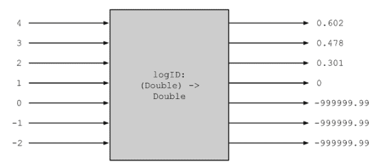
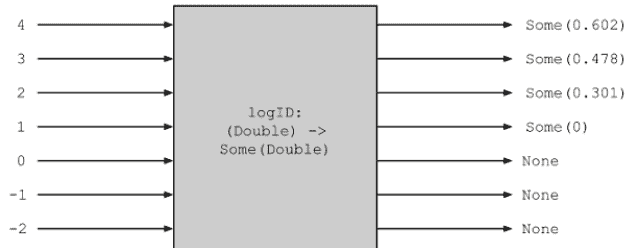
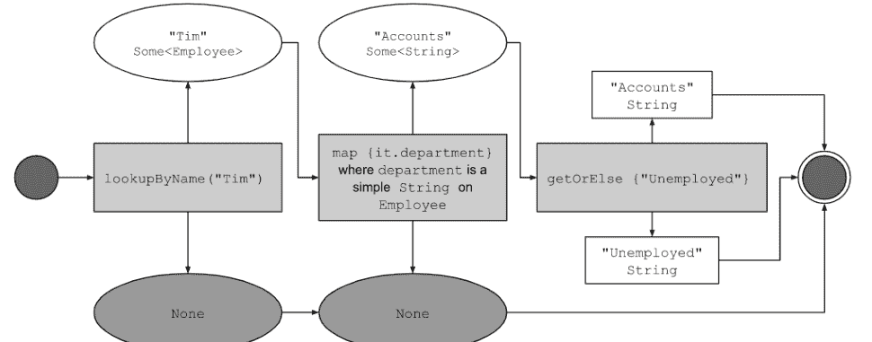
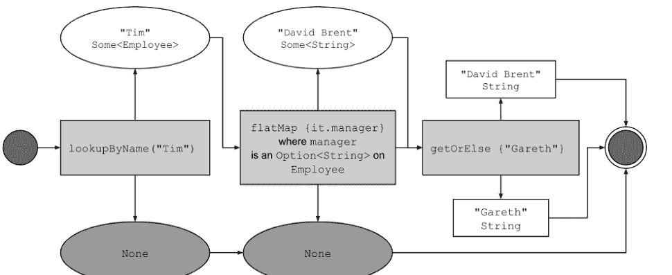
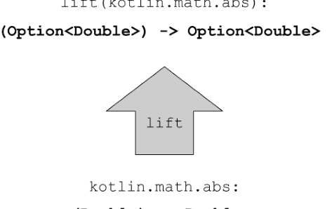

# 无异常处理错误


### 本章涵盖：

- 理解抛出异常的陷阱，以及它们为何破坏引用透明性
- 采用纯函数式方法处理异常情况
- 使用 `Option` 数据类型对成功条件进行编码并忽略失败
- 应用 `Either` 数据类型对成功和失败条件进行编码

我们简要提到在第 1 章中抛出异常是一种副作用，是不期望的行为。但为什么我们认为抛出异常很糟？为什么它不是期望的效果？答案与控制的丧失有很大关系。在抛出异常的那一点，控制权从程序中移出，异常会沿调用栈向上传播。这种控制丧失意味着两种情况之一——程序将被终止，因为异常未被处理，或者调用栈上更高处的程序的某个部分会捕获并处理异常。我们的程序复杂性已急剧升级，而在函数式编程中，这种控制丧失和额外复杂性应不惜一切代价避免。

如果异常不应该在函数式代码中抛出，我们如何处理异常情况呢？核心思想是我们可以用普通值表示失败和异常，并且我们可以编写高阶函数来抽象出错误处理和恢复的常见模式。返回错误作为值的函数式解决方案更安全，并保留了引用透明性，并且通过使用高阶函数，我们可以保留异常的主要优点——错误处理逻辑的整合。我们将更仔细地查看异常并讨论其一些问题，之后我们将看到如何使用函数式方法处理此类情况。

与我们在第 3 章中创建自己的 `List` 和 `Tree` 数据类型的相同原因，我们将创建

本章介绍两种 Kotlin 类型，Option 和 Either。正如之前所述，我们创建的类型并不存在于 Kotlin 标准库中，但在其他函数式编程语言中可以自由获得。它们也已通过 Arrow 移植自这些语言，Arrow 是 Kotlin 的一个补充函数式伴侣库。值得查看它们的文件，其可在 arrow-kt.io 找到。本章的目的是增强你对这些类型如何用于处理错误的理解。完成本章后，你可以随意使用 Arrow 版本的 Option 和 Either。尽管 Arrow 版本的语义可能有所不同，但思想保持不变。

## 4.1 抛出异常的问题

为什么异常会破坏引用透明性，为什么这是一个问题？让我们看一个简单的例子。我们将定义一个抛出异常的函数然后调用它。

### 列表 4.1 抛出并捕获异常

```
fun failingFn(i: Int): Int {
    val y: Int = throw Exception("boom")
    return try {
        val x = 42 + 5
        x + y
    } catch (e: Exception) {
        43
    }
}
```

+ ① 声明类型为 Int 的抛出 Exception
+ ② 不可达代码，因此不会返回 43

从 REPL 调用 failingFn 会得到预期的错误：

```
>>> chapter4.Listing_4_1.failingFn(12)
java.lang.Exception: boom
  at chapter4.Listing_4_1.failingFn(Listing_4_1.kt:7)
```

我们可以证明 y 不是引用透明的。回顾第 1.3 节，任何 RT 表达式都可以用其引用的值替换，且此替换应保持程序含义不变。如果我们在 x + y 中用 throw Exception("boom!") 替换 y，会产生不同的结果，因为异常现在会在会捕获异常并返回 43 的 try 块内部抛出：

```
fun failingFn2(i: Int): Int =
    try {
        val x = 42 + 5
        x + (throw Exception("boom!")) as Int
    } catch (e: Exception) {
        43
    }
```

+ ① 被抛出的 Exception 可以用任意类型标注，这里是 Int。

异常被捕获，因此返回 43
我们可以在 REPL 中演示这一点：

```
>>> chapter4.Listing_4_1.failingFn2(12)
res0: kotlin.Int = 43
```

另一种理解 RT 的方式是，RT 表达式的含义 *不依赖于上下文* 且可以局部推理，而非 RT 表达式的含义是 *上下文相关的* 且需要更全局的推理。例如，RT 表达式 42 + 5 的含义不依赖于它所嵌入的更大表达式——它始终永远等于 47。但表达式 throw Exception("boom!") 的含义非常依赖上下文——正如我们刚才演示的，它根据嵌套在哪个 try 块（如果有的话）而具有不同的含义。

异常有两个主要问题：

- 正如我们刚才讨论的，*异常破坏 RT 并引入上下文依赖*，使我们远离替换模型的简单推理，并可能写出令人困惑的基于异常的代码。这是民间建议仅将抛出异常用于错误处理而非控制流的来源。在函数式编程中，我们完全避免抛出异常，除非在无法恢复的极端情况下。
- *异常不是类型安全的*。`failingFn` 的类型 `(Int) -> Int` 告诉我们 nothing 关于可能发生异常的事实，并且编译器绝不会强制 `failingFn` 的调用者对如何处理这些异常做出决定。如果我们在 `failingFn` 中忘记检查异常，抛出的异常要到运行时才会检测到。

## 高阶函数与受检异常的使用

Java 的受检异常至少强制做出是否处理或重新抛出错误的决定，但它们会导致调用者产生大量样板代码。更重要的是，它们不适用于高阶函数，高阶函数不可能知道其参数可能抛出的具体异常。例如，考虑我们为 List 定义的 map 函数：

```
fun <A, B> map(xs: List<A>, f: (A) -> B): List<B> =
    foldRight(
        xs,
        List.empty(),
        { a, xa -> Cons(f(a), xa) })
```

这个函数显然很有用、高度通用，并且与受检异常的使用相矛盾——我们不能为 f 可能抛出的每一种受检异常都提供一个 map 版本。即使我们想这样做，map 又如何知道可能出现哪些异常呢？这就是为什么即使在 Java 中，通用代码也经常求助于使用 RuntimeException 或某些常见的受检 Exception 类型的原因。

我们希望有一种没有这些缺点的异常替代方案，但我们不想失去异常的主要好处：它们允许我们整合和集中错误处理逻辑，而不是被迫将此逻辑分布在整个代码库中。我们使用的技术基于一个旧想法：不是抛出异常，而是返回一个指示发生异常情况的值。这个想法可能对任何使用 C 中的返回码来处理异常的人都很熟悉。但我们不使用错误码，而是为这些“可能已定义的值”引入一种新的通用类型，并使用高阶函数来封装处理和传播错误的常见模式。与 C 风格的错误码不同，我们使用的错误处理策略是完全类型安全的，并且我们能得到类型检查器的充分帮助来强制我们处理错误，同时保持最小的语法噪音。我们很快就会看到所有这些是如何工作的。

## 4.2 异常问题的替代方案

让我们考虑一个可能使用异常的现实情况，并看看我们可以使用的不同方法。这里有一个计算列表平均值的函数的实现，如果列表为空则未定义：

```
fun mean(xs: List<Double>): Double =
    if (xs.isEmpty())
        throw ArithmeticException("mean of empty list!")
    else xs.sum() / length(xs)
```

当 xs 为空时抛出 ArithmeticException
② 否则返回有效结果

`mean` 函数是所谓的 *偏函数* 的一个例子：它对某些输入未定义。函数通常是偏的，因为它对输入做出一些假设，而这些假设并未由输入类型暗示。¹⁷ 你可能习惯于在这种情况下抛出异常，但还有另外两个选项，它们 *同样* 不理想。让我们在查看首选方法之前先针对我们的 `mean` 示例来看一下这些选项：

### 4.2.1 哨兵值

抛出异常的第一个可能替代方案是返回某种类型为 `Double` 的错误值。我们可以简单地在所有情况下返回 `xs.sum() / xs.length()`，并在分母 `xs.length()` 为零时使其返回 `Double.NaN`。或者，我们也可以返回其他哨兵值。在其他情况下，我们可能返回 `null` 而不是所需类型的值。这种一般性的方法是在没有异常的语言中经常进行错误处理的方式，我们拒绝这种解决方案有几个原因：

- 它允许错误静默传播——调用者可能忘记检查此条件且不会被编译器提醒，这可能导致后续代码无法正常工作。经常错误要到代码中更晚的地方才会检测到。
- 它导致调用站点出现大量样板代码，使用显式的 `if` 语句来检查调用者是否收到“真实”结果。如果恰好调用了多个函数，每个函数都使用必须以某种方式检查和聚合的错误码，则这种样板会放大。
- 它不适用于多态代码。对于某些输出类型，即使我们想这样做，我们可能甚至 *没有* 该类型的哨兵值！考虑像 `max` 这样的函数，它根据自定义比较函数找到序列中的最大值：`fun <A> max(xs: List<A>, greater: (A,A) -> Boolean): A`。如果输入为空，我们无法编造类型 A 的值。`null` 也不能在这里使用，因为 `null` 仅对非原始类型有效，而 A 实际上可能是 `Double` 或 `Int` 等原始类型。
- 它要求调用者采用特殊的策略或调用约定——正确使用 `mean` 函数要求调用者做一些除了调用 `mean` 并使用结果之外的事情。给函数这种特殊策略使得难以将它们传递给高阶函数，而高阶函数必须统一对待所有参数。

### 4.2.2 提供的默认值

抛出异常的第二个替代方案是强制调用者提供一个参数，告诉我们在不知道如何处理输入时该怎么做：

```
fun mean(xs: List<Double>, onEmpty: Double) =
    if (xs.isEmpty()) onEmpty ①
    else xs.sum() / xs.size() ②
```

① 当 xs 为空时提供默认值。
② 否则返回有效结果


这使得 mean 成为一个全函数，将输入类型的每个值映射到输出类型的唯一一个值。但它仍然存在缺点——它要求直接调用者直接了解如何处理未定义的情况，并且限制它们只能返回一个 Double。如果 mean 作为更大计算的一部分被调用，而我们希望在 mean 未定义时中止该计算怎么办？或者在这种情况下，我们是否希望在更大计算中采取完全不同的分支？简单地传递一个 onEmpty 参数并不能给予我们这种自由。

我们需要一种方法来推迟如何处理未定义情况的决策，以便它们能在最合适的层级得到处理。

## 4.3 使用 Option 编码成功条件

首选方法我们在第 1.2 节中提到过，即在返回类型中显式表示一个函数可能并不总是有一个答案。我们可以将这种方法视为将错误处理策略推迟给调用者。我们将引入一个名为 Option 的新类型来表示此类情况。正如我们之前提到的，该类型也存在于其他函数式语言和库中，但我们在这里出于教学目的重新创建它：

```
sealed class Option<out A> {
    //helper functions in companion object
}

data class Some<out A>(val get: A) : Option<A>()
object None : Option<Nothing>()
```

Option 有两种情况：

- 未定义，在这种情况下它将是 None
- 已定义，在这种情况下它将是 Some

我们可以用 Option 来定义 mean，如下所示：

## 列表 4.2 使用 Option 使 mean 函数保持纯净。

```
fun mean(xs: List<Double>): Option<Double> =
    if (xs.isEmpty()) None ①
    else Some(xs.sum() / xs.size()) ②
```

- ① 当 xs 为空时返回 None 值
- ② 返回包装有效结果的 Some 值

返回类型现在反映了结果可能并不总是被定义的情况。我们仍然始终从函数返回声明类型（现在是 Option<Double>）的结果。

## 无效结果的哨兵值



将所有无效输入映射到与有效输出相同类型的标记值。高度模糊，调用位置无法意识到此类特殊值。编译器不会检查。

## 无效结果的 Option 类型



有效输出被包装在 Some 中。无效输出映射到 None。调用位置必须相应地处理 Option。这在编译时得到强制执行。

图 4.1 比较哨兵值与 Option 对无效输入的响应

### 4.3.1 Option 的使用模式

编程中充斥着偏函数，而 Option（以及我们将在第 4.4 节中讨论的 Either 数据类型）通常是 FP 中处理这种偏性的方式。你在 Kotlin 标准库中看不到 Option 的任何使用，尽管你会在像 Arrow 这样的函数式库中看到它的使用。以下是它们使用它的一些示例：

- 使用 getOption 对映射中的给定键进行查找，如果找到则返回包装在 Some 中的值，否则对不存在的值返回 None。
- 为列表和其他可迭代对象定义的 firstOrNone 和 lastOrNone，如果序列非空，则返回包含序列第一个或最后一个元素的 Option。

这些并不是唯一的例子——作为函数式程序员，我们会在许多不同的情况下看到 Option 出现。使 Option 方便的原因是我们可以通过高阶函数提取出常见的错误处理模式，从而免于编写异常处理代码所带来的通常样板代码。在本节中，我们将介绍一些处理 Option 的基本函数。我们的目标不是让你精通所有这些函数，而只是让你熟悉到足以在需要编写一些函数式代码来处理错误时，可以重访本章并自行取得进展。

## 侧边栏 可空类型及其与 Option 的比较

Kotlin 选择不引入 Option 的概念，创建者称轻量级包装器的实例化会带来性能开销。处理空值问题的替代方案是引入可空类型的概念。

类型系统区分了可能持有 null 的引用和永远不会持有的引用。引入了一个并行的类型层次结构，以便类型系统中的每种类型都有一个等价的可空类型。例如，引用可能为 null 的 String 的值必须为 String? 类型。? 将其与不可空的等价类型 String 区分开来。这个可空值需要在调用位置处理，编译器强制你处理其状态的二元性。

在编译时处理 nulls 显然比允许 null 值传播并在运行时因 NullPointerException 而崩溃要好，但它仍然在需要处理这些可空类型的每个调用位置留下样板代码的痕迹。

在本节中，我们将专注于使用 Option 数据类型来表示可空值所认为的更函数式的方法。使用此类对象造成的开销可以忽略不计，因此从现在开始我们将不再提及可空类型。

## Option 的基本函数

Option 可以被认为像一个最多包含一个元素的 List，我们之前看到的许多 List 函数在 Option 上都有类似的函数。让我们看一些这些函数。

我们将做一些与第 3 章略有不同的事情，在第 3 章中我们将所有 List 函数放在 List companion object 中。这里我们尽可能使用扩展方法，增强对象使其可以用语法 obj.fn(arg1) 或 obj fn arg1 调用，而不是 fn(obj, arg1)。这是一个风格选择，没有实际意义，我们将在本书中同时使用这两种风格。18 让我们仔细看看。

### 清单 4.3 增强 Option 数据类型

```
fun <A, B> Option<A>.map(f: (A) -> B): Option<B> = TODO()

fun <A, B> Option<A>.flatMap(f: (A) -> Option<B>): Option<B> = TODO()

fun <A> Option<A>.getOrElse(default: () -> A): A = TODO()

fun <A> Option<A>.orElse(ob: () -> Option<A>): Option<A> = TODO()

fun <A> Option<A>.filter(f: (A) -> Boolean): Option<A> = TODO()
```

- 1. 如果 Option 不是 None，则应用 f 将 A 的值转换为 B
- 2. 如果 Option 不是 None，则应用可能失败的 f 到 Option
- 3. 如果 Option 是 None，则返回默认值
- 4. 如果 Option 是 None，则返回默认 Option
- 5. 如果谓词 f 未满足，则将 Some 转换为 None

这里有一点值得一提。getOrElse 中（以及 orElse 中类似的注解）的 default: () -> A 类型注解表示参数是一个无参数函数，返回类型 B。这通常用于实现惰性求值。现在不用担心——我们将在第 5 章中更多地讨论这种非严格性的概念。

## 练习 4.1

实现上述所有 Option 上的函数。在实现每个函数时，试着思考它的含义以及在什么情况下会使用它。我们接下来会探讨何时使用这些函数中的每一个。以下是解决此练习的几个提示：

- 使用匹配是可以的，不过你应该能够在不使用此技术的情况下实现除 map 和 getOrElse 之外的所有函数。
- 对于 map 和 flatMap，类型签名应该足以确定实现。
- getOrElse 返回 Option 的 Some 情况内部的结果，或者如果 Option 是 None，则返回给定的默认值。
- orElse 如果第一个 Option 已定义则返回它；否则返回第二个 Option。

## 基本 Option 函数的使用场景

尽管我们可以显式地匹配 Option，但我们几乎总是会使用上述高阶函数。在这里，我们将尝试为何时使用每一种提供一些指导。对这些函数的熟练程度需要通过实践获得，但这里的目标是获得一些基本熟悉度。下次你尝试编写使用 Option 的函数式代码时，看看是否能在诉诸模式匹配之前识别出这些函数所封装的模式。

让我们从 map 开始。你可以使用 map 函数来转换 Option 内部的结果（如果存在）。我们可以将其视为在假设错误未发生的情况下继续进行计算；它也是将错误处理推迟到后续代码的一种方式：

```kotlin
data class Employee(
    val name: String,
    val department: String,
    val manager: Option<String>
)

fun lookupByName(name: String): Option<Employee> = TODO()

fun timDepartment(): Option<String> =
    lookupByName("Tim").map { it.department }
```



图 4.2 使用 map 转换 Option 的内容

这里，lookupByName("Tim") 返回一个 Option<Employee>，我们使用 map 对其进行转换以提取表示部门的 String。注意，我们不需要显式检查 lookupByName("Tim") 的结果，我们只需在 map 的参数内部像未发生错误一样继续计算。如果 lookupByName("Tim") 返回 None，这将中止剩余的计算，并且 map 根本不会调用 it.department 函数。

在我们的示例中，Employee 的 manager 类型为 Option<String>。如果我们想使用像处理部门那样简单的 map 来确定经理是谁，那将使我们得到一个笨拙的 Option<Option<String>>。


```
val unwieldy: Option<Option<String>> =
    lookupByName("Tim").map { it.manager }
```

当我们应用 flatMap 时，它会先映射，然后展平结果¹⁹，这样我们就得到一个更有用的 Option<String>，表示 Tim 的经理。然后它可以再由 getOrElse 处理，以获得更具体的結果。

```
val manager: String = lookupByName("Tim")
    .flatMap { it.manager }
    .getOrElse { "Unemployed" }
```



## 图 4.3 使用 flatMap 展平并转换 Option<Option<String>> 的内容

## 练习 4.2

使用 flatMap 实现方差函数。如果序列的均值为 m，则方差是序列中每个元素 x 减去 m 的平方的均值。在代码中，这将是 (x - m).pow(2)。可使用在代码清单 4.2 中开发的 mean 方法来实现此功能。参见 Wikipedia 上的方差定义 (en.wikipedia.org/wiki/Variance#Definition)。

```
fun variance(xs: List<Double>): Option<Double> = TODO()
```

正如方差的实现所示，使用 flatMap 我们可以构建一个多阶段的计算，其中任何阶段都可能失败，并且计算会在遇到第一个失败时立即中止，因为 None.flatMap(f) 会立即返回 None，而不会运行 f。

我们可以使用 filter 将成功转换为失败，如果成功的值与给定谓词不匹配。一种常见模式是通过调用 map、flatMap 和/或 filter 来转换 Option，然后使用 getOrElse 在最后进行错误处理。这可以通过继续我们从代码清单 4.4 开始的示例来演示：

```
val dept: String = lookupByName("Tim")
  .map { it.department }
  .filter { it != "Accounts" }
  .getOrElse { "Unemployed" }
```

这里使用 getOrElse 将 Option<String> 转换为 String，通过提供默认部门，以防键 "Tim" 不存在于映射中或 Tim 的部门不是 "Accounts"。

orElse 与 getOrElse 类似，不同之处在于如果第一个为 None，我们返回另一个 Option。当我们需要将可能失败的计算链接在一起时，这通常很有用，如果第一个未成功，则尝试第二个。

一个常见的习惯用法是执行 o.getOrElse(throw Exception("FAIL")) 将 Option 的 None 情况转换回异常。一般经验法则是，我们仅在没有任何合理的程序会捕获该异常时才使用异常；如果对于某些调用者，异常可能是可恢复的错误，我们使用 Option（或在第 4.4 节中讨论的 Either）来给予它们灵活性。

正如你所见，将错误作为普通值返回很方便，并且使用高阶函数让我们能够实现与使用异常时相同的错误处理逻辑的整合。请注意，我们不必在计算的每个阶段都检查 None——我们可以应用多个转换，然后在准备好时再检查并处理 None。但我们也获得了额外的安全性，因为 Option<A> 与 A 是不同的类型，编译器不会让你忘记显式地推迟或处理 None 的可能性。

### 4.3.2 Option 组合、提升和包装异常导向的 API

人们很容易得出结论，一旦开始使用 Option，它就会感染整个代码库。可以想象，任何调用接受或返回 Option 的方法的调用者都必须修改以处理 Some 或 None。但这种情况不会发生，原因在于我们可以将普通函数提升为在 Option 上操作的函数。

例如，map 函数让我们可以使用类型为 (A) -> B 的函数对类型为 Option<A> 的值进行操作，返回 Option<B>。另一种看待方式是，map 将类型为 (A) -> B 的函数 f 转换为类型为 (Option<A>) -> Option<B> 的函数。让我们明确这一点：

### 列表 4.4 将函数提升以使用 Options

```
fun <A, B> lift(f: (A) -> B): (Option<A>) -> Option<B> =
  { oa -> oa.map(f) }
```

这告诉我们，任何我们已有的函数都可以通过 lift 转换，使其在单个 Option 值的上下文中操作。让我们看一个示例，演示如何对内置的 kotlin.math.abs 函数使用 lift 来获取数字的绝对值：

```
val abs0: (Option<Double>) -> Option<Double> =
    lift { kotlin.math.abs(it) }
```

kotlin.math 命名空间包含各种独立的数学函数，包括 abs、sqrt、exp 等。我们不需要重写 kotlin.math.abs 函数使其适用于可选值；我们只是事后将其提升到 Option 上下文中。我们可以对任何函数都这样做。



图 4.4 将简单函数提升以接收和发出 Option 类型

让我们看另一个示例。假设我们正在为一家汽车保险公司的网站实现逻辑，该网站包含一个页面，用户可以在其中提交表单以请求即时在线报价。我们希望解析此表单中的信息并最终调用我们的费率函数：

```
/**
 * Top secret formula for computing an annual car
 * insurance premium from two key factors.
 */
fun insuranceRateQuote(
    age: Int,
    numberOfSpeedingTickets: Int
): Double = TODO()
```

我们希望能够调用此函数，但如果用户在网页表单中提交年龄和超速罚单数量，这些字段将作为简单的字符串到达，我们必须（尝试）将其解析为整数。此解析可能会失败；给定一个字符串 s，我们可以使用 s.toInt() 尝试将其解析为 Int，如果字符串不是有效的整数，则会抛出 NumberFormatException：

```
>>> "112".toInt()
res0: kotlin.Int = 112

>>> "hello".toInt()
java.lang.NumberFormatException: For input string: "hello"
at java.lang.NumberFormatException.forInputString(NumberFormatException.java:65)
 at java.lang.Integer.parseInt(Integer.java:580)
 at java.lang.Integer.parseInt(Integer.java:615)
```

让我们将 toInt() 的基于异常的 API 转换为 Option，看看是否可以实现一个函数 parseInsuranceRateQuote，该函数将年龄和超速罚单数量作为字符串，并在两个值都成功解析时尝试调用 insuranceRateQuote 函数。

```
fun parseInsuranceQuote(
    age: String,
    speedingTickets: String
): Option<Double> {

    val optAge: Option<Int> = catches { age.toInt() }

    val optTickets: Option<Int> =
        catches { speedingTickets.toInt() }

    //return insuranceRateQuote(optAge, optTickets)
}

fun <A> catches(a: () -> A): Option<A> =
    try {
        Some(a())
    } catch (e: Throwable) {
        None
    }
```

- 1. 这不会通过类型检查，因为存在不兼容性
- 2. 我们以非严格方式接受 A 参数，因此可以捕获在评估 a 时发生的任何异常并将其转换为 None。
- 3. 在 Some 内部使用 () 调用非严格参数 a
- 4. 注意：这会丢弃有关错误 e 的信息。我们将在第 4.4 节中使用 Either 改进这一点。

catches 函数是一个通用函数，我们可以用它将基于异常的 API 转换为面向 Option 的 API。它使用非严格或惰性参数，如无参数函数定义 () -> A 作为 a 的类型所示。我们将在第 5 章中更详细地讨论惰性，但现在我们需要知道的是，惰性参数可以通过调用 invoke() 或等效的 () 简写符号来求值。换句话说，调用也可以写成 a.invoke() 或 a()。

但这里有一个问题——在将 optAge 和 optTickets 解析为 Option<Int> 之后，我们如何调用 insuranceRateQuote，而它目前接受两个 Int 值？我们是否必须重写 insuranceRateQuote 使其接受 Option<Int> 值？不需要，而且更改 insuranceRateQuote 会使关注点纠缠在一起，迫使它意识到之前的计算可能失败，更不用说我们可能没有修改 insuranceRateQuote 的能力——也许它是在我们无法访问的单独模块中定义的。


相反，我们希望将 insuranceRateQuote 提升到两个可选值上下文中运行。我们可以在 parseInsuranceRateQuote 的主体中使用显式的模式匹配来实现这一点，但那样会很繁琐。

### 练习 4.3

编写一个通用函数 map2，使用二元函数合并两个 Option 值。如果任一 Option 值为 None，则返回值也为 None。以下是其签名：

```
fun <A, B, C> map2(a: Option<A>, b: Option<B>, f: (A, B) -> C): Option<C> =
    TODO()
```

使用 map2，我们现在可以按如下方式实现 parseInsuranceRateQuote：

```
fun parseInsuranceRateQuote(
    age: String,
    speedingTickets: String
): Option<Double> {

    val optAge: Option<Int> = catches { age.toInt() }

    val optTickets: Option<Int> =
        catches { speedingTickets.toInt() }

    return map2(optAge, optTickets) { a, t ->
        insuranceRateQuote(a, t)
    }
}

fun <A> catches(a: () -> A): Option<A> =
    try {
        Some(a())
    } catch (e: Throwable) {
        None
    }
```

使用 map2 现在允许使用现有的 insuranceRateQuote 函数。然而，仍然存在一个缺点，即如果任一或两者 Option 为 None，将返回一个整体的 None，因此我们失去了哪个失败的知识。

然而，map2 函数意味着我们永远不需要修改任何现有双参数函数以使其“感知 Option”。我们可以在事后将其提升到 Option 上下文中运行。你是否已经能看出如何定义 map3、map4 和 map5？让我们看几个类似的案例。

### 练习 4.4

编写一个函数 sequence，将 Option 的列表合并为一个包含原始列表中所有 Some 值的列表的 Option。如果原始列表中甚至包含一次 None，则函数的结果应为 None；否则结果应为包含所有值的 Some。以下是其签名：

```
fun <A> sequence(xs: List<Option<A>>): Option<List<A>> = TODO()
```

有时我们希望使用可能失败的函数对列表进行映射，如果将其应用于列表中的任何元素返回 None，则返回 None。例如，如果我们有一整个 String 值列表希望解析为 Option<Int> 呢？在这种情况下，我们可以简单地对 map 的结果进行 sequence：

```
fun parseInts(xs: List<String>): Option<List<Int>> =
    sequence(xs.map { str -> catches { str.toInt() } })
```

不幸的是，这效率不高，因为它遍历了列表两次，首先将每个 String 转换为 Option<Int>，然后第二次遍历将这些 Option<Int> 值合并为 Option<List<Int>>。以这种方式对 map 的结果进行 sequence 是足够常见的现象，以至于需要一个新的通用函数 traverse。

### 练习 4.5

实现 traverse 函数。使用 map 和 sequence 实现它相当直接，但请尝试实现一个更高效的实现，只查看列表一次。完成后，使用 traverse 实现 sequence。

```
fun <A, B> traverse(
    xa: List<A>,
    f: (A) -> Option<B>
): Option<List<B>> = TODO()
```

在看到这么多示例后，我们可以得出结论，你永远不需要修改任何现有函数以使其适用于可选值。在 map、lift、sequence、traverse、map2、map3 等之间，你拥有处理此类情况所需的所有工具。

### 4.3.3 使用 Arrow fx 的 Option 的 For comprehension

许多语言都有一个称为 for-comprehension 或 monad-comprehension 的特性。这个概念可以描述为一种构造，它在一系列 flatMap 和 map 调用上应用语法糖，从而产生最终结果。与处理一系列嵌套调用相比，for-comprehension 具有更令人愉悦且更简洁的语法，类似于命令式代码。

Kotlin 本身并未提供 for-comprehension，但幸运的是 Arrow 已涵盖此功能。在 Arrow 中它被称为 fx，但其工作方式与其它语言提供的非常相似。让我们看看如何使用 Option 上的 fx 方法实现 map2。考虑以下代码作为 map2 的实现：

```
fun <A, B, C> map2(
    oa: Option<A>,
    ob: Option<B>,
    f: (A, B) -> C
): Option<C> =
    oa.flatMap { a ->
        ob.map { b ->
            f(a, b)
        }
    }
```

使用 Arrow 提供的 fx 函数，这现在可以提炼成更具表现力且看似命令式的形式：

```
fun <A, B, C> map2(
    oa: Option<A>,
    ob: Option<B>,
    f: (A, B) -> C
): Option<C> =
    Option.fx {
        val (a) = oa
        val (b) = ob
        f(a, b)
    }
```

for-comprehension 由一系列语句组成，例如 val (a) = oa 和 val (b) = ob，后跟像 f(a, b) 这样产生结果的表达式。编译器将这些语句反糖化为 flatMap 调用，最后的表达式被转换为 map 调用。

值得注意的是，这种风格的 for-comprehension 不能与我们的 Option 类型一起使用，因为受支持的类需要是 Arrow 的 Monad 类型类的实例。我们将在本书后面学习 Monad 和类型类，但目前可以说，这仅适用于 Arrow 的受支持类型，例如 Option、Either、List、State 和 IO 等等。

当你对使用 flatMap 和 map 越来越熟悉时，你应该可以开始使用 for-comprehension 代替对这些组合子的显式调用。

## 4.4 使用 Either 编码成功和失败条件

正如我们之前所暗示的，本章的核心思想是，我们可以用普通值表示失败和异常，并编写抽象出常见错误处理和恢复模式的函数。Option 并不是我们可以用来的唯一数据类型，尽管它经常被使用，但它相当简单。你可能已经注意到 option 的一个问题是，在异常情况下它不会告诉我们出了什么问题。它唯一能做的就是给我们 None，表示没有值可取。但有时我们想要知道更多信息。例如，我们可能想要一个 String 提供更多信息，或者如果引发了异常，我们可能想知道该错误到底是什么。

我们可以设计一种数据类型来编码我们想要的关于失败的任何信息。有时仅知道是否发生了失败就足够了，在这种情况下我们可以使用 Option；其他时候我们想要更多信息。在本节中，我们将逐步介绍 Option 的一个简单扩展——Either 数据类型，它允许我们跟踪失败的原因。让我们看看它的定义：

### 列表 4.5 The Either data type

```
sealed class Either<out E, out A>

data class Left<out E>(val value: E) : Either<E, Nothing>()
data class Right<out A>(val value: A) : Either<Nothing, A>()
```

Either 只有两种情况，就像 Option 一样。关键区别在于两种情况都携带一个值。Either 数据类型以非常通用的方式表示可以是两种事物之一的值。我们可以说它是一个两个类型的不相交联合。当我们用它来表示成功或失败时，按惯例 Right 构造函数保留给成功情况（“right”意为正确的一个双关），而 Left 用于失败。我们给左类型参数起了暗示性的名字 E（表示 error）。

让我们再次看一下 mean 示例，这次在失败时返回一个 String：

```
fun mean(xs: List<Double>): Either<String, Double> =
    if (xs.isEmpty())
        Left("mean of empty list!")
    else Right(xs.sum() / xs.size())
```

有时我们可能想要包含有关错误的更多信息，例如显示源代码中错误位置的堆栈跟踪。在这种情况下，我们可以简单地在 Either 的 Left 侧返回异常：

```
fun safeDiv(x: Int, y: Int): Either<Exception, Int> =
    try {
        Right(x / y)
    } catch (e: Exception) {
        Left(e)
    }
```

为了帮助创建新的 Either，我们将再次编写一个名为 catches 的函数，它提取了将抛出异常转换为值的这种常见模式。

### 列表 4.6 A catches function converting exceptions to Either

```
fun <A> catches(a: () -> A): Either<Exception, A> =
    try {
        Right(a())
    } catch (e: Exception) {
        Left(e)
    }
```

### 练习 4.6

实现在 Right 值上操作的 Either 的 map、flatMap、orElse 和 map2 版本。

```
fun <E, A, B> Either<E, A>.map(f: (A) -> B): Either<E, B> = TODO()

fun <E, A, B> Either<E, A>.flatMap(f: (A) -> Either<E, B>): Either<E, B> = TODO()

fun <E, A> Either<E, A>.orElse(
    f: () -> Either<E, A>
): Either<E, A> = TODO()

fun <E, A, B, C> map2(
    ae: Either<E, A>,
    be: Either<E, B>,
    f: (A, B) -> C
): Either<E, C> = TODO()
```

### 4.4.1 使用 Arrow fx 的 Either 的 For comprehension

在本节中，我们将专注于使用 Either 编写优雅的 for-comprehension。与 Option 情况一样，Arrow 中也存在一个 Either 变体，它能够在这种 for-comprehension 中使用。让我们看下面的详细示例来演示其工作原理。

### 列表 4.7 Using Either in for-comprehensions

```
suspend fun String.parseToInt(): Either<Throwable, Int> =
    Either.catch { this.toInt() }

suspend fun parseInsuranceRateQuote(
    age: String,
    numberOfSpeedingTickets: String
): Either<Throwable, Double> {
    val ae = age.parseToInt()
    val te = numberOfSpeedingTickets.parseToInt()
    return Either.fx {
        val (a) = ae
        val (t) = te
        insuranceRateQuote(a, t)
    }
}
```


- 1. 为 `String` 添加 `parseToInt` 扩展方法
- 2. 使用 `Either.catch` 方法生成一个 `Either<Throwable, Int>`
- 3. 方法标记为 `suspend`，意味着其子进程可能阻塞
- 4. 使用扩展方法生成一个 `Either`
- 5. 使用 `Either.fx` 打开 for-comprehension
- 6. 通过解构 `flatMap` 右偏的 `Either`
- 7. 在成功时将 `insuranceRateQuote` 的最终求值作为 `Either.Right` 返回

这个示例涉及很多内容，所以让我们慢慢分析。首先，我们声明一个扩展函数，为所有 `String` 实例添加 `parseInt` 方法。该函数将处理 `String` 上 `toInt` 方法抛出的任何异常，并会自动返回包含所抛异常的 `Either.Left`，或者包含成功解析值的 `Either.Right`。由于这可能是一个阻塞操作，我们需要用 `suspend` 关键字标记该函数。*挂起函数* 只是一个普通的 Kotlin 函数，加上额外的 `suspend` 修饰符，表示该函数可以在执行长时间运行的子进程时被挂起。

`parseInsuranceQuote` 方法随后将使用此扩展函数将它的两个 `String` 参数解析为 `Either<Throwable, Int>`。这两个参数都可能导致失败，从而产生包含异常的 `Either.Left`，并且随后在标记为 `fx` 块的 for-comprehension 中被 flatMapped。

对 `insuranceRateQuote` 的最终调用只有在两个 `Either` 实例都是 `Right` 时才会发生。这将产生一个 `Either.Right<Double>`。另一方面，如果其中一个或两个实例是 `Either.Left<Throwable>`，则 *第一个* 将被返回给方法调用者，从而短路 for-comprehension 的其余部分。`Either` 的右侧始终具有优先权，因此被称为 *右偏*。

现在我们获取实际发生的异常信息，而不是在失败时仅仅返回 `None`。

## 练习 4.7

为 `Either` 实现 `sequence` 和 `traverse`。如果有错误，它们应返回遇到的第一个错误。

作为最后一个示例，这里有一个 `map2` 的应用，其中函数 `mkPerson` 在构造有效的 `Person` 之前验证给定的姓名和年龄。

## 清单 4.8 使用 Either 验证数据

```kotlin
data class Person(val name: Name, val age: Age)

data class Name(val value: String)
data class Age(val value: Int)

fun mkName(name: String): Either<String, Name> =
    if (name.isBlank()) Left("Name is empty.")
    else Right(Name(name))

fun mkAge(age: Int): Either<String, Age> =
    if (age < 0) Left("Age is out of range.")
    else Right(Age(age))

fun mkPerson(name: String, age: Int): Either<String, Person> =
    map2(mkName(name), mkAge(age)) { n, a -> Person(n, a) }
```

## 练习 4.8

在清单 4.8 中找到的实现中，map2 只能报告一个错误，即使姓名和年龄都无效。你需要做出什么改变才能报告两个错误？你会改变 map2 还是 mkPerson 的签名？或者你能否创建一个新的数据类型，比 Either 更能捕捉这一需求，并具有额外的结构？对于该数据类型，orElse、traverse 和 sequence 的行为会有什么不同？

## 4.5 摘要

- 抛出异常是不希望的，会破坏引用透明性。
- 抛出异常应仅保留用于无法恢复的极端情况。
- 你可以通过使用封装异常情况的数据类型来实现纯函数式错误处理。
- Option 数据类型很方便用于将简单成功条件编码为 Some，或将失败编码为空的 None。
- Either 数据类型可以将成功条件编码为 Right，或将失败条件编码为 Left。
- 容易抛出异常的函数可以被提升以符合 Option 和 Either 类型。
- 一系列 Option 或 Either 操作可能在遇到第一个失败时停止。
- for-comprehension 是一种允许流畅表达一系列组合子调用的构造。
- Arrow 库是 Kotlin 的函数式伴侣，拥有 Option 和 Either 构造，通过绑定方法允许使用 for-comprehension 来简化代码。
