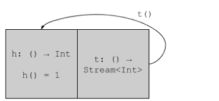
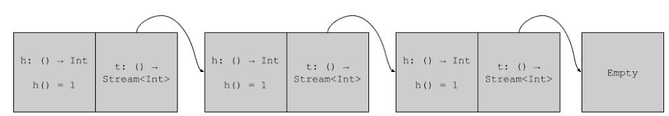

# 严格性与惰性

### 本章涵盖：

- 理解严格函数与非严格函数之间的差异
- 实现惰性列表数据类型
- 缓存流以避免重新计算
- 检查流以进行可视化和测试
- 将程序描述与求值分离
- 消费无限流并掌握核心递归

Kotlin 与大多数现代编程语言一样，默认使用 *严格* 求值。也就是说，它只允许参数必须在调用前完全求值的函数。在迄今为止的所有示例中，我们都专注于这种求值策略，也称为 *急切* 或 *贪婪* 求值。事实上，这正是我们在推导 `List`、`Option` 和 `Either` 等数据类型时所使用的。我们稍后会查看严格性的更正式定义，但严格求值在现实世界中到底意味着什么？

严格求值的表达式在绑定到变量时立即求值。这包括作为参数传递给函数时。这种策略在我们只是为简单值赋值时是可以接受的，但如果我们的表达式执行某些昂贵或复杂的计算来确定其值会怎样？更进一步，如果这种昂贵计算用于表达列表数据类型的 *所有* 元素，而我们可能只需要前几个元素会怎样？

*非严格* 或 *惰性* 求值的概念在这里派上用场——值只在实际引用时才计算，而不是在声明时。我们不再贪婪地执行所有计算，而是按需计算。

在本章中，我们将更仔细地研究非严格求值的概念，以及应用这种策略的影响。我们还将构建一个代数数据类型，紧密地模拟这一概念，使我们能够执行与之前实现的数据类型上所做的所有相同操作。我们将看到这些操作如何帮助我们在计算的声明与其最终求值之间实现关注点的分离。最后，我们将深入探讨如何使用核心递归生成无限数据流，这是一种基于流本身产生的内容惰性生成无限值序列的技术。

在第 3 章中，我们讨论了纯函数式数据结构，以单链表为例。我们涵盖了列表上的许多批量操作——map、filter、foldLeft、foldRight、zipWith 等等。我们注意到这些操作中的每一个都会对输入进行一次遍历并为输出构造一个新列表。

想象一下，如果你有一副牌，被要求移除奇数牌然后翻开所有皇后。理想情况下，你会一次性遍历牌堆，同时寻找皇后和奇数牌。这比先移除奇数牌然后在剩余牌中寻找皇后更高效。然而后者正是 Kotlin 在以下代码片段中所做的：

```
>>> List.of(1, 2, 3, 4).map { it + 10 }.filter { it % 2 == 0 }.map { it * 3 }
res0: kotlin.collections.List<kotlin.Int> = [36, 42]
```

在这个表达式中，map { it + 10 } 会生成一个中间列表，然后传递给 filter { it % 2 == 0 }，后者又构造一个列表传递给 map { it * 3 }，然后产生最终列表。换句话说，每次转换都会生成一个临时列表，该列表仅用作下一个转换的输入，然后立即被丢弃。

思考一下这个程序是如何求值的。如果我们手动生成其求值轨迹，步骤看起来会像如下所示。

## 清单 5.1 严格列表实现上操作的求值轨迹

```
List.of(1, 2, 3, 4)
    .map { it + 10 }.filter { it % 2 == 0 }.map { it * 3 }
List.of(11, 12, 13, 14)
    .filter { it % 2 == 0 }.map { it * 3 }
List.of(12, 14)
    .map { it * 3 }
List.of(36, 42)
```

这里我们展示了为求值表达式而执行的每次替换的结果。例如，从第一行到第二行，我们根据 map 的定义，将 List.of(1,2,3,4).map { it + 10 } 替换为 List.of(11,12,13,14)。22 这种视图清楚地表明了 map 和 filter 的每次调用如何各自遍历输入并为输出分配列表。如果我们能以某种方式将此类转换序列融合为一次遍历并避免创建临时数据结构，不是很好吗？我们可以重写

手工将代码改写成 while 循环，但理想情况下我们希望在保留相同的高层次组合风格的同时自动完成此操作。我们希望使用像 map 和 filter 这样的高阶函数来组合程序，而不是编写单一的循环。

事实证明，我们可以通过使用非严格性（或不太正式地说，惰性）来实现这种自动循环融合。在本章中，我们将解释这具体意味着什么，并逐步实现一种能够融合转换序列的惰性列表类型。虽然构建“更好”的列表是本章的动机，但我们会看到非严格性是改进函数式程序效率和模块化的基本技术。

## 5.1 严格函数与非严格函数

在进入惰性列表的示例之前，我们需要介绍一些基础知识。什么是严格性和非严格性，以及如何在 Kotlin 中表达这些概念？

非严格性是函数的一个属性。说一个函数是非严格的，只是意味着该函数可以选择不求值一个或多个参数。相比之下，严格函数总是求值其参数。严格函数在大多数编程语言中是常态，事实上大多数语言只支持期望其参数完全求值的函数。除非另行说明，Kotlin 中的任何函数定义都将是严格的（到目前为止我们定义的所有函数都是严格的）。例如，考虑以下函数：

```
fun square(x: Double): Double = x * x
```

当你调用 square(41.0 + 1.0) 时，由于它是严格的，函数 square 将接收求值后的 42.0 值。如果你调用 square(exitProcess(-1))，程序将在 square 有机会执行任何操作之前终止，因为 exitProcess(-1) 表达式会在进入 square 的函数体之前被求值。

虽然我们还没有学习在 Kotlin 中表示非严格性的语法，但你几乎肯定熟悉这个概念。例如，在包括 Kotlin 在内的许多编程语言中都存在的短路布尔函数 && 和 || 是非严格的。你可能习惯将 && 和 || 视为内置语法，是语言的一部分，但你也可以将它们视为可能选择不求值其参数的函数。函数 && 接受两个布尔参数，但只有在第一个为 true 时才求值第二个参数：

```
>>> false && { println("!!"); true }.invoke() //does not print anything
res0: kotlin.Boolean = false
```

而 || 只有在第一个为 false 时才求值其第二个参数：

```
>>> true || { println("!!"); false }.invoke() //does not print anything either
res1: kotlin.Boolean = true
```

Kotlin 中非严格性的另一个例子是 if 控制结构：

```
val result =
    if (input.isEmpty()) exitProcess(-1) else input
```

尽管 if 是 Kotlin 中的内置语言结构，但可以将其视为接受三个参数的函数：一个 Boolean 类型的条件，在条件为 true 时返回某个类型 A 的表达式，以及在条件为 false 时返回相同类型 A 的另一个表达式。这个 if 函数是非严格的，因为它不会求值所有参数。更精确地说，我们会说 if 函数在其条件参数上是严格的，因为它总是会求值条件以确定采用哪个分支，而在 true 和 false 两个分支上是非严格的，因为它只会根据条件求值其中一个。

在 Kotlin 中，我们可以通过接受部分参数未求值来编写非严格函数。由于 Kotlin 没有表达未求值参数的方法，我们必须始终显式地这样做。下面是一个非严格的 if 函数：

```
fun <A> if2(
    cond: Boolean,
    onTrue: () -> A,
    onFalse: () -> A
): A = if (cond) onTrue() else onFalse()

val y = if2((a < 22),
    { println("a") },
    { println("b") }
)
```

- ① 惰性值类型 A 的函数参数类型是 () -> A
- ② 创建 () -> A 的函数字面量语法

我们希望传递未求值的参数在其类型前立即带有 () ->。类型为 () -> A 的值是一个接受零个参数并返回 A 的函数。23 一般来说，表达式的未求值形式称为 thunk，我们可以强制 thunk 求值表达式并得到结果。我们通过调用函数并传递空参数列表来实现，如 onTrue() 或 onFalse()。同样，if2 的调用者必须显式创建 thunk，其语法遵循我们已经见过的函数字面量语法的相同约定。总的来说，这种语法使发生的事情非常清晰——我们用一个无参数的函数替换每个非严格参数，然后在函数体中显式调用该函数以获得结果。

使用这种语法，传递给函数未求值的参数将在函数体中引用的每个位置求值一次。也就是说，Kotlin（默认情况下）不会缓存求值参数的结果：

```
fun maybeTwice1(b: Boolean, i: () -> Int) =
    if (b) i() + i() else 0
```

```
>>> val x = maybeTwice1(true, { println("hi"); 1 + 41 })
hi
hi
```

这里，i 在 maybeTwice1 的函数体中被引用了两次，我们通过传递块 { println("hi"); 1+41 } 使其每次都被求值变得非常明显，该块在返回 42 的结果之前作为副作用打印 hi。表达式 1 + 41 也将被计算两次。如果我们希望只求值一次结果，可以通过在分配新值时委托给 lazy 内置函数来显式缓存值：

```
fun maybeTwice2(b: Boolean, i: () -> Int) {
    val j: Int by lazy(i)
    if (b) j + j else 0
}
```

```
>>> val x = maybeTwice2(true, { println("hi"); 1 + 41 })
hi
```

我们使用惰性求值来初始化 j 的值。这将推迟初始化，直到 if 语句引用它为止。它还会缓存结果，以便对该值的后续引用不会触发重复求值。此用于求值的机制对本讨论并不重要，但在标题为惰性初始化的侧边栏中会更详细地介绍。

### 严格性的形式定义

SIDEBAR
如果表达式的求值无限运行或抛出错误而不是返回一个确定的值，我们说该表达式不终止，或说它求值为 bottom。如果函数 f 对于所有求值为 bottom 的 x，表达式 f(x) 都求值为 bottom，则函数 f 是严格的。

NOTE
我们说非严格函数参数按名称传递，而严格参数按值传递。

### 惰性初始化

*惰性初始化* 是推迟对象创建、值计算或其他昂贵过程直到第一次需要时的策略。完整的定义可以在维基百科上找到：[维基百科懒初始化](en.wikipedia.org/wiki/Lazy_initialization)

此语言特性在 Kotlin 中通过名为 `lazy` 的内置函数实现。当此函数使用 lambda thunk 作为参数被调用时，会返回一个 `Lazy<T>` 的实例（其中 T 是要分配的值的类型）。此 `Lazy` 对象用作实现惰性属性的委托。委托通过使用 `by` 关键字来表达。

```
val x: Int by lazy { expensiveOp() }

fun useIt() =
    if (x > 10) "hi"
    else if (x == 0) "zero"
    else ("lo")
```

- 1. `by` 关键字用于将 `lazy` 返回的 `Lazy<Int>` 绑定到 x
- 2. 当 x 在条件语句中被求值时，`expensiveOp` 的调用将被执行并缓存结果
- 3. 使用缓存的值而不是再次调用 `expensiveOp`

惰性属性 x 在首次访问时通过执行传递给 `lazy` 函数的 lambda thunk 中的 `expensiveOp` 来初始化。然后结果被缓存到委托对象中，以便后续求值利用。

对 thunk 的访问默认使用并发锁是线程安全的，但行为可以通过使用不同的惰性线程安全模式来改变。这些模式的使用超出了本侧边栏的范围，但在 Kotlin 网站上²⁴ 有很好的文档记录。

## 5.2 一个扩展示例：惰性列表

让我们回到本章开头提出的问题，在那里我们对列表执行了多次遍历所需的多个转换。我们将探讨如何使用惰性列表或 *streams* 作为示例来提高函数式程序的效率和模块化。我们将看到如何通过使用惰性将流上的转换链融合为一次遍历。这里有一个简单的 `Stream` 定义。这里有一些我们接下来会讨论的新内容。


## 列表 5.2 Stream 数据类型的定义及其密封实现

```
sealed class Stream<out A> {
    companion object {
        //smart constructors
    }
}

data class Cons<out A>(
    val head: () -> A,
    val tail: () -> Stream<A>
) : Stream<A>()

object Empty : Stream<Nothing>()
```

此类型看起来与我们的 List 类型相同，只是 Cons 数据构造函数采用显式的 thunk（() -> A 和 () -> Stream<A>）而不是常规的严格值。如果我们希望检查或遍历 Stream，则需要像我们在 if2 的定义中早期所做的那样强制这些 thunk。例如，这里有一个用于可选地提取 Stream 头部的扩展函数：

```
fun <A> Stream<A>.headOption(): Option<A> =
    when (this) {
        is Empty -> None
        is Cons -> Some(head())
    }
```

① 使用 head() 显式强制 head thunk

当我们为 Stream 实例添加行为时，在 when 构造中当 this 被智能转换为 Cons 时，head 和 tail 值可供使用。请注意，我们必须通过 head() 显式强制 head，除此之外，代码的工作方式与 List 相同。但 Stream 仅评估实际所需部分的能力（我们不评估 Cons 的 tail）非常有用，正如我们在下一节中将看到的那样。

### 5.2.1 流的记忆化与避免重复计算

代表昂贵计算的求值应不惜一切代价避免。防止过度求值的一种方法是称为记忆化的技术。在应用此技术时，我们通过缓存初始求值的结果来防止昂贵计算的多次求值。净结果是每个纯表达式仅求值一次，然后在该程序的剩余部分中重复使用。

我们通常希望在 Cons 节点被强制后缓存其值。例如，如果我们直接使用 Cons 数据构造函数，这段代码实际上会计算 expensive(y) 两次：

```
val x = Cons({ expensive(y) }, { tl })
val h1 = x.headOption()
val h2 = x.headOption()
```

我们通常通过定义智能构造函数来避免此问题，我们称之为用于构造数据类型并确保某些额外不变量或提供与“真实”构造函数略有不同的签名的函数。按照惯例，智能构造函数位于基类的 companion object 中，其名称通常将对应数据构造函数的首字母小写。在这里，我们的 cons 智能构造函数负责记忆化 Cons 的 head 和 tail 的按名参数。这是一个常见的技巧，它确保我们的 thunk 只会在首次强制时执行一次工作。后续的强制将返回缓存的 lazy val：

```
companion object {
    //smart constructors
    fun <A> cons(hd: () -> A, tl: () -> Stream<A>): Stream<A> {
        val head: A by lazy(hd)
        val tail: Stream<A> by lazy(tl)
        return Cons({ head }, { tail })
    }

    fun <A> empty(): Stream<A> = Empty
}
```

空的智能构造函数只是返回 Empty，但将 Empty 标注为 Stream<A>，这在某些情况下对类型推断更好。25 我们可以在 Stream.of 函数中看到这两个智能构造函数是如何使用的：

```
companion object {
    //smart constructors

    fun <A> of(vararg xs: A): Stream<A> =
        if (xs.isEmpty()) empty()
        else cons({ xs[0] },
            { of(*xs.sliceArray(1 until xs.size)) })
}
```

由于 Kotlin 不负责将 cons 的参数包装在 thunk 中，我们需要通过用 lambda 包围 xs[0] 和 of(*xs.sliceArray(1 until xs.size)) 来显式执行此操作，以便在我们强制 Stream 之前不会求值这些表达式。

### 5.2.2 用于检查流的辅助函数

在继续之前，让我们编写一些辅助函数以使检查流变得更容易。

### 练习 5.1

编写一个函数将 Stream 转换为 List，这将强制其求值以便您在 REPL 中查看结果。您可以将其转换为我们在第 3 章中开发的单链表 List 类型，并且您可以使用扩展方法实现此函数以及操作 Stream 的其他函数。

```
fun <A> Stream<A>.toList(): List<A> = TODO()
```

### 提示

考虑在实现此函数时的栈安全性。考虑尾调用消除以及您在 List 上实现的其他方法的使用。

### 练习 5.2

编写 take(n) 函数以返回 Stream 的前 n 个元素，并编写 drop(n) 以跳过 Stream 的前 n 个元素。

```
fun <A> Stream<A>.take(n: Int): Stream<A> = TODO()
```

```
fun <A> Stream<A>.drop(n: Int): Stream<A> = TODO()
```

### 练习 5.3

编写 takeWhile 函数以返回与给定谓词匹配的 Stream 的所有起始元素。

```
fun <A> Stream<A>.takeWhile(p: (A) -> Boolean): Stream<A> = TODO()
```

### 提示

您可以在 REPL 中使用 take 和 toList 一起检查流。例如，尝试打印 Stream.of(1,2,3).take(2).toList()。这在单元测试中的断言表达式中也非常有用。

## 5.3 分离程序描述与求值

函数式编程中的一个主要主题是关注点分离。我们希望将计算的描述与实际运行它们分开。我们已经在前几章中以不同的方式触及了这一主题。例如，一等函数在其主体中捕获一些计算，但只有在接收到其参数后才执行它。我们还使用 Option 来捕获发生错误这一事实，其中如何处理它成为一个单独的关注点。有了 Stream，我们能够构建一个产生元素序列的计算，而不会在我们实际需要这些元素之前运行该计算的步骤。

惰性让我们可以将表达式的 *描述* 与该表达式的 *求值* 分开。这给了我们强大的能力——我们可以选择描述一个比我们需要的“更大”的表达式，然后只求值其一部分。作为示例，让我们来看一下函数 `exists`，它检查此 Stream 中是否存在与布尔函数匹配的元素：

```
fun <A> Stream<A>.exists(p: (A) -> Boolean): Boolean =
    when (this) {
        is Cons -> p(this.head()) || this.tail().exists(p)
        else -> false
    }
```

请注意，`||` 在其第二个参数上是非严格的。如果 `p(head())` 返回 `true`，则 `exists` 会提前终止遍历并同样返回 `true`。还请记住，流的 tail 是一个 lazy `val`。因此，遍历不仅提前终止，流的 tail 根本就不会被求值！因此，生成 tail 的任何代码实际上都永远不会被执行。

这里的 `exists` 函数使用显式递归实现。但请记住，在第 3 章中，对于 `List`，我们可以用 `foldRight` 的形式实现通用递归。我们可以对 `Stream` 做同样的事情，但以惰性的方式：

### 列表 5.3 `Stream` 上的 `foldRight` 函数用于泛化递归。

```
fun <A, B> Stream<A>.foldRight(
    z: () -> B,
    f: (A, () -> B) -> B
): B =
    when (this) {
        is Cons -> f(this.head()) { tail().foldRight(z, f) }
        else -> z()
    }
```

- ① 类型 `() -> B` 表示函数 `f` 按名接收其第二个参数，并且可以选择不对其求值。
- ② 如果 `f` 不求值其第二个参数，则递归永远不会发生。

这看起来与我们在第 3 章中为 `List` 编写的 `foldRight` 非常相似，但请注意我们的合并函数 `f` 在其第二个参数上是非严格的。如果 `f` 选择不求值其第二个参数，遍历将被提前终止。我们可以通过使用 `foldRight` 来实现 `exists2` 来看到这一点。
26

```
fun <A> Stream<A>.exists2(p: (A) -> Boolean): Boolean =
    foldRight({ false }, { a, b -> p(a) || b() })
```

### 练习 5.4

实现 `forAll`，它检查 `Stream` 中的所有元素是否匹配给定的谓词。您的实现应在遇到不匹配的值时立即终止遍历。

```
fun <A> Stream<A>.forAll(p: (A) -> Boolean): Boolean = TODO()
```

### 练习 5.5

使用 `foldRight` 实现 `takeWhile`。

### 练习 5.6

使用 `foldRight` 实现 `headOption`。

### 练习 5.7

使用 `foldRight` 实现 `map`、`filter`、`append` 和 `flatMap`。`append` 方法在其参数上应是非严格的。

提示  考虑在适用时使用之前定义的方法。

请注意，这些实现是 *增量的*——它们不会完全生成答案。只有当其他计算查看结果 `Stream` 的元素时，生成该 `Stream` 的计算才会实际发生——然后它只会做足够的工作来生成请求的那些元素。由于这种增量特性，我们可以一个接一个地调用这些函数，而无需完全实例化中间结果。

让我们来看一下本章开头动机示例的一个片段的简化程序跟踪，`Stream.of(1, 2, 3, 4).map { it + 10 }.filter { it % 2 == 0 }`。为了简单起见，我们省略了最终的转换 `.map { it * 3 }`。我们将把这个表达式转换为 `List` 以强制求值。花一点时间研究这个跟踪以了解发生了什么。它比本章前面我们查看的跟踪更具挑战性。请记住，像这样的跟踪只是同一个表达式一遍又一遍地出现，每次都多求值一步。

### 清单 5.4 表示 Stream 上操作求值顺序的跟踪

```
import chapter3.Cons as ConsL
import chapter3.Nil as NilL
```

```
Stream.of(1, 2, 3, 4).map { it + 10 }
    .filter { it % 2 == 0 }
```

```
.map { it * 3 }.toList()

cons({ 11 }, { Stream.of(2, 3, 4).map { it + 10 } })
    .filter { it % 2 == 0 }
    .map { it * 3 }.toList() ①

Stream.of(2, 3, 4).map { it + 10 }
    .filter { it % 2 == 0 }
    .map { it * 3 }.toList() ①

cons({ 12 }, { Stream.of(3, 4).map { it + 10 } })
    .filter { it % 2 == 0 }
    .map { it * 3 }.toList() ②

ConsL(36, Stream.of(3, 4).map { it + 10 }
    .filter { it % 2 == 0 }
    .map { it * 3 }.toList()) ③

ConsL(36, cons({ 13 }, { Stream.of(4).map { it + 10 } })
    .filter { it % 2 == 0 }
    .map { it * 3 }.toList()) ⑤

ConsL(36, Stream.of(4).map { it + 10 }
    .filter { it % 2 == 0 }
    .map { it * 3 }.toList()) ⑥

ConsL(36, cons({ 14 }, { Stream.empty<Int>().map { it + 10 } })
    .filter { it % 2 == 0 }
    .map { it * 3 }.toList()) ⑦

ConsL(36, ConsL(42, Stream.empty<Int>().map { it + 10 }
    .filter { it % 2 == 0 }
    .map { it * 3 }.toList())) ⑧

ConsL(36, ConsL(42, NilL)) ⑨
```

- ① 对第一个元素应用 `map`
- ② 对第一个元素应用 `filter`；谓词返回 `false`
- ③ 对第二个元素应用 `map`
- ④ 对第二个元素应用 `filter`；谓词返回 `true`；应用第二个 `map`；产生结果的第一个元素
- ⑤ 对第三个元素应用 `map`
- ⑥ 对第三个元素应用 `filter`；谓词返回 `false`
- ⑦ 对最后一个元素应用 `map`
- ⑧ 对最后一个元素应用 `filter`；谓词返回 `true`；应用第二个 `map`；产生结果的第二个元素
- ⑨ 已到达流末尾 `Empty`。现在 `map` 和 `filter` 没有更多工作要做；空流变为 `Nil`

### 注意
Kotlin 提供了使用 `as` 关键字进行导入别名的功能。这允许将对象、类、方法等重命名后以不同的名称导入。在本例中，`Cons` 已在 `Stream` 中定义，因此 `List` 数据类型的 `Cons` 和 `Nil` 的导入别名分别导入为 `ConsL` 和 `NilL`。这是在发生命名空间冲突时无需使用完整包名限定符的便捷技巧。

```kotlin
import chapter3.Cons as ConsL
import chapter3.Nil as NilL
```

在此跟踪中需要注意的是 `filter` 和 `map` 转换是如何交错的——计算在生成 `map` 输出的单个元素和用 `filter` 测试该元素是否能被 2 整除（如果是则将其添加到输出列表中）之间交替进行。请注意，我们并没有完全实例化 `map` 产生的中间流。这就像我们使用专用循环交错逻辑一样。因此，人们有时将流描述为“第一类循环”，其逻辑可使用 `map` 和 `filter` 等高阶函数组合。

由于中间流未被实例化，因此可以以新颖的方式重用现有组合子，而无需担心对流的处理超过必要程度。例如，我们可以重用 `filter` 来定义 `find`，该方法仅返回第一个匹配的元素（如果存在）。尽管 `filter` 转换整个流，但该转换是惰性进行的，因此 `find` 在找到匹配项后立即终止：

```kotlin
fun <A> Stream<A>.find(p: (A) -> Boolean): Option<A> =
    filter(p).headOption()
```

由于中间流未生成，流的转换只需要足够的内存来存储和转换当前元素即可。例如，在转换 `Stream.of(1, 2, 3, 4).map { it + 10 }.filter { it % 2 == 0 }` 中，一旦 `filter` 确定不需要，垃圾回收器就可以回收 `map` 发出的值 11 和 13 所分配的空间。当然，这是一个简单的例子；在其他情况下，我们可能要处理更多元素，并且流元素本身可能是保留大量内存的大对象。能够尽快回收这部分内存可以减少整个程序所需的内存量。

我们将在本书第 4 部分详细介绍如何定义内存高效的流式计算，特别是需要 I/O 的计算。

## 5.4 通过核心递归函数生成无限数据流
我们编写的函数也适用于无限流，因为它们是增量的。以下是无限的 1 的 Stream 示例：

```kotlin
fun ones(): Stream<Int> = Stream.cons({ 1 }, { ones() })
```

虽然 ones 是无限的，但我们迄今编写的函数只检查生成所需输出所需的流部分。例如：

```
>>> ones().take(5).toList()
res0: chapter3.List<kotlin.Int> = Cons(head=1, tail=Cons(head=1,
    tail=Cons(head=1,
    tail=Cons(head=1,
    tail=Cons(head=1, tail=Nil)))))

>>> ones().exists { it % 2 != 0 }
res1: Boolean = true
```



ones()



ones().take(3): [1, 1, 1]

图 5.1 ones 函数是增量的，按需生成无限的 1 值流。

试着玩几个其他例子：

```
ones().map { it + 1 }.exists { it % 2 == 0 }
ones().takeWhile { it == 1 }
ones().forAll { it == 1 }
```

在每种情况下，我们都会立即得到结果。不过要小心，因为很容易写出永不终止或不安全的栈表达式。例如，ones.forAll { it != 1 }

将永远需要检查更多序列，因为它永远不会遇到允许它以确定答案终止的元素（这将表现为栈溢出而不是无限循环）。27

让我们看看还能发现哪些用于生成流的函数。

### 练习 5.8
将 ones 稍微推广为函数 constant，该函数返回给定值的无限 Stream。

```kotlin
fun <A> constant(a: A): Stream<A> = TODO()
```

### 练习 5.9
编写一个函数，生成从 n 开始的无限整数流，然后是 n + 1、n + 2，依此类推。28

```kotlin
fun from(n: Int): Stream<Int> = TODO()
```

### 练习 5.10
编写一个函数 fibs，生成无限的斐波那契数流：0、1、1、2、3、5、8，依此类推。

```kotlin
fun fibs(): Stream<Int> = TODO()
```

### 练习 5.11
编写一个更通用的流构建函数，称为 unfold。它接受初始状态，以及一个用于生成下一个状态和生成流中下一个值的函数。

```kotlin
fun <A, S> unfold(z: S, f: (S) -> Option<Pair<A, S>>): Stream<A> = TODO()
```

Option 用于指示 Stream 是否以及何时应终止。函数 unfold 是一个非常通用的 Stream 构建函数。

unfold 函数是通常称为核心递归函数的一个例子。递归函数消耗数据，而核心递归函数产生数据。而且递归函数通过在更小的输入上递归来终止，而核心递归函数只要保持生产性就不需要终止，这仅意味着我们总能在有限时间内评估更多结果。只要 f 终止，unfold 函数就是生产性的，因为我们只需要再运行一次函数 f 即可生成 Stream 的下一个元素。

核心递归有时也称为受 guard 的递归，而生产性有时也称为共同终止。这些术语对我们的讨论并不那么重要，但在函数式编程的上下文中你有时会听到它们的使用。如果你好奇它们来自何处并想了解一些更深层的联系，请参阅本章注释中的参考文献。

### 练习 5.12
用 unfold 表示 fibs、from、constant 和 ones。29

### 练习 5.13
使用 unfold 实现 map、take、takeWhile、zipWith（如第 3 章所述）和 zipAll。zipAll 函数应只要任一流仍有元素就继续遍历——它使用 Option 来指示每个流是否已耗尽。

```kotlin
fun <A, B> Stream<A>.map(f: (A) -> B): Stream<B> = TODO()

fun <A> Stream<A>.take(n: Int): Stream<A> = TODO()

fun <A> Stream<A>.takeWhile(p: (A) -> Boolean): Stream<A> = TODO()

fun <A, B, C> Stream<A>.zipWith(
    that: Stream<B>,
    f: (A, B) -> C
): Stream<C> = TODO()

fun <A, B> Stream<A>.zipAll(
    that: Stream<B>
): Stream<Pair<Option<A>, Option<B>>> = TODO()
```

现在我们已经练习了编写流函数，让我们回到第 3 章末尾介绍的练习——一个函数 hasSubsequence，用于检查列表是否包含给定的子序列。使用严格列表和列表处理函数时，我们被迫编写一个相当棘手的单体循环来实现此函数而不做额外工作。使用惰性列表，你能否看出如何通过组合我们已编写的其他函数来实现 hasSubsequence？在继续之前请自行思考。

### 练习 5.14（困难）
使用你编写的函数实现 startsWith。它应检查一个 Stream 是否是另一个 Stream 的前缀。例如，Stream(1,2,3) startsWith Stream(1,2) 将为 true。

```kotlin
fun <A> Stream<A>.startsWith(that: Stream<A>): Boolean = TODO()
```


**提示** 这可以通过重用本章前面使用 `unfold` 开发的函数来解决。

## 练习 5.15

实现 `tails` 使用 `unfold`。对于给定的 `Stream`，`tails` 返回输入序列的后缀的 `Stream`，从原始 `Stream` 开始。例如，给定 `Stream.of(1,2,3)`，它将返回 `Stream.of(Stream.of(1,2,3), Stream.of(2,3), Stream.of(3), Stream.empty())`。

```
fun <A> Stream<A>.tails(): Stream<Stream<A>> = TODO()
```

我们现在可以使用我们已经编写的函数来实现 `hasSubsequence`：

```
fun <A> Stream<A>.hasSubsequence(s: Stream<A>): Boolean =
    this.tails().exists { it.startsWith(s) }
```

此实现执行的步骤数与使用嵌套循环并带有提前退出每个循环的逻辑的更单体实现相同。通过使用惰性，我们可以将此函数从更简单的组件组合起来，同时仍保留更专业（且更冗长）的实现的效率。

## 练习 5.16（困难/可选）

将 `tails` 推广到函数 `scanRight`，它类似于返回中间结果流的 `foldRight`。例如：

```
>>> Stream.of(1, 2, 3).scanRight(0, { a, b -> a + b }).toList()
res1: chapter3.List<kotlin.Int> = Cons(head=6, tail=Cons(head=5, tail=Cons(head=3, tail=Cons(head=0, tail=Nil))))
```

此示例应等价于表达式 `List.of(1+2+3+0, 2+3+0, 3+0, 0)`。你的函数应重用中间结果，以便遍历包含 n 个元素的 `Stream` 时时间始终与 n 成线性关系。它能使用 `unfold` 实现吗？如何实现，或为什么不能？它能使用我们编写的另一个函数实现吗？

在本章中，我们将非严格性引入作为实现高效且模块化函数式程序的基本技术。非严格性可以被视为在编写函数式代码时恢复部分效率的一种技术，但它也是一个更大的概念——非严格性可以通过将表达式的描述与其求值的如何和何时分离来提高模块化。保持这些关注点的分离使我们能够在多个上下文中重用描述，通过求值表达式的不同部分来获得不同的结果。我们无法做到这一点当描述和求值像严格代码中那样交织在一起时。我们在本章中看到了这一原则的许多实际例子，并在本书的剩余部分会看到更多。

我们将在下一章转换思路并讨论处理状态的纯函数式方法。这是我们在开始探索函数式设计过程之前所需的最后一个构建块。

## 5.5 摘要

- 严格表达式在绑定到变量的时刻求值。这对于简单表达式是可以接受的，但对于应尽可能延迟的昂贵计算则不合适。
- *非严格* 或 *惰性* 求值会导致计算被延迟到值首次被引用时。这允许昂贵计算按需求值。
- 一个 *thunk* 是表达式的未求值形式，是 "think" 的一个幽默过去分词。
- 惰性初始化可以通过将表达式包装在 *thunk* 中来实现，如果需要，可以在后期显式强制执行。
- 你可以使用 `Stream` 数据类型通过 `Cons` 和 `Empty` 密封类型来建模惰性列表实现。
- *Memoizing* 是一种通过缓存首次求值的结果来防止表达式多次求值的技术。
- 一个 *smart* 构造函数提供了一个与实际构造函数签名略有不同的函数。它确保了原始构造函数所提供的额外不变量。
- 在应用惰性时，我们能够分离 *description* 和 *evaluation* 的关注点，从而能够描述比所需更大的表达式，同时只求值其中较小的部分。
- 无限流可以使用 *corecursive* 函数以增量方式生成数据。`unfold` 函数就是这样一个流生成器。
