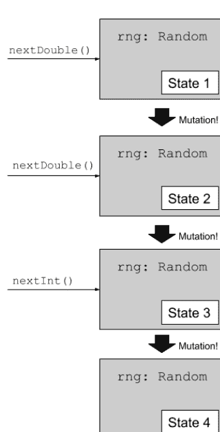

# 纯函数式状态


## 本章涵盖：

- 通过使状态更新显式化来编写纯状态 API
- 在处理纯状态转换时识别一般性重复
- 使用组合子对显式状态转换进行抽象
- 组合多个和嵌套的状态动作
- 引入通用状态动作数据类型
- 在处理状态动作时使用命令式风格

处理程序状态很棘手，在函数式编程的上下文中更是如此，在那里我们重视诸如不可变性和消除副作用等原则。变异状态代价巨大，使得程序难以推理和维护。幸运的是，我们手头有一个设计模式来以纯函数式的方式处理程序状态。应用此模式使我们能够以确定性的方式处理状态，并随后更容易地推理和测试我们的程序。

通过将程序状态视为在一系列转换期间作为上下文传递的 *transition* 或 *action*，我们可以包含和本地化通常与状态机相关联的复杂性。我们甚至可以通过使用将状态动作在后台隐式传递的高阶组合子函数来完全 *hiding* 这些状态转换。当我们结合这些在后台传递和隐藏状态转换的概念时，一个模式开始出现。

在本章中，我们将看到如何编写操纵状态的纯函数式程序，以 *random number generation* 这个简单领域作为示例。虽然它本身并不是本章技术中最引人注目的用例，但随机数生成的简单性使其成为一个很好的第一个示例。我们将在本书的第 3 部分和第 4 部分看到更有说服力的用例，尤其是第 4 部分，在那里我们将更多地谈论处理状态和效应。这里的目标是为你提供如何使任何有状态 API 纯函数式的基本模式。当你开始编写自己的函数式 API 时，你可能会遇到许多我们在这里探讨的相同问题。

## 6.1 使用副作用生成随机数

让我们从一个人为的例子开始，即使用伪随机数生成器生成随机数。此操作通常使用可变状态和副作用来处理。让我们使用典型的命令式解决方案来演示这一点，然后再继续展示如何以纯函数式的方式实现。

如果你需要在 Kotlin 中生成随机数³⁰，标准库中有一个类 kotlin.random.Random³¹，它具有一个相当典型的依赖于副作用的命令式 API。列表 6.1 是 Random 类用法的示例：

## 列表 6.1 使用 Kotlin Random 类来演示内部状态的突变。

```
>>> val rng = kotlin.random.Random ①

>>> rng.nextDouble()
res1: kotlin.Double = 0.2837830961138915

>>> rng.nextDouble()
res2: kotlin.Double = 0.7994579111535903

>>> rng.nextInt()
res3: kotlin.Int = -1630636086

>>> rng.nextInt(10)
res4: kotlin.Int = 8 ②
```

- ① 使用当前系统时间作为种子创建一个新的随机数生成器
- ② 获取 0 到 9 之间的随机整数

即使我们不知道 kotlin.random.Random 内部发生了什么，我们也可以假设对象 rng 具有在每次调用后更新的内部状态，因为否则每次调用 nextInt 或 nextDouble 时我们都会得到相同的值。这些方法不是引用透明的，因为状态更新是作为副作用执行的。正如我们在第 1 章讨论中所知，这意味着它们的可测试性、可组合性、模块化以及易于并行化的程度不如它们本可以的那样。




## 图 6.1 使用 Random 类在变异状态下生成伪随机数

让我们以可测试性为例。如果我们想编写一个使用随机性的 方法，我们需要测试是可复现的。假设我们有以下产生副作用的方法，旨在模拟掷一个六面骰子，应返回 1 到 6 之间（含）的数值：

### 列表 6.2 模拟掷骰子且存在差一错误的方法

```
fun rollDie(): Int {
    val rng = kotlin.random.Random
    return rng.nextInt(6)
}
```

- ① 方法应返回 1 到 6 之间的随机数
- ② 生成器返回 0 到 5 之间的随机数

此方法存在差一错误。它本应返回 1 到 6 之间的值，但实际上返回的是 0 到 5 的值。即使它工作不正常，六次测试中有五次该方法的测试仍会符合测试规范！如果测试确实失败了，在尝试修复之前能够可靠地重现该失败将是理想的。

请注意，这里重要的是不是这个具体示例，而是一般思想。在这种情况下，错误是明显的且易于重现。但我们可以很容易想象一种情况，其中方法更加复杂且错误更加微妙。程序越复杂、错误越微妙，能够以可靠的方式重现错误就越重要。

使此类测试更确定的一个建议可能是传入随机数生成器。这样，当我们想要重现失败的测试时，可以传入导致测试失败的相同生成器：

```
fun rollDie2(rng: Random): Int = rng.nextInt(6)
```

但这个解决方案存在问题。“相同”的生成器必须既使用相同的种子创建，也处于相同的状态，这意味着自创建以来其方法已被调用了特定次数。这将非常难以保证，因为每次调用 nextInt 时，例如，随机数生成器的先前状态就会被销毁。我们现在是否需要一个单独的机制来跟踪我们对 Random 调用了多少次方法？

不！当然，对这一切的回答是，我们应该从原则上避免副作用！

## 6.2 纯函数式随机数生成

让我们通过移除这种不期望的副作用来演进我们的设计。我们将通过将示例重构为纯函数式解决方案来恢复引用透明性。这样做的方法是使状态更新显式化。不要作为副作用更新状态，而是简单地返回新状态以及我们正在生成的值。列表 6.3 显示了随机数生成器的一种可能接口。

### 列表 6.3 随机数生成器的接口

```
interface RNG {
    fun nextInt(): Pair<Int, RNG>
}
```

此方法应生成一个随机 Int。我们稍后将基于 nextInt 定义其他函数。与仅返回生成的随机数（如 kotlin.random.Random 所做）并通过就地突变更新某些内部状态不同，我们返回随机数和新状态，同时保持旧状态不变。32 实际上，我们将计算下一个状态的关注点与将新状态传达给程序其余部分的关注点分开。没有使用全局可变内存——我们只是将下一个状态返回给调用者。这使 nextInt 的调用者完全控制对新状态的处理。请注意，我们仍然在封装状态，从某种意义上说，此 API 的用户对随机数生成器本身的实现一无所知。

对于我们的示例，我们确实需要一个实现，所以让我们选择一个简单的实现。以下是一种称为线性同余生成器 的算法（bit.ly/2MtQsgc）。此实现的细节并不是那么重要，但请注意 nextInt 同时返回生成的值和用于生成下一个值的新的 RNG。

### 列表 6.4 一个纯函数式的随机数生成器，实现 RNG

```
data class SimpleRNG(val seed: Long) : RNG {
    override fun nextInt(): Pair<Int, RNG> {
        val newSeed =
            (seed * 0x5DEECE66DL + 0xBL) and
            0xFFFFFFFFFFFFL
        val nextRNG = SimpleRNG(newSeed)
        val n = (newSeed ushr 16).toInt()
        return Pair(n, nextRNG)
    }
}
```

- 1. 我们使用当前种子生成新种子。and 是一个按位与。
- 2. 下一个状态，即从新种子创建的 RNG 实例。
- 3. 值 n 是新的伪随机整数。ushr 是带零填充的右二进制移位。
- 4. 返回值是 Pair<Int, RNG>，包含伪随机整数和下一个 RNG 状态。

列表 6.5 演示了我们如何在解释器中使用此 API。

### 列表 6.5 在 REPL 中使用 SimpleRNG 演示可重复的随机数生成

```
>>> val rng = SimpleRNG(42)

>>> val (n1, rng2) = rng.nextInt()

>>> println("n1:$n1; rng2:$rng2")

n1:16159453; rng2:SimpleRNG(seed=1059025964525)

>>> val (n2, rng3) = rng2.nextInt()

>>> println("n2:$n2; rng3:$rng3")

n2:-1281479697; rng3:SimpleRNG(seed=197491923327988)
```

- 1. 选择一个任意值来初始化 SimpleRNG
- 2. 解构 nextInt 返回的 Pair<Int, RNG>

我们可以按想要的次数运行这组语句，我们总是会得到相同的值。当我们调用 rng.nextInt() 时，它总是返回 16159453 和一个新的 RNG，其 nextInt 总是返回 -1281479697。换句话说，我们现在已经到达了一个纯 API。

## 6.3 使有状态 API 纯化

使看似有状态的 API 纯化的问题及其解决方案——让 API 计算下一个状态而不是实际突变任何东西——并非随机数生成的独有问题。

这个问题经常出现，我们总可以用同样的方式处理它。33

例如，假设你有一个可以生成数字序列的数据存储库。

```
class MutatingSequencer {
    private var repo: Repository = TODO()
    fun nextInt(): Int = TODO()
    fun nextDouble(): Double = TODO()
}
```

现在假设 nextInt 和 nextDouble 各自以某种方式突变 repo。我们可以通过使状态转换显式来机械地将此接口转换为纯函数式接口。

```
interface StateActionSequencer {
    fun nextInt(): Pair<Int, StateActionSequencer>
    fun nextDouble(): Pair<Double, StateActionSequencer>
}
```

每当我们使用这种模式时，我们就让调用者负责将下一个计算出的状态传递到程序的其余部分。回到列表 6.3 中前面显示的纯 RNG 接口，如果我们重用之前的 RNG，它总是会生成之前生成过的相同值。

```
fun randomPair(rng: RNG): Pair<Int, Int> {
    val (i1, _) = rng.nextInt()
    val (i2, _) = rng.nextInt()
    return Pair(i1, i2)
}
```

这里 i1 和 i2 将是相同的！如果我们想生成两个不同的数字，我们需要使用第一次调用 nextInt 返回的 RNG 来生成第二个 Int：

### 列表 6.6 使用不同的 RNG 实例生成后续随机数

```
fun randomPair2(rng: RNG): Pair<Pair<Int, Int>, RNG> {
    val (i1, rng2) = rng.nextInt()
    val (i2, rng3) = rng2.nextInt()
    return Pair(Pair(i1, i2), rng3)
}
```

- ① 在此处使用 rng2 而不是 rng。
- ② 在生成随机数后返回最终状态 rng3，允许调用者继续生成随机值。

你可以看到一般模式，也许你也能看到直接使用此 API 可能变得乏味。让我们编写几个生成随机值的函数，看看是否能注意到可以提取的重复。

### 练习 6.1

编写一个使用 RNG.nextInt 生成 0 到 Int.MAX_VALUE（含）之间随机整数的函数。

### 提示

每个负值必须映射到一个不同的非负值。请确保处理 `nextInt` 返回 `Int.MIN_VALUE` 的边界情况，该值没有非负对应值。

### 练习

```
```kotlin
fun nonNegativeInt(rng: RNG): Pair<Int, RNG> = TODO()
```
```

### 侧边栏

### 处理函数式编程中的笨拙

当你编写更多函数式程序时，你有时会遇到函数式表达程序感觉笨拙或乏味的情况。这是否意味着纯度等同于试图在不使用字母 E 的情况下写一整部小说？当然不是！这种笨拙几乎总是缺少抽象的迹象，等待被发现。

当你遇到这些情况时，我们鼓励你继续前进并寻找可以提取的常见模式。很可能这是其他人遇到过的问题，你甚至可能自己重新发现“标准”解决方案。即使你卡住了，自己努力拼凑出一个干净的解决方案也会帮助你更好地理解其他人发现的用于处理类似问题的解决方案。

随着练习、经验以及对本书中包含的惯用法的更熟悉，函数式地表达程序将变得毫不费力且自然。当然，好的设计仍然很难，但使用纯函数编程大大简化了设计空间。

### 练习

### 6.2

编写一个生成 0 到 1 之间（不包括 1）的 `Double` 的函数。除了你已经开发的函数之外，你可以使用 `Int.MAX_VALUE` 来获取最大正整数值，并且可以使用 `x.toDouble()` 将 `x: Int` 转换为 `Double`。

```
```kotlin
fun double(rng: RNG): Pair<Double, RNG> = TODO()
```
```


## 练习 6.3

编写函数来生成一个 Pair<Int, Double>、一个 Pair<Double, Int> 和一个 Triple<Double, Double, Double>。你应该能够重用你已经编写的函数。

```
fun intDouble(rng: RNG): Pair<Pair<Int, Double>, RNG> = TODO()

fun doubleInt(rng: RNG): Pair<Pair<Double, Int>, RNG> = TODO()

fun double3(rng: RNG): Pair<Triple<Double, Double, Double>, RNG> = TODO()
```

## 练习 6.4

编写一个函数来生成随机整数列表。

```
fun ints(count: Int, rng: RNG): Pair<List<Int>, RNG> = TODO()
```

## 6.4 传递状态动作的隐式方法

到目前为止，我们已经从使用可变状态的方法转向了以纯函数式的方式显式传播状态，从而避免了副作用。除了程序化且容易出错之外，沿途传递这种状态感觉不必要地繁琐和乏味。让我们进一步演进我们的设计，消除显式传递这种状态的必要性。

回顾我们的实现，我们会注意到一个共同模式：我们的每个函数都有形如 (RNG) -> Pair<A, RNG> 的类型，其中 A 为某种类型。这类类型的函数被称为状态动作或状态转换，因为它们将 RNG 状态从一个状态转换到下一个状态。这些状态动作可以使用组合子进行组合，组合子是我们将在本节中定义的高阶函数。由于我们自己传递状态相当乏味且重复，我们希望我们的组合子能够自动地将状态从一个动作传递到下一个动作。

为了让动作的类型便于讨论，并简化我们对它们的思考，让我们为 RNG 状态动作数据类型创建一个类型别名：

### 列表 6.7 表示状态转换的类型别名

```
typealias Rand<A> = (RNG) -> Pair<A, RNG>
```

我们可以将类型为 Rand<A> 的值视为“一个随机生成的 A”，尽管这并不完全精确。它实际上是一个状态动作——一个依赖于某个 RNG 的程序，使用它来生成一个 A，并且还将 RNG 转换到一个新的状态，该状态稍后可以被另一个动作使用。

我们现在可以将诸如 RNG.nextInt 之类的方法转换为这种新类型的值，该方法返回一个包含生成的 Int 以及下一个 RNG 的 Pair<Int, RNG>：

```
val intR: Rand<Int> = { rng -> rng.nextInt() }
```

我们希望编写组合子，以便在避免显式传递 RNG 状态的同时组合 Rand 动作。我们最终会得到一种领域特定语言，它会为我们完成所有的传递。例如，一个简单的 RNG 状态转换是 unit 动作，它在不使用 RNG 状态的情况下将其传递下去，始终返回一个常量值而不是随机值：

### 列表 6.8 unit 组合子在设置常量的同时传递状态

```
fun <A> unit(a: A): Rand<A> = { rng -> Pair(a, rng) }
```

还有 map 用于在不修改状态本身的情况下转换状态动作的输出。记住，Rand<A> 只是一个类型别名，表示函数类型 (RNG) -> Pair(A, RNG)，所以这只是一种函数组合：

### 列表 6.9 map 组合子修改输出而不修改状态

```
fun <A, B> map(s: Rand<A>, f: (A) -> B): Rand<B> =
    { rng ->
        val (a, rng2) = s(rng)
        Pair(f(a), rng2)
    }
```

作为 map 用法的示例，这里是 nonNegativeEven，它重用 nonNegativeInt 来生成一个大于或等于零且能被二整除的 Int：

```
fun nonNegativeEven(): Rand<Int> =
    map(::nonNegativeInt) { it - (it % 2) }
```

## 练习 6.5

使用 map 以更优雅的方式重新实现 double。参见练习 6.2。

```
val doubleR: Rand<Double> = TODO()
```

### 6.4.1 通过组合状态动作获得更多能力

我们一直在开发一个 API，用于通过隐藏其转换来处理单个状态动作。有时我们需要同时利用多个状态动作的更多能力，同时保留在后台隐藏其转换的能力。我们希望在实现练习 6.3 中的 intDouble 和 doubleInt 时继续遵循这种方法，但 map  simply 没有这种能力。我们需要一个新的组合子 map2，它可以使用二元而非一元函数将两个 RNG 动作组合成一个。

## 练习 6.6

根据以下签名编写 map2 的实现。此函数接收两个动作 ra 和 rb，以及一个用于组合其结果的函数 f，并返回一个将它们组合起来的新动作：

```
fun <A, B, C> map2(
    ra: Rand<A>,
    rb: Rand<B>,
    f: (A, B) -> C
): Rand<C> = TODO()
```

我们只需要编写一次 map2 组合子，然后就可以用它来组合任意的 RNG 状态动作。例如，如果我们有一个生成类型为 A 的值的动作和一个生成类型为 B 的值的动作，那么我们可以将它们组合成一个生成两者配对的动作：

```
fun <A, B> both(ra: Rand<A>, rb: Rand<B>): Rand<Pair<A, B>> =
    map2(ra, rb) { a, b -> Pair(a, b) }
```

我们可以使用 both 更简洁地重新实现练习 6.3 中的 intDouble 和 doubleInt。我们通过使用本章前面开发的 Rand 值 intR 和 doubleR 来实现这一点：

```
val intR: Rand<Int> = { rng -> rng.nextInt() }

val doubleR: Rand<Double> =
    map(::nonNegativeInt) { i ->
        i / (Int.MAX_VALUE.toDouble() + 1)
    }

val intDoubleR: Rand<Pair<Int, Double>> = both(intR, doubleR)

val doubleIntR: Rand<Pair<Double, Int>> = both(doubleR, intR)
```

## 练习 6.7（困难）

如果你可以组合两个 RNG 转换，你也应该能够组合它们的整个列表。实现 sequence 以将 List of 转换组合成单个转换。用它重新实现你之前编写的 ints 函数。为简单起见，在本练习中，使用递归来构建一个重复 n 次的 x 列表是可以接受的。

```
fun <A> sequence(fs: List<Rand<A>>): Rand<List<A>> = TODO()
```

完成 sequence() 的实现后，尝试使用 fold 重新实现它。

## 6.4.2 通过嵌套状态动作进行递归重试

我们已经从变异现有状态发展到显式传递状态动作，之后又开发了一个更优雅的 API 来在后台隐藏这些转换。在这样做的过程中，我们开始看到一个模式正在出现：我们正朝着不显式提及或传递 RNG 值的实现前进。map 和 map2 组合子让我们能够以相当简洁优雅的方式实现原本乏味且容易出错的函数。但有一些函数我们无法很好地用 map 和 map2 来编写。

其中一个函数是 nonNegativeLessThan，它生成一个介于 0（含）和 n（不含）之间的整数。对实现的第一次尝试可能是生成一个非负整数对 n 取模：

```
fun nonNegativeLessThan_A(n: Int): Rand<Int> =
    map(::nonNegativeInt) { it % n }
```

这肯定会生成范围内的数字，但它会产生偏差，因为 Int.MaxValue 可能不能被 n 精确整除。因此，小于该除法余数的数字会出现得更频繁。当 nonNegativeInt 生成的数字高于能放入 32 位整数的 n 的最大倍数时，我们应该重试生成器并希望得到一个较小的数字。我们可能会尝试这样做：

### 列表 6.10 没有可用状态的失败递归重试

```
fun nonNegativeLessThan_B(n: Int): Rand<Int> =
    map(::nonNegativeInt) { i ->
        val mod = i % n
        if (i + (n - 1) - mod >= 0) mod
        else nonNegativeLessThan_B(n) (???)
    }
```

- 如果我们得到的 Int 高于能放入 32 位 Int 的 n 的最大倍数，则递归重试。
- nonNegativeLessThan(n) 的错误类型导致编译失败。

这是在正确的方向上迈出的一步，但 nonNegativeLessThan(n) 在那里使用的类型是错误的。记住，它应该返回一个 Rand<Int>，这是一个期望 RNG 的函数！但我们那里没有它。我们希望的是将事物串联起来，以便 nonNegativeInt 返回的 RNG 被传递给对 nonNegativeLessThan 的递归调用。我们可以不使用 map 而显式地传递它，像这样：


### 列表 6.11 显式传递派生状态的成功递归重试

```
fun nonNegativeIntLessThan(n: Int): Rand<Int> =
    { rng ->
        val (i, rng2) = nonNegativeInt(rng)
        val mod = i % n
        if (i + (n - 1) - mod >= 0)
            Pair(mod, rng2)
        else nonNegativeIntLessThan(n) (rng2)
    }
```

但最好有一个组合子来替我们完成这种传递。map 和 map2 都不够用。我们需要一个更强大的组合子，flatMap。

### EXERCISE 6.8

实现 flatMap，然后用它来实现 nonNegativeLessThan。

```
fun <A, B> flatMap(f: Rand<A>, g: (A) -> Rand<B>): Rand<B> = TODO()
```

flatMap 允许我们使用 Rand<A> 生成一个随机的 A，然后取该 A 并根据其值选择一个 Rand<B>。在 nonNegativeLessThan 中，我们用它来根据 nonNegativeInt 生成的值选择是否重试。

### EXERCISE 6.9

重新实现 map 和 map2 以 flatMap 为基础。之所以说 flatMap 比 map 和 map2 更强大，正是因为这种实现是可能的。

## 6.4.3 将组合子 API 应用于初始示例

在我们寻求更优雅地处理状态转换的方法的过程中，我们已经得到一个简洁的 API，它使用组合子在后台无缝传递状态，而无需我们付出任何努力。

我们现在可以重新审视第 6.1 节中的示例。能否使用我们的纯函数式 API 实现一个更可测试的掷骰子？

以下是使用 nonNegativeIntLessThan 实现 rollDie 的实现，其中包含我们之前出现的差一错误：

```
fun rollDie(): Rand<Int> =
    nonNegativeIntLessThan(6)
```

如果我们用各种 RNG 状态测试此函数，很快就会找到一个导致此函数返回 0 的 RNG：

```
>>> val zero = rollDie(SimpleRNG(5)).first
zero: Int = 0
```

我们可以通过使用相同的 SimpleRNG(5) 随机生成器可靠地重现此问题，而无需担心其状态在使用后被破坏。

修复这个 bug 很简单：

```
fun rollDie_B(): Rand<Int> =
  map(nonNegativeIntLessThan(6)) { it + 1 }
```

通过使用组合子，我们大大降低了复杂性，因为不再需要在程序中显式传递随机数生成器。我们定义了一种更高层的领域特定语言，大大简化了我们对这种简单的差一错误等问题的推理方式。

## 6.5 一个通用的状态动作数据类型

尽管我们只在随机数生成中处理状态，但我们可以轻松地将此技术应用于任何需要传递状态的其他领域。仔细检查后我们发现，我们编写的组合子也不特定于任何领域，并且可以轻松用于传递任何种类的状态。在本节中，我们打算开发一种数据类型，以便对任意种类状态转换进行泛化。

正如我们刚刚发现的那样，我们刚刚编写的函数——unit、map、map2、flatMap 和 sequence——实际上与随机数生成完全无关。它们是用于处理状态动作的通用函数，并且不关心状态的类型。请注意，例如，map 不关心它处理的是 RNG 状态动作，因此我们可以为其提供更通用的签名，将 RNG 替换为 S：

### 列表 6.12 map 组合子的泛化版本

```
fun <S, A, B> map(
  sa: (S) -> Pair<A, S>,
  f: (A) -> B
): (S) -> Pair<B, S> = TODO()
```

更改此签名不需要修改 map 的实现！更通用的签名一直都在；我们只是没有看到它。

然后我们应该提出一个比 Rand 更通用的类型，用于处理任何类型的状态：

### 列表 6.13 用于状态转换的泛化 State 类型别名

```
typealias State<S, A> = (S) -> Pair<A, S>
```

这里的 State 是指携带一些状态的计算的简写，或状态动作、状态转换，甚至是语句（参见第 6.6 节）。我们可能希望将其写成自己的类，包装底层函数并将其命名为 run。

### 列表 6.14 将状态转换包装在数据类中

```
data class State<S, out A>(val run: (S) -> Pair<A, S>)
```

话虽如此，表示并不太重要。重要的是我们有一个单一的通用类型，并且使用该类型我们可以编写通用函数来捕获有状态程序的常见模式。

我们现在可以简单地将 Rand 设为 State 的类型别名：

### 列表 6.15 更新为使用 State 的 Rand 类型别名

```
typealias Rand<A> = State<RNG, A>
```

**练习 6.10**
将函数 `unit`、`map`、`map2`、`flatMap` 和 `sequence` 泛化。尽可能将它们作为 `State` 数据类的方法添加。或者，在有意义的地方将它们放在 `State` 的伴生对象中。

**注意**
始终考虑方法应放置的位置——在伴生对象中，还是在数据类型本身的类上。对于操作数据类型实例的方法，例如 `map`，将其放在类级别当然是有意义的。当我们仅仅发出一个值时，例如 `unit` 方法的情况，或者当我们操作多个实例时，例如 `map2` 和 `sequence`，将其绑定到伴生对象可能更有意义。这通常取决于个人喜好，并且可能因提供实现的人而异。

我们在练习 6.10 中编写的函数只捕获了最常见的几种模式。随着你编写更多函数式代码，你可能会遇到其他模式并发现其他用于捕获它们的函数。

## 6.6 纯函数式命令式编程

随着我们函数式代码复杂性的不断增加，可读性开始受到牺牲。在这个过程中恢复一些失去的可读性是否可能？我们能否回到我们所熟悉的简单命令式风格？

好消息是，当我们以纯函数式方式编码时，我们可以实现这种更简单的表达风格。在本节中，我们将演示如何编写具有命令式*外观*的函数式代码。我们可以通过使用 *for-comprehension* 来实现这一点，这是一个我们在第 4 章中简要提及的概念，但现在将以更详细的方式展开。

到目前为止，我们花费了大量时间开发自己的 `State` 实现，并在其中学到了很多。现在我们将切换到使用 Arrow 提供的替代实现。在第 3 章和第 4 章中，我们已经将 Arrow 引入为 Kotlin 的函数式伴侣。特别是，我们了解了已提供的 `Option` 和 `Either` 数据类型，以及它们与 for comprehensions 协同工作的能力。碰巧的是，所提供的 `State` 实现也具有这种能力，这将使我们期望的命令式风格成为可能。

在前面的章节中，我们编写的函数遵循一定的模式。我们会运行一个状态动作，将其结果赋给一个 `val`，然后运行另一个使用该 `val` 的状态动作，将其结果赋给另一个 `val`，以此类推。这看起来很像 *命令式* 编程。

在命令式编程范式中，程序是一系列语句的序列，其中每个语句都可能修改程序状态。这正是我们一直在做的事情，只是我们的“语句”实际上是 `State` 动作，而它们实际上是函数。作为函数，它们只需通过在参数中接收当前程序状态来读取它，并只需通过返回值来写入程序状态。

> **侧边栏** **命令式编程和函数式编程是相反的吗？**
> 
> 绝对不是！请记住，函数式编程只是没有副作用的编程。命令式编程是关于使用修改某些程序状态的语句进行编程，而正如我们所见，在没有副作用的情况下维护状态是完全合理的。
> 
> 函数式编程对编写命令式程序有很好的支持，并且由于它们是引用透明的，因此可以进行等式推理，这是一个额外的好处。我们将在第 2 部分对程序的等式推理说得更多，特别是第 3 部分和第 4 部分的命令式程序。

我们实现了一些组合子，如 `map`、`map2`，最终是 `flatMap`，以处理状态从一个语句到下一个语句的传播。但在这样做的过程中，我们似乎失去了一点命令式的感觉。

例如，考虑以下声明。这里我们更关心类型签名而不是实现。

> **注意** 在 Arrow `State` 类中，状态类型参数首先出现。


## 列表 6.16 执行状态传播所需的状态声明和组合子

```
val int: State<RNG, Int> = TODO()

fun ints(x: Int): State<RNG, List<Int>> = TODO()

fun <A, B> flatMap(
    s: State<RNG, A>,
    f: (A) -> State<RNG, B>
): State<RNG, B> = TODO()

fun <A, B> map(
    s: State<RNG, A>,
    f: (A) -> B
): State<RNG, B> = TODO()
```

- 1. 是一个具有生成单个随机整数能力的 `State<RNG, Int>`
- 2. 返回一个可以生成长度为 x 的随机整数列表的 `State<RNG, List<Int>>`
- 3. 一个 `flatMap` 函数，它对 `State<RNG, A>` 操作，并带有一个从 A 到 `State<RNG, B>` 的函数
- 4. 一个 `map` 函数，它对 `State<RNG, A>` 操作，并带有一个将 A 转换为 B 的函数

现在我们编写一些使用这些声明的代码，这些声明随后可从列表 6.16 中获得。

## 列表 6.17 使用一系列 flatMap 和 map 的状态传播

```
val ns: State<RNG, List<Int>> =
    flatMap(int) { x ->
        flatMap(int) { y ->
            map(ints(x)) { xs ->
                xs.map { it % y }
            }
        }
    }
```

- 1. int 将生成一个随机整数。
- 2. ints(x) 生成一个长度为 x 的随机整数列表
- 3. 用列表中每个元素除以 y 的余数替换该元素

由于所有嵌套的 flatMap 和 map 调用，这里发生的事情并不清楚。让我们通过关注 for-comprehension 来寻找更简单的方法。这种构造会展开一系列 flatMap 调用，使我们能够将此代码重写为一系列看似命令式声明的形式。此代码的技巧在于每一步发生的解构。每次看到某物被解构时，都意味着一次 flatMap 调用。

例如，写成 flatMap(int) { x -> ... } 的一行可以在 for-comprehension 的范围内重写为 val (x: Int) = int。考虑到这一点，让我们尝试使用此技术重写列表 6.17。

## 列表 6.18 使用 for-comprehension 的状态传播

```
val ns2: State<RNG, List<Int>> =
    State.fx(Id.monad()) {
        val (x: Int) = int
        val (y: Int) = int
        val (xs: List<Int>) = ints(x)
        xs.map { it % y }
    }
```

- - ① 通过将代码块传递给 `State.fx(Id.monad())` 来打开 for-comprehension
- - ② `int` 被解构为名为 x 的 `Int`
- - ③ `int` 再次被解构为名为 y 的 `Int`
- - ④ `ints(x)` 被解构为长度为 x 的 `List<Int>`
- - ⑤ 用 xs 中每个元素除以 y 的余数替换每个元素，返回结果

我们首先通过调用 `State.fx` 并传入 `Id.monad()` 的一个实例来打开 for-comprehension。我们不会过多关注此细节，但可以说，这将允许我们传入一个充当命令式代码块的匿名函数，然后将该块的最终结果作为值返回。

构成 for-comprehension 的代码块更容易阅读（和编写），并且它看起来就是它所代表的东西——一个维护某种状态的命令式程序。但它与前一个示例中的代码相同。我们获取下一个 `Int` 并将其赋给 x，获取其后的下一个 `Int` 并将其赋给 y，然后生成长度为 x 的列表，最后返回所有元素对 y 取模的列表。

我们几乎拥有以命令式风格编写完整函数式程序所需的一切。为了便于使用 for-comprehensions（或 `flatMaps`）进行这种命令式编程，我们只需要再有两个原始的 `State` 组合子——一个用于读取状态，一个用于写入状态。如果我们想象有一个组合子 `get` 用于获取当前状态，以及一个组合子 `set` 用于设置新状态，我们就可以实现一个可以以任意方式修改状态的组合子：

## 列表 6.19 修改当前状态的组合子

```
fun <S> modify(f: (S) -> S): State<S, Unit> =
    State.fx(Id.monad()) {
        val (s: S) = get<S>()
        val (_) = set(f(s))
    }
```

- - ① 为 `State` 设置 for-comprehension
- - ② 获取当前状态并将其赋给 s
- - ③ 设置应用 f 于 s 的新状态

此方法返回一个 `State` 动作，该动作通过函数 f 修改传入的状态。它产生 Unit 以表明除了状态之外它没有返回值。

get 和 set 动作会是什么样子？它们非常简单。get 动作只是传递传入的状态并将其作为值返回：

## 列表 6.20 get 组合子检索然后传递其状态

```kotlin
fun <S> get(): State<S, S> =
    State { s -> Tuple2(s, s) }
```

set 动作是用新的状态 s 构造的。 resulting action 忽略传入的状态，用新状态替换它，并返回 Unit 而不是有意义的值：

## 列表 6.21 set 组合子更新状态，然后返回 Unit

```kotlin
fun <S> set(s: S): State<S, Unit> =
    State { Tuple2(s, Unit) }
```

get、set 和 modify 组合子已经可以在 arrow.mtl.StateApi 类上找到，但我们只是为了演示目的想展示它们包含的内容。这些两个简单的动作，加上我们编写的状态组合子——unit、map、map2 和 flatMap——是我们以纯函数方式实现任何类型状态机或有状态程序所需的所有工具。

**TIP** 我们建议你熟悉 Arrow 关于 State 的文档 (arrow-kt.io/../-state.html)，并查看底层源代码 (github.com/../State.kt) 以便完全掌握其工作原理。如第 1.5 节所述，Arrow 的实现比我们编写的要丰富一些，采用了 monad 转换器 StateT，并为 State 类公开了公共 API StateAPI。不要太担心 monad 转换器是什么，只需知道 StateApi 负责公开诸如 get、set、modify stateSequential 和 stateTraverse 等方法，这些方法在接下来的练习中可能会派上用场。

## 练习 6.11（困难/可选）

为了获得使用 `State` 的经验，实现一个有限状态自动机来模拟一个简单的糖果分配器。机器有两种类型的输入：你可以插入硬币，或转动旋钮来分配糖果。它可以处于两种状态之一：锁定或未锁定。它还跟踪剩余的糖果数量和包含的硬币数量。

```
sealed class Input

object Coin : Input()
object Turn : Input()

data class Machine(
    val locked: Boolean,
    val candies: Int,
    val coins: Int
)
```

机器的规则如下：

- - 将硬币插入锁定机器中，如果还有糖果剩余，则会使其解锁。
- - 在未锁定机器上转动旋钮会使其分配糖果并变为锁定。
- - 在锁定机器上转动旋钮或向未锁定机器中插入硬币不会产生任何效果。
- - 糖果用完的机器会忽略所有输入。

`simulateMachine` 方法应根据输入列表操作机器，并在结束时返回机器中剩余的硬币和糖果数量。例如，如果输入的 `Machine` 有 10 个硬币和 5 个糖果，并且总共成功购买了 4 个糖果，则输出应为 `(14, 1)`。使用以下声明存根来实现你的解决方案：

```
fun simulateMachine(
    inputs: List<Input>
): State<Machine, Tuple2<Int, Int>> = TODO()
```

## 6.7 结论

在本章中，我们涉及了如何编写具有状态的纯函数式程序的主题。我们以随机数生成作为动机示例，但总体模式在许多不同领域都会出现。这个想法很简单：使用一个接受状态作为参数的纯函数，并返回新状态以及其结果。下次你遇到依赖副作用的命令式 API 时，看看是否可以提供其纯函数式版本，并使用我们在此编写的一些函数使使用它更方便。


## 6.8 摘要

- 显式地*更新状态*可以恢复引用透明性，而在变异状态的情况下引用透明性会丢失。
- 通过*计算*每个后续状态而不是变异现有状态，使有状态的 API 保持纯净。
- 基于先前状态计算状态的函数被称为*状态动作*或*状态转换*。
- 你可以使用*组合子*来抽象重复的状态转换模式，甚至在需要时组合和嵌套状态动作。
- 你可以通过使用 for-comprehension 在处理状态转换时采用*命令式*风格。
- Arrow 提供了有用的 `State` API 和相关的数据类型来建模本章讨论的所有概念。
