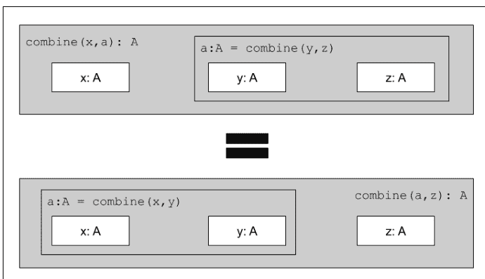
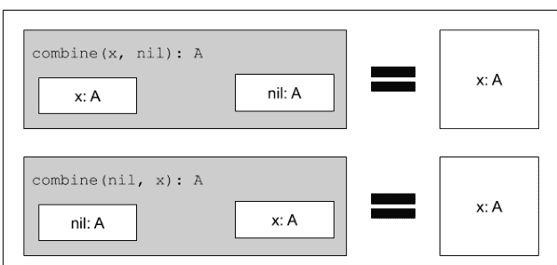
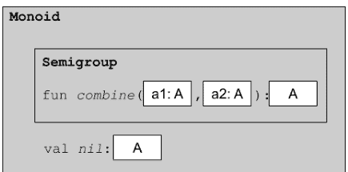

# 解析器组合子


### 本章涵盖：

- 对库应用代数设计方法
- 从简单示例开始，并在设计过程中逐步引入复杂性
- 在原语和更高级别的组合子之间做出区分
- 发明和调整组合子以实现设计目标
- 通过引入语法糖改善库的人体工学
- 通过首先关注代数设计来推迟组合子的实现

在本章中，我们将逐步进行创建 *解析器* 的组合子库的设计。我们将使用 JSON⁴² 解析作为激励用例。与第 7 章和第 8 章一样，本章与其说是关于解析，不如说是关于提供对函数式设计过程的进一步见解。

## 侧边栏

### 什么是解析器？

解析器是一种专用程序，它将非结构化数据（例如文本，或任何类型的符号、数字或标记流）作为输入，并输出该数据的结构化表示。例如，我们可以编写一个解析器将逗号分隔的文件转换为列表的列表，其中外部列表的元素表示记录，而每个内部列表的元素表示每条记录的逗号分隔字段。另一个例子是解析器，它接受 XML 或 JSON 文档并将其转换为树状数据结构。

在我们将在本章中构建的解析器组合子库中，解析器不必如此复杂，也不必解析整个文档。它可以做一些像在输入中识别单个字符这样基本的事情。然后我们使用组合子将复合解析器从基本解析器组装起来，并从中构建更复杂的解析器。

本章将介绍一种我们称之为 *代数设计* 的设计方法。这种设计方法只是我们在过去章节中以不同程度一直在做的事情的自然演进——首先设计我们的接口以及相关的定律，并让这些组合来指导我们对数据类型表示的选择。

在几个关键点上，我们将提供更开放的练习，旨在模仿你在从头开始编写自己的库时可能遇到的场景。如果你利用这些机会放下书本，花时间研究可能的方法，你将从本章中获得最大收益。当你设计自己的库时，不会有人给你一个整齐选择的要填充实现的类型签名序列。相反，你必须决定需要哪些类型和组合子，而本书这一部分的目的是为你独立完成此事做好准备。如往常一样，如果你在某个练习上卡住或想要更多想法，你可以继续阅读或查阅附录 B 中的答案。也可能是一个好主意与他人一起完成这些练习，甚至与 liveBook 版的其他读者交流笔记。

## 侧边栏

### 解析器组合子与解析器生成器

你可能熟悉像 Yacc⁴³ 这样的 *解析器生成器* 库，或其他语言中的类似库（例如 Java 中的 ANTLR⁴⁴）。这些库基于语法规范为解析器生成代码。这种方法工作良好且可能相当高效，但带来了代码生成的通常问题——库的输出是一个难以调试的单块代码。也很难重用逻辑片段，因为我们无法引入新的组合子或辅助函数来抽象解析器中的常见模式。

在解析器组合子库中，解析器只是普通的头等值。重用解析逻辑是微不足道的，我们不需要任何与编程语言分开的外部工具。

## 9.1 设计代数

回顾第 7.4 节，我们将 *代数* 定义为在某些数据类型上操作的一组函数，*以及* 一组指定这些函数之间关系的定律。在过去的章节中，我们在发明代数中的函数、完善函数集合以及调整数据类型表示之间相当流畅地切换。定律有点像是事后考虑——只有在我们有了表示和完善的 API 之后才推导出定律。这种设计风格没有什么问题，但在本章中我们将采取不同的方法。我们将 *从* 代数（包括其定律）开始，然后再决定表示。这种方法——我们称之为 *代数设计* ——可用于任何设计问题，但对于解析特别有效。这主要是因为很容易想象解析不同类型输入所需的组合子。这反过来让我们在推迟决定表示的同时仍能关注具体目标。

有许多不同种类的解析库。甚至有几个开源的 Kotlin 解析器组合子库可用。与上一章一样，我们部分出于教学目的，并进一步鼓励没有库是权威的这一想法，从第一性原理推导出自己的库。我们的库将为表达力而设计，能够解析任意语法，同时也为速度和良好的错误报告而设计。这一点很重要。每当我们在意料之外的输入上运行解析器时——如果输入格式错误就会发生这种情况——它应该生成解析错误。如果有解析错误，我们希望能够准确指出输入中错误的位置并准确指示其原因。错误报告在解析库中通常是事后考虑，但我们将确保从一开始就仔细关注它。

## 9.1.1 识别单个字符的解析器

好吧，让我们开始吧。为了简单和速度，我们的库将创建在字符串上操作的解析器。我们可以使解析库更通用，但我们将避免这样做，因为这会带来一些成本。我们需要选择一些解析任务来帮助我们发现解析器的良好代数。应该先看什么？像解析电子邮件地址、JSON 或 HTML 这样实用的东西吗？不！这些任务可以稍后再来。一个良好且简单的起点是解析各种重复字母和无意义单词的组合，如 "abracadabra" 和 "abba"。尽管听起来很傻，我们之前见过这类简单示例如何帮助我们忽略多余细节并专注于问题的本质。

所以让我们从最简单的解析器开始，它识别单个字符输入 'a'。与过去章节一样，我们可以为此任务发明一个组合子并将其命名为 char：

```
fun char(c: Char): Parser<Char>
```

我们在这里做了什么？我们创造了一个名为 Parser 的类型，它由一个参数参数化，表示 Parser 的结果类型。也就是说，运行解析器不应仅产生是/否响应——如果它成功，我们希望得到具有某种有用类型的结果，如果它失败，我们期望有关失败的信息。char('a') 解析器只有在输入完全是字符 'a' 时才会成功，并且它将返回相同的字符 'a' 作为其结果。

这种关于“运行解析器”的讨论清楚地表明，我们的代数需要以某种方式扩展以支持它。让我们为此发明另一个函数：

```
fun <A> run(p: Parser<A>, input: String): Either<PE, A>
```

等一下，PE 代表什么？它是我们刚刚创造出来的类型参数！此时，我们不太关心 PE（parse error 的缩写）的表示，或 Parser 的表示。我们正在指定一个接口，该接口恰好使用了两种类型，我们选择尽可能对其表示或实现细节一无所知。让我们通过一些接口声明使其明确：

### 列表 9.1 一个提供声明所有解析器组合子的地方的接口。

```
interface Parsers<PE> {
    interface Parser<A>
    fun char(c: Char): Parser<Char>
    fun <A> run(p: Parser<A>, input: String): Either<PE, A>
}
```

① 使用解析错误 PE 参数化的接口，其中可以声明所有未来的解析器组合子。


解析器的一个简单表示。
在列表 9.1 中，引入了一个名为 Parsers 的顶层接口。它将成为所有与 Parser 相关的组合子和辅助函数以及相关 PE 解析错误的归宿。目前，我们将这两种类型保持在最简单的表示形式中，并将继续向 Parsers 接口的主体中添加新的组合子。

把注意力重新放回 char 函数上，我们应该满足一个明显的定律——对于任何类型为 Char 的 c，

```
run(char(c), c.toString()) == Right(c)
```

## 9.1.2 用于识别整个字符串的解析器

继续吧。我们现在可以识别单个字符 'a'，但如果我们想识别字符串 "abracadabra" 呢？我们目前还没有识别整个字符串的方法，所以让我们在 Parsers 中添加一个函数来帮助我们构造 Parser<String>。

```
fun string(s: String): Parser<String>
```

同样地，这应该满足一个明显的定律——对于任意字符串 s，

```
run(string(s), s) == Right(s)
```

如果我们想识别字符串 "abra" 或 "cadabra" 呢？我们可以为此目的添加一个非常专门的组合子：

```
fun orString(s1: String, s2: String): Parser<String>
```

但在两种解析器之间进行选择似乎在无论其结果类型如何的情况下都更有通用用途。让我们继续使其多态化：

```
fun <A> or(pa: Parser<A>, pb: Parser<A>): Parser<A>
```

我们期望 or(string("abra"), string("cadabra")) 在任一字符串解析器成功时都会成功：

```
run(or(string("abra"), string("cadabra")), "abra") ==
    Right("abra")
run(or(string("abra"), string("cadabra")), "cadabra") ==
    Right("cadabra")
```

尽管这可行，但对读者来说理解起来很困难。让我们改进一下我们的呈现方式。我们可以为这个 or 组合子提供更友好的中缀语法，其中省略所有 . 和括号，像 s1 or s2 这样。

### 列表 9.2 添加语法糖以使 or 组合子更易于使用

```
interface Parsers<PE> {
    interface Parser<A>
    fun string(s: String): Parser<String>
    fun <A> or(a1: Parser<A>, a2: Parser<A>): Parser<A>
    infix fun String.or(other: String): Parser<String> =
        or(string(this), string(other))
    fun <A> run(p: Parser<A>, input: String): Either<PE, A>
}
```

- 1. 用于将 String 转换为 Parser<String> 的字符串解析器
- 2. 用于在两个 Parser<A> 实例之间进行选择的 or 组合子
- 3. 中缀扩展方法，使 or 组合子在 String 上使用时更令人愉悦

我们引入了一个方便的 String 上的 or 扩展方法，并用 infix 修饰符标记。该方法会将两个相邻的字符串提升为 Parser<String> 实例，然后对这两个解析器应用 or 组合子。这现在使我们能够按如下方式声明 or 的定律。

```
run("abra" or "cadabra", "abra") == Right("abra")
```

## 9.1.3 用于识别重复的解析器

更简洁了！我们现在可以识别各种字符串，但我们还没有谈论重复的方法。例如，我们如何识别我们的 "abra" 或 "cadabra" 解析器的三次重复？再次，让我们添加一个组合子来满足此目的。这应该让你想起我们在上一章属性基于测试中编写的类似函数。

```
fun <A> listOfN(n: Int, p: Parser<A>): Parser<List<A>>
```

我们使 listOfN 在 A 的选择上是参数化的，因为它似乎不应该关心我们是否有 Parser<String>、Parser<Char> 或其他类型的解析器。以下是我们通过定律表达的对 listOfN 的期望的一些示例：

```
run(listOfN(3, "ab" or "cad"), "ababab") == Right("ababab")
run(listOfN(3, "ab" or "cad"), "cadcadcad") == Right("cadcadcad")
run(listOfN(3, "ab" or "cad"), "ababcad") == Right("ababcad")
run(listOfN(3, "ab" or "cad"), "cadabab") == Right("cadabab")
```

到目前为止，我们只是积累了所需的组合子，但我们还没有尝试将代数精炼为最小的原语集合。我们也没有谈论太多关于更一般的定律。我们接下来将开始做这件事，但与其直接给出答案，我们将要求你在尝试设计一个具有相关定律的最小代数时，自己检查几个更简单的用例。这应该是一项具有挑战性的任务，但享受与之抗争的过程，看看你能想出什么。

以下是需要考虑的额外解析任务，以及一些指导性问题：

- 一个 `Parser<Int>`，它识别零个或多个 `'a'` 字符，其结果值是它看到的 `'a'` 字符的数量。例如，给定 `"aa"`，解析器结果为 2；给定 `""` 或 `"b123"`（一个不以 `'a'` 开头的字符串），它结果为 0；等等。
- 一个 `Parser<Int>`，它识别一个或多个 `'a'` 字符，其结果值是它看到的 'a' 字符的数量。这是否可以用与 `'a'` 重复零次或多次的解析器相同的组合子以某种方式定义？解析器在给定没有起始 'a' 的字符串时应失败。在这种情况下你希望如何处理错误报告？API 是否可以在失败时支持给出像 `"Expected one or more 'a'"` 这样的显式消息？
- 一个解析器，它识别零个或多个 `'a'`，后跟一个或多个 `'b'`，并返回所见字符计数的配对。例如，给定 `"bbb"`，我们得到 `Pair(0,3)`，给定 `"aaaab"`，我们得到 `Pair(4,1)`，等等。

一些额外的考虑：

- 如果我们试图解析零个或多个 `"a"` 的序列，并且只对所见字符的数量感兴趣，似乎效率不高，因为必须先构建一个 `List<Char>`，然后再丢弃它并提取长度。可以对此做些什么吗？
- 我们代数中的各种重复形式是原语，还是可以用更简单的方式定义？
- 我们之前引入了表示解析错误的 type parameter `PE`，但到目前为止我们还没有为其 API 选择任何表示或函数。我们的代数也没有任何让程序员控制报告哪些错误的方法。鉴于我们希望从解析器中获得有意义的错误消息，这似乎是一个限制。可以对此做些什么吗？
- `a or (b or c)` 是否与 `(a or b) or c` 相同？如果是，这是否是代数的原始定律，还是由更简单的内容隐含的？
- 尝试提出一组定律来指定你的代数。你不一定需要定律是完整的，只需写下一些你期望对任何 `Parsers` 实现都应成立的定律即可。

花一些时间根据这些指导提出组合子和可能的定律。当你感到卡住或达到一个良好的停止点时，然后继续阅读下一节，该节逐步介绍一种可能的代数设计以满足这些要求。

## 代数设计的优势

当你首先设计库的代数时，代数数据类型的表示就不那么重要了。只要它们支持所需的定律和函数，你甚至不需要使你的表示公开。

这里有一个潜在的想法，即一个类型是基于它与其他类型的关系（由函数集及其定律指定）来赋予意义的，而不是基于其内部表示。这种观点通常与范畴论相关联，这是一门我们之前提到过的数学分支。

## 9.2 设计代数的一种可能方法

在本节中，我们将逐步介绍针对前面提到的解析任务的一组组合子的发现过程。如果你自己完成了这个设计任务，你很可能走的路径与我们不同。你完全可能最终得到一组不同的组合子，这完全没问题。

## 9.2.1 计数字符重复

首先，让我们考虑识别字符 'a' 的零次或多次重复并返回所见字符数量的解析器。我们可以先添加一个原语组合子，让我们称之为 many，它让我们走到一半：

```
fun <A> many(pa: Parser<A>): Parser<List<A>>
```

这并不完全是我们想要的——我们需要一个计算元素数量的 Parser<Int>。我们可以更改 many 组合子使其返回 Parser<Int>，但这感觉太具体了。毫无疑问，会有我们关心的不只是列表长度的情况。最好引入另一个到现在应该很熟悉的组合子，map：

```
fun <A, B> map(pa: Parser<A>, f: (A) -> B): Parser<B>
```

我们现在可以按如下方式定义我们的解析器：

```
map(many(char('a'))) { it.size }
```

让我们将这些组合子转换为扩展方法，使其看起来更 pleasing 一些。

```
fun <A> Parser<A>.many(): Parser<List<A>>
fun <A, B> Parser<A>.map(f: (A) -> B): Parser<B>
```

有了这些组合子，我们的新解析器可以表示为 numA，其后是它的

证明：

```
val numA: Parser<Int> = char('a').many().map { it.size }

run(numA, "aaa") == Right(3)
run(numA, "b") == Right(0)
```

当传入由 "aaa" 组成的字符串时，我们期望计数为 3。类似地，如果传入字符串 "b"，我们期望计数为 0。

我们对 map 的行为有强烈的预期。它应该仅在 Parser 成功时转换结果值，并且 map 不应检查额外的输入字符。此外，一个失败的解析器不能通过 map 变为成功，反之亦然。一般来说，我们期望 map 是结构保持的，就像我们对 Par 和 Gen 的要求一样。让我们通过规定现在熟悉的定律来形式化这一点：

```
map(p) { a -> a } == p
```

我们应该如何记录这个定律？我们可以把它放在文档注释中，但在前一章中我们开发了一种使我们的定律可执行的方法。让我们在这里使用我们的基于属性的测试库！

```
object ParseError ①

abstract class Laws : Parsers<ParseError> { ②
    private fun <A> equal( ③
        p1: Parser<A>,
        p2: Parser<A>,
        i: Gen<String>
    ): Prop =
        forAll(i) { s -> run(p1, s) == run(p2, s) }

    fun <A> mapLaw(p: Parser<A>, i: Gen<String>): Prop = ④
        equal(p, p.map { a -> a }, i)
}
```

- ① 用于 Parsers 中类型参数 PE 的具体实现 ParseError
- ② 实现 Parsers 接口以允许访问所有组合子和辅助函数。
- ③ 用于断言解析器相等性的辅助函数
- ④ 一个属性，用于测试我们的 map 函数是否遵守定律

The Laws 类目前被声明为抽象，直到我们实现了 Parsers 接口中的所有方法，此时它可以成为一个对象。我们现在有了一种方法来测试我们的组合子是否对指定的定律成立。当我们稍后测试我们的 Parsers 实现是否按预期行为时，这将非常有用。当我们以后发现更多定律时，建议你将它们写成 Laws 类中的实际属性。为了简洁起见，我们不会给出所有定律的 Prop 实现，但这并不意味着你不应该自己编写它们！

顺便说一下，如果我们将 string 视为核心原始函数之一，结合 map 我们可以很容易地用 string 实现 char：

```
fun char(c: Char): Parser<Char> = string(c.toString()).map { it[0] }
```

类似地，另一个名为 succeed 的组合子可以用 string 和 map 定义。这个解析器始终以值 a 成功，而不论输入字符串为何（因为 string("") 总是会成功，即使输入为空）：

```
fun <A> succeed(a: A): Parser<A> = string("").map { a }
```

这个组合子看起来熟悉吗？我们可以用一个定律来指定它的行为：

```
run(succeed(a), s) == Right(a)
```

## 9.2.2 切片与非空重复

many 和 map 的组合确实让我们能够表达统计已看到的 'a' 字符数量的解析任务，但仅为了丢弃其值并提取长度而构造一个 List<Char> 似乎效率低下。如果我们能仅运行一个 Parser 来查看它检查输入字符串的哪一部分，那就太好了。让我们为此目的设计一个组合子，称为 slice：

```
fun <A> slice(pa: Parser<A>): Parser<String>
```

我们称此组合子为 slice，因为我们希望它在成功时返回解析器检查的输入字符串的那一部分。作为示例：

```
run(slice(('a' or 'b').many()), "aaba") == Right("aaba")
```

我们忽略 many 累积的列表，只返回解析器匹配的输入字符串的那一部分。将 slice 转换为扩展方法后，我们统计 'a' 字符的解析器现在可以写成：

```
char('a').many().slice().map { it.length }
```

length 字段指的是 String.length，其耗时为常数。这与 List 上的 size() 方法不同，后者可能需要与列表长度成比例的时间⁴⁵，并且随后要求我们在计数元素之前构造列表。

请注意，目前还没有实现。我们只是提出我们期望的接口。但 slice 确实对实现施加了约束：即使解析器 p.many().map { it.size() } 在运行时会生成一个中间列表，p.many().slice().map { it.length } 也不会。这是一个强有力的暗示，说明 slice 是原始的，因为它必须能够访问解析器的内部表示。

让我们考虑下一个用例。如果我们想识别一个或多个 'a' 字符怎么办？首先，我们为它引入一个新的组合子 many1：

```
fun <A> many1(p: Parser<A>): Parser<List<A>>
```

many1 感觉不应该必须是原始的，而必须用 many 来定义。实际上，many1(p) 只是 p 后跟 many(p)。因此，看起来我们需要一种方法来运行一个解析器，然后在第一个成功的情况下运行另一个解析器。让我们通过添加一个 product 组合子来容纳按顺序运行解析器：

```
fun <A, B> product(pa: Parser<A>, pb: Parser<B>): Parser<Pair<A, B>>
```

我们现在可以向 Parser<A> 添加一个中缀 product 扩展方法，以便表达 pa product pb：

```
infix fun <A, B> Parser<A>.product(
    pb: Parser<B>
): Parser<Pair<A, B>>
```

到目前为止，开发完全专注于仅从代数驱动。我们将继续保持这种方法，但让我们玩得开心并实现一些组合子！

## 练习 9.1

使用 product 实现现在熟悉的组合子 map2。进而，使用它来实现 many1 用 many 表示。

```
override fun <A, B, C> map2(
    pa: Parser<A>,
    pb: () -> Parser<B>,
    f: (A, B) -> C
): Parser<C> = TODO()

override fun <A> many1(p: Parser<A>): Parser<List<A>> = TODO()
```

有了 many1，我们现在可以按如下方式实现零个或多个 'a' 后跟一个或多个 'b' 的解析器：

```
char('a').many().slice().map { it.length } product
    char('b').many1().slice().map { it.length }
```

## 练习 9.2 (Hard)

尝试提出定律来指定 product 的行为。

现在我们有了 map2，many 真的是原始的吗？让我们思考 many(p) 会做什么。它会尝试运行 p，然后再次运行 many(p)，再一次，等等，直到解析 p 的尝试失败。它会将所有成功运行 p 的结果累积到一个列表中。一旦 p 失败，解析器

返回空的 List。

## 练习 9.3 (Hard)

在继续之前，看看你是否可以用 or、map2 和 succeed 来定义 many。

```
fun <A> many(pa: Parser<A>): Parser<List<A>> = TODO()
```

## 练习 9.4 (Hard)

使用 map2 和 succeed 实现前面引入的 listOfN 组合子。

```
fun <A> listOfN(n: Int, pa: Parser<A>): Parser<List<A>> = TODO()
```

我们在练习 9.3 中已经尝试实现 many。让我们一起解决这个问题，看看能学到什么。这里是用 or、map2 和 succeed 表示的实现：

```
infix fun <T> T.cons(la: List<T>): List<T> = listOf(this) + la

fun <A> many(pa: Parser<A>): Parser<List<A>> =
    map2(pa, many(pa)) { a, la ->
      a cons la
    } or succeed(emptyList())
```

我们首先添加一个整洁的小扩展方法，允许通过在元素列表前加上一个元素来创建列表，我们称之为 cons。这只是一些语法糖，用 a cons la 替换 listOf(a) + la，使代码更易于理解。

many 的实现看起来整洁且声明式。我们使用 map2 来表达我们希望 p 后跟 many(p)，并且我们希望用 cons 组合它们的结果来构造结果列表。或者，如果失败，我们希望以空列表成功。但此实现存在一个问题。我们在 map2 的第二个参数中递归调用 many，而这会严格求值其第二个参数。考虑对某个解析器 p 的 many(p) 求值的简化程序跟踪。这里我们只展示 or 的左侧展开：

```
many(p)
map2(p, many(p)) { a, la -> a cons la }
map2(p, map2(p, many(p)) { a, la -> a cons la }) { a, la ->
  a cons la
}
```

由于对 map2 的调用总是求值其第二个参数，我们的 many 函数永远不会终止！这不好。这表明我们需要使 product 和 map2 在其第二个参数上是非严格的：

```
fun <A, B> product(
    pa: Parser<A>,
    pb: () -> Parser<B>
): Parser<Pair<A, B>> = TODO()

fun <A, B, C> map2(
    pa: Parser<A>,
    pb: () -> Parser<B>,
    f: (A, B) -> C
): Parser<C> =
    product(pa, pb).map { (a, b) -> f(a, b) }
```

## 练习 9.5

我们也可以像在第 7 章那样使用一个单独的组合子来处理非严格性。提供一个名为 defer 的新组合子，并对现有的组合子进行必要的更改。你如何看待这种方法在此情况下？

## 注意

本练习的目的是仅仅尝试引入 defer 函数的方法，以及它对我们现有组合子会产生的影响。我们不会在本次练习之外引入它，因为它增加了复杂性，同时给我们的库带来的益处有限。尽管如此，尝试一下还是值得的！

通过更新 many 的实现，利用 defer 使用 map2 的第二个惰性参数，我们的问题现在消失了：

### 列表 9.3 依赖惰性求值的 many 实现

```
fun <A> many(pa: Parser<A>): Parser<List<A>> =
    map2(pa, many(pa).defer()) { a, la ->
        a cons la
    } or succeed(emptyList())
```

① map2 的第二个参数变成一个块。

因为 map2 依赖于 product 的功能，如果第一个 Parser 失败，第二个甚至不会被查询，所以它在第二个参数上也应该是非严格的。

我们现在有了用于解析一个事物后跟另一个事物，或同类事物连续出现的好组合子。但由于我们正在考虑组合子是否应该是非严格的，让我们重新审视之前的 or 组合子：

```
fun <A> or(pa: Parser<A>, pb: Parser<A>): Parser<A>
```

我们假设 or 是左偏的，这意味着它先在输入上尝试 p1，然后只有在 p1 失败时才尝试 p2。这纯粹是一个设计选择，你可能更喜欢一个总是运行 p1 和 p2 两者的 or 版本。在我们的例子中，我们选择了第二个参数可能永远不会被查询的非严格版本。这就是这样的 or 组合子的样子：

```
fun <A> or(pa: Parser<A>, pb: () -> Parser<A>): Parser<A>
```

## 9.3 处理上下文敏感性

本节我们将探讨一个允许将上下文传递给下一个组合子的组合子。我们称组合子传递状态的能力为上下文敏感性。

现在暂停几秒钟，反思一下本章到目前为止我们所涵盖的内容。我们在定义一组可在后续章节中使用的有用原语方面已经取得了很大进展。以下是我们已定义的最有用的原语回顾。

### 表 9.1 到目前为止推导出的有用原语列表

| 原语 | 描述 |
|---|---|
| `string(s)` | 识别并返回单个 `String` |
| `slice(p)` | 如果成功，返回 `p` 检查的输入部分 |
| `succeed(a)` | 总是以值 `a` 成功 |
| `map(p, f)` | 如果成功，将函数 `f` 应用于 `p` 的结果 |
| `product(p1, p2)` | 顺序执行两个解析器，先运行 `p1` 再运行 `p2`，如果两者都成功则返回它们结果的配对 |
| `or(p1, p2)` | 在两个解析器之间选择，先尝试 `p1`，然后在 `p1` 失败的情况下将未提交的输入传递给 `p2` |

使用这些原语我们可以表达各种重复形式（many、listOfN 和 many1）以及 char 和 map2 等组合子。如果这些原语足以解析任何上下文无关文法，包括 JSON，你会感到惊讶吗？确实如此！我们很快就会开始编写 JSON 解析器，但我们需要一些更多的构建块。

假设我们想解析一个像 '4' 这样的单个数字，后面跟着与该数字一样多的 'a' 字符。这类输入的例子有 "0"、"1a"、"2aa"、"4aaaa" 等等。这是一个上下文敏感文法的例子，不能用我们已经定义的 product 原语来表达。原因在于第二个解析器的选择取决于第一个的结果。换句话说，第二个解析器依赖于第一个的上下文。回到我们的例子，我们希望运行第一个解析器来提取数字，然后使用第一个解析器结果中的数字执行 listOfN。product 组合子根本无法表达类似的东西。

这种进展可能对你来说很熟悉。在过去的章节中，我们遇到了类似的情况，并通过引入一个名为 flatMap 的新原语来处理它。

```
fun <A, B> flatMap(pa: Parser<A>, f: (A) -> Parser<B>): Parser<B>
```

你能看出这个组合子如何解决上面提到的上下文敏感性问题吗？它提供了一种按顺序排列解析器的能力，其中链中的每个解析器都依赖于前一个的输出。

## 练习 9.6
使用 `flatMap` 和任何其他组合子，编写我们之前无法表达的上下文敏感解析器。结果应为返回读取字符数的 `Parser<Int>`。你可以使用一个名为 `regex` 的新原语来解析数字，它将正则表达式 `String` 提升为 `Parser<String>`。

## 练习 9.7
用 `flatMap` 和 `map` 实现 `product` 和 `map2`。

## 练习 9.8
`map` 不再是原语。用 `flatMap` 和/或其他组合子来表达它。

我们现在引入了一个名为 `flatMap` 的新原语，它使上下文敏感解析成为可能，并允许我们实现 `map` 和 `map2`。这不是 `flatMap` 第一次挺身而出。

我们的原语列表现在缩小到六个：`string`、`regex`、`slice`、`succeed`、`or` 和 `flatMap`。尽管原语更少，但通过采用更通用的 `flatMap` 而非 `map` 和 `product`，我们的能力比以前更强了。这个新的强大工具使我们能够解析任意上下文无关文法，如 JSON，以及包括 C++ 和 PERL 在内的极其复杂的上下文敏感文法！

## 注意
到目前为止，我们几乎没有花时间实现这些原语中的任何一个，而是通过在 `Parsers` 接口中定义抽象定义来完善 *代数*。让我们坚持这种方法，并在可能的情况下尽可能推迟这些原语的实现。

## 9.4 编写 JSON 解析器

到目前为止，我们一直在构建一组原语，为构建更复杂的解析器提供基本构建块。我们已经能够解析字符、字符串、识别重复并传递上下文。在本节中，我们将通过开发一个真正有用的东西——JSON 解析器，来在此基础上扩展到目前为止推导出的原语列表。这是有趣的部分，所以让我们直接开始吧！

### 9.4.1 定义 JSON 解析器的期望

我们还没有代数的实现，也没有用于良好错误报告的组合子。我们的 JSON 解析器不需要知道解析器是如何表示的内部细节，所以我们可以稍后再处理。我们只需编写一个函数，使用我们已定义的原语集以及沿途可能需要的任何派生组合子来生成 JSON 解析器。

我们一分钟后会回顾 JSON 格式，但首先让我们检查一下构建解析器后我们期望的解析结果类型。最终结果将是一个看起来像这样的结构：

### 列表 9.4 为 JSON 解析开发的顶层结构

```
object JSONParser : ParsersImpl<ParseError>() {
    val jsonParser: Parser<JSON> = TODO()
}
```

- ① 提供对代数实现的访问
- ② Parser<JSON> 的顶层声明，JSON 将在稍后定义。

在如此早的阶段定义这个顶层函数似乎有点奇怪，因为在我们拥有 Parsers 接口的具体实现之前，我们实际上无法运行解析器。但我们仍将继续，因为在定义实现之前定义代数并探索其表达能力是常见的 FP 实践。具体实现会限制我们，使 API 的更改变得更加困难。这在库的设计阶段尤其如此。在不必承诺任何特定实现的情况下完善代数要容易得多。这种以代数为先的设计方法与本书迄今为止采用的方法截然不同，但可能是本章最重要的经验教训。

在第 9.5 节我们将回到为解析 API 添加更好错误报告的问题。我们可以在不扰乱 API 整体结构或大幅更改 JSON 解析器的情况下做到这一点。我们还将提出 Parser 类型的具体、可运行的表示。重要的是，我们将在下一节中实现的 JSON 解析器将完全独立于该表示。

### 9.4.2 回顾 JSON 格式

如果你还不熟悉 JSON 格式，本节将简要介绍这种数据表示的主要概念。你可能还想阅读 Wikipedia 的描述 46 和官方文法规范 47 以了解更多信息。以下是一个简单 JSON 文档的示例：


## Listing 9.5 可解析的示例 JSON 对象

```
{
  "Company name" : "Microsoft Corporation",
  "Ticker": "MSFT",
  "Active": true,
  "Price": 30.66,
  "Shares outstanding": 8.38e9,
  "Related companies": [ "HPQ", "IBM", "YHOO", "DELL", "GOOG" ]
}
```

JSON 中的一个值可以是几种类型之一。JSON 中的对象是一个用大括号 ({ }) 包裹的键值对逗号分隔序列。键必须是像 "Ticker" 或 "Price" 这样的字符串，而值可以是另一个对象、一个包含更多值的数组，如 ["HPQ", "IBM" ... ]，或一个字面量，如 "MSFT"、true、null 或 30.66。

我们将编写一个相当愚蠢的解析器，它只是从文档中解析语法树，而不做任何进一步的处理。接下来，我们需要一个已解析 JSON 文档的表示形式。让我们为此目的引入一个数据类型：

## Listing 9.6 用于解析的表示 JSON 对象的[content]

## Listing 9.5 可解析的示例 JSON 对象

```
{
  "Company name" : "Microsoft Corporation",
  "Ticker": "MSFT",
  "Active": true,
  "Price": 30.66,
  "Shares outstanding": 8.38e9,
  "Related companies": [ "HPQ", "IBM", "YHOO", "DELL", "GOOG" ]
}
```

JSON 中的一个值可以是几种类型之一。JSON 中的对象是一个用大括号 ({ }) 包裹的键值对逗号分隔序列。键必须是像 "Ticker" 或 "Price" 这样的字符串，而值可以是另一个对象、一个包含更多值的数组，如 ["HPQ", "IBM" ... ]，或一个字面量，如 "MSFT"、true、null 或 30.66。

我们将编写一个相当愚蠢的解析器，它只是从文档中解析语法树，而不做任何进一步的处理。接下来，我们需要一个已解析 JSON 文档的表示形式。让我们为此目的引入一个数据类型：

## Listing 9.6 用于解析的表示 JSON 对象的[content]
## Listing 9.5 可解析的示例 JSON 对象

```
{
  "Company name" : "Microsoft Corporation",
  "Ticker": "MSFT",
  "Active": true,
  "Price": 30.66,
  "Shares outstanding": 8.38e9,
  "Related companies": [ "HPQ", "IBM", "YHOO", "DELL", "GOOG" ]
}
```

JSON 中的一个值可以是几种类型之一。JSON 中的对象是一个用大括号 ({ }) 包裹的键值对逗号分隔序列。键必须是像 "Ticker" 或 "Price" 这样的字符串，而值可以是另一个对象、一个包含更多值的数组，如 ["HPQ", "IBM" ... ]，或一个字面量，如 "MSFT"、true、null 或 30.66。

我们将编写一个相当愚蠢的解析器，它只是从文档中解析语法树，而不做任何进一步的处理。接下来，我们需要一个已解析 JSON 文档的表示形式。让我们为此目的引入一个数据类型：

## Listing 9.6 用于解析的表示 JSON 对象的[content]
## Listing 9.5 可解析的示例 JSON 对象

```
{
  "Company name" : "Microsoft Corporation",
  "Ticker": "MSFT",
  "Active": true,
  "Price": 30.66,
  "Shares outstanding": 8.38e9,
  "Related companies": [ "HPQ", "IBM", "YHOO", "DELL", "GOOG" ]
}
```

JSON 中的一个值可以是几种类型之一。JSON 中的对象是一个用大括号 ({ }) 包裹的键值对逗号分隔序列。键必须是像 "Ticker" 或 "Price" 这样的字符串，而值可以是另一个对象、一个包含更多值的数组，如 ["HPQ", "IBM" ... ]，或一个字面量，如 "MSFT"、true、null 或 30.66。

我们将编写一个相当愚蠢的解析器，它只是从文档中解析语法树，而不做任何进一步的处理。接下来，我们需要一个已解析 JSON 文档的表示形式。让我们为此目的引入一个数据类型：

## Listing 9.6 用于解析的表示 JSON 对象的表示形式

```
sealed class JSON {
    object JNull : JSON()
    data class JNumber(val get: Double) : JSON()
    data class JString(val get: String) : JSON()
    data class JBoolean(val get: Boolean) : JSON()
    data class JArray(val get: List<JSON>) : JSON()
    data class JSONObject(val get: Map<String, JSON>) : JSON()
}
```

## 9.4.3 一个 JSON 解析器

我们迄今为止开发的原语单独使用并不是很有用，但当用作更大事物的构建块时，它们突然具有了更多价值。让我们回顾一下我们当前的原语列表。

## 表 9.2 用于 JSON 解析组合子基础的原语

| Primitive | Description |
|---|---|
| string(s) | Recognizes and returns a single String |
| regex(p) | Recognizes a regular expression of String |
| slice(p) | Returns the portion of input inspected by p if successful |
| succeed(a) | Always succeeds with the value a |
| flatMap(p, f) | Runs a parser, then uses its result to select a second parser to run in sequence |
| or(p1, p2) | Chooses between two parsers, first attempting p1, then p2 if p1 fails |

In addition, we have used these primitives to define a number of combinators like map, map2, many, and many1.

## EXERCISE 9.9 (Hard)

At this point, you are going to take over the design process. You'll be creating a `Parser<JSON>` from scratch using the primitives we've defined. You don't need to worry about the representation of `Parser` just yet. As you go, you'll undoubtedly discover additional combinators and idioms, notice and factor out common patterns, and so on. Use the skills you've been developing throughout this book, and have fun! If you get stuck, you can always consult the tips in appendix A or the final solution in appendix B.

Here are some basic guidelines to help you in the exercise:

- Any general-purpose combinators you discover can be declared in the `Parsers` abstract class directly. These are top level declarations with no implementation.
- Any syntactic sugar can be placed in another abstract class called `ParsersDsl` that extends from `Parsers`. Make generous use of `infix`, along with anything else in your Kotlin bag-of-tricks to make the final `JSONParser` as easy to use as possible. The functions implemented here should all delegate to declarations in `Parsers`.
- Any JSON-specific combinators can be added to `JSONParser` which extends `ParsersDsl`.
- You'll probably want to introduce combinators that make it easier to parse the tokens of the JSON format (like string literals and numbers). For this you could use the `regex` primitive we introduced earlier. You could also add a few primitives like `letter`, `digit`, `whitespace`, and so on, for building up your token parsers.

**NOTE**

This exercise is about defining the algebra consisting of primitive and combinator declarations only. No implementations should appear in the final solution.

The basic skeleton of what you will be building should resemble something like this:

```
```kotlin
abstract class Parsers<PE> {

    // primitives

    internal abstract fun string(s: String): Parser<String>

    internal abstract fun regex(r: String): Parser<String>

    internal abstract fun <A> slice(p: Parser<A>): Parser<String>

    internal abstract fun <A> succeed(a: A): Parser<A>

    internal abstract fun <A, B> flatMap(
        p1: Parser<A>,
        f: (A) -> Parser<B>
    ): Parser<B>

    internal abstract fun <A> or(
        p1: Parser<out A>,
        p2: () -> Parser<out A>
    ): Parser<A>
}
```
```

```
// other combinators here
}

abstract class ParsersDsl<PE> : Parsers<PE>() {
    // syntactic sugar here
}

abstract class JSONParsers : ParsersDsl<ParseError>() {
    val jsonParser: Parser<JSON> = TODO()
}
```

Take a deep breath and have lots of fun!

## 9.5 Surfacing errors through reporting

So far we haven’t discussed error reporting at all. We’ve focused exclusively on discovering a set of primitives that allow to us express parsers for different grammars. Aside from parsing a grammar, we also want our parser to respond in a meaningful way when given unexpected input.

Even without knowing what an implementation of Parsers will look like, we can reason abstractly about what information is being specified by a set of combinators. None of the combinators we’ve introduced so far say anything about what error message should be reported in the event of failure or what other information a ParseError should contain. Our existing combinators only specify what the grammar is and what to do with the result if successful. If we were to declare ourselves done with design, moving us onto implementation of the primitives and combinators, we’d have to make some arbitrary decisions about error reporting and error messages that are unlikely to be universally appropriate.

In this section we will begin to discover a set of combinators for expressing what errors get reported by a Parser. Before we dive in, let’s think about some pointers to consider during our discovery process.

Given the following parser:

```
val spaces = string(" ").many()

string("abra") product spaces product string("cadabra")
```

What sort of error would you like to report given the input "abra cAdabra" (note the capital 'A')? Would a simple Expected 'a' do? Or how about Expected "cadabra"? What if you wanted to choose a different error message along the lines of "Magic word incorrect, try again!"?

- Given a or b, if a fails on the input, do we always want to run b? Are there cases where we might not want to run b? If there are such cases, can you think of additional combinators that would allow the programmer to specify when or should consider the second parser?
- How do you want to handle reporting the location of errors?
- Given a or b, if a and b both fail on the input, should we support reporting both errors?

And do we always want to report both errors, or do we want to give the programmer a way to specify which of the two errors is reported?

## Combinators specify information to implementation

In a typical library design scenario where we have at least some idea of a concrete representation, we often think of functions in terms of how they will affect the final representation of our program.

By starting with the algebra first, we’re forced to think differently—we must think of functions in terms of what information they specify to a possible implementation. The signatures determine what information is given to the implementation, and the implementation is free to use this information however it wants as long as it respects any specified laws.

## 9.5.1 First attempt at representing errors

Now that we have considered these ideas about error handling, we will start defining the algebra by progressively introducing our error-reporting combinators. Let’s begin with an obvious one. None of the primitives so far let us assign an error message to a parser. We can introduce a primitive combinator for this called tag:

```
fun <A> tag(msg: String, p: Parser<A>) : Parser<A>
```

The intended meaning of tag is that if p fails, its ParseError will somehow incorporate msg. What does this mean exactly? Well, we could do the simplest thing possible and assume that ParseError is simply a type alias for String, and that the returned ParseError will equal the tag. But we’d like our parse error to also tell us where the problem occurred. Let’s tentatively add this concept to our algebra, call it Location.

## Listing 9.7 Representing ParseError in terms of message and location

```
data class Location(val input: String, val offset: Int = 0) {

    private val slice by lazy { input.slice(0..offset + 1) }

    val line by lazy { slice.count { it == '\n' } + 1 }

    val column by lazy {
        when (val n = slice.lastIndexOf('\n')) {
            -1 -> offset + 1
            else -> offset - n
        }
    }
}

fun errorLocation(e: ParseError): Location

fun errorMessage(e: ParseError): String
```

- prepare a substring of the input up to where the error occurred
- calculate the number of lines to the error location


③ 计算错误位置的列数

我们在这里为 `Location` 选择了一个具体的表示，它包含完整的输入、错误发生时在此输入中的偏移量，以及从完整输入和偏移量延迟计算的行号和列号。我们现在可以更精确地说明我们对 `tag` 的期望。在出现 `Left(e)` 失败的情况下，`errorMessage(e)` 将等于 `tag` 设置的消息。那 `Location` 呢？我们希望 `Parsers` 实现能提供错误发生位置的 `Location`。这一概念目前似乎有点模糊——如果我们有 `a or b`，并且两个解析器都在输入上失败，将报告哪个位置？此外，我们会看到哪些 tag(s)？我们将在下一节关于错误嵌套的讨论中更深入地探讨这个问题。

## 9.5.2 通过错误嵌套累积错误

`tag` 组合子是否足以满足我们所有的错误报告需求？还不够。让我们通过一个示例更仔细地看看：

```
tag("first magic word", string("abra")) product
    string(" ").many() product
    tag("second magic word", string("cadabra"))
```

- ① 为第一个解析器添加标签
- ② 跳过任意空白
- ③ 为下一个解析器添加标签

我们希望从 `run(p, "abra cAdabra")` 得到什么样的 `ParseError`？注意 cAdabra 中的大写 A。错误的直接原因是这个大写 'A' 而不是预期的小写 'a'。该错误有一个确切的位置，在调试问题时报告它会很有帮助。但仅报告这种低级错误并不会很有信息量，尤其是如果这部分是一个大型语法，并且我们在更大的输入上运行解析器时。

使用 `tag` 时，我们应该有一些更上下文的信息——立即发生的错误发生在标记为“second magic word”的 `Parser` 中。这对于确定问题发生的位置非常有帮助。理想情况下，错误消息应该告诉我们，在使用“second magic word”解析“cAdabra”时，出现了意外的大写 'A'。这突出了错误并提供了理解它所需的上下文。也许顶层解析器（本例中的 p）能够提供更高级别的描述，说明解析器在失败时正在做什么，例如“parsing magic spell”，这也可能很有信息量。

因此，假设一个级别的错误报告总是足够是不合理的。让我们因此提供一种嵌套标签的方法：

### 列表 9.8 使用 scope 组合子进行嵌套标签

```
fun <A> scope(msg: String, p: Parser<A>): Parser<A>
```

尽管 scope 与 tag 具有相同的声明，scope 的实现不会丢弃附加到 p 的 tag(s)——它仅在 p 失败时添加额外信息。让我们精确地说明这意味着什么。首先，我们修改从 ParseError 中提取信息的函数。与其只包含单个 Location 和 String 消息，不如获取一个 List<Pair<Location, String>>：

### 列表 9.9 使用 ParseError 数据类型表示堆叠错误

```
data class ParseError(val stack: List<Pair<Location, String>>)
```

这是一个错误消息栈，指示 Parser 在失败时正在做什么。我们现在可以指定 scope 在遇到多个错误时做什么——如果 run(p, s) 是 Left(e1)，则 run(scope(msg, p), s) 是 Left(e2)，其中 e2.stack.head 将包含 msg 而 e2.stack.tail 将包含 e1。

我们以后可以编写辅助函数，使构造和操作 ParseError 值更方便，并使其对人类更友好地格式化。现在我们只想确保它包含错误报告所需的所有相关信息。现在看来 ParseError 对于大多数目的来说已经足够了。让我们将其选为 Parsers 接口中 run 的返回类型中的具体表示：

```
fun <A> run(p: Parser<A>, input: String): Either<ParseError, A>
```

## 9.5.3 控制分支和回溯

关于错误报告，我们还需要解决最后一个问题。正如我们刚刚讨论的，当我们在 or 组合子内部发生错误时，我们需要某种方法来确定要报告哪些错误(s)。我们不想仅为此有一个全局约定；有时我们希望允许程序员控制这种选择。让我们看一个更具体的动机示例：

```
val spaces = string(" ").many()

val p1 = scope("magic spell") {
    string("abra") product spaces product string("cadabra")
}
val p2 = scope("gibberish") {
    string("abba") product spaces product string("babba")
}

val p = p1 or p2
```

我们希望从 run(p, "abra cAdabra") 得到什么 ParseError？再次注意 cAdabra 中冒犯性的大写 A。or 的两个分支都将在输入上产生错误。
“gibberish”解析器将报告一个错误，因为期望第一个词为“abba”，而“magic spell”解析器将报告一个错误，因为“cAdabra”中的大写字母意外。哪个错误我们希望报告给用户？

在这种情况下，我们恰好希望“magic spell”解析错误。在成功解析“abra”词之后，我们已提交到 or 的“magic spell”分支，这意味着如果我们遇到解析错误，我们不会检查 or 的后续分支。在其他情况下，我们可能希望允许解析器考虑下一个分支。

因此，似乎我们需要一个原语，让程序员能够指示何时提交到特定的解析分支。回想一下，我们松散地将 p1 or p2 分配为，尝试在输入上运行 p1，然后如果 p1 失败则在同一输入上尝试运行 p2。我们可以改变其含义为，尝试在输入上运行 p1，如果它以未提交状态失败，则在同一输入上尝试运行 p2；否则，报告失败。这不仅对提供良好的错误消息有用——它还通过让实现避免检查大量可能的解析分支来提高效率。

解决此问题的常见解决方案是让所有解析器在检查至少一个字符以产生结果时默认提交。我们现在引入一个名为 attempt 的组合子，它延迟对解析的提交：

```
fun <A> attempt(p: Parser<A>): Parser<A>
```

它应该满足类似以下情况。这不是完全的相等；即使我们希望在尝试的解析器 p1 失败时运行 p2，我们也可能希望 p2 在失败时以某种方式合并两个分支的错误。

```
attempt(p1.flatMap { _ -> fail }) or p2 == p2
```

这里 fail 是一个始终失败的解析器。事实上，如果我们愿意，我们可以将其引入为一个原始组合子。接下来发生的是，即使 p1 在检查输入的过程中失败，attempt 也会撤消对该解析的提交并允许运行 p2。attempt 组合子可以在处理此类模糊语法时使用。在歧义得到解决并且解析可以提交到单个分支之前，可能需要检查多个标记。作为示例，我们可能会这样写：

```
(attempt(
    string("abra") product spaces product string("abra")
) product string("cadabra")) or
    (string("abra") product spaces product string("cadabra!"))
```

假设此解析器在“abra cadabra!”上运行。在解析第一个“abra”之后，我们不知道是否期望另一个“abra”（第一个分支）或“cadabra!”（第二个分支）。通过将 attempt 包装在 string("abra") product spaces product string("abra") 周围，我们允许在完成解析第二个“abra”之前考虑第二个分支，在那时我们提交到该分支。

练习 9.10

你能想到任何其他可能有用的原语来指定在 or 链中报告哪些错误吗？

请注意，我们仍然没有编写代数的实际实现！尽管缺乏实现，这一过程更多是关于确保我们的组合子为库的用户提供一个定义良好的接口来交互。更重要的是，它应该为他们提供一种向底层实现传达正确信息的方式。然后实现将负责以满足我们规定的定律的方式解释信息。

## 9.6 实现代数

本章的全部内容都是在不实现任何东西的情况下构建定义代数！这最终导致了 Parser<JSON> 的最终定义。在这一点上，明智的做法是，如果你还没有这样做，就用第 9.5 节中讨论的错误报告组合子改造你在练习 9.9 中开发的解析器。现在是令人兴奋的部分，我们定义一个可以运行的实现！

随着我们错误处理组合子的添加，原语列表再次发生了变化。让我们再回顾一次列表。

### 表 9.3 用于 JSON 解析组合子基础的更新原语列表

| Primitive | Description |
|---|---|
| `string(s)` | 识别并返回单个 `String` |
| `regex(s)` | 识别 `String` 的正则表达式 |
| `slice(p)` | 如果成功，返回 `p` 检查的输入部分 |
| `tag(msg, p)` | 失败时，用 `msg` 替换分配的消息 |
| `scope(msg, p)` | 失败时，将 `msg` 添加到 `p` 返回的错误栈中 |
| `flatMap(p, f)` | 运行一个解析器，然后使用其结果选择第二个解析器按顺序运行 |
| `attempt(p)` | 在 `p` 成功后才延迟提交 |
| `or(p1, p2)` | 在两个解析器之间选择，先尝试 `p1`，如果 `p1` 失败则尝试 `p2` |

列表随着 tag、scope 和 attempt 的添加而有所变化。我们还从之前的表 9.2 中删除了 succeed。

在下一节中，我们将研究 Parser 的表示，并使用这种表示实现 Parsers 接口。我们设计的代数对

可能的表示。我们应该能够想出一个简单、纯函数式的 Parser 表示，用于实现 Parsers 接口。但首先，让我们表达将作为实现起点使用的顶层构造。

### 列表 9.10 解析器组合子库的顶层表示

```
interface Parser<A>

data class ParseError(val stack: List<Pair<Location, String>>)

abstract class Parsers<PE> {
    internal abstract fun <A> or(p1: Parser<A>, p2: Parser<A>): Parser<A>
}

open class ParsersImpl<PE>() : Parsers<PE>() {
    override fun <A> or(p1: Parser<A>, p2: Parser<A>): Parser<A> = TODO()
}

abstract class ParserDsl<PE> : ParsersImpl<PE>() {
    infix fun <A> Parser<A>.or(p: Parser<A>): Parser<A> =
        this@ParserDsl.or(this, p)
}

object Example : ParserDsl<ParseError>() {
    init {
        val p1: Parser<String> = TODO()
        val p2: Parser<String> = TODO()
        val p3 = p1 or p2
    }
}
```

- 1. 无论我们为 Parser 发现什么表示，这只是一个示例
- 2. Parsers 类保存所有未实现的原始和组合子代数定义
- 3. ParsersImpl 是 Parsers 的具体实现
- 4. ParserDsl 添加语法糖以使使用组合子更方便
- 5. 通过 this@ParserDsl 访问 ParserImpl 中的 or 函数，这是防止循环引用的变通方法。
- 6. 一个使用我们组合子库的对象

## 9.6.1 逐步构建代数实现

我们终于要讨论一个具体的 Parsers 实现，它满足迄今为止积累的所有特性。与其直接跳到最终的 Parser 表示，我们将逐步构建它。我们将通过检查代数的原语，然后推理支持每个原语所需的信息来实现这一点。

让我们从 string 组合子开始：

```
fun string(s: String): Parser<String>
```

我们也知道需要支持 run 函数：

```
fun <A> run(p: Parser<A>, input: String): Either<PE, A>
```

作为第一次尝试，我们可以假设我们的 Parser 只是 run 函数的实现：

```
typealias Parser<A> = (String) -> Either<ParseError, A>
```

我们可以用它来实现 string 原语如下：

### 清单 9.11 以 Location 为基础的字符串原语实现

```
override fun string(s: String): Parser<String> =
{ input: String ->
    if (input.startsWith(s))
        Right(s)
    else Left(Location(input).toError("Expected: $s"))
}

private fun Location.toError(msg: String) =
    ParseError(listOf(Pair(this, msg)))
```

- ① 使用 toError 构造一个 ParseError
- ② 将 Location 转换为 ParseError 的扩展

string 的 else 分支必须构建一个 ParseError。目前构造它们很不方便，因此我们在 Location 上引入了一个名为 toError 的辅助扩展函数。

## 9.6.2 依次排列解析器

到目前为止，一切顺利。我们有一个至少支持 string 的 Parser 表示。让我们继续讨论解析器的序列化。不幸的是，要表示像 "abra" product "cadabra" 这样的解析器，我们现有的表示是不够的。如果 "abra" 的解析成功，那么在对剩余字符运行 "cadabra" 解析器之前，我们希望将这些字符视为已消耗。因此，为了支持序列化，我们需要一种让 Parser 指示它消耗了多少字符的方法。考虑到 Location 包含完整的输入字符串和该字符串中的偏移量，捕获这一点其实很容易。

### 清单 9.12 将结果表示为 ADT 以跟踪已消耗的字符

```
typealias Parser<A> = (Location) -> Result<A>

sealed class Result<out A>
data class Success<out A>(val a: A, val consumed: Int) : Result<A>()
data class Failure(val get: ParseError) : Result<Nothing>()
```

- ① Parser 的函数定义现在返回一个 Result<A>
- ② Success 类型携带已消耗字符的计数

我们刚刚引入了一个更丰富的替代数据类型 Result，而不是像以前那样使用简单的 Either。

成功时，我们返回类型为 A 的值，以及已消耗的输入字符数。调用者随后可以使用此计数来更新 `Location` 状态。这种类型开始触及 `Parser` 的本质——它是一种可能失败的状态动作，类似于我们在第 6 章中构建的那样。它接收输入状态，并在成功时返回一个值以及足够的信息来控制状态应如何更新。

将 `Parser` 理解为只是状态动作，为我们提供了一种构建表示的方法，该表示支持我们迄今为止规定的所有花哨的组合子和定律。我们只需考虑每个原语要求我们的状态类型跟踪什么，然后逐步了解每个组合子如何转换此状态。

**EXERCISE 9.11 (Hard)**
为此 `Parser` 表示实现 `string`、`regex`、`succeed` 和 `slice`。已包含一些私有辅助函数存根，以引导你找到正确的方向。

**NOTE**
`slice` 可能比它本可以的效率更低，因为它仍必须构造一个值然后丢弃它。不要在当前练习中处理这个问题。

```
override fun string(s: String): Parser<String> = TODO()

private fun firstNonMatchingIndex(
    s1: String,
    s2: String,
    offset: Int
): Option<Int> = TODO()

private fun State.advanceBy(i: Int): State = TODO()

override fun regex(r: String): Parser<String> = TODO()

private fun String.findPrefixOf(r: Regex): Option<MatchResult> = TODO()

override fun <A> succeed(a: A): Parser<A> = TODO()

override fun <A> slice(p: Parser<A>): Parser<String> = TODO()

private fun State.slice(n: Int): String = TODO()
```

## 9.6.3 通过标记解析器捕获错误消息

在我们的原语列表中继续向下，让我们接下来查看 `scope`。在失败的情况下，我们希望将一条新消息推入 `ParseError` 堆栈。让我们在 `ParseError` 上引入一个辅助函数来实现这一点。我们称之为 `push` 48。

### 清单 9.13 将错误推入 ParseError 堆栈头的扩展函数

```
fun ParseError.push(loc: Location, msg: String): ParseError =
    this.copy(stack = Pair(loc, msg) cons this.stack)
```

有了它，我们就可以使用接下来将描述的 Result 上的 mapError 扩展方法来实现 scope：

### 清单 9.14 使用 push 记录错误的 scope 实现

```
fun <A> scope(msg: String, pa: Parser<A>): Parser<A> =
    { state -> pa(state).mapError { pe -> pe.push(state, msg) } }
```

mapError 扩展方法允许在失败时转换错误，其定义如下：

### 清单 9.15 在 Result 失败时映射 ParseError 的扩展函数

```
fun <A> Result<A>.mapError(f: (ParseError) -> ParseError): Result<A> =
    when (this) {
        is Success -> this
        is Failure -> Failure(f(this.get))
    }
```

因为我们在内部解析器返回后才将内容推入堆栈，所以堆栈底部将具有在解析后期发生的更详细的消息。例如，如果 scope(msg1, a product scope(msg2, b)) 在解析 b 时失败，堆栈上的第一个错误将是 msg1，其后是 a 生成的任何错误，然后是 msg2，最后是 b 生成的错误。

我们可以类似地实现 tag，但它不是将内容推入错误堆栈，而是替换已有的内容。我们可以使用 mapError 和一个也称为 tag 的 ParseError 扩展再次编写它，这将在之后讨论：

### 清单 9.16 使用 tag 记录错误的 tag 实现

```
fun <A> tag(msg: String, pa: Parser<A>): Parser<A> =
    { state ->
        pa(state).mapError { pe ->
            pe.tag(msg) ①
        }
    }
```

- ① 调用 ParseError 上的辅助方法，也命名为 tag。

我们向 ParseError 添加了一个也命名为 tag 的辅助扩展函数。我们将做出一个设计决策，即 tag 会修剪错误堆栈，截断来自内部作用域的更详细消息，仅使用堆栈底部最近的位置。这就是它的样子：


### 清单 9.17 在 `Result` 失败时为 `ParseError` 添加标签的扩展函数

```
fun ParseError.tag(msg: String): ParseError {
    val latest = this.stack.lastOrNone() ①
    val latestLocation = latest.map { it.first } ②
    return ParseError(latestLocation.map { Pair(it, msg) }.toList()) ③
}
```

- ① 获取栈的最后一个元素，如果栈为空则返回 None。
- ② 如果存在则使用其位置
- ③ 使用*仅*此位置和标签消息组装一个新的 `ParseError`。

### EXERCISE 9.12
修改你对 `string` 的实现，以便在发生错误时提供有意义的错误消息。

## 9.6.4 从错误条件中恢复并回溯

Next, 让我们考虑 `or` 和 `attempt`。如果我们回顾之前关于 `or` 的学习，可以总结其行为如下：它应运行第一个解析器，如果该解析器*处于未提交状态*下失败，则应在相同输入上运行第二个解析器。我们还说过，消耗至少一个字符应导致*已提交*的解析，并且 `attempt(p)` 会将 p 的已提交失败转换为*未提交*失败。

我们可以通过简单地在 `Result` 的 `Failure` 分支中添加一个字段来支持我们想要的行为。我们只需要一个 `Boolean` 值来指示解析器是否在已提交状态下失败，我们称之为 `isCommitted`：

```
data class Failure(
    val get: ParseError,
    val isCommitted: Boolean
) : Result<Nothing>()
```

`attempt` 的实现现在利用了这些新信息，并简单地取消任何发生的失败的提交。它通过使用名为 `uncommit` 的辅助函数来实现，我们可以在 `Result` 上定义它：

### 清单 9.18 取消任何失败提交的 `attempt` 实现

```
fun <A> attempt(p: Parser<A>): Parser<A> = { s -> p(s).uncommit() }

fun <A> Result<A>.uncommit(): Result<A> =
    when (this) {
        is Failure ->
            if (this.isCommitted)
                Failure(this.get, false)
            else this
        is Success -> this
    }
```

现在 `or` 的实现可以在运行第二个解析器之前简单地检查 isCommitted 标志。考虑解析器 x or y：如果 x 成功，则整个表达式成功。如果 x 在已提交状态下失败，我们会尽早失败并跳过运行 y。否则，如果 x 在未提交状态下失败，我们运行 y 并忽略 x 的结果：

### 清单 9.19 尊重已提交状态的 `or` 实现

```
fun <A> or(pa: Parser<A>, pb: () -> Parser<A>): Parser<A> =
    { state ->
        when (val r: Result<A> = pa(state)) {
            is Failure ->
                if (!r.isCommitted) pb() (state) ①
                else r ②
            is Success -> r ③
        }
    }
```

- ① 未提交的失败将调用惰性的 pb 并使用传递给 or 的原始状态运行它
- ② 已提交的失败将原样传递
- ③ 成功将原样传递

## 9.6.5 通过上下文相关解析器传播状态

现在来看我们列表中的最后一个原语，flatMap。回想一下，flatMap 通过允许第二个解析器的选择取决于第一个解析器的结果，从而启用上下文相关的解析器。实现很简单，因为我们在调用第二个解析器之前推进位置。再次我们将使用一个辅助函数，这次是 Location 上的 advanceBy。尽管这很简单，但有一个需要注意的细节：如果第一个解析器消耗了任何字符，我们将使用名为 addCommit 的辅助函数确保第二个解析器被提交。

### 清单 9.20 使用 addCommit 确保解析器被提交

```
fun <A, B> flatMap(pa: Parser<A>, f: (A) -> Parser<B>): Parser<B> =
    { state ->
        when (val result = pa(state)) {
            is Success ->
                f(result.a)(state.advanceBy(result.consumed))
                    .addCommit(result.consumed != 0)
                    .advanceSuccess(result.consumed)
            is Failure -> result
        }
    }
```

- ① 在调用第二个解析器之前推进源位置。
- ② 如果第一个解析器已消耗任何字符则提交。
- ③ 增加已消耗字符数以考虑 pa 已消耗的字符。

在 Location 上的 advanceBy 中，我们简单地增加偏移量：

```
fun Location.advanceBy(n: Int): Location =
    this.copy(offset = this.offset + n)
```

ParseError 上的 addCommit 函数同样简单直接，确保如果尚未提交，则更新已提交状态：

```
fun <A> Result<A>.addCommit(commit: Boolean): Result<A> =
    when (this) {
        is Failure ->
            Failure(this.get, this.isCommitted || commit)
        is Success -> this
    }
```

拼图的最后一块是 Result 上的 advanceSuccess 函数，它负责递增成功结果的已消耗字符数。我们希望 flatMap 消耗的总字符数是解析器 pa 和 f 生成的解析器消耗的字符数之和。我们在 f 的结果上使用 advanceSuccess 以确保进行此调整：

```
fun <A> Result<A>.advanceSuccess(n: Int): Result<A> =
    when (this) {
        is Success ->
            Success(this.a, this.consumed + n)
        is Failure -> this
    }
```

- ① 在成功时将已消耗字符数增加 n
- ② 在失败时原样传递结果。

### EXERCISE 9.13
实现 `run`，以及使用我们当前的 `Parser` 表示法尚未实现的任何剩余原语。尝试在各种输入上运行你的 JSON 解析器。

### NOTE
我们现在应该有可工作的代码了，虽然不幸的是你会发现这会导致大输入时栈溢出。即使这不是练习的必需部分，解决此问题的一个简单方案是提供 `many` 的专用实现，避免为构建列表的每个元素使用一个栈帧。确保所有进行重复的组合子都以 `many` 为定义（它们都可以），这就解决了问题。

### EXERCISE 9.14
想出一种将 `ParseError` 格式化为人类可读形式的好方法。有很多选择，但一个关键的见解是，当我们将错误作为 `String` 显示时，通常希望合并或分组附加到同一位置的标签。

我们本可以花更多时间改进和开发本章中的示例，但我们现在就保持现状。我们鼓励你自行继续尝试和增强你所拥有的东西，尽管解析器组合库本身并不是本章我们试图强调的最重要点——它实际上完全是关于展示代数优先库设计的方法。

本章结束了本书的第 2 部分。我们希望你已经了解如何设计自己的函数式库。更重要的是，我们也希望本节能激励你开始基于你个人感兴趣的领域设计和构建自己的库。函数式设计并不是只为专家保留的东西。它应该是各级别经验的函数式程序员日常工作中的一部分。

在开始第 3 部分之前，我们恳请你在编写函数式代码的同时自行设计一些库，就像你到目前为止所学习的。尽情享受在解决过程中与设计问题斗争并征服它们的乐趣。当你玩够了回来时，第 3 部分将为你呈现一个模式和抽象的宇宙。

## 9.7 摘要

- 代数库设计首先确立接口及其相关定律，然后据此驱动实现。
- 解析器组合库为函数式库设计提供了一个有动力的用例，并且非常适合代数设计方法。
- 原语是简单的组合子，不依赖于其他组合子，并为更复杂的 higher order 组合子提供构建块。
- 代数设计鼓励首先发明原语，这使得随后发现更复杂的组合子成为可能。
- 当组合子传递状态时，称其为上下文相关，从而允许组合子的序列化能力。
- 解析器组合子可以累积错误，这使得在失败时能够呈现错误报告。
- 解析器可能以未提交状态失败，这允许回溯和从错误中恢复。
- 以代数开始设计使组合子能够向实现指定信息


# 10 幺半群

### 本章涵盖：
- 对纯代数结构的介绍
- 了解幺半群及其施加的定律
- 幺半群与折叠操作之间的联系
- 使用平衡折叠以块形式执行并行计算
- 高阶类型及其在可折叠数据结构中的应用
- 通过组合幺半群从更简单的部分执行复杂计算

在第 2 部分结束时，我们已经习惯于从它们的 *algebras* 角度考虑数据类型。特别是，我们关注它们支持的操作以及支配这些操作的定律。到现在为止，你会注意到非常不同的数据类型的代数往往共享某些共同模式。在本章中，我们将开始识别这些模式并利用它们。

本章将是我们首次介绍 *purely algebraic structures*。作为示例，我们将首先考虑一个称为 *monoid* 的简单结构，它 *only by its algebra* 定义。名称 *monoid* 初听起来可能令人望而生畏，但它只是一个数学术语，在范畴论中指的是 *category with one object*。除了满足相同的定律之外，monoid 接口的实例可能彼此之间几乎没有或没有任何关系。尽管如此，我们将看到这种代数结构通常是我们编写有用多态函数所需的一切。

我们选择从幺半群开始，因为它们简单、普遍且有用。无论我们是否意识到，幺半群经常出现在日常编程中。使用列表、连接字符串或累积循环的结果通常可以用幺半群来表述。在这种情况下，*monoid instances* 的使用被用作这种代数结构的具体实现。我们将首先为组合整数、布尔值和 `Options` 定义一些幺半群实例。然后我们还将看到幺半群实例非常适合实现列表上的 `fold` 操作。

本章后来 culminates 在幺半群在两个现实世界情况中的使用方式：它们通过让我们自由地将问题分解为可以并行计算的块来促进并行化；它们也可以被组合以从更简单的部分组装复杂计算。

### 10.1 什么是幺半群？

掌握 monoid 等代数结构似乎是一项艰巨的任务，但从纯代数角度[content]
## 10 幺半群

### 本章涵盖：
- 对纯代数结构的介绍
- 了解幺半群及其施加的定律
- 幺半群与折叠操作之间的联系
- 使用平衡折叠以块形式执行并行计算
- 高阶类型及其在可折叠数据结构中的应用
- 通过组合幺半群从更简单的部分执行复杂计算

在第 2 部分结束时，我们已经习惯于从它们的 *algebras* 角度考虑数据类型。特别是，我们关注它们支持的操作以及支配这些操作的定律。到现在为止，你会注意到非常不同的数据类型的代数往往共享某些共同模式。在本章中，我们将开始识别这些模式并利用它们。

本章将是我们首次介绍 *purely algebraic structures*。作为示例，我们将首先考虑一个称为 *monoid* 的简单结构，它 *only by its algebra* 定义。名称 *monoid* 初听起来可能令人望而生畏，但它只是一个数学术语，在范畴论中指的是 *category with one object*。除了满足相同的定律之外，monoid 接口的实例可能彼此之间几乎没有或没有任何关系。尽管如此，我们将看到这种代数结构通常是我们编写有用多态函数所需的一切。

我们选择从幺半群开始，因为它们简单、普遍且有用。无论我们是否意识到，幺半群经常出现在日常编程中。使用列表、连接字符串或累积循环的结果通常可以用幺半群来表述。在这种情况下，*monoid instances* 的使用被用作这种代数结构的实现。我们将首先为组合整数、布尔值和 `Options` 定义一些幺半群实例。然后我们还将看到幺半群实例非常适合实现列表上的 `fold` 操作。

本章后来 culminates 在幺半群在两个现实世界情况中的使用方式：它们通过让我们自由地将问题分解为可以并行计算的块来促进并行化；它们也可以被组合以从更简单的部分组装复杂计算。

### 10.1 什么是幺半群？

掌握 monoid 等代数结构似乎是一项艰巨的任务，但从纯代数角度来看，我们会意识到它实际上是多么简单。与其试图用语言解释它，我们将首先通过示例来探索这个概念。

让我们从字符串连接的代数开始。我们可以将 "foo" + "bar" 相加得到 "foobar"。此外，空字符串被称为该操作的 *identity element*。也就是说，如果我们说 (s + "") 或 ("" + s)，结果对于 s 的任何值始终为 s。此外，如果我们通过说 (r + s + t) 组合三个字符串，则该操作是 *associative*。我们所说的就是括号的位置无关紧要：(r + s) + t 或 r + (s + t)。

完全相同的规则支配整数加法。它是结合的，因为 (x + y) + z 总等于 x + (y + z)。它有一个恒等元 0，与另一个整数相加时不起作用。乘法也是如此，它以相同的方式工作，但恒等元为 1。

布尔运算符 && 和 || 同样是结合的，并且它们分别具有恒等元 true 和 false。

这些只是几个简单的例子，但当你去寻找时，类似的代数可以在任何适用定律的地方找到。这种特定类型的代数的术语是 *monoid*，而结合律和恒等律统称为 *monoid laws*。一个幺半群由以下内容组成：

- 某个类型 `A`
- 一个结合的二元操作 `combine`，它接受两个类型为 `A` 的值并将它们合并为一个：`combine(combine(x,y), z) == combine(x, combine(y,z))` 对于任何 `x: A, y: A, z: A` 的选择



图 10.1 用 combine 表示的幺半群结合律

- 值 nil: A，即该操作的恒等元：combine(x, nil) == x 且 combine(nil, x) == x 对于任何 x: A



图 10.2 用 combine 表示的幺半群恒等律

我们可以用 Kotlin 接口来表达这一点：

### 列表 10.1 用 Kotlin 接口表示的幺半群

```
interface Monoid<A> {
    fun combine(a1: A, a2: A): A
    val nil: A
}
```

① 满足结合律，combine(combine(x, y), z) == combine(x, combine(y, z))

② 满足恒等律，combine(x, nil) == x 且 combine(nil, x) == x

该接口的一个示例实例是 String 幺半群：

```
val stringMonoid = object : Monoid<String> {
    override fun combine(a1: String, a2: String): String = a1 + a2
    override val nil: String = ""
}
```

列表连接也形成一个幺半群，此方法能够为任何类型 A 生成一个幺半群：

```
fun <A> listMonoid(): Monoid<List<A>> = object : Monoid<List<A>> {
    override fun combine(a1: List<A>, a2: List<A>): List<A> = a1 + a2
    override val nil: List<A> = emptyList()
}
```

### 侧边栏 代数结构的纯粹抽象性

请注意，除了满足幺半群定律之外，各种 Monoid 实例之间并没有太多共同之处。问题的答案“什么是幺半群？”仅仅是幺半群是一个类型，连同幺半群操作和一组定律。幺半群就是代数，仅此而已。当然，你可以通过考虑各种具体实例来建立一些其他直觉，但这种直觉不一定正确，而且并不能保证你遇到的所有幺半群都会与你的直觉相符！

### 练习 10.1

给出整数加法和乘法以及布尔运算符的 Monoid 实例。

```
val intAddition: Monoid<Int> = TODO()

val intMultiplication: Monoid<Int> = TODO()

val booleanOr: Monoid<Boolean> = TODO()

val booleanAnd: Monoid<Boolean> = TODO()
```

### 练习 10.2

给出一个用于组合 Option 值的 Monoid 实例。

```
fun <A> optionMonoid(): Monoid<Option<A>> = TODO()

fun <A> dual(m: Monoid<A>): Monoid<A> = TODO()
```

### 练习 10.3

一个具有相同参数和返回类型的函数有时被称为 endofunction。⁴⁹ 编写 endofunction 的幺半群。

```
fun <A> endoMonoid(): Monoid<(A) -> A> = TODO()
```

### 练习 10.4

使用我们在第 8 章中开发的属性测试框架来实现幺半群定律的结合性和恒等性的属性。使用你的属性来测试我们到目前为止编写的一些幺半群。

```
fun <A> monoidLaws(m: Monoid<A>, gen: Gen<A>): Prop = TODO()
```

### 谈论幺半群

程序员和数学家在谈论类型是幺半群还是具有幺半群实例时对术语存在分歧。

作为程序员，很容易认为类型 Monoid<A> 的实例就是幺半群。但事实并非如此。幺半群实际上是两者的结合——类型连同满足定律的实例。更准确地说，类型 A 在 Monoid<A> 实例定义的操作下形成一个幺半群。换句话说，我们可能会说“类型 A 是一个幺半群”，甚至“类型 A 是幺半群的”。无论如何，Monoid<A> 实例只是这一事实的证据。

这与说你正在阅读的页面或屏幕“形成一个矩形”或“是矩形的”非常相似。说它“是一个矩形”不太准确（尽管仍然有意义），但说它“有一个矩形”就很奇怪了。

那么，什么是幺半群呢？它只是一个类型 A 和一个满足定律的 Monoid<A> 实现。换句话说，幺半群是一个类型，连同该类型上的一个二元操作（combine），满足结合性并具有恒等元（nil）。

这对我们有什么好处？就像任何抽象一样，幺半群的有用性在于我们可以在仅假设抽象提供的功能的情况下编写有用的通用代码。仅知道一个类型形成幺半群，除了它之外一无所知，我们能否编写任何有趣的程序？绝对可以！让我们看一些例子。

### 10.2 使用幺半群折叠列表

幺半群与列表有着密切的联系。如果我们回忆第 3 章中在 List 类型上定义的各种 fold 操作，我们会发现始终存在两个参数：零值初始化器，以及将两个值组合成累积结果的函数。所有这些都是在单个类型的上下文中完成的，即初始化器值的类型。

让我们更仔细地查看 List 上 foldLeft 和 foldRight 的签名，以确认上述观察。


```
fun <A, B> foldRight(z: B, f: (A, B) -> B): B

fun <A, B> foldLeft(z: B, f: (B, A) -> B): B
```

我们看到初始值 z、合并函数 (A, B) -> B 以及从初始值传递而来的结果类型 B。

如果我们把 A 和 B 合并成一个单一类型并称之为 A 会怎样？

```
fun <A> foldRight(z: A, f: (A, A) -> A): A

fun <A> foldLeft(z: A, f: (A, A) -> A): A
```

幺半群的各个组成部分就像手套一样完美契合这些参数类型。因此，如果我们有一个 List<String>，words，我们就可以简单地传递 stringMonoid 的 combine 和 nil 来用幺半群归约列表并连接所有字符串。让我们在 REPL 中尝试一下：

```
>>> val words = listOf("Hic", "Est", "Index")
res0: kotlin.collections.List<kotlin.String> = [Hic, Est, Index]

>>> words.foldRight(stringMonoid.nil, stringMonoid::combine)
res1: kotlin.String = HicEstIndex

>>> words.foldLeft(stringMonoid.nil, stringMonoid::combine)
res2: kotlin.String = HicEstIndex
```

请注意，使用幺半群进行折叠时，选择 foldLeft 还是 foldRight 都无关紧要。我们在两种情况下都应得到相同的结果。这正是由于结合律和恒等律成立。左折叠将操作关联到左侧，而右折叠将操作关联到右侧，恒等元分别位于最左和最右：

```
>>> words.foldLeft("") { a, b -> a + b } == (("" + "Hic") + "Est") + "Index"
res3: kotlin.Boolean = true

>>> words.foldRight("") { a, b -> a + b } == "Hic" + ("Est" + ("Index" + ""))
res4: kotlin.Boolean = true
```

有了这些知识，我们现在可以编写一个名为 concatenate 的函数，用它来用幺半群折叠列表。

```
fun <A> concatenate(la: List<A>, m: Monoid<A>): A =
  la.foldLeft(m.nil, m::combine)
```

在某些情况下，元素类型可能没有 Monoid 实例。在这种情况下，我们总可以对列表进行映射，将其转换为具有关联实例的类型。

## 练习 10.5

函数 foldMap 用于对齐列表元素的类型，以便可以对列表应用 Monoid 实例。实现此函数。

```
fun <A, B> foldMap(la: List<A>, m: Monoid<B>, f: (A) -> B): B = TODO()
```

## 练习 10.6（困难）

foldMap 函数可以使用 foldLeft 或 foldRight 实现。但你也可以使用 foldMap 来编写 foldLeft 和 foldRight。试试看，挺有意思的！

```
fun <A, B> foldRight(la: Sequence<A>, z: B, f: (A, B) -> B): B = TODO()

fun <A, B> foldLeft(la: Sequence<A>, z: B, f: (B, A) -> B): B = TODO()
```

## 10.3 结合性与并行

当我们想并行化这样一个过程时，从左到右顺序处理列表效率不高。随着列表大小的增长和计算变得更复杂，这一点变得越来越重要。我们可以利用幺半群的结合性来设计更高效的折叠列表的方法。本节将探讨如何使用一种称为平衡折叠的技术来实现这一点。它利用幺半群实现更高效的折叠，进而可用于并行计算。

平衡折叠到底是什么？让我们通过示例来看。

假设我们有一个序列 a、b、c、d，想用某个幺半群对其进行归约。向右折叠时，a、b、c、d 的组合看起来像这样：

```
combine(a, combine(b, combine(c, d)))
```

向左折叠看起来像这样：

```
combine(combine(combine(a, b), c), d)
```

而平衡折叠看起来像这样：

```
combine(combine(a, b), combine(c, d))
```


图 10.3 平衡折叠将工作负载拆分为相等组以实现高效处理

请注意，平衡折叠允许并行，因为两个内部的 combine 调用是独立的，可以同时运行。除此之外，更平衡的树结构在每次 combine 的成本与其参数大小成比例的情况下可能更高效。例如，考虑以下表达式的运行时性能：

```
listOf("lorem", "ipsum", "dolor", "sit")
.foldLeft("") { a, b -> a + b }
```

在折叠的每一步，我们都在分配完整的中间 String，然后丢弃它并在下一步分配更大的字符串。请记住，String 值是不可变的，评估字符串 a 和 b 的 a + b 需要分配一个新的字符数组并将 a 和 b 都复制到这个新数组中。它花费的时间与 a.length + b.length 成正比。

我们可以通过追踪前面表达式的求值来确认这一点：

```
listOf("lorem", "ipsum", "dolor", "sit")
    .foldLeft("") { a, b -> a + b }

listOf("ipsum", "dolor", "sit")
    .foldLeft("lorem") { a, b -> a + b }

listOf("dolor", "sit")
    .foldLeft("loremipsum") { a, b -> a + b }

listOf("sit")
    .foldLeft("loremipsumdolor") { a, b -> a + b }

listOf<String>()
    .foldLeft("loremipsumdolorsit") { a, b -> a + b }

"loremipsumdolorsit"
```

请注意中间字符串在每一步都被创建然后立即被丢弃。更高效的策略是前面描述的平衡折叠。这里我们将序列按一半组合，首先构造 "loremipsum" 和 "dolorsit"，然后最终将它们加在一起形成 "loremipsumdolorsit"。

## 练习 10.7

基于 *平衡折叠* 技术实现 `foldMap`。你的实现应使用将序列拆分为两半、递归处理每一半，然后使用提供的幺半群将答案加在一起的策略。

```
fun <A, B> foldMap(la: List<A>, m: Monoid<B>, f: (A) -> B): B = TODO()
```

## 练习 10.8

还使用我们在第 7 章开发的库实现一个名为 `parFoldMap` 的 *并行* 版本的 `foldMap`。

### 提示

实现 `par`，一个组合子，将 `Monoid<A>` 提升为 `Monoid<Par<A>>`，然后用它来实现 `parFoldMap`。

## 练习

```
fun <A> par(m: Monoid<A>): Monoid<Par<A>> = TODO()

fun <A, B> parFoldMap(
    la: List<A>,
    pm: Monoid<Par<B>>,
    f: (A) -> B
): Par<B> = TODO()
```

## 练习 10.9（困难/可选）

使用练习 10.7 中开发的 `foldMap` 来检测 `List<Int>` 是否升序。这需要在推导合适的 `Monoid` 实例时发挥一些创造力。

```
fun ordered(ints: Sequence<Int>): Boolean = TODO()
```

## 10.4 示例：并行解析

到目前为止，我们一直在看一些在日常工作中几乎没有用处的平凡示例。即使断言列表顺序可能有点用处，我们也将把它应用到像现实世界中会遇到的非平凡用例。词频统计程序就是这样一个很好的例子。

对于我们的示例，假设我们想统计一个 `String` 中的单词数。这是一个相当简单的解析问题。我们可以逐字符扫描字符串，查找空白并统计连续非空白字符的运行次数。

像这样顺序解析时，解析器状态可能简单到只需跟踪上一个看到的字符是否是空白。

对于短字符串来说这很好，但想象一下对一个可能太大而无法放入单台机器内存的巨大文本文件执行此操作。如果我们能并行处理文件的块就太好了。策略是将文件拆分为可管理的块，并行处理多个块，然后合并结果。在这种情况下，解析器状态需要稍微复杂一些，并且我们需要能够合并中间结果，而不管我们查看的部分是在文件的开头、中间还是结尾。换句话说，我们希望合并操作是结合性的。

为了保持简单和具体，让我们考虑一个短字符串并假装它是大型文件：

```
"lorem ipsum dolor sit amet, "
```

如果我们大致将这个字符串分成两半，可能会在单词中间拆分。对于我们的字符串，这将产生 "lorem ipsum do" 和 "lor sit amet, "。当我们把这些字符串中单词计数的结果加起来时，我们希望避免重复计算单词 dolor。显然，仅将单词计数为 Int 是不够的。我们需要找到一种数据结构，可以处理像 do 和 lor 这样的半个单词的部分结果，并能跟踪到目前为止看到的完整单词，如 ipsum、sit 和 amet。我们可以用以下代数数据类型来表示它。

### 列表 10.2 词数计数的部分结果的代数数据类型表示

```
sealed class WC

data class Stub(val chars: String) : WC()
data class Part(val ls: String, val words: Int, val rs: String) : WC()
```

- ① Stub 是构成部分单词的字符的累积
- ② Part 包含左 stub、单词计数和右 stub。

Stub 是最简单的情况，此时我们还没有看到任何完整单词。Part 将到目前为止看到的完整单词计数保存在整数 words 中。值 ls 保存这些单词左侧看到的任何部分单词，rs 保存右侧的任何部分单词。

例如，对字符串 "lorem ipsum do" 进行计数会得到 Part ("lorem", 1, "do")，因为有一个确定的完整单词 "ipsum"。由于 lorem 左侧没有空白，do 右侧也没有空白，我们无法确定它们是否是完整单词，因此不计数。对 "lor sit amet, " 进行计数会得到 Part("lor", 2, "")，逗号被丢弃。


## 练习 10.10

为 WC 编写一个单子实例，并确保它满足两个单子定律。

```
val wcMonoid: Monoid<WC> = TODO()
```

## 练习 10.11

使用 WC 单子实现一个函数，通过递归地将字符串拆分为子字符串并统计这些子字符串中的单词数来统计字符串中的单词数。

```
fun wordCount(s: String): Int = TODO()
```

## 侧边栏

### 单子同态

如果你在阅读本章时戴上了发现定律的帽子，你可能会注意到某些单子之间的函数存在一个定律。

例如，取字符串连接单子和整数加法单子。如果取两个字符串的长度并将它们相加，结果与取这两个字符串连接后的长度相同：

```
"foo".length + "bar".length == ("foo" + "bar").length
```

这里，length 是从 String 到 Int 的函数，它保持了单子结构。这样的函数称为单子同态。50 单子同态 f 在单子 M 和 N 之间对所有值 x 和 y 遵守以下一般定律：

```
M.combine(f(x), f(y)) == f(N.combine(x, y))
```

上述练习中从 String 到 WC 的同态也应满足相同的定律。

此属性在设计自己的库时可能很有用。如果库使用的两种类型都是单子，并且它们之间存在某些函数，那么考虑这些函数是否预期保持单子结构并使用基于属性的测试检查单子同态定律是个好主意。

有时两个单子之间会在两个方向上都有同态。如果它们满足单子同构（iso-意为相等），我们就说这两个单子是同构的。M 和 N 之间的单子同构有两个同态 f 和 g，其中 f andThen g 和 g andThen f 都是恒等函数。

例如，就连接而言，String 和 Array<Char> 单子是同构的。两个布尔单子 (false, ||) 和 (true, &&) 也通过 !（否定）操作是同构的。

## 10.5 可折叠数据结构

在第 3 章中，我们实现了数据结构 List 和 Tree，两者都可以折叠。然后在第 5 章中，我们编写了 Stream，这是一种惰性结构，也可以用类似 List 的方式折叠。好像还不够，我们现在还添加了在 Kotlin 的 Sequence 上操作的折叠功能。

当我们编写需要处理这些结构之一中包含的数据的代码时，我们通常不关心结构的形状。它是树、列表、惰性、急切、高效随机访问等并不重要。

例如，如果我们有一个充满整数的结构并且想要计算它们的和，我们可以使用 foldRight：

```
ints.foldRight(0) { a, b -> a + b }
```

看着这段代码片段，我们根本不需要关心 ints 的类型。它可以是 Vector、Stream、List，或者任何具有 foldRight 方法的东西。我们可以在以下接口中捕获所有这些容器类型的这种共同性：

```
interface Foldable<F> {
    fun <A, B> foldRight(fa: Kind<F, A>, z: B, f: (A, B) -> B): B
    fun <A, B> foldLeft(fa: Kind<F, A>, z: B, f: (B, A) -> B): B
    fun <A, B> foldMap(fa: Kind<F, A>, m: Monoid<B>, f: (A) -> B): B
    fun <A, B> concatenate(fa: Kind<F, A>, m: Monoid<A>): A =
        foldLeft(fa, m.nil, m::combine)
}
```

- 接口声明类型 F 表示任何容器
- Kind<F, A> 表示 F<A> 的种类

Foldable 接口声明了一个泛型类型 F，它可以表示任何容器，例如 Option、List 或 Stream。我们还看到了一种名为 Kind<F, A> 的新类型，它表示 F<A>。我们无法在 Kotlin 类型声明中表达多层泛型，因此 Arrow 为我们提供了 Kind 来声明 F 的种类是类型为 A 的内部元素的外部容器。就像接受其他函数作为参数的函数称为高阶函数一样，像 Foldable 这样的东西是高阶类型构造函数或高阶种类类型。

## 侧边栏

### 高阶种类类型与 Kotlin

如果你来自面向对象编程背景，你会知道什么是构造函数。特别是，*值构造函数* 是对它应用一个值来“构造”另一个值（对象）的方法或函数。同样，我们有一种称为 *类型构造函数* 的东西，它是一种允许另一个类型应用于它的类型。这种构造的结果称为 *高阶种类类型。*

例如，取 `Foldable` 接口。我们声明此接口的新实例，即 `ListFoldable`，它是 `List` 类型的 `Foldable`。让我们用一段伪代码片段来表达这种情况：

```
interface Foldable<F<A>> {
    //some abstract methods
}

object ListFoldable : Foldable<List<A>> {
    //some method implementations with parametrized A
}
```

仔细检查后，这并不像我们想象的那么简单。这里我们处理的是一个类型构造函数，它是 `F<A>` 的 `Foldable`，在实现中是 `List<A>`，但也可能是 `Stream<A>`、`Option<A>` 或其他东西。请注意我们处理的两个泛型层级，即 `F` 和 `A`，或更具体地说，实现中的 `List<A>`。*这种种类嵌套无法在 Kotlin 中表达并且会导致编译失败。*

高阶种类类型是一种高级语言特性，像 Kotlin 和 Java 这样的语言不支持。虽然将来可能会改变，但 Arrow 团队为这种情况提供了一个临时解决方法。附录 D 更详细地介绍了 Arrow 如何解决这个问题以在 Kotlin 中启用高阶种类类型。

## 注意

再次强调，Kotlin 无法直接表达高阶种类类型，因此我们需要依赖 Arrow 来提供这种能力。**请确保你在继续之前已阅读并理解附录 D。所有后续材料都建立在这一知识之上。**

## 练习 10.12

以相互的方式在 `Foldable<F>` 接口上实现 `foldLeft`、`foldRight` 和 `foldMap`。值得一提的是，以相互方式使用这些函数可能会导致不期望的效果，如循环引用。这将在练习 10.13 中解决。

```
interface Foldable<F> {
    fun <A, B> foldRight(fa: Kind<F, A>, z: B, f: (A, B) -> B): B = TODO()
    fun <A, B> foldLeft(fa: Kind<F, A>, z: B, f: (B, A) -> B): B = TODO()
    fun <A, B> foldMap(
        fa: Kind<F, A>,
        m: Monoid<B>,
        f: (A) -> B
    ): B = TODO()
}
```

## 练习 10.13

使用上一练习中的 `Foldable<F>` 接口实现 `Foldable<ForList>`。

```
object ListFoldable : Foldable<ForList>
```

## 练习 10.14

回想一下，我们在第 3 章中实现了一个二元 `Tree`。接下来，实现 `Foldable<ForTree>`。你只需要重写 `Foldable` 的 `foldMap` 即可使其工作，让提供的 `foldLeft` 和 `foldRight` 方法使用你的新实现。

## 注意

`Tree` 的可折叠版本以及 `ForTree` 和 `TreeOf` 已在第 10 章练习样板代码中提供。

## 练习

```
object TreeFoldable : Foldable<ForTree>
```

## 侧边栏

### 半群及其与单子的关系

我们以单子开始本书的第 3 部分，因为它们简单易懂。尽管它们很简单，但仍可以进一步分解为称为 *半群* 的更小单元。



图 10.4 半群涵盖了单子的组合方面

## 侧边栏

正如我们已经学到的，单子由两个操作组成，即组合的能力，以及创建空 nil 值的能力。组合的能力称为半群，可以定义如下：

```
interface Semigroup<A> {
    fun combine(a1: A, a2: A): A
}
```

换句话说，单子是半群与 nil 值操作的组合，可以表示如下：

```
interface Monoid<A> : Semigroup<A> {
    val nil: A
}
```

尽管我们不会直接使用半群，但仍然很好知道单子不是可用的最简单的代数结构。

## 练习 10.15

编写 Foldable<ForOption> 的一个实例。

```
object OptionFoldable : Foldable<ForOption>
```

## 练习 10.16

任何 Foldable 结构都可以转换为 List。使用接口上的现有方法为 Foldable<F> 编写此便捷方法。

```
fun <A> toList(fa: Kind<F, A>): List<A> = TODO()
```

## 10.6 组合单子

到目前为止我们介绍的单子都是自包含的，并且不依赖于其他单子来实现其功能。本节将处理依赖于其他单子来实现其功能的单子。

单独考虑单子时，其应用相当有限。接下来，我们将研究

我们可以通过将其与其他幺半群结合使其更有用。我们可以通过 *composing* 或 *nesting* 幺半群来实现这一点。

`Monoid` 抽象本身并没有那么吸引人，而在通用 `foldMap` 的情况下它也只是稍微有趣一点。幺半群真正的威力来自于它们可以 *compose*。换句话说，如果类型 A 和 B 都是幺半群，那么它们可以作为 `Pair<A, B>` 的新幺半群进行组合。我们将这种幺半群组合称为它们的 *product*。

### 练习 10.17

通过组合两个幺半群实现 `productMonoid`。只要 `A.combine` 和 `B.combine` 都是结合的，你的 `combine` 实现就应该是结合的。

```
fun <A, B> productMonoid(
    ma: Monoid<A>,
    mb: Monoid<B>
): Monoid<Pair<A, B>> = TODO()
```

## 10.6.1 组装更复杂的幺半群

增强幺半群的一种方法是让它们相互依赖。本节将讨论从其他幺半群组装幺半群。

只要它们包含的元素类型也形成幺半群，一些数据结构就会形成有趣的幺半群。例如，只要值类型是幺半群，就存在一个用于合并 Maps 的键值对的幺半群。

### 列表 10.3 通过使用另一个幺半群合并键值映射的幺半群

```
fun <K, V> mapMergeMonoid(v: Monoid<V>): Monoid<Map<K, V>> =
    object : Monoid<Map<K, V>> {
        override fun combine(a1: Map<K, V>, a2: Map<K, V>): Map<K, V> =
            (a1.keys + a2.keys).foldLeft(nil, { acc, k ->
                acc + mapOf(
                    k to v.combine(
                        a1.getOrDefault(k, v.nil),
                        a2.getOrDefault(k, v.nil)
                    )
                )
            })
        
        override val nil: Map<K, V> = emptyMap()
    }
```

我们现在可以通过使用这个简单的 `mapMergeMonoid` 组合子轻松组装复杂的幺半群，如下所示：

```
val m: Monoid<Map<String, Map<String, Int>>> =
    mapMergeMonoid<String, Map<String, Int>>(
mapMergeMonoid<String, Int>(
    intAdditionMonoid
)
)
```

这使我们能够在无需额外编程的情况下使用幺半群组合嵌套表达式。让我们将其带到 REPL：

```
>>> val m1 = mapOf("o1" to mapOf("i1" to 1, "i2" to 2))
>>> val m2 = mapOf("o1" to mapOf("i3" to 3))

>>> m.combine(m1, m2)

res0: kotlin.collections.Map<kotlin.String,kotlin.collections.Map<
    kotlin.String, kotlin.Int>> = {o1={i1=1, i2=2, i3=3}}
```

通过嵌套幺半群，我们现在能够通过发出单个命令合并嵌套数据结构。接下来，我们将查看一个作为幺半群发出函数的幺半群。

### 练习 10.18

编写一个幺半群实例，用于结果本身是幺半群的函数。

```
fun <A, B> functionMonoid(b: Monoid<B>): Monoid<(A) -> B> = TODO()
```

### 练习 10.19

一个 bag 类似于一个集合，只是它由一个映射表示，该映射为每个元素包含一个条目，以该元素作为键，并且该键下的值是该元素在 bag 中出现的次数。例如：

```
>>> bag(listOf("a", "rose", "is", "a", "rose"))

res0: kotlin.collections.Map<kotlin.String, kotlin.Int> = {a=2, rose=2, is=1}
```

使用幺半群从 List<A> 计算这样的 bag。

```
fun <A> bag(la: List<A>): Map<A, Int> = TODO()
```

## 10.6.2 使用组合的幺半群融合遍历

有时我们需要对列表应用多个计算，这通常会导致多次遍历才能得到结果。本节将描述如何使用幺半群在单次遍历期间同时执行这些计算。

多个幺半群可以组合成一个这一事实意味着我们在折叠数据结构时可以一起执行多个计算。例如，我们可以同时获取列表的长度和总和以计算平均值：

### Listing 10.4 通过同时计算长度和总和来确定列表的平均值

```
>>> val m = productMonoid<Int, Int>(intAdditionMonoid, intAdditionMonoid)
>>> val p = ListFoldable.foldMap(List.of(1, 2, 3, 4), m, { a -> Pair(1, a) })

res0: kotlin.Pair<kotlin.Int, kotlin.Int> = (4, 10)

>>> val mean = p.first / p.second.toDouble()
>>> mean

res1: kotlin.Double = 0.4
```

手动使用 productMonoid 和 foldMap 组装幺半群可能很繁琐。问题的一部分在于我们是单独构建 Monoid 而不是 foldMap 的映射函数，并且我们必须手动保持它们“对齐”，正如我们在这里所做的那样。更好的方法将是创建一个组合子库，使组装这些组合的幺半群并定义可能并行化并在单次遍历中运行的复杂计算变得更方便。这样的库超出了本章的范围，但如果这让你着迷，作为一个有趣的项目来探索是值得的。

我们在第 3 部分的目标是让你习惯于处理更抽象的结构，并培养识别它们的能力。在本章中，我们介绍了最简单的纯代数抽象之一，即幺半群。当你开始寻找它时，你会发现充分的机会在自己的库中利用幺半群结构。结合性属性使能够折叠任何 Foldable 数据类型，并提供并行执行这种操作的灵活性。幺半群也是组合性的，你可以使用它们以声明性和可重用的方式组装折叠。

Monoid 是我们遇到的第一个纯抽象代数，仅以其抽象操作及其所遵循的定律来定义。我们看到即使不知道其参数的具体信息，只要其类型形成幺半群，我们仍然可以编写有用的函数。这种更抽象的思维模式是我们将在第 3 部分其余部分进一步发展的东西。我们将考虑其他纯代数接口，并展示它们如何封装我们在整本书中重复出现的常见模式。

## 10.7 摘要

- *纯代数结构* 是对定律的声明式抽象，在编写多态函数时强制执行这些定律。
- *幺半群* 是一个代数结构，遵守 *associativity and identity* 定律，并由遵守这些定律的操作的类型定义。
- 幺半群操作与折叠操作密切相关，并且最常用于此类操作。
- *平衡折叠* 在并行化中非常有效，并且是幺半群的自然选择。
- *高阶类型* 允许对操作进行抽象以促进跨多个实现的 code reuse，并是接受其他类型以构造新类型的类型。
- 幺半群可以组合形成 *products*，表示更复杂的幺半群结构。
- 使用组合的幺半群可以同时应用多个操作，从而防止不必要的列表遍历。

# 幺半群和函子

### 本章涵盖：

- 通过概括 map 操作来定义函子
- 通过应用函子派生通用方法
- 重新审视并形式化函子定律
- 定义构成幺半群的各种组合子
- 介绍并证明支配幺半群的定律
- 发现幺半群的真正含义

许多开发者在听到 *monad* 一词时都会不寒而栗。我们想象人们坐在高高在上的象牙塔里，完全脱离我们生活的现实。我们听到他们喃喃自语关于学术概念，而这些概念与现实世界几乎没有或没有关系。

尽管过去人们曾以这种方式使用 *monad* 一词，但我们希望证明这与事实相去甚远。幺半群概念在应用上非常实用，可以真正改变我们编写代码的方式。当然，这个术语（连同其相对的 *functor*，我们将在本章中也了解）确实源于范畴论的学术根源。尽管如此，我们将学到它非常实用，无需畏惧。

本章旨在揭开令人畏惧的幺半群的神秘面纱，到本章结束时，你应该对它有一个可操作的理解，以及如何以务实的方式将其应用于日常编程挑战中。这很可能是从本书中学到的最重要的课程之一。

第 10 章介绍了一个简单的代数结构，幺半群。这是我们遇到的第一个完全抽象、纯代数的接口，它促使我们以新的方式思考接口

我们一直以面向对象的方式来看待它们。也就是说，一个有用的接口可能仅由一组受定律关联的操作定义。

本章将继续这种思考模式，并将其应用于从第 1 部分和第 2 部分编写的一些库中提取代码重复的问题。我们将发现两个新的抽象接口 Monad 和 Functor，并获得在代码中识别此类抽象结构的更通用经验。

## 11.1 函子：泛化 map 函数

本章的焦点是 Monad，但要完全理解它，我们需要先弄清楚它所依赖的 Functor。在第 10 章中我们了解到 Monoid 与 Semigroup 之间存在关系。事实上，我们发现 Monoid 是一个具有一些额外功能⁵¹ 的 Semigroup。虽然 Monad 与 Functor 之间的关系没有这么明确，但我们仍然可以说 Monad 通常也是一个 Functor。因此，本节将帮助我们首先理解 Functor 是什么以及如何应用它。一旦我们奠定了这一基础，就能自信地进入 Monad 的领域。

在第 1 部分和第 2 部分中，我们实现了几种不同的组合子库。在每种情况下，我们都是先编写一组小的原语，然后再编写许多纯粹以这些原语定义的组合子。我们注意到我们在编写的库之间派生的组合子存在一些相似之处。例如，我们为每种数据类型实现了一个 map 函数，以提升在某种数据类型的“上下文中”转换一个参数的函数。对于 Option、Gen 和 Parser，其类型签名如下：

```kotlin
fun <A, B> map(ga: Option<A>, f: (A) -> B): Option<B>
fun <A, B> map(ga: Gen<A>, f: (A) -> B): Gen<B>
fun <A, B> map(ga: Parser<A>, f: (A) -> B): Parser<B>
```

这些类型签名仅在具体的 数据类型（Option、Gen 或 Parser）上有所不同。我们可以用一个名为 Functor 的 Kotlin 接口来捕捉这一思想，作为实现 map 的数据类型：

### 列表 11.1 为类型 F 定义 map 功能的函子接口

```kotlin
interface Functor<F> {
    fun <A, B> map(fa: Kind<F, A>, f: (A) -> B): Kind<F, B>
}
```

这里我们将 map 参数化为类型构造子 Kind<F, A>，就像我们在第 10 章中对 Foldable 所做的那样。回想一下，类型构造子应用于一个类型以生成另一个类型。例如，List 是一个类型构造子，而不是一个类型。List 类型没有值，但我们可以将其应用于类型 Int 以生成类型 List<Int>。同样，Parser 可以应用于 String 得到 Parser<String>。而不是选择特定的 Kind<F, A>，比如 Gen<A> 或 Parser<A>，Functor 接口在 F 的选择上是参数化的。以下是 List 的一个实例：

```kotlin
val listFunctor = object : Functor<ForList> {
    override fun <A, B> map(fa: ListOf<A>, f: (A) -> B): ListOf<B> =
        fa.fix().map(f)
}
```

**NOTE** 与第 10 章一样，我们借助 Kind 类型及其相关的样板代码来在 Kotlin 中表达高阶类型。请参阅附录 D 以了解其含义。

我们说像 List（或 Option，或 F）这样的类型构造子是一个函子，而 Functor<F> 实例构成了 F 确实是函子的证明。

我们可以用这个抽象做什么？我们可以通过纯粹代数的方式对接口的操作进行尝试，从而发现有用的函数。让我们看看仅用 map 能定义哪些（如果有的话）有用操作。让我们看一个这样的例子。如果我们有 F<Pair<A, B>>，其中 F 是一个函子，我们可以将 F “分配”到 pair 上得到 Pair<F<A>, F<B>>：

```kotlin
fun <A, B> distribute(
    fab: Kind<F, Pair<A, B>>
): Pair<Kind<F, A>, Kind<F, B>> =
    Pair(map(fab) { it.first }, map(fab) { it.second })
```

我们只是通过遵循类型写出了它，但让我们思考一下它对 List、Gen、Option 等具体数据类型意味着什么。例如，如果我们对 List<Pair<A, B>> 进行 distribute，我们会得到两个长度相同的列表，一个包含所有的 A，另一个包含所有的 B。该操作有时称为 unzip。因此，我们刚刚编写了一个通用的 unzip 函数，它不仅适用于列表，还适用于任何函子！

当我们有这样一个在乘积上的操作时，我们应该看看是否可以在和或余积上构造相反的操作。余积是范畴论中给不相交并集的术语，也就是我们迄今所知的 Either。在我们的例子中，给定一个高阶类型的余积，我们应该得到一个余积的类型。我们将称之为 codistribute。

```kotlin
fun <A, B> codistribute(
    e: Either<Kind<F, A>, Kind<F, B>>
): Kind<F, Either<A, B>> =
    when (e) {
        is Left -> map(e.a) { Left(it) }
        is Right -> map(e.b) { Right(it) }
    }
```

codistribute 对 Gen 意味着什么？如果我们有一个生成 A 的生成器或生成 B 的生成器，我们可以构造一个生成器，根据我们实际拥有的生成器生成 A 或 B。

我们刚刚基于 Functor 的抽象接口纯粹地提出了两个通用且可能有用的组合子，并且我们可以将它们重用于任何允许 map 实现的类型。

### 11.1.1 定律的重要性及其与函子的关系

每当我们创建像 Functor 这样的抽象时，我们不仅应考虑它应具有哪些抽象方法，还应考虑我们期望其实现遵守的定律。你为抽象规定的定律完全由你决定，尽管 Kotlin 不会代表你强制执行这些定律中的任何一个。如果你要借用像函子或幺半群这样的现有数学抽象的名称，我们建议使用数学中已指定的定律。定律重要有两个原因：

- 定律有助于接口形成一个新的语义层，其代数可以独立于实例进行推理。例如，当我们取 Monoid<A> 和 Monoid<B> 的乘积形成 Monoid<Pair<A, B>> 时，幺半群定律让我们得出结论，“融合”的幺半群运算也是结合的。我们不需要知道 A 和 B 的任何信息就能得出这一结论。
- 在具体层面，我们在编写从像 Functor 这样的抽象接口的函数派生的各种组合子时经常依赖定律。我们将在本节后面看到这些例子。

对于 Functor，我们将规定我们在第 7 章为我们的 Par 数据类型首次引入的熟悉定律。该定律规定了 map 组合子与恒等函数之间的关系如下：

### 列表 11.2 显示 map 与恒等函数之间关系的函子定律

```kotlin
map(x) { a -> a } == x
```

换句话说，用恒等函数对结构 x 进行映射本身应该是恒等的。这个定律看起来相当自然，随着我们超越 Par，我们注意到像 Gen 和 Parser 这样的其他类型的 map 函数也满足这一定律。该定律捕捉到 map(x) “保持 x 的结构” 的要求。满足该定律的实现被限制做奇怪的事情，比如抛出异常、删除 List 的第一个元素、将 Some 转换为 None 等等。只有结构的元素被 map 修改；形状或结构本身保持不变。请注意，该定律适用于 List、Option、Par、Gen 以及大多数定义 map 的其他数据类型！

为了给出这种结构保持的一个具体例子，我们可以考虑前面定义的 distribute 和 codistribute。以下是它们的签名供参考：

```kotlin
fun <A, B> distribute(fab: Kind<F, Pair<A, B>>): Pair<Kind<F, A>, Kind<F, B>>

fun <A, B> codistribute(e: Either<Kind<F, A>, Kind<F, B>>): Kind<F, Either<A, B>>
```

由于我们对 F 的了解仅限于它是函子，定律保证返回的值将与参数具有相同的形状。如果 distribute 的输入是成对的列表，返回的列表对将与输入长度相同，并且对应元素将以相同的顺序出现。这种代数推理可能为我们节省大量工作，因为依赖于该定律意味着我们不必为这些属性编写单独的测试。

## 11.2 Monad：泛化 flatMap 和 unit 函数

现在我们对 Functor 有了更多的了解以及如何应用它，我们发现与 Monoid 一样，Functor 只是可以从我们的库中提取的众多抽象之一。但 Functor 并不是最引人注目的抽象，因为仅用 map 定义的有用操作并不多。

相反，让我们把注意力集中在名为 Monad 的更有趣的接口上，它在 Functor 的功能上有所增加。使用该接口，我们可以实现比仅使用函子更多的操作，同时提取否则会重复的代码。它还附带定律，使我们能够推理我们的库如何按预期行为。

回想一下，对于本书中的几种数据类型，我们已经实现了 map2 以“提升”一个接受两个参数的函数。对于 Gen、Parser 和 Option，map2 函数可以按如下方式实现。

### 列表 11.3 Gen、Parser 和 Option 的 map2 实现

```kotlin
fun <A, B, C> map2(
    fa: Gen<A>,
    fb: Gen<B>,
    f: (A, B) -> C
): Gen<C> = 
    flatMap(fa) { a -> map(fb) { b -> f(a, b) } }

fun <A, B, C> map2(
    fa: Parser<A>,
    fb: Parser<B>,
    f: (A, B) -> C
): Parser<C> = 
    flatMap(fa) { a -> map(fb) { b -> f(a, b) } }

fun <A, B, C> map2(
    fa: Option<A>,
    fb: Option<B>,
    f: (A, B) -> C
): Option<C> = 
    flatMap(fa) { a -> map(fb) { b -> f(a, b) } }
```

生成一个随机 C 的生成器，运行随机生成器 fa 和 fb，并用函数 f 组合它们的结果。


- 2. 创建一个解析器，通过函数 f 结合解析器 fa 和 fb 的结果来生成 C。
- 3. 如果两个 Option 都有值，则使用函数 f 将它们结合，否则返回 None。

这些函数不仅仅在名称上相似。尽管它们操作的数据类型看似毫无关联，实现却完全相同！唯一不同的是所操作的具体数据类型。这证实了我们一直暗示的观点——这些是某种更一般模式的特定实例。我们应该能够利用这种模式来避免重复。例如，我们应该能够只编写一次 map2，使其可用于所有这些数据类型。

我们在这里通过为函数和参数选择统一的名称、按相同顺序传递参数等方式，有意让代码重复变得非常明显。在日常工作中可能更难察觉。但你编写的库越多，就越擅长识别可以提取为通用抽象的模式。

## 11.2.1 介绍 Monad 接口

单子无处不在！事实上，这正是将 Parser、Gen、Par、Option 以及我们迄今为止看到的许多其他数据类型联系在一起的东西。就像我们对 Foldable 和 Functor 所做的那样，我们可以为 Monad 设计一个 Kotlin 接口，一次性定义 map2 和许多其他函数，而不必为每种具体数据类型重复其定义。

在本书记第 2 部分中，我们关注的是单个数据类型，寻找一组最小的原始操作，从中可以派生出大量有用的组合子。我们在这里也会做类似的事情，将抽象接口精炼为一组小的原始操作。

让我们先引入一个新的接口，暂时称之为 Mon。既然我们最终想要定义 map2，那就按列表 11.4 的方式先定义它。

### 列表 11.4 将 Mon 接口定义为 map2 的归属地

```
interface Mon<F> {
    fun <A, B, C> map2(
        fa: Kind<F, A>,
        fb: Kind<F, B>,
        f: (A, B) -> C
    ): Kind<F, C> =
        flatMap(fa) { a -> map(fb) { b -> f(a, b) } }
}
```

- 1. Mon 接口使用高阶类型 F 进行参数化
- 2. 使用 Kind<F, A> 表示 F<A>
- 3. 由于在 F 的上下文中未定义 map 和 flatMap，因此无法编译

在这个示例中，我们只是取了 map2 的实现，并在签名中将 Parser、Gen 和 Option 改为 Mon<F> 接口中的多态 F。52 我们使用 Kind 接口来引用 F 的种类。但在这种多态上下文中，实现无法编译！我们在这里对 F 一无所知，因此当然不知道如何对 Kind<F, A> 进行 flatMap 或 map！

我们可以做的就是简单地将 map 和 flatMap 添加到 Mon 接口并保持它们抽象。这样做可以保持 map2 与之前一致。

### 列表 11.5 向 Mon 接口引入 flatMap 和 map 声明

```
fun <A, B> map(fa: Kind<F, A>, f: (A) -> B): Kind<F, B>

fun <A, B> flatMap(fa: Kind<F, A>, f: (A) -> Kind<F, B>): Kind<F, B>
```

这种转换相当机械。我们只是检查了 map2 的实现，并将它调用的所有函数 map 和 flatMap 作为合适的抽象方法添加到我们的接口中。这个接口现在可以编译了，但在宣布胜利并继续定义 Mon<List>、Mon<Parser>、Mon<Option> 等实例之前，让我们看看是否可以精炼我们的原始集合。我们的当前原始集合是 map 和 flatMap，可以从中派生出 map2。flatMap 和 map 是否是最小的原始集合？嗯，实现 map2 的数据类型都有一个 unit，而且我们知道 map 可以用 flatMap 和 unit 来实现。例如，在 Gen 上：

```
fun <A, B> map(fa: Gen<A>, f: (A) -> B): Gen<B> =
    flatMap(fa) { a -> unit(f(a)) }
```

所以让我们选择 flatMap 和 unit 作为我们的最小原始集合。我们将把所有具有这些函数定义的数据类型统一在单一概念下。该接口将命名为 Monad，具有 flatMap 和 unit 的抽象声明，同时提供 map 和 map2 的默认实现，基于我们的抽象原始操作。

### 列表 11.6 声明具有 flatMap 和 unit 原始定义的 Monad

```
interface Monad<F> : Functor<F> {
    fun <A> unit(a: A): Kind<F, A>
    fun <A, B> flatMap(fa: Kind<F, A>, f: (A) -> Kind<F, B>): Kind<F, B>
    override fun <A, B> map(
        fa: Kind<F, A>,
        f: (A) -> B
    ): Kind<F, B> =
        flatMap(fa) { a -> unit(f(a)) }
    fun <A, B, C> map2(
        fa: Kind<F, A>,
        fb: Kind<F, B>,
        f: (A, B) -> C
    ): Kind<F, C> =
        flatMap(fa) { a -> map(fb) { b -> f(a, b) } }
}
```

① Monad 提供了 map 的默认实现，并且也可以实现 Functor

② 为了成功编译，Functor 中 map 的重写需要显式声明

### 侧边栏 单子名称的含义

我们本可以把 Monad 命名为任何东西，比如 FlatMappable、Unicorn 或 Bicycle。但 monad 已经是一个在常用中非常合适的名称。这个名称来自范畴论，一个启发了大量函数式编程概念的数学分支。monad 这个名称是有意与 monoid 相似，两者在深层次上相关。

为了将其与具体数据类型联系起来，我们可以为 Gen 实现 Monad 实例。

### 列表 11.7 使用具体类型声明 Gen 的 Monad 实例

```
object Monads {
    val genMonad = object : Monad<ForGen> {
        override fun <A> unit(a: A): GenOf<A> = Gen.unit(a)
        override fun <A, B> flatMap(
            fa: GenOf<A>,
            f: (A) -> GenOf<B>
        ): GenOf<B> =
            fa.fix().flatMap { a: A -> f(a).fix() }
    }
}
```

① 类型 ForGen 是我们提供的替代类型，用来绕过 Kotlin 在表达高阶类型方面的限制

② 类型别名 GenOf<A> 是 Kind<ForGen, A> 的语法糖

使用提供的扩展方法 fix() 将所有 GenOf<A> 向下转型为 Gen<A>，以便与 Gen.flatMap 兼容

我们只需要实现 flatMap 和 unit，就能免费获得 map 和 map2。这是由于 Monad 从 Functor 继承了这两个函数。我们一次性实现了它们，适用于任何可以创建 Monad 实例的数据类型！但我们才刚刚开始。以这种方式可以实现的函数还有很多。

### 练习 11.1

为 Par、Option 和 List 编写单子实例。此外，为 arrow.core.ListK 和 arrow.core.SequenceK 提供单子实例。

### 注意

Arrow 提供的 ListK 和 SequenceK 类型是包装类，它们将平台等价物 List 和 Sequence 转换为功能齐全的类型构造子。

### 练习

```
object Monads {
    val parMonad: Monad<ForPar> = TODO()
    val optionMonad: Monad<ForOption> = TODO()
    val listMonad: Monad<ForList> = TODO()
    val listKMonad: Monad<ForListK> = TODO()
    val sequenceKMonad: Monad<ForSequenceK> = TODO()
}
```

### 练习 11.2（困难）

State 看起来也可能是一个单子，但它接受两个类型参数，即 S 和 A。要实现 Monad，你需要一个只有一个参数的类型构造子。尝试实现一个 State 单子，看看会遇到什么问题，并思考如何解决。我们将在本章后面讨论解决方案。

```
data class State<S, out A>(val run: (S) -> Pair<A, S>) : StateOf<S, A>
```

## 11.3 单子组合子

我们已经到了为单子定义原始操作的地步。有了这些，我们现在可以继续前进，发现额外的组合子。事实上，现在我们可以回顾之前的章节，看看是否还有为每个单子数据类型实现的其它函数。这些类型中的许多都可以作为一次到位的单子来实现，所以现在就让我们这样做。

### 练习 11.3
sequence 和 traverse 组合子现在应该相当熟悉了，你在前几章中对它们的实现可能都非常相似。在 Monad<F> 上一次性实现它们。

```
fun <A> sequence(lfa: List<Kind<F, A>>): Kind<F, List<A>> = TODO()

fun <A, B> traverse(
    la: List<A>,
    f: (A) -> Kind<F, B>
): Kind<F, List<B>> = TODO()
```

我们曾在 Gen 和 Parser 上看到过 listOfN 组合子，它允许我们重复生成器或解析器 n 次，以获得该长度的列表的解析器或生成器。我们可以通过将其添加到 Monad 接口，为所有单子 F 实现这个组合子。我们也可以给它一个更通用的名称，比如 replicateM，意思是“在单子中复制”。

### 练习 11.4
实现 replicateM 以生成 Kind<F, List<A>>，列表长度为 n。

```
fun <A> replicateM(n: Int, ma: Kind<F, A>): Kind<F, List<A>> = TODO()

fun <A> _replicateM(n: Int, ma: Kind<F, A>): Kind<F, List<A>> = TODO()
```

### 练习 11.5
思考 replicateM 在各种 F 选择下的行为。例如，它在 List 单子中如何表现？而 Option 呢？用你自己的话描述 replicateM 的一般含义。

我们的数据类型 Parser 还有一个名为 product 的组合子，它接受两个解析器并将其转换为成对的解析器。我们用 map2 实现这个 product 组合子。我们也可以为任意单子 F 通用地编写它：

## Listing 11.8 使用 map2 组合子实现 product 的通用实现。

```
fun <A, B> product(
    ma: Kind<F, A>,
    mb: Kind<F, B>
): Kind<F, Pair<A, B>> =
    map2(ma, mb) { a, b -> Pair(a, b) }
```

我们不必将自己限制在已经看到的组合子上。我们也应该有探索新解决方案的自由。

## 练习 11.6（困难）

这里有一个我们之前没有见过的函数的例子。实现函数 `filterM`。它有点像 `filter`，只是我们不是有一个从 `(A) -> Boolean` 的函数，而是有 `(A) -> Kind<F, Boolean>`。用单子等价物替换各种普通函数如 `filter` 通常会产生有趣的结果。实现此函数，然后思考它对 `Par`、`Option` 和 `Gen` 等各种数据类型意味着什么。

```
fun <A> filterM(
    ms: List<A>,
    f: (A) -> Kind<F, Boolean>
): Kind<F, List<A>> = TODO()
```

我们在这里看到的组合子只是 `Monad` 让我们一次又一次实现的全库中的一小部分。我们将在第 13 章看到更多示例。

## 11.4 Monad 定律

像 monad 和 functor 这样的代数概念是定义和规范它们的定律的体现。在本节中，我们将介绍规范我们 `Monad` 接口的定律。当然，我们会期望 functor 定律也适用于 `Monad`，因为 `Monad<F>` 是一个 `Functor<F>`，但我们还期望什么？什么定律应该约束 `flatMap` 和 `unit`？简而言之，我们可以引用几个满足这些约束的定律：

- 结合律
- *左* 恒等律
- *右* 恒等律

本节将逐一查看每一个，同时证明它们对 monad 成立。

### 11.4.1 结合律

我们要研究的第一个单子定律是结合律。这个定律完全关乎操作的顺序。让我们通过示例来看这个问题。如果我们想将三个单子值合并成一个，应该先合并哪两个？这重要吗？为了解答这个问题，让我们暂时离开抽象层面，看看使用 Gen monad 的一个简单具体示例。

假设我们在测试一个产品订单系统，需要为测试生成一些假订单作为 fixture。我们可能有一个 Order 数据类和该类的生成器。

## Listing 11.9 Item 和 Order 文本 fixture 生成器的声明

```
data class Order(val item: Item, val quantity: Int)
data class Item(val name: String, val price: Double)

val genOrder: Gen<Order> =
    Gen.string().flatMap { name: String ->
        Gen.double(0..10).flatMap { price: Double ->
            Gen.choose(1, 100).map { quantity: Int ->
                Order(Item(name, price), quantity)
            }
        }
    }
```

- ① 生成一个随机字符串名称
- ② 生成 0 到 10 之间的双精度价格
- ③ 生成 1 到 100 之间的整数数量

这里我们在内联生成 Item（来自 name 和 price），但可能有地方我们想单独生成一个 Item。我们可以将其提取到自己的生成器中：

```
val genItem: Gen<Item> =
    Gen.string().flatMap { name: String ->
        Gen.double(0..10).map { price: Double ->
            Item(name, price)
        }
    }
```

这现在可以用来生成订单：

```
val genOrder2: Gen<Order> =
    Gen.choose(1, 100).flatMap { quantity: Int ->
        genItem.map { item: Item ->
            Order(item, quantity)
        }
    }
```

这应该做完全相同的事情，对吧？似乎可以安全地假设。但别急！我们怎么能确定？它并不完全是相同的代码！

让我们将 genOrder 的实现展开为对 map 和 flatMap 的调用，以便更好地了解正在发生的事情。

```
val genOrder3: Gen<Order> =
    Gen.choose(1, 100).flatMap { quantity: Int ->
        Gen.string().flatMap { name: String ->
            Gen.double(0..10).map { price: Double ->
                Order(Item(name, price), quantity)
            }
        }
    }
```

当我们将此与 listing 11.8 进行比较时，我们可以清楚地看到它们并不相同，但似乎完全合理地假设这两个实现做完全相同的事情。事实上，即使顺序已经改变，如果它们不这样做也会令人惊讶和奇怪。这是因为我们假设 flatMap 遵守结合律。

## Listing 11.10 用 flatMap 表示结合律

```
x.flatMap(f).flatMap(g) ==
    x.flatMap { a -> f(a).flatMap(g) }
```

并且此定律应适用于所有适当类型的值 x、f 和 g —— 不仅适用于 Gen，还适用于 Parser、Option 或任何其他 monad。

### 11.4.2 对特定 monad 证明结合律

到目前为止，我们一直严格在抽象层面处理。但这对现实情况有什么影响？它如何适用于我们在过去章节中处理的数据类型？为了找出答案，让我们证明此定律对 Option 成立。我们所要做的就是用 None 或 Some(v) 替换前一等式中的 x 并展开其两侧。我们将从 x 为 None 的情况开始：

```
None.flatMap(f).flatMap(g) ==
    None.flatMap { a -> f(a).flatMap(g) }
```

由于 None.flatMap(f) 对所有 f 都是 None，这可以简化为：

```
None == None
```

换句话说，该定律对 None 成立。让我们确认当 x 为任意值 v 的 Some(v) 时也是如此。

## Listing 11.11 通过将 x 替换为 Some(v) 验证结合律

```
x.flatMap(f).flatMap(g) == x.flatMap { a -> f(a).flatMap(g) } ①

Some(v).flatMap(f).flatMap(g) ==
    Some(v).flatMap { a -> f(a).flatMap(g) } ②

f(v).flatMap(g) == { a: Int -> f(a).flatMap(g) }(v) ③

f(v).flatMap(g) == f(v).flatMap(g) ④
```

- 1. `flatMap` 的原始结合律
- 2. 在两侧将 x 替换为 `Some(v)`
- 3. 通过直接对 f 应用 v 在两侧折叠 `Some(v).flatMap`
- 4. 在右侧直接对 g 应用 v，证明相等

因此我们可以得出结论，此定律在 x 为任意值 v 的 Some(v) 时也成立。我们可以因此得出结论，该定律对 Option 的两种情况都成立。

## KLEISLI 组合：对结合律更清晰的视角

在前面的示例中很难识别结合律。相比之下，还记得 monoid 的结合律有多清晰吗？

```
combine(combine(x,y), z) == combine(x, combine(y,z))
```

我们的 monad 结合律看起来一点也不像那样！幸运的是，有一种方法可以通过考虑单子函数而不是我们到目前为止一直处理的单子值，使此定律更清晰。

我们到底是什么意思单子函数，它与我们迄今为止看到的单子值有何不同？如果单子值是 F<A> 的实例，单子函数是形式为 (A) F<B> 的函数。这种函数被称为 Kleisli 箭头，以瑞士数学家 Heinrich Kleisli 的名字命名。Kleisli 箭头特别之处在于它们可以相互组合：

```
fun <A, B, C> compose(
    f: (A) -> Kind<F, B>,
    g: (B) -> Kind<F, C>
): (A) -> Kind<F, C>
```

## 练习 11.7

在 Monad 中实现以下 Kleisli 组合函数。

```
fun <A, B, C> compose(
    f: (A) -> Kind<F, B>,
    g: (B) -> Kind<F, C>
): (A) -> Kind<F, C> = TODO()
```

考虑到 flatMap 将 Kleisli 箭头作为参数，我们现在可以使用此新函数以更对称的方式陈述 monad 的结合律。

## Listing 11.12 用 compose 表示结合律

```
compose(compose(f, g), h) == compose(f, compose(g, h))
```

## 练习 11.8（困难）

用 compose 的抽象定义实现 flatMap。通过这种方式，似乎我们找到了另一组最小的 monad 组合子：compose 和 unit。

```
fun <A, B> flatMap(
  fa: Kind<F, A>,
  f: (A) -> Kind<F, B>
): Kind<F, B> = TODO()
```

## 用 flatMap 和 compose 验证结合性

在 listing 11.10 中，我们用 flatMap 表示了 monad 的结合律。然后我们在 listing 11.12 中使用 compose 选择了此定律的更清晰表示。在本节中，我们将通过使用练习 11.8 中得出的 flatMap 实现，对用 compose 表示的定律应用替换模型，证明这两个证明是等价的。为了简单起见，我们一次看一侧。让我们先关注等式的左侧。

## Listing 11.13 将替换模型应用于用 compose 表示的结合律的左侧

```
compose(compose(f, g), h) ①

{ a -> flatMap(compose(f, g)(a), h) } ②

{ a -> flatMap({ b: A -> flatMap(f(b), g) }(a), h) } ③

{ a -> flatMap(flatMap(f(a), g), h) } ④

flatMap(flatMap(x, g), h) ⑤
```

- 1. 用 compose 表示的结合律的左侧
- 2. 用 flatMap 替换外部 compose，传播 a
- 3. 用 flatMap 替换内部 compose，传播 b
- 4. 将 a 通过 b 应用到 f
- 5. 通过为应用了 a 的任意 f 引入别名 x 来简化

接下来，我们将注意力转向右侧。


### Listing 11.14 以 compose 表示的结合律右边应用代换模型

```
compose(f, compose(g, h))

{ a -> flatMap(f(a), compose(g, h)) }

{ a -> flatMap(f(a)) { b -> flatMap(g(b), h) } }

flatMap(x) { b -> flatMap(g(b), h) }
```

- ① 以 `compose` 表示的结合律的右边
- ② 用 `flatMap` 替换外层的 `compose`，传播 a
- ③ 用 `flatMap` 替换内层的 `compose`，传播 b
- ④ 通过为应用了 a 的任意 f 引入别名 x 来简化

最终结果如下所示：

```
flatMap(flatMap(x, g), h) ==
  flatMap(x) { b -> flatMap(g(b), h) }
```

我们可以通过将 flatMap 设为高阶类型 x 上的扩展函数来更简洁地表达这一点。

```
x.flatMap(g).flatMap(h) ==
  x.flatMap { b -> g(b).flatMap(h) }
```

除了部分参数的命名之外，这与 listing 11.10 中以 flatMap 形式陈述的定律完全一致。因此我们可以得出证明是等价的结论。

## 11.4.3 左恒等律和右恒等律

用于定义 Monad 的其他定律被称为恒等律。值得一提的是，这不仅仅是一条定律，而是一对定律，分别称为左恒等和右恒等。与结合律一起，它们通常被称为三个 Monad 定律。

让我们先思考一下恒等意味着什么。就像 nil 是 monoid 中 combine 的恒等元一样，monad 中 compose 也存在一个恒等元。unit 这个名称在数学中常用来表示某个操作的恒等元，因此我们选择 unit 作为 Monad 恒等操作的名称也就顺理成章了。

```
fun <A> unit(a: A): Kind<F, A>
```

现在我们有了定义恒等元的方法，我们将把它与 compose 结合起来表达两个恒等律。回顾练习 11.7，compose 接受两个参数，一个类型为 (A) Kind<F, B>，另一个为 (B) Kind<F, C>。unit 函数具有合适的类型可以作为 compose 的参数传递。其效果应该是与 unit 组合的任何事物都保持不变。这通常以我们两个定律的形式出现，*左恒等* 和 *右恒等*：

```
compose(f, { a: A -> unit(a) }) == f
compose({ a: A -> unit(a) }, f) == f
```

我们也可以用 flatMap 的形式表述这些定律，但这样理解起来就不那么清晰了：

```
flatMap(x) { a -> unit(a) } == x
flatMap(unit(a), f) == f(a)
```

### EXERCISE 11.9

使用以下值，证明以 compose 表示的左恒等律和右恒等律等价于以 flatMap 表示的定律：

```
val f: (A) -> Kind<F, A>
val x: Kind<F, A>
val v: A
```

### EXERCISE 11.10

证明恒等律对 Option Monad 成立。

### EXERCISE 11.11

Monad 组合子可以用另一组最小集合来表示，即 map、unit 和 join。用 flatMap 实现 join 组合子。

### EXERCISE 11.12

flatMap 或 compose 现在都可以用 join 来实现。为了本练习的目的，请同时实现两者。

### EXERCISE 11.13 (Hard/Optional)

使用 join、map 和 unit 用 flatMap 的形式重新表述 Monad 的结合律。

### EXERCISE 11.14 (Hard/Optional)

用你自己的话写下结合律对 Par 和 Parser 的含义的解释。

### EXERCISE 11.15 (Hard/Optional)

用你自己的话解释恒等律对 Gen 和 List 在具体意义上陈述了什么。

回顾左恒等和右恒等的恒等律：

```
flatMap(x) { a -> unit(a) } == x
flatMap(unit(a), f) == f(a)
```

## 11.5 Monad 到底是什么？

到目前为止，我们一直在微观层面审视 Monad，通过识别各种组合子并证明相关定律。尽管这很有用，但它并不能真正告诉我们 Monad 是什么。为了加深理解，我们将把视角拉远，对该主题进行更广泛的审视。在此过程中，我们发现 Monad 接口有些不寻常。我们为其提供 Monad 实例的数据类型似乎彼此之间并没有太多关联。是的，Monad 在它们之间提取了代码重复，但 Monad 到底是什么？"Monad" 的含义是什么？

你可能习惯于将接口视为为抽象数据类型提供相对完整的 API，仅抽象出具体的表示。毕竟，单链表和基于数组的链表在幕后实现可能不同，但它们很可能会共享一个通用的 List 接口，可以在此基础上编写大量有用且具体的应用代码。Monad 与 Monoid 一样，是一个更抽象且纯粹代数的接口。Monad 组合子通常只是恰好是 Monad 的给定数据类型的完整 API 的一小部分。因此 Monad 并不是对一种类型或另一种类型的概括；相反，许多截然不同的数据类型都可以满足 Monad 接口和定律。

我们已经看到了三组原始 Monad 组合子的最小集合，Monad 的实例必须提供其中一组集合的实现：

- flatMap 和 unit
- compose 和 unit
- map、join 和 unit

我们还知道有两条需要满足的 Monad 定律，即结合律和恒等律，可以以各种方式表述。因此我们可以明确地说明 Monad 是什么：

> 一个 Monad 是对一组最小的 Monad 组合子的实现，满足结合律和恒等律。

这是一个完全体面、精确且简洁的定义。如果我们要精确的话，这是唯一正确的定义。Monad 由其操作和定律定义；不多也不少。但它有点令人不满意。它没有说明它意味着什么——Monad 的含义是什么。问题在于这是一个自包含的定义。即使你是一位经验丰富的程序员，拥有大量与编程相关的知识，这个定义也与其中任何积累的知识都不相交。

### 11.5.1 恒等 Monad

为了真正理解 Monad 的运作方式，让我们尝试用我们已知的事物来思考它们，然后再将其连接到更广泛的背景中。为了培养对 Monad 含义的直觉，让我们看一些更多 Monad 并比较它们的行为。

为了将 Monad 提炼到最本质的形式，我们来看最简单的有趣例子，即恒等 Monad，由以下类型给出：

```
data class Id<A>(val a: A)
```

### EXERCISE 11.16
在此类上实现 map、flatMap 和 unit 作为方法，并为 Monad<Id> 提供实现。

```
data class Id<out A>(val a: A) : IdOf<A> {
    companion object {
        fun <A> unit(a: A): Id<A> = TODO()
    }

    fun <B> flatMap(f: (A) -> Id<B>): Id<B> = TODO()
    fun <B> map(f: (A) -> B): Id<B> = TODO()
}

val idMonad: Monad<ForId> = TODO()
```

现在，Id 只是一个简单的包装器。它实际上并没有增加任何东西。将 Id 应用于 A 是一个恒等，因为包装类型和未包装类型是完全同构的（我们可以在这两者之间来回转换而不会丢失任何信息）。但恒等 Monad 的含义是什么？让我们尝试在一些代码中使用它：

```
val id: Id<String> = idMonad.flatMap(Id("Hello, ")) { a: String ->
    idMonad.flatMap(Id("monad!")) { b: String ->
        Id(a + b)
    }
}.fix()
```

在 REPL 中求值 id 时，我们得到以下结果：

```
>>> id
res1: example.Id(a=Hello, monad!)
```

那么在示例中，恒等 Monad 的 flatMap 的作用是什么？它只是变量替换。变量 a 和 b 分别绑定到 "Hello, " 和 "monad!"，然后代入表达式 a + b。我们也可以不用 Id 包装器，使用简单变量写出同样的东西：

```
>>> val a = "Hello, "
>>> val b = "monad!"
>>> a + b
res2: kotlin.String = Hello, monad!
```

除了 Id 包装器之外，没有任何区别。因此，我们现在至少对 Monad 的含义这个问题有了部分答案。我们可以说 Monad 提供了一个引入和绑定变量的上下文，并允许变量替换。但这就是全部吗？

### 11.5.2 State Monad 和部分类型应用

我们在上一节通过观察 Id Monad 研究了最简单的情况。现在我们将把注意力转向光谱的另一端，通过查看我们在第 6 章中处理的更具挑战性的 Monad，即 State Monad。

如果你还记得这个数据类型，你会记得我们在练习 6.8 和 6.9 中分别编写了 flatMap 和 map 函数。让我们再次看看这个数据类型及其组合子。

### Listing 11.15 用于表示状态转换的 State 数据类型，如前所述建立

```
data class State<S, out A>(val run: (S) -> Pair<A, S>) {

    companion object {
        fun <S, A> unit(a: A): State<S, A> =
            State { s: S -> Pair(a, s) }
    }

    fun <B> map(f: (A) -> B): State<S, B> =
        flatMap { a -> unit<S, B>(f(a)) }

    fun <B> flatMap(f: (A) -> State<S, B>): State<S, B> =
        State { s: S ->
            val (a: A, s2: S) = this.run(s)
            f(a).run(s2)
        }
}
```

State 看起来确实符合 Monad 的特征，但似乎有一个需要注意的地方。如果你曾在练习 11.2 中尝试过它，你会注意到问题在于类型构造器接受两个类型参数，而 Monad 需要的类型构造器只有一个。这意味着我们不能简单地声明 Monad<ForState>，因为替代类型 ForState 需要暗示 State<S, A>。它有两个类型参数，而不是一个。

如果我们选择某个特定的 S，那么我们会有类似 ForStateS 和 StateOfS<A> 的东西，这更接近 Monad 所期望的种类。换句话说，State 没有一个单一的

monad 实例，而是一整个族，每个 S 的选择对应一个。我们真正想要做的是对 State 进行部分应用，将 S 类型参数固定为某个具体类型，从而只剩下唯一的类型变量 A。

这与我们对函数进行部分应用的方式非常相似，只是现在我们在类型层面进行。例如，我们可以创建一个 IntState 类型构造器，它是 State 的别名，其第一个类型参数固定为 Int：

```
typealias IntState<A> = State<Int, A>
```

而 IntState 正是我们能够为其构建 Monad 的那种东西：

## Listing 11.16 用于 Int 类型的部分应用的状态 monad 实例

```
val intState = object : Monad<ForIntState> {
    override fun <A> unit(a: A): IntStateOf<A> =
        IntState { s: Int -> Pair(a, s) }

    override fun <A, B> flatMap(
        fa: IntStateOf<A>,
        f: (A) -> IntStateOf<B>
    ): IntStateOf<B> =
        fa.fix().flatMap { a: A -> f(a).fix() }
}
```

- ① 用来替代 Kind<Int, A> 的代理类型，以安抚编译器
- ② Kind<ForIntState, A> 的类型别名

当然，如果我们必须为每一种特定的状态类型编写显式的 Monad 实例，这将非常重复。考虑 IntState、DoubleState、StringState，列表还在继续。除了这种方式扩展性不佳之外，这还意味着我们的 State 数据类型需要继承自 IntState，以及单子族中每一个其他的部分应用类型。这在 Kotlin 中根本不可能！

抛开这种硬编码 monad 实例的方法不谈，让我们看看如何以更少的代码重复来解决这个问题。幸运的是，通过引入 StateMonad 接口可以做到这一点，该接口可以用 Int 等类型进行部分应用，从而得到 StateMonad<Int>。

## Listing 11.17 状态 monad 接口去除了硬编码的部分应用类型

```
interface StateMonad<S> : Monad<StatePartialOf<S>> {
    override fun <A> unit(a: A): StateOf<S, A>

    override fun <A, B> flatMap(
        fa: StateOf<S, A>,
        f: (A) -> StateOf<S, B>
    ): StateOf<S, B>
}
```

- ① `Monad` 类型构造器对任意 `S` 接受部分应用的类型参数 `StatePartialOf`
- ② 单子组合子不再受限于处理单一类型参数货币

主要区别在于 `StateMonad` 接口本身的声明。monad 接口有一个类型参数 `S`，用于表示它所代表的族成员，并且它将扩展自一个新的类型别名 `StatePartialOf<S>`，即 `Kind<ForState, S>` 的别名。

诸如 `StatePartialOf` 和 `StateOf` 之类的类型只是我们自己可以编写的样板代码，尽管 Arrow 已经很方便地为我们生成了所有这些内容。书的附录 D 描述了确切需要哪些样板代码，以及如何让 Arrow 代替我们完成所有繁重的工作。

**NOTE** 请重新审阅附录 D 第 2 节，其中描述了声明部分应用类型构造器所需的样板代码。**请确保您已阅读并彻底理解了此内容。**

我们现在可以使用 `StateMonad` 接口声明状态 monad 族的新成员。让我们继续使用之前的 `intStateMonad` 示例，使用此接口和样板代码：

## Listing 11.18 一个部分应用的 `State` monad，为其所代表的类型族成员带来灵活性

```
val intStateMonad: StateMonad<Int> = object : StateMonad<Int> {
    override fun <A> unit(a: A): StateOf<Int, A> =
        State { s -> Pair(a, s) }

    override fun <A, B> flatMap(
        fa: StateOf<Int, A>,
        f: (A) -> StateOf<Int, B>
    ): StateOf<Int, B> =
        fa.fix().flatMap { a -> f(a).fix() }
}
```

我们可以看到，我们已从 listing 11.16 中的硬编码 `ForIntState` monad 演进到 listing 11.17 中的更灵活的部分应用变体。再一次，只需提供 `flatMap` 和 `unit` 的实现，我们就能免费获得所有其他单子组合子的实现。

## EXERCISE 11.17

现在我们有了 State monad，试着使用它看看其行为如何。声明 replicateM、map2 和 sequence 的一些值，使用上述 intStateMonad 的类型声明。描述每个在幕后如何行为？

```
val replicateIntState: StateOf<Int, List<Int>> = TODO()

val map2IntState: StateOf<Int, Int> = TODO()

val sequenceIntState: StateOf<Int, List<Int>> = TODO()
```

既然我们已经检查了 Id 和 State，我们可以再次退一步问 monad 的含义是什么。让我们看看两者之间的区别。还记得第 6 章中，State 上的原始操作（除了 monadic 操作 flatMap 和 unit）是，我们可以通过某种形式的 get 和 set 组合子来修改当前状态：

```
fun <S> getState(): State<S, S> = State { s -> Pair(s, s) }

fun <S> setState(s: S): State<S, Unit> = State { Pair(Unit, s) }
```

还记得我们也发现这些组合子构成了 State 的最小原始操作集合。因此，与 monadic 原语 flatMap 和 unit 结合起来，它们完全指定了我们可以用 State 数据类型做的一切。这对于 monad 来说通常是正确的——它们都有 flatMap 和 unit，并且每个 monad 都带来自己特有的额外原始操作集合。

## EXERCISE 11.18

表达你期望 getState、setState、flatMap 和 unit 共同遵守的定律？

这告诉我们关于 State monad 的含义是什么？为了充分理解我们想要传达的内容，让我们再次将注意力转向 listing 11.18 中的 intStateMonad，并通过一个真实示例使用它。

## Listing 11.19 使用 flatMap 和 map 操作序列进行获取和设置状态

```
val F = intStateMonad

fun <A> zipWithIndex(la: List<A>): List<Pair<Int, A>> =
    la.foldLeft(F.unit(emptyList<Pair<Int, A>>())) { acc, a ->
        acc.fix().flatMap { xs ->
            acc.fix().getState<Int>().flatMap { n ->
                acc.fix().setState(n + 1).map { _ ->
                    listOf(Pair(n, a)) + xs
                }
            }
        }
    }
    }.fix().run(0).first.reversed()
```

此函数使用 State action 为列表中的所有元素编号。它保持一个 Int 状态，在每一步都会递增。我们从 0 开始运行复合 State action。最后我们反转顺序，因为我们使用 foldLeft 以相反顺序运行了计算。

为了更清晰地表达这一点，我们可以想象使用 Arrow 风格的 for-comprehension 传递给 foldLeft 的主体，在这段伪代码片段中：

## Listing 11.20 使用 for-comprehension 进行获取和设置状态

```
...
{ acc: StateOf<Int, List<Pair<Int, A>>>, a: A ->
    acc.fx {
        val (xs) = acc
        val (n) = acc.getState()
        val (_) = acc.setState(n + 1)
        listOf(Pair(n, a)) + xs
    }
}
...
```

for-comprehension 去除了 flatMap 和 map 引入的所有杂乱，让我们专注于似乎使用 State 传播递增计数器的命令式指令序列。

注意 for-comprehension 中 getState 和 setState 的情况。我们显然获得了变量绑定，就像在 Id monad 中一样——我们将每个连续的状态 action（acc、getState，然后是 setState）的值绑定到变量。但在行与行之间还有更多事情发生。在 for-comprehension 的每一行中，flatMap 的实现确保当前状态可供 getState 使用，并且新状态会传播到所有跟随 setState 的 action。

Id 的 action 与 State 的 action 之间的差异告诉我们关于 monad 的一般情况是什么？我们可以看出，一连串的 flatMap 调用（或等价的 for-comprehension）就像一个具有向变量赋值的语句的命令式程序，而 monad 指定了在语句边界发生什么。例如，对于 Id，除了解包之外什么都没有发生

并在 `Id` 构造子中重新包装。使用 `State` 时，最新的状态会从一个语句传递到下一个语句。使用 `Option` 单子时，一个语句可能返回 `None` 并终止程序。使用 `List` 单子时，一个语句可能返回多个结果，这会导致后续语句可能多次运行，对每个结果运行一次。

`Monad` 契约并未指定 *what* 正在发生 between the lines，只要求无论 *is* 正在发生都满足结合律和恒等律。

## 练习 11.19（困难）

为了巩固你对单子的理解，请为 `Reader` 数据类型提供一个单子实例并解释其含义。同时，花点时间回答以下问题：

- 其原始操作是什么？
- `flatMap` 的作用是什么？
- 它对 `sequence`、`join` 和 `replicateM` 等单子函数赋予了什么含义？
- 它对单子定律赋予了什么含义？

在本章中，我们取了一个在整本书中反复出现的模式，然后将其统一在单一概念之下：monad。这使我们能够一次性编写许多组合子，适用于许多乍看之下似乎没有任何共同点的数据类型。我们从不同角度讨论了所有单子都满足的 *monad laws*，然后最终对这个宽泛术语的含义有了一些洞见。

像这样抽象的话题不可能一次就完全理解。它需要一种迭代的方法，让你从不同角度不断重新审视该主题。当你发现新的单子或它们的新应用，或在新上下文中看到它们出现时，你不可避免地会获得新的洞见。每次发生这种情况时，你可能会对自己说：“OK, I thought I understood monads before, but now I *really* get it.”。不要被骗了！

## 11.6 摘要

- 表示像 `List` 或 `Option` 这样类型的类型构造子 F 是一个函子，并且 `Functor<F>` 实例证明了这一假设成立。
- 函子接口有一个 `map` 方法，它是一个高阶函数，对封闭类型的每个元素应用转换。
- 定律很重要，因为它们确立了接口的语义。这产生了一个代数，可以 *independently* 从其实例进行推理。
- 函子定律规定了 `map` 与恒等函数之间的关系。它保留了封闭类型的结构，并且只关心转换其元素。
- 单子接口 *is a functor* 通常具有 `flatMap` 和 `unit` 原语。这些基本函数可用于派生许多其他有用的组合子，包括函子的组合子。
- 单子定律通过在其实例上强制执行 *associativity* 和 *identity* 原则来约束单子的行为。
- *associative law* 处理顺序问题，并保证无论 `flatMap` 操作如何嵌套，结果都保持不变。
- 恒等定律由 *left identity* 和 *right identity* 组成，各自处理 `unit` 的结果是 `flatMap` 表达式的主语或宾语的情况。
- 有三组最小的组合子可以定义一个单子，即 `unit` 与 `flatMap`、`compose` 或 `map` 和 `join` 组合。
- 每个单子都有一组基本原语以及其自身的一组附加组合子，所有这些的交互使得每个单子的行为独一无二。
- 单子契约并未指定 for-comprehension 行间 *between the lines* 正在发生什么，只要求无论发生什么都满足单子定律。

## 附录 A. 练习提示和技巧


### A.1 引言

本附录包含提示和技巧，帮助你在本书中更具挑战性的练习中朝着正确的方向思考。琐碎的练习已从本附录中省略，尽管所有练习的完整解答都可以在附录 B 中找到。

## 第 3 章. 函数式数据结构

### 练习 3.1

实现 `tail` 函数以移除 `List` 的第一个元素。注意该函数耗时恒定。如果 `List` 是 `Nil`，你在实现中可以做出哪些不同的选择？我们将在下一章回到这个问题。

**TIP** 尝试匹配列表的元素类型。仔细考虑你将如何处理空列表。

### 练习 3.2

使用相同的思路，实现 `setHead` 函数以用不同值替换 `List` 的第一个元素。

**TIP** 这里与练习 3.1 相同。

### 练习 3.3

将 `tail` 推广为 `drop` 函数，该函数从列表中移除前 n 个元素。注意该函数耗时仅与被丢弃的元素数量成比例——我们不需要复制整个 `List`。

**TIP** 使用匹配和递归解决此问题。在你的解决方案中考虑以下所有情况：
- 如果 n 参数为 0，函数应做什么？
- 如果列表为空，它应做什么？
- 如果列表不为空且 n 非零怎么办？

### 练习 3.4

实现 `dropWhile`，只要它们匹配谓词，就从 List 前缀中移除元素。

**TIP** 使用模式匹配和递归。函数如果列表为空应做什么？如果不为空呢？

### 练习 3.5

并非一切都如此顺利。实现一个函数 `init`，它返回一个由 `List` 中除最后一个元素外的所有元素组成的 `List`。因此，给定 `List(1,2,3,4)`，`init` 将返回 `List(1,2,3)`。为什么这个函数不能像 `tail` 那样以恒定时间实现？

**TIP** 这里考虑使用简单的递归，即使它很 naive 且在较大列表上会导致栈溢出。我们将在开发更好的处理此类情况的工具后稍后再回访这个问题。

### 练习 3.6

使用 `foldRight` 实现的 `product`，如果遇到 `0.0` 能否立即停止递归并返回 `0.0`？为什么或为什么不？考虑如果用大型列表调用 `foldRight`，任何短路如何工作。这个问题有更深的含义，我们将在第 5 章中再次讨论。

**TIP** 查看上一个示例中的程序跟踪。基于跟踪，供应的函数是否可能选择提前终止递归？

### 练习 3.7

当你像这样将 `Nil` 和 `Cons` 本身传递给 `foldRight` 时会发生什么：

```
foldRight (
List.of(1, 2, 3),
List.empty<Int>(),
{ x, y -> Cons(x, y) }
```

你认为这说明了 `foldRight` 与 `List` 的数据构造子之间有什么关系？

**TIP** 跟踪中的第一步应表示为：

`Cons(1, foldRight(List.of(2, 3), z, f))`

现在继续跟踪每次后续的 `foldRight` 调用。

### *练习 3.12（困难）*

你能用 `foldRight` 表示 `foldLeft` 吗？反过来呢？通过 `foldLeft` 实现 `foldRight` 是有用的，因为它让我们可以尾递归地实现 `foldRight`，这意味着即使对于大型列表也能工作而不会栈溢出。

**NOTE** 这个练习将你推得远超你目前所知的内容，所以如果你现在还无法弄明白，也不要对自己太苛刻！

**TIP** 两个方向都是完全可能的。对于用 `foldRight` 表示的 `foldLeft`，你应该使用 `foldRight` 构建一些值，以便实现 `foldLeft` 的效果。这不一定是返回类型的 `B`，而可以是签名为 `(B) -> B` 的函数，在范畴论中也称为 `Identity`。

### *练习 3.14（困难）*

编写一个函数，将列表的列表连接成单个列表。其运行时间应与所有列表的总长度成线性。尝试使用我们已经定义过的函数。

**TIP** 我们之前定义的 `foldRight` 函数在这里可以使用。

### *练习 3.15*

编写一个函数，通过给每个元素加 1 来转换整数列表。这应该是一个纯函数，返回一个新的 `List`。

**TIP** 使用 `foldRight` 而不求助于递归。


### 练习 3.16

编写一个函数，将 `List<Double>` 中的每个值转换为 `String`。你可以使用表达式 `d.toString()` 将某个 `d: Double` 转换为 `String`。

**提示** 再次，使用 `foldRight` 而不要诉诸递归。

### 练习 3.17

编写一个函数 `map`，它概括了在保持列表结构的同时修改列表中每个元素。 使用使用 `foldLeft` 的 `foldRight` 变体，以防止大型列表导致栈溢出。

**提示** 再一次，使用 `foldRight` 而不要诉诸递归。

### 练习 3.18

编写一个函数 `filter`，它从列表中移除除满足给定谓词的元素之外的元素。 使用它从 `List<Int>` 中移除所有奇数。

**提示** 再一次，`foldRight` 是你的朋友！

### 练习 3.19

编写一个函数 `flatMap`，它像 `map` 一样工作，只是给定的函数将返回一个列表而不是单个结果，并且该列表应插入到最终结果列表中。 以下是其签名：

```
fun <A, B> flatMap(xa: List<A>, f: (A) -> List<B>): List<B> = TODO()
```

**提示** 使用我们已经定义的一些现有函数的组合。

### 练习 3.23

作为示例，实现 `hasSubsequence` 以检查一个 `List` 是否包含另一个 `List` 作为子序列。 例如，`List(1,2,3,4)` 将具有 `List(1,2)`、`List(2,3)` 和 `List(4)` 作为子序列，等等。 你可能很难找到一个简洁且高效的纯函数式实现。 那也没关系。 无论如何最自然地实现该函数。 我们将在第 5 章重新审视此实现并希望改进它。

作为额外提示，练习文件建议首先实现以下函数：

```
tailrec fun <A> startsWith(l1: List<A>, l2: List<A>): Boolean = TODO()
```

使用 startsWith 实现 hasSubsequence 会容易得多。

提示 预先指定这些函数的一些属性是很好的。 例如，你是否期望以下断言为真？

```
xs.append(ys).startsWith(xs) shouldBe true
xs.startsWith(Nil) shouldBe true
xs.append(ys.append(zs)).hasSubsequence(ys) shouldBe true
xs.hasSubsequence(Nil) shouldBe true
```

你会发现，如果其中任何一个问题的答案是“是”，那么这就意味着对其他问题的答案有所暗示。

### 练习 3.28

为 Tree 概括 size、maximum、depth 和 map，编写一个新的函数 fold 来抽象它们之间的相似性。 以此更通用的函数重新实现它们。 你能在这 fold 函数与 List 的左折和右折之间画出类比吗？

提示 fold 的签名是：

```
fun <A, B> fold(ta: Tree<A>, l: (A) -> B, b: (B, B) -> B): B
```

看看你是否能定义此函数，然后重新实现你为 Tree 已编写的函数。

提示 当你实现 mapF 函数时，你可能会在 lambda 中遇到类型不匹配错误，提示编译器发现了 Branch 而它需要 Leaf。 要修复此问题，你需要在 lambda 参数中包含显式类型。

## 第 4 章. 不使用异常处理错误

### 练习 4.3

编写一个通用函数 map2，使用二元函数组合两个 Option 值。 如果任一 Option 值为 None，则返回值也是如此。

```
fun <A, B, C> map2(a: Option<A>, b: Option<B>, f: (A, B) -> C): Option<C> =
    TODO()
```

提示 使用 flatMap 以及可能的 map 方法。

### 练习 4.4

编写一个函数 `sequence`，它将 `Options` 的列表组合成一个 `Option`，其中包含原始列表中所有 `Some` 值组成的列表。 如果原始列表甚至包含一次 `None`，则函数的结果应为 `None`；否则结果应为包含所有值的列表的 `Some`。

> 提示 使用匹配拆分列表，其中在 `Cons` 情况下会有对 `sequence` 的递归调用。 或者，使用 `foldRight` 方法为你处理递归。

### 练习 4.5

实现 `traverse` 函数。 使用 `map` 和 `sequence` 实现起来很直接，但请尝试实现一个更高效的实现，只查看列表一次。 完成后，使用 `traverse` 实现 `sequence`。

> 提示 `traverse` 函数可以用显式递归编写，也可以使用 `foldRight` 为你执行递归。 使用 `traverse` 实现 `sequence` 可能比你想象的更简单。

### 练习 4.6

在 `Either` 上实现 `map`、`flatMap`、`orElse` 和 `map2` 的版本，使其对 `Right` 值操作。

> 提示 我们之前为 `Option` 编写的 `map2` 函数将遵循 `Either` 的相同模式。

### 练习 4.7

为 `Either` 实现 `sequence` 和 `traverse`。 如果有错误，它们应返回遇到的第一个错误。

**提示** `traverse` 和 `sequence` 的签名分别如下：

```
fun <E, A, B> traverse(
    xs: List<A>,
    f: (A) -> Either<E, B>
): Either<E, List<B>> = TODO()

fun <E, A> sequence(es: List<Either<E, A>>): Either<E, List<A>> = TODO()
```

在你的实现中，你可以匹配列表并使用显式递归或使用 `foldRight` 为你执行递归。

### 练习 4.8

在第 4.8 节清单中找到的实现中，`map2` 只能报告一个错误，即使姓名和年龄都无效。 你需要做出什么改变才能报告两个错误？ 你会改变 `map2` 还是 `mkPerson` 的签名？ 或者你可以创建一个新的数据类型，该数据类型比 `Either` 更能捕捉此要求，并具有一些附加结构？ 对于该数据类型，`orElse`、`traverse` 和 `sequence` 的行为会有什么不同？

**提示** `Option` 和 `Either` 有许多变体。 如果我们想累积多个错误，一个简单的方法是创建一个新的数据类型，让我们可以在表示失败的数据构造函数中保留错误列表。

## 第 5 章. 严格性与惰性

### 练习 5.1

编写一个函数将 `Stream` 转换为 `List`，这将强制其求值，让你可以在 REPL 中查看它以及在源代码仓库提供的单元测试中执行断言。 你可以将其转换为我们在本书第 3 章中开发的单链表 `List` 类型。 你可以使用扩展方法实现此函数和其他操作 `Stream` 的函数。

**提示** 虽然简单的递归解决方案可行，但在更大的流上可能会发生栈溢出。 改进的解决方案是将其作为尾递归函数实现，并在最后进行列表反转。

### 练习 5.2

编写函数 `take(n)` 用于返回 `Stream` 的前 n 个元素，以及 `drop(n)` 用于跳过 `Stream` 的前 n 个元素。

**提示** 许多 `Stream` 函数可以从匹配 `Stream` 开始，并考虑在两种情况下该做什么。 这些特定函数首先需要考虑是否需要查看流。

### 练习 5.4

实现 `forAll`，它检查 `Stream` 中的所有元素是否匹配给定的谓词。 你的实现应在遇到不匹配的值时立即终止遍历。

**提示** 使用 `foldRight` 实现此功能。

### 练习 5.6 (HARD)

使用 `foldRight` 实现 `headOption`。

**提示** 让 `None: Option<A>` 成为 `foldRight` 的第一个参数。 从那里开始遵循类型。

### 练习 5.9

编写一个函数，生成一个无限的整数流，从 n 开始，然后是 n + 1、n + 2，等等。

**提示** 示例函数 `ones` 是递归的，你如何递归地定义 `from`？

### 练习 5.10

编写一个函数 `fibs`，生成无限的斐波那契数流：0、1、1、2、3、5、8，等等。

**提示** 第二章讨论了使用递归辅助函数以函数式方式编写循环。 请考虑在此处使用相同的方法。

### 练习 5.11

编写一个更通用的流构建函数，称为 `unfold`。 它接受一个初始状态，以及一个用于生成下一个状态和生成流中的下一个值的函数。


提示 回顾你在练习 4.1 中用于处理 Option 的技术。

### 练习 5.14 (困难)

使用你已编写的函数实现 startsWith。它应检查一个 Stream 是否是另一个 Stream 的前缀。例如，Stream(1,2,3) startsWith Stream(1,2) 的结果为 true。

提示 尽量避免使用显式递归。使用 zipAll 和 takeWhile。

### 练习 5.15

使用 unfold 实现 tails。对于给定的 Stream，tails 返回输入序列的后缀 Stream，从原始 Stream 开始。例如，给定 Stream.of(1,2,3)，它将返回 Stream.of(Stream.of(1,2,3), Stream.of(2,3), Stream.of(3), Stream.empty())。

提示 尝试使用此作为起始状态的 unfold。你可能需要将最后发出空 Stream 作为特殊情况处理。

### 练习 5.16 (困难)

将 tails 推广为函数 scanRight，它类似于 foldRight 但返回中间结果的流。例如：

```
>>> Stream.of(1, 2, 3).scanRight(0, { a, b -> a + b }).toList()
res1: chapter3.List<kotlin.Int> = Cons(head=6, tail=Cons(head=5, tail=Cons(head=3, tail=Cons(head=0, tail=Nil))))
```

此示例应等价于表达式 List.of(1+2+3+0, 2+3+0, 3+0, 0)。你的函数应重用中间结果，以便遍历包含 n 个元素的 Stream 时始终具有线性于 n 的时间。能否使用 unfold 实现？如何实现，或为什么不能？能否使用我们已编写的另一个函数实现？

提示 该函数无法使用 unfold 实现，因为 unfold 是从左到右生成 Stream 的元素。它可以使用 foldRight 实现。

## 章节 6. 纯函数式状态

### 练习 6.2

编写一个函数生成介于 0 和 1 之间（不包括 1）的 `Double`。除了你已开发的函数外，你可以使用 `Int.MAX_VALUE` 获取最大正整数值，并且可以使用 `x.toDouble()` 将 `x: Int` 转换为 `Double`。

**提示** 使用 `nonNegativeInt` 生成介于 0 和 `Int.MAX_VALUE` 之间（含）的随机整数。然后将其映射到 0 到 1 的 double 范围。

### 练习 6.5

使用 `map` 以更优雅的方式重新实现 `doubleR`。参见练习 6.2。

**提示** 这是对 `nonNegativeInt` 或 `nextInt` 应用 `map`。

### 练习 6.6

根据以下签名编写 `map2` 的实现。此函数接收两个 action，`ra` 和 `rb`，以及一个用于合并其结果的函数 `f`，并返回一个合并它们的新的 action。

**提示** 首先接收一个 RNG。注意你可以选择将哪个 RNG 传递给哪个函数，以及传递的顺序。思考你期望的行为是什么，以及你的实现是否满足该期望。

### 练习 6.7 (困难)

**困难：** 如果你能合并两个 RNG 转换，你也应该能合并一整列转换。实现 `sequence` 以将 `List` 的转换合并为单个转换。利用它重新实现你之前编写的 `ints` 函数。为了本练习的简便性，使用递归构建重复 `n` 次的 `x` 的列表是可以接受的。

**提示** 你需要递归遍历列表。记住你可以使用 `foldLeft` 或 `foldRight` 而不是编写递归定义。你也可以重用刚刚编写的 `map2` 函数。作为实现测试用例，我们应期望 `sequence(List.of(unit(1), unit(2), unit(3))) (r).first` 返回 `List(1, 2, 3)`。

### 练习 6.8

实现 flatMap，然后使用它实现 nonNegativeLessThan。

提示 使用 flatMap 的实现几乎与我们尝试使用 map 时失败的实现相同。

### 练习 6.9

以 flatMap 的形式重新实现 map 和 map2。能够这样做正是我们说 flatMap 比 map 和 map2 更强大的原因。

提示
mapF: 你的解决方案将类似于 nonNegativeLessThan。
map2F: 你对 Option 数据类型的 map2 的解决方案应该能给你一些思路。

### 练习 6.10

将函数 unit、map、map2、flatMap 和 sequence 泛化。在可能的情况下将它们作为 State 数据类的方法添加。否则应将它们放在 State companion object 中。

提示 以 Rand 的专用函数作为灵感。

回顾一下，如果你有一个 f : (S) -> Pair(A,S)，你只需写 State(f) 即可创建一个 State<S,A>。该函数也可以使用 lambda 内联声明：

```
State { s: S ->
...
  Pair(a,s2)
}
```

## 章节 7. 纯函数式并行

### 练习 7.1

Par.map2 是一个用于合并两个并行计算结果的新高阶函数。它的签名是什么？给出最通用的签名（不要假设它仅适用于 Int）。

提示 该函数不应要求两个 Par 输入具有相同的类型。

### 练习 7.2

在演进 API 的任何阶段，你都可以开始思考出现的抽象类型的可能 *表示*。尝试为 `Par` 提出一种表示，使其能够实现我们的 API 的函数。

> **提示** 如果 run 由 `java.util.concurrent.ExecutorService` 支持会怎样？你可能需要花一些时间浏览 `java.util.concurrent` 包，看看还能找到哪些有用的东西。

### 练习 7.3

修复 `map2` 的实现，使其尊重 `Future` 上超时契约。

> **提示** 为了尊重超时，我们需要一个新的 `Future` 实现，记录评估一个 future 所花费的时间，然后从分配给评估另一个 future 的可用时间中减去该时间。

### 练习 7.5

编写名为 `sequence` 的此函数。不需要额外的原语。不要调用 `run`。

> **提示** 一种可能的实现在结构上将与我们之前为 `Option` 实现的函数非常相似。

### 练习 7.7 (困难)

浏览 `Executors` 中的各种静态方法，以了解存在的不同 `ExecutorService` 实现。然后，在继续之前，回到你的 `fork` 实现并尝试找到一个反例，或说服自己该定律对你的实现成立。

> **提示** 固定大小的线程池存在问题。如果线程池的边界恰好为大小 1 会怎样？

## 章节 8. 基于属性的测试

### 练习 8.4

使用此 `Gen` 表示实现 `Gen.choose`。它应生成 `start` 到 `stopExclusive` 范围内的整数。随意使用你已编写的函数。

```
fun choose(start: Int, stopExclusive: Int): Gen<Int> = TODO()
```

**提示** 考虑使用第 6 章的 `nonNegativeInt` 方法来实现此生成器。

### 练习 8.5

让我们看看使用此 Gen 表示还能实现什么。尝试使用以下签名实现 `unit`、`boolean` 和 `listOfN`，再次借鉴之前编写的函数：

```
fun <A> unit(a: A): Gen<A> = TODO()

fun boolean(): Gen<Boolean> = TODO()

fun <A> listOfN(n: Int, ga: Gen<A>): Gen<List<A>> = TODO()
```

**提示** 我们可以大量借鉴第 6 章为本练习开发的 `State` API。我们有一个方法可以提供随机布尔值，这可能对我们的 `boolean()` 生成器很有用。我们能否以某种方式重用 `State.sequence()`？

### 练习 8.6

实现 `flatMap`，然后使用它实现此更动态的 `listOfN` 版本。将 `flatMap` 和 `listOfN` 放在 `Gen` 数据类中，如所示。

**提示** 尝试在解决方案中使用练习 8.5 中的 `listOfN` 的先前实现以及 `flatMap`。

### 练习 8.9

现在我们有了 `Prop` 的表示，实现用于组合 `Prop` 值的 `and` 和 `or`。注意，在 `or` 失败的情况下，我们不知道是哪一个属性负责，左边的还是右边的。你能设计一种处理方法吗？

**提示** 确定哪个属性导致失败可以通过允许 `Prop` 值标记或标记在失败时传播的消息来实现。

### 练习 8.12

在 `Gen` 上实现一个 `listOf` 组合子，它不接受显式大小并且应返回 `SGen` 而不是 `Gen`。实现应生成由 `SGen` 提供的大小的列表。


提示 考虑使用之前编写的 `listOfN` 函数。

### 练习 8.13

定义 `nonEmptyListOf` 用于生成非空列表，然后更新 `max` 的规范以使用此生成器。

提示 你还可以再使用一次 `listOfN`。

### 练习 8.16

表达第7章中关于 `fork` 的属性，即 `fork(x) == x`。

提示 使用上一练习中的 `Gen<Par<Int>>` 生成器。

## 第9章. 解析器组合子

### 练习 9.1

使用 `product` 实现现在熟悉的组合子 `map2`。进而，使用它以 `many` 的形式实现 `many1`。

提示 考虑对 `product` 的结果进行映射。

### 练习 9.2 (HARD)

尝试提出规范 `product` 行为的定律。

提示 数字的乘法总是 *结合* 的，因此 `(a * b) * c` 与 `a * (b * c)` 相同。这个属性是否类似于解析器？关于 `map` 和 `product` 之间的关系有什么可以说的？

### 练习 9.7

使用 `flatMap` 和 `map` 实现 `product` 和 `map2`。

提示 尝试使用 `flatMap` 和 `succeed`。

### 练习 9.9 (HARD)

到目前为止，你将接管设计过程。你将使用我们定义的原语从头开始创建一个 `Parser<JSON>`。你暂时不需要担心 `Parser` 的表示。随着进展，你无疑会发现额外的组合子和惯用法，注意并提取常见模式，等等。利用你在本书中一直在发展的技能，并享受乐趣！

**提示** 对于你的文法的标记，跳过任何尾随空白是一个好主意，以避免在各处处理空白。尝试引入一个名为 `token` 的组合子用于此目的。当使用 `product` 序列化解析器时，通常希望忽略序列中的一个解析器，考虑为此目的引入名为 `skipL` 和 `skipR` 的组合子。

### 练习 9.10

你能想到任何其他可能有助于指定在 `or` 链中报告哪些错误（error）的原语吗？

**提示** 这里有两个选项：我们可以返回 `or` 链中最新的错误，或者返回在输入字符串中推进最远后发生的错误。

### 练习 9.12

修改你对 `string` 的实现，以便在发生错误时提供有意义的错误消息。

**提示** 你可能希望 `string` 报告失败的直接原因（未匹配的字符），以及正在解析的整体字符串。

## 第10章. 幺半群

### 练习 10.2

为组合 `Option` 值提供一个 `Monoid` 实例。

提示 在此实例中，有多个实现满足幺半群定律。考虑为 Monoid 实现一个双辅助函数，允许以相反顺序组合幺半群以处理这种二元性。

### 练习 10.3

具有相同参数和返回类型的函数有时被称为 *自函数*。53 为自函数编写一个幺半群。

提示 我们组合值的方式有限，因为 op 应该组合类型为 (A) -> A 的函数，对任何 A 选择都成立。对于 op 可能有多种实现，但对于 zero 只有一种。

### 练习 10.4

使用我们在第8章中开发的属性测试框架来实现结合律和幺元律的幺半群定律的属性。使用你的属性测试我们迄今为止编写的一些幺半群。

提示 你需要生成三个类型为 A 的值来测试结合律。

### 练习 10.5

函数 foldMap 用于对齐列表元素的类型，以便可以将 Monoid 实例应用于列表。实现此函数。

提示 可以先映射然后连接，尽管这非常低效。可以使用单个 foldLeft 代替。

### 练习 10.6 (HARD)

foldMap 函数可以使用 foldLeft 或 foldRight 实现。但你也可以使用 foldMap 编写 foldLeft 和 foldRight。试试看，玩玩吧！

**提示** 传递给 `foldRight` 的函数的类型是 `(A, B) -> B`，它可以被柯里化为 `(A) -> (B) -> B`。这是一个强有力的提示，我们应该使用自函数幺半群 `(B) -> B` 来实现 `foldRight`。`foldLeft` 的实现只是此操作的对偶。不要太担心这些实现的效率。

### 练习 10.7

基于 *平衡折叠* 技术实现 `foldMap`。你的实现应使用将序列分成两半、递归处理每一半，然后使用提供的幺半群将答案加在一起的策略。

**提示** 长度为 `0` 和 `1` 的序列是特殊情况，应分别处理。

### 练习 10.8 (HARD/OPTIONAL)

还使用我们在第7章中开发的库实现一个名为 `parFoldMap` 的 *并行* 版本的 `foldMap`。

**提示** 考虑部分答案的情况。我们需要知道当我们只看到 *某些* 元素时，到目前为止看到的内容是否是有序的。对于有序序列，看到的每个新元素都不应落在已看到元素的范围内。

### 练习 10.9 (HARD/OPTIONAL)

使用练习 10.7 中开发的 `foldMap` 来检测 `List<Int>` 的升序。这在推导适当的 `Monoid` 实例时需要一些创造力。

**提示** 尝试创建一个数据类型，该类型跟踪给定段中值的区间，以及是否已找到“无序段”。在合并两个段的值时，思考这两种信息应如何更新。

### 练习 10.13

使用上一练习中的 `Foldable<F>` 接口实现 `Foldable<ForList>`。

提示 可折叠的 List 已经有可重用的 foldLeft 和 foldRight 实现。

### 练习 10.19

一个 bag 类似于一个集合，只是它由一个映射表示，该映射为每个元素包含一个条目，以该元素作为键，并且该键下的值是该元素在 bag 中出现的次数。例如：

```
>>> bag(listOf("a", "rose", "is", "a", "rose"))
res0: kotlin.collections.Map<kotlin.String, kotlin.Int> = {a=2, rose=2, is=1}
```

提示 考虑使用 mapMergeMonoid 以及本章前面开发的另一个幺半群来实现此分箱。
