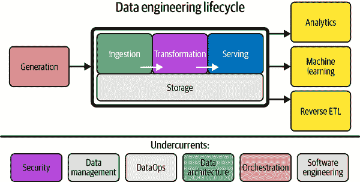
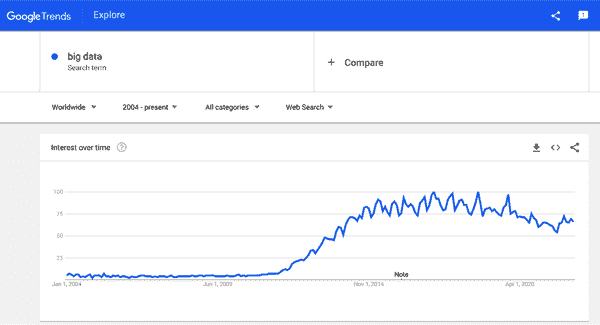
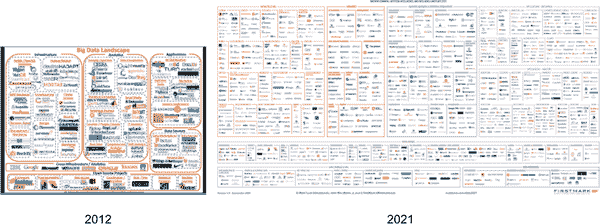
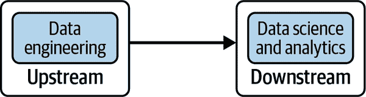
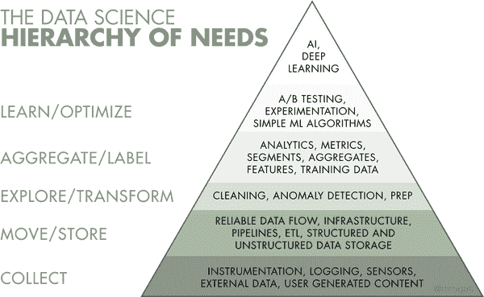
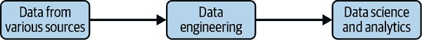
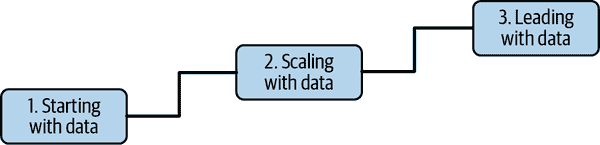
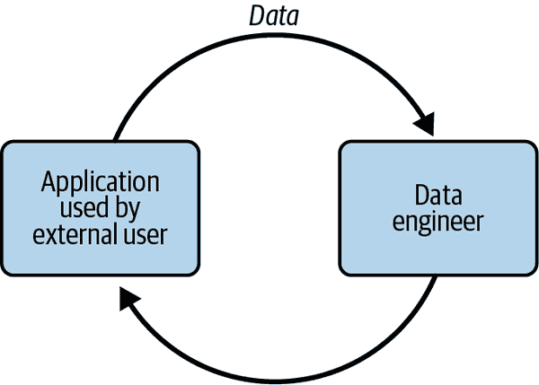
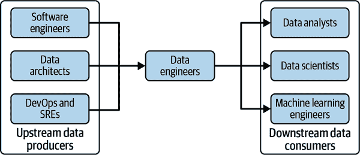

## 第 1 章. 数据工程述要

其次，我们有幸在直播节目、播客、聚会以及无数次私下通话中，与数据领域的顶尖专家进行交流。他们的想法帮助塑造了本书。要一一道出他们的名字多得数不胜数，但我们要特别感谢 Jordan Tigani、Zhamak Dehghani、Ananth Packkildurai、Shruti Bhat、Eric Tschetter、Benn Stancil、Kevin Hu、Michael Rogove、Ryan Wright、Adi Polak、Shinji Kim、Andreas Kretz、Egor Gryaznov、Chad Sanderson、Julie Price、Matt Turck、Monica Rogati、Mars Lan、Pardhu Gunnam、Brian Suk、Barr Moses、Lior Gavish、Bruno Aziza、Gian Merlino、DeVaris Brown、Todd Beauchene、Tudor Girba、Scott Taylor、Ori Rafael、Lee Edwards、Bryan Offutt、Ollie Hughes、Gilbert Eijkelenboom、Chris Bergh、Fabiana Clemente、Andreas Kretz、Ori Reshef、Nick Singh、Mark Balkenende、Kenten Danas、Brian Olsen、Lior Gavish、Rhaghu Murthy、Greg Coquillo、David Aponte、Demetrios Brinkmann、Sarah Catanzaro、Michel Tricot、Levi Davis、Ted Walker、Carlos Kemeny、Josh Benamram、Chanin Nantasenamat、George Firican、Jordan Goldmeir、Minhaaj Rehmam、Luigi Patruno、Vin Vashista、Danny Ma、Jesse Anderson、Alessya Visnjic、Vishal Singh、Dave Langer、Roy Hasson、Todd Odess、Che Sharma、Scott Breitenother、Ben Taylor、Thom Ives、John Thompson、Brent Dykes、Josh Tobin、Mark Kosiba、Tyler Pugliese、Douwe Maan、Martin Traverso、Curtis Kowalski、Bob Davis、Koo Ping Shung、Ed Chenard、Matt Sciorma、Tyler Folkman、Jeff Baird、Tejas Manohar、Paul Singman、Kevin Stumpf、Willem Pineaar、Michael Del Balso（来自 Tecton）、Emma Dahl、Harpreet Sahota、Ken Jee、Scott Taylor、Kate Strachnyi、Kristen Kehrer、Taylor Miller、Abe Gong、Ben Castleton、Ben Rogojan、David Mertz、Emmanuel Raj、Andrew Jones、Avery Smith、Brock Cooper、Jeff Larson、Jon King、Holden Ackerman、Miriah Peterson、Felipe Hoffa、David Gonzalez、Richard Wellman、Susan Walsh、Ravit Jain、Lauren Balik、Mikiko Bazeley、Mark Freeman、Mike Wimmer、Alexey Shchedrin、Mary Clair Thompson、Julie Burroughs、Jason Pedley、Freddy Drennan、Jason Pedley、Kelly and Matt Phillipps、Brian Campbell、Faris Chebib、Dylan Gregerson、Ken Myers、Jake Carter、Seth Paul、Ethan Aaron，以及许多其他人。

如果您没有被特别点名，请别介意。您知道您是谁。告诉我们一声，我们会在下一版中加上您的名字。

我们还要感谢 Ternary Data 团队（Colleen McAuley、Maike Wells、Patrick Dahl、Aaron Hunsaker 等）、我们的学生，以及世界各地无数支持我们的人。这很好地提醒了我们世界是多么渺小。

与 O'Reilly 团队合作太棒了！特别感谢 Jess Haberman 在图书提案过程中对我们的信任，感谢我们了不起且极其耐心的责任编辑 Nicole Taché 和 Michele Cronin 提供的宝贵编辑意见、反馈和支持。也要感谢 O'Reilly 出色的制作团队（Greg 及团队成员）。

Joe 想感谢他的家人——Cassie、Milo 和 Ethan——允许他写这本书。他们付出了很多，Joe 发誓再也不写书了。 ;)

Matt 想感谢他的朋友和家人长久以来的耐心与支持。他仍希望 Seneca 能在经历了大量辛劳和假期错失的家庭时光后，大发慈悲给个五星好评。

### 什么是数据工程？

如果您从事数据或软件工作，可能已经注意到数据工程已从幕后走向台前，与数据科学共享舞台。数据工程是数据和技术领域最热门的领域之一，这是有充分理由的。它为生产环境中的数据科学和分析构建了基础。本章探讨什么是数据工程、该领域如何诞生及演变、数据工程师的技能，以及他们与谁共事。

尽管数据工程目前很流行，但关于数据工程的含义和数据工程师的工作内容，仍存在许多困惑。自从公司开始利用数据做事——如预测分析、描述性分析和报告——数据工程以某种形式就已存在，并在 2010 年代随着数据科学的兴起而成为焦点。为了本书的目的，必须明确定义*数据工程*和*数据工程师*的含义。

首先，让我们看看数据工程是如何被描述的，并建立一些贯穿全书的术语。关于*数据工程*的定义多不胜数。2022 年初，在 Google 上精确搜索“what is data engineering?”会返回超过 91,000 个唯一结果。在给出我们的定义之前，以下是该领域几位专家对数据工程的定义示例：

> 数据工程是一组旨在创建信息流动和访问接口及机制的操作。它需要专职专家——数据工程师——来维护数据，使其保持可用且可被他人使用。简而言之，数据工程师建立并运营组织的数据基础设施，为数据分析师和科学家的进一步分析做准备。
>
> 来源：《数据工程及其主要概念》，AlexSoft 著^(1)

> 第一类数据工程以 SQL 为中心。工作和数据的主要存储在关系型数据库中。所有数据处理均使用 SQL 或基于 SQL 的语言完成。有时，这种数据处理是通过 ETL 工具完成的。^(2) 第二类数据工程以大数据为中心。工作和数据的主要存储在 Hadoop、Cassandra 和 HBase 等大数据技术中。所有数据处理在 MapReduce、Spark 和 Flink 等大数据框架中完成。虽然也使用 SQL，但主要处理是用 Java、Scala 和 Python 等编程语言完成的。
>
> Jesse Anderson^(3)

> 相较于原有角色，数据工程领域可被视为商业智能和数据仓库的超集，引入了更多软件工程的要素。该学科还整合了围绕所谓“大数据”分布式系统运维的专业化，以及扩展 Hadoop 生态系统、流处理和大规模计算相关的概念。
>
> Maxime Beauchemin^(4)

> 数据工程完全关乎数据的移动、操作和管理。
>
> Lewis Gavin^(5)

哇！如果您对数据工程感到困惑，这完全可以理解。以上仅是少数几个定义，却包含了关于*数据工程*含义的大量不同观点。

#### 数据工程的定义

当我们梳理各界人士定义数据工程的共同脉络时，一个显而易见的模式浮现出来：数据工程师获取数据、存储数据，并为数据科学家、分析师及其他人员准备数据以供使用。我们定义*数据工程*和*数据工程师*如下：

> *数据工程*是对系统和流程进行开发、实施和维护，这些系统和流程接收原始数据并生成高质量、一致的信息，以支持下游用例，如分析和机器学习。数据工程是安全、数据管理、DataOps、数据架构、编排和软件工程的交汇点。*数据工程师*管理数据工程生命周期，从从源系统获取数据开始，到为分析或机器学习等用例提供数据结束。

#### 数据工程生命周期

很容易盲目地执着于技术而忽略大局。本书围绕一个名为*数据工程生命周期*的核心理念展开（图 1-1），我们认为这为数据工程师提供了审视其角色的全局视角。

数据工程生命周期将话题从技术转移到数据本身以及它必须服务的最终目标上。数据工程生命周期的阶段如下：

- 生成
- 存储
- 摄入
- 转换
- 服务

数据工程生命周期还包含*暗流*的概念——贯穿整个生命周期的关键理念。这些包括安全、数据管理、DataOps、数据架构、编排和软件工程。我们在第 2 章中更广泛地介绍数据工程生命周期及其暗流。尽管如此，我们在此引入它，因为它对我们对数据工程的定义以及本章后续的讨论至关重要。

现在你已经有了数据工程的工作定义及其生命周期的介绍，让我们退一步，回顾一下历史。

### 数据工程师的演变

> 历史不会简单重复，但总是押韵。
>
> 一句常被归因于马克·吐温的著名格言

理解当今和未来的数据工程需要了解该领域是如何演变的背景。本节不是历史课，但回顾过去对于理解我们身处何地以及事物将走向何方至关重要。一个常见的主题不断重现：旧的东西又变新了。

#### 早期：1980 年至 2000 年，从数据仓库到网络

数据工程师的诞生可以说源于数据仓库，最早可追溯到 20 世纪 70 年代，*业务数据仓库*在 20 世纪 80 年代成型，比尔·恩门于 1989 年正式提出了*数据仓库*一词。在 IBM 工程师开发出关系数据库和结构化查询语言 (SQL) 后，Oracle 普及了这项技术。随着初生的数据系统不断发展，企业需要专门的工具和数据管道用于报告和商业智能 (BI)。为了帮助人们在数据仓库中正确建模业务逻辑，拉尔夫·金鲍尔和恩门分别开发了以他们名字命名的数据建模技术和方法，这些技术和方法至今仍被广泛使用。

数据仓库开启了可扩展分析的第一个时代，新型大规模并行处理 (MPP) 数据库利用多个处理器来处理大量数据，面世并支持前所未有的数据量。BI 工程师、ETL 开发人员和数据仓库工程师等角色满足了数据仓库的各种需求。数据仓库和 BI 工程是当今数据工程的前身，在该学科中仍发挥着核心作用。

互联网在 20 世纪 90 年代中期成为主流，催生了一整代以网络为先的公司，如 AOL、雅虎和亚马逊。互联网繁荣催生了大量 Web 应用程序及其支持所需的后端系统——服务器、数据库和存储。其中大部分基础设施昂贵、单体且授权繁重。销售这些后端系统的供应商可能没有预见到 Web 应用程序将产生的巨大数据规模。

#### 2000 年代初期：当代数据工程的诞生

快进到 2000 年代初期，90 年代末的互联网泡沫破裂，只留下一小撮幸存者。其中一些公司，如雅虎、谷歌和亚马逊，后来成长为科技巨头。最初，这些公司继续依赖 1990 年代传统的单体关系数据库和数据仓库，将这些系统推向极限。随着这些系统不堪重负，需要新的方法来应对数据增长。新一代系统必须具有成本效益、可扩展、高可用和可靠。

随着数据的爆炸式增长，商品硬件——如服务器、内存、磁盘和闪存驱动器——也变得廉价且无处不在。几项创新使得在大规模计算集群上进行分布式计算和存储成为可能。这些创新开始去中心化并拆解传统的单体服务。“大数据”时代由此开始。

*《牛津英语词典》*将[大数据](https://oreil.ly/8IaGH)定义为“可以通过计算分析以揭示模式、趋势和关联的极大数据集，特别是与人类行为和交互有关的数据集。”大数据另一个著名且简洁的描述是数据的三个 *V*：速度、多样性和体量。

2003 年，谷歌发布了关于谷歌文件系统的论文，随后在 2004 年发布了关于 MapReduce 的论文，这是一种超大规模的数据处理范式。事实上，大数据在 MPP 数据仓库和实验物理项目的数据管理中有更早的先例，但谷歌的出版物为数据技术和我们今天所知的数据工程的文化根源构成了一次“大爆炸”。你将在第 3 章和第 8 章分别了解更多关于 MPP 系统和 MapReduce 的内容。

谷歌的论文激励雅虎的工程师开发并于 2006 年开源了 Apache Hadoop。^(6) Hadoop 的影响力难以言喻。对大规模数据问题感兴趣的软件工程师被这个新的开源技术生态系统的可能性所吸引。随着各种规模和类型的公司看到其数据增长到数 TB 甚至 PB 级别，大数据工程师时代诞生了。

大约在同一时期，亚马逊为了满足自身爆炸式增长的数据需求，创建了弹性计算环境（Amazon Elastic Compute Cloud，即 EC2）、无限可扩展的存储系统（Amazon Simple Storage Service，即 S3）、高度可扩展的 NoSQL 数据库（Amazon DynamoDB）以及许多其他核心数据构建模块。^(7) 亚马逊选择通过 *Amazon Web Services* (AWS) 向内部和外部提供这些服务，成为第一个流行的公有云。AWS 通过虚拟化和转售大量商品硬件资源池，创建了一个超灵活的按需付费资源市场。开发人员无需为数据中心购买硬件，只需从 AWS 租用计算和存储资源即可。

随着 AWS 成为亚马逊极具利润的增长引擎，其他公有云很快跟进，如 Google Cloud、Microsoft Azure 和 DigitalOcean。公有云可以说是 21 世纪最重要的创新之一，它引发了一场软件和数据应用开发与部署方式的革命。

早期的大数据工具和公有云为当今的数据生态系统奠定了基础。没有这些创新，现代数据格局——以及我们现在所知道的数据工程——将不复存在。

#### 2000 年代和 2010 年代：大数据工程

Hadoop 生态系统中的开源大数据工具迅速成熟，并从硅谷传播到全球技术领先的公司。首次，任何企业都能使用顶级科技公司所用的同款前沿数据工具。另一场革命随批处理向事件流的转变而发生，开启了大“实时”数据的新时代。你将在全书中了解批处理和事件流。

工程师可以任选最新最好的工具——Hadoop、Apache Pig、Apache Hive、Dremel、Apache HBase、Apache Storm、Apache Cassandra、Apache Spark、Presto 以及涌现的许多其他新技术。传统的面向企业和基于 GUI 的数据工具突然显得过时了，随着 MapReduce 的兴起，代码优先的工程成为时尚。我们（作者）亲历了那个时代，感觉旧教条仿佛在大数据的祭坛上猝然死去。

### 数据工程的演变

#### 大数据时代（2000 年代–2010 年代）

2000 年代末和 2010 年代数据工具的爆发式增长催生了*大数据工程师*。为了有效使用这些工具和技术——即包括 Hadoop、YARN、Hadoop 分布式文件系统 (HDFS) 和 MapReduce 在内的 Hadoop 生态系统——大数据工程师必须精通软件开发和底层基础设施黑客技术，但重点有所转移。大数据工程师通常维护大规模的通用硬件集群，以大规模交付数据。虽然他们偶尔会向 Hadoop 核心代码提交拉取请求，但他们的重点已从核心技术开发转移到了数据交付。

大数据迅速成为其自身成功的牺牲品。作为一个流行词，*大数据*在 2000 年代初至 2010 年代中期流行起来。大数据俘获了那些试图理解不断增长的数据量的公司的想象力，也俘获了兜售大数据工具和服务的公司铺天盖地、厚颜无耻的营销攻势。由于巨大的炒作，公司使用大数据工具解决小数据问题的现象很常见，有时甚至搭建一个 Hadoop 集群仅仅为了处理几 GB 的数据。似乎每个人都想分一杯大数据的羹。Dan Ariely [发推文](https://oreil.ly/cpL26) 说：“大数据就像青少年的性行为：人人都在谈论，没人真懂怎么做，人人都以为别人在做，所以人人都声称自己在做。”

图 1-2 展示了搜索词“大数据”的 Google Trends 快照，以便了解大数据的兴衰。

尽管该术语很流行，但大数据已失去动力。发生了什么？用一个词概括：简化。尽管开源大数据工具功能强大且复杂精密，但管理它们工作量巨大，且需要持续关注。公司往往雇佣整个大数据工程师团队，每年花费数百万美元，来“照看”这些平台。大数据工程师往往花费过多时间维护复杂的工具，而用于交付业务洞察和价值的时间可以说不那么多。

开源开发者、云厂商和第三方开始寻找方法来抽象、简化大数据，使其无需承担管理集群、安装、配置和升级开源代码的高昂管理开销和成本即可使用。*大数据* 这个术语本质上是一个遗迹，用来描述处理大量数据的特定时期和方法。

如今，数据流动速度比以往任何时候都快，规模也越来越大，但大数据处理变得如此触手可及，以至于不再需要一个单独的术语；每家公司都旨在解决其数据问题，无论实际数据规模大小。大数据工程师现在简称为*数据工程师*。

#### 2020 年代：面向数据生命周期的工程

在撰写本书时，数据工程师角色正在快速演变。我们预计这种演变在可预见的未来将继续快速进行。过去数据工程师往往关注 Hadoop、Spark 或 Informatica 等单体框架的底层细节，但趋势正转向去中心化、模块化、托管化和高度抽象化的工具。

确实，数据工具以惊人的速度激增（参见 图 1-3）。2020 年代初的流行趋势包括*现代数据栈*，它代表了一组开箱即用的开源和第三方产品的集合，旨在让分析师的生活更轻松。同时，数据源和数据格式在种类和规模上都在增长。数据工程越来越成为一门互操作的学科，像搭乐高积木一样连接各种技术，以服务于最终的业务目标。

本书讨论的数据工程师更准确地描述为*数据生命周期工程师*。随着抽象和简化程度的提高，数据生命周期工程师不再受昨天大数据框架那些繁杂细节的拖累。虽然数据工程师保持低层数据编程技能并按需使用，但他们发现自己的角色越来越集中在价值链更高端的事务上：安全、数据管理、DataOps、数据架构、编排和通用数据生命周期管理。^(8)

随着工具和工作流的简化，我们看到了数据工程师态度的明显转变。开源项目和服务不再关注谁拥有“最大数据”，而是越来越关注管理和治理数据，使其更易于使用和发现，并提高其质量。数据工程师现在精通 *CCPA* 和 *GDPR* 等首字母缩写词；^(9) 在构建数据管道时，他们关注隐私、匿名化、数据垃圾回收和法规合规性。

旧事重提，焕然新生。虽然数据管理（包括数据质量和治理）等“企业级”东西在大数据时代之前对大型企业很常见，但在小公司却未被广泛采用。现在昨天数据系统的许多棘手问题已得到解决、精美地产品化和包装，技术专家和企业家将重点转回“企业级”东西上，但强调去中心化和敏捷性，这与传统的企业命令控制式方法形成对比。

我们将现在视为数据生命周期管理的黄金时代。管理数据工程生命周期的数据工程师拥有比以往更好的工具和技术。我们将在下一章更详细地讨论数据工程生命周期及其潜流。

#### 数据工程与数据科学

数据工程在数据科学中处于什么位置？这有一些争论，有人认为数据工程是数据科学的一个分支学科。我们认为数据工程*独立于*数据科学和分析。它们相辅相成，但截然不同。数据工程位于数据科学的上游（图 1-4），这意味着数据工程师提供数据科学家（位于数据工程下游）使用的输入，后者将这些输入转化为有用的东西。

请看数据科学需求层级（图 1-5）。2017 年，Monica Rogati 在[一篇文章](https://oreil.ly/pGg9U)中发布了这个层级，展示了 AI 和机器学习 (ML) 与数据移动/存储、收集和基础设施等更“平凡”领域的相对位置。

尽管许多数据科学家渴望构建和调优 ML 模型，但现实是估计有 70% 到 80% 的时间花在层级底部三层的苦力活上——收集数据、清洗数据、处理数据——只有极小一部分时间用于分析和 ML。Rogati 认为，公司在涉足 AI 和 ML 等领域之前，需要建立坚实的数据基础（层级的底部三层）。

数据科学家通常未受过构建生产级数据系统的训练，由于缺乏数据工程师的支持和资源，他们最终草率地做这项工作。在理想世界中，数据科学家应将 90% 以上的时间集中在金字塔顶层：分析、实验和 ML。当数据工程师专注于层级的这些底层部分时，他们为数据科学家的成功构建了坚实的基础。

随着数据科学推动高级分析和机器学习的发展，数据工程横跨“获取数据”与“从数据中获取价值”之间的鸿沟（参见图 1-6）。我们认为，数据工程与数据科学同等重要、同等可见，数据工程师在让数据科学在生产环境中取得成功方面发挥着至关重要的作用。

### 数据工程技能与活动

数据工程师的技能组合涵盖了数据工程的“暗流”：安全、数据管理、DataOps、数据架构和软件工程。这一技能组合要求理解如何评估数据工具，以及它们如何在数据工程生命周期中协同工作。了解数据在源系统中是如何产生的，以及分析师和数据科学家将在处理和整理数据后如何消费数据并创造价值，同样至关重要。最后，数据工程师需要同时应对大量复杂的变动部件，并必须在成本、敏捷性、可扩展性、简洁性、复用性和互操作性这些维度上持续优化（图 1-7）。我们将在后续章节中更详细地介绍这些主题。

正如我们所讨论的，在过去的一段时间里，数据工程师需要了解并掌握如何使用少数几个强大且单体的技术（Hadoop、Spark、Teradata、Hive 以及其他许多技术）来创建数据解决方案。使用这些技术通常需要对软件工程、网络、分布式计算、存储或其他底层细节有深入的理解。他们的工作主要集中在集群管理和维护、管理开销、编写管道和转换作业等任务上。

如今，数据工具领域的管理和部署变得简单得多。现代数据工具大大抽象并简化了工作流。因此，数据工程师现在专注于平衡最简单、最具成本效益的最佳组合服务，以向业务交付价值。数据工程师还需要创建能够随着新趋势出现而演进的敏捷数据架构。

数据工程师*不*做哪些事情？数据工程师通常不直接构建机器学习模型、创建报表或仪表板、执行数据分析、构建关键绩效指标（KPI）或开发软件应用程序。数据工程师应对这些领域有良好的功能性理解，以最好地服务于利益相关者。

#### 数据成熟度与数据工程师

公司内部数据工程复杂度的程度在很大程度上取决于公司的数据成熟度。这极大地影响了数据工程师的日常工作职责和职业发展。究竟什么是数据成熟度？

*数据成熟度*是指组织在数据利用、能力和集成方面向更高水平演进的过程，但数据成熟度并不单纯取决于公司的成立时间或收入。一家早期初创公司的数据成熟度可能高于一家成立 100 年、年收入数十亿美元的公司。关键在于数据是否被作为竞争优势加以利用。

数据成熟度模型有很多版本，例如[数据管理成熟度模型 (DMM)](https://oreil.ly/HmX62) 等，但很难挑选出一个既简单又适合数据工程的模型。因此，我们将创建自己的简化数据成熟度模型。我们的数据成熟度模型（图 1-8）分为三个阶段：起步用数、规模用数、引领用数。让我们看看每个阶段以及数据工程师在每个阶段通常做什么。

##### 第一阶段：起步用数

一家开始接触数据的公司，按定义处于数据成熟度的早期阶段。公司可能只有模糊、松散定义的目标，甚至没有目标。数据架构和基础设施处于规划和开发的最早期。采用率和利用率可能很低或为零。数据团队规模很小，通常只有个位数的人员。在这个阶段，数据工程师通常是全能型人才，往往会兼任数据科学家或软件工程师等其他角色。数据工程师的目标是快速行动、获得进展并增加价值。

从数据中获取价值的实操方法通常知之甚少，但这种渴望是存在的。报表或分析缺乏正式结构，大多数数据需求都是临时性的。虽然在这个阶段直接全身心投入机器学习很诱人，但我们不建议这样做。我们见过无数数据团队因为试图在没有建立坚实数据基础的情况下跳跃到机器学习而陷入困境、落得一场空。

这并不是说在这个阶段无法从机器学习中获得胜利——这虽然罕见但也是可能的。如果没有坚实的数据基础，你很可能没有数据来训练可靠的机器学习模型，也没有办法以可扩展、可重复的方式将这些模型部署到生产环境中。我们半开玩笑地称自己为[“康复中的数据科学家”](https://oreil.ly/2wXbD)，主要是基于个人经历，在数据成熟度或数据工程支持不足的情况下参与了过早的数据科学项目。

在起步用数的组织中，数据工程师应关注以下方面：

*   争取关键利益相关者（包括高层管理人员）的支持。理想情况下，数据工程师应为关键计划争取到发起人，以设计和构建支持公司目标的数据架构。
*   定义正确的数据架构（通常是独自完成，因为可能没有数据架构师）。这意味着确定业务目标以及你希望通过数据计划实现的竞争优势。朝着支持这些目标的数据架构努力。请参阅第 3 章了解我们关于“良好”数据架构的建议。
*   识别并审计将支持关键计划并在你设计的数据架构中运行的数据。
*   为未来的数据分析师和数据科学家构建坚实的数据基础，以便他们生成提供竞争价值的报表和模型。在此期间，在该团队招聘到位之前，你可能也需要生成这些报表和模型。

这是一个充满陷阱的微妙阶段。以下是针对该阶段的一些建议：

*   如果数据没有带来很多可见的成功，组织的意志力可能会减弱。快速取得胜利将确立数据在组织中的重要性。只需记住，快速胜利可能会产生技术债。要有偿还债务的计划，否则它会增加未来交付的摩擦。
*   走出去与人交谈，避免孤岛式工作。我们经常看到数据团队在泡沫中工作，不与部门外的人沟通，不从业务利益相关者那里获取观点和反馈。危险在于你会花大量时间做对人们没用的事情。
*   避免无差别的重体力劳动。不要用不必要的技术复杂性把自己困住。尽可能使用现成的、交钥匙的解决方案。
*   仅在能创造竞争优势的地方构建定制解决方案和代码。

##### 第二阶段：规模用数

此时，公司已摆脱临时性的数据请求，建立了正式的数据实践。现在的挑战是创建可扩展的数据架构，并为公司真正成为数据驱动型组织的未来做规划。数据工程角色从全能型转向专家型，人们专注于数据工程生命周期的特定方面。

在处于数据成熟度第二阶段的组织中，数据工程师的目标是做到以下几点：

*   建立正式的数据实践
*   创建可扩展且稳健的数据架构
*   采用 DevOps 和 DataOps 实践

###### 目标

*   构建支持机器学习的系统
*   继续避免无差别的繁重劳动，仅在能带来竞争优势时才进行定制

我们将在本书后面回到这些目标中的每一个。

需要注意的问题包括以下内容：

*   随着我们在数据方面变得更加成熟，很容易根据硅谷公司的社会认同来采用前沿技术。这很少是对你的时间和精力的好利用。任何技术决策都应由其为客户带来的价值驱动。
*   扩展的主要瓶颈不是集群节点、存储或技术，而是数据工程团队。专注于易于部署和管理的解决方案，以扩大团队的吞吐量。
*   你会倾向于将自己定位为技术专家、能交付神奇产品的数据天才。相反，应将重点转移到务实的领导力上，并开始向下一个成熟阶段过渡；与其他团队沟通数据的实际效用。教会组织如何消费和利用数据。

##### 第三阶段：以数据引领

在此阶段，公司是数据驱动的。数据工程师创建的自动化管道和系统允许公司内部人员进行自助分析和机器学习。引入新数据源是无缝的，并能产生切实的价值。数据工程师实施适当的控制和实践，以确保数据始终可供人员和系统使用。数据工程角色比第二阶段继续更深度地专业化。

在处于数据成熟度第三阶段的组织中，数据工程师将继续在前几阶段的基础上构建，此外还将执行以下工作：

*   创建自动化，以实现新数据的无缝引入和使用
*   专注于构建利用数据作为竞争优势的定制工具和系统
*   关注数据的“企业级”方面，如数据管理（包括数据治理和质量）和 DataOps
*   部署在整个组织中暴露和传播数据的工具，包括数据目录、数据血缘工具和元数据管理系统
*   与软件工程师、机器学习工程师、分析师及其他人员高效协作
*   创建一个社区和环境，让人们无论角色或职位如何，都能协作和畅所欲言

需要注意的问题包括以下内容：

*   在此阶段，自满是一个重大危险。一旦组织达到第三阶段，它们必须持续专注于维护和改进，否则有跌回较低阶段的风险。
*   技术干扰比在其他阶段构成更大的危险。这里存在追求无法为业务带来价值的昂贵“兴趣项目”的诱惑。仅在定制技术提供竞争优势的地方使用它。

#### 数据工程师的背景与技能

数据工程是一个快速增长的领域，关于如何成为一名数据工程师，仍有许多问题。因为数据工程是一个相对较新的学科，可供进入该领域的正规培训很少。大学没有标准的数据工程路径。尽管少数数据工程训练营和在线教程涵盖了零散的主题，但该学科尚无通用课程。

进入数据工程领域的人在教育、职业和技能组合方面背景各异。每个进入该领域的人都应该预期要投入大量时间进行自学。阅读本书是一个很好的起点；本书的主要目标之一是为您提供我们认为作为数据工程师取得成功所需的知识和技能基础。

如果你正在转行做数据工程，我们发现从相邻领域转型最容易，例如软件工程、ETL 开发、数据库管理、数据科学或数据分析。这些学科往往具备“数据意识”，并为组织中的数据角色提供良好的背景。它们还使人们具备解决数据工程问题的相关技术技能和背景知识。

尽管缺乏正规化的路径，但存在一个必需的知识体系，我们认为数据工程师应掌握这些知识才能成功。根据定义，数据工程师必须同时理解数据和技术。就数据而言，这意味着了解围绕数据管理的各种最佳实践。在技术方面，数据工程师必须了解各种工具选项、它们的相互作用和权衡。这需要对软件工程、DataOps 和数据架构有良好的理解。

放眼全局，数据工程师还必须了解数据消费者（数据分析师和数据科学家）的需求，以及数据在整个组织中的广泛影响。数据工程是一项整体性实践；最优秀的数据工程师通过业务和技术的双重视角来审视他们的职责。

##### 业务职责

我们在本节列出的宏观职责并非数据工程师独有，但对从事数据或技术领域工作的任何人都至关重要。因为简单的 Google 搜索就能获得大量学习这些领域的资源，我们将简要列出它们：

**知道如何与非技术人员和技术人员沟通。**
: 沟通是关键，你需要能够与整个组织中的人建立融洽关系和信任。我们建议密切关注组织层级、汇报关系、人际互动方式以及存在哪些孤岛。这些观察对你的成功将极其宝贵。

**理解如何确定范围并收集业务和产品需求。**
: 你需要知道要构建什么，并确保利益相关者同意你的评估。此外，要培养对数据和技术决策如何影响业务的感知。

**理解敏捷、DevOps 和 DataOps 的文化基础。**
: 许多技术人员错误地认为这些实践可以通过技术解决。我们认为这是危险的错误。敏捷、DevOps 和 DataOps 从根本上说是文化层面的，需要全组织的认同。

**控制成本。**
: 当你能在保持低成本的同时提供超额价值时，你就会成功。了解如何针对价值实现时间、总拥有成本和机会成本进行优化。学会监控成本以避免意外。

**持续学习。**
: 数据领域感觉像是在以光速变化。在其中取得成功的人擅长在巩固基础知识的同时学习新事物。他们也善于筛选，判断哪些新发展与其工作最相关，哪些还不成熟，哪些只是昙花一现。保持对领域的关注，并学会如何学习。

成功的数据工程师总是放眼全局，以理解大局并为业务实现超额价值。沟通至关重要，无论是对技术人员还是非技术人员。我们经常看到数据团队因与其他利益相关者的沟通而成功；成功或失败很少是技术问题。懂得如何在组织中游刃有余、确定范围并收集需求、控制成本以及持续学习，将使你区别于那些仅依靠技术能力发展职业生涯的数据工程师。

##### 技术职责

你必须理解如何在高层面上构建优化性能和成本的架构，使用预打包或自研组件。归根结底，架构及其组成技术是服务于数据工程生命周期的基石。回顾数据工程生命周期的阶段：

*   生成
*   存储
*   摄入
*   转换
*   服务

数据工程生命周期的暗流包括以下内容：

*   安全
*   数据管理
*   DataOps
*   数据架构
*   编排

##### 软件工程

稍微深入一点，我们在本节中讨论作为数据工程师所需的一些战术性数据和技术技能；我们将在后续章节中更详细地讨论这些内容。

人们经常问，数据工程师是否应该懂得编程？简短回答：是的。数据工程师应具备生产级的软件工程功底。我们注意到，数据工程师承担的软件开发项目性质在过去几年里发生了根本性变化。全托管服务现在取代了以前工程师所需的大量低级编程工作，工程师现在使用托管的开源软件，以及简单的即插即用 `SaaS` 产品。例如，数据工程师现在专注于高层抽象，或在编排框架内将管道作为代码编写。

即使在一个更加抽象的世界里，软件工程最佳实践也能提供竞争优势，能够深入研究代码库深层架构细节的数据工程师，在出现特定技术需求时能为公司带来优势。简而言之，不会编写生产级代码的数据工程师将受到严重阻碍，我们短期内不认为这种情况会改变。数据工程师在承担其他众多角色的同时，依然是软件工程师。

数据工程师应该掌握哪些语言？我们将数据工程编程语言分为主要和次要两类。在撰写本文时，数据工程的主要语言是 `SQL`、`Python`、一种 `Java 虚拟机 (JVM)` 语言（通常是 `Java` 或 `Scala`）以及 `bash`：

###### SQL
数据库和数据湖最常见的接口。在因大数据处理需要编写自定义 `MapReduce` 代码而短暂被边缘化后，`SQL`（以各种形式）已重新成为数据领域的通用语言。

###### Python
数据工程与数据科学之间的桥梁语言。越来越多的数据工程工具是用 `Python` 编写的，或拥有 `Python` `API`。它被称为“万物第二好语言”。`Python` 是流行数据工具（如 `pandas`、`NumPy`、`Airflow`、`sci-kit learn`、`TensorFlow`、`PyTorch` 和 `PySpark`）的基础。`Python` 是底层组件之间的胶水，且经常作为与框架交互的一流 `API` 语言。

###### JVM 语言，如 Java 和 Scala
广泛用于 Apache 开源项目，如 `Spark`、`Hive` 和 `Druid`。`JVM` 通常比 `Python` 性能更高，且可能提供比 `Python` `API` 更底层的功能访问（例如，Apache `Spark` 和 `Beam` 即是这种情况）。如果你使用流行的开源数据框架，了解 `Java` 或 `Scala` 将大有裨益。

###### bash
Linux 操作系统的命令行界面。了解 `bash` 命令并熟练使用 `CLI`，在需要编写脚本或执行操作系统操作时，将显著提高你的工作效率和工作流。即使在今天，数据工程师也经常使用 `awk` 或 `sed` 等命令行工具在数据管道中处理文件，或从编排框架调用 `bash` 命令。如果你使用 Windows，可以随意用 `PowerShell` 替代 `bash`。

数据工程师可能还需要掌握次要编程语言，包括 `R`、`JavaScript`、`Go`、`Rust`、`C/C++`、`C#` 和 `Julia`。当这些语言在公司内部流行，或与特定领域的数据工具搭配使用时，通常需要用这些语言进行开发。例如，`JavaScript` 已被证明作为云数据仓库中用户定义函数的语言很受欢迎。同时，`C#` 和 `PowerShell` 在利用 `Azure` 和微软生态系统的公司中至关重要。

#### 数据工程角色的连续谱，从 A 到 B

尽管职位描述将数据工程师描绘成必须拥有所有可想象数据技能的“独角兽”，但数据工程师并不都做同类工作，也不具备相同的技能组合。数据成熟度是了解公司在提升数据能力过程中将面临何种数据挑战的有益指南。审视数据工程师工作类型的一些关键区别很有好处。虽然这些区别过于简化，但它们阐明了数据科学家和数据工程师的职责，避免将任一角色归入“独角兽”大类。

在数据科学中，存在 A 类和 B 类数据科学家的概念。^(10) `A 类数据科学家`——`A` 代表分析——专注于理解数据并获取洞见。`B 类数据科学家`——`B` 代表构建——拥有与 A 类数据科学家相似的背景，并具备强大的编程技能。B 类数据科学家构建系统，使数据科学在生产环境中落地。借用这个数据科学家连续谱，我们将为两类数据工程师创建类似的区分：

##### A 类数据工程师
`A` 代表 `抽象`。在这种情况下，数据工程师避免无差别的繁重劳动，使数据架构尽可能抽象和简单，不重复造轮子。`A 类数据工程师`主要通过使用现成产品、托管服务和工具来管理数据工程生命周期。`A 类数据工程师`跨行业、跨各个数据成熟度层级的公司工作。

##### B 类数据工程师
`B` 代表 `构建`。`B 类数据工程师`构建可扩展的数据工具和系统，利用公司的核心竞争力和竞争优势。在数据成熟度范围内，B 类数据工程师更常见于处于第 2 和第 3 阶段（用数据扩展和引领）的公司，或者当最初的数据用例非常独特且关键任务，需要自定义数据工具才能起步时。

`A 类`和 `B 类`数据工程师可能在同一家公司工作，甚至可能是同一个人！更常见的情况是，先雇佣 A 类数据工程师打地基，然后随着公司内部需求的出现，B 类数据工程师的技能组合或被学习，或被雇佣。

#### 组织内部的数据工程师

数据工程师不是在真空中工作的。根据他们正在从事的工作，他们将与技术和非技术人员互动，并面向不同方向（内部和外部）。让我们探讨数据工程师在组织内部做什么，以及他们与谁互动。

##### 面向内部与面向外部的数据工程师

数据工程师服务于多个最终用户，并面向许多内部和外部方向（`图 1-9`）。由于并非所有数据工程工作负载和职责都相同，因此了解数据工程师服务于谁至关重要。根据最终用例，数据工程师的主要职责是面向外部、面向内部，或两者的混合。

`面向外部`的数据工程师通常与外部应用的用户保持一致，如社交媒体应用、物联网 (`IoT`) 设备和电商平台。这类数据工程师设计、构建和管理系统，从这些应用收集、存储和处理事务和事件数据。这些数据工程师构建的系统拥有从应用到数据管道，再回到应用的反馈循环（`图 1-10`）。

面向外部的数据工程带来了一组独特的问题。面向外部的查询引擎通常比面向内部的系统处理大得多的并发负载。工程师还需要考虑对用户可运行的查询设置严格限制，以限制任何单个用户对基础设施的影响。此外，安全性对于外部查询来说是一个复杂且敏感得多的问题，特别是当被查询的数据是多租户的（来自许多客户的数据存放在单个表中）时。

*面向内部的数据工程师*通常专注于对业务需求和内部利益相关者至关重要的活动（图 1-11）。示例包括为 BI 仪表板、报表、业务流程、数据科学和 ML 模型创建和维护数据管道和数据仓库。

面向外部和面向内部的职责通常是混合在一起的。在实践中，面向内部的数据通常是面向外部数据的前提条件。数据工程师面对两群需求截然不同的用户，他们在查询并发性、安全性等方面有着完全不同的要求。

##### 数据工程师与其他技术角色

在实践中，数据工程生命周期横跨许多职责领域。数据工程师处于各种角色的核心交汇点，直接或通过管理者与许多组织单元进行交互。

让我们看看数据工程师可能影响哪些人。在本节中，我们将讨论与数据工程相关的技术角色（图 1-12）。

数据工程师是*数据生产者*（如软件工程师、数据架构师、DevOps 或站点可靠性工程师 [SRE]）与*数据消费者*（如数据分析师、数据科学家和 ML 工程师）之间的枢纽。此外，数据工程师还将与运维角色的人员交互，如 DevOps 工程师。

考虑到新数据角色涌现的速度（分析工程师和 ML 工程师便是例证），这绝非详尽列表。

###### 上游利益相关者

要成为一名成功的数据工程师，你需要了解你正在使用或设计的数据架构，以及生成你所需数据的源系统。接下来，我们将讨论几位熟悉的上游利益相关者：数据架构师、软件工程师和 DevOps 工程师。

###### 数据架构师

数据架构师的工作抽象层级比数据工程师高一级。数据架构师为组织数据管理设计蓝图，规划流程、整体数据架构和系统。^(11) 他们还充当组织技术侧与非技术侧之间的桥梁。成功的数据架构师通常拥有丰富的工程经验积累的“实战伤痕”，这使他们能够指导和协助工程师，同时成功地向非技术业务利益相关者传达工程挑战。

数据架构师实施跨孤岛和业务单元的数据管理策略，主导数据管理和数据治理等全局战略，并指导重大计划。数据架构师通常在云迁移和绿地云设计中发挥核心作用。

云计算的出现改变了数据架构与数据工程之间的界限。云数据架构比本地系统更加灵活，因此传统上涉及大量研究、漫长交付周期、采购合同和硬件安装的架构决策，现在通常在实施过程中做出，只是大策略中的一步。尽管如此，数据架构师将继续作为企业中有影响力的远见者，与数据工程师携手合作，确定架构实践和数据战略的大局。

视公司的数据成熟度和规模而定，数据工程师可能与数据架构师的职责重叠，或承担其职责。因此，数据工程师应很好地理解架构最佳实践和方法。

请注意，我们将数据架构师放在*上游利益相关者*部分。数据架构师通常协助设计作为数据工程师源系统的应用数据层。架构师也可能在数据工程生命周期的各个其他阶段与数据工程师交互。我们将在第 3 章介绍“良好”的数据架构。

###### 软件工程师

软件工程师构建运行业务的软件和系统；他们主要负责生成数据工程师将消费和处理的*内部数据*。软件工程师构建的系统通常生成应用事件数据和日志，这些本身就是重要资产。这些内部数据与从 SaaS 平台或合作伙伴企业拉取的*外部数据*形成对比。在管理良好的技术组织中，软件工程师和数据工程师从新项目伊始就协同合作，为分析和 ML 应用设计应用数据。

数据工程师应与软件工程师协作，了解生成数据的应用、生成数据的量、频率和格式，以及任何将影响数据工程生命周期的因素，如数据安全和法规合规性。例如，这可能意味着设定上游预期，明确软件工程师需要做什么来完成他们的工作。数据工程师必须与软件工程师紧密合作。

###### DevOps 工程师和站点可靠性工程师

DevOps 和 SRE 通常通过运维监控生成数据。我们将他们归类为数据工程师的上游，但他们也可能是下游，通过仪表板消费数据，或在协调数据系统运维时直接与数据工程师交互。

###### 下游利益相关者

数据工程的存在是为了服务下游数据消费者和用例。本节讨论数据工程师如何与各种下游角色交互。我们还将介绍几种服务模式，包括集中式数据工程团队和跨职能团队。

###### 数据科学家

数据科学家构建前瞻性模型以进行预测和推荐。这些模型随后在实时数据上进行评估，以各种方式提供价值。例如，模型评分可能根据实时条件决定自动化操作，根据客户当前会话中的浏览历史向其推荐产品，或为交易员做出实时经济预测。

根据业界常见的传闻，数据科学家将 70% 到 80% 的时间花在收集、清洗和准备数据上。^(12) 根据我们的经验，这些数字往往反映了不成熟的数据科学和数据工程实践。特别是，如果许多流行的数据科学框架没有适当地扩展，就会成为瓶颈。仅在单个工作站上工作的数据科学家迫使自己对数据进行降采样，使数据准备变得复杂得多，并可能损害他们生成模型的质量。此外，本地开发的代码和环境通常难以部署到生产环境，缺乏自动化严重阻碍了数据科学工作流。如果数据工程师做好他们的工作并成功协作，数据科学家在初步探索性工作后，不应再花费时间收集、清洗和准备数据。数据工程师应尽可能自动化这些工作。

对生产就绪型数据科学的需求是数据工程职业涌现的重要驱动力。数据工程师应帮助数据科学家实现通往生产的路径。事实上，我们（作者）在认识到这一基本需求后，从数据科学转行到了数据工程。数据工程师致力于提供数据自动化和规模，使数据科学更加高效。

###### 数据分析师

###### 数据分析师 (重复)

数据分析师（或业务分析师）致力于了解业务绩效和趋势。相比之下，数据科学家着眼于未来，而数据分析师通常关注过去或现在。数据分析师通常在数据仓库或数据湖中运行 `SQL` 查询。他们也可能利用电子表格进行计算和分析，以及使用各种 BI 工具，如 Microsoft Power BI、Looker 或 Tableau。数据分析师是其常用数据领域的专家，并会深入熟悉数据定义、特征和质量问题。数据分析师典型的下游客户是业务用户、管理层和高管。

数据工程师与数据分析师合作，为业务所需的新数据源构建管道。数据分析师的主题专业知识对于提高数据质量至关重要，他们经常以此身份与数据工程师协作。

###### 机器学习工程师和 AI 研究员

机器学习工程师（ML 工程师）的职责与数据工程师和数据科学家有重叠。ML 工程师开发先进的 ML 技术、训练模型，并在可扩展的生产环境中设计和维护运行 ML 流程的基础设施。ML 工程师通常拥有 ML 和深度学习技术及框架（如 `PyTorch` 或 `TensorFlow`）的高级实操知识。

ML 工程师还了解运行这些框架所需的硬件、服务和系统，无论是用于模型训练还是生产规模的模型部署。ML 流程在云环境中运行很常见，ML 工程师可以在其中按需启动和扩展基础设施资源，或依赖托管服务。

正如我们所提到的，ML 工程、数据工程和数据科学之间的界限是模糊的。数据工程师可能承担一些 ML 系统的运维职责，而数据科学家可能与 ML 工程紧密合作，设计先进的 ML 流程。

ML 工程领域正在滚雪球般发展，并与数据工程中发生的许多相同发展并行。几年前，ML 的关注点还集中在如何构建模型上，但现在 ML 工程越来越强调融入机器学习运营（`MLOps`）的最佳实践，以及此前在软件工程和 DevOps 中采用的其他成熟实践。

AI 研究员致力于研究新的、先进的 ML 技术。AI 研究员可能在大型科技公司、专业的知识产权初创公司（OpenAI、DeepMind）或学术机构工作。有些从业者在公司内兼职从事研究，同时承担 ML 工程职责。在专业 ML 实验室工作的人员通常 100% 专注于研究。研究课题可能针对即时的实际应用，或更抽象的 AI 演示。`DALL-E`、`Gato AI`、`AlphaGo` 和 `GPT-3/GPT-4` 都是 ML 研究项目的绝佳例子。鉴于 ML 进步的速度，这些例子在几年内很可能就会显得过时。我们在“附加资源”中提供了一些参考资料。

资金充足的组织中的 AI 研究员高度专业化，并有工程师支持团队协助其工作。学术界的 ML 工程师通常资源较少，但依靠研究生、博士后和大学工作人员团队提供工程支持。部分专注于研究的 ML 工程师通常依赖相同的支持团队进行研究和生产。

#### 数据工程师和业务领导层

我们讨论了数据工程师交互的技术角色。但数据工程师也作为组织连接器在更广泛的层面上发挥作用，通常是以非技术身份。企业越来越依赖数据作为许多产品的核心部分，或作为产品本身。数据工程师现在参与战略规划，并领导超越 IT 边界的关键计划。数据工程师通常通过充当业务与数据科学/分析之间的纽带来支持数据架构师。

##### C-suite（高管层）中的数据

C 级高管越来越多地参与数据和分析，因为这些被视为现代企业的重要资产。例如，CEO 现在关注曾经是 IT 专属领域的计划，如云迁移或新客户数据平台的部署。

###### 首席执行官

非科技公司的首席执行官（CEO）通常不关心数据框架和软件的琐碎细节。相反，他们与技术 C-suite 角色和公司数据领导层合作定义愿景。数据工程师提供了一个窗口，展示数据能实现什么。数据工程师及其管理者维护一份组织可用数据的清单——包括内部和第三方数据——以及获取这些数据的时间范围。他们还被委派与其他工程角色合作研究主要的数据架构变更。例如，数据工程师通常深度参与云迁移、新数据系统迁移或流式技术部署。

###### 首席信息官

首席信息官（CIO）是组织内负责信息技术的高级 C-suite 高管；这是一个面向内部的角色。CIO 必须具备深厚的信息技术和业务流程知识——仅具备其中之一是不够的。CIO 领导信息技术组织，制定持续的政策，同时在 CEO 的指导下定义和执行重大计划。

在数据文化成熟的组织中，CIO 经常与数据工程领导层协作。如果一个组织的数据成熟度不高，CIO 通常会帮助塑造其数据文化。CIO 将与工程师和架构师合作规划重大计划，并就在采用主要架构元素（如企业资源规划（`ERP`）和客户关系管理（`CRM`）系统、云迁移、数据系统和面向内部的 IT）做出战略决策。

###### 首席技术官

首席技术官（CTO）类似于 CIO，但面向外部。CTO 负责面向外部应用（如移动应用、Web 应用和物联网）的关键技术战略和架构——这些都是数据工程师的关键数据源。CTO 通常是技术娴熟的技术专家，并对软件工程基础和系统架构有很好的理解。在一些没有 CIO 的组织中，CTO 有时首席运营官（COO）会扮演 CIO 的角色。数据工程师通常直接或间接向 CTO 汇报。

###### 首席数据官

首席数据官（CDO）一职于 2002 年在 Capital One 设立，以认可数据作为业务资产日益增长的重要性。CDO 负责公司的数据资产和战略。CDO 关注数据的业务效用，但应具备扎实的技术背景。CDO 监督数据产品、战略、计划和核心职能，如主数据管理和隐私保护。偶尔，CDO 也会管理业务分析和数据工程。

###### 首席分析官

首席分析官（CAO）是 CDO 角色的一种变体。当两个角色同时存在时，CDO 专注于交付数据所需的技术和组织。CAO 负责业务的分析、战略和决策制定。CAO 可能监督数据科学和 ML，但这很大程度上取决于公司是否设有 CDO 或 CTO 角色。

###### 首席算法官

###### 首席算法官 (CAO-2) (重复)

首席算法官 (CAO-2) 是高管层 (C-suite) 中的一项近期创新，是一个高度技术性的角色，专门专注于数据科学和机器学习 (ML)。CAO-2 通常具有数据科学或 ML 项目中个人贡献者和团队负责人的经验。他们通常拥有 ML 研究背景和相关高级学位。

CAO-2 需要熟悉当前的 ML 研究，并深入了解其公司的 ML 计划。除了制定业务计划外，他们还提供技术领导力，设定研发议程，并建立研究团队。

###### 数据工程师与项目经理

数据工程师经常参与重大计划，这些计划可能跨越多年。在我们撰写本书时，许多数据工程师正在从事云迁移工作，将流水线和数据仓库迁移到下一代数据工具。其他数据工程师则从零开始启动全新项目，通过从数量惊人的最佳架构和工具选项中进行选择，从头组装新的数据架构。

这些大型计划通常受益于*项目管理*（与接下来讨论的产品管理形成对比）。数据工程师以基础设施和服务交付的身份发挥作用，而项目经理则指挥调度并担任把关人。大多数项目经理遵循敏捷和 Scrum 的某种变体，瀑布模型仍偶尔出现。业务永不眠，业务利益相关者通常积压了大量他们想要解决的问题和想要启动的新计划。项目经理必须筛选冗长的请求列表，并确定关键交付物的优先级，以使项目保持正轨并更好地服务于公司。

数据工程师与项目经理互动，通常为项目规划冲刺 (sprint) 以及与冲刺相关的每日站会。反馈是双向的：数据工程师向项目经理和其他利益相关者通报进度和阻碍，项目经理则在技术团队的节奏与业务不断变化的需求之间取得平衡。

###### 数据工程师与产品经理

产品经理监督产品开发，通常负责产品线。在数据工程师的语境下，这些产品被称为*数据产品*。数据产品要么从零开始构建，要么是在现有产品基础上的增量改进。随着企业界采用以数据为中心的关注点，数据工程师与*产品经理*的互动更加频繁。与项目经理一样，产品经理在技术团队的活动与客户及业务需求之间取得平衡。

###### 数据工程师与其他管理角色

数据工程师与项目经理和产品经理之外的各种管理者互动。然而，这些互动通常遵循服务模型或跨职能模型。数据工程师要么作为一个中心化团队服务于各种传入请求，要么作为分配给特定管理者、项目或产品的资源工作。

有关数据团队及其构建方式的更多信息，我们推荐 John Thompson 的《Building Analytics Teams》（Packt 出版）和 Jesse Anderson 的《Data Teams》（Apress 出版）。这两本书为数据高管的角色、招聘对象以及如何为您的公司构建最高效的数据团队提供了强有力的框架和视角。

###### 注记

公司雇佣工程师并非只是让他们孤立地编写代码。要配得上他们的头衔，工程师应深入理解他们被指派解决的问题、他们可用的技术工具，以及他们共事和服务的人员。

### 结论

本章为您提供了数据工程领域的简要概述，包括以下内容：

* 定义数据工程并描述数据工程师的工作内容
* 描述公司的数据成熟度类型
* A 类和 B 类数据工程师
* 数据工程师与谁共事

我们希望第一章能激起您的兴趣，无论您是软件开发从业者、数据科学家、ML 工程师、业务利益相关者、企业家还是风险投资家。当然，后续章节仍有大量内容有待阐述。第 2 章 涵盖数据工程生命周期，第 3 章 介绍架构。后续章节将深入探讨生命周期各部分的技术决策细节。整个数据领域正处于变动之中，尽可能地，每一章都关注*不变量*——在持续不断的变化中多年依然有效的视角。

### 附加资源

* [“AI 需求层级”](https://oreil.ly/1RJOR) 作者 Monica Rogati
* [AlphaGo 研究网页](https://oreil.ly/mNB6b)
* [“大数据将在五年内消亡”](https://oreil.ly/R2Rus) 作者 Lewis Gavin
* 《Building Analytics Teams》作者 John K. Thompson (Packt)
* Lewis Gavin 著 [*What Is Data Engineering?*](https://oreil.ly/7LSon) 第 1 章 (O'Reilly)
* [“数据即产品与数据即服务”](https://oreil.ly/iOUug) 作者 Justin Gage
* [“数据工程：快速简单的定义”](https://oreil.ly/eNAnS) 作者 James Furbush (O'Reilly)
* 《Data Teams》作者 Jesse Anderson (Apress)
* [“在 Twitter 做数据科学”](https://oreil.ly/8rcYh) 作者 Robert Chang
* [“数据工程师的没落”](https://oreil.ly/qxg6y) 作者 Maxime Beauchemin
* [“数据工程的未来是学科的融合”](https://oreil.ly/rDiqj) 作者 Liam Hausmann
* [“CEO 如何引领数据驱动文化”](https://oreil.ly/7Kp6R) 作者 Thomas H. Davenport 和 Nitin Mittal
* [“打造数据驱动文化如何推动成功”](https://oreil.ly/UgzIZ) 作者 Frederik Bussler
* [信息管理知识体系网站](https://www.imbok.info)
* [“信息管理知识体系”维基百科页面](https://oreil.ly/Jk0KW)
* [“信息管理”维基百科页面](https://oreil.ly/SWj8k)
* [“论大数据中的复杂性”](https://oreil.ly/r0jkK) 作者 Jesse Anderson (O'Reilly)
* [“OpenAI 的新语言生成器 GPT-3 令人震惊地优秀——且完全无意识”](https://oreil.ly/hKYeB) 作者 Will Douglas Heaven
* [“数据工程师的崛起”](https://oreil.ly/R0QwP) 作者 Maxime Beauchemin
* [“大数据简史”](https://oreil.ly/BgzWe) 作者 Mark van Rijmenam
* [“数据架构师的技能”](https://oreil.ly/gImx2) 作者 Bob Lambert
* [“数据分析的三个层级：评估数据组织成熟度的框架”](https://oreil.ly/bTTd0) 作者 Emilie Schario
* [“什么是数据架构师？IT 的数据框架远见者”](https://oreil.ly/2QBcv) 作者 Thor Olavsrud
* [Quora 上的讨论“成为数据工程师还是数据科学家哪个更复杂？”](https://oreil.ly/1MAR8)
* [“为什么 CEO 必须主导大数据计划”](https://oreil.ly/Zh4A0) 作者 John Weathington

^(1) “Data Engineering and Its Main Concepts,” AlexSoft, 最后更新于 2021 年 8 月 26 日，[`oreil.ly/e94py`](https://oreil.ly/e94py)。

^(2) *ETL* 代表 *extract, transform, load*（抽取、转换、加载），这是本书涵盖的一种常见模式。

^(3) Jesse Anderson, “The Two Types of Data Engineering,” 2018 年 6 月 27 日，[`oreil.ly/dxDt6`](https://oreil.ly/dxDt6)。

^(4) Maxime Beauchemin, “The Rise of the Data Engineer,” 2017 年 1 月 20 日，[`oreil.ly/kNDmd`](https://oreil.ly/kNDmd)。

^(5) Lewis Gavin, *What Is Data Engineering?* (Sebastapol, CA: O'Reilly, 2020), [`oreil.ly/ELxLi`](https://oreil.ly/ELxLi)。

### 参考文献

1. Cade Metz, “How Yahoo Spawned Hadoop, the Future of Big Data,” *Wired*, 2011 年 10 月 18 日, <https://oreil.ly/iaD9G>。
2. Ron Miller, “How AWS Came to Be,” *TechCrunch*, 2016 年 7 月 2 日, <https://oreil.ly/VJehv>。
3. *DataOps* 是 *data operations*（数据运营）的缩写。我们将在第 2 章中介绍该主题。更多信息请阅读 [DataOps 宣言](https://oreil.ly/jGoHM)。
4. 这些首字母缩写词分别代表 *California Consumer Privacy Act*（加州消费者隐私法案）和 *General Data Protection Regulation*（通用数据保护条例）。
5. Robert Chang, “Doing Data Science at Twitter,” *Medium*, 2015 年 6 月 20 日, <https://oreil.ly/xqjAx>。
6. Paramita (Guha) Ghosh, “Data Architect vs. Data Engineer,” Dataversity, 2021 年 11 月 12 日, <https://oreil.ly/TlyZY>。
7. 关于这一概念存在多种参考资料。尽管这句老生常谈广为人知，但关于其在不同实际场景下的有效性已展开健康的辩论。更多详情请参阅 Leigh Dodds, “Do Data Scientists Spend 80% of Their Time Cleaning Data? Turns Out, No?” Lost Boy 博客, 2020 年 1 月 31 日, <https://oreil.ly/szFww>；以及 Alex Woodie, “Data Prep Still Dominates Data Scientists’ Time, Survey Finds,” *Datanami*, 2020 年 7 月 6 日, <https://oreil.ly/jDVWF>。
