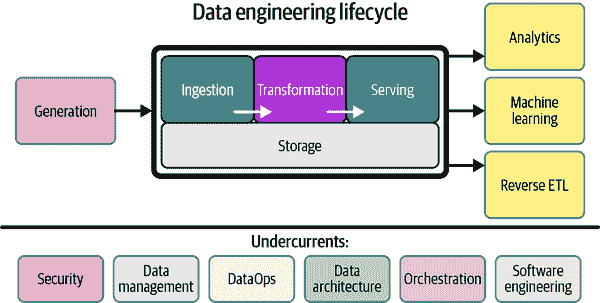
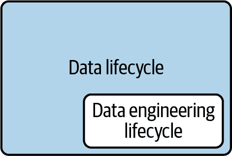
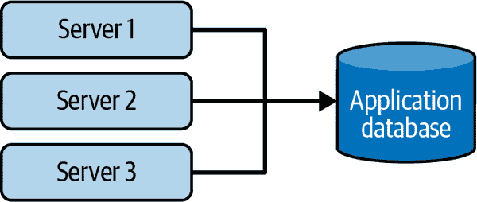
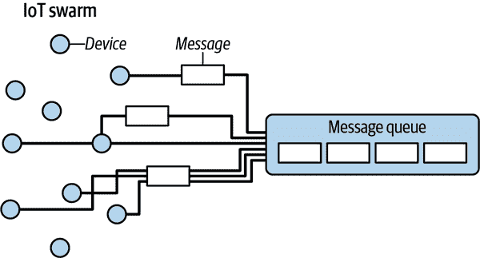
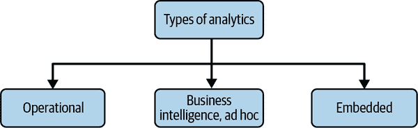
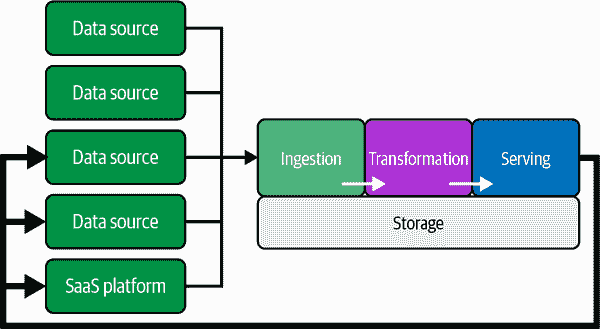
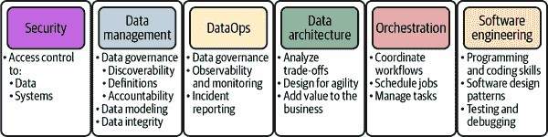
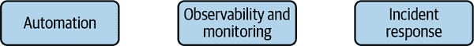

# 第 2 章. 数据工程生命周期

本书的主要目标是鼓励你超越将数据工程视为特定数据技术集合的观点。数据领域正经历新数据技术和实践的爆发式增长，抽象程度和易用性不断提高。由于技术抽象的增加，数据工程师将越来越多地成为*数据生命周期工程师*，从*数据生命周期管理原则*的角度进行思考和操作。

在本章中，你将了解*数据工程生命周期*，这是本书的核心主题。数据工程生命周期是我们描述数据工程“从摇篮到坟墓”全过程的框架。你还将了解数据工程生命周期的*暗流*，它们是支撑所有数据工程工作的关键基础。

### 什么是数据工程生命周期？

数据工程生命周期包含多个阶段，将原始数据素材转化为可供分析师、数据科学家、机器学习工程师等使用的有用最终产品。本章介绍数据工程生命周期的主要阶段，重点阐述每个阶段的核心概念，细节留待后续章节展开。

我们将数据工程生命周期划分为五个阶段（图 2-1，上部）：

*   生成
*   存储
*   摄入
*   转换
*   数据服务

我们从源系统获取并存储数据，开始数据工程生命周期。接下来转换数据，然后进入核心目标：向分析师、数据科学家、机器学习工程师等提供数据服务。实际上，存储贯穿生命周期始终，随着数据从头流向尾——因此图中将存储“阶段”展示为支撑其他阶段的基础。

一般来说，中间阶段——存储、摄入、转换——可能会有点混杂。这没关系。虽然我们拆分了数据工程生命周期的各个部分，但它并不总是整齐、连续的流程。生命周期的各个阶段可能会重复、乱序、重叠，或以有趣且意想不到的方式交织在一起。

作为基石的是*暗流*（图 2-1，下部），它们贯穿数据工程生命周期的多个阶段：安全、数据管理、DataOps、数据架构、编排和软件工程。没有这些暗流，数据工程生命周期的任何部分都无法正常运作。

### 数据生命周期与数据工程生命周期的区别

你可能会想知道整体数据生命周期与数据工程生命周期的区别。两者有细微差别。数据工程生命周期是整个数据生命周期的一个子集（图 2-2）。全数据生命周期涵盖数据的整个寿命，而数据工程生命周期聚焦于数据工程师可控制的阶段。

### 生成：源系统

*源系统*是数据工程生命周期中所用数据的起源。例如，源系统可以是物联网设备、应用程序消息队列或事务型数据库。数据工程师从源系统消费数据，但通常不拥有或控制源系统本身。数据工程师需要对源系统的工作原理、数据生成方式、数据频率和速度、以及生成的数据多样性有实际的理解。

工程师还需要与源系统所有者保持畅通的沟通，了解可能破坏管道和分析的变更。应用程序代码可能会改变字段的数据结构，或者应用团队甚至可能选择将后端迁移到全新的数据库技术。

数据工程的一大挑战是工程师必须处理和理解令人眼花缭乱的各种数据源系统。举例说明，让我们看看两个常见的源系统，一个非常传统（应用程序数据库），另一个是较新的例子（物联网集群）。

图 2-3 展示了一个由数据库支持的多台应用服务器组成的传统源系统。这种源系统模式在 1980 年代随着关系型数据库管理系统（RDBMS）的爆发式成功而流行。应用程序 + 数据库模式至今仍很流行，并伴随着软件开发实践的各种现代演进。例如，应用程序通常由许多小型服务/数据库对组成（微服务），而不是单一的单体架构。

再看一个源系统示例。图 2-4 展示了一个物联网集群：一组设备（圆圈）向中央收集系统发送数据消息（矩形）。随着传感器、智能设备等物联网设备在野外激增，这种物联网源系统日益普遍。

#### 评估源系统：关键工程考量

评估源系统时有许多因素需要考虑，包括系统如何处理摄入、状态和数据生成。以下是数据工程师必须考虑的源系统评估起始问题集：

*   数据源的基本特征是什么？是应用程序？还是一群物联网设备？
*   数据在源系统中如何持久化？是长期持久化，还是临时且快速删除？
*   数据生成速率如何？每秒多少事件？每小时多少千兆字节？
*   数据工程师能从输出数据中期望什么级别的一致性？如果你对输出数据运行数据质量检查，数据不一致的发生频率如何——意外的空值、糟糕的格式等？
*   错误发生的频率如何？
*   数据会包含重复吗？
*   部分数据值会延迟到达吗？可能比同时生成的其他消息晚得多？

### 源系统

*   导入数据的 `schema` 是什么？数据工程师是否需要跨多张表甚至多个系统进行关联，才能获得数据的完整视图？
*   如果 `schema` 发生变更（例如新增一列），该如何处理并通知下游相关方？
*   应以何种频率从源系统拉取数据？
*   对于有状态系统（例如跟踪客户账户信息的数据库），数据是作为定期快照提供，还是作为来自变更数据捕获（`CDC`）的更新事件提供？变更执行的逻辑是什么？这些变更在源数据库中是如何被跟踪的？
*   谁/什么是将传输数据供下游消费的数据提供方？
*   从数据源读取数据会影响其性能吗？
*   源系统是否存在上游数据依赖？这些上游系统的特征是什么？
*   是否已建立数据质量检查以监测延迟或缺失的数据？

源系统生成的数据被下游系统消费，包括人工生成的电子表格、物联网传感器、Web 和移动应用程序。每个源系统都有其独特的数据生成量和节奏。数据工程师应了解源系统如何生成数据，包括相关的怪癖或细微差别。数据工程师还需要了解其交互的源系统的限制。例如，针对源应用程序数据库运行分析查询是否会导致资源争用和性能问题？

源数据最棘手的细微差别之一在于 `schema`。`schema` 定义了数据的层级组织结构。从逻辑上讲，我们可以从整个源系统的层面来思考数据，深入到单个表，一直细化到各个字段的结构。从源系统传出的数据的 `schema` 有多种处理方式。两种流行的选择是 `schemaless`（无模式/动态模式）和 `fixed schema`（固定模式）。

`Schemaless` 并不意味着没有 `schema`。相反，它意味着应用程序在写入数据时定义 `schema`，无论写入目标是消息队列、平面文件、Blob 还是文档数据库（如 MongoDB）。建立在关系型数据库存储之上的更传统模型使用数据库中强制执行的 `fixed schema`，应用程序写入必须符合该模式。

这两种模型都给数据工程师带来了挑战。`Schemas` 随时间变化；事实上，敏捷软件开发方法鼓励 `schema` 演进。数据工程师工作的关键部分是获取符合源系统 `schema` 的原始数据输入，并将其转化为用于分析的有价值输出。随着源 `schema` 的演进，这项工作变得更具挑战性。

我们将在第 5 章中更详细地深入探讨源系统；我们也分别在第 6 章和第 8 章中介绍 `schemas` 和数据建模。

### 存储

你需要一个地方来存储数据。选择存储解决方案是数据生命周期其余部分成功的关键，由于多种原因，这也是数据生命周期中最复杂的阶段之一。首先，云中的数据架构通常利用 `several`（多个）存储解决方案。其次，很少有数据存储解决方案纯粹作为存储发挥作用，许多支持复杂的转换查询；即使是对象存储解决方案也可能支持强大的查询功能——例如 [Amazon S3 Select](https://oreil.ly/XzcKh)。第三，虽然存储是数据工程生命周期的一个阶段，但它经常涉及其他阶段，如摄入、转换和服务。

存储贯穿整个数据工程生命周期，通常在数据管道的多个位置出现，存储系统与源系统、摄入、转换和服务相互交叉。在许多方面，数据的存储方式影响着它在数据工程生命周期所有阶段中的使用方式。例如，云数据仓库可以存储数据、在管道中处理数据，并为分析师提供服务。Apache Kafka 和 Pulsar 等流式框架可以同时作为消息的摄入、存储和查询系统运行，对象存储则是数据传输的标准层。

#### 评估存储系统：关键工程考量

以下是在为数据仓库、数据湖仓、数据库或对象存储选择存储系统时需要询问的几个关键工程问题：

*   该存储解决方案是否与架构所需的写入和读取速度兼容？
*   存储会成为下游流程的瓶颈吗？
*   你是否了解该存储技术的工作原理？你是否在最优地利用存储系统，还是在做一些“反模式”的操作？例如，你是否在对象存储系统中应用高频率的随机访问更新？（这是一种反模式，会带来显著的性能开销。）
*   该存储系统能否应对预期的未来规模？你应该考虑存储系统的所有容量限制：总可用存储空间、读操作速率、写入量等。
*   下游用户和流程能否在所需的服务级别协议（`SLA`）内检索数据？
*   你是否在捕获关于 `schema` 演进、数据流、数据血统等方面的元数据？元数据对数据的效用有重大影响。元数据代表着对未来的投资，能极大地增强可发现性和机构知识，从而简化未来的项目和架构变更。
*   这是纯存储解决方案（对象存储），还是支持复杂查询模式（即云数据仓库）？
*   存储系统是 `schema` 无关（对象存储）？灵活 `schema`（Cassandra）？还是强制 `schema`（云数据仓库）？
*   你如何为数据治理跟踪主数据、黄金记录数据质量和数据血统？（我们将在“数据管理”中详细讨论这些内容。）
*   你如何处理法规合规性和数据主权？例如，你能否将数据存储在特定地理位置而非其他位置？

#### 理解数据访问频率

并非所有数据的访问方式都相同。检索模式将因存储和查询的数据而大不相同。这引出了数据“温度”的概念。数据访问频率将决定数据的温度。

访问最频繁的数据称为 `hot data`（热数据）。`Hot data` 通常每天被检索多次，甚至可能每秒几次——例如，在为用户请求提供服务的系统中。这些数据应存储在便于快速检索的介质中，其中“快速”是相对于用例而言的。`Lukewarm data`（温数据）可能会偶尔被访问——比如每周或每月一次。

`Cold data`（冷数据）极少被查询，适合存储在归档系统中。`Cold data` 通常为合规目的而保留，或作为另一个系统发生灾难性故障时的备选。在“过去”，`cold data` 会存储在磁带上并运送到远程归档设施。在云环境中，供应商提供专门的存储层级，月度存储成本极低，但数据检索价格高昂。

#### 选择存储系统

你应该使用哪种类型的存储解决方案？这取决于你的用例、数据量、摄入频率、格式以及被摄入数据的大小——本质上就是前面列出的关键考量因素。没有放之四海而皆准的通用存储建议。每种存储技术都有其权衡。存在无数种存储技术，在为数据架构决定最佳选项时很容易让人眼花缭乱。

第 6 章更详细地介绍了存储最佳实践和方法，以及存储与其他生命周期阶段的交叉。

### 摄入

在了解了数据源、所用源系统的特征以及数据存储方式后，你需要收集数据。数据工程生命周期的下一阶段是从源系统进行数据摄入。

根据我们的经验，源系统和摄入环节代表了数据工程生命周期中最显著的瓶颈。源系统通常不在你的直接控制范围内，可能会随机变得无响应，或提供质量低劣的数据。又或者，你的数据摄入服务可能会因多种原因神秘地停止工作。结果是数据流停止，或为存储、处理和服务提供的数据不足。

不可靠的源系统和摄入系统会对数据工程生命周期产生连锁反应。但假设你已经回答了关于源系统的关键问题，那么你的状况就不错了。

### 摄入阶段的关键工程考量

在准备设计或构建系统时，以下是关于摄入阶段的一些主要问题：

- 我摄入的数据有哪些用例？我能否复用这些数据，而不是创建同一数据集的多个版本？
- 生成和摄入这些数据的系统是否可靠？数据在需要时是否可用？
- 摄入后的数据目的地是什么？
- 我需要以多高的频率访问数据？
- 数据通常以多大的量级到达？
- 数据采用什么格式？我的下游存储和转换系统能否处理该格式？
- 源数据是否处于良好状态，可供下游立即使用？如果是，能持续多久？什么因素会导致其不可用？
- 如果数据来自 `streaming` 源，是否需要在到达目的地前进行转换？`in-flight transformation`（流式转换）是否合适，即在流内部对数据进行转换？

这些只是你在摄入环节需要考虑的因素示例，我们将在第 7 章（Chapter 7）中涵盖这些问题及更多内容。在结束前，让我们简要关注两个主要的数据摄入概念：`batch`（批处理）与 `streaming`（流处理），以及 `push`（推送）与 `pull`（拉取）。

### 批处理与流处理

我们处理的几乎所有数据本质上都是 `streaming` 的。数据在其源头几乎总是持续生成和更新。`Batch ingestion`（批量摄入）只是以大块方式处理此流的一种专门且便捷的方法——例如，在单个批次中处理一整天的数据。

`Streaming ingestion`（流式摄入）允许我们以连续、实时的方式将数据提供给下游系统——无论是其他应用程序、数据库还是分析系统。这里的 `real-time`（实时）或 `near real-time`（准实时）意味着数据在生成后很短时间内（例如不到一秒）即可被下游系统使用。符合实时资格所需的延迟因领域和需求而异。

批量数据要么按预定的时间间隔摄入，要么在数据达到预设大小阈值时摄入。`Batch ingestion` 是一扇单向门：一旦数据被分割成批次，下游消费者的延迟就固有地受到限制。由于遗留系统的局限性，批处理长期以来一直是摄入数据的默认方式。`Batch processing`（批处理）仍然是为下游消费摄入数据的一种极其流行的方式，特别是在分析和 `ML`（机器学习）领域。

然而，许多系统中存储与计算的分离，以及 `event-streaming`（事件流）和处理平台的普及，使得数据流的连续处理变得更加容易且日益流行。选择主要取决于用例和对数据时效性的期望。

#### 批处理与流式摄入的关键考量

你应该采用 `streaming-first`（流优先）策略吗？尽管 `streaming-first` 方法很有吸引力，但仍有许多权衡需要理解和思考。在确定 `streaming ingestion` 是否比 `batch ingestion` 更合适时，以下是一些你应该自问的问题：

- 如果我以 `real time`（实时）方式摄入数据，下游存储系统能否应对数据流的速率？
- 我是否需要毫秒级的 `real-time` 数据摄入？还是说 `micro-batch`（微批处理）方法可行，例如每分钟累积并摄入一次数据？
- 我对 `streaming ingestion` 的用例是什么？实施 `streaming` 能带来哪些具体收益？如果我能实时获取数据，能采取哪些行动来改进 `batch` 处理？
- 与单纯做 `batch` 相比，我的 `streaming-first` 方法在时间、金钱、维护、停机时间和机会成本方面是否会更高？
- 如果基础设施故障，我的 `streaming pipeline`（流式管道）和系统是否可靠且具备冗余？
- 哪些工具最适合该用例？我应该使用托管服务（`Amazon Kinesis`、`Google Cloud Pub/Sub`、`Google Cloud Dataflow`），还是自行部署 `Kafka`、`Flink`、`Spark`、`Pulsar` 等实例？如果是后者，谁来管理？成本和权衡是什么？
- 如果我要部署 `ML` 模型，`online predictions`（在线预测）和可能的持续训练能带来什么收益？
- 我是否从实时生产实例获取数据？如果是，我的摄入流程对该源系统有何影响？

正如你所见，`streaming-first` 看似是个好主意，但并不总是简单直接；额外的成本和复杂性固有地存在。许多优秀的摄入框架确实同时支持 `batch` 和 `micro-batch` 摄入风格。我们认为 `batch` 适用于许多常见用例，例如模型训练和周报。仅在确定了能证明相对于使用 `batch` 的权衡合理的业务用例后，才采用真正的 `real-time streaming`。

### 推送与拉取

在数据摄入的 `push`（推送）模型中，源系统将数据写出到目标端，无论是数据库、对象存储还是文件系统。在 `pull`（拉取）模型中，数据从源系统检索而来。推送和拉取范式之间的界限可能相当模糊；数据在通过数据管道的各个阶段时，通常既被推送也被拉取。

例如，考虑抽取、转换、加载（`ETL`）流程，它常用于面向批处理的摄入工作流。`ETL` 的 `extract`（`E`，抽取）部分阐明了我们处理的是拉取摄入模型。在传统 `ETL` 中，摄入系统按固定计划查询当前的源表快照。你将在本书中了解更多关于 `ETL` 和抽取、加载、转换（`ELT`）的内容。

再举一个例子，考虑持续的 `CDC`（变更数据捕获），它有几种实现方式。一种常见方法是在源数据库中每次行发生变更时触发一条消息。该消息被 `pushed`（推送）到队列中，摄入系统将其拾取。另一种常见的 `CDC` 方法使用二进制日志，记录数据库的每次提交。数据库 `pushes`（推送）到其日志中。摄入系统读取日志，但不再以其他方式直接与数据库交互。这给源数据库增加的负载极小或没有。某些版本的 `batch CDC` 使用 `pull` 模式。例如，在 `timestamp-based CDC`（基于时间戳的 CDC）中，摄入系统查询源数据库并拉取自上次更新以来发生变更的行。

采用 `streaming ingestion` 时，数据绕过后端数据库，直接被推送到端点，通常由 `event-streaming platform`（事件流平台）缓冲数据。这种模式适用于发射传感器数据的 `IoT`（物联网）传感器群。我们不再依赖数据库维护当前状态，而是将每次记录的读数视为一个事件。这种模式在软件应用中也日益流行，因为它简化了 `real-time processing`（实时处理），允许应用开发者为下游分析定制消息，并极大地简化了数据工程师的工作。

我们在第 7 章中深入讨论了数据摄入的最佳实践和技术。接下来，让我们转向数据工程生命周期的转换阶段。

### 转换

在你摄入并存储数据之后，你需要对其进行处理。数据工程生命周期的下一个阶段是*转换*，这意味着需要将数据从其原始形式更改为对下游用例有用的形式。如果没有适当的转换，数据将处于惰性状态，无法以有用的形式用于报告、分析或机器学习。通常，转换阶段是数据开始为下游用户消费创造价值的地方。

紧随摄入之后，基础转换将数据映射为正确的类型（例如，将摄入的字符串数据更改为数值和日期类型），将记录置于标准格式中，并移除错误记录。转换的后期阶段可能会转换数据模式并应用规范化。在下游，我们可以应用大规模聚合以用于报告，或为机器学习流程生成特征。

#### 转换阶段的关键考量

在考虑数据工程生命周期中的数据转换时，考虑以下因素会有所帮助：

- 转换的成本和投资回报率 (ROI) 是多少？相关的业务价值是什么？
- 转换是否尽可能简单且自我隔离？
- 转换支持哪些业务规则？

你可以批量转换数据，也可以在流式传输过程中即时转换。正如在“摄入”中提到的，几乎所有数据最初都以连续流的形式存在；批处理只是处理数据流的一种专门方式。批量转换压倒性地流行，但考虑到流处理解决方案日益增长的普及度以及流式数据总量的普遍增加，我们预计流式转换的普及度将继续增长，也许很快就会在某些领域完全取代批处理。

从逻辑上讲，我们将转换视为数据工程生命周期中一个独立的领域，但生命周期的现实在实践中可能要复杂得多。转换通常与生命周期的其他阶段纠缠在一起。通常，数据在源系统中或摄入过程中即时转换。例如，源系统可能会在将记录转发给摄入流程之前向其添加事件时间戳。或者，流式管道中的记录可能在发送到数据仓库之前，通过额外的字段和计算进行“丰富”。转换在生命周期的各个部分无处不在。数据准备、数据清洗和整理——这些转换任务为数据的最终消费者增加了价值。

业务逻辑是数据转换的主要驱动力，通常体现在数据建模中。数据将业务逻辑转化为可复用的元素（例如，一次销售意味着“有人以每个 30 美元的价格从我这里买了 12 个相框，总计 360 美元”）。在这种情况下，有人以每个 30 美元的价格买了 12 个相框。数据建模对于清晰、及时地了解业务流程至关重要。如果不添加会计规则的逻辑，原始零售交易的简单视图可能没有用处，这样首席财务官才能清晰地了解财务状况。确保在转换中实施业务逻辑的标准化方法。

为机器学习进行数据特征化是另一个数据转换过程。特征化旨在提取和增强对训练机器学习模型有用的数据特征。特征化可能是一门“玄学”，它结合了领域专业知识（以识别哪些特征可能对预测很重要）和丰富的数据科学经验。对于本书而言，重点是一旦数据科学家确定了如何对数据进行特征化，数据工程师就可以在数据管道的转换阶段自动化特征化过程。

转换是一个深奥的主题，我们无法在简短的介绍中将其详尽阐述。第 8 章深入探讨了查询、数据建模以及各种转换实践和细微差别。

### 数据服务

你已到达数据工程生命周期的最后阶段。现在数据已被摄入、存储，并转换为连贯且有用的结构，是时候从数据中获取价值了。“获取价值”对不同用户意味着不同的事情。

当数据用于实际目的时，它才具有*价值*。未被消费或查询的数据纯粹是惰性的。数据虚荣项目是公司面临的主要风险。在大数据时代，许多公司追求虚荣项目，在数据湖中收集海量数据集，却从未以任何有用的方式消费它们。云时代正在触发一波新的虚荣项目，这些项目建立在最新的数据仓库、对象存储系统和流技术之上。数据项目必须在整个生命周期中都是有意为之的。那么精心收集、清洗和存储的数据，其最终业务目的是什么？

数据服务或许是数据工程生命周期中最令人兴奋的部分。这是奇迹发生的地方。这是机器学习工程师可以应用最先进技术的地方。让我们看看数据的一些常见用途：分析、机器学习和反向 ETL。

#### 分析

分析是大多数数据工作的核心。一旦你的数据被存储和转换，你就可以生成报告或仪表板，并对数据进行临时分析。虽然分析的主体过去涵盖商业智能 (BI)，但现在包括其他方面，如运营分析和嵌入式分析（图 2-5）。让我们简要了解一下这些分析变体。

##### 商业智能

BI 调动收集到的数据来描述企业的过去和当前状态。BI 需要使用业务逻辑来处理原始数据。请注意，用于分析的数据服务是数据工程生命周期阶段可能纠缠不清的另一个领域。正如我们之前提到的，业务逻辑通常在数据工程生命周期的转换阶段应用于数据，但逻辑在读取时应用的方法越来越流行。数据以干净但相当原始的形式存储，仅进行最少的后处理业务逻辑。BI 系统维护一个业务逻辑和定义的存储库。这些业务逻辑用于查询数据仓库，以便报告和仪表板与业务定义保持一致。

随着公司数据成熟度的提高，它将从临时数据分析转向自助式分析，允许业务用户在无需 IT 干预的情况下实现数据访问民主化。自助式分析的能力假设数据质量足够高，以至于组织中的人员可以简单地自行访问数据，随心所欲地切片切块，并获得即时洞察。虽然自助式分析在理论上很简单，但在实践中很难实现。主要原因是数据质量差、组织孤岛和缺乏足够的数据技能，往往阻碍了分析的广泛使用。

##### 运营分析

运营分析关注运营的细粒度细节，推动报告用户可以立即采取的行动。运营分析可以是库存的实时视图，或网站或应用程序健康状况的实时仪表板。在这种情况下，数据实时被消费，直接来自源系统或流式数据管道。运营分析中的洞察类型不同于传统 BI，因为运营分析关注当下，并不一定关心历史趋势。

##### 嵌入式分析

您可能会想，为什么我们要将嵌入式分析（面向客户的分析）单独从 BI 中拆分出来。实际上，在 SaaS 平台上提供给客户的分析伴随着一套单独的需求和复杂性。内部 BI 面向有限的受众，通常只呈现有限数量的统一视图。访问控制至关重要，但并不特别复杂。访问权限通过少量的角色和访问层级进行管理。

采用嵌入式分析后，报表的请求速率以及分析系统相应的负载会大幅上升；访问控制变得更加复杂且关键。企业可能要为成千上万或更多客户提供独立的分析和数据。每个客户必须只能看到自己的数据。公司内部的数据访问错误可能只会导致流程审查。客户之间的数据泄露将被视为严重的信任危机，导致媒体关注和大量客户流失。将数据泄露和安全漏洞相关的影响范围降至最低。在存储层以及任何可能发生数据泄露的地方应用租户级或数据级安全控制。

### 机器学习

ML 的出现和成功是最令人振奋的技术革命之一。一旦组织达到较高的数据成熟度，就可以开始识别适合用 ML 解决的问题，并围绕此建立实践体系。

数据工程师的职责在分析和 ML 方面有显著重叠，数据工程、ML 工程和分析工程之间的界限可能很模糊。例如，数据工程师可能需要支持既服务于分析管道又服务于 ML 模型训练的 Spark 集群。他们可能还需要提供一个跨团队编排任务的系统，并支持跟踪数据历史和血缘的元数据和目录系统。划定这些职责领域和相关的汇报结构是一个关键的组织决策。

特征存储是一种新近开发的工具，结合了数据工程和 ML 工程。特征存储旨在通过维护特征历史和版本、支持团队间共享特征，以及提供基本的运维和编排能力（如回填），来减轻 ML 工程师的运维负担。实际上，数据工程师是特征存储核心支持团队的一部分，以支持 ML 工程。

数据工程师有必要熟悉 ML 吗？当然有帮助。无论数据工程、ML 工程、业务分析等之间的运营边界如何，数据工程师都应保持对其团队运作的了解。优秀的数据工程师精通基本的 ML 技术及相关数据处理需求、公司内部模型的用例，以及组织中各分析团队的职责。这有助于保持高效沟通并促进协作。理想情况下，数据工程师将与其他团队合作构建工具，而这些工具是任何单个团队无法独立完成的。

本书无法深入涵盖 ML。如果您有兴趣深入了解，不断壮大的书籍、视频、文章和社区生态系统可供参考；我们在“Additional Resources”中提供了一些建议。

以下是针对 ML 特有的数据服务阶段的一些考量因素：

*   数据质量是否足以进行可靠的特征工程？质量要求和评估是与消费数据的团队紧密协作制定的。
*   数据是否可发现？数据科学家和 ML 工程师能否轻松找到有价值的数据？
*   数据工程和 ML 工程之间的技术和组织边界在哪里？这个组织问题具有重要的架构影响。
*   数据集是否正确地代表了真实情况？是否存在不公平的偏见？

虽然 ML 令人振奋，但根据我们的经验，公司往往过早地投入其中。在向 ML 投入大量资源之前，请花时间构建坚实的数据基础。这意味着在数据工程和 ML 生命周期中建立最佳的系统和架构。通常最好先在分析方面建立能力，然后再转向 ML。许多公司因为在缺乏适当基础的情况下开展项目而使其 ML 梦想破灭。

### 反向 ETL

反向 ETL 长期以来一直是数据领域的实际存在，被视为一种我们不愿谈论或不屑赋予其名称的反模式。*反向 ETL* 从数据工程生命周期的输出端获取处理后的数据，并将其反馈回源系统，如图 2-6 所示。实际上，这种流程是有益且往往必要的；反向 ETL 允许我们获取分析结果、评分模型等，并将它们反馈回生产系统或 SaaS 平台。

市场分析师可能会利用数据仓库中的数据在 Microsoft Excel 中计算出价，然后将这些出价上传到 Google Ads。这一过程通常完全是手动且原始的。

在我们撰写本书期间，多家供应商已接受反向 ETL 的概念并围绕其构建产品，例如 Hightouch 和 Census。反向 ETL 作为一种实践仍处于起步阶段，但我们推测它将长期存在。

随着企业越来越多地依赖 SaaS 和外部平台，反向 ETL 变得尤为重要。例如，公司可能希望将特定指标从数据仓库推送到客户数据平台或 CRM 系统。广告平台是另一个常见用例，如 Google Ads 示例所示。预计反向 ETL 将出现更多活动，且与数据工程和 ML 工程都有重叠。

关于*反向 ETL* 这一术语是否会流传下来，目前尚无定论。该实践也可能演变。一些工程师声称，我们可以通过在事件流中处理数据转换，并根据需要将这些事件发送回源系统，从而消除反向 ETL。在各企业中实现该模式的广泛采用则是另一回事。要点是，转换后的数据将需要以某种方式返回源系统，理想情况下应带有与源系统关联的正确血缘和业务流程。

### 贯穿数据工程生命周期的主要暗流

数据工程正在迅速成熟。以往的数据工程周期仅关注技术层，而工具和实践的持续抽象和简化已转移了这一焦点。数据工程现在包含的内容远超工具和技术。该领域正在向价值链上游迈进，融合了数据管理和成本优化等传统企业实践，以及 DataOps 等较新的实践。

我们将这些实践称为*暗流*——安全、数据管理、DataOps、数据架构、编排和软件工程——它们支持数据工程生命周期的各个方面（图 2-7）。在本节中，我们将简要概述这些暗流及其主要组成部分，您将在全书中看到更多详细内容。

#### 安全

安全必须是数据工程师的首要考量，忽视安全者将自食恶果。这就是为什么安全是第一大暗流。数据工程师必须理解数据安全和访问安全，并践行最小权限原则。[最小权限原则](https://oreil.ly/6RGAq)意味着仅授予用户或系统执行预期功能所需的基本数据和资源访问权限。我们在安全经验较少的数据工程师身上常见的一个反模式是向所有用户授予管理员访问权限。这是一场等待发生的灾难！

#### 安全 (暗流)

仅授予用户完成当前工作所需的访问权限，不多给一点。当你只是用标准用户权限查找可见文件时，不要在 root shell 下操作。当使用权限较低的角色查询表时，不要在数据库中使用超级用户角色。对自己施加最小权限原则，可以防止意外损坏，并让你保持安全优先的思维模式。

人员和组织架构始终是任何公司最大的安全漏洞。当我们在媒体上听到重大安全漏洞时，往往发现是公司内部有人忽视了基本预防措施，遭遇了网络钓鱼攻击，或以其他方式不负责任地行事。数据安全的第一道防线是建立一种渗透整个组织的安全文化。所有有权访问数据的人员都必须了解自己在保护公司敏感数据及其客户数据方面的责任。

数据安全也关乎时机——向恰好需要访问数据的人员和系统提供数据访问权限，*且仅限于执行其工作所需的时长*。数据应在传输中和静止时均受到保护，防止意外可见，方法是使用加密、令牌化、数据脱敏、混淆以及简单、稳健的访问控制。

数据工程师必须是称职的安全管理员，因为安全属于他们的职责范围。数据工程师应了解云端和本地部署的安全最佳实践。了解用户和身份访问管理（IAM）角色、策略、组、网络安全、密码策略和加密是很好的切入点。

全书中，我们重点强调了数据工程生命周期中安全应作为首要考量的领域。您也可以在`第 10 章`中获得关于安全的更详细见解。

#### 数据管理

您可能认为数据管理听起来非常……企业化。“老派”的数据管理实践正渗透进数据工程和 ML 工程。故纸堆翻新。数据管理已存在数十年，但直到最近才在数据工程领域获得关注。数据工具变得更简单，数据工程师需要管理的复杂性降低。因此，数据工程师正向最佳实践的下一个台阶——价值链上游——迈进。曾经为大公司保留的数据最佳实践——数据治理、主数据管理、数据质量管理、元数据管理——现正渗透到各种规模和成熟度的公司中。正如我们常说的，数据工程正变得“企业级”。这终究是件好事！

国际数据管理协会（DAMA）《数据管理知识体系指南》（*DMBOK*），我们认为这是企业数据管理的权威书籍，给出了如下定义：

> 数据管理是对计划、策略、方案和实践的制定、执行和监督，旨在在数据和信息资产的整个生命周期内交付、控制、保护和增强其价值。

这有点冗长，让我们看看它如何与数据工程联系起来。数据工程师管理数据生命周期，而数据管理涵盖了数据工程师在技术和战略层面完成这一任务所使用的一套最佳实践。没有数据管理框架，数据工程师只是在真空中操作的技术人员。数据工程师需要对数据在整个组织中的效用有更广阔的视角，从源系统到高管层，以及中间的每一个环节。

为什么数据管理很重要？数据管理证明了数据对日常运营至关重要，就像企业将财务资源、成品或房地产视为资产一样。数据管理实践形成了一个连贯的框架，每个人都可以采用它，以确保组织从数据中获得价值并妥善处理数据。

数据管理有多个方面，包括以下内容：

*   数据治理，包括可发现性和问责制
*   数据建模与设计
*   数据血缘
*   存储与运维
*   数据集成与互操作性
*   数据生命周期管理
*   面向高级分析和 ML 的数据系统
*   伦理与隐私

虽然本书绝非数据管理的详尽资源，但让我们简要介绍一下各领域与数据工程相关的要点。

##### 数据治理

根据《数据治理：权威指南》，“数据治理首先是一项数据管理职能，旨在确保组织收集的数据的质量、完整性、安全性和可用性。”^(1)

我们可以扩展该定义：数据治理调动人员、流程和技术，在保护数据并实施适当安全控制的前提下，最大化数据在组织中的价值。有效的数据治理是经过深思熟虑制定并得到组织支持的。当数据治理是偶然且随意的，其副作用可能从数据不可信到安全漏洞，不一而足。有意识地实施数据治理将最大化组织的数据能力和数据产生的价值。它还（希望能）让公司免于因可疑或彻头彻尾的鲁莽数据实践而登上头条。

想想数据治理做得不好的典型例子。业务分析师收到一个报表请求，却不知道用什么数据来回答问题。他们可能会花费数小时在事务型数据库的几十张表中挖掘，盲目猜测哪些字段可能有用。分析师编制出一份“大方向正确”的报表，但无法完全确定报表底层数据是否准确可靠。报表接收者也会质疑数据的有效性。分析师的诚信——以及公司系统中所有数据的诚信——受到质疑。公司对自身业绩感到困惑，导致业务规划变得不可能。

数据治理是数据驱动业务实践的基础，也是数据工程生命周期中关键任务的一部分。当数据治理实施得当时，人员、流程和技术协同一致，将数据视为关键业务驱动力；如果出现数据问题，会得到及时处理。

数据治理的核心类别包括可发现性、安全性和问责制。^(2) 在这些核心类别下还有子类别，如数据质量、元数据和隐私。让我们依次看看每个核心类别。

###### 可发现性

在数据驱动型公司中，数据必须可用且可发现。最终用户应能快速可靠地访问完成工作所需的数据。他们应知晓数据来源、数据与其他数据的关联以及数据含义。

数据可发现性的关键领域包括元数据管理和主数据管理。让我们简要描述这些领域。

###### 元数据

*元数据*是“关于数据的数据”，它支撑数据工程生命周期的每个部分。元数据正是使数据可发现和可治理所需的数据。

我们将元数据分为两大类：自动生成和人工生成。现代数据工程围绕自动化展开，但元数据收集往往是手动且容易出错的。

## 元数据基础

技术可以协助这一过程，消除手动元数据收集中大量容易出错的工作。我们正在看到数据目录、数据血缘追踪系统和元数据管理工具的大量涌现。工具可以爬取数据库以查找关系，并监控数据管道以追踪数据的来源和去向。一种低保真的手动方法采用内部主导的方式，由各利益相关者在组织内部众包元数据收集。这些数据管理工具将在全书中深入介绍，因为它们支撑了数据工程生命周期的大部分内容。

元数据成为数据和数据流程的副产品。然而，关键挑战依然存在。特别是互操作性和标准仍然缺乏。元数据工具的优劣取决于其与数据系统的连接器以及共享元数据的能力。此外，自动化元数据工具不应完全将人排除在外。

数据具有社交属性；每个组织都会围绕流程、数据集和管道积累社会资本和知识。面向人的元数据系统关注元数据的社交层面。Airbnb 在其关于数据工具的各种博客文章中强调了这一点，尤其是其最初的 Dataportal 概念。^(3) 此类工具应提供一个场所来披露数据所有者、数据消费者和领域专家。文档和内部 Wiki 工具为元数据管理提供了关键基础，但这些工具也应与自动化数据编目集成。例如，数据扫描工具可以生成包含指向相关数据对象链接的 Wiki 页面。

一旦元数据系统和流程建立起来，数据工程师就可以以有用的方式消费元数据。元数据成为设计管道和管理数据全生命周期的基础。

## 元数据类别

*DMBOK* 确定了对数据工程师有用的四大主要元数据类别：

- 业务元数据
- 技术元数据
- 运营元数据
- 参考元数据

让我们简要描述每一类元数据。

### 业务元数据

**业务元数据** 与数据在业务中的使用方式相关，包括业务和数据定义、数据规则和逻辑、数据的使用方式和地点，以及数据所有者。

数据工程师利用业务元数据来回答关于谁、什么、哪里和如何的非技术性问题。例如，数据工程师可能被指派创建一个用于客户销售分析的数据管道。但什么是客户？是指在过去 90 天内购买过的人？还是指自业务开展以来任何时间购买过的人？数据工程师会使用正确的数据参考业务元数据（数据字典或数据目录）来查找“客户”是如何定义的。业务元数据为数据工程师提供了正确的上下文和定义，以便妥善使用数据。

### 技术元数据

**技术元数据** 描述了在数据工程生命周期中由各个系统创建和使用的数据。它包括数据模型和模式、数据血缘、字段映射和管道工作流。数据工程师利用技术元数据来创建、连接和监控数据工程生命周期中的各种系统。

以下是数据工程师将会用到的一些常见技术元数据类型：

- 管道元数据（通常由编排系统产生）
- 数据血缘
- 模式

编排是协调各系统间工作流的中心枢纽。编排系统中捕获的 **管道元数据** 提供了工作流调度、系统和数据依赖、配置、连接详情等详细信息。

**数据血缘元数据** 随时间推移追踪数据的起源、变更及其依赖关系。随着数据在数据工程生命周期中流动，它通过转换和与其他数据的组合而演变。数据血缘提供了数据在各个系统和工作流中移动时演变的审计追踪。

**模式元数据** 描述了存储在数据库、数据仓库、数据湖或文件系统等系统中的数据结构；它是不同存储系统之间的关键区别因素之一。例如，对象存储不管理模式元数据；相反，这必须在 `metastore` 中管理。另一方面，云数据仓库在内部管理模式元数据。

这些只是数据工程师应了解的技术元数据的几个示例。这并非完整列表，我们将在全书中介绍技术元数据的其他方面。

### 运营元数据

**运营元数据** 描述了各个系统的运行结果，包括关于流程的统计信息、作业 ID、应用运行时日志、流程中使用的数据和错误日志。数据工程师利用运营元数据来判断流程是成功还是失败，以及涉及的数据。

编排系统可以提供有限的运营元数据视图，但后者仍倾向于分散在许多系统中。对更高质量运营元数据和更好元数据管理的需求，是下一代编排和元数据管理系统的主要动力。

### 参考元数据

**参考元数据** 是用于对其他数据进行分类的数据。这也被称为 **查找数据**。参考数据的标准示例包括内部代码、地理代码、度量单位和内部日历标准。请注意，大部分参考数据完全由内部管理，但地理代码等项目可能来自标准外部参考。参考数据本质上是解释其他数据的标准，因此如果它发生变化，这种变化会随时间缓慢进行。

## 数据问责制

**数据问责制** 意味着指派个人负责管理一部分数据。负责人随后协调其他利益相关者的治理活动。如果没有人对相关数据负责，管理数据质量就会很困难。

请注意，对数据负责的人不一定是数据工程师。负责人可能是软件工程师或产品经理，或担任其他角色。此外，负责人通常不拥有维护数据质量所需的所有资源。相反，他们与所有接触数据的人协调，包括数据工程师。

数据问责制可以发生在不同层级；问责制可以发生在表或日志流的层级，但也可以细化到跨许多表出现的单个实体字段。个人可能负责跨多个系统管理客户 ID。对于企业数据管理，数据域是给定字段类型可能出现的所有值的集合，例如在这个 ID 示例中。这可能看起来过于官僚和繁琐，但它能显著影响数据质量。

## 数据质量

> 我能信任这些数据吗？
>
> 业务中的每个人

**数据质量** 是针对期望状态对数据的优化，其核心问题是：“你得到的与你期望的相比如何？”数据应符合业务元数据中的期望。数据是否符合业务商定的定义？

数据工程师确保整个数据工程生命周期中的数据质量。这涉及执行数据质量测试，并确保数据符合模式期望、数据完整性和精确性。

根据《数据治理：权威指南》，数据质量由三个主要特征定义：^(4)

**准确性**：收集的数据在事实上是否正确？是否存在重复值？数值是否准确？

**完整性**：记录是否完整？所有必填字段是否包含有效值？

**及时性**：记录是否能及时获得？

这些特征中的每一个都非常微妙。例如，在处理网页事件数据时，我们该如何看待机器人和网页抓取器？如果我们打算分析客户旅程，就必须有一个流程来区分人类流量和机器生成的流量。任何被错误分类为 `human` 的机器人生成事件都会带来数据准确性问题，反之亦然。

关于完整性和及时性，会出现各种有趣的问题。在介绍 `Dataflow model` 的 Google 论文中，作者给出了一个离线视频平台展示广告的例子。^(5) 该平台在有网络连接时下载视频和广告，允许用户在离线状态下观看，然后在网络连接恢复后上传广告观看数据。这些数据可能会迟到，远在广告被观看之后才到达。平台该如何处理广告结算？

从根本上说，这个问题无法通过纯技术手段解决。相反，工程师需要确定他们对迟到数据的标准，并统一执行这些标准，或许借助各种技术工具。

数据质量横跨人为问题和技术问题的边界。数据工程师需要健壮的流程来收集关于数据质量的可执行人工反馈，并利用技术工具在下游用户看到问题之前预先检测质量问题。我们将在本书各章节的适当位置介绍这些收集流程。

## 数据建模与设计

为了通过业务分析和数据科学从数据中获取商业洞察，数据必须处于可用形式。将数据转换为可用形式的过程称为 `数据建模和设计`。虽然我们传统上认为数据建模是数据库管理员（`DBAs`）和 `ETL` 开发人员的问题，但数据建模几乎可以在组织的任何地方发生。固件工程师为 `IoT` 设备开发记录的数据格式，Web 应用程序开发人员设计 `API` 调用的 `JSON` 响应或 `MySQL` 表模式——这些都是数据建模和设计的实例。

由于新数据源和用例的多样性，数据建模变得更具挑战性。例如，严格的范式化不适用于事件数据。幸运的是，新一代数据工具在保留度量、维度、属性和层级的逻辑分离的同时，增加了数据模型的灵活性。云数据仓库支持海量非范式化和半结构化数据的摄入，同时仍支持通用的数据建模模式，如 `Kimball`、`Inmon` 和 `Data Vault`。`Spark` 等数据处理框架可以摄入从扁平结构化关系记录到原始非结构化文本的全谱系数据。我们将在第 8 章中更详细地讨论这些数据建模和转换模式。

面对工程师必须应对的各种数据，人们很容易举手投降，放弃数据建模。这是一个可怕的想法，后果严重，当人们低声抱怨 `write once, read never (WORN)` 访问模式或提到 `data swamp` 时，这一点显而易见。数据工程师需要了解建模最佳实践，并培养灵活性，以便将适当级别和类型的建模应用于数据源和用例。

## 数据血缘

随着数据在其生命周期中流动，你如何知道哪个系统影响了数据，或者当数据被传递和转换时它由什么组成？`数据血缘` 描述了数据在其生命周期中审计轨迹的记录，追踪处理数据的系统以及数据所依赖的上游数据。

数据血缘有助于错误追踪、责任归属以及数据和处理系统的调试。它具有为数据生命周期提供审计轨迹并协助合规性的明显好处。例如，如果用户希望从你的系统中删除其数据，拥有该数据的血缘信息可让你知道数据存储在哪里及其依赖关系。

数据血缘在拥有严格合规标准的大型公司中已经存在很长时间了。然而，随着数据管理变得主流，它现在也被小型公司更广泛地采用。我们还注意到，Andy Petrella 的 [`Data Observability Driven Development (DODD)`](https://oreil.ly/3f4WS) 概念与数据血缘密切相关。`DODD` 沿着数据血缘全程观察数据。此过程应用于开发、测试，最后是生产环境，以交付符合预期的质量和一致性。

## 数据集成与互操作性

`数据集成和互操作性` 是跨工具和流程集成数据的过程。随着我们从单一技术栈分析方法转向异构云环境，其中各种工具按需处理数据，集成和互操作性占据了数据工程师工作中越来越大的比重。

越来越多地，集成通过通用 `APIs` 而非自定义数据库连接来实现。例如，数据管道可能从 `Salesforce API` 拉取数据，存储到 `Amazon S3`，调用 `Snowflake API` 将其加载到表中，再次调用 API 运行查询，然后将结果导出到 S3 供 `Spark` 使用。

所有这些活动都可以通过与数据系统对话而非直接处理数据的相对简单的 `Python` 代码来管理。虽然与数据系统交互的复杂性降低了，但系统的数量和管道的复杂性却急剧增加。从零开始的工程师很快就会超出定制脚本的能力范围，并陷入对 `编排` 的需求中。编排是我们的潜流主题之一，我们将在"编排"中详细讨论它。

## 数据生命周期管理

数据湖的出现鼓励组织忽略数据归档和销毁。既然可以无限增加存储，为什么要丢弃数据？有两个变化促使工程师更加关注数据工程生命周期末端发生的事情。

首先，数据越来越多地存储在云端。这意味着我们采用按需付费的存储成本，而不是为本地数据湖支付大量前期资本支出。当每个字节都出现在每月的 `AWS` 账单上时，`CFOs` 看到了节省成本的机会。云环境使数据归档成为一个相对简单的过程。主要云供应商提供专门用于归档的对象存储类别，允许以极低的成本长期保留数据，前提是访问频率极低（值得注意的是数据检索并不便宜，但那是另一个话题）。这些存储类别还支持额外的策略控制，以防止关键归档数据被意外或故意删除。

其次，`GDPR` 和 `CCPA` 等隐私和数据保留法律要求数据工程师主动管理数据销毁，以尊重用户的“被遗忘权”。数据工程师必须知道他们保留了哪些消费者数据，并必须有程序根据请求和合规要求销毁数据。

在云数据仓库中，数据销毁很简单。`SQL` 语义允许删除符合 `where` 子句的行。在数据湖中，数据销毁更具挑战性，因为 `write-once, read-many` 是默认的存储模式。`Hive ACID` 和 `Delta Lake` 等工具允许大规模轻松管理删除事务。新一代元数据管理、数据血缘和目录工具也将简化数据工程生命周期的终结。

## 伦理与隐私

# 数据伦理、隐私与 DataOps

过去几年发生的数据泄露、错误信息传播和数据处理不当事件清楚地表明了一件事：数据影响着人们。数据曾处于“西部荒野”般的状态，像棒球卡一样被自由收集和交易。那些日子早已一去不复返。虽然数据的伦理和隐私影响曾被视为“锦上添花”的东西（就像安全曾经一样），但现在它们已成为通用数据生命周期的核心。数据工程师需要在无人监督时也做正确的事，因为总有一天会有人监督。^(6) 我们希望更多组织能够倡导良好的数据伦理和隐私文化。

伦理和隐私如何影响数据工程生命周期？数据工程师需要确保数据集对个人身份信息（`PII`）和其他敏感信息进行脱敏；在数据转换过程中能够识别和追踪偏差。监管要求和合规处罚日益严格。请确保您的数据资产符合日益增多的数据法规，如 `GDPR` 和 `CCPA`。请务必重视这一点。本书全程提供贴士，确保您将伦理和隐私融入数据工程生命周期。

## DataOps

`DataOps` 将 `Agile`（敏捷）方法论、`DevOps` 和统计过程控制（`SPC`）的最佳实践映射到数据领域。`DevOps` 旨在提高软件产品的发布质量，而 `DataOps` 则为数据产品做同样的事情。

数据产品因数据的使用方式而与软件产品不同。软件产品为最终用户提供特定的功能和技术特性。相比之下，数据产品围绕合理的业务逻辑和指标构建，其用户基于这些做出决策或构建执行自动化操作的模型。数据工程师必须同时理解构建软件产品的技术层面，以及能够创造卓越数据产品的业务逻辑、质量和指标。

与 `DevOps` 一样，`DataOps` 从精益制造和供应链管理中借鉴了许多理念，融合人员、流程和技术，以缩短价值实现时间。正如 Data Kitchen（`DataOps` 专家）所描述的：^(7)

> `DataOps` 是一系列技术实践、工作流、文化规范和架构模式的集合，它们能够实现：
>
> *   快速创新和实验，以不断加快的速度向客户交付新洞见
> *   极高的数据质量和极低的错误率
> *   跨越复杂的人员、技术和环境阵列进行协作
> *   清晰的度量、监控和结果透明化

精益实践（如缩短前置时间和减少缺陷）以及随之而来的质量和生产力提升，正在软件和数据运营中获得动力，这是我们乐见其成的。

首先，`DataOps` 是一套文化习惯；数据工程团队需要采纳一个与业务沟通协作、打破孤岛、从成功与错误中持续学习、快速迭代的循环。只有当这些文化习惯确立后，团队才能从技术和工具中获得最佳结果。

根据公司的数据成熟度，数据工程师有一些选项可以将 `DataOps` 融入整个数据工程生命周期的肌理之中。如果公司没有预先存在的数据基础设施或实践，`DataOps` 就是一个绝佳的绿地机会，可以从第一天起就融入其中。对于缺乏 `DataOps` 的现有项目或基础设施，数据工程师可以开始将 `DataOps` 加入工作流。我们建议首先从可观测性和监控入手，以窥探系统性能，然后再加入自动化和事件响应。在数据成熟的公司里，数据工程师可能会与现有的 `DataOps` 团队共事，以改进数据工程生命周期。在所有情况下，数据工程师都必须了解 `DataOps` 的理念和技术层面。

`DataOps` 有三大核心技术要素：自动化、监控与可观测性，以及事件响应（图 2-8）。让我们逐一了解这些要素，以及它们如何与数据工程生命周期相关联。

### 自动化

自动化为 `DataOps` 流程带来可靠性和一致性，并允许数据工程师快速部署新产品功能和改进现有工作流。`DataOps` 自动化具有与 `DevOps` 相似的框架和工作流，包含变更管理（环境、代码和数据版本控制）、持续集成/持续部署（`CI/CD`）以及配置即代码。与 `DevOps` 一样，`DataOps` 实践监控并维护技术和系统（数据管道、编排等）的可靠性，并增加了检查数据质量、数据/模型漂移、元数据完整性等维度。

让我们简要讨论一下 `DataOps` 自动化在一个假设组织中的演变过程。`DataOps` 成熟度较低的组织通常尝试使用 `cron` 作业来调度多阶段的数据转换过程。这在一段时间内效果很好。随着数据管道变得更加复杂，可能会发生几种情况。如果 `cron` 作业托管在云实例上，该实例可能会出现运维问题，导致作业意外停止运行。随着作业间隔变短，某个作业最终会运行过长，导致后续作业失败或产生陈旧数据。工程师可能直到收到分析师反馈报告过期时，才意识到作业失败了。

随着组织数据成熟度的提高，数据工程师通常会采用编排框架，例如 `Airflow` 或 `Dagster`。数据工程师知道 `Airflow` 带来运维负担，但编排的好处最终会超过其复杂性。工程师将逐步将 `cron` 作业迁移到 `Airflow` 作业。现在，作业运行前会检查依赖关系。在给定时间内可以容纳更多转换作业，因为每个作业可以在上游数据就绪时立即启动，而不是在固定的预定时间。

数据工程团队仍有运维改进的空间。数据科学家最终会部署一个损坏的 `DAG`，导致 `Airflow` Web 服务器瘫痪，让数据团队在运维层面变得“盲目”。经历足够多这样的头疼事后，数据工程团队成员意识到他们需要停止允许手动部署 `DAG`。在下一个运维成熟度阶段，他们采用自动化 `DAG` 部署。`DAG` 部署前会经过测试，监控流程确保新 `DAG` 正常启动运行。此外，数据工程师会阻止新 `Python` 依赖的部署，直到安装验证通过。采用自动化后，数据团队更加愉快，头疼的事少得多。

[DataOps 宣言](https://oreil.ly/2LGwL) 的信条之一是“拥抱变化”。这并非为了变化而变化，而是指目标导向的变化。在我们自动化旅程的每个阶段，都存在运维改进的机会。即使达到了我们在此描述的高成熟度水平，仍有进一步改进的空间。工程师可能会采用内置更好元数据能力的下一代编排框架。或者他们可能尝试开发一个框架，根据数据血缘规范自动构建 `DAG`。关键在于，工程师不断寻求实施自动化改进，以减轻工作量并增加为业务交付的价值。

### 可观测性与监控

# 数据工程生命周期：DataOps、架构与编排

## 糟糕数据的代价

正如我们告诉客户的那样，“数据是无声的杀手。”我们见过无数糟糕数据在报表中潜伏数月甚至数年的案例。高管可能基于这些糟糕数据做出关键决策，直到很久以后才发现错误。结果通常很糟糕，有时甚至会给企业带来灾难性后果。计划受挫甚至被摧毁，多年的心血付诸东流。在最坏的情况下，糟糕数据可能导致公司财务破产。

另一个恐怖故事发生在为报表生成数据的系统随机停止工作时，导致报表延迟数天。数据团队直到被利益相关者询问为何报表延迟或产生陈旧信息时才知情。最终，各方利益相关者对核心数据团队的能力失去信任，并开始组建自己的小团队。结果是出现许多不同的不稳定系统、不一致的报表和数据孤岛。

如果你不观察和监控你的数据以及生成数据的系统，你不可避免地会经历属于你自己的数据恐怖故事。可观测性、监控、日志记录、告警和追踪对于在数据工程生命周期中提前发现任何问题都至关重要。我们建议你引入 `SPC`（统计过程控制），以了解受监控事件是否超出正常范围，以及哪些事件值得响应。

本章前面提到的 `Petrella’s DODD method` 为*利用前文提到的自动化和可观测性能力，快速识别事件根因并尽可能可靠、迅速地解决它*提供了一个极佳的框架。

事件响应不仅仅关乎技术和工具，尽管这些很有帮助；它还关乎开放且无指责的沟通，无论是在数据工程团队内部还是跨组织。正如亚马逊云科技 CTO Werner Vogels 那句名言：“一切都在随时损坏。”数据工程师必须为灾难做好准备，并随时准备尽快、最高效地做出响应。

数据工程师应在业务报告问题之前主动发现问题。故障在所难免，当利益相关者或最终用户发现问题时，他们会提出来。他们这样做不会高兴。但当他们去反馈问题给团队，却发现团队已经在积极处理并致力于解决时，感受截然不同。作为最终用户，你会更信任哪个团队的状态？信任建立需要很长时间，却可能在几分钟内失去。事件响应既关乎事后响应事件，也关乎在事件发生前主动解决它们。

## DataOps 总结

此时，`DataOps` 仍在不断完善中。从业者已出色地将 `DevOps` 原则适配到数据领域，并通过 `DataOps Manifesto`（DataOps 宣言）和其他资源勾勒出了初步愿景。数据工程师应将 `DataOps` 实践作为其所有工作的高优先级事项。前期的投入将通过更快的产品交付、更好的数据可靠性和准确性，以及更高的整体业务价值，带来显著的长期回报。

与软件工程相比，数据工程的运维状态仍显稚嫩。许多数据工程工具，尤其是遗留的单体架构，并非自动化优先。最近兴起一股运动，旨在跨数据工程生命周期采用自动化最佳实践。像 `Airflow` 这样的工具为新一代自动化和数据管理工具铺平了道路。我们描述的 `DataOps` 通用实践具有指导性，我们建议公司在现有工具和知识允许的范围内，尽最大努力采纳它们。

## 数据架构

数据架构反映了支持组织长期数据需求和战略的数据系统的当前和未来状态。由于组织的数据需求可能会迅速变化，且新工具和实践似乎几乎每天都在出现，数据工程师必须理解良好的数据架构。第 3 章将深入探讨数据架构，但我们想在此强调，数据架构是数据工程生命周期的潜流。

数据工程师首先应了解业务需求，收集新用例的需求。接下来，数据工程师需要将这些需求转化为设计，以在成本和运维简易性之间取得平衡，实现数据的新捕获和服务方式。这意味着要了解源系统、摄入、存储、转换和数据服务中设计模式、技术及工具的权衡。

这并不意味着数据工程师就是数据架构师，因为这通常是两个独立的角色。如果数据工程师与数据架构师共事，数据工程师应能交付数据架构师的设计，并提供架构层面的反馈。

## 编排

> 我们认为编排很重要，因为我们将其视为数据平台以及数据生命周期、软件开发生命周期（就数据而言）的真正重心。
>
> Nick Schrock，Elementl 创始人^(9)

编排不仅是核心 `DataOps` 流程，也是数据作业工程和部署流程的关键部分。那么，什么是编排？

*编排* 是协调许多作业按计划节奏尽可能快速、高效运行的过程。例如，人们常将 `Apache Airflow` 等编排工具称为*调度器*。这不太准确。纯粹的调度器（如 `cron`）仅感知时间；编排引擎则内置了作业依赖的元数据，通常以 `有向无环图 (DAG)` 的形式呈现。`DAG` 可运行一次，或按固定间隔（每日、每周、每小时、每五分钟等）调度运行。

在本书讨论编排时，我们假设编排系统以高可用性保持在线。这使得编排系统能在无人干预的情况下持续感知和监控，并在作业部署时随时运行新作业。编排系统监控其管理的作业，并在内部 `DAG` 依赖完成时启动新任务。它还能监控外部系统和工具，以等待数据到达和条件满足。当特定条件超出范围时，系统也会设置错误条件并通过电子邮件或其他渠道发送告警。你可能会设定夜间每日数据管道的预期完成时间为上午 10 点。如果作业此时未完成，告警将发送给数据工程师和消费者。

# 编排系统

编排系统还构建了作业历史功能、可视化和告警。高级编排引擎可以在新的 `DAG` 或单个任务添加到 `DAG` 时对其进行回填。它们还支持跨时间范围的依赖关系。例如，月度报表作业可能会在启动前检查 `ETL` 作业是否已完成整个月的处理。

编排长期以来一直是数据处理的关键能力，但除了大公司之外，很少有人将其作为首要考虑因素，也难以接触到。企业使用各种工具来管理作业流，但这些工具昂贵、超出小型初创公司的承受范围，且通常不可扩展。`Apache Oozie` 在 2010 年代非常流行，但它是为在 `Hadoop` 集群内工作而设计的，在更异构的环境中难以使用。`Facebook` 于 2000 年代末为内部使用开发了 `Dataswarm`；这启发了流行工具 `Airflow` 的诞生，后者由 `Airbnb` 于 2014 年推出。

`Airflow` 从诞生之初就是开源的，并被广泛采用。它由 `Python` 编写，使其高度可扩展，几乎适用于任何可想象的用例。虽然存在许多其他有趣的开源编排项目，如 `Luigi` 和 `Conductor`，但 `Airflow` 可以说是目前的思想领袖。`Airflow` 的出现正值数据处理变得更加抽象和易用之时，工程师们越来越有兴趣跨多个处理器和存储系统协调复杂的流程，尤其是在云环境中。

在撰写本文时，有几个新兴的开源项目旨在模仿 `Airflow` 核心设计的最佳元素，同时在关键领域对其进行改进。其中最有趣的例子是 `Prefect` 和 `Dagster`，它们旨在提高 `DAG` 的可移植性和可测试性，使工程师能够更轻松地从本地开发过渡到生产环境。`Argo` 是一个围绕 `Kubernetes` 原语构建的编排引擎；`Metaflow` 是 `Netflix` 推出的一个开源项目，旨在改进数据科学编排。

我们必须指出，编排严格来说是一个批处理概念。编排任务 `DAG` 的流式替代方案是流式 `DAG`。流式 `DAG` 的构建和维护仍然充满挑战，但下一代流式平台（如 `Pulsar`）旨在大幅降低工程和运维负担。我们将在第 8 章中详细讨论这些发展 Chapter 8。

# 软件工程

软件工程始终是数据工程师的核心技能。在当代数据工程的早期（2000-2010 年），数据工程师在底层框架上工作，并用 `C`、`C++` 和 `Java` 编写 `MapReduce` 作业。在大数据时代的巅峰时期（2010 年代中期），工程师开始使用抽象掉这些底层细节的框架。

这种抽象延续至今。云数据仓库支持使用 `SQL` 语义进行强大的转换；像 `Spark` 这样的工具变得更加用户友好，从底层编码细节转向易用的 DataFrame。尽管存在这种抽象，软件工程对数据工程仍然至关重要。我们想简要讨论几个适用于数据工程生命周期的常见软件工程领域。

## 核心数据处理代码

尽管核心数据处理代码变得更加抽象且易于管理，但仍然需要编写，且贯穿数据工程生命周期的始终。无论是在摄入、转换还是数据服务中，数据工程师都需要精通并高效使用 `Spark`、`SQL` 或 `Beam` 等框架和语言；我们反对“`SQL` 不是代码”这一观点。

数据工程师理解正确的代码测试方法也至关重要，例如单元测试、回归测试、集成测试、端到端测试和冒烟测试。

## 开源框架开发

许多数据工程师深度参与开源框架的开发。他们采用这些框架来解决数据工程生命周期中的特定问题，然后继续开发框架代码以改进工具以适应其用例，并回馈社区。

在大数据时代，我们在 `Hadoop` 生态系统中看到了数据处理框架的“寒武纪大爆发”。这些工具主要关注数据工程生命周期的转换和服务部分。数据工程工具的物种形成并未停止或放缓，但重点已转移到抽象阶梯的上层，远离直接的数据处理。这代新的开源工具帮助工程师管理、增强、连接、优化和监控数据。

例如，`Airflow` 从 2015 年到 2020 年代初主导了编排领域。现在，一批新的开源竞争对手（包括 `Prefect`、`Dagster` 和 `Metaflow`）应运而生，旨在修复 `Airflow` 感知到的局限性，提供更好的元数据处理、可移植性和依赖管理。编排的未来将走向何方，谁也说不准。

在数据工程师开始设计新的内部工具之前，最好先调研公开可用工具的全貌。请关注实施工具相关的总拥有成本（`TCO`）和机会成本。很有可能已经有一个开源项目解决了他们想要解决的问题，他们最好选择协作而不是重复造轮子。

## 流式处理

流式数据处理本质上比批处理更复杂，且工具和范式可以说不够成熟。随着流式数据在数据工程生命周期的每个阶段变得更加普遍，数据工程师面临着有趣的软件工程问题。

例如，在批处理世界中我们视为理所当然的数据处理任务（如连接操作），在实时场景下往往变得更加复杂，需要更复杂的软件工程。工程师还必须编写代码来应用各种 `windowing`（窗口）方法。`Windowing` 允许实时系统计算有价值的指标，如尾部统计。工程师有许多框架可供选择，包括用于处理单个事件的各种函数平台（`OpenFaaS`、`AWS Lambda`、`Google Cloud Functions`）或用于分析流以支持报告和实时操作的专用流处理器（`Spark`、`Beam`、`Flink` 或 `Pulsar`）。

## 基础设施即代码

`基础设施即代码`（`IaC`）将软件工程实践应用于基础设施的配置和管理。随着公司迁移到托管大数据系统（如 `Databricks` 和 `Amazon Elastic MapReduce`（`EMR`））以及云数据仓库，大数据时代的基础设施管理负担已有所减轻。当数据工程师必须在云环境中管理其基础设施时，他们越来越多地通过 `IaC` 框架来实现，而不是手动启动实例和安装软件。有几个通用和特定云平台的框架允许基于一组规范进行自动化基础设施部署。许多框架既可以管理云服务，也可以管理基础设施。还有一种结合容器和 `Kubernetes` 的 `IaC` 概念，使用如 `Helm` 之类的工具。

这些实践是 `DevOps` 的重要组成部分，允许部署的版本控制和可重复性。自然地，这些能力在整个数据工程生命周期中至关重要，尤其是当我们采用 `DataOps` 实践时。

## 流水线即代码

`流水线即代码` 是现代编排系统的核心概念，它触及数据工程生命周期的每个阶段。数据工程师使用代码（通常是 `Python`）来声明数据任务及其之间的依赖关系。编排引擎解释这些指令，使用可用资源运行步骤。

## 通用问题解决

In practice, regardless of the advanced tools adopted, data engineers will encounter various thorny problems in the data engineering lifecycle, problems that require them to solve issues and write custom code outside the boundaries of their chosen tools. When using frameworks like Fivetran, Airbyte, or Matillion, data engineers encounter data sources without existing connectors, requiring them to write custom code. They should be proficient in software engineering to understand APIs, pull and transform data, handle exceptions, and so on.

# Conclusion

Most discussions we've seen about data engineering in the past involve technology but ignore the big picture of data lifecycle management. As technology becomes more abstract and takes on more heavy lifting, data engineers have the opportunity to think and act at a higher level. The data engineering lifecycle and its undercurrents are extremely useful mental models for organizing data engineering work.

We divide the data engineering lifecycle into the following stages:

*   Generation
*   Storage
*   Ingestion
*   Transformation
*   Data Serving

Several themes run through the data engineering lifecycle. These are the undercurrents of the data engineering lifecycle. At a high level, the undercurrents include:

*   Security
*   Data Management
*   DataOps
*   Data Architecture
*   Orchestration
*   Software Engineering

Data engineers have several top-level goals in the data lifecycle: achieve optimal ROI and reduce costs (financial and opportunity), reduce risk (security, data quality), and maximize data value and utility.

The next two chapters will discuss how these elements influence good architectural design and how to choose the right technologies. If you are already familiar with these two topics, you can skip directly to Part 2, where we will cover each stage of the data engineering lifecycle.

# Additional Resources

*   [“A Comparison of Data Processing Frameworks”](https://oreil.ly/tq61F) by Ludovic Santos
*   [DAMA International website](https://oreil.ly/mu7oI)
*   [“The Dataflow Model: A Practical Approach to Balancing Correctness, Latency, and Cost in Massive-Scale, Unbounded, Out-of-Order Data Processing”](https://oreil.ly/nmPVs) by Tyler Akidau et al.
*   [“Data Processing” Wikipedia page](https://oreil.ly/4mllo)
*   [“Data Transformation” Wikipedia page](https://oreil.ly/tyF6K)
*   [“Democratizing Data at Airbnb”](https://oreil.ly/E9CrX) by Chris Williams et al.
*   [“Five Steps to Begin Collecting the Value of Your Data” Lean-Data web page](https://oreil.ly/F4mOh)
*   [“Getting Started with DevOps Automation”](https://oreil.ly/euVJJ) by Jared Murrell
*   [“Incident Management in the Age of DevOps” Atlassian web page](https://oreil.ly/O8zMT)
*   [“An Introduction to Dagster: The Orchestrator for the Full Data Lifecycle” video](https://oreil.ly/PQNwK) by Nick Schrock
*   [“Is DevOps Related to DataOps?”](https://oreil.ly/J8ZnN) by Carol Jang and Jove Kuang
*   [“The Seven Stages of Effective Incident Response” Atlassian web page](https://oreil.ly/Lv5XP)
*   [“Staying Ahead of Debt”](https://oreil.ly/uVz7h) by Etai Mizrahi
*   [“What Is Metadata”](https://oreil.ly/65cTA) by Michelle Knight

^(1) Evren Eryurek et al., *Data Governance: The Definitive Guide* (Sebastopol, CA: O’Reilly, 2021), 1, [*https://oreil.ly/LFT4d*](https://oreil.ly/LFT4d).

^(2) Eryurek, *Data Governance*, 5.

^(3) Chris Williams et al., “Democratizing Data at Airbnb,” *The Airbnb Tech Blog*, May 12, 2017, [*https://oreil.ly/dM332*](https://oreil.ly/dM332).

^(4) Eryurek, *Data Governance*, 113.

^(5) Tyler Akidau et al., “The Dataflow Model: A Practical Approach to Balancing Correctness, Latency, and Cost in Massive-Scale, Unbounded, Out-of-Order Data Processing,” *Proceedings of the VLDB Endowment* 8 (2015): 1792–1803, [*https://oreil.ly/Z6XYy*](https://oreil.ly/Z6XYy).

^(6) We espouse the notion that ethical behavior is doing the right thing when no one is watching, an idea that occurs in the writings of C. S. Lewis, Charles Marshall, and many other authors.

^(7) “What Is DataOps,” DataKitchen FAQ page, accessed May 5, 2022, [*https://oreil.ly/Ns06w*](https://oreil.ly/Ns06w).

^(8) Andy Petrella, “Data Observability Driven Development: The Perfect Analogy for Beginners,” Kensu, accessed May 5, 2022, [*https://oreil.ly/MxvSX*](https://oreil.ly/MxvSX).

^(9) Ternary Data, “An Introduction to Dagster: The Orchestrator for the Full Data Lifecycle - UDEM June 2021,” YouTube video, 1:09:40, [*https://oreil.ly/HyGMh*](https://oreil.ly/HyGMh).
