# Chapter 3 Designing Good Data Architecture

Good data architecture provides seamless capabilities for every step of the data lifecycle and undercurrents. We will first define *data architecture*, then discuss components and considerations. Next, we will cover specific batch processing patterns (data warehouse, data lake), stream processing patterns, and patterns that unify batch and stream processing. Throughout, we will emphasize leveraging cloud capabilities to provide scalability, availability, and reliability.

# What Is Data Architecture?

Successful data engineering is built on a solid data architecture. This chapter aims to review several popular architectural approaches and frameworks, then provide our perspective on what constitutes a "good" data architecture. Indeed, we cannot please everyone. However, we will propose a pragmatic, domain-specific, actionable *data architecture* definition that we believe applies to companies of vastly different scales, business processes, and needs.

What is data architecture? When you stop to break it down, the topic becomes a bit fuzzy; researching data architecture yields many inconsistent and often outdated definitions. This is much like when we defined *data engineering* in Chapter 1—there is no consensus. In a rapidly changing field, this is to be expected. So, for the purposes of this book, what does *data architecture* mean? Before defining the term, it is crucial to understand the context in which it sits. Let's briefly introduce enterprise architecture, which will provide a framework for our data architecture definition.

## Enterprise Architecture Definition

Enterprise architecture has many subsets, including business, technology, application, and data (Figure 3-1). Therefore, there are many frameworks and resources dedicated to enterprise architecture. In fact, architecture is a surprisingly controversial topic.

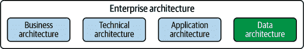

The term *enterprise* elicits mixed reactions. It conjures images of sterile corporate offices, command-and-control/waterfall planning, stagnant business culture, and hollow buzzwords. Even so, we can still learn a thing or two from it.

Before defining and describing *enterprise architecture*, let's deconstruct the term. Let's look at how some important thought leaders define enterprise architecture: TOGAF, Gartner, and EABOK.

### TOGAF Definition

*TOGAF* stands for *The Open Group Architecture Framework*, a standard of The Open Group. It claims to be the most widely used architecture framework today. Here is TOGAF's definition: ^(1)

> In the context of "enterprise architecture," the term "enterprise" can refer to the entire enterprise—encompassing all its information and technology services, processes, and infrastructure—or a specific domain within the enterprise. In both cases, the architecture spans multiple systems and multiple functional groups within the enterprise.

### Gartner Definition

## 企业架构的定义

### Gartner 的定义

`Gartner` 是一家全球性的研究和咨询公司，负责撰写与企业相关趋势的研究文章和报除其他事项外，它还负责那个（臭名昭著的）Gartner 炒作周期。Gartner 的定义如下：^(2)

> 企业架构（EA）是一门学科，旨在通过识别和分析针对期望业务愿景和成果的变革执行情况，主动且整体地引领企业应对颠覆性力量。EA 通过向业务和 IT 领导者提供可签署实施的建议，以调整政策和项目来实现目标业务成果，从而利用相关的业务颠覆创造价值。

### EABOK 的定义

`EABOK` 是 `Enterprise Architecture Book of Knowledge`（企业架构知识体系）的缩写，是由 MITRE 公司发布的企业架构参考资料。EABOK 于 2004 年作为未完成的草案发布，此后未再更新。尽管看似过时，EABOK 仍常被企业架构描述所引用；我们在撰写本书时发现其许多观点颇有裨益。以下是 EABOK 的定义：^(3)

> 企业架构（EA）是一种组织模型；它是企业的一种抽象表现形式，能够协调战略、运营和技术，从而制定成功路线图。

### 我们的定义

我们从这些企业架构定义中提炼出几个共同主线：变革、协调、组织、机遇、问题解决和迁移。以下是我们对 `enterprise architecture`（企业架构）的定义，我们认为它与当今快速变化的数据环境更为相关：

> 企业架构是为了支持 `企业中的变革` 而设计系统，通过仔细 `评估权衡` 达成 `灵活且可逆的决策` 来实现。

这里我们涉及了一些关键领域，将在全书中反复探讨：灵活且可逆的决策、变更管理以及权衡评估。我们将在本节详细讨论每个主题，随后在本章后半部分通过给出各种数据架构示例，使该定义更加具体。

灵活且可逆的决策之所以至关重要，主要有两个原因。首先，世界在不断变化，预测未来是不可能的。可逆的决策允许你在世界变化、获得新信息时调整方向。其次，随着组织规模扩大，企业自然倾向于僵化。采用可逆决策的文化有助于克服这种倾向，因为它降低了决策附带的风险。

“单向门”和“双向门”的概念归功于杰夫·贝索斯。^(4) `单向门` 是指几乎无法逆转的决策。例如，亚马逊本可以决定出售 AWS 或将其关闭。采取此类行动后，亚马逊几乎不可能重建一个拥有相同市场地位的公有云。

另一方面，`双向门` 是一种容易逆转的决策：你走进去，如果喜欢屋里的景象就继续前行；如果不喜欢，就退回门外。亚马逊可能会决定要求新微服务数据库必须使用 `DynamoDB`。如果该政策行不通，亚马逊可以选择逆转它，并重构一些服务以使用其他数据库。由于每个可逆决策（双向门）的赌注都很低，组织可以做出更多决策，快速迭代、改进并收集数据。

变更管理与可逆决策密切相关，是企业架构框架的核心主题。即使强调可逆决策，企业往往仍需开展大型计划。理想情况下，这些计划应拆解为更小的变更，每个变更本身都是一个可逆决策。回到亚马逊的例子，我们注意到从 2007 年 DynamoDB 概念论文发表到 2012 年 Werner Vogels 宣布 `AWS` 上推出 DynamoDB 服务，中间间隔了五年。在幕后，团队采取了大量小步骤，使 DynamoDB 成为 AWS 客户的现实。管理此类小步骤正是变更管理的核心。

架构师不仅仅是规划 IT 流程并模糊地眺望遥远的乌托邦未来；他们积极解决业务问题并创造新机遇。技术解决方案的存在不是为了其本身，而是为了支持业务目标。架构师识别当前状态下的问题（数据质量差、可扩展性限制、亏损的业务线），定义期望的未来状态（敏捷的数据质量改进、可扩展的云数据解决方案、改进的业务流程），并通过执行具体的小步骤来落地计划。这点值得反复强调：

> `技术解决方案的存在不是为了其本身，而是为了支持业务目标。`

我们从 Mark Richards 和 Neal Ford 合著的《[软件架构基础](https://oreil.ly/hpCp0)》（O'Reilly 出版）中获得了重要启发。他们强调权衡在工程领域是不可避免且无处不在的。有时软件和数据相对流动的特性会让我们误以为自己摆脱了硬核物理世界中工程师面临的约束。确实，这在一定程度上是真的；修补软件 Bug 比重新设计和更换飞机机翼容易得多。然而，数字系统最终仍受物理限制约束，如延迟、可靠性、密度和能耗。工程师还面临各种非物理限制，如编程语言和框架的特性，以及管理复杂性、预算等方面的实际约束。幻想式思维会导致糟糕的工程。数据工程师必须在每一步都考量权衡，以设计最优系统，同时将高利息技术债务降至最低。

让我们重申企业架构定义中的一个核心观点：企业架构在灵活性与权衡之间取得平衡。这并非总是容易的平衡，架构师必须在认识到世界是动态的前提下，持续评估和重新评估。考虑到企业面临的变革步伐，组织及其架构都无法原地踏步。

## 数据架构的定义

现在你已了解企业架构，让我们通过建立一个工作定义来深入探讨数据架构，为本书其余部分奠定基础。`Data architecture`（数据架构）是企业架构的一个子集，继承了其属性：流程、战略、变更管理和权衡评估。以下是几个影响我们定义的数据架构定义。

### TOGAF 的定义

TOGAF 对数据架构的定义如下：^(5)

> 对企业主要数据类型和来源、逻辑数据资产、物理数据资产及数据管理资源的结构和交互进行描述。

### DAMA 的定义

DAMA `DMBOK` 对数据架构的定义如下：^(6)

> 识别企业的数据需求（无论结构如何），并设计和维护主蓝图以满足这些需求。利用主蓝图指导数据集成、管控数据资产，并使数据投资与业务战略保持一致。

### 我们的定义

综合前两个定义及我们的经验，我们制定了 `data architecture`（数据架构）的定义：

> 数据架构是为了支持企业不断演变的数据需求而设计系统，通过仔细评估权衡达成灵活且可逆的决策来实现。

## 数据架构如何融入数据工程？

正如数据工程生命周期是数据生命周期的一个子集，数据工程架构也是通用数据架构的一个子集。*数据工程架构*是构成数据工程生命周期关键部分的系统和框架。在本书中，我们将交替使用*数据架构*和*数据工程架构*这两个术语。

您还应该了解数据架构的其他方面，即运维和技术方面（图 3-2）。*运维架构*涵盖了与人员、流程和技术相关的功能性需求。例如，数据服务于哪些业务流程？组织如何管理数据质量？从数据产生到可供查询的延迟要求是多少？*技术架构*概述了数据如何沿数据工程生命周期被摄取、存储、转换和服务。例如，您将如何每小时将 10 TB 数据从源数据库移动到数据湖？简而言之，运维架构描述*需要做什么*，而技术架构详述*如何做*。

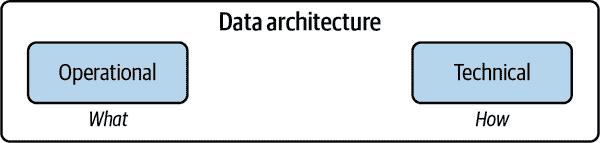

现在我们有了数据架构的工作定义，让我们来介绍“良好”数据架构的要素。

### “良好”的数据架构

> 永远不要追求最佳架构，而应追求最不糟糕的架构。
>
> Mark Richards 和 Neal Ford^(7)

根据 [Grady Booch](https://oreil.ly/SynOe) 的说法，“架构代表塑造系统的重要设计决策，其中*重要*程度由变更成本来衡量。”数据架构师旨在做出重要决策，从基础层面上实现良好的架构。

什么是“良好”的数据架构？借用一句老生常谈的话，见到它你就知道。良好的数据架构*利用一套通用、广泛可复用的构建模块来满足业务需求，同时保持灵活性并做出适当的权衡。*糟糕的架构是专制的，试图将一堆“一刀切”的决策塞进一个[大泥球](https://oreil.ly/YWfb1)中。

敏捷性是良好数据架构的基石；它承认世界是流动的。*良好的数据架构具有灵活性且易于维护。*它会根据业务内部的变化以及可能在未来释放更多价值的新技术和实践而演进。企业及其数据用例始终在演变。世界是动态的，数据领域的变化步伐正在加速。去年对您很管用的数据架构可能不足以应对今天，更别说明年了。

糟糕的数据架构紧密耦合、僵化、过度中心化，或使用错误的工具完成工作，从而阻碍开发和变更管理。理想情况下，通过在设计架构时考虑可逆性，变更的成本会更低。

数据工程生命周期的潜流为处于任何数据成熟度阶段的公司奠定了良好数据架构的基础。同样，这些潜流包括安全、数据管理、DataOps、数据架构、编排和软件工程。

良好的数据架构是一个有生命、会呼吸的东西。它永远不会完成。事实上，根据我们的定义，变更和演进是数据架构含义和目的的核心。现在让我们看看良好数据架构的原则。

#### 良好数据架构的原则

本节从 10,000 英尺的高度（即宏观视角）审视良好的架构，重点关注原则——即在评估主要架构决策和实践时有用的关键思想。我们从多个来源汲取架构原则的灵感，特别是 AWS Well-Architected Framework（AWS 云架构良好框架）和 Google Cloud 的云原生架构五大原则。

[AWS Well-Architected Framework](https://oreil.ly/4D0yq) 由六大支柱组成：

*   运维卓越
*   安全性
*   可靠性
*   性能效率
*   成本优化
*   可持续性

Google Cloud 的[云原生架构五大原则](https://oreil.ly/t63DH)如下：

*   为自动化而设计。
*   明智地管理状态。
*   青睐托管服务。
*   实施纵深防御。
*   始终在架构。

我们建议您仔细研究这两个框架，识别有价值的想法，并确定分歧点。我们希望通过以下数据工程架构原则来扩展或详述这些支柱：

1.  明智地选择通用组件。
2.  为故障做计划。
3.  为可扩展性而架构。
4.  架构即领导力。
5.  始终在架构。
6.  构建松耦合系统。
7.  做可逆的决策。
8.  优先考虑安全。
9.  拥抱 FinOps。

##### 原则 1：明智地选择通用组件

数据工程师的主要工作之一是选择可在整个组织中广泛使用的通用组件和实践。当架构师选择得当且领导有方时，通用组件会成为一种结构，促进团队协作并打破孤岛。结合共享的知识和技能，通用组件能够实现团队内部及团队之间的敏捷性。

通用组件可以是任何在组织内具有广泛适用性的事物。通用组件包括对象存储、版本控制系统、可观测性、监控和编排系统以及处理引擎。通用组件应向所有有合适用例的人员开放，并鼓励团队依赖已在使用的通用组件，而不是重复造轮子。通用组件必须支持强大的权限和安全性，以便在团队间共享资产的同时防止未经授权的访问。

云平台是采用通用组件的理想场所。例如，云数据系统中的计算与存储分离允许用户使用专用工具访问共享存储层（最常见的是对象存储），以获取和查询特定用例所需的数据。

选择通用组件是一项平衡术。一方面，您需要关注数据工程生命周期和团队的需求，利用对单个项目有用的通用组件，同时促进互操作和协作。另一方面，架构师应避免做出会阻碍从事特定领域问题的工程师生产力的决策，即强迫他们采用“一刀切”的技术解决方案。第 4 章提供了更多细节。

##### 原则 2：为故障做计划

> 一切都会失败，且时刻都在发生。
>
> Werner Vogels，Amazon Web Services CTO^(8)

现代硬件具有高度的稳健性和耐用性。即便如此，给予足够的时间，任何硬件组件都会发生故障。要构建高度稳健的数据系统，您必须在设计中考虑故障。以下是一些用于评估故障场景的关键术语；我们将在本章及全书中更详细地描述这些术语：

**可用性**：IT 服务或组件处于可操作状态的时间百分比。

**可靠性**：系统在指定时间间隔内执行其预期功能时，满足定义标准的概率。

**恢复时间目标**：服务或系统中断的最大可接受时间。恢复时间目标 (RTO) 通常通过确定中断的业务影响来设定。对于内部报表系统，RTO 为一天可能没问题。但对于在线零售商，仅仅 5 分钟的网站中断就可能产生重大的不利业务影响。

**恢复点目标**：

## 原则 2：为故障而设计

恢复后的可接受状态。在数据系统中，故障期间往往会丢失数据。在此背景下，恢复点目标（`RPO`）指的是最大可接受的数据丢失量。

工程师在为故障而设计时，需要考虑可接受的可靠性、可用性、`RTO` 和 `RPO`。这些指标将指导他们在评估可能的故障场景时做出架构决策。

## 原则 3：为可扩展性而架构

数据系统的可扩展性包含两大核心能力。首先，可扩展系统能够*纵向扩展*以处理大量数据。我们可能需要启动一个大型集群，在 PB 级客户数据上训练模型，或者横向扩展流式摄入系统以应对瞬时负载峰值。我们的扩容能力使我们能够临时应对极端负载。其次，可扩展系统能够*缩容*。一旦负载峰值消退，我们应自动移除产能以削减成本。（这与原则 9 相关。）*弹性系统*能根据负载动态扩缩容，理想情况下以自动化方式进行。

某些可扩展系统还能*缩容至零*：即在闲置时完全关闭。大型模型训练作业完成后，我们可以删除集群。许多无服务器系统（例如无服务器函数和无服务器在线分析处理（`OLAP`）数据库）能自动缩容至零。

请注意，部署不当的扩缩容策略可能导致系统过度复杂和成本高昂。一个带有单个故障转移节点的简单关系型数据库可能比复杂的集群部署更适合某个应用。衡量当前负载、估算负载峰值，并预估未来几年的负载，以确定数据库架构是否合适。如果您的初创公司增长速度远超预期，这种增长也应带来更多可用资源，以便为可扩展性重新设计架构。

## 原则 4：架构即领导力

数据架构师负责技术决策和架构描述，并通过有效的领导力和培训传播这些选择。数据架构师应具备高超的技术能力，但将大部分个人贡献者工作委派给他人。强大的领导力与高超技术能力的结合非常罕见且极具价值。最优秀的数据架构师严肃对待这种双重角色。

请注意，领导力并不意味着对技术采取命令与控制的方式。过去，架构师选择一种专有数据库技术并强迫每个团队将数据存放在那里的情况并不少见。我们反对这种做法，因为它会严重阻碍当前的数据项目。云环境允许架构师在通用组件选择与赋能项目创新的灵活性之间取得平衡。

回到技术领导力的概念上，`Martin Fowler` 描述了一种理想软件架构师的特定原型，其同事 `Dave Rice` 完美诠释了这一原型：^(9)

> 在许多方面，*Architectus Oryzus*（蜘蛛架构师）最重要的活动是指导开发团队，提升他们的水平，使他们能够承担更复杂的问题。提升开发团队的能力，比作为唯一决策者给架构师带来大得多的杠杆作用，从而避免成为架构瓶颈的风险。

理想的数据架构师表现出类似的特征。他们具备数据工程师的技术技能，但不再从事日常的数据工程实践；他们指导现有的数据工程师，在与组织协商后做出审慎的技术选择，并通过培训和领导力传播专业知识。他们培训工程师掌握最佳实践，并汇聚公司的工程资源，在技术和业务两方面追求共同目标。

作为数据工程师，你应该实践架构领导力，并寻求架构师的指导。最终，你很可能会亲自担任架构师角色。

## 原则 5：持续架构

我们直接借用了 `Google Cloud 的云原生架构五大原则` 中的这一原则。数据架构师担任该角色并非仅为了维持现状；相反，他们不断响应业务和技术的变化，设计新颖而激动人心的事物。根据 [`EABOK`](https://oreil.ly/i58Az)，架构师的工作是深入了解*基线架构*（当前状态），制定*目标架构*，并规划*排序计划*，以确定架构变更的优先级和顺序。

我们补充道，现代架构不应是命令控制式或瀑布式的，而应是协作式和敏捷的。数据架构师维护一份随时间变化的 `target architecture`（目标架构）和排序计划。`target architecture`（目标架构）成为一个移动的靶子，根据内部和全球范围内的业务和技术变化进行调整。`sequencing plan`（排序计划）决定了交付的即时优先事项。

## 原则 6：构建松耦合系统

> 当系统架构的设计使团队能够在不依赖其他团队的情况下测试、部署和更改系统时，团队只需极少的沟通即可完成工作。换句话说，架构和团队都是松耦合的。
>
> 
> `Google DevOps 技术架构指南`^(10)

2002 年，`Bezos` 给 `Amazon` 员工写了一封邮件，后来被称为 `Bezos API Mandate`（贝佐斯 API 强制令）：^(11)

1.  此后所有团队必须通过服务接口暴露其数据和功能。

2.  团队之间必须通过这些接口进行通信。

3.  不允许任何其他形式的进程间通信：无直接链接、无直接读取其他团队的数据存储、无共享内存模型、绝无后门。唯一允许的通信是通过网络进行的服务接口调用。

4.  他们使用什么技术无关紧要。`HTTP`、`Corba`、`Pubsub`、自定义协议——都无所谓。

5.  所有服务接口无一例外，必须从一开始就设计为可外部化的。也就是说，团队必须规划和设计，以便能将接口暴露给外部世界的开发者。无一例外。

`Bezos's API Mandate`（贝佐斯 API 强制令）的出现被广泛视为 `Amazon` 的分水岭时刻。将数据和服务置于 `API` 之后实现了松耦合，并最终造就了我们今天所知的 `AWS`。`Google` 对松耦合的追求使其能够将系统扩展到非凡的规模。

对于软件架构，松耦合系统具有以下特性：

1.  系统被拆分为许多小组件。

2.  这些系统通过抽象层（如消息总线或 `API`）与其他服务交互。这些抽象层隐藏并保护服务的内部细节，例如数据库后端或内部类和方法调用。

3.  作为特性 2 的结果，系统组件的内部变更不需要其他部分进行更改。代码更新的细节隐藏在稳定的 `API` 之后。每个部分都可以独立演进和改进。

4.  作为特性 3 的结果，整个系统不存在瀑布式的全局发布周期。相反，每个组件会随着变更和改进的进行而单独更新。

请注意，我们讨论的是*技术系统*。我们需要放眼更远。让我们将这些技术特性转化为组织特性：

1.  许多小团队共同构建一个大型复杂系统。每个团队负责设计、维护和改进某些系统组件。

2. 这些团队通过 API 定义、消息模式等方式，将其组件的抽象细节发布给其他团队。团队无需关心其他团队的组件内部情况；它们只需使用发布的 API 或消息规范来调用这些组件。它们对自己的部分进行迭代，以随着时间的推移提高性能和能力。它们也可能在新增功能时发布新能力，或向其他团队请求新功能。同样，后者的发生无需团队担心所请求功能的内部技术细节。团队通过*松耦合通信*协同工作。

3. 作为特征 2 的结果，每个团队都能独立于其他团队的工作，快速演进和改进其组件。

4. 具体而言，特征 3 意味着团队可以在最短停机时间的情况下发布组件更新。团队在正常工作时间持续发布，以进行代码更改并测试它们。

技术和人员系统的松耦合将使您的数据工程团队能够更高效地相互协作，并与公司的其他部门协作。这一原则也直接促进了原则 7。

## 原则 7：做可逆的决策

数据领域正在快速变化。今天的热门技术或技术栈可能明天就成了过眼云烟。主流观点变化迅速。您应以可逆决策为目标，因为这些决策倾向于简化您的架构并保持其敏捷性。

正如 Fowler 所写：“架构师最重要的任务之一，就是通过寻找消除软件设计中不可逆性的方法，来移除架构。”^(12) Fowler 在 2003 年写下这句话时的真理，在今天依然准确。

正如我们之前所说，Bezos 将可逆决策称为“双向门”。正如他所说：“如果你走进去，不喜欢另一边看到的东西，你就回不去了。我们可以称这些为类型 1 决策。但大多数决策不是这样的——它们是可变的、可逆的——它们是双向门。”只要有可能，就以双向门为目标。

考虑到变化的步伐——以及您数据架构中技术的解耦/模块化——始终致力于选择当前最适合的最佳组合方案。同时，做好准备，随着环境的演进升级或采用更好的实践。

## 原则 8：优先考虑安全

每位数据工程师都必须对其构建和维护的系统安全负责。我们现在重点关注两个主要理念：零信任安全和共享责任安全模型。这些与云原生架构紧密契合。

### 强化边界与零信任安全模型

要定义*零信任安全*，首先了解传统的强边界安全模型及其局限性会有所帮助，Google Cloud 的五大原则中对此有详细阐述：^(13)

> 传统架构非常依赖边界安全，粗略地说，就是一个强化的网络边界，内部是“受信任的事物”，外部是“不受信任的事物”。不幸的是，这种方法一直容易受到内部攻击，以及鱼叉式网络钓鱼等外部威胁。

1996 年的电影《碟中谍》完美展示了强边界安全模型及其局限性。在电影中，CIA 将高度敏感的数据存储在一个物理安防极其严密的房间内的存储系统上。伊森·潜入 CIA 总部，利用人为目标获得了对存储系统的物理访问权限。一旦进入安全室，他就能相对轻松地窃取数据。

至少十年来，令人震惊的媒体报道让我们意识到，利用强化组织安全边界内部人为目标的安全漏洞威胁日益增长。即使员工在高度安全的企业网络上工作，他们仍通过电子邮件和移动设备与外部世界保持连接。外部威胁实际上变成了内部威胁。

在云原生环境中，强化边界的概念进一步被削弱。所有资产都或多或少地连接到外部世界。虽然虚拟私有云（VPC）网络可以定义为无外部连接，但工程师用于定义这些网络的 API 控制平面仍然面向互联网。

### 共享责任模型

Amazon 强调[共享责任模型](https://oreil.ly/rEFoU)，将安全划分为云安全*和*云*中的*安全。AWS 负责云安全：^(14)

> AWS 负责保护 AWS 云中运行 AWS 服务的基础设施。AWS 还为您提供可安全使用的服务。

AWS 用户负责云中的安全：

> 您的责任由您使用的 AWS 服务决定。您还需对其他因素负责，包括数据的敏感性、组织的要求以及适用的法律法规。

一般来说，所有云服务商都基于某种形式的共享责任模型运营。它们根据发布的规范保护其服务。尽管如此，设计应用程序和数据的安全模型并利用云能力来实现该模型，最终仍是用户的责任。

### 数据工程师即安全工程师

在当今的企业界，指挥控制式的安全方法非常普遍，即安全和网络团队管理边界和通用安全实践。云将这种责任推给了并非显性从事安全角色的工程师。由于这种责任，加上强安全边界的普遍削弱，所有数据工程师都应视自己为安全工程师。

未能承担这些新的隐性责任可能导致严重后果。许多数据泄露事件源于将 Amazon S3 存储桶配置为公共访问这一简单错误。^(15) 处理数据的人必须假定他们最终对保护数据负责。

## 原则 9：拥抱 FinOps

让我们先来看几个 FinOps 的定义。首先，FinOps 基金会给出的定义是：^(16)

> FinOps 是一种不断发展的云财务管理学科和文化实践，它通过帮助工程、财务、技术和业务团队协作做出数据驱动的支出决策，使组织能够获得最大的商业价值。

此外，J. R. Sorment 和 Mike Fuller 在《Cloud FinOps》中提供了以下定义：^(17)

> “FinOps” 一词通常指倡导 DevOps 与财务之间建立协作工作关系的新兴专业运动，其结果是对基础设施支出进行迭代的、数据驱动的管理（即降低云的单位经济成本），同时提高成本效率，并最终提高云环境的盈利能力。

云时代数据的成本结构发生了巨大变化。在本地部署环境中，数据系统通常通过资本支出（详见第 4 章）每隔几年采购一次新系统。责任方必须在预算与期望的计算和存储容量之间取得平衡。过度采购意味着浪费资金，而采购不足则意味着阻碍未来的数据项目，并投入大量人员时间来控制系统负载和数据规模；采购不足可能需要更快的技术刷新周期，并产生相关的额外成本。

在云时代，大多数数据系统采用按需付费模式，且易于扩展。系统可以按查询付费模式、按处理容量付费模式，或其他按需付费模式的变体运行。这种方法可能比资本性支出模式高效得多。现在可以扩容以获得高性能，然后缩容以节省成本。然而，按需付费模式使得支出变得更加动态。数据领导者面临的新挑战是管理预算、优先级和效率。

云工具要求建立一套管理支出和资源的流程。过去，数据工程师从性能工程的角度思考问题——在固定资源集上最大化数据流程的性能，并为未来需求购买足够的资源。有了 FinOps，工程师需要学会从云系统的成本结构角度思考。例如，运行分布式集群时，AWS 抢占式实例的适当组合是什么？从成本效益和性能角度来看，运行大规模每日作业的最佳方法是什么？公司何时应从按查询付费模式切换到预留容量？

FinOps 将运维监控模式演变为持续监控支出的模式。FinOps 不仅监控 Web 服务器的请求和 CPU 利用率，还可能监控处理流量的无服务器函数的持续成本，以及触发警报的支出激增。正如系统被设计为在流量过大时优雅降级一样，公司可能会考虑采用支出硬性限制，并通过优雅的故障模式来应对支出激增。

运维团队还应从成本攻击的角度思考。正如分布式拒绝服务（DDoS）攻击可以阻断对 Web 服务器的访问一样，许多公司懊恼地发现，来自 S3 存储桶的过度下载会导致支出飙升，并让小型初创公司面临破产威胁。在公开共享数据时，数据团队可以通过设置请求者付费策略，或者仅监控过度的数据访问支出，一旦支出开始上升到不可接受的水平就迅速撤销访问权限，来解决这些问题。

截至撰写本文时，FinOps 是一项刚刚正式确立的实践。FinOps 基金会成立于 2019 年。^(18) 不过，我们强烈建议您尽早开始思考 FinOps，不要等到遇到高额云账单时才行动。从 [FinOps 基金会](https://oreil.ly/4EOIB) 和 O’Reilly 的 [*Cloud FinOps*](https://oreil.ly/bdZRx) 开始您的旅程。我们还建议数据工程师参与到为数据工程创建 FinOps 实践的社区进程中来——在这样一个新的实践领域，还有大量领域有待探明。

既然您已对良好的数据架构原则有了高层理解，让我们更深入地探讨设计和构建良好数据架构所需的主要概念。

# 主要架构概念

如果您关注数据领域的当前趋势，似乎每周都会有新类型的数据工具和架构登场。在这一阵忙碌的活动中，我们绝不能忽视所有这些架构的主要目标：获取数据并将其转化为对下游消费有用的东西。

## 领域与服务

> **领域**：知识、影响或活动的范围。用户应用程序所针对的主题领域即为该软件的领域。
>
> —— 埃里克·埃文斯^(19)

在深入探讨架构组件之前，让我们简要介绍两个您将频繁遇到的术语：领域和服务。*领域*是您为其构建架构的现实世界主题领域。*服务*是一组功能，其目标是完成一项任务。例如，您可能有一个销售订单处理服务，其任务是处理订单创建时的订单。销售订单处理服务的唯一工作就是处理订单；它不提供其他功能，如库存管理或更新用户配置文件。

一个领域可以包含多个服务。例如，您可能有一个销售领域，包含三个服务：订单、开票和产品。每个服务都有支持销售领域的特定任务。其他领域也可能共享服务（图 3-3）。在这种情况下，会计领域负责基本会计职能：开票、薪资和应收账款 (AR)。请注意，会计领域与销售领域共享开票服务，因为销售会生成发票，而会计必须跟踪发票以确保收到付款。销售和会计各自拥有自己的领域。

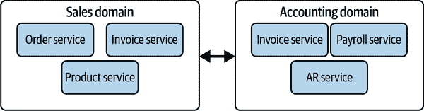

在思考什么构成领域时，应关注领域在现实世界中代表什么，并由此倒推。在前面的例子中，销售领域应代表您公司销售职能中发生的事情。在为销售领域构建架构时，避免照搬其他公司的做法。您公司的销售职能可能具有独特之处，需要特定的服务才能按销售团队的预期方式运作。

明确领域应包含的内容。在确定领域应涵盖的范围及包含的服务时，最好的建议是直接去与用户和利益相关者交谈，倾听他们的诉求，并构建能帮助他们完成工作的服务。避免闭门造车这一经典陷阱。

## 分布式系统、可扩展性与故障设计

本节的讨论与我们之前讨论的数据工程架构的第二和第三原则相关：为故障做计划并为可扩展性做架构。作为数据工程师，我们关注数据系统的四个紧密相关的特性（可用性和可靠性前面已提及，此处为完整性重述）：

可扩展性
: 允许我们增加系统容量以提高性能并应对需求。例如，我们可能希望扩展系统以处理高查询率或处理海量数据集。

弹性
: 可扩展系统动态扩缩容的能力；高弹性系统可根据当前工作负载自动扩容和缩容。随着需求增加，扩容至关重要，而在云环境中缩容则能省钱。现代系统有时可缩容至零，意味着闲置时可自动关闭。

可用性
: IT 服务或组件处于可操作状态的时间百分比。

可靠性
: 系统在指定时间间隔内执行其预期功能时达到既定标准的概率。

###### 提示

请参阅 PagerDuty 的 [“为什么可用性和可靠性至关重要？”网页](https://oreil.ly/E6il3)，了解有关可用性和可靠性的定义和背景。

这些特性如何相关联？如果系统在指定时间间隔内无法满足性能要求，可能会变得无响应。因此，低可靠性可能导致低可用性。另一方面，动态扩缩容有助于确保无需工程师人工干预即可获得足够的性能——弹性提高了可靠性。

可扩展性可以通过多种方式实现。对于您的服务和领域，是否由单台机器处理所有事情？单台机器可以垂直扩展；您可以增加资源（CPU、磁盘、内存、I/O）。但单台机器可能的资源有硬性限制。此外，如果这台机器宕机了怎么办？给定足够的时间，某些组件最终会失效。您的备份和故障转移计划是什么？单台机器通常无法提供高可用性和高可靠性。

我们利用分布式系统来实现更高的整体扩展能力，并提高可用性和可靠性。*水平扩展*允许您添加更多机器以满足负载和资源需求（图 3-4）。常见的水平扩展系统有一个领导节点，它充当工作负载的实例化、进度和完成的主要联系点。当工作负载启动时，领导节点将任务分发给其系统内的工作节点，完成任务并将结果返回给领导节点。典型的现代分布式架构也内置了冗余。数据被复制，以便如果一台机器宕机，其他机器可以从缺失服务器停止的地方接管；集群可能会添加更多机器以恢复容量。

分布式系统广泛存在于您架构中将使用的各种数据技术中。您使用的几乎每一个云数据仓库对象存储系统在底层都包含某种分布概念。分布式系统的管理细节通常被抽象掉，使您能够专注于高层架构，而不是底层管道。然而，我们强烈建议您深入了解分布式系统，因为这些细节对于理解和提高管道性能极有帮助；Martin Kleppmann 的 [*Designing Data-Intensive Applications*](https://oreil.ly/XD98e)（O’Reilly 出版）是一本极佳的资源。

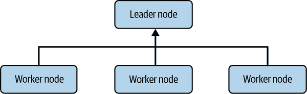

# 紧耦合与松耦合：层级、单体与微服务

在设计数据架构时，您需要选择在各个域、服务和资源中包含多少相互依赖。在光谱的一端，您可以选择拥有高度集中的依赖和工作流。域和服务的每个部分都至关重要地依赖于其他每个域和服务。这种模式称为*紧耦合*。

在光谱的另一端，您拥有去中心化的域和服务，它们之间没有严格的依赖关系，这种模式称为*松耦合*。在松耦合场景中，去中心化团队很容易构建出其数据可能无法被同行使用的系统。请务必为拥有各自域和服务的团队分配通用标准、所有权、责任和问责制。设计“良好”的数据架构依赖于域和服务的紧耦合与松耦合之间的权衡。

值得注意的是，本节中的许多思想源于软件开发。我们将尝试保留这些宏大思想的原始意图和精神背景——使其与数据无关——同时稍后解释将这些概念专门应用于数据时您应注意的一些差异。

## 架构层级

随着您开发架构，了解架构层级会有所帮助。您的架构有多层——数据、应用、业务逻辑、展示等——您需要知道如何解耦这些层。因为模态的紧耦合带来了明显的脆弱性，请记住如何构建架构层以实现最大的可靠性和灵活性。让我们看看单层和多层架构。

### 单层

在*单层架构*中，您的数据库和应用紧密耦合，驻留在单个服务器上（图 3-5）。这台服务器可能是您的笔记本电脑，也可能是云中的单个虚拟机 (VM)。紧耦合的性质意味着如果服务器、数据库或应用发生故障，整个架构就会失效。虽然单层架构适合原型设计和开发，但由于明显的故障风险，不建议用于生产环境。

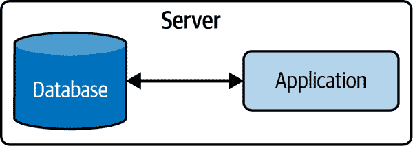

即使单层架构内置了冗余（例如故障转移副本），它们在其他方面也存在显著限制。例如，针对生产应用数据库运行分析查询通常是不切实际的（且不建议这样做）。这样做有使数据库不堪重负并导致应用不可用的风险。单层架构适合在本地机器上测试系统，但不建议用于生产用途。

### 多层

紧耦合单层架构的挑战通过解耦数据和应用来解决。*多层*（也称为 *n 层*）架构由单独的层组成：数据、应用、业务逻辑、展示等。这些层是自底向上且分层的，意味着下层不一定依赖上层；上层依赖下层。其理念是将数据与应用分离，将应用与展示分离。

常见的多层架构是三层架构，一种广泛使用的客户端-服务器设计。*三层架构*由数据、应用逻辑和展示层组成（图 3-6）。每一层都与其他层隔离，允许关注点分离。使用三层架构，您可以自由地在每一层中使用任何您喜欢的技术，而无需单体式地聚焦。

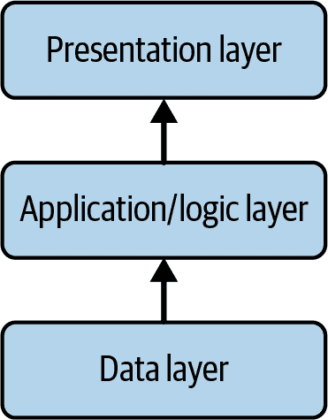

我们在生产环境中见过许多单层架构。单层架构提供了简单性，但也带来了严重的局限性。最终，组织或应用会超出这种安排；它运行良好，直到不再良好。例如，在单层架构中，数据层和逻辑层以多层架构中完全避免的方式共享并竞争资源（磁盘、CPU 和内存）。资源分散在各个层级中。数据工程师应利用层级来评估其分层架构和依赖处理方式。再次强调，从简单开始，随着架构变得更复杂，将向额外层级演进的机制内置其中。

在多层架构中，使用分布式系统时，您需要考虑分离层以及层内资源共享的方式。分布式系统在底层驱动着您在数据工程生命周期中将遇到的许多技术。首先，考虑您是否希望节点之间存在资源争用。如果不希望，请采用*无共享架构*：单个节点处理每个请求，意味着其他节点不与该节点共享内存、磁盘或 CPU 等资源，也不相互共享。数据和资源隔离在节点上。或者，各个节点可以处理多个请求并共享资源，但存在资源争用的风险。另一个考虑因素是节点是否应共享所有节点均可访问的同一磁盘和内存。这称为*共享磁盘架构*，当您希望在随机节点故障时拥有共享资源时很常见。

## 单体

单体的一般概念是将尽可能多的东西包含在一个屋檐下；在其最极端的版本中，单体由运行在单台机器上的单个代码库组成，同时提供应用逻辑和用户界面。

单体内的耦合可以从两个方面来看：技术耦合和领域耦合。*技术耦合*指架构层级，而*领域耦合*指域耦合在一起的方式。单体在技术和域之间具有不同程度的耦合。您可能拥有一个在多层架构中各层解耦的应用，但仍然共享多个域。或者，您可能拥有一个服务于单个域的单层架构。

## 单体架构

单体架构的紧耦合意味着其组件缺乏模块化。在单体架构中替换或升级组件，往往是在一种痛苦与另一种痛苦之间做权衡。由于紧耦合的特性，跨架构复用组件非常困难，甚至不可能。在评估如何改进单体架构时，往往像在玩“打地鼠”游戏：改进了一个组件，往往以单体架构中其他未知区域的后果为代价。

数据团队往往会忽视解决单体架构日益增长的复杂性，任由其演变成[一团糟](https://oreil.ly/2brRT)。

第 4 章将更深入地讨论单体架构与分布式技术的对比。我们还将讨论*分布式单体*，这是一种奇怪的混合体，当工程师构建具有过度紧耦合的分布式系统时就会出现。

### 微服务

与单体架构的属性——交织的服务、中心化、服务间的紧耦合——相比，微服务是截然相反的。*微服务架构*由独立的、去中心化的、松耦合的服务组成。每个服务都有特定的功能，并与其领域内运行的其他服务解耦。如果某个服务暂时宕机，不会影响其他服务继续运行的能力。

一个常见的问题是如何将单体架构转换为多个微服务（图 3-7）。这完全取决于单体架构的复杂程度，以及从中拆分服务需要付出多少努力。完全有可能你的单体架构无法拆分，在这种情况下，你需要开始创建一个新的并行架构，以微服务友好的方式解耦服务。我们不建议进行全面重构，而是建议拆分服务。单体架构不是一夜之间形成的，它既是技术问题也是组织问题。如果你计划拆分它，请务必获得单体架构相关干系人的支持。

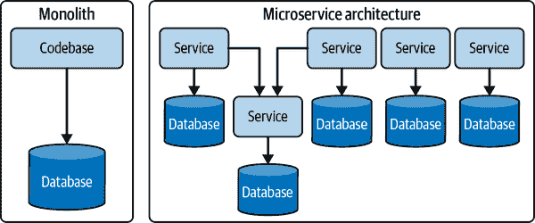

如果你想了解更多关于拆分单体架构的内容，我们建议阅读 Neal Ford 等人编写的精彩实用指南[《软件架构的难点》](https://oreil.ly/0iJBG)（O'Reilly 出版）。

### 数据架构的考量

正如我们在本节开头提到的，紧耦合与松耦合的概念源于软件开发，其中一些概念已有 20 多年的历史。尽管数据领域的架构实践正在采纳软件开发的实践，但仍然常见到非常单体化、紧耦合的数据架构。部分原因在于现有数据技术的本质及其集成方式。

例如，数据管道可能从多个源头获取数据并汇入一个中央数据仓库。中央数据仓库本质上是单体的。向数据仓库的微服务等价物迈进，意味着将工作流解耦，让特定领域的数据管道连接到相应的特定领域数据仓库。例如，销售数据管道连接到销售专用数据仓库，库存和产品领域遵循类似的模式。

与其教条地宣扬微服务优于单体（以及其他论点），我们建议你务实地将松耦合作为理想目标，同时认识到你在数据架构中使用的数据技术的现状和局限性。尽可能采用可逆的技术选择，以实现模块化和松耦合。

正如你在图 3-7 中所见，你可以将架构组件垂直分离为不同的关注层。虽然多层架构解决了解耦共享资源的技术挑战，但它并未解决共享领域的复杂性。沿着单层与多层架构的思路，你还应考虑如何分离数据架构的领域。例如，你的分析师团队可能依赖来自销售和库存的数据。销售和库存领域是不同的，应视为独立的领域。

解决此问题的一种方法是中心化：由单个团队负责从所有领域收集数据并协调其以供全组织消费。（这是传统数据仓库中的常见方法。）另一种方法是*数据网格*。采用数据网格时，每个软件团队负责准备其数据以供组织内其他部分消费。我们将在本章后面详细介绍数据网格。

我们的建议：单体架构不一定不好，在特定条件下从单体开始可能是合理的。有时你需要快速行动，从单体开始要简单得多。只要做好最终将其拆分为更小部分的准备；不要过于安于现状。

## 用户访问：单租户与多租户

作为数据工程师，你必须决定跨多个团队、组织和客户共享系统。在某种意义上，所有云服务都是多租户的，尽管这种多租户发生在不同的粒度上。例如，云计算实例通常位于共享服务器上，但 `VM` 本身提供了一定程度的隔离。对象存储是多租户系统，但只要客户正确配置权限，云厂商就保证安全性和隔离性。

工程师经常需要在更小的规模上做出关于多租户的决策。例如，大公司的多个部门是否共享同一个数据仓库？组织是否在同一张表中共享多个大客户的数据？

多租户有两个因素需要考虑：性能和安全。在云系统中有多个大租户时，系统能否为所有租户提供一致的性能，还是会出现“吵闹邻居”问题？（即，一个租户的高使用量会降低其他租户的性能？）关于安全性，不同租户的数据必须得到妥善隔离。当公司有多个外部客户租户时，这些租户不应互相知晓，工程师必须防止数据泄露。数据隔离策略因系统而异。例如，使用多租户表并通过视图隔离数据通常是完全可以接受的。但是，你必须确保这些视图不会泄露数据。请阅读厂商或项目文档，以了解适当的策略和风险。

## 事件驱动架构

你的业务很少是静态的。业务中经常发生各种事情，例如获得新客户、客户下新订单、或产品/服务订单。这些都是*事件*的例子，事件广义上定义为发生过的事情，通常是某事物*状态*的变化。例如，客户可能创建一个新订单，稍后又可能更新该订单。

事件驱动工作流（图 3-8）涵盖了在数据工程生命周期的各个部分中创建、更新和异步移动事件的能力。该工作流归结为三个主要领域：事件生成、路由和消费。事件必须被生成并路由给消费者，而生产者、事件路由器和消费者之间不应存在紧耦合依赖。

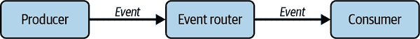

# 事件驱动架构 (重复)

事件驱动架构（图 3-9）采用事件驱动工作流，并利用它在各个服务之间进行通信。事件驱动架构的优势在于，它将事件的状态分发到多个服务中。如果某个服务下线、分布式系统中的某个节点故障，或者你希望多个消费者或服务访问同一事件，这将非常有帮助。只要存在松耦合服务，这就是事件驱动架构的候选场景。本章后面描述的许多示例都包含某种形式的事件驱动架构。

你将在第 5 章详细了解事件驱动流和消息系统。

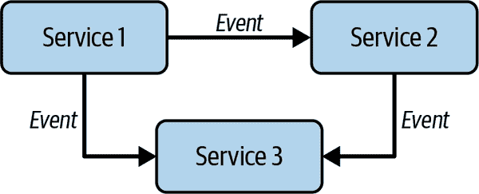

# Brownfield 与 Greenfield 项目

在设计数据架构项目之前，你需要知道是从零开始，还是重新设计现有架构。每种类型的项目都需要评估权衡，尽管考量因素和方法各不相同。项目大致分为两类：Brownfield（棕地项目）和 Greenfield（绿地项目）。

## Brownfield 项目

*Brownfield 项目*通常涉及重构和重组现有架构，并受到过去和当下选择的制约。因为架构的关键部分是变更管理，你必须想办法绕过这些限制，并设计一条前进的道路来实现新的业务和技术目标。Brownfield 项目需要彻底了解遗留架构以及各种新旧技术的相互作用。人们往往很容易批评前任团队的工作和决策，但深入挖掘、提问并理解决策背后的原因要好得多。共情和上下文有助于你诊断现有架构的问题、识别机会并发现陷阱。

你最终需要引入新架构和新技术，并弃用旧组件。让我们看看几种流行的方法。许多团队不假思索地跳进去，对旧架构进行一次性或大爆炸式的彻底改造，往往在过程中摸索如何弃用。虽然这种方法很流行，但我们不建议采用，因为它伴随着风险且缺乏计划。这条路往往导致灾难，伴随着许多不可逆且代价高昂的决策。你的工作是做出可逆的、高投资回报率（ROI）的决策。

一种流行的替代直接重写的方法是绞杀者模式：新系统缓慢且增量地替换遗留架构的组件。^(20) 最终，遗留架构被完全替换。绞杀者模式的吸引力在于其有针对性且精准的方法，一次弃用系统的一个部分。这允许在评估弃用对依赖系统的影响时，做出灵活且可逆的决策。

值得注意的是，弃用可能只是“象牙塔”式的建议，并不切实际或无法实现。如果你身处大型组织，根除遗留技术或架构可能是不可能的。总有人在某个地方使用着这些遗留组件。正如有人曾说：“遗留系统是用居高临下的方式来描述赚钱的东西。”

如果你能弃用，请理解弃用旧架构有许多方法。关键在于通过逐步提升新平台的成熟度来展示其价值，以证明成功，然后遵循退出计划关闭旧系统。

## Greenfield 项目

在另一端，*Greenfield 项目*允许你开创一个全新的开始，不受先前架构的历史或遗留问题的束缚。Greenfield 项目往往比 Brownfield 项目容易，许多数据架构师和工程师觉得它们更有趣！你有机会尝试最新、最酷的工具和架构模式。还有什么比这更令人兴奋的呢？

但在你过度兴奋之前，有几点需要警惕。我们看到团队因“闪亮物体综合症”而过度兴奋。他们感到不得不追逐最新、最棒的技术潮流，却不了解这将如何影响项目的价值。还有诱惑去搞“简历驱动开发”，堆砌令人印象深刻的新技术，而不优先考虑项目的最终目标。^(21) 始终将需求置于“构建酷炫事物”之上。

无论你是在做 Brownfield 还是 Greenfield 项目，都要始终专注于“良好”数据架构的原则。评估权衡，做出灵活且可逆的决策，并追求正向 ROI。

# 数据架构的示例和类型

因为数据架构是一门抽象的学科，通过示例推理会有所帮助。在本节中，我们概述了当今流行的著名数据架构示例和类型。虽然这些示例绝非详尽无遗，但旨在让你接触一些最常见的数据架构模式，并让你思考为你的用例设计良好架构所需的灵活性和权衡分析。

## 数据仓库

*数据仓库*是一个用于报告和分析的中央数据枢纽。数据仓库中的数据通常经过高度格式化和结构化，以适应分析用例。它是最古老、最成熟的数据架构之一。

1989 年，Bill Inmon 提出了数据仓库的概念，他将其描述为“面向主题的、集成的、非易失的、随时间变化的数据集合，用于支持管理决策。”^(22) 尽管数据仓库的技术层面已发生重大演变，但我们认为这个最初的定义在今天依然站得住脚。

过去，数据仓库广泛用于预算充足（通常达数百万美元）的企业，用于采购数据系统并支付内部团队持续维护数据仓库的费用。这既昂贵又费力。此后，可扩展的按需付费模式使得云数据仓库甚至对微型公司也触手可及。因为第三方提供商管理数据仓库基础设施，公司可以用更少的人做更多的事，即使数据复杂性在增长。

值得注意的有两种数据仓库架构类型：组织架构和技术架构。*组织数据仓库架构*组织与特定业务团队结构和流程相关的数据。*技术数据仓库架构*反映数据仓库的技术本质，例如 MPP。一家公司可以拥有没有 MPP 系统的数据仓库，也可以运行一个未组织为数据仓库的 MPP 系统。然而，技术架构和组织架构一直存在于良性循环中，且经常被相互关联。

### 组织数据仓库架构

组织数据仓库架构有两个主要特征：

将联机分析处理 (OLAP) 与生产数据库（联机事务处理）分离
：随着业务增长，这种分离至关重要。将数据移入单独的物理系统可将负载从生产系统转移开，并提高分析性能。

集中化并组织数据
：

# 数据仓库与数据湖架构

## 传统数据仓库与 ETL

传统上，数据仓库通过使用 `ETL` 从应用系统中提取数据。抽取阶段从源系统拉取数据。转换阶段清洗并标准化数据，以高度建模的形式组织数据并施加业务逻辑。（第 8 章 涵盖转换和数据模型。）加载阶段将数据推送到数据仓库目标数据库系统中。数据被加载到多个数据集市中，以满足特定业务线或部门的分析需求。图 3-10 展示了总体工作流程。数据仓库和 `ETL` 与特定的业务结构密切配合，包括 `DBA` 和 `ETL` 开发团队，它们执行业务领导者的指示，以确保用于报告和分析的数据与业务流程相对应。

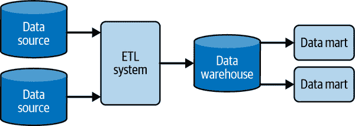

关于技术数据仓库架构，20 世纪 70 年代末出现的首批 `MPP` 系统在 20 世纪 80 年代流行起来。`MPP` 系统支持本质上与关系型应用数据库中使用的相同 `SQL` 语义。但它们经过优化，可并行扫描海量数据，从而实现高性能聚合和统计计算。近年来，`MPP` 系统越来越多地从基于行的架构转向列式架构，以支持更大规模的数据和查询，尤其是在云数据仓库中。随着数据和报告需求的增长，`MPP` 系统对于大型企业运行高性能查询至关重要。

`ETL` 的一种变体是 `ELT`。采用 `ELT` 数据仓库架构时，数据或多或少直接从生产系统移动到数据仓库中的暂存区。在此场景下，暂存表示数据处于原始形式。转换不再使用外部系统，而是直接在数据仓库中处理。其意图是利用云数据仓库和数据处理工具的强大计算能力。数据按批处理，转换后的输出被写入表和视图以供分析。图 3-11 展示了总体流程。`ELT` 在流式处理场景中也很流行，因为事件从 `CDC` 过程中流出，存储在暂存区，随后在数据仓库内进行转换。

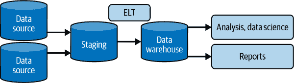

`ELT` 的第二个版本在 Hadoop 生态系统的大数据增长期间流行起来。这就是*读时转换 ELT*，我们将在“数据湖”中讨论它。

## 云数据仓库

*云数据仓库*代表了本地数据仓库架构的重大演进，因此导致了组织架构的重大变化。`Amazon Redshift` 开启了云数据仓库革命。企业无需为未来几年适当规划 `MPP` 系统规模并签署数百万美元合同来采购系统，而是可以按需启动 `Redshift` 集群，随着数据和分析需求的增长随时间扩展。它们甚至可以按需启动新的 `Redshift` 集群来服务特定工作负载，并在不再需要时快速删除集群。

`Google BigQuery`、`Snowflake` 和其他竞争对手普及了计算与存储分离的理念。在此架构中，数据存放在对象存储中，允许近乎无限的存储空间。这还赋予了用户按需启动计算能力的选项，提供了临时大数据处理能力，而无需承担数千个节点的长期成本。

云数据仓库扩展了 `MPP` 系统的能力，涵盖了直到最近还需要 Hadoop 集群的许多大数据用例。它们可以轻松在单个查询中处理 PB 级数据。它们通常支持允许每行存储数十兆字节原始文本数据或极其丰富复杂的 `JSON` 文档的数据结构。随着云数据仓库（和数据湖）的成熟，数据仓库和数据湖之间的界限将继续模糊。

云数据仓库提供的新能力影响如此之大，以至于我们可能会考虑完全抛弃*数据仓库*这一术语。相反，这些服务正在演变为一个新的数据平台，其能力远超传统 `MPP` 系统。

## 数据集市

*数据集市*是仓库中更精炼的子集，旨在服务于分析和报告，专注于单个子组织、部门或业务线；每个部门都有自己的数据集市，专门满足其需求。这与服务于更广泛组织或业务的完整数据仓库形成对比。

数据集市存在有两个原因。首先，数据集市使数据对分析师和报告开发人员更易访问。其次，数据集市提供了除初始 `ETL` 或 `ELT` 管道之外的额外转换阶段。如果报告或分析查询需要复杂的数据连接和聚合，尤其是原始数据量大时，这可以显著提高性能。转换流程可以用连接和聚合后的数据填充数据集市，以提高实时查询的性能。图 3-12 展示了总体工作流程。我们将在第 8 章中讨论数据集市以及为数据集市建模。

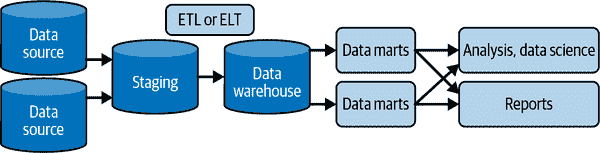

## 数据湖

大数据时代出现的最流行架构之一是*数据湖*。与其对数据施加严格的结构限制，为什么不直接将所有数据——结构化和非结构化——倾倒到一个中心位置？数据湖承诺成为一种民主化力量，让业务部门从无限数据的喷泉中自由汲取。第一代数据湖，“*数据湖 1.0*”，做出了实质性贡献，但总体未能兑现其承诺。

*数据湖 1.0* 始于 `HDFS`。随着云的普及，这些数据湖迁移到了基于云的对象存储，具有极低的存储成本和近乎无限的存储容量。数据湖不依赖于存储和计算紧密耦合的整体式数据仓库，而是允许存储任何大小和类型的海量数据。当需要查询或转换这些数据时，您可以通过按需启动集群获得近乎无限的计算能力，并可为手头任务挑选喜欢的数据处理技术——`MapReduce`、`Spark`、`Ray`、`Presto`、`Hive` 等。

尽管前景诱人且炒作甚嚣尘上，*数据湖 1.0* 仍存在严重缺陷。数据湖变成了垃圾场；随着曾经充满希望的数据项目失败，*数据沼泽*、*暗数据* 和 *WORN*（一次写入，从不读取）等术语应运而生。数据增长到无法管理的规模，却缺乏模式管理、数据编目和发现工具。此外，原始数据湖概念本质上是只写的，随着 `GDPR` 等要求定向删除用户记录的法规出台，这造成了巨大麻烦。

数据处理也颇具挑战。像连接这样相对普通的数据转换，编写为 `MapReduce` 作业非常痛苦。后来的框架如 `Pig` 和 `Hive` 在一定程度上改善了数据处理状况，但对解决数据管理的基本问题帮助不大。`SQL` 中常见的简单数据操作语言（`DML`）操作——删除或更新行——实现起来很痛苦，通常通过创建全新表来实现。虽然大数据工程师对数据仓库同行流露出特定的鄙视，但后者可以指出数据仓库开箱即用地提供了基本数据管理能力，且 `SQL` 是编写复杂、高性能查询和转换的高效工具。

## 数据湖 1.0

数据湖 1.0 也未能兑现大数据运动的另一个核心承诺。Apache 生态系统中的开源软件被吹捧为避免专有 MPP 系统数百万美元合同的手段。廉价的现成硬件将取代定制的供应商解决方案。实际上，由于管理 Hadoop 集群的复杂性迫使公司以高薪雇佣大量工程师团队，大数据成本激增。公司通常选择从供应商处购买授权的、定制的 Hadoop 版本，以避免原始 Apache 代码库的“裸露电线和锋利边缘”，并获得一套脚手架工具使 Hadoop 更易用。即使是那些利用云存储避免管理 Hadoop 集群的公司，也必须在人才上投入巨资来编写 MapReduce 作业。

我们应该小心，不要低估第一代数据湖的效用和威力。许多组织在数据湖中发现了显著价值——尤其是 Netflix 和 Facebook 等大型、高度数据驱动的硅谷科技公司。这些公司拥有资源来建立成功的数据实践，并创建其自定义的基于 Hadoop 的工具和增强功能。但对于许多组织来说，数据湖变成了一个内部的“超级基金场地”，充满了浪费、失望和不断攀升的成本。

## 融合、新一代数据湖与数据平台

为了应对第一代数据湖的局限性，各方参与者都试图增强该概念以充分实现其承诺。例如，Databricks 引入了*数据湖屋*的概念。数据湖屋融合了数据仓库中的控制、数据管理和数据结构，同时仍将数据存储在对象存储中，并支持多种查询和转换引擎。特别是，数据湖屋支持原子性、一致性、隔离性和持久性（ACID）事务，这与原始数据湖有很大不同，在原始数据湖中，你只是倒入数据，从不更新或删除它。*数据湖屋*一词暗示了数据湖和数据仓库的融合。

云数据仓库的技术架构已演变为与数据湖架构非常相似。云数据仓库将计算与存储分离，支持 PB 级查询，存储各种非结构化数据和半结构化对象，并与 Spark 或 Beam 等高级处理技术集成。

我们认为融合趋势只会继续。数据湖和数据仓库仍将作为不同的架构存在。实际上，它们的能力将融合，以至于很少有用户会在日常工作中注意到它们之间的界限。我们现在看到多家供应商提供结合了数据湖和数据仓库功能的*数据平台*。从我们的角度来看，AWS、Azure、[Google Cloud](https://oreil.ly/ij2QV)、[Snowflake](https://oreil.ly/NoE9p) 和 Databricks 是佼佼者，每家都提供一系列紧密集成的工具来处理数据，涵盖从关系型到完全非结构化的各种数据。未来的数据工程师将不必在数据湖或数据仓库架构之间二选一，而是可以根据供应商、生态系统和相对开放性等多种因素，选择一个融合的数据平台。

## 现代数据栈

*现代数据栈*（图 3-13）是当前一种流行的分析架构，它突出了我们预计在未来几年将看到更广泛使用的抽象类型。过去的数据栈依赖昂贵的整体工具集，而现代数据栈的主要目标是使用基于云的、即插即用的、易于使用的现成组件，来创建模块化且具有成本效益的数据架构。这些组件包括数据管道、存储、转换、数据管理/治理、监控、可视化和探索。该领域仍处于变动中，具体工具正在快速变化和演进，但核心目标将保持不变：降低复杂性，增加模块化。注意，现代数据栈的概念与上一节中的融合数据平台理念完美契合。

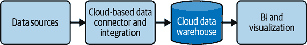

现代数据栈的关键成果是自助服务（分析和管道）、敏捷数据管理，以及使用开源工具或定价结构清晰的简单专有工具。社区也是现代数据栈的一个核心方面。与过去发布版本和路线图很大程度上对用户隐藏的产品不同，在现代数据栈领域运营的项目和公司通常拥有强大的用户群和活跃的社区，它们通过早期使用产品、建议功能和提交拉取请求来改进代码，参与开发。

无论“现代”走向何方（我们在第 11 章中分享了我们的想法），我们认为，具有易于理解的定价和实施的即插即用模块化的关键概念是未来的方向。尤其是在分析工程领域，现代数据栈是并将继续是数据架构的默认选择。全书中，我们引用的架构包含现代数据栈的组件，例如基于云的即插即用模块化组件。

## Lambda 架构

在“过去”（2010 年代初到中期），随着 Kafka 作为高度可扩展的消息队列的出现，以及 Apache Storm 和 Samza 等用于流式/实时分析的框架，处理流数据的流行度爆发式增长。这些技术使公司能够对大量数据、用户聚合和排名以及产品推荐执行新类型的分析和建模。数据工程师需要想办法将批处理和流数据协调到单一架构中。Lambda 架构是对这一问题的早期流行响应之一。

在*Lambda 架构*（图 3-14）中，你拥有相互独立运行的系统——批处理、流处理和服务。源系统理想情况下是不可变且仅追加的，将数据发送到两个目标进行处理：流和批。流处理旨在在“速度层”中以尽可能低的延迟提供数据，通常是 NoSQL 数据库。在批处理层，数据在数据仓库等系统中进行处理和转换，创建数据的预计算和聚合视图。服务层通过聚合来自两层的查询结果，提供统一视图。

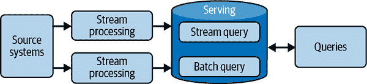

Lambda 架构有其自身的挑战和批评。管理具有不同代码库的多个系统听起来有多难就有多难，这会创建容易出错的系统，其代码和数据极难协调。

我们提到 Lambda 架构是因为它仍然受到关注，并且在数据架构的搜索引擎结果中很流行。如果你试图结合流数据和批数据进行分析，Lambda 不是我们的首选推荐。技术和实践已经发展了。

接下来，让我们看看对 Lambda 架构的一种回应：Kappa 架构。

## Kappa 架构

作为对 Lambda 架构缺点的回应，Jay Kreps 提出了一个称为*Kappa 架构*的替代方案（图 3-15）。^(23) 核心论点是：为什么不直接使用流处理平台作为所有数据处理——摄取、存储和服务——的骨干呢？这促成了真正的基于事件的架构。通过直接读取实时事件流并重放大块数据进行批处理，可以无缝地将实时和批处理应用于同一数据。

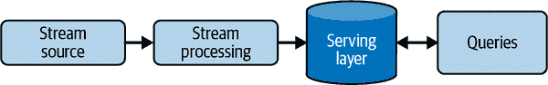

# 数据架构：Kappa、Dataflow 和物联网

## Kappa 架构采用面临的挑战

虽然最初的 Kappa 架构文章发布于 2014 年，但我们并未见其被广泛采用。这可能有几个原因。首先，流处理本身对许多公司来说仍有点神秘；谈论它容易，但执行起来比预期的要难。其次，Kappa 架构在实践中证明既复杂又昂贵。虽然某些流系统能扩展至海量数据，但它们复杂且昂贵；批量存储和处理对于巨大的历史数据集而言，仍然高效且具成本效益得多。

## Dataflow 模型与统一的批处理和流处理

Lambda 和 Kappa 都试图通过将复杂的工具“强行拼凑”在一起，来解决 2010 年代 Hadoop 生态系统的局限性，而这些工具最初很可能并不天然契合。统一批处理和流数据的核心挑战依然存在，Lambda 和 Kappa 都为这一追求的持续进步提供了灵感和基础。

管理批处理和流处理的核心问题之一是统一多条代码路径。虽然 Kappa 架构依赖统一的队列和存储层，但人们仍不得不面对使用不同工具来收集实时统计数据或运行批量聚合作业的问题。如今，工程师们正通过多种方式寻求解决这一问题。Google 通过开发 [Dataflow 模型](https://oreil.ly/qrxY4) 和实现该模型的 [Apache Beam](https://beam.apache.org) 框架留下了印记。

Dataflow 模型的核心思想是将所有数据视为事件，因为聚合是在各种类型的窗口上执行的。持续的实时事件流是*无界数据*。数据批次只是有界事件流，而边界提供了天然的窗口。工程师可以为实时聚合选择各种窗口，例如滑动窗口或翻滚窗口。实时和批处理在同一系统中使用几乎相同的代码进行。

“批处理是流处理的一种特殊情况”这一理念现在更加普及。Flink 和 Spark 等各种框架都采用了类似的方法。

## 物联网架构

*物联网* (IoT) 是设备的分布式集合，也称为*物件*——计算机、传感器、移动设备、智能家居设备，以及任何其他具有互联网连接的设备。物联网数据不是源于直接的人工输入（想想键盘录入数据），而是由设备从周围环境中定期或持续收集数据并传输到目的地生成的。物联网设备通常功耗低，并在低资源/低带宽环境中运行。

虽然物联网设备的概念至少可以追溯到几十年前，但智能手机革命几乎一夜之间创造了一个庞大的物联网集群。此后，出现了许多新的物联网类别，例如智能恒温器、车载娱乐系统、智能电视和智能音箱。物联网已从未来学家的幻想演变为一个庞大的数据工程领域。我们预计物联网将成为数据生成和消费的主要方式之一，本节将比您读过的其他章节更深入一些。

对物联网架构有个大致了解将有助于您理解更广泛的数据架构趋势。让我们简要了解一些物联网架构概念。

### 设备

*设备*（也称为*物件*）是连接到互联网的物理硬件，它们感知周围环境，并收集和传输数据到下游目的地。这些设备可用于消费类应用，如门铃摄像头、智能手表或恒温器。设备可能是一台监控装配线缺陷部件的 AI 驱动摄像头、一台记录车辆位置的 GPS 追踪器，或一台编程用于下载最新推文并冲泡咖啡的树莓派。任何能够从其环境中收集数据的设备都是物联网设备。

设备至少应具备收集和传输数据的能力。然而，设备在发送数据下游之前，可能还会处理数据或在其收集的数据上运行机器学习——分别称为边缘计算和边缘机器学习。

数据工程师不一定需要了解物联网设备的内部细节，但应了解设备的功能、收集的数据、传输数据前运行的任何边缘计算或机器学习，以及数据发送的频率。了解设备或互联网中断的后果、影响数据收集的环境或其他外部因素，以及这些因素如何影响来自设备的下游数据收集，也会有所帮助。

### 与设备交互

除非你能获取设备的数据，否则设备没有益处。本节介绍一些在实际环境中与物联网设备交互所需的关键组件。

#### 物联网网关

*物联网网关* 是连接设备并安全地将设备路由到互联网上适当目的地的枢纽。虽然你可以在没有物联网网关的情况下将设备直接连接到互联网，但网关允许设备使用极低的功耗进行连接。它充当数据保留的中转站，并管理通往最终数据目的地的互联网连接。

新的低功耗 WiFi 标准旨在让物联网网关在未来变得不那么关键，但这些标准刚刚开始推出。通常，一群设备将使用许多物联网网关，在每个存在设备的物理位置放置一个（图 3-16）。

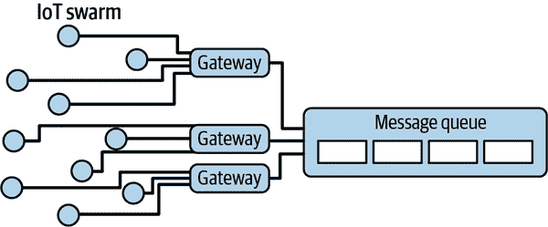

#### 摄入

*摄入* 从物联网网关开始，如前所述。从那里，事件和度量数据可以流入事件摄入架构。

当然，其他模式也是可能的。例如，网关可能会累积数据并分批上传，以便稍后进行分析处理。在偏远的物理环境中，网关可能大部分时间都没有网络连接。它们可能只有在被带入蜂窝网络或 WiFi 网络范围内时，才上传所有数据。关键在于，物联网系统和环境的多样性带来了复杂性——例如迟到数据、数据结构和模式差异、数据损坏和连接中断——工程师必须在其架构和下游分析中考虑这些因素。

#### 存储

存储需求在很大程度上取决于系统中物联网设备的延迟要求。例如，对于稍后分析而收集科学数据的远程传感器，批量对象存储可能完全可以接受。然而，在家庭监控和自动化解决方案中，可能期望系统后端持续分析数据并提供近实时响应。在这种情况下，消息队列或时序数据库更为合适。我们将在 第 6 章 中更详细地讨论存储系统。

#### 服务

服务模式极其多样。在批量科学应用中，数据可能使用云数据仓库进行分析，然后以报告形式呈现。在家庭监控应用中，数据将以多种方式呈现和服务。数据将使用流处理引擎或时序数据库查询进行近实时分析，以查找关键事件，如火灾、停电或闯入。异常检测将触发向房主、消防部门或其他实体发送警报。批量分析组件也存在——例如，关于房屋状态的月度报告。

物联网的一个重要服务模式类似于反向 ETL（图 3-17），尽管我们倾向于不在物联网语境中使用该术语。设想这样一个场景：来自制造设备上传感器的数据被收集并分析。这些测量结果经过处理以寻找优化方案，使设备能更高效地运行。数据被发送回去以重新配置设备并对其进行优化。

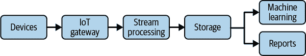

### 仅触及物联网表面

物联网场景极其复杂，物联网架构和系统对于可能将职业生涯花在处理业务数据上的数据工程师来说也比较陌生。我们希望这一介绍能鼓励感兴趣的数据工程师深入了解这个迷人且快速发展的专业领域。

## 数据网格

*数据网格*是针对蔓延的单体数据平台（如中心化数据湖和数据仓库）以及“数据的巨大鸿沟”（即数据领域被划分为运营数据和分析数据）的一种近期回应。^(24) 数据网格试图颠覆中心化数据架构的挑战，采用领域驱动设计的概念（常用于软件架构）并将其应用于数据架构。由于数据网格近期备受关注，你应该了解它。

数据网格的很大一部分是去中心化，正如 Zhamak Dehghani 在其关于该主题的开创性文章中所指出的：^(25)

> 为了去中心化单体数据平台，我们需要改变对数据、其位置和所有权的看法。不再将数据从域流向中心拥有的数据湖或平台，而是需要由域以易于消费的方式托管和服务其领域数据集。

Dehghani 后来确定了数据网格的四个关键组成部分：^(26)

* 面向领域的去中心化数据所有权和架构
* 数据即产品
* 自助式数据基础设施即平台
* 联邦计算治理

图 3-18 展示了数据网格架构的简化版本。你可以在 Dehghani 的著作 [*Data Mesh*](https://oreil.ly/mK8cJ)（O’Reilly 出版）中了解更多关于数据网格的信息。

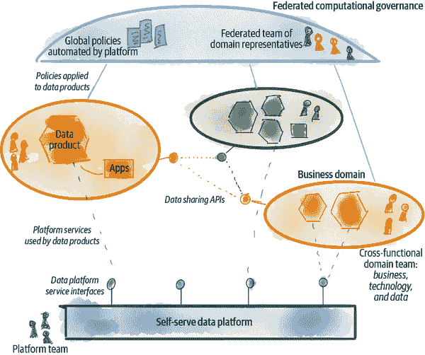

## 其他数据架构示例

数据架构还有无数其他变体，例如数据织构、数据枢纽、[可扩展架构](https://oreil.ly/MB1Ap)、[元数据优先架构](https://oreil.ly/YkA9e)、事件驱动架构、实时数据栈（第 11 章）等。随着实践的巩固成熟和工具的简化改进，新架构将持续涌现。我们重点介绍了少数最关键的数据架构模式，它们要么极其成熟，要么快速演进，要么两者兼具。

作为数据工程师，要关注新架构如何帮助你的组织。通过培养对数据工程生态系统发展的高层认知，保持对新进展的了解。保持开放心态，不要对某一方法产生情感依赖。一旦识别出潜在价值，深入学习并做出具体决策。如果做得正确，对数据架构的微调——或大规模改造——都能对业务产生积极影响。

## 谁参与数据架构设计？

数据架构不是在真空中设计的。大公司可能仍会雇佣数据架构师，但这些架构师需要紧跟技术和数据的现状。象牙塔式数据架构的时代已经一去不复返。过去，架构在很大程度上与工程正交。我们预计随着数据工程乃至整个工程领域的快速演进，变得更加敏捷，工程与架构之间的界限将消失，这种区别将不复存在。

理想情况下，数据工程师将与专职数据架构师共事。然而，如果公司规模较小或数据成熟度较低，数据工程师可能需要身兼数职，同时担任架构师。因为数据架构是数据工程生命周期的潜流，数据工程师应了解“良好”的架构以及各种类型的数据架构。

在设计架构时，你将与业务利益相关者一起评估权衡。采用云数据仓库与数据湖相比有哪些固有权衡？各种云平台有哪些权衡？何时统一批/流框架（Beam、Flink）会是合适的选择？在抽象层面研究这些选择将帮助你做出具体、有价值的决策。

## 总结

你已了解数据架构如何融入数据工程生命周期，什么构成了“良好”的数据架构，并看到了几个数据架构示例。因为架构是成功的关键基础，我们鼓励你投入时间深入研究它，并理解任何架构中固有的权衡。你将做好准备，规划出符合组织独特需求的架构。

接下来，让我们看看一些在数据架构和整个数据工程生命周期中选择合适技术的方法。

## 附加资源

* [“贫血领域模型”](https://oreil.ly/Bx8fF) by Martin Fowler
* [“大数据架构”](https://oreil.ly/z7ZQY) Azure 文档
* [“限界上下文”](https://oreil.ly/Hx3dv) by Martin Fowler
* [“大数据两种处理架构简介——Lambda 和 Kappa”](https://oreil.ly/CcmZi) by Iman Samizadeh
* [“现代数据平台的构建模块”](https://oreil.ly/ECuIW) by Prukalpa
* [“明智选择开源”](https://oreil.ly/79pNh) by Benoit Dageville 等
* [“选择适合全球数据分发的架构”](https://oreil.ly/mGkrg) Google Cloud Architecture 网页
* [“面向列的 DBMS 维基百科页面”](https://oreil.ly/pG4DJ)
* [“数据处理框架对比”](https://oreil.ly/XSM7H) by Ludovik Santos
* [“云的成本，万亿美元悖论”](https://oreil.ly/8wBqr) by Sarah Wang and Martin Casado
* [“数据湖怪兽的诅咒”](https://oreil.ly/UdFHa) by Kiran Prakash and Lucy Chambers
* [*数据架构：数据科学家入门*](https://oreil.ly/dbiK0) by W. H. Inmon 等（Academic Press）
* [“数据架构：复杂与繁杂”](https://oreil.ly/akjNd) by Dave Wells
* [“数据即产品与数据即服务”](https://oreil.ly/6svBK) by Justin Gage
* [“数据二分法：重新思考我们对待数据和服务的方式”](https://oreil.ly/Bk4dV) by Ben Stopford
* [“数据织构架构是现代化数据管理和集成的关键”](https://oreil.ly/qQf3z) by Ashutosh Gupta
* [“数据织构定义”](https://oreil.ly/ECpAG) by James Serra
* [“数据团队平台”](https://oreil.ly/SkDj0) by GitLab Data
* [“数据仓库架构：概览”](https://oreil.ly/pzGKb) by Roelant Vos
* [“Javatpoint 上的数据仓库架构教程”](https://oreil.ly/XgwiO)
* [“定义架构 ISO/IEC/IEEE 42010 网页”](https://oreil.ly/CJxom)
* [“现代面向列数据库系统的设计与实现”](https://oreil.ly/Y93uf) by Daniel Abadi 等
* [“我在微服务世界见过的灾难”](https://oreil.ly/b1TWh) by Joao Alves
* [“领域驱动设计”](https://oreil.ly/nyMrw) by Martin Fowler
* [“消除管道债务：引入 Great Expectations”](https://oreil.ly/EgVav) by the Great Expectations project
* [*EABOK* 草案](https://oreil.ly/28yWO), edited by Paula Hagan
* [EABOK 网站](https://eabok.org)

## 参考资料

### 资源

*   [“EagerReadDerivation”](https://oreil.ly/ABD9d) 作者：Martin Fowler
*   [“AWS 中的端到端无服务器 ETL 编排：指南”](https://oreil.ly/xpmrY) 作者：Rittika Jindal
*   [“企业架构” Gartner 术语表定义](https://oreil.ly/mtam7)
*   [“企业架构在构建数据驱动型组织中的作用”](https://oreil.ly/n73yP) 作者：Ashutosh Gupta
*   [“事件溯源”](https://oreil.ly/xrfaP) 作者：Martin Fowler
*   [“重拾对数据管道的热爱”](https://oreil.ly/ASz07) 作者：Sean Knapp
*   [“云原生架构的五大原则：它是什么以及如何掌握它”](https://oreil.ly/WCYSj) 作者：Tom Grey
*   [“关注事件”](https://oreil.ly/NsFaL) 作者：Martin Fowler
*   [“函数式数据工程：批处理的现代范式”](https://oreil.ly/ZKmuo) 作者：Maxime Beauchemin
*   [“Google Cloud 架构框架” Google Cloud 架构网页](https://oreil.ly/Cgknz)
*   [“如何攻克 CAP 定理”](https://oreil.ly/NXLn6) 作者：Nathan Marz
*   [“如何构建数据架构以驱动创新——今日与未来”](https://oreil.ly/dyCpU) 作者：Antonio Castro 等
*   [“TOGAF 如何定义企业架构 (EA)”](https://oreil.ly/b0kaG) 作者：Avancier Limited
*   [信息管理知识体系网站](https://www.imbok.info)
*   [“Dagster 简介：用于构建数据应用的开源 Python 库”](https://oreil.ly/hHNqx) 作者：Nick Schrock
*   [“日志：每个软件工程师都应了解的实时数据统一抽象”](https://oreil.ly/meDK7) 作者：Jay Kreps
*   [“Microsoft Azure IoT 参考架构”文档](https://oreil.ly/UUSMY)
*   Microsoft 的 [“Azure 架构中心”](https://oreil.ly/cq8PN)
*   [“现代 CI 过于复杂且方向错误”](https://oreil.ly/Q4RdW) 作者：Gregory Szorc
*   [“现代数据栈：过去、现在与未来”](https://oreil.ly/lt0t4) 作者：Tristan Handy
*   [“超越批处理与流处理之争”](https://oreil.ly/sHMjv) 作者：David Yaffe
*   [“现代数据架构的个人实践：将 Strava 数据导入 Google Cloud Platform”](https://oreil.ly/o04q2) 作者：Matthew Reeve
*   [“多语言持久化”](https://oreil.ly/aIQcv) 作者：Martin Fowler
*   [“波将金数据科学”](https://oreil.ly/MFvAe) 作者：Michael Correll
*   [“原则性数据工程，第一部分：架构概览”](https://oreil.ly/74rlm) 作者：Hussein Danish
*   [“质疑 Lambda 架构”](https://oreil.ly/mc4Nx) 作者：Jay Kreps
*   [“使用发件箱模式实现可靠的微服务数据交换”](https://oreil.ly/vvyWw) 作者：Gunnar Morling
*   [“ReportingDatabase”](https://oreil.ly/ss3HP) 作者：Martin Fowler
*   [“元数据湖的崛起”](https://oreil.ly/fijil) 作者：Prukalpa
*   [“像运营产品团队一样运营数据团队”](https://oreil.ly/0MjbR) 作者：Emilie Schario 和 Taylor A. Murphy
*   [“将实用性与增值分离”](https://oreil.ly/MAy9j) 作者：Ross Pettit
*   [“现代数据架构的六大原则”](https://oreil.ly/wcyDV) 作者：Joshua Klahr
*   Snowflake 的 [“什么是数据仓库架构”网页](https://oreil.ly/KEG4l)
*   [“软件基础设施 2.0：愿望清单”](https://oreil.ly/wXMts) 作者：Erik Bernhardsson
*   [“领先于数据债务”](https://oreil.ly/9JdJ1) 作者：Etai Mizrahi
*   [“战术与战略：SOA 与无关紧要的沥青坑”](https://oreil.ly/NUbb0) 作者：Neal Ford
*   [“使用 Deequ 大规模测试数据质量”](https://oreil.ly/WG9nN) 作者：Dustin Lange 等
*   [“三层架构”](https://oreil.ly/POjK6) 作者：IBM Education
*   [TOGAF 框架网站](https://oreil.ly/7yTZ5)
*   [“首席数据官 2021 年需关注的 5 大数据趋势”](https://oreil.ly/IFXFp) 作者：Prukalpa
*   [“240 张表却无文档？”](https://oreil.ly/dCReG) 作者：Alexey Makhotkin
*   [“终极数据可观测性清单”](https://oreil.ly/HaTwV) 作者：Molly Vorwerck
*   [“统一分析：批处理与流处理的融合；SQL 及更远” Apache Flink 路线图](https://oreil.ly/tCYPh)
*   [“UtilityVsStrategicDichotomy”](https://oreil.ly/YozUm) 作者：Martin Fowler
*   [“什么是数据湖仓？”](https://oreil.ly/L12pz) 作者：Ben Lorica 等
*   [“什么是数据架构？数据管理框架”](https://oreil.ly/AJgMw) 作者：Thor Olavsrud
*   [“什么是开放数据生态系统及其长久存在的原因”](https://oreil.ly/PoeOA) 作者：Casber Wang
*   [“MLOps 有什么问题？”](https://oreil.ly/c1O9I) 作者：Laszlo Sragner
*   [“究竟什么是数据网格”](https://oreil.ly/Hjnlu) 作者：Chris Riccomini
*   [“谁需要架构师”](https://oreil.ly/0BNPj) 作者：Martin Fowler
*   [“Zachman 框架”维基百科页面](https://oreil.ly/iszvs)

### 注释

1.  The Open Group，《*TOGAF 9.1 版*》，[`oreil.ly/A1H67`](https://oreil.ly/A1H67)。
2.  Gartner 术语表，条目“企业架构 (EA)”，[`oreil.ly/SWwQF`](https://oreil.ly/SWwQF)。
3.  EABOK 联盟网站，[`eabok.org`](https://eabok.org)。
4.  Jeff Haden，“亚马逊创始人 Jeff Bezos：成功人士做出明智决策的秘诀”，《*Inc.*》，2018 年 12 月 3 日，[`oreil.ly/QwIm0`](https://oreil.ly/QwIm0)。
5.  The Open Group，《*TOGAF 9.1 版*》，[`oreil.ly/A1H67`](https://oreil.ly/A1H67)。
6.  《*DAMA - DMBOK：数据管理知识体系指南*》，第 2 版（Technics Publications，2017 年）。
7.  Mark Richards 和 Neal Ford，《*软件架构基础*》（加利福尼亚州塞巴斯托波尔：O'Reilly，2020 年），[`oreil.ly/hpCp0`](https://oreil.ly/hpCp0)。
8.  UberPulse，“Amazon.com CTO：一切皆会失败”，YouTube 视频，3:03，[`oreil.ly/vDVlX`](https://oreil.ly/vDVlX)。
9.  Martin Fowler，“谁需要架构师？”，《*IEEE Software*》，2003 年 7/8 月，[`oreil.ly/wAMmZ`](https://oreil.ly/wAMmZ)。
10. Google Cloud，“DevOps 技术：架构”，Cloud Architecture Center，[`oreil.ly/j4MT1`](https://oreil.ly/j4MT1)。
11. “Bezos API 强制令：亚马逊的外部化宣言”，Nordic APIs，2021 年 1 月 19 日，[`oreil.ly/vIs8m`](https://oreil.ly/vIs8m)。
12. Fowler，“谁需要架构师？”
13. Tom Grey，“云原生架构的 5 大原则——它是什么以及如何掌握它”，Google Cloud 博客，2019 年 6 月 19 日，[`oreil.ly/4NkGf`](https://oreil.ly/4NkGf)。
14. Amazon Web Services，“AWS WAF 中的安全性”，AWS WAF 文档，[`oreil.ly/rEFoU`](https://oreil.ly/rEFoU)。
15. Ericka Chickowski，“漏洞桶：10 起最严重的 Amazon S3 数据泄露”，Bitdefender《*Business Insights*》博客，2018 年 1 月 24 日，[`oreil.ly/pFEFO`](https://oreil.ly/pFEFO)。
16. FinOps 基金会，“什么是 FinOps”，[`oreil.ly/wJFVn`](https://oreil.ly/wJFVn)。
17. J. R. Storment 和 Mike Fuller，《*Cloud FinOps*》（加利福尼亚州塞巴斯托波尔：O'Reilly，2019 年），[`oreil.ly/QV6vF`](https://oreil.ly/QV6vF)。
18. “FinOps 基金会成员数飙升至 300 家，并为云服务提供商和供应商推出新的合作伙伴层级”，Business Wire，2019 年 6 月 17 日，[`oreil.ly/XcwYO`](https://oreil.ly/XcwYO)。
19. Eric Evans，《*领域驱动设计参考：定义与模式摘要*》（2015 年 3 月），[`oreil.ly/pQ9oq`](https://oreil.ly/pQ9oq)。

