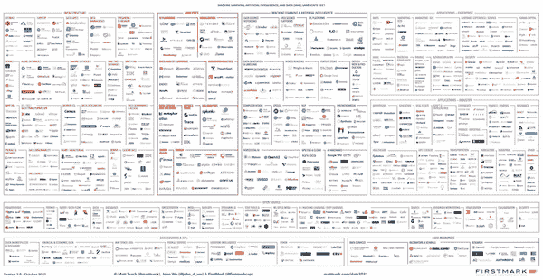
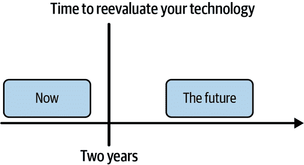
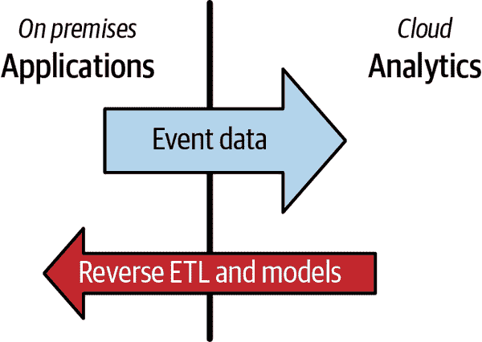
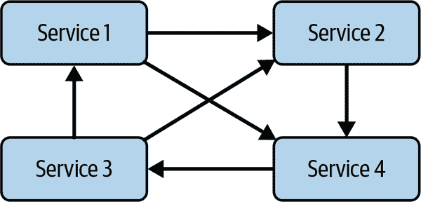
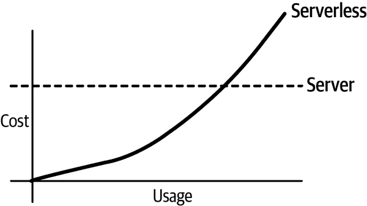

# 第 4 章 跨数据工程生命周期选择技术

## 参考文献

^(20) Martin Fowler, “StranglerFigApplication,” June 29, 2004, [*https://oreil.ly/PmqxB*](https://oreil.ly/PmqxB).

^(21) Mike Loukides, “Resume Driven Development,” *O’Reilly Radar*, October 13, 2004, [*https://oreil.ly/BUHa8*](https://oreil.ly/BUHa8).

^(22) H. W. Inmon, *Building the Data Warehouse* (Hoboken: Wiley, 2005).

^(23) Jay Kreps, “Questioning the Lambda Architecture,” *O’Reilly Radar*, July 2, 2014, [*https://oreil.ly/wWR3n*](https://oreil.ly/wWR3n).

^(24) Zhamak Dehghani, “Data Mesh Principles and Logical Architecture,” MartinFowler.com, December 3, 2020, [*https://oreil.ly/ezWE7*](https://oreil.ly/ezWE7).

^(25) Zhamak Dehghani, “How to Move Beyond a Monolithic Data Lake to a Distributed Data Mesh,” MartinFowler.com, May 20, 2019, [*https://oreil.ly/SqMe8*](https://oreil.ly/SqMe8).

^(26) Zhamak Dehghani, “Data Mesh Principles and Logical Architecture.”

---

如今的数据工程陷入了“富贵病”困境。我们拥有解决各类数据问题的海量技术，绝不缺乏选择。数据技术以交钥匙产品的形式几乎以各种方式提供——开源、托管开源、专有软件、专有服务等。然而，很容易陷入追逐前沿尖端技术的漩涡，而忽视了数据工程的核心宗旨：设计健壮可靠的系统，贯穿完整生命周期流转数据，并根据最终用户需求提供服务。正如结构工程师精心挑选技术与材料以实现建筑师的蓝图愿景，数据工程师的任务是做出合理的技术选择，护送数据跨越生命周期，服务于数据应用与用户。

第 3 章 探讨了“优秀”的数据架构及其重要性。现在我们将解释如何选择合适的技术来支撑该架构。数据工程师必须选用优秀技术，以打造最佳数据产品。我们认为选择优秀数据技术的标准很简单：它是否为数据产品和更广泛的业务增加了价值？

许多人混淆了架构与工具。架构是*战略*层面的；工具是*战术*层面的。我们有时会听到：“我们的数据架构是工具 X、Y 和 Z。” 这是错误的架构思维。架构是满足业务战略目标的数据系统的高层设计、路线图和蓝图。架构关乎*是什么*、*为什么*和*何时*。工具用于将架构变为现实；工具关乎*怎么做*。

我们常见团队“跑偏”，在规划架构前就先选技术。原因各异：贪新症、简历驱动开发、缺乏架构专长。实践中，这种技术优先的做法往往导致他们拼凑出一种苏斯博士笔下的奇幻机器，而非真正的数据架构。我们强烈建议不要在架构未定前就选技术。**架构先行，技术次之。**

本章将讨论在拥有战略架构蓝图后，制定技术选择的战术计划。以下是跨数据工程生命周期选择数据技术时的一些考量因素：

- 团队规模与能力
- 上市速度
- 互操作性
- 成本优化与业务价值
- 当下与未来：不可变技术与过渡性技术
- 部署位置（云、本地、混合云、多云）
- 自建与采购
- 单体与模块化
- 无服务器与服务器
- 优化、性能与基准测试之争
- 数据工程生命周期的暗流

## 团队规模与能力

首先要评估的是团队的规模及其技术能力。你们是精简团队（甚至可能只有一人），需要身兼数职，还是团队足够大，大家分工专业？是少数人负责数据工程生命周期的多个阶段，还是各人覆盖特定领域？团队规模将影响你们采用的技术类型。

技术复杂度呈连续谱分布，团队规模大致决定了团队能投入多少精力应对复杂方案。我们有时会看到小型数据团队阅读大厂前沿技术博客，便试图照搬那些极其复杂的技术与实践。我们称之为*盲目模仿工程*，这通常是消耗大量宝贵时间和金钱的重大错误，往往毫无产出。特别是对于小团队或技术功底较弱的团队，应尽可能使用托管和 SaaS 工具，将有限精力集中在直接为业务增值的复杂问题上。

盘点团队技能栈。成员倾向低代码工具，还是代码优先？是否精通 Java、Python 或 Go 等特定语言？从低代码到重代码的各类偏好都有对应技术可选。同样，我们建议坚持使用团队熟悉的技术和工作流。我们见过数据团队投入大量时间学习炫酷的新技术、语言或工具，却从未在生产环境用过。学习新技术、语言和工具是巨大的时间投资，务必审慎决策。

## 上市速度

在技术领域，上市速度制胜。这意味着选择能帮助你更快交付功能和数据、同时保持高质量与安全标准的技术。这也意味着在发布、学习、迭代、改进的紧凑反馈循环中工作。

完美是优秀的敌人。一些数据团队会在技术选型上纠结数月甚至数年而无果。决策迟缓、产出缓慢是数据团队的死刑判决。我们见过不少数据团队因行动太慢、未能交付受雇产出的价值而解散。

尽早且频繁地交付价值。正如我们提到的，用好用的工具。团队成员往往能用熟悉的工具撬动更大杠杆。避免无差别的重体力劳动，让团队陷入不必要的复杂工作却几乎不增值。选择能助你快速、可靠、安全、合规地前进的工具。

## 互操作性

极少只用单一技术或系统。选型时，需确保其能与其他技术交互协作。*互操作性*描述了各技术或系统如何连接、交换信息和交互。

假设你在评估技术 A 和 B。从互操作性角度看，技术 A 与技术 B 集成有多容易？这通常是难度谱系，从无缝集成到耗时繁琐。是否每个产品已内置无缝集成，配置轻而易举？还是说需要大量手动配置才能集成？

通常，厂商和开源项目会针对特定平台和系统实现互操作。大多数数据摄入和可视化工具都内置了与主流数据仓库和数据湖的集成。此外，主流数据摄入工具还会集成通用 API 和服务，如 CRM、财务软件等。

有时标准的存在是为了互操作性。几乎所有数据库都允许通过 Java 数据库连接 (JDBC) 或开放数据库互连 (ODBC) 进行连接，这意味着您可以轻松地使用这些标准连接到数据库。在其他情况下，互操作性是在没有标准的情况下发生的。表述性状态转移 (REST) 并非 API 的真正标准；每个 REST API 都有其怪癖。在这些情况下，由供应商或开源软件 (OSS) 项目负责确保与其他技术和系统的顺利集成。

请始终注意，在数据工程生命周期中连接您的各种技术有多简单。正如其他章节所述，我们建议为模块化而设计，并赋予自己在新实践和替代方案出现时轻松替换技术的能力。

# 成本优化与业务价值

在一个完美的世界里，您可以尝试所有最新、最酷的技术，而无需考虑成本、时间投入或为业务增加的价值。现实中，预算和时间是有限的，成本是选择正确数据架构和技术的主要约束。您的组织期望从数据项目中获得正向的 ROI，因此您必须了解可以控制的基本成本。技术是主要的成本驱动因素，因此您的技术选择和管理策略将显著影响您的预算。我们通过三个主要视角来审视成本：总拥有成本、机会成本和 FinOps。

## 总拥有成本

*总拥有成本* (TCO) 是一项计划的总估算成本，包括所用产品和服务的直接和间接成本。*直接成本* 可直接归因于某项计划。例如，从事该计划的团队薪资，或所消耗的所有 AWS 服务的账单。*间接成本* 也称为*间接费用*，独立于该计划，无论归属何处都必须支付。

除了直接和间接成本外，*采购方式* 也会影响成本核算方式。费用分为两大类：资本性支出和运营性支出。

*资本性支出*，也称为 *capex*，需要预先投资。付款要求*即时*完成。在云出现之前，公司通常会通过大额采购合同预先购买硬件和软件。此外，还需要大量投资将硬件托管在服务器机房、数据中心和托管设施中。这些预先投资——通常高达数十万到数百万美元或更多——会被视为资产，并随时间缓慢折旧。从预算角度来看，需要资本为整个采购提供资金。这是 capex，一项巨大的资本支出，并制定长期计划以实现投入精力和费用的正向 ROI。

*运营性支出*，也称为 *opex*，在某些方面与 capex 相反。Opex 是渐进的，分摊在一段时间内。Capex 着眼长远，而 opex 着眼短期。Opex 可以是即用即付或类似模式，并允许极大的灵活性。Opex 更接近直接成本，使其更容易归因于数据项目。

直到最近，opex 还不是大型数据项目的选项。数据系统通常需要数百万美元的合同。随着云的出现，这种情况发生了改变，因为数据平台服务允许工程师按基于消费的模式付费。总体而言，opex 使工程团队能够更灵活地选择其软件和硬件。基于云的服务让数据工程师能够快速迭代各种软件和技术配置，且通常成本低廉。

数据工程师需要对灵活性保持务实态度。数据领域变化太快，无法投资于必然过时、难以轻松扩展、并可能阻碍数据工程师尝试新事物的长期硬件。考虑到灵活性和低初始成本的优势，我们敦促数据工程师采取以云为中心、以灵活的即用即付技术为核心的 *opex-first* 方法。

## 总机会成本

任何选择本质上都会排除其他可能性。*总机会成本* (TOCO) 是我们在选择技术、架构或流程时所承担的失去机会的成本。^(1) 请注意，此处的“拥有”不需要长期购买硬件或许可证。即使在云环境中，一旦某技术、技术栈或管道成为我们生产数据流程的核心部分且难以迁移，我们实际上就拥有了它。数据工程师在承接新项目时往往未能评估 TOCO；依我们之见，这是一个巨大的盲点。

如果您选择数据栈 A，您就选择了数据栈 A 的优势而非所有其他选项，实际上排除了数据栈 B、C 和 D。您承诺使用数据栈 A 及其所包含的一切——支持它的团队、培训、设置和维护。如果数据栈 A 是个糟糕的选择会怎样？当数据栈 A 过时时会怎样？您还能迁移到其他数据栈吗？

您能多快、多廉价地迁移到更新、更好的东西？在数据领域，新技术和产品似乎以越来越快的速度出现，这是一个关键问题。您在数据栈 A 上积累的专业知识能否转化为下一波浪潮？还是说您能替换数据栈 A 的组件，为自己争取一些时间和选择？

最小化机会成本的第一步是睁大眼睛去评估它。我们见过无数数据团队被困在当时看似不错、实则不利于未来扩展或干脆已过时的技术中。不灵活的数据技术很像熊夹。很容易陷进去，却极其痛苦难以逃脱。

## FinOps

我们已在“原则 9：拥抱 FinOps”中涉及 FinOps。正如我们所讨论的，典型的云支出本质上是 opex：公司为运行关键数据流程的服务付费，而非预先采购并随时间追回价值。FinOps 的目标是通过应用类 DevOps 的监控和动态调整系统实践，充分实现财务问责和业务价值的运营化。

在本章中，我们想强调关于 FinOps 的一点，这在以下引言中得到了很好的体现：^(2)

> 如果您认为 FinOps 是关于省钱，那就再想想吧。FinOps 是关于*赚钱*。云支出可以推动更多收入，预示客户群增长，实现更多产品和功能的发布速度，甚至帮助关闭数据中心。

在我们的数据工程背景下，快速迭代和动态扩展的能力对于创造业务价值至关重要。这是将数据工作负载迁移到云端的主要动机之一。

# 今天与未来：不可变技术与过渡性技术

在数据工程这样一个令人兴奋的领域，人们很容易专注于快速演变的未来，而忽视当下的具体需求。构建更美好未来的初衷虽高尚，却往往导致过度架构和过度工程。为未来挑选的工具，等到未来来临时可能已陈旧过时；未来往往与我们多年前设想的截然不同。

正如许多生活教练会告诉你的那样，专注于当下。你应该为当前和近期的未来选择最佳技术，但要以一种支持未来未知变化和演进的方式来选择。自问：你今天处于什么位置，未来的目标是什么？这些问题的答案应指导你关于架构的决策，从而决定架构中使用的技术。这通过理解什么可能会改变、什么倾向于保持不变来实现。

我们有两类工具需要考虑：不变的和过渡的。*不变技术*可能是支撑云的组件，或是经受住时间考验的语言和范式。在云中，不变技术的例子包括对象存储、网络、服务器和安全。对象存储（如 Amazon S3 和 Azure Blob Storage）将从今天持续存在到本十年末，甚至可能更久。将数据存储在对象存储中是明智之举。对象存储在各方面持续改进并不断提供新选项，但无论整体技术如何快速演进，你的数据在对象存储中都将保持安全且可用。

就语言而言，SQL 和 bash 已存在数十年，我们短期内不太可能看到它们消失。不变技术受益于林迪效应：一项技术建立的时间越长，它将被使用的时间就越长。想想电网、关系型数据库、C 编程语言或 x86 处理器架构。我们建议将林迪效应作为一块试金石，以判断一项技术是否具有潜在的不变性。

*过渡技术*是那些来去匆匆的技术。典型轨迹始于大肆炒作，随后是流行度的飞速增长，最后缓慢沉寂至默默无闻。JavaScript 前端领域就是一个经典例子。2010 年至 2020 年间，有多少 JavaScript 前端框架来了又走？Backbone.js、Ember.js 和 Knockout 在 2010 年代初很流行，而 React 和 Vue.js 如今拥有巨大的心智份额。三年后流行的前端 JavaScript 框架会是什么？谁知道呢。

资金雄厚的新进入者和开源项目每天都在数据领域涌现。每个供应商都会说他们的产品将改变行业，并[“让世界变得更美好”](https://oreil.ly/A8Fdi)。这些公司和项目大多无法获得长期牵引力，慢慢沉寂至默默无闻。顶级风投正在进行大额押注，明知其大多数数据工具投资将会失败。如果投入数百万（甚至数十亿）资金的风投在数据工具投资上都无法判断准确，你怎么可能知道该为你的数据架构投资哪些技术？这很难。只需看看我们在第 1 章中介绍的 Matt Turck 那幅（臭名昭著的）[机器学习、人工智能和数据（MAD）全景图](https://oreil.ly/TWTfM)（图 4-1）中包含的技术数量即可。

即使是相对成功的技术，往往也在几年的快速采用后迅速沉寂，成为其成功的牺牲品。例如，在 2010 年代初，Hive 因允许分析师和工程师在无需手动编写复杂 MapReduce 作业的情况下查询海量数据集而被迅速采纳。受 Hive 成功的启发但希望改进其缺点，工程师们开发了 Presto 等技术。Hive 现在主要出现在遗留部署中。几乎每项技术都遵循这一不可避免的衰退路径。

## 我们的建议

考虑到工具和最佳实践快速变化的步伐，我们建议每两年评估一次工具（图 4-2）。只要可能，就在数据工程生命周期中寻找不变技术，并将其作为基础。在不变技术周围构建过渡工具。

考虑到许多数据技术有合理的失败概率，你需要考虑从所选技术迁移出去有多容易。离开的障碍是什么？正如我们之前在讨论机会成本时提到的，避免“熊市陷阱”。以全神贯注的姿态进入新技术，清楚地知道该项目可能会被放弃、公司可能无法生存，或者该技术仅仅是不再适用。

# 部署位置

公司在决定在哪里运行其技术栈时，现在有许多选择。向云的缓慢转变最终演变为大量公司在 AWS、Azure 和 Google Cloud Platform (GCP) 上疯狂启动工作负载。在过去十年中，许多 CTO 来认为他们围绕技术托管的决策对其组织具有生存意义。如果行动太慢，他们就有被更敏捷的竞争对手抛在身后的风险；另一方面，规划不善的云迁移可能导致技术失败和灾难性成本。

让我们看看运行技术栈的主要场所：本地部署、云、混合云和多云。

## 本地部署

虽然新创业公司越来越多地诞生于云端，但本地部署系统仍是成熟公司的默认选择。本质上，这些公司拥有自己的硬件，这些硬件可能位于它们自有的数据中心，或租赁的托管空间中。无论哪种情况，公司都需对其硬件及运行在其上的软件承担运维责任。如果硬件故障，他们必须自行维修或更换。他们还必须每隔几年管理升级周期，因为新的更新硬件发布，旧硬件老化且可靠性降低。他们必须确保有足够的硬件来应对高峰；对于在线零售商，这意味着托管足够的容量来应对“黑色星期五”的负载峰值。对于负责本地部署系统的数据工程师而言，这意味着购买足够大的系统，以在峰值负载和大型作业下保证良好性能，同时避免过度采购和超支。

一方面，成熟公司拥有行之有效的成熟运维实践。假设一家依赖信息技术的公司已经运营了一段时间。这意味着它设法平衡了运行硬件、管理软件环境、部署开发团队代码、运行数据库和大数据系统的成本和人员需求。

另一方面，成熟公司看到更年轻、更敏捷的竞争对手利用云托管服务快速扩张。他们还看到成熟竞争对手进军云端，从而能够为大规模数据作业或“黑色星期五”购物高峰临时扩展巨大的算力。

处于竞争激烈领域的公司通常没有原地踏步的选择。竞争异常激烈，时刻面临被“颠覆”的威胁，颠覆者往往是更敏捷的竞争对手，且常有大量风险投资资金支持。每家公司都必须在保持现有系统高效运行的同时，决定下一步行动。这可能涉及在保持硬件本地运行的同时，采用更新的 DevOps 实践，如容器、Kubernetes、微服务和持续部署。也可能涉及完全迁移到云端，正如下文所述。

## 云端

云端彻底颠覆了本地部署模式。你无需购买硬件，只需从云提供商（如 AWS、Azure 或 Google Cloud）租用硬件和托管服务。这些资源通常可以极短期地预留；虚拟机在不到一分钟内即可启动，后续使用按秒计费。这使得云用户能够动态扩展资源，这在本地服务器时代是不可想象的。

# 云计算模型与策略

## 云服务模型

在云环境中，工程师可以快速启动项目并进行实验，而无需担心漫长的硬件规划交付周期。一旦代码准备好部署，他们就可以立即运行服务器。这使得云模型对预算和时间紧张的初创公司极具吸引力。

早期云时代由**基础设施即服务（`IaaS`）**产品主导——例如 `VM` 和虚拟磁盘等产品，本质上是租用的硬件切片。渐渐地，我们看到了向**平台即服务（`PaaS`）**转变的趋势，而**软件即服务（`SaaS`）**产品继续保持快速增长。

### 基础设施即服务

`IaaS` 提供基础构建模块：虚拟机、存储和网络。工程师保留对操作系统和运行时环境的控制权，但将物理硬件管理外包出去。

### 平台即服务

`PaaS` 包含 `IaaS` 产品，但增加了更复杂的托管服务以支持应用程序。示例包括托管数据库，如 `Amazon Relational Database Service (RDS)` 和 `Google Cloud SQL`；托管流式平台，如 `Amazon Kinesis` 和 `Simple Queue Service (SQS)`；以及托管 Kubernetes，如 `Google Kubernetes Engine (GKE)` 和 `Azure Kubernetes Service (AKS)`。`PaaS` 服务使工程师能够忽略管理单个机器和跨分布式系统部署框架的运维细节。它们以最小的运维开销提供对复杂、自动扩缩容系统的即开即用访问。

### 软件即服务

`SaaS` 产品在抽象阶梯上更进一步。`SaaS` 通常提供功能齐全的企业软件平台，几乎无需运维管理。`SaaS` 的示例包括 `Salesforce`、`Google Workspace`、`Microsoft 365`、`Zoom` 和 `Fivetran`。主要公有云和第三方都提供 `SaaS` 平台。`SaaS` 涵盖了广泛的企业领域，包括视频会议、数据管理、广告技术、办公应用和 `CRM` 系统。

## 无服务器计算

本章还讨论了**无服务器**，它在 `PaaS` 和 `SaaS` 产品中变得越来越重要。无服务器产品通常提供从零到极高使用率的自动扩缩容。它们按使用量付费计费，并允许工程师在无需感知底层服务器运维的情况下进行操作。许多人对*无服务器*这一术语有异议；毕竟，代码必须运行在某处。实际上，无服务器通常意味着*许多不可见的服务器*。

## 云采用的驱动因素

云服务对拥有现有数据中心和 `IT` 基础设施的成熟企业变得越具吸引力。动态、无缝的扩缩容对于应对季节性（例如零售企业应对黑色星期五的负载）和 Web 流量负载峰值的企业极具价值。2020 年 `COVID-19` 的爆发是云采用的主要驱动力，因为公司认识到在高度不确定的商业环境中快速扩展数据流程以获取洞察的价值；企业还必须应对因在线购物、Web 应用使用和远程办公激增而带来的大幅负载增加。

在讨论云中选择技术的细微差别之前，让我们先讨论为什么迁移到云需要思维方式的剧变，特别是在定价方面；这与“FinOps”中介绍的 `FinOps` 密切相关。迁移到云的企业往往因未能适当调整其实践以适应云定价模型而犯下重大部署错误。

## 混合云

随着越来越多的成熟企业迁移到云，**混合云**模型的重要性日益增长。几乎没有任何企业能一夜之间迁移其所有工作负载。混合云模型假设组织将无限期地在云外维护某些工作负载。

考虑混合云模型有许多原因。组织可能认为他们在某些领域（如其应用栈和相关硬件）已实现运维卓越。因此，他们可能仅迁移到在云环境中看到即时收益的特定工作负载。例如，将本地 `Spark` 栈迁移到临时云集群，减轻了数据工程团队管理软硬件的运维负担，并允许为大型数据作业快速扩缩容。

这种将分析放入云中的模式非常优雅，因为数据主要单向流动，从而最小化数据流出成本（`图 4-3`）。也就是说，本地应用生成的事件数据基本可以免费推送到云端。大量数据保留在云端进行分析，而较少量的数据被推回本地用于向应用部署模型、反向 `ETL` 等。

新一代托管混合云服务产品还允许客户在其数据中心中部署云托管服务器。^(4) 这使用户能够将每个云的最佳功能与本地基础设施相结合。

## 多云

**多云**仅指将工作负载部署到多个公有云。公司可能有多种多云部署的动机。`SaaS` 平台通常希望在现有客户云工作负载附近提供服务。`Snowflake` 和 `Databricks` 跨多个云提供其 `SaaS` 产品正是出于此原因。这对于数据密集型应用尤为关键，因为网络延迟和带宽限制会阻碍性能，且数据流出成本可能高得令人望而却步。

采用多云方法的另一个常见动机是利用多个云中的最佳服务。例如，一家公司可能希望在 `Google Cloud` 上处理其 `Google Ads` 和 `Analytics` 数据，并通过 `GKE` 部署 `Kubernetes`。该公司可能还会专门采用 `Azure` 来运行 `Microsoft` 工作负载。此外，公司可能青睐 `AWS`，因为它拥有多项最佳级服务（例如 `AWS Lambda`）并享有巨大的市场份额，使得招聘精通 `AWS` 的工程师相对容易。各种云提供商服务的任何组合都是可能的。考虑到主要云提供商之间的激烈竞争，预计它们将提供更多最佳级服务，使多云更具吸引力。

多云方法有几个缺点。正如我们刚才提到的，数据流出成本和网络瓶颈至关重要。采用多云可能会引入显著的复杂性。公司现在必须管理跨多个云的琳琅满目的服务；跨云集成和安全构成相当大的挑战；多云网络可能极其复杂。

新一代**“云上云”**服务旨在通过跨云提供服务、在云之间无缝复制数据或通过单一控制面管理多个云上的工作负载，以降低复杂性来促进多云。举一个例子，一个 `Snowflake` 账户运行在单个云区域中，但客户可以轻松在 `GCP`、`AWS` 或 `Azure` 中启动其他账户。`Snowflake` 在这些不同的云账户之间提供简单的计划数据复制。`Snowflake` 界面在所有这些账户中基本相同，消除了在云原生数据服务之间切换的培训负担。

“云上云”领域正在快速发展；在本书出版后的几年内，将会有更多此类服务可用。数据工程师和架构师最好保持对这一快速变化的云格局的关注。

## 去中心化：区块链与边缘

尽管目前尚未广泛使用，但简要提及一个可能在未来十年流行的新趋势是值得的：**去中心化计算**。当今的应用程序主要运行在本地和云中，但 `区块链`、`Web 3.0` 和 `边缘计算` 的兴起可能会颠覆这一范式。目前，去中心化平台已被证明极受欢迎，但在数据领域尚未产生重大影响；即便如此，在您评估技术决策时，关注这些平台也是值得的。

## 我们的建议

从我们的角度来看，我们仍处于向云端迁移的早期阶段。因此，围绕工作负载放置和迁移的证据与论点正处于变动之中。云端本身也在变化，正从以 Amazon EC2 为核心的 IaaS 模式（该模式推动了 AWS 早期的增长）转向更多托管服务产品，例如 AWS Glue、Google BigQuery 和 Snowflake。

我们还看到了新的工作负载放置抽象层的出现。本地服务正变得更加云原生和抽象化。混合云服务允许客户在其防火墙内运行全托管服务，同时促进本地与远程环境之间的紧密集成。此外，“云中之云”开始成形，这得益于第三方服务和公有云厂商的推动。

## 为当下选择技术，但着眼未来

正如我们在“今日与未来：不可变技术与过渡性技术”中提到的，你需要一只眼盯着当下，同时为未知做规划。现在是规划工作负载放置和迁移的艰难时刻。由于云行业竞争和变革的快速步伐，五到十年后的决策空间将截然不同。人们很容易陷入考虑每一种可能的未来架构排列组合的诱惑。

我们认为，避免这种无休止的分析陷阱至关重要。相反，应为当下做规划。为你当前的需求和近期的具体计划选择最佳技术。基于真实的业务需求选择部署平台，同时专注于简洁性和灵活性。

特别是，除非有令人信服的理由，否则不要选择复杂的多云或混合云策略。你是否需要在多个云上靠近客户提供数据服务？行业法规是否要求你在自己的数据中心存放特定数据？你是否有令人信服的技术需求，必须在两个不同的云上使用特定服务？如果这些场景不适用于你，请选择单云部署策略。

另一方面，要有后路。正如我们之前强调的，每种技术——即使是开源软件——都伴随着一定程度的锁定。单云策略具有简洁性和集成性的显著优势，但也附带显著的锁定风险。在此，我们指的是思维上的灵活性，即评估世界当前状态并构想替代方案的灵活性。理想情况下，你的后路将永远锁在玻璃柜后，但准备这份计划将帮助你在当下做出更好的决策，并在未来出现问题时给你一条出路。

## 云回迁论点

在我们撰写本书时，Sarah Wang 和 Martin Casado 发表了[“云的成本，万亿美元悖论”](https://oreil.ly/5kc52)，这篇文章在科技界引起了巨大轰动。读者普遍将其解读为呼吁将云工作负载迁回本地服务器。他们的论点其实更微妙一些：公司应投入大量资源控制云支出，并应将回迁视为一种可能的选择。

我们想花点时间剖析他们讨论的一个部分。Wang 和 Casado 引用 Dropbox 将大量工作负载从 AWS 迁移到 Dropbox 自有服务器的案例，作为考虑类似回迁举措的公司的案例研究。

### 你不是 Dropbox，也不是 Cloudflare

我们认为，这个案例研究经常在缺乏适当背景的情况下被引用，是*错误等同*逻辑谬误的一个有力例证。Dropbox 提供特定服务，在这些服务中，拥有硬件和数据中心可提供竞争优势。公司在评估云和本地部署选项时，不应过度依赖 Dropbox 的案例。

首先，重要的是要理解 Dropbox 存储着海量数据。该公司对具体托管数据量讳莫如深，但表示数据量达数 EB（Exabytes，百亿亿字节）并持续增长。

其次，Dropbox 处理着巨大的网络流量。我们知道，其 2017 年的带宽消耗大到足以让公司增加“数百 Gbps 的互联网连接（通过运营商，包括地区性和全球性 ISP），以及数百个新的对等互联合作伙伴（我们直接交换流量而非通过 ISP）。”^(5) 在公有云环境中，数据出站费用将高得惊人。

第三，Dropfox 本质上是一家云存储供应商，但拥有一款高度专业化的存储产品，结合了对象存储和块存储的特性。Dropbox 的核心竞争力是一种差分文件更新系统，能在最小化网络和 CPU 使用量的同时，高效同步用户间正在编辑的文件。该产品不适合对象存储、块存储或其他标准云产品。相反，Dropbox 从构建定制的、高度集成的软硬件栈中获益。^(6)

第四，虽然 Dropbox 将其核心产品迁移到了自有硬件上，但它继续扩展其他 AWS 工作负载。这使 Dropbox 能专注于大规模构建一项高度调优的云服务，而不是试图替换多项服务。Dropbox 可以专注于云存储和数据同步的核心竞争力，同时将其他领域（如数据分析）的软硬件管理外包。^(7)

其他常被引用的公司在云外构建成功的案例包括 Backblaze 和 Cloudflare，但它们提供的教训相似。[Backblaze](https://oreil.ly/zmQ3l) 最初是一款个人云数据备份产品，但后来开始提供 [B2](https://oreil.ly/y2Bh9)，一种类似于 Amazon S3 的对象存储服务。Backblaze 目前存储着超过 1 EB 的数据。[Cloudflare](https://oreil.ly/e3thA) 声称为超过 2500 万个互联网资产提供服务，在 200 多个城市设有接入点，总网络容量达 51 Tbps（太比特每秒）。

Netflix 提供了另一个有用的例子。该公司以在 AWS 上运行其技术栈而闻名，但这只是部分属实。Netflix 确实在 AWS 上运行视频转码，2017 年这约占其计算需求的 70%。^(8) Netflix 还在 AWS 上运行其应用后端和数据分析。然而，Netflix 没有使用 AWS 内容分发网络，而是与互联网服务提供商合作构建了[定制 CDN](https://oreil.ly/vXuu5)，利用高度专业化的软硬件组合。对于一家消耗全球互联网流量巨大份额的公司来说，^(9) 构建这一关键基础设施使其能够以高性价比向庞大的客户群提供高质量视频。

这些案例研究表明，在特定情况下，公司管理自己的硬件和网络连接是合理的。现代公司构建和维护硬件的最大成功案例，涉及非凡的规模（EB 级数据、Tbps 级带宽等）和有限的用例，在这些用例中，公司可以通过工程化高度集成的软硬件栈来实现竞争优势。此外，所有这些公司都消耗巨大的网络带宽，这表明如果它们选择完全在公有云中运营，数据出站费用将是一项主要成本。

考虑继续在本地运行工作负载，或将云工作负载迁回本地，前提是你运行的是真正的云规模服务。什么是云规模？如果你存储着 EB 级数据，或处理着每秒 Tb 级的流量*进出互联网*，那你可能就处于云规模。（实现每秒 Tb 级的*内部*网络流量相当容易。）此外，如果数据出口成本是你业务的主要因素，请考虑拥有自己的服务器。举一个云规模工作负载受益于迁回本地的具体例子，Apple 通过将 iCloud 存储迁移到自己的服务器，可能会获得显著的财务和性能优势。^(10)

# 自建与购买

自建与购买是技术领域由来已久的争论。支持自建的论点是，你拥有对解决方案的端到端控制权，不受制于供应商或开源社区。支持购买的论点归结为资源限制和专业知识；你是否具备构建比现有方案更好解决方案的专业知识？无论哪种决定，都取决于 TCO、TOCO，以及该解决方案是否为你的组织提供竞争优势。

如果你已经领会了本书迄今为止的主题，那就是我们建议在*这样做能为你的业务提供竞争优势*时，投资于自建和定制。否则，站在巨人的肩膀上，*使用市场上现成的东西*。考虑到开源和付费服务的数量——它们可能都拥有志愿者社区或高薪聘请的优秀工程师团队——你自己构建一切是愚蠢的。

正如我们常问的那样，“当你的车需要新轮胎时，你会获取原材料，从头制造轮胎，并自己安装吗？”像大多数人一样，你可能会购买轮胎并让别人安装。同样的论点适用于自建与购买。我们见过从头构建自己数据库的团队。仔细审视后会发现，一个简单的开源 RDBMS 会更好地满足他们的需求。想象一下投入到这个自研数据库中的时间和金钱。这简直是 TCO 和机会成本方面的低 ROI 典范。

这就是区分 A 型和 B 型数据工程师派上用场的地方。正如我们之前指出的，A 型和 B 型角色通常由同一工程师承担，尤其是在小型组织中。只要可能，倾向于 A 型行为；避免无差异的重复造轮子，拥抱抽象。使用开源框架，如果这太麻烦，请考虑购买合适的托管或专有解决方案。无论哪种情况，都有大量优秀的模块化服务可供选择。

公司采用软件方式的变化现实值得一提。过去，IT 部门过去常以自上而下的方式做出大多数软件采购和采用决策，而如今，趋势是公司内部自下而上地采用软件，由开发人员、数据工程师、数据科学家和其他技术角色推动。公司内部的技术采用正变得有机且持续。

让我们看看开源和专有解决方案的一些选项。

## 开源软件

*开源软件*（OSS）是一种软件分发模式，其中软件及其底层代码库可供公众使用，通常遵循特定的许可条款。OSS 通常由分布式的协作团队创建和维护。OSS 大多数情况下可免费使用、修改和分发，但有特定的注意事项。例如，许多许可证要求在分发软件时包含开源衍生软件的源代码。

创建和维护 OSS 的动机各不相同。有时 OSS 是有机产生的，源于个人或小团队的想法，他们创造了一个新颖的解决方案，并选择将其发布到公共领域供公众使用。其他时候，公司可能会以 OSS 许可证的形式向公众提供特定工具或技术。

OSS 有两种主要形式：社区管理和商业 OSS。

### 社区管理的 OSS

OSS 项目凭借强大的社区和活跃的用户群而成功。*社区管理的 OSS* 是 OSS 项目的普遍路径。对于流行的 OSS 项目，社区向全球开发者开放了高比例的创新和贡献。

以下是采用社区管理的 OSS 项目时需要考虑的因素：

**关注度**：避免采用没有吸引力和知名度的 OSS 项目。查看 GitHub 的星标数、分叉数、提交量和近期提交情况。另一个要注意的方面是相关聊天群组和论坛上的社区活跃度。该项目是否有强烈的社区归属感？强大的社区能形成强采用的良性循环。这也意味着你将更容易获得技术支持，并找到合格的人才来使用该框架。

**成熟度**：该项目存在多久了，目前有多活跃，人们在生产环境中发现它有多好用？项目的成熟度表明人们认为它有用，并愿意将其纳入生产工作流。

**故障排查**：如果出现问题，你将如何处理？你是独自排查问题，还是社区能帮你解决问题？

**项目管理**：查看 Git 问题及其处理方式。它们能得到快速解决吗？如果是，提交问题并使其得到解决的流程是什么？

**团队**：是否有公司赞助该 OSS 项目？核心贡献者是谁？

**开发者关系与社区管理**：该项目在做什么来鼓励采用？是否有活跃的聊天社区（如 Slack）提供鼓励和支持？

**贡献**：该项目是否鼓励并接受拉取请求？拉取请求被接受并合并到主代码库的流程和时间线是怎样的？

**路线图**：是否有项目路线图？如果有，它是否清晰透明？

**自托管与维护**：你是否有资源托管和维护 OSS 解决方案？如果有，与从 OSS 供应商处购买托管服务相比，其 TCO 和 TOCO 如何？

**回馈社区**：如果你喜欢该项目并正在积极使用它，请考虑投资它。你可以为代码库做贡献，帮助修复问题，并在社区论坛和聊天中提供建议。如果项目接受捐赠，请考虑捐赠。许多 OSS 项目本质上是社区服务项目，维护者通常除了维护 OSS 项目外还有全职工作。遗憾的是，这往往是一份不足以养家糊口的爱心劳动。如果你负担得起捐赠，请务必捐赠。

### 商业 OSS

有时 OSS 也有缺点。也就是说，你必须在自己的环境中托管和维护解决方案。这可能微不足道，也可能极其复杂繁琐，取决于 OSS 应用。商业供应商试图通过为你托管和管理 OSS 解决方案来解决这一管理难题，通常以云 SaaS 产品的形式提供。此类供应商的例子包括 Databricks (Spark)、Confluent (Kafka)、DBT Labs (dbt) 等，还有许多许多其他的。

这种模式称为*商业开源软件*（COSS）。通常，供应商会免费提供 OSS 的“核心”，同时对增强功能、精选代码分发版或全托管服务收费。

# 商业开源软件 (COSS)

供应商通常与社区开源项目有关联。随着开源项目变得更加流行，维护者可能会为该开源项目的托管版本创建一个独立的业务。这通常会成为一个围绕开源代码托管版本构建的云 SaaS 平台。这是一个普遍趋势：一个开源项目变得流行，关联公司筹集大量风险投资 (VC) 资金以商业化该开源项目，公司像快速移动的火箭飞船一样扩张。

此时，数据工程师有两个选择。您可以继续使用社区管理的开源版本，这需要您自行继续维护（更新、服务器/容器维护、提交修复 Bug 的拉取请求等）。或者，您可以付费给供应商，让其负责 COSS 产品的行政管理工作。

以下是商业开源项目需要考虑的因素：

**价值**

: 供应商提供的价值是否优于您自行管理开源技术？一些供应商会在其托管产品中添加许多社区开源版本中没有的花哨功能。这些新增功能对您有吸引力吗？

**交付模式**

: 您如何访问该服务？产品是通过下载、API 还是 Web/移动端 UI 提供？请确保您能轻松访问初始版本和后续发布版本。

**支持**

: 支持的重要性怎么强调都不为过，但对买家来说往往是不透明的。产品的支持模式是什么？支持是否需要额外付费？通常，供应商会收取额外费用出售支持服务。请务必清楚了解获取支持的成本。同时，了解支持覆盖的范围和不覆盖的范围。任何不在支持范围内的内容都将由您自行负责和管理。

**发布与漏洞修复**

: 供应商是否对发布计划、改进和漏洞修复保持透明？这些更新对您来说是否容易获取？

**销售周期与定价**

: 供应商通常会提供按需定价，尤其是针对 SaaS 产品，如果您承诺签署长期协议，还会提供折扣。请务必了解按量付费与预付费的权衡。一次性支付一大笔款项是否值得，还是将资金用在别处更好？

**公司财务状况**

: 公司是否具有生存能力？如果公司融到了风投资金，您可以在 Crunchbase 等网站上查询其融资情况。公司的资金还能撑多久？几年后它还会存在吗？

**Logo 数量与营收**

: 公司专注于增加客户数量，还是试图增加营收？您可能会惊讶于有多少公司主要关注客户数量、GitHub Star 数或 Slack 频道成员数的增长，却没有建立稳健财务所需的营收。

**社区支持**

: 公司是否真正支持开源项目的社区版本？公司向社区开源代码库贡献了多少？某些供应商挪用开源项目随后却极少回馈社区价值，由此引发过争议。如果公司倒闭，该产品作为社区支持的开源项目继续存活的可能性有多大？

还请注意，云厂商也提供自己的托管开源产品。如果云厂商发现某个特定产品或项目获得关注，预计该厂商会推出自己的版本。这可能从简单的示例（虚拟机上提供的开源 Linux）到极其复杂的托管服务（全托管 Kafka）不等。这些产品背后的动机很简单：云厂商通过资源消耗赚钱。云生态系统中的产品越多，意味着“粘性”越大，客户支出增加的机会越多。

# 专有围墙花园

虽然开源无处不在，但非开源技术也拥有巨大的市场。数据行业一些最大的公司销售闭源产品。让我们看看两种主要类型的*专有围墙花园*：独立公司和平台云产品。

## 独立产品

过去几年，数据工具领域经历了指数级增长。每天都会涌现新的独立数据工具产品。凭借从资金充裕的风投那里筹集资金的能力，这些数据公司可以扩张并雇佣优秀的工程、销售和营销团队。这带来了一种局面：用户在市场上拥有一些很棒的产品选择，同时却不得不在无休止的销售和营销噪音中筛选。在撰写本文时，数据公司自由获取资本的好时光即将结束，但那是另一个后果仍在显现的漫长故事。

通常，销售数据工具的公司不会将其作为开源发布，而是提供专有解决方案。虽然您无法获得纯开源解决方案的透明度，但专有独立解决方案效果可能很好，尤其是作为云中的全托管服务时。

以下是独立产品需要考虑的事项：

**互操作性**

: 确保该工具能与您选择的其他工具（开源、其他独立产品、云产品等）互操作。互操作性至关重要，所以请确保买前能试用。

**心智份额与市场份额**

: 该解决方案是否流行？它在市场上是否有影响力？是否拥有积极的客户评价？

**文档与支持**

: 问题和疑问不可避免会出现。是否有清晰的途径通过文档或支持来解决您的问题？

**定价**

: 定价是否易懂？规划低、中、高概率的使用场景及相应成本。您能否协商合同及折扣？值得吗？签订合同会让您在谈判和尝试新选项方面失去多少灵活性？您能否获得未来定价的合同承诺？

**持久性**

: 公司能否存活足够长的时间，让您从其产品中获得价值？如果公司融过资，请四处打听其资金状况。查看用户评价。询问朋友并在社交网络上发帖询问用户对该产品的使用体验。确保您知道自己将面临什么。

## 云平台专有服务产品

云厂商开发并销售其用于存储、数据库等方面的专有服务。许多解决方案最初是各自关联公司内部使用的工具。例如，亚马逊创建了数据库 DynamoDB，以克服传统关系型数据库的局限性，并处理随着 Amazon.com 发展成巨头而产生的大量用户和订单数据。亚马逊随后仅在 AWS 上提供 DynamoDB 服务；它现在是一款广受好评的产品，被各种规模和成熟度的公司使用。云厂商通常会将其产品捆绑在一起以协同工作。每个云都可以通过创建强大的集成生态系统来增加其用户群的粘性。

以下是专有云产品需要考虑的因素：

**性能与价格对比**

: 云产品是否明显优于独立或开源版本？选择云产品的总拥有成本 (TCO) 是多少？

**采购考量**

: 按需定价可能很昂贵。您能否通过购买预留容量或签订长期承诺协议来降低成本？

# 我们的建议

自建与购买的决策归根结底于了解您的竞争优势，以及在何处投入资源进行定制最合理。总体而言，我们默认倾向于开源和商业开源软件 (COSS)，这能让您专注于改进这些选项不足的领域。重点关注几个自建能显著增加价值或大幅减少摩擦的领域。

# 单体架构与模块化架构

单体架构与模块化系统是软件架构领域另一个由来已久的争论话题。单体系统是自包含的，通常在单一系统下执行多种功能。单体派倾向于将所有东西放在一处的简洁性。推理单个实体更容易，而且因为活动部件更少，你可以移动得更快。*模块化*派则倾向于解耦的、最佳组合技术，执行它们独特擅长的任务。特别是考虑到数据世界中产品变化的速度，观点认为你应该致力于在不断变化的解决方案阵列中实现互操作性。

在你的数据工程技术栈中应该采取何种方法？让我们探讨一下权衡取舍。

## 单体架构

*单体架构*（图 4-4）几十年来一直是技术主流。在瀑布流时代，软件发布规模巨大、紧密耦合，且节奏缓慢。大型团队协作交付单一可工作的代码库。单体数据系统延续至今，老牌软件厂商如 Informatica 和开源框架如 Spark 皆是如此。

单体架构的优点在于易于推理，且由于一切自包含，需要较低的认知负担和上下文切换。你不必应对几十种技术，而是只需处理“一项”技术，通常还只有一种主要编程语言。如果你希望在架构和流程推理上追求简洁，单体架构是一个绝佳选择。

当然，单体架构也有缺点。首先，单体架构脆弱。由于活动部件数量庞大，更新和发布耗时更长，往往倾向于“大杂烩”式打包。如果系统有 Bug——希望软件在发布前经过彻底测试！——它可能危害整个系统。

用户导致的问题也发生在单体架构中。例如，我们见过一个单体 ETL 流水线运行需要 48 小时。如果流水线中任何环节出错，整个流程都必须重启。同时，焦急的业务用户在等待报表，报表默认已经晚了两天，通常到达得更晚。故障频繁到足以让该单体系统最终被弃用。

单体系统中的多租户也可能是一个重大问题。隔离多个用户的工作负载颇具挑战。在本地数据仓库中，一个用户定义函数可能消耗足够多的 CPU 从而拖慢其他用户的系统速度。依赖冲突和资源争用是频繁的头痛来源。

单体架构的另一个缺点是，如果供应商或开源项目倒闭，迁移到新系统将非常痛苦。因为所有流程都包含在单体中，从该系统中抽离并迁移到新平台，将在时间和金钱上付出高昂代价。

## 模块化

*模块化*（图 4-5）是软件工程中的老概念，但模块化分布式系统随微服务的兴起而真正走红。与其依赖庞大的单体来处理需求，为何不将系统和流程拆分为各自关注点的自包含领域？微服务可通过 API 通信，让开发者专注于自己的领域，同时使其应用对其他微服务可访问。这是软件工程的趋势，在现代数据系统中也日益普遍。

大型科技公司是微服务运动的关键推手。著名的贝佐斯 API 强制令降低了应用间的耦合，允许重构和分解。贝佐斯还实施了“两个披萨原则”（团队规模不应大到两个披萨喂不饱全组人）。实际上这意味着团队最多五人。这一上限也限制了团队职责领域的复杂度——特别是其可管理的代码库。庞大的单体应用可能需要一百人团队，而将开发者分成五人小组，则要求将应用拆解为小型、可管理、松耦合的组件。

在模块化微服务环境中，组件可互换，且可创建*多语言*（多编程语言）应用；Java 服务可替换 Python 编写的服务。服务消费者只需关注服务 API 的技术规范，无需担心幕后实现细节。

数据处理技术通过提供强大的互操作性支持，已转向模块化模型。数据以标准格式（如 Parquet）存储在数据湖和湖仓的对象存储中。任何支持该格式的处理工具都能读取数据，并将处理结果写回湖中供另一工具处理。云数据仓库支持通过标准格式导入/导出及外部表与对象存储互操作——即直接查询数据湖中的数据。

当今数据生态系统中新技术以眩晕般的速度涌现，大多数很快陈旧过时。周而复始。随着技术变更替换工具的能力极其宝贵。我们视数据模块化为比单体数据工程更强大的范式。模块化允许工程师为流水线上的每个作业或步骤选择最佳技术。

模块化的缺点是需要推理的东西更多。你不再处理单一关注系统，而是潜在地拥有无数系统需要理解和运维。互操作性潜在是个头疼问题；希望这些系统都能友好共处。

正是这个问题导致我们将编排作为单独的暗流拆分出来，而非将其置于数据管理之下。编排对单体数据架构也很重要；见证 Control-M 等工具在传统数据仓库领域的成功。但编排五到十个工具比编排一个工具复杂得多。编排成为绑定数据栈模块的胶水。

## 分布式单体模式

*分布式单体模式*是一种分布式架构，却仍饱受单体架构诸多局限之苦。基本思想是运行一个拥有不同服务执行不同任务的分布式系统。但服务和节点共享一组通用依赖或通用代码库。

一个标准示例是传统的 Hadoop 集群。Hadoop 集群可以同时托管多个框架，例如 Hive、Pig 或 Spark。该集群还有许多内部依赖。此外，集群运行核心 Hadoop 组件：Hadoop 公共库、HDFS、YARN 和 Java。在实践中，集群通常为每个组件安装一个版本。

标准的本地部署 Hadoop 系统意味着要管理一个适用于所有用户和所有作业的通用环境。管理升级和安装是一个重大挑战。强制作业升级依赖有破坏它们的风险；维护框架的两个版本会带来额外的复杂性。

一些基于 Python 的现代编排技术——例如 Apache Airflow——也遭遇此问题。虽然它们采用了高度解耦和异步的架构，但每个服务运行的都是具有相同依赖的同一代码库。任何执行器都可以执行任何任务，因此在一个 DAG 中单次任务运行所需的客户端库必须安装在整个集群上。编排许多工具意味着要为一系列 API 安装客户端库。依赖冲突是一个持续存在的问题。

分布式单体问题的一个解决方案是云环境中的临时基础设施。每个作业获得自己的临时服务器或集群，并安装所需依赖。每个集群仍然高度单体化，但分离作业能大幅减少冲突。例如，这种模式现在对于 Spark 来说非常常见，配合 Amazon EMR 和 Google Cloud Dataproc 等服务使用。

第二个解决方案是使用容器将分布式单体正确分解为多个软件环境。我们将在“Serverless 与服务器”中详述容器。

## 我们的建议

虽然单体架构因易于理解和降低复杂性而具有吸引力，但这要付出高昂的代价。代价是潜在的灵活性丧失、机会成本以及高摩擦的开发周期。

以下是在评估单体架构与模块化选项时需要考虑的一些事项：

**互操作性**

: 为共享和互操作性而设计架构。

**避免“熊陷阱”**

: 容易陷入的东西，可能难以或无法摆脱。

**灵活性**

: 数据领域目前发展极快。坚持单体架构会降低灵活性和决策的可逆性。

# Serverless 与服务器

云提供商的一大趋势是 *serverless*（无服务器），它允许开发人员和数据工程师在不管理后台服务器的情况下运行应用程序。Serverless 为合适的用例提供了快速的价值实现时间。对于其他情况，它可能并不合适。让我们看看如何评估 serverless 是否适合你。

## Serverless

虽然 serverless 已经存在一段时间了，但 serverless 趋势在 2014 年随着 AWS Lambda 全面爆发。凭借无需管理服务器即可按需执行小块代码的承诺，serverless 大受欢迎。其受欢迎的主要原因是成本和便利性。与其支付服务器的费用，为什么不只在代码被调用时付费呢？

Serverless 有多种形式。虽然函数即服务（FaaS）非常流行，但 serverless 系统早于 AWS Lambda 的出现。例如，Google Cloud 的 BigQuery 就是 serverless 的，因为数据工程师无需管理后端基础设施，且系统可缩减至零并自动扩展以处理大型查询。只需将数据加载到系统中并开始查询。你只需为查询消耗的数据量和少量的数据存储费用付费。这种付费模式——按消耗和存储付费——正变得越来越普遍。

Serverless 何时有意义？与许多其他云服务一样，这取决具体情况；数据工程师若能深入了解云定价细节，以预测 serverless 部署何时会变得昂贵，将大有裨益。具体看 AWS Lambda 的案例，各路工程师都发现了以极低成本运行批处理工作负载的技巧。^(11) 另一方面，serverless 函数存在固有的开销低效问题。在高事件速率下，每次函数调用仅处理一个事件可能会花费高昂，尤其是当多线程或多进程等更简单的方法是极佳替代方案时。

与运维的其他领域一样，监控和建模至关重要。*监控* 以确定真实环境中的单次事件成本和 serverless 执行的最大长度，并*建模* 利用此单次事件成本，在事件速率增长时确定总体成本。建模还应包括最坏情况——如果我的网站遭遇机器人群攻击或 DDoS 攻击会怎样？

## 容器

结合 serverless 和微服务，*容器* 是截至撰写时最强大的流行运维技术之一。容器在 serverless 和微服务中都扮演着角色。

容器常被称为 *轻量级虚拟机*。传统虚拟机封装整个操作系统，而容器打包隔离的用户空间（如文件系统和少量进程）；许多此类容器可共存于单个宿主操作系统上。这提供了虚拟化的主要优势（即依赖和代码隔离），而无需承担携带整个操作系统内核的开销。

单个硬件节点可托管众多容器，并进行细粒度的资源分配。撰写本文时，容器与 Kubernetes（一种容器管理系统）的普及度持续增长。Serverless 环境通常在后台运行于容器之上。事实上，Kubernetes 是一种 serverless 环境，因为它允许开发人员和运维团队部署微服务，而无需担心部署机器的细节。

容器为本章前面提到的分布式单体问题提供了部分解决方案。例如，Hadoop 现在支持容器，允许每个作业拥有自己隔离的依赖。

> **Warning**
>
> 容器集群无法提供全虚拟机那样的安全性和隔离性。*容器逃逸*——广义上指容器中的代码在操作系统层面获得容器外特权的一类漏洞利用——常见到足以被视为多租户的风险。虽然 Amazon EC2 是一个真正的多租户环境，来自许多客户的虚拟机托管在同一硬件上，但 Kubernetes 集群应仅托管相互信任环境内的代码（例如，在单个公司的防火墙内）。此外，代码审查流程和漏洞扫描至关重要，以确保开发人员不会引入安全漏洞。

各种容器平台增加了额外的 serverless 功能。容器化函数平台将容器作为由事件触发的临时单元运行，而非持久服务。^(12) 这赋予了用户 AWS Lambda 的简便性，同时拥有容器环境的完全灵活性，而非高度受限的 Lambda 运行时。而 AWS Fargate 和 Google App Engine 等服务则在不管理 Kubernetes 所需计算集群的情况下运行容器。这些服务还能完全隔离容器，防止与多租户相关的安全问题。

抽象将继续渗透至数据栈的各个层面。考虑 Kubernetes 对集群管理的影响。虽然你可以管理自己的 Kubernetes 集群——许多工程团队确实如此——但即使是 Kubernetes 也已广泛作为托管服务提供。Kubernetes 之后是什么？我们和你一样充满期待。

## 如何评估服务器与 Serverless

# 为什么要运行自己的服务器而不是使用无服务器？

有几个原因。成本是一个主要因素。当使用量和成本超过运行和维护服务器的持续成本时，无服务器就不太合理了（参见图 4-6）。然而，在一定规模下，无服务器的经济效益可能会减弱，而运行服务器变得更具吸引力。

定制化、性能和控制权是青睐服务器而非无服务器的其他主要原因。某些无服务器框架对于特定用例可能功能不足或受限。以下是在使用服务器时需要考虑的一些事项，特别是在云环境中，服务器资源是临时性的：

## 预期服务器会故障

服务器故障不可避免。避免使用过度定制且脆弱的“特殊雪花”服务器，因为这会在架构中引入显而易见的漏洞。相反，应将服务器视为可根据需要创建并随后删除的临时资源。如果应用程序需要在服务器上安装特定代码，请使用 `boot script` 或构建 `image`。通过 `CI/CD pipeline` 将代码部署到服务器。

## 使用集群和自动扩缩容

利用云按需扩展和收缩计算资源的能力。随着应用程序使用量的增加，对应用程序服务器进行集群化，并使用 `autoscaling` 功能随需求增长自动水平扩展应用程序。

## 将基础设施视为代码

自动化不仅适用于服务器，只要可能，还应扩展到基础设施。使用部署管理器（如 `Terraform`、`AWS CloudFormation` 和 `Google Cloud Deployment Manager`）部署基础设施（服务器或其他）。

## 使用容器

对于具有复杂安装依赖的更复杂或重型工作负载，请考虑在单台服务器或 `Kubernetes` 上使用容器。

# 我们的建议

以下是一些关键考量，可帮助您确定无服务器是否适合您：

## 工作负载大小和复杂性

无服务器最适合简单、离散的任务和工作负载。如果您有许多活动部分需要大量计算或内存资源，则不太适合。在这种情况下，请考虑使用容器和容器工作流编排框架，如 `Kubernetes`。

## 执行频率和持续时间

您的无服务器应用程序每秒将处理多少请求？每个请求需要多长时间处理？云无服务器平台对执行频率、并发性和持续时间有限制。如果您的应用程序无法在这些限制内正常运行，则是时候考虑面向容器的方法了。

## 请求和网络

无服务器平台通常采用某种形式的简化网络，并不支持所有云虚拟网络功能，例如 `VPCs` 和防火墙。

## 语言

您通常使用什么语言？如果它不是无服务器平台官方支持的语言之一，则应考虑改用容器。

## 运行时限制

无服务器平台不提供完整的操作系统抽象。相反，您仅限于特定的运行时镜像。

## 成本

无服务器函数非常方便，但可能很昂贵。当您的无服务器函数仅处理少量事件时，成本很低；随着事件数量增加，成本会迅速上升。这种情况是意外云账单的常见来源。

归根结底，抽象化往往会胜出。我们建议先考虑使用无服务器，一旦超出无服务器选项的承载范围，再转向服务器——如果可能，配合容器和编排。

# 优化、性能与基准测试大战

想象一下，您是一位正在选购新交通工具的亿万富翁。您将选择范围缩小到两个选项：

*   **787 商务喷气机**
    *   航程：9,945 海里（搭载 25 名乘客）
    *   最大速度：0.90 马赫
    *   巡航速度：0.85 马赫
    *   燃油容量：101,323 千克
    *   最大起飞重量：227,930 千克
    *   最大推力：128,000 磅

*   **Tesla Model S Plaid**
    *   续航里程：560 公里
    *   最高速度：322 公里/小时
    *   0–100 公里/小时加速：2.1 秒
    *   电池容量：100 千瓦时
    *   纽博格林圈速：7 分 30.9 秒
    *   马力：1020
    *   扭矩：1050 磅英尺

哪个选项性能更好？您不必懂太多汽车或飞机知识就能意识到这是一个愚蠢的比较。一个选项是专为洲际飞行设计的宽体私人喷气机，而另一个是电动超级跑车。

我们在数据库领域经常看到这种“拿苹果比橘子”的比较。基准测试要么比较针对完全不同用例进行优化的数据库，要么使用与现实需求毫无相似之处的测试场景。

最近，我们在数据领域的主要供应商中看到了新一轮基准测试大战的爆发。我们赞赏基准测试，并很高兴看到许多数据库供应商终于从客户合同中删除了 DeWitt 条款。^(13) 即便如此，也要让买家当心：数据领域充斥着毫无意义的基准测试。^(14) 以下是一些在基准测试中作弊的常见伎俩。

## 1990 年代的“大数据”

声称支持 PB 级“大数据”的产品，往往使用的基准测试数据集小到足以轻松放入您智能手机的存储空间中。对于依赖缓存层提供性能的系统，测试数据集完全驻留在固态硬盘 (`SSD`) 或内存中，通过反复查询相同数据，基准测试可以显示超高性能。较小的测试数据集在比较定价时也能最小化 `RAM` 和 `SSD` 成本。

要针对真实用例进行基准测试，您必须模拟预期的真实数据和查询规模。根据对您需求的详细评估来评估查询性能和资源成本。

## 毫无意义的成本对比

在分析价格/性能或 `TCO` 时，毫无意义的成本对比是标准伎俩。例如，许多 `MPP` 系统即使驻留在云环境中也无法轻松创建和删除；这些系统一旦配置完成，就会连续运行数年。其他数据库支持动态计算模式，按查询或按使用秒收费。在每秒成本的基础上比较临时性和非临时性系统是毫无意义的，但我们在基准测试中经常看到这种情况。

## 非对称优化

非对称优化的欺骗性以多种形式出现，但这里有一个例子。供应商经常通过运行复杂的连接查询来比较基于行的 `MPP` 系统与列式数据库，这些查询针对高度规范化的数据。规范化数据模型对基于行的系统是最优的，但列式系统只有进行一些模式更改才能发挥其全部潜力。更糟糕的是，供应商为其系统额外注入了一剂连接优化（例如，预索引连接），却未在竞争数据库中应用可比的调优（例如，将连接放入物化视图）。

## 买者自负

与数据技术中的所有事物一样，让买家当心。在盲目依赖供应商基准测试来评估和选择技术之前，请做好功课。

# 暗流及其对技术选择的影响

正如本章所示，数据工程师在评估技术时有许多因素需要考虑。无论您选择何种技术，请务必了解它如何支持数据工程生命周期的暗流。让我们简要回顾一下它们。

## 数据管理

## 数据管理

数据管理是一个广泛的领域，就技术而言，并不总是显而易见某项技术是否将数据管理作为主要关注点。例如，在幕后，第三方供应商可能会使用数据管理最佳实践——合规性、安全性、隐私、数据质量和治理——但会将这些细节隐藏在有限的 UI 层之后。在这种情况下，在评估产品时，询问公司其数据管理实践会有所帮助。以下是您应该询问的一些示例问题：

*   你们如何防止数据泄露，无论是来自外部还是内部？
*   你们的产品对 GDPR、CCPA 和其他数据隐私法规的合规性如何？
*   你们是否允许我托管自己的数据以符合这些法规？
*   你们如何确保数据质量，以及我是否在你们的解决方案中查看的是正确的数据？

还有许多其他问题可以问，这些只是考虑数据管理与选择正确技术关系时的几种思路。这些相同的问题也应适用于您正在考虑的开源软件（OSS）解决方案。

## DataOps

问题总会发生。这不可避免。服务器或数据库可能宕机，云厂商的某个区域可能发生中断，您可能部署了有 Bug 的代码，错误数据可能被引入您的数据仓库，以及其他不可预见的问题可能发生。

在评估新技术时，您对部署新代码有多少控制权？如果出现问题，您将如何收到警报？当出现问题时，您将如何响应？答案在很大程度上取决于您正在考虑的技术类型。如果该技术是开源软件（OSS），您很可能需要负责设置监控、托管和代码部署。您将如何处理问题？您的事件响应流程是什么？

如果您使用的是托管产品，大部分运维工作都不在您的控制范围内。请考虑供应商的 SLA、他们通知您问题的方式，以及他们是否透明地说明了如何处理该问题，包括提供修复的预计时间（ETA）。

## 数据架构

正如第 3 章所讨论的，良好的数据架构意味着评估权衡并为工作选择最佳工具，同时保持决策的可逆性。随着数据版图以极快的速度演变，完成工作的*最佳工具*是一个移动的目标。主要目标是避免不必要的锁定，确保数据栈的互操作性，并产生高投资回报率（ROI）。请据此选择您的技术。

## 编排示例：Airflow

在本章的大部分内容中，我们一直主动避免过多讨论任何特定技术。我们为编排破例，因为该领域目前由一种开源技术主导，即 Apache Airflow。

Maxime Beauchemin 于 2014 年在 Airbnb 发起了 Airflow 项目。Airflow 从一开始就作为一个非商业开源项目进行开发。该框架迅速在 Airbnb 之外获得了显著的关注度，于 2016 年成为 Apache 孵化器项目，并于 2019 年成为 Apache 顶级项目。

Airflow 享有许多优势，主要归功于其在开源市场的主导地位。首先，Airflow 开源项目极其活跃，提交频率高，对 Bug 和安全问题的响应时间快，且项目最近发布了 Airflow 2，这是代码库的一次重大重构。其次，Airflow 拥有巨大的关注度。Airflow 在许多通讯平台上拥有充满活力、活跃的社区，包括 Slack、Stack Overflow 和 GitHub。用户可以轻松找到问题和难题的答案。第三，Airflow 可通过许多供应商（包括 GCP、AWS 和 Astronomer.io）作为托管服务或软件分发版进行商业获取。

Airflow 也有一些缺点。Airflow 依赖几个核心的不可扩展组件（调度器和后端数据库），这些组件可能成为性能、规模和可靠性的瓶颈；Airflow 可扩展的部分仍然遵循分布式单体模式。（参见“单体与模块化”。）最后，Airflow 缺乏对许多数据原生构造的支持，例如模式管理、血缘和编目；并且开发和测试 Airflow 工作流具有挑战性。

我们在此不试图详尽讨论 Airflow 的替代方案，仅提及撰写时几个关键的编排竞争者。Prefect 和 Dagster 旨在通过重新思考 Airflow 架构的组件来解决前面讨论的一些问题。会有其他此处未讨论的编排框架和技术吗？请有此预期。

我们强烈建议任何选择编排技术的人都研究此处讨论的选项。他们还应熟悉该领域的动态，因为当您阅读此内容时，肯定会有新的发展发生。

## 软件工程

作为一名数据工程师，您应致力于跨数据栈进行简化和抽象。尽可能购买或使用预构建的开源解决方案。消除无差异的繁重工作应是您的主要目标。将您的资源——定制编码和工具——集中在能为您带来可靠竞争优势的领域。例如，在您的生产数据库和云数据仓库之间手工编写数据库连接代码，这对您来说是竞争优势吗？很可能不是。这是一个非常成熟的已解决问题。请选择现成的解决方案（开源或托管 SaaS）。世界不需要第 100 万零 1 个数据库到云数据仓库的连接器。

另一方面，客户为什么向您购买？您的业务在做事方式上可能有其独特之处。也许是驱动您金融科技平台的特定算法。通过抽象掉大量冗余的工作流和流程，您可以继续削减、完善和定制那些能为业务带来实质性进展的事物。

# 结论

选择正确的技术并非易事，尤其是当新技术和模式每天都在涌现时。今天可能是历史上评估和选择技术最令人困惑的时期。选择技术是在用例、成本、自建与购买、模块化之间的平衡。始终以对待架构的方式对待技术：评估权衡，力求决策可逆。

# 附加资源

*   [*Cloud FinOps*](https://oreil.ly/1qj1p) 作者：J. R. Storment 和 Mike Fuller（O’Reilly）
*   [“Cloud Infrastructure: The Definitive Guide for Beginners”](https://oreil.ly/jyJpz) 作者：Matthew Smith
*   [“The Cost of Cloud, a Trillion Dollar Paradox”](https://oreil.ly/Wjv0T) 作者：Sarah Wang 和 Martin Casado
*   FinOps Foundation 的 [“What Is FinOps” 网页](https://oreil.ly/TO0Oz)
*   [“Red Hot: The 2021 Machine Learning, AI and Data (MAD) Landscape”](https://oreil.ly/aAy5z) 作者：Matt Turck
*   Ternary Data 的 [“What’s Next for Analytical Databases? w/ Jordan Tigani (MotherDuck)” 视频](https://oreil.ly/8C4Gj)
*   [“The Unfulfilled Promise of Serverless”](https://oreil.ly/aF8zE) 作者：Corey Quinn
*   [“What Is the Modern Data Stack?”](https://oreil.ly/PL3Yx) 作者：Charles Wang

^1 更多详情，请参阅 Joseph Reis 在 [*97 Things Every Data Engineer Should Know*](https://oreil.ly/J8PBq) (O’Reilly) 中的“Total Opportunity Cost of Ownership”。

^2 J. R. Storment 和 Mike Fuller, *Cloud FinOps* (Sebastopol, CA: O’Reilly, 2019), 6, [`oreil.ly/RvRvX`](https://oreil.ly/RvRvX)。

^3 这是 Storment 和 Fuller 的 [*Cloud FinOps*](https://oreil.ly/JjV17) 中的一个重点强调。

^4 示例包括 [Google Cloud Anthos](https://oreil.ly/eeu0s) 和 [AWS Outposts](https://oreil.ly/uaHAu)。

^(5) Raghav Bhargava, “Evolution of Dropbox's Edge Network,” Dropbox.Tech, June 19, 2017, [*https://oreil.ly/RAwPf*](https://oreil.ly/RAwPf).

^(6) Akhil Gupta, “Scaling to Exabytes and Beyond,” Dropbox.Tech, March 14, 2016, [*https://oreil.ly/5XPKv*](https://oreil.ly/5XPKv).

^(7) “Dropbox Migrates 34 PB of Data to an Amazon S3 Data Lake for Analytics,” AWS website, 2020, [*https://oreil.ly/wpVoM*](https://oreil.ly/wpVoM).

^(8) Todd Hoff, “The Eternal Cost Savings of Netflix's Internal Spot Market,” High Scalability, December 4, 2017, [*https://oreil.ly/LLoFt*](https://oreil.ly/LLoFt).

^(9) Todd Spangler, “Netflix Bandwidth Consumption Eclipsed by Web Media Streaming Applications,” *Variety*, September 10, 2019, [*https://oreil.ly/tTm3k*](https://oreil.ly/tTm3k).

^(10) Amir Efrati and Kevin McLaughlin, “Apple's Spending on Google Cloud Storage on Track to Soar 50% This Year,” *The Information*, June 29, 2021, [*https://oreil.ly/OlFyR*](https://oreil.ly/OlFyR).

^(11) Evan Sangaline, “Running FFmpeg on AWS Lambda for 1.9% the Cost of AWS Elastic Transcoder,” Intoli blog, May 2, 2018, [*https://oreil.ly/myzOv*](https://oreil.ly/myzOv).

^(12) 示例包括 [OpenFaaS](http://www.openfaas.com)、[Knative](https://oreil.ly/0pT3m) 和 [Google Cloud Run](https://oreil.ly/imWhI)。

^(13) Justin Olsson and Reynold Xin, “Eliminating the Anti-competitive DeWitt Clause for Database Benchmarking,” Databricks, November 8, 2021, [*https://oreil.ly/3iFOE*](https://oreil.ly/3iFOE).

^(14) 关于此类经典案例，请参阅 William McKnight and Jake Dolezal, “Data Warehouse in the Cloud Benchmark,” GigaOm, February 7, 2019, [*https://oreil.ly/QjCmA*](https://oreil.ly/QjCmA)。
