# 第 5 章 源系统中的数据生成

欢迎来到数据工程生命周期的第一阶段：源系统中的数据生成。正如我们之前所述，数据工程师的工作是从源系统获取数据，对其进行处理，并使其能够服务于下游用例。但在获取原始数据之前，你必须了解数据存在于何处、是如何生成的，以及其特性和怪癖。

本章涵盖了一些常见的运营源系统模式和主要的源系统类型。用于数据生成的源系统有很多，我们不会穷尽覆盖所有系统。我们将探讨这些系统生成的数据，以及在使用源系统时应考虑的事项。我们还将讨论数据工程的潜流如何应用于数据工程生命周期的这一第一阶段（图 5-1）。

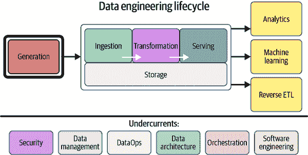

随着数据的激增，特别是随着数据共享的兴起（将在下文讨论），我们预计数据工程师的角色将发生重大转变，更多地转向理解数据源与数据目的地之间的相互作用。数据工程的基本管道任务——将数据从 A 点移动到 B 点——将大幅简化。另一方面，理解数据在源系统中创建时的本质仍然至关重要。

## 数据来源：数据是如何创建的？

当你了解生成数据的各种系统的底层运营模式时，理解数据是如何被创建的至关重要。数据是一组无序的、无上下文的事实和数字。它可以通过多种方式创建，无论是模拟还是数字。

*模拟数据* 创建发生在现实世界中，例如语音、手语、纸上书写或演奏乐器。这种模拟数据通常是瞬态的；你有多少次进行过口头交谈，其内容在交谈结束后就随风而逝？

*数字数据* 要么是通过将模拟数据转换为数字形式而创建，要么是数字系统的原生产物。模拟转数字的一个例子是手机短信应用将模拟语音转换为数字文本。数字数据创建的一个例子是电商平台上的信用卡交易。客户下单，交易记入其信用卡，交易信息被保存到各个数据库中。

在本章中，我们将利用一些常见示例，例如与网站或移动应用交互时创建的数据。但事实上，数据无处不在。我们从物联网设备、信用卡终端、望远镜传感器、股票交易等捕获数据。

熟悉你的源系统及其生成数据的方式。花精力阅读源系统文档，了解其模式和怪癖。如果你的源系统是 RDBMS，了解其运作方式（写入、提交、查询等）；深入了解可能影响你从中摄取数据的源系统细节。

## 源系统：核心概念

源系统以多种方式生成数据。本节讨论你在使用源系统时将频繁遇到的核心概念。

### 文件和非结构化数据

*文件* 是字节序列，通常存储在磁盘上。应用程序经常将数据写入文件。文件可能存储本地参数、事件、日志、图像和音频。

此外，文件是数据交换的通用媒介。尽管数据工程师希望能以编程方式获取数据，但世界上仍有大量数据通过文件发送和接收。例如，如果你从政府机构获取数据，极有可能你会以 Excel 或 CSV 文件的形式下载数据，或通过电子邮件接收文件。

作为数据工程师，你将遇到的主要源文件格式——无论是手动创建还是作为源系统进程的输出——包括 Excel、CSV、TXT、JSON 和 XML。这些文件各有怪癖，可以是结构化的（Excel、CSV）、半结构化的（JSON、XML、CSV）或非结构化的（TXT、CSV）。虽然作为数据工程师你会大量使用特定格式（如 Parquet、ORC 和 Avro），但我们稍后会介绍这些，这里重点关注源系统文件。第 6 章 涵盖文件的技术细节。

### API

*应用程序编程接口* (API) 是系统间交换数据的标准方式。理论上，API 简化了数据工程师的数据摄取任务。实际上，许多 API 仍然暴露出大量数据复杂性供工程师管理。即使随着各种服务、框架以及用于自动化 API 数据摄取的服务的兴起，数据工程师往往仍需投入大量精力来维护自定义 API 连接。我们将在本章后面更详细地讨论 API。

### 应用数据库（OLTP 系统）

*应用数据库* 存储应用程序的状态。一个标准示例是存储银行账户余额的数据库。随着客户交易和付款的发生，应用程序更新银行账户余额。

通常，应用数据库是*联机事务处理* (OLTP) 系统——一种以高速率读写单个数据记录的数据库。OLTP 系统常被称为*事务型数据库*，但这并不一定意味着相关系统支持*原子事务*。

更广泛地说，OLTP 数据库支持低延迟和高并发。RDBMS 数据库可以在不到一毫秒的时间内选择或更新一行（不计网络延迟），并每秒处理数千次读写。文档数据库集群可以管理更高的文档提交率，但以潜在的不一致性为代价。一些图数据库也可以处理事务型用例。


## OLTP 数据库

从根本上说，当成千上万甚至数百万用户可能同时与应用程序交互、并发更新和写入数据时，OLTP 数据库作为应用程序后端工作良好。OLTP 系统不太适合由大规模分析驱动的用例，在这些场景中，单个查询必须扫描大量数据。

### ACID

对原子事务的支持是被称为 ACID 的一组关键数据库特性之一（正如你可能从 第 3 章 回忆的那样，这代表 *原子性、一致性、隔离性、持久性*）。*一致性* 意味着任何数据库读取都将返回检索项的最后写入版本。*隔离性* 意味着如果同一事物有两个更新在并发进行，最终数据库状态将与按提交顺序依次执行这些更新的结果一致。*持久性* 表示已提交的数据永远不会丢失，即使在断电的情况下也是如此。

请注意，支持应用程序后端并不要求具备 ACID 特性，放宽这些约束可以显著提升性能和规模。然而，ACID 特性保证数据库将维护一个一致的世界图景，从而极大地简化了应用程序开发人员的任务。

所有工程师（无论是数据工程师还是其他）都必须理解在有和没有 ACID 的情况下进行操作。例如，为了提高性能，一些分布式数据库使用宽松的一致性约束，如 *最终一致性*，来提高性能。了解你正在使用的一致性模型有助于你防止灾难发生。

### 原子事务

*原子事务* 是作为一个单元提交的一组多个更改。在 图 5-2 的示例中，运行在 RDBMS 上的传统银行应用程序执行一条 SQL 语句，检查两个账户余额，一个在账户 A（来源），另一个在账户 B（目标）。如果账户 A 中有足够资金，则将资金从账户 A 转移到账户 B。整个事务应同时更新两个账户余额，或者在不更新任何一个账户余额的情况下失败。也就是说，整个操作应作为一个 *事务* 发生。

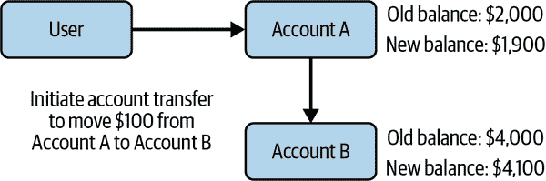

### OLTP 和分析

通常，小公司直接在 OLTP 上运行分析。这种模式在短期内有效，但最终无法扩展。在某个时刻，由于 OLTP 的结构性限制或与竞争性事务工作负载的资源争用，在 OLTP 上运行分析查询会遇到性能问题。数据工程师必须了解 OLTP 和应用程序后端的内部工作原理，以便与分析系统建立适当的集成，而不会降低生产应用程序的性能。

随着公司在 SaaS 应用程序中提供更多分析功能，对混合能力（快速更新结合分析能力）的需求给数据工程师带来了新的挑战。我们将使用术语 *数据应用* 来指代混合了事务和分析工作负载的应用程序。

## 在线分析处理系统

与 OLTP 系统相反，*在线分析处理* (OLAP) 系统旨在运行大规模分析查询，通常不擅长处理单个记录的查找。例如，现代列式数据库经过优化以扫描大量数据，省去了索引以提高可扩展性和扫描性能。任何查询通常涉及扫描最小数据块，通常大小为 100 MB 或更大。除非结合为此用例设计的缓存层，否则尝试在这样的系统中每秒查找数千个单独项目将使其不堪重负。

请注意，我们使用术语 *OLAP* 来指代任何支持大规模交互式分析查询的数据库系统；我们不将自己局限于支持 OLAP 立方体（多维数据数组）的系统。OLAP 中的 *online* 部分意味着系统持续监听传入的查询，使 OLAP 系统适合交互式分析。

虽然本章涵盖源系统，但 OLAP 通常是用于分析的存储和查询系统。为什么我们要在源系统章节中讨论它们？在实际用例中，工程师经常需要从 OLAP 系统读取数据。例如，数据仓库可能提供用于训练机器学习模型的数据。或者，OLAP 系统可能服务于反向 ETL 工作流，其中分析系统中的衍生数据被发送回源系统，如 CRM、SaaS 平台或事务应用程序。

## 变更数据捕获

*变更数据捕获* (CDC) 是一种提取数据库中发生的每个更改事件（插入、更新、删除）的方法。CDC 经常被用于近实时地在数据库之间复制数据，或为下游处理创建事件流。

根据数据库技术的不同，CDC 的处理方式也不同。关系型数据库通常直接在数据库服务器上生成事件日志，该日志可被处理以创建流。（参见 “数据库日志”。）许多云原生 NoSQL 数据库可以将日志或事件流发送到目标存储位置。

## 日志

*日志* 记录系统中发生的事件信息。例如，日志可能记录 Web 服务器上的流量和使用模式。你的台式计算机操作系统（Windows、macOS、Linux）在系统启动以及应用程序启动或崩溃时记录事件。

日志是丰富的数据源，对下游数据分析、机器学习和自动化具有潜在价值。以下是几个常见的日志来源：

- 操作系统
- 应用程序
- 服务器
- 容器
- 网络
- 物联网设备

所有日志都跟踪事件和事件元数据。至少，日志应捕获谁、什么和何时：

**谁**
: 与事件关联的人员、系统或服务账户（例如，Web 浏览器用户代理或用户 ID）

**发生了什么**
: 事件及相关元数据

**何时**
: 事件的时间戳

### 日志编码

日志有几种编码方式：

**二进制编码日志**
: 这些以自定义紧凑格式编码数据，以提高空间效率和快速 I/O。“数据库日志” 中讨论的数据库日志是一个标准示例。

**半结构化日志**
: 这些以文本形式按对象序列化格式编码（通常是 JSON）。半结构化日志可被机器读取且可移植。然而，它们的效率远低于二进制日志。虽然它们名义上可被机器读取，但从中提取价值通常需要大量自定义代码。

**纯文本（非结构化）日志**
: 这些本质上存储软件的控制台输出。因此，不存在通用标准。这些日志可为数据科学家和机器学习工程师提供有用信息，尽管从原始文本数据中提取有用信息可能很复杂。

### 日志分辨率

日志以各种分辨率和日志级别创建。日志 *分辨率* 指日志中捕获的事件数据量。例如，数据库日志从数据库事件中捕获足够的信息，以允许在任何时间点重建数据库状态。

另一方面，为大数据系统在日志中捕获所有数据变更通常不切实际。相反，这些日志可能仅记录发生了特定类型的提交事件。*日志级别* 指记录日志条件所需的条件，具体涉及错误和调试。软件通常可配置为记录每个事件或仅记录错误。

### 日志延迟：批量或实时

批量日志通常连续写入文件。对于实时应用程序，单个日志条目可以写入 Kafka 或 Pulsar 等消息系统。

## 数据库日志


# 数据库日志

*数据库日志*至关重要，值得更详细的介绍。预写日志——通常是以特定数据库原生格式存储的二进制文件——在数据库保证和可恢复性方面发挥着关键作用。数据库服务器接收针对数据库表的写入和更新请求（参见图 5-3），在确认请求之前将每个操作存储在日志中。确认附带一项与日志相关的保证：即使服务器发生故障，它也可以在重启时通过从日志完成未完成的工作来恢复其状态。

数据库日志在数据工程中极其有用，特别是用于 CDC 从数据库变更生成事件流。

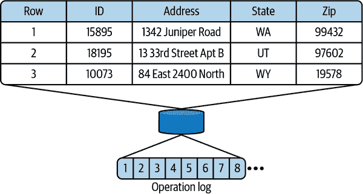

## CRUD

*CRUD* 代表 *create*（创建）、*read*（读取）、*update*（更新）和 *delete*（删除），是编程中常用的事务模式，代表持久化存储的四种基本操作。CRUD 是在数据库中存储应用程序状态的最常用模式。CRUD 的一个基本原则是数据必须在使用前创建。数据创建后，可以被读取和更新。最后，数据可能需要被销毁。CRUD 保证这四种操作将在数据上发生，无论其存储方式如何。

CRUD 是软件应用中广泛使用的模式，你常会在 API 和数据库中发现 CRUD 的身影。例如，Web 应用程序将大量使用 CRUD 进行 RESTful HTTP 请求，以及从数据库存储和检索数据。

与任何数据库一样，我们可以使用基于快照的提取，从应用程序应用 CRUD 操作的数据库中获取数据。另一方面，结合 CDC 的事件提取为我们提供了完整的操作历史，并可能实现近实时分析。

## 仅插入模式

*仅插入模式*直接在包含数据的表中保留历史记录。不是更新记录，而是插入带有指示创建时间的时间戳的新记录（表 5-1）。例如，假设你有一张客户地址表。按照 CRUD 模式，如果客户更改地址，你只需更新该记录。采用仅插入模式，会插入一条具有相同客户 ID 的新地址记录。要按客户 ID 读取当前客户地址，你需要查找该 ID 下的最新记录。

表 5-1. 仅插入模式生成记录的多个版本

| Record ID | Value | Timestamp |
| --- | --- | --- |
| 1 | 40 | 2021-09-19T00:10:23+00:00 |
| 1 | 51 | 2021-09-30T00:12:00+00:00 |

在某种意义上，仅插入模式直接在表本身中维护数据库日志，如果应用程序需要访问历史记录，这将特别有用。例如，仅插入模式非常适合旨在展示客户地址历史的银行应用程序。

单独的分析仅插入模式常与常规 CRUD 应用程序表一起使用。在仅插入 ETL 模式中，每当 CRUD 表中发生更新时，数据管道都会在目标分析表中插入一条新记录。

仅插入模式有几个缺点。首先，表可能变得非常大，特别是当数据频繁变更时，因为每次变更都会插入表中。有时会根据记录过期日期或最大记录版本数清除记录，以保持表大小合理。第二个缺点是记录查找会产生额外开销，因为查找当前状态涉及运行 `MAX​(cre⁠ated_timestamp)`。如果单个 ID 下有数百或数千条记录，此查找操作的运行成本很高。

## 消息与流

与事件驱动架构相关，两个经常互换使用的术语是 *message queue*（消息队列）和 *streaming platform*（流平台），但两者之间存在微妙但本质的区别。定义和对比这些术语很有价值，因为它们涵盖了与源系统相关的许多核心理念，以及贯穿整个数据工程生命周期的实践和技术。

*消息*是在两个或多个系统之间通信的原始数据（图 5-4）。例如，我们有系统 1 和系统 2，系统 1 向系统 2 发送一条消息。这些系统可以是不同的微服务、发送消息给无服务器函数的服务器等。消息通常通过 *message queue*（消息队列）从发布者发送给消费者，一旦消息投递成功，就会从队列中移除。

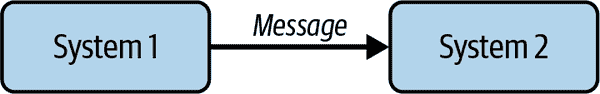

消息是事件驱动系统中离散的、单一的信号。例如，物联网设备可能会将包含最新温度读数的消息发送到消息队列。该消息随后被一个服务摄入，该服务决定是开启还是关闭炉子。该服务向炉子控制器发送一条消息，后者采取相应行动。一旦消息被接收并采取行动，消息就会从消息队列中移除。

相比之下，*stream*（流）是事件记录的仅追加日志。（流被摄入并存储在 *event-streaming platforms*（事件流平台）中，我们将在“消息与流”中更详细地讨论。）随着事件发生，它们按有序序列累积（图 5-5）；事件可能按时间戳或 ID 排序。（注意，由于分布式系统的微妙性，事件并不总是按精确顺序投递。）

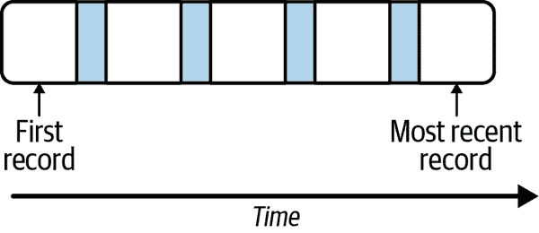

当你关心多个事件中发生了什么时，你会使用流。由于流的仅追加特性，流中的记录会在较长的保留窗口（通常为数周或数月）内持久化，从而允许对记录进行复杂操作，例如跨多条记录的聚合，或倒带至流中的某个时间点的能力。

值得注意的处理流的系统也可以处理消息，流平台常用于消息传递。当我们想要执行消息分析时，经常会在流中累积消息。在我们的物联网示例中，触发炉子开关的温度读数稍后也可能被分析，以确定温度趋势和统计数据。

## 时间类型

虽然时间是所有数据摄入的重要考量因素，但在流处理场景下，它变得更为关键和微妙，因为我们将数据视为连续的，并期望在数据生成后不久就消费它。让我们看看摄入数据时会遇到的关键时间类型：事件生成的时间、摄入和处理的时间，以及处理耗时（图 5-6）。

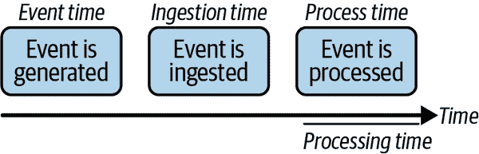

*事件时间* 表示事件在源系统中生成的时间，包括原始事件本身的时间戳。事件创建后，在事件被摄入并下游处理之前，会发生不确定的时间滞后。始终为事件经历的每个阶段包含时间戳。在事件发生时及每个时间阶段（创建、摄入、处理时）记录事件日志。使用这些时间戳日志准确追踪数据在数据管道中的流动。

数据创建后，会被摄入到某处。*摄入时间* 表示事件从源系统摄入到消息队列、缓存、内存、对象存储、数据库或存储数据的任何其他位置的时间（参见第 6 章）。摄入后，数据可能会立即处理；或在几分钟、几小时、几天内处理；或仅在存储中无限期持久化。


*处理时间*发生在摄入时间之后，即数据被处理时（通常指转换）。*处理时长*是指处理数据所花费的时间，以秒、分钟、小时等为单位衡量。

你需要记录这些各类时间，最好以自动化方式记录。在数据工作流中设置监控，以捕获事件发生的时间、摄入和处理的时间，以及处理事件所花费的时长。

# 源系统实用细节

本节讨论与现代源系统交互的实用细节。我们将深入探讨常见数据库、API 和其他方面的细节。这些信息的有效期比前文讨论的主要观点要短；流行的 API 框架、数据库和其他细节将继续快速变化。

尽管如此，这些细节是一线数据工程师的关键知识。我们建议你将这些信息作为基础知识学习，但要广泛阅读以紧跟最新发展。

## 数据库

在本节中，我们将介绍作为数据工程师你会遇到的常见源系统数据库技术，以及使用这些系统的高层级考量因素。数据库的类型多种多样，正如数据的用例一样。

### 理解数据库技术的主要考量因素

这里介绍跨多种数据库技术的主要概念，包括支撑软件应用的数据库和支持分析用例的数据库：

**数据库管理系统**：用于存储和提供数据的数据库系统。缩写为 DBMS，它由存储引擎、查询优化器、灾难恢复以及用于管理数据库系统的其他关键组件组成。

**查找**：数据库如何查找和检索数据？索引可以加快查找速度，但并非所有数据库都有索引。了解你的数据库是否使用索引；如果使用，设计和维护它们的最佳模式是什么？理解如何利用它们进行高效提取。了解主要索引类型（包括 B 树和日志结构合并树 (LSM)）的基础知识也很有帮助。

**查询优化器**：数据库是否使用优化器？其特点是什么？

**扩展与分布**：数据库是否随需求扩展？采用何种扩展策略？是横向扩展（更多数据库节点）还是纵向扩展（单机资源更多）？

**建模模式**：哪种建模模式最适合该数据库（例如数据规范化或宽表）？（参见第 8 章中关于数据建模的讨论。）

**CRUD**：数据在数据库中如何被查询、创建、更新和删除？每种类型的数据库处理 CRUD 操作的方式都不同。

**一致性**：数据库是完全一致的，还是支持宽松的一致性模型（例如最终一致性）？数据库是否支持读写的可选一致性模式（例如强一致性读取）？

我们将数据库分为关系型和非关系型两大类。事实上，非关系型类别要多样化得多，但关系型数据库在应用后端中仍占据重要地位。

### 关系型数据库

*关系型数据库管理系统* (RDBMS) 是最常见的应用后端之一。关系型数据库于 20 世纪 70 年代在 IBM 开发，于 20 世纪 80 年代由 Oracle 推广普及。互联网的增长带来了 LAMP 技术栈（Linux、Apache Web 服务器、MySQL、PHP）的兴起，以及商业和开源 RDBMS 选项的爆发式增长。即使随着 NoSQL 数据库的兴起（见下一节），关系型数据库依然极其流行。

数据存储在*关系*（行）表中，每个关系包含多个*字段*（列）；参见图 5-7。注意，我们在全书中交替使用*列*和*字段*这两个术语。表中的每个关系都具有相同的*模式*（一系列分配了静态类型的列，如字符串、整数或浮点数）。行通常在磁盘上作为连续的字节序列存储。

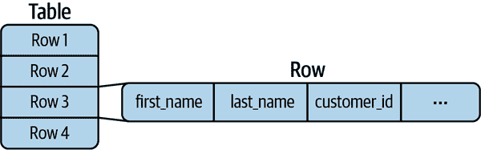

表通常由*主键*索引，主键是表中每行的唯一字段。主键的索引策略与表在磁盘上的布局密切相关。

表也可以有各种*外键*——其值与其他表中主键的值相关联的字段，这便于连接操作，并允许将数据分布在多个表中的复杂模式。特别是，可以设计*规范化模式*。规范化是一种策略，旨在确保记录中的数据不在多处重复，从而避免一次性在多个位置更新状态并防止不一致（参见第 8 章）。

RDBMS 系统通常符合 ACID 原则。规范化模式、ACID 合规性和对高事务率的支持相结合，使关系型数据库系统成为存储快速变化的应用状态的理想选择。数据工程师的挑战在于确定如何随时间捕获状态信息。

全面讨论 RDBMS 的理论、历史和技术超出了本书的范围。我们鼓励你学习 RDBMS 系统、关系代数和规范化策略，因为它们广泛存在，你会频繁遇到它们。参见“附加资源”获取推荐书籍。

### 非关系型数据库：NoSQL

虽然关系型数据库适用于许多用例，但它们并非万能解决方案。我们经常看到人们从关系型数据库入手，误以为它是通用工具，便强行塞入大量用例和工作负载。随着数据和查询需求的演变，关系型数据库在重压下不堪重负。此时，你需要使用适合特定高压工作负载的数据库。非关系型或 NoSQL 数据库应运而生。*NoSQL* 代表*不仅仅是 SQL*，指代一整类摒弃关系范式的数据库。

一方面，摒弃关系约束可以提高性能、可扩展性和模式灵活性。但正如架构设计中永远存在的那样，权衡无处不在。NoSQL 数据库通常也会放弃各种 RDBMS 特性，如强一致性、连接操作或固定模式。

本书的一个主要主题是数据创新层出不穷。让我们快速回顾一下 NoSQL 的历史，这有助于理解数据创新为何以及如何影响你作为数据工程师的工作。21 世纪初，Google 和 Amazon 等科技公司的业务规模超出了其关系型数据库的承载能力，它们开创了新的分布式非关系型数据库来扩展其 Web 平台。

虽然 *NoSQL* 一词最早出现于 1998 年，但其现代含义是由 Eric Evans 在 21 世纪初提出的。^(1) 他在一篇[2009 博客文章](https://oreil.ly/LOYbo)中讲述了这段故事：

> 我在 [nosqleast](https://oreil.ly/6xN5Y) 待了过去几天，这里的热门话题之一是“nosql”这个名字。可以理解的是，许多人担心这个名字不好，会传递出不恰当或不准确的信息。虽然我不对这个主意声称所有权，但我确实得为现在的叫法承担一些责任。怎么个说法呢？Johan Oskarsson 正在组织第一次聚会，在 IRC 上问“大家觉得叫什么好？”；那是我在那 45 秒左右脱口而出的三四个建议之一，当时没多想。


# NoSQL

然而，我的遗憾不在于这个名字说了什么；而在于它没说什么。当 Johan 最初提出第一次聚会的想法时，他似乎想说……

当然，键值存储也可服务于需要高持久性持久化的应用程序。电商应用程序可能需要为用户及其订单保存和更新海量的 `event state changes`。用户登录电商应用程序，点击浏览各个页面，将商品加入购物车，然后结账。每个事件都必须持久存储以便检索。键值存储通常将数据持久化到磁盘并跨多个节点复制，以支持此类用例。

### 文档存储

如前所述，*文档存储*是一种专门的键值存储。在此语境下，*文档*是一个嵌套对象；出于实际目的，我们通常可以将每个文档视为一个 `JSON` 对象。文档存储在集合中，并通过键检索。*集合*大致相当于关系型数据库中的表（见表 5-2）。

**表 5-2. RDBMS 与文档术语对比**

| RDBMS | 文档数据库 |
| --- | --- |
| 表 | 集合 |
| 行 | 文档、项、实体 |

关系型数据库和文档存储的一个关键区别在于，后者不支持连接操作。这意味着数据无法轻易*规范化*，即拆分到多个表中。（应用程序仍可手动连接。代码可以查找一个文档，提取一个属性，然后检索另一个文档。）理想情况下，所有相关数据可存储在同一个文档中。

在许多情况下，相同的数据必须存储在分布于众多集合中的多个文档里；软件工程师必须小心地更新该属性在所有存储位置的值。（许多文档存储支持事务概念以便于此操作。）

文档数据库通常完全拥抱 `JSON` 的灵活性，不强制执行模式或类型；这是福也是祸。一方面，这使得模式高度灵活且富有表现力。模式也可随应用程序增长而演进。另一方面，我们见过文档数据库变成管理和查询的绝对噩梦。如果开发人员不小心管理模式演进，数据可能会随时间变得不一致且膨胀。如果模式演进未在部署前及时沟通，还可能破坏下游摄取，给数据工程师带来麻烦。

以下是存储在名为 `users` 的集合中的数据示例。集合键为 `id`。每个文档中还包含一个 `name`（以及作为子元素的 `first` 和 `last`）和一个用户喜爱的乐队数组：

```json
{
  "users": [
    {
      "id": 1234,
      "name": {
        "first": "Joe",
        "last": "Reis"
      },
      "favorite_bands": [
        "AC/DC",
        "Slayer",
        "WuTang Clan",
        "Action Bronson"
      ]
    },
    {
      "id": 1235,
      "name": {
        "first": "Matt",
        "last": "Housley"
      },
      "favorite_bands": [
        "Dave Matthews Band",
        "Creed",
        "Nickelback"
      ]
    }
  ]
}
```

要查询此示例中的数据，可以通过键检索记录。请注意，大多数文档数据库还支持创建索引和查找表，以允许通过特定属性检索文档。在应用程序开发中，当你需要以各种方式搜索文档时，这通常非常宝贵。例如，你可以在 `name` 上设置索引。

对数据工程师而言，另一个关键技术细节是文档存储通常不符合 ACID 原则，这与关系型数据库不同。精通特定文档存储的技术专长对于理解性能、调优、配置、对写入、一致性、持久性等的相关影响至关重要。例如，许多文档存储是*最终一致*的。允许数据跨集群分布有利于扩展和性能，但如果工程师和开发人员不理解其影响，可能会导致灾难。

要在文档存储上运行分析，工程师通常必须执行全量扫描以从集合中提取所有数据，或采用 CDC 策略将事件发送到目标流。全量扫描方法可能同时带来性能和成本影响。扫描运行时往往会拖慢数据库，许多无服务器云产品对每次全量扫描收取高额费用。在文档数据库中，创建索引通常有助于加快查询速度。我们将在第 8 章讨论索引和查询模式。

### 宽列

*宽列数据库*针对存储海量数据、高事务率和极低延迟进行了优化。这些数据库可扩展至极高的写入速率和海量数据。具体而言，宽列数据库可支持 PB 级数据、每秒百万级请求和 10 毫秒以下的延迟。这些特性使宽列数据库在电商、金融科技、广告技术、物联网和实时个性化应用中广受欢迎。数据工程师必须了解所用宽列数据库的运行特性，以设置合适的配置、设计模式、选择合适的行键，从而优化性能并避免常见运维问题。

这些数据库支持海量数据的快速扫描，但不支持复杂查询。它们仅有一个索引（行键）用于查找。数据工程师通常必须提取数据并发送到辅助分析系统，以运行复杂查询来应对这些限制。这可以通过运行大规模扫描进行提取，或采用 CDC 捕获事件流来实现。

### 图数据库


# 图数据库

*图数据库* 以数学图结构（作为节点和边的集合）显式存储数据。^(3) `Neo4j` 已被证明极受欢迎，而 `Amazon`、`Oracle` 和其他供应商也提供其图数据库产品。粗略地说，当您想要分析元素之间的连通性时，图数据库是一个不错的选择。

例如，您可以使用文档数据库为每个用户存储一份描述其属性的文档。您可以添加一个名为 *connections* 的数组元素，其中包含社交媒体语境下直接相连用户的 ID。要确定用户拥有多少直接连接非常容易，但假设您想知道通过遍历两次直接连接可以到达多少用户。您可以通过编写复杂的代码来回答这个问题，但每次查询都会运行缓慢并消耗大量资源。文档存储根本未针对这种用例进行优化。

图数据库正是为这种类型的查询而设计的。它们的数据结构允许基于元素间连通性的查询；当我们关心理解元素间复杂的遍历时，图数据库是首选。用图的术语来说，我们存储 *节点*（前例中的用户）和 *边*（用户之间的连接）。图数据库支持节点和边丰富的数据模型。根据底层图数据库引擎的不同，图数据库会使用专门的查询语言，如 `SPARQL`、`资源描述框架 (RDF)`、`图查询语言 (GQL)` 和 `Cypher`。

作为图的一个示例，考虑一个包含四个用户的网络。用户 1 关注用户 2，用户 2 关注用户 3 和用户 4；用户 3 也关注用户 4（图 5-8）。

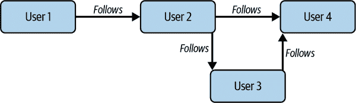

我们预计图数据库应用将在科技公司之外大幅增长；市场分析也预测将快速增长。^(4) 当然，从运维角度来看，图数据库是有益的，并支持现代应用至关重要的复杂社交关系。从数据科学和机器学习的角度来看，图结构也令人着迷，可能揭示人类互动和行为的深层见解。

这给可能更习惯处理结构化关系、文档或非结构化数据的数据工程师带来了独特的挑战。工程师必须选择是否执行以下操作：

- 将源系统图数据映射到他们现有的首选范式之一中
- 在源系统内部直接分析图数据
- 采用特定于图的分析工具

图数据可以重新编码为关系数据库中的行，这可能是一个合适的解决方案，具体取决于分析用例。事务型图数据库也为分析而设计，尽管大型查询可能会使生产系统过载。现代基于云的图数据库支持在海量数据上进行读密集型图分析。

## 搜索

*搜索数据库* 是一种非关系型数据库，用于搜索数据复杂且直接的语义和结构特征。搜索数据库有两个突出的用例：文本搜索和日志分析。让我们分别介绍它们。

*文本搜索* 涉及在文本主体中搜索关键词或短语，匹配精确、模糊或语义相似的匹配项。*日志分析* 通常用于异常检测、实时监控、安全分析和运维分析。通过使用索引，查询可以被优化并加速。

根据您所在公司的类型，您可能会定期使用搜索数据库，也可能完全不使用。无论如何，了解它们的存在总是好的，以防您在实际工作中遇到它们。搜索数据库因快速搜索和检索而流行，可在各种应用中找到；电商网站可能使用搜索数据库为其产品搜索提供支持。作为数据工程师，您可能需要将数据从搜索数据库（如 `Elasticsearch`、`Apache Solr`、`Lucene` 或 `Algolia`）引入下游 `KPI` 报表或类似系统中。

## 时间序列

*时间序列* 是按时间组织的一系列值。例如，股票价格可能随着交易在一天中执行而变动，或者气象传感器每分钟采集一次大气温度。任何随时间记录的事件——无论是定期还是零星的——都是时间序列数据。*时间序列数据库* 针对时间序列数据的检索和统计处理进行了优化。

虽然订单、发货、日志等时间序列数据已经在关系数据库中存储了很长时间，但这些数据规模和体量通常很小。随着数据增长得更快、更大，需要新的专用数据库。时间序列数据库解决了来自 `IoT`、事件和应用日志、广告技术和金融科技等众多用例中不断增长的高速数据量的需求。这些工作负载通常是写密集型的。因此，时间序列数据库通常利用内存缓冲来支持快速写入和读取。

我们应该区分时间序列数据库中常见的测量数据和事件数据。*测量数据* 定期生成，例如温度或空气质量传感器。*事件数据* 是不规则的，每次事件发生时创建——例如，当运动传感器检测到移动时。

时间序列的模式通常包含一个时间戳和一小组字段。因为数据是时间相关的，所以数据按时间戳排序。这使得时间序列数据库适合运维分析，但不太适合 `BI` 用例。连接操作不常见，尽管一些准时间序列数据库（如 `Apache Druid`）支持连接。有许多时间序列数据库可用，既有开源选项也有付费选项。

# API

`API` 现在是云中、`SaaS` 平台以及内部公司系统之间交换数据的标准且普遍的方式。Web 上存在许多类型的 `API` 接口，但我们主要关注围绕 `HTTP` 构建的接口，这是 Web 和云中最流行的类型。

## REST

我们首先讨论 `REST`，目前占主导地位的 `API` 范式。正如 第 4 章 所述，*REST* 代表 *表述性状态传递*。这套用于构建 `HTTP` Web `API` 的实践和理念由 Roy Fielding 于 2000 年在博士论文中提出。`REST` 围绕 `HTTP` 动词构建，如 `GET` 和 `PUT`；在实践中，现代 `REST` 仅使用原始论文中概述的少量动词映射。

`REST` 的主要思想之一是交互是无状态的。与 `Linux` 终端会话不同，不存在具有关联状态变量（如工作目录）的会话概念；每个 `REST` 调用都是独立的。`REST` 调用可以改变系统状态，但这些更改是全局的，适用于整个系统，而非当前会话。

批评者指出，`REST` 绝不是一个完整的规范。^(5) `REST` 规定了交互的基本属性，但利用 `API` 的开发人员必须获得大量领域知识，才能有效地构建应用程序或提取数据。

我们看到 `API` 抽象层级差异很大。在某些情况下，`API` 仅仅是内部系统的一个薄包装器，提供保护系统免受用户请求影响所需的最低限度功能。在其他示例中，`REST` 数据 `API` 是工程杰作，可为分析应用准备数据并支持高级报表。


一些发展简化了从 `REST APIs` 设置数据摄取管道的过程。首先，数据提供方经常用各种语言（尤其是 `Python`）提供客户端库。客户端库消除了构建 `API` 交互代码所需的大量样板劳动。客户端库处理认证等关键细节，并将基本方法映射为可访问的类。

其次，各种服务和开源库应运而生，用于与 `APIs` 交互并管理数据同步。许多 `SaaS` 和开源供应商为常见的 `APIs` 提供开箱即用的连接器。平台也简化了根据需要构建自定义连接器的过程。

有许多数据 `APIs` 没有客户端库或开箱即用的连接器支持。正如我们在全书中强调的，工程师最好利用现成工具减少无差异的繁重劳动。然而，底层 `plumbing`（管道/基础设施）任务仍然消耗大量资源。在几乎任何大型公司，数据工程师都需要处理编写和维护自定义代码以从 `APIs` 拉取数据的问题，这要求理解所提供数据的结构、开发适当的数据提取代码，并确定合适的数据同步策略。

## GraphQL

`GraphQL` 由 Facebook 创建，作为应用程序数据的查询语言和通用 `REST APIs` 的替代方案。`REST APIs` 通常将查询限制在特定数据模型上，而 `GraphQL` 则开启了在单个请求中检索多数据模型的可能性。这比 `REST` 允许更灵活、更具表现力的查询。`GraphQL` 围绕 `JSON` 构建，并以类似 `JSON` 查询的形状返回数据。

`REST` 和 `GraphQL` 之间存在某种“圣战”，一些工程团队是一方的拥护者，一些则两者兼用。实际上，工程师在与源系统交互时将会遇到这两者。

## Webhooks

`Webhooks` 是一种简单的基于事件的数据传输模式。数据源可以是应用程序后端、网页或移动应用。当源系统中发生指定事件时，这会触发对数据消费方托管的 `HTTP` 端点的调用。请注意，连接方向是从源系统到数据接收端，这与典型 `APIs` 的方向相反。因此，webhooks 通常被称为 `reverse APIs`（反向 API）。

端点可以对 `POST` 事件数据执行各种操作，可能触发下游流程或存储数据以供将来使用。出于分析目的，我们有兴趣收集这些事件。工程师通常使用消息队列以高速度和大吞吐量摄取数据。我们将在本章后面讨论消息队列和事件流。

## RPC 和 gRPC

`remote procedure call`（`RPC`，远程过程调用）常用于分布式计算。它允许你在远程系统上运行一个过程。

`gRPC` 是 Google 于 2015 年内部开发的远程过程调用库，后来作为开放标准发布。仅凭其在 Google 的应用就足以让它列入我们的讨论范围。许多 Google 服务（如 `Google Ads` 和 `GCP`）提供 `gRPC APIs`。`gRPC` 围绕 `Protocol Buffers` 开放数据序列化标准构建，该标准也由 Google 开发。

`gRPC` 强调基于 `HTTP/2` 的高效双向数据交换。“高效”指的是 CPU 利用率、功耗、电池寿命和带宽等方面。与 `GraphQL` 一样，`gRPC` 比 `REST` 施加了更具体的技术标准，从而允许使用通用客户端库，并让工程师开发一套适用于任何 `gRPC` 交互代码的技能。

## 数据共享

云数据共享的核心概念是多租户系统支持在租户间共享数据的安全策略。具体来说，任何具有细粒度权限系统的公共云对象存储系统都可以作为数据共享的平台。流行的云数据仓库平台也支持数据共享功能。当然，数据也可以通过下载或电子邮件交换来共享，但多租户系统让这个过程容易得多。

许多现代共享平台（尤其是云数据仓库）支持行、列和敏感数据过滤。数据共享还简化了 `data marketplace`（数据市场）的概念，后者可在多个流行的云和数据平台上使用。数据市场为数据商业提供了一个中心位置，数据提供方可以在其中宣传和销售其产品，而无需担心管理对数据系统网络访问的细节。

数据共享还可以简化组织内部的数据管道。数据共享允许组织的各个单元管理其数据并有选择地与其他单元共享，同时仍允许各个单元单独管理其计算和查询成本，从而促进数据去中心化。这促进了诸如 `data mesh`（数据网格）之类的去中心化数据管理模式。^(6)

数据共享和数据网格与我们通用架构组件的理念紧密契合。选择通用组件（参见 第 3 章），以实现数据和专业知识的简单高效交换，而不是拥抱最激动人心、最复杂的技术。

## 第三方数据源

技术的消费化意味着每家公司本质上现在都是一家技术公司。其后果是，这些公司（以及越来越多的政府机构）希望将其数据提供给客户和用户，无论是作为其服务的一部分还是作为单独的订阅。例如，美国劳工统计局发布关于美国劳动力市场的各种统计数据。美国国家航空航天局（`NASA`）发布其研究计划的各种数据。Facebook 与在其平台上投放广告的企业共享数据。

为什么公司要提供数据？数据具有粘性，允许用户将应用程序集成并扩展到用户的应用程序中，从而形成一个飞轮效应。更高的用户采用率和使用量意味着更多数据，这意味着用户可以将更多数据集成到他们的应用程序和数据系统中。副作用是现在几乎有无限的第三方数据来源。

直接访问第三方数据通常通过 `APIs`、云平台上的数据共享或数据下载完成。`APIs` 通常提供深度集成能力，允许客户拉取和推送数据。例如，许多 `CRMs` 提供 `APIs`，其用户可将其集成到自己的系统和应用程序中。我们看到一个常见的工作流：从 `CRM` 获取数据，通过客户评分模型融合 `CRM` 数据，然后使用反向 `ETL` 将该数据送回 `CRM`，以便销售人员联系更合格的潜在客户。

## 消息队列和事件流平台

事件驱动架构在软件应用中无处不在，并有望进一步增长其普及度。首先，消息队列和事件流平台——事件驱动架构中的关键层——在云环境中更易于设置和管理。其次，数据应用的兴起——直接集成实时分析的应用程序——正蓬勃发展。事件驱动架构非常适合这种环境，因为事件既可以触发应用程序中的工作，又可以为近实时分析提供数据。


请注意，流式数据（在本例中为消息和流）贯穿数据工程生命周期的许多阶段。与通常直接连接到应用程序的 RDBMS 不同，流式数据的界限有时不那么明确。这些系统被用作源系统，但由于其瞬态特性，它们通常会贯穿数据工程生命周期。例如，你可以使用 `event-streaming platform` 在事件驱动应用程序中进行消息传递，作为源系统。同一个 `event-streaming platform` 也可用于摄入和转换阶段，以处理数据用于实时分析。

作为源系统，消息队列和事件流平台有多种用途，从在微服务之间路由消息，到每秒摄入来自 Web、移动和 IoT 应用程序的数百万事件数据。让我们更仔细地看看消息队列和事件流平台。

### 消息队列

`message queue` 是一种使用发布/订阅模型在离散系统之间异步发送数据（通常作为小的单个消息，大小在千字节级别）的机制。数据被发布到消息队列，并投递给一个或多个订阅者（图 5-9）。订阅者确认收到消息，将其从队列中移除。

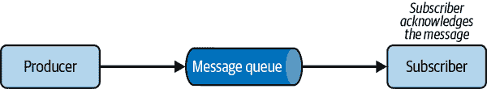

消息队列允许应用程序和系统相互解耦，广泛用于微服务架构。消息队列缓冲消息以应对瞬时负载峰值，并通过带有复制的分布式架构使消息持久化。

消息队列是解耦微服务和事件驱动架构的关键要素。使用消息队列时需要注意的一些事项包括投递频率、消息排序和可扩展性。

#### 消息排序和投递

消息的创建、发送和接收顺序会显著影响下游订阅者。一般来说，分布式消息队列中的顺序是一个棘手的问题。消息队列通常应用一种模糊的顺序概念和先进先出（FIFO）。严格 FIFO 意味着如果消息 A 在消息 B 之前被摄入，则消息 A 将始终在消息 B 之前被投递。在实践中，消息可能会乱序发布和接收，尤其是在高度分布式的消息系统中。

例如，Amazon SQS [标准队列](https://oreil.ly/r4lsy) 会尽最大努力保持消息顺序。SQS 还提供 [FIFO 队列](https://oreil.ly/8PPne)，以额外开销为代价提供更强的保证。

一般来说，除非你的消息队列技术保证顺序投递，否则不要假设消息会按顺序投递。你通常需要为乱序消息投递进行设计。

#### 投递频率

消息可以**恰好投递一次**（`exactly once`）或**至少投递一次**（`at least once`）。如果消息是 `exactly once` 发送的，则在订阅者确认消息后，消息消失且不会再次投递。^(7) 发送为 `at least once` 的消息可以被多个订阅者消费，或被同一订阅者多次消费。当重复或冗余不重要时，这非常棒。

理想情况下，系统应该是 `idempotent`（幂等）的。在幂等系统中，处理一条消息一次的结果与处理多次的结果相同。这有助于应对各种微妙场景。例如，即使我们的系统能保证恰好一次投递，消费者可能已完全处理了一条消息，却在确认处理前失败。该消息实际上会被处理两次，但幂等系统能优雅地处理这种情况。

#### 可扩展性

事件驱动应用程序中使用的最流行的消息队列都是水平可扩展的，运行在多台服务器上。这使得这些队列能够动态地扩缩容，在系统落后时缓冲消息，并持久化存储消息以提高抗故障能力。然而，正如前面提到的，这可能会产生各种复杂性（多次投递和模糊排序）。

### 事件流平台

从某种意义上说，`event-streaming platform` 是消息队列的延续，消息从生产者传递给消费者。正如本章前面所述，消息和流的主要区别在于：消息队列主要用于路由消息并提供特定的投递保证。相比之下，`event-streaming platform` 用于以有序记录日志的形式摄入和处理数据。在 `event-streaming platform` 中，数据会保留一段时间，并且可以从过去的某个时间点重放消息。

让我们描述一个与事件流平台相关的事件。正如 第 3 章 所述，事件是“发生的事情，通常是某事物 `state`（状态）的变化”。事件具有以下特征：一个键、一个值和一个时间戳。单个事件中可能包含多个键值时间戳。例如，一个电商订单事件可能如下所示：

```
{
  "Key": "Order # 12345",
  "Value": "SKU 123, purchase price of $100",
  "Timestamp": "2023-01-02 06:01:00"
}
```

#### 主题

在事件流平台中，生产者将事件流式传输到主题，主题是相关事件的集合。例如，一个主题可能包含欺诈警报、客户订单或来自 IoT 设备的温度读数。在大多数事件流平台上，一个主题可以有零个、一个或多个生产者和消费者。

使用前面的事件示例，一个主题可能是 `web orders`。此外，让我们将这个主题发送给几个消费者，例如 `fulfillment`（履约）和 `marketing`（营销）。这是分析与事件驱动系统之间界限模糊的一个绝佳示例。`fulfillment` 订阅者将使用事件触发履约流程，而 `marketing` 运行实时分析或训练和运行 ML 模型以调整营销活动（图 5-10）。

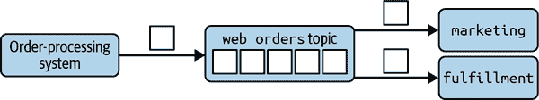

#### 流分区

`Stream partitions` 是将一个流细分为多个流。一个好的类比是多车道高速公路。拥有多条车道允许并行处理和更高的吞吐量。消息通过 `partition key` 分发到各个分区。具有相同 `partition key` 的消息将始终进入同一个分区。

例如在 图 5-11 中，每条消息都有一个数字 ID——显示在代表消息的圆圈内——我们将其用作分区键。为了确定分区，我们除以 3 并取余数。从下到上，分区的余数分别为 0、1 和 2。

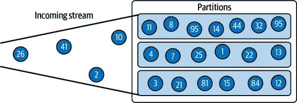

设置分区键，以便应一起处理的消息具有相同的分区键。例如，在 IoT 场景中，通常希望将来自特定设备的所有消息发送到同一处理服务器。我们可以通过使用设备 ID 作为分区键，然后设置一台服务器消费每个分区来实现这一点。

流分区的一个关键问题是确保你的分区键不会产生 `hotspotting`（热点）——即不成比例的大量消息被投递到一个分区。例如，如果每个 IoT 设备已知位于美国的某个特定州，我们可能会使用州作为分区键。考虑到与州人口成比例的设备分布，包含加利福尼亚、德克萨斯、佛罗里达和纽约的分区可能会不堪重负，而其他分区则相对利用不足。确保你的分区键将消息均匀地分布在各个分区中。

#### 故障容错和弹性


事件流平台通常是分布式系统，流存储在各个节点上。如果一个节点宕机，另一个节点会替代它，流仍然可访问。这意味着记录不会丢失；你可以选择删除记录，但那是另一回事。这种容错性和弹性使得流平台成为当你需要一个能够可靠地生成、存储和摄取事件数据的系统时的优秀选择。

# 你将与谁共事

访问源系统时，了解你将与之共事的人至关重要。根据我们的经验，良好的外交手段和与源系统利益相关者的关系是成功数据工程中被低估且至关重要的一部分。

这些利益相关者是谁？通常，你将打交道的利益相关者分为两类：系统利益相关者和数据利益相关者（图 5-12）。*系统利益相关者*构建和维护源系统；他们可能是软件工程师、应用开发人员和第三方。数据利益相关者拥有并控制你想要的数据的访问权，通常由 IT 部门、数据治理小组或第三方处理。系统和数据利益相关者通常是不同的人或团队；有时，他们是同一拨人。

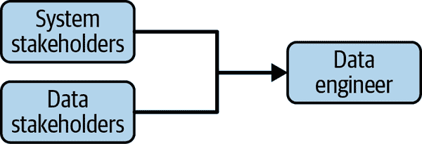

你往往只能听任利益相关者能否遵循正确的软件工程、数据库管理和开发实践。理想情况下，利益相关者正在实施 DevOps 并以敏捷方式工作。我们建议在数据工程师和源系统利益相关者之间建立反馈循环，以提高对数据如何被消费和使用的认知。这是数据工程师能获得巨大价值的最容易被忽视的领域之一。当上游源数据发生变化时——而且一定会发生变化，无论是模式或数据变更、服务器或数据库故障，还是其他重要事件——你都要确保自己知晓这些问题将对你的数据工程系统产生什么影响。

与上游源系统所有者建立数据契约可能会有所帮助。什么是数据契约？James Denmore 给出了如下定义：^(8)

> 数据契约是源系统所有者和从该系统摄取数据用于数据管道的团队之间的书面协议。契约应说明提取什么数据、通过什么方法（全量、增量）、频率如何，以及源系统和摄取方的联系人是谁（个人、团队）。数据契约应存储在众所周知且易于查找的位置，例如 GitHub 仓库或内部文档站点。如果可能，应以标准化格式编写数据契约，以便将其集成到开发流程中或通过编程方式查询。

此外，考虑与上游提供方建立 SLA（服务等级协议）。SLA 规定了你对所依赖的源系统的预期。SLA 的一个例子可能是“源系统的数据将可靠可用且质量高”。服务等级目标（SLO）衡量绩效是否符合 SLA 中约定的内容。例如，基于你的 SLA 示例，SLO 可能是“源系统将拥有 99% 的正常运行时间”。如果数据契约或 SLA/SLO 显得过于正式，至少要口头设定对源系统正常运行时间、数据质量以及其他对你重要事项的保证预期。上游源系统所有者需要了解你的需求，以便为你提供所需的数据。

# 暗流及其对源系统的影响

与数据工程生命周期的其他部分不同，源系统通常不在数据工程师的控制范围内。存在一种隐性假设（有人可能称之为*希望*），即源系统的利益相关者和所有者——以及他们生产的数据——正在遵循关于数据管理、DataOps（和 DevOps）、DODD（第 2 章提到）数据架构、编排和软件工程的最佳实践。数据工程师应争取尽可能多的上游支持，以确保在源系统生成数据时应用这些暗流。这样做将使数据工程生命周期的其余步骤进行得更加顺利。

暗流如何影响源系统？让我们来看看。

## 安全性

安全性至关重要，你最不想做的就是意外在源系统中制造一个漏洞点。以下是一些需要考虑的方面：

*   源系统的架构是否保证数据安全且加密，无论是静态数据还是传输中数据？
*   你是否必须通过公共互联网访问源系统，还是在使用虚拟专用网络 (VPN)？
*   将源系统的密码、令牌和凭证安全地锁好。例如，如果你使用 Secure Shell (SSH) 密钥，请使用密钥管理器保护密钥；同样的规则适用于密码——使用密码管理器或单点登录 (SSO) 提供商。
*   你信任源系统吗？务必做到信任但验证，确认源系统是合法的。你不想成为来自恶意行为者数据的接收端。

## 数据管理

源系统的数据管理对数据工程师来说具有挑战性。在大多数情况下，你对源系统及其生产的数据只有边缘控制权——如果有控制权的话。在可能的范围内，你应该了解源系统中数据的管理方式，因为这将直接影响你如何摄取、存储和转换数据。

以下是一些需要考虑的方面：

数据治理
:   上游数据和系统是否以可靠、易懂的方式进行治理？谁管理数据？

数据质量
:   如何确保上游系统的数据质量和完整性？与源系统团队合作，设定数据和沟通的预期。

模式
:   预期上游模式会发生变化。在可能的情况下，与源系统团队协作，以便在即将发生模式变更时收到通知。

主数据管理
:   上游记录的创建是否由主数据管理实践或系统控制？

隐私与伦理
:   你是否有权访问原始数据，还是数据会被混淆？源数据有何影响？保留多久？是否会根据保留策略转移位置？

法规
:   根据法规，你应该访问这些数据吗？

## DataOps

运维卓越——DevOps、DataOps、MLOps、*X*Ops——应贯穿整个技术栈的上下游，支持数据工程和生命周期。虽然这是理想状态，但往往无法完全实现。

因为你正在与同时控制源系统及其生产数据的利益相关者打交道，你需要确保能够观察和监控源系统的正常运行时间和使用情况，并在事件发生时做出响应。例如，当你依赖的用于 CDC 的应用数据库超出其 I/O 容量并需要重新扩展时，这将如何影响你从该系统接收数据的能力？你能否访问数据，还是必须等到数据库重新扩展完成后才能访问？这将如何影响报表？在另一个例子中，如果软件工程团队在持续部署，代码变更可能导致应用程序本身出现意外故障。该故障将如何影响你访问支撑应用程序的数据库的能力？数据是否会是最新的？


## DataOps 考量

在数据工程团队与支持源系统的团队之间建立清晰的沟通链路。理想情况下，这些利益相关者团队已将 DevOps 融入其工作流与文化中。这将极大地促进 DataOps（DevOps 的“兄弟”）目标的实现，即快速解决并减少错误。正如我们之前提到的，数据工程师需要将自己融入利益相关者的 DevOps 实践中，反之亦然。只有当所有人都参与其中，并专注于让系统整体协同工作时，DataOps 才能成功。

以下是一些 DataOps 考量因素：

### 自动化

存在影响源系统的自动化，例如代码更新和新功能发布。同时也存在你为数据工作流设置的 DataOps 自动化。源系统自动化中的问题是否会影响你的数据工作流自动化？如果会，请考虑对这些系统进行解耦，使它们能够独立执行自动化。

### 可观测性

你如何知道源系统出现了问题，例如停机或数据质量问题？为源系统的正常运行时间设置监控（或使用拥有该源系统的团队创建的监控）。设置检查机制，确保来自源系统的数据符合下游使用的预期。例如，数据质量是否良好？模式是否兼容？客户记录是否一致？数据是否按照内部政策规定进行了哈希处理？

### 事件响应

如果发生严重问题，你的预案是什么？例如，如果源系统离线，你的数据管道将如何表现？源系统恢复在线后，你如何回填“丢失”的数据？

## 数据架构

与数据管理类似，除非你参与源系统架构的设计与维护，否则你对上游源系统架构的影响微乎其微。你也应了解上游架构的设计方式及其优劣势。经常与负责源系统的团队沟通，以了解本节讨论的因素，并确保他们的系统能满足你的预期。了解架构在哪些方面表现良好、哪些方面表现不佳，将影响你如何设计数据管道。

以下是关于源系统架构的一些考量因素：

### 可靠性

所有系统在某个时刻都会遭受熵增，输出会偏离预期。Bug 会被引入，随机故障会发生。系统是否产生可预测的输出？我们预期系统多久会失败一次？恢复系统至足够可靠状态的平均修复时间（MTTR）是多少？

### 持久性

一切皆会失效。服务器可能宕机，云的可用区或区域可能离线，或出现其他问题。你需要考虑不可避免的故障或停机将如何影响你管理的数据系统。源系统如何处理硬件故障或网络中断导致的数据丢失？针对长时间停机并限制停机影响范围（blast radius）的预案是什么？

### 可用性

什么保证源系统在应该运行时处于启动、运行且可用的状态？

### 人员

谁负责源系统的设计？如果架构发生破坏性变更，你将如何知晓？数据工程师需要与维护源系统的团队协作，确保这些系统架构可靠。与源系统团队建立 SLA（服务等级协议），设定关于潜在系统故障的预期。

## 编排

在数据工程工作流中进行编排时，你主要关心的是确保编排工具能够访问源系统，这需要正确的网络访问、认证和授权。

以下是关于源系统编排的一些考量因素：

### 节奏与频率

数据是按固定时间表可用，还是你想访问新数据时随时都能访问？

### 通用框架

软件工程师和数据工程师是否使用相同的容器管理器，例如 Kubernetes？将应用工作负载和数据工作负载集成到同一个 Kubernetes 集群中是否合理？如果你使用像 Airflow 这样的编排框架，将其与上游应用团队集成是否合理？这里没有标准答案，但你需要在集成的收益与紧耦合的风险之间取得平衡。

## 软件工程

随着数据领域转向简化和自动化访问源系统的工具，你很可能需要编写代码。以下是编写访问源系统代码时的几个考量因素：

### 网络

确保你的代码能够访问源系统所在的网络。此外，始终要考虑安全网络。你是通过公共互联网访问 HTTPS URL、SSH，还是 VPN？

### 认证与授权

你是否拥有访问源系统的适当凭证（令牌、用户名/密码）？你将把这些凭证存储在哪里，以免它们出现在代码或版本控制中？你是否拥有执行编码任务所需的正确 IAM 角色？

### 访问模式

你如何访问数据？你是否在使用 API，以及如何处理 REST/GraphQL 请求、响应数据量和分页？如果你通过数据库驱动程序访问数据，该驱动程序是否与你访问的数据库兼容？对于任一访问模式，重试和超时等情况是如何处理的？

### 编排

你的代码是否与编排框架集成，并能作为编排工作流执行？

### 并行化

你如何管理和扩展对源系统的并行访问？

### 部署

你如何处理源代码变更的部署？

# 结论

源系统及其数据在数据工程生命周期中至关重要。数据工程师倾向于将源系统视为“别人的问题”——这样做风险自负！滥用源系统的数据工程师，当生产环境宕机时可能需要另谋高就。

如果有“棍子”，自然也有“胡萝卜”。与源系统团队更好地协作可以带来更高质量的数据、更成功的结果和更好的数据产品。与这些团队的对应人员建立双向沟通流程；设置流程以通知影响分析和机器学习的模式及应用变更。主动沟通你的数据需求，以协助应用团队完成数据工程流程。

请注意，数据工程师与源系统团队之间的集成正在加深。一个例子是反向 ETL，它长期隐匿于幕后，但最近已崭露头角。我们还讨论了事件流平台如何在事件驱动架构和分析中发挥作用；源系统也可以是一个数据工程系统。在合理的地方构建共享系统。

寻找构建面向用户数据产品的机会。与应用团队交谈，了解他们希望向用户展示哪些分析，或机器学习可在哪些地方改善用户体验。让应用团队成为数据工程的利益相关者，并找到分享成功经验的方式。

现在你已了解源系统的类型及其生成的数据，接下来我们将探讨存储这些数据的方法。

# 附加资源

*   Confluent 的 [“Schema Evolution and Compatibility” 文档](https://oreil.ly/6uUWM)
*   [*Database Internals*](https://oreil.ly/ncKnG) 作者 Alex Petrov (O’Reilly)
*   *Database System Concepts* 作者 Abraham (Avi) Silberschatz 等 (McGraw Hill)
*   [“The Log: What Every Software Engineer Should Know About Real-Time Data’s Unifying Abstraction”](https://oreil.ly/xNkWC) 作者 Jay Kreps
*   [“Modernizing Business Data Indexing”](https://oreil.ly/4xzyq) 作者 Benjamin Douglas 和 Mohammad Mohtasham


*   [“NoSQL：名字里有什么？”](https://oreil.ly/z0xZH) 作者：Eric Evans
*   [“利用 Deequ 大规模检测测试数据质量”](https://oreil.ly/XoHFL) 作者：Dustin Lange 等
*   [“DynamoDB 单表设计的内容、原因与时机”](https://oreil.ly/jOMTh) 作者：Alex DeBrie

^(1) Keith D. Foote, “A Brief History of Non-Relational Databases,” Dataversity, June 19, 2018, [`https://oreil.ly/5Ukg2`](https://oreil.ly/5Ukg2).

^(2) Nemil Dalal 关于 [MongoDB 历史](https://oreil.ly/pEKzk) 的精彩系列文章讲述了一些令人震惊的数据库滥用故事及其对初创公司的后果。

^(3) Martin Kleppmann, *Designing Data-Intensive Applications* (Sebastopol, CA: O’Reilly, 2017), 49, [`https://oreil.ly/v1NhG`](https://oreil.ly/v1NhG).

^(4) Aashish Mehra, “Graph Database Market Worth $5.1 Billion by 2026: Exclusive Report by MarketsandMarkets,” Cision PR Newswire, July 30, 2021, [`https://oreil.ly/mGVkY`](https://oreil.ly/mGVkY).

^(5) 举个例子，参见 Michael S. Mikowski, “RESTful APIs: The Big Lie,” August 10, 2015, [`https://oreil.ly/rqja3`](https://oreil.ly/rqja3).

^(6) Martin Fowler, “How to Move Beyond a Monolithic Data Lake to a Distributed Data Mesh,” MartinFowler.com, May 20, 2019, [`https://oreil.ly/TEdJF`](https://oreil.ly/TEdJF).

^(7) *恰好一次* 是否可能是一个语义层面的争论。从技术上讲，无法保证恰好一次投递，这一点通过 [两军问题](https://oreil.ly/4VL1C) 便可说明。

^(8) James Denmore, *Data Pipelines Pocket Reference* (Sebastopol, CA: O’Reilly), [`https://oreil.ly/8QdkJ`](https://oreil.ly/8QdkJ). 阅读该书可了解更多关于如何编写数据契约的信息。
