# 第 6 章 存储

存储是数据工程生命周期的基石（图 6-1），支撑着其主要阶段——摄入、转换和服务。数据在生命周期流转过程中会被存储多次。借用一句老话的意境，可以说是“层层皆存储”。无论数据是几秒、几分钟、几天、几个月还是几年后被需要，它都必须持久化在存储中，直到系统准备好消费它以进行进一步处理和传输。了解数据的用例以及未来将如何检索它，是为数据架构选择合适存储解决方案的第一步。

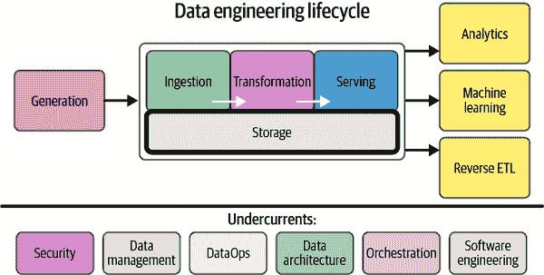

我们在 第 5 章 中也讨论过存储，但侧重点和控制域不同。源系统通常不由数据工程师维护或控制。数据工程师直接处理的存储，将是本章的重点，它涵盖了数据工程生命周期的各个阶段：从源系统摄入数据，到服务数据以通过分析、数据科学等方式交付价值。多种形式的存储以某种方式贯穿了整个数据工程生命周期。

要理解存储，我们将首先研究构成存储系统的*原始要素*，包括硬盘驱动器、固态硬盘和系统内存（参见 图 6-2）。了解物理存储技术的基本特性对于评估任何存储架构中固有的权衡至关重要。本节还将讨论序列化和压缩，这是实用存储的关键软件要素。（我们将序列化和压缩的深度技术讨论推迟到 附录 A。）我们还将讨论*缓存*，它在组装存储系统时至关重要。

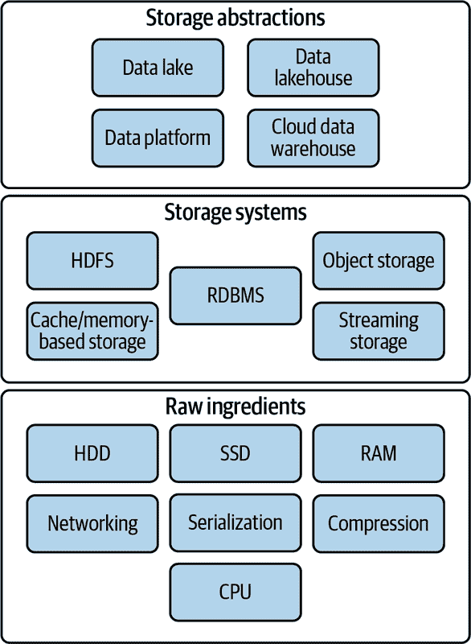

接下来，我们将探讨*存储系统*。在实践中，我们不会直接访问系统内存或硬盘。这些物理存储组件位于服务器和集群内部，它们可以使用各种访问范式来摄入和检索数据。

最后，我们将探讨*存储抽象*。存储系统被组装成云数据仓库、数据湖等。在构建数据管道时，工程师会为数据在摄入、转换和服务阶段流转时的存储选择合适的抽象层。

## 数据存储的原始要素

存储太过常见，以至于容易被视为理所当然。我们常对这样一个事实感到惊讶：许多软件工程师和数据工程师每天都在使用存储，却鲜少了解其幕后工作原理，或各种存储介质固有的权衡。结果，我们看到存储被以一些相当……有趣的方式使用。尽管当前的托管服务有可能让数据工程师从管理服务器的复杂性中解脱出来，但数据工程师仍需了解底层组件的基本特性、性能考量、持久性和成本。

在大多数数据架构中，数据在通过数据管道的各个处理阶段时，会频繁经过磁性存储、SSD 和内存。数据存储和查询系统通常遵循涉及分布式系统、众多服务和多层硬件存储的复杂配方。这些系统需要正确的原始要素才能正常运行。

让我们看看数据存储的一些原始要素：磁盘驱动器、内存、网络和 CPU、序列化、压缩和缓存。

### 磁性磁盘驱动器

*磁盘*利用涂有铁磁性薄膜的旋转盘片（图 6-3）。在写入操作期间，读/写头对该薄膜进行磁化，以物理方式编码二进制数据。在读取操作期间，读/写头检测磁场并输出比特流。磁盘驱动器已存在很长时间。由于每吉字节存储数据的成本显著低于 SSD，它们仍然构成了大容量数据存储系统的骨干。

一方面，这些磁盘在性能、存储密度和成本方面取得了非凡的进步。^(1) 另一方面，SSD 在各项指标上都大幅超越磁盘。目前，商用磁盘驱动器的成本约为每吉字节容量 3 美分。（注意，我们将经常使用缩写 *HDD* 和 *SSD* 分别表示旋转磁盘和固态驱动器。）

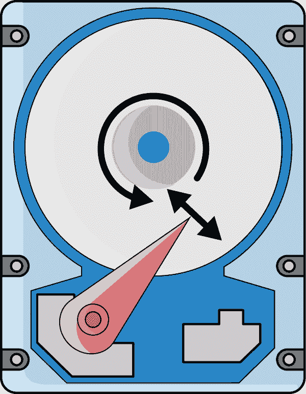

IBM 在 20 世纪 50 年代开发了磁盘驱动器技术。从那时起，磁盘容量稳步增长。第一个商用磁盘驱动器 IBM 350 容量为 3.75 兆字节。截至撰写本文时，市面上已有存储容量达 20 TB 的磁性驱动器。事实上，磁盘仍在经历快速创新，热辅助磁记录（HAMR）、叠瓦式磁记录（SMR）和氦气填充磁盘机箱等技术被用于实现更高的存储密度。尽管驱动器容量持续改进，但 HDD 性能的其他方面却受限于物理规律。

首先，*磁盘传输速度*（数据的读写速率）不会与磁盘容量成比例扩展。磁盘容量随*面密度*（每平方英寸存储的吉比特）扩展，而传输速度随*线密度*（每英寸比特数）扩展。这意味着如果磁盘容量增长 4 倍，传输速度仅增加 2 倍。因此，目前的数据中心驱动器最大数据传输速度为 200–300 MB/s。换个角度看，假设传输速度为 300 MB/s，读取 30 TB 磁盘的全部内容需要 20 多个小时。


## 磁性驱动器

第二个主要限制是寻道时间。为了访问数据，驱动器必须将读/写磁头物理移动到磁盘上的适当磁道。第三，为了在磁盘上找到特定的数据片段，磁盘控制器必须等待该数据旋转到读/写磁头下方。这导致了*旋转延迟*。典型的商用驱动器以每分钟 7,200 转（RPM）的速度旋转，其寻道时间和旋转延迟导致总体平均延迟超过四毫秒（访问选定数据片段所需的时间）。第四个限制是每秒输入/输出操作数（IOPS），这对事务型数据库至关重要。磁性驱动器的 IOPS 范围为 50 到 500。

各种技巧可以改善延迟和传输速度。使用更高的旋转速度可以提高传输速率并减少旋转延迟。限制磁盘盘片的半径或仅将数据写入磁盘上的窄带区域可以减少寻道时间。然而，这些技术都无法使磁性驱动器在随机访问查找方面与 SSD 具有可比性。SSD 可以以显著更低的延迟、更高的 IOPS 和更高的传输速度提供数据，部分原因是无需等待物理旋转的磁盘或磁头。

如前所述，磁盘因其低廉的数据存储成本而在数据中心备受青睐。此外，磁性驱动器可以通过并行性维持极高的传输速率。这是云对象存储背后的关键思想：数据可以分布在集群中成千上万个磁盘上。通过同时从众多磁盘读取，数据传输速率大幅提升，其瓶颈主要在于网络性能而非磁盘传输速率。因此，网络组件和 CPU 也是存储系统的关键基础原料，我们稍后将回到这些主题。

## 固态硬盘

*固态硬盘*（SSD）将数据作为电荷存储在闪存单元中。SSD 消除了磁性驱动器的机械组件；数据通过纯电子方式读取。SSD 可以在 0.1 毫秒（100 微秒）内查找随机数据。此外，SSD 可以通过将存储切分为分区，并利用众多并行运行的存储控制器，同时扩展数据传输速度和 IOPS。商用 SSD 可支持每秒数吉字节的传输速度和数万 IOPS。

得益于这些卓越的性能特征，SSD 已彻底改变了事务型数据库，并成为 OLTP 系统商业部署的公认标准。SSD 使 PostgreSQL、MySQL 和 SQL Server 等关系型数据库能够每秒处理数千笔事务。

然而，SSD 目前并非大规模分析型数据存储的默认选项。同样，这归结为成本。商用 SSD 通常每吉字节容量成本为 20-30 美分（美元），几乎是磁性驱动器单位容量成本的 10 倍。因此，基于磁盘的对象存储已成为数据湖和云数仓中大规模数据存储的主流选择。

SSD 在 OLAP 系统中仍扮演重要角色。一些 OLAP 数据库利用 SSD 缓存来支持对频繁访问数据的高性能查询。随着低延迟 OLAP 越来越普及，我们预计这些系统中的 SSD 使用量也将随之增加。

## 随机存取存储器

我们通常互换使用*随机存取存储器*（RAM）和*内存*这两个术语。严格来说，磁性驱动器和 SSD 也作为存储数据以供后续随机访问检索的内存，但 RAM 具有几个特定特征：

- 它连接到 CPU 并映射到 CPU 地址空间。
- 它存储 CPU 执行的代码以及该代码直接处理的数据。
- 它是*易失性*的，而磁性驱动器和 SSD 是*非易失性*的。虽然它们偶尔会发生故障导致数据损坏或丢失，但驱动器通常在断电后仍能保留数据。RAM 在断电不到一秒的时间内就会丢失数据。
- 它提供的传输速度和检索时间比 SSD 存储快得多。DDR5 内存——RAM 的最新广泛使用标准——提供的数据检索延迟约为 100 纳秒，比 SSD 快约 1,000 倍。典型 CPU 可支持 100 GB/s 的带宽连接到附加内存，并支持每秒数百万次 IOPS。（统计数据因内存通道数量和其他配置细节而大相径庭。）
- 它比 SSD 存储昂贵得多，大约为 10 美元/GB（撰写本文时）。
- 它受限于连接到单个 CPU 和内存控制器的 RAM 容量。这进一步增加了复杂性和成本。大内存服务器通常在一块主板上利用许多互联的 CPU，每个 CPU 连接一块 RAM。
- 它仍然比 CPU 缓存慢得多，后者是一种直接位于 CPU 芯片上或同一封装内的内存类型。缓存存储频繁和最近访问的数据，以便在处理期间进行超快速检索。CPU 设计包含多层大小和性能特征各异的缓存。

当我们谈论系统内存时，几乎总是指*动态 RAM*，一种高密度、低成本的内存形式。动态 RAM 将数据作为电荷存储在电容器中。这些电容器会随时间泄漏，因此必须频繁*刷新*（读取并重写）数据以防止数据丢失。硬件内存控制器处理这些技术细节；数据工程师只需关注带宽和检索延迟特征。其他形式的内存，如*静态 RAM*，用于 CPU 缓存等专用应用。

当前的 CPU 几乎总是采用*冯·诺依曼架构*，代码和数据存储在同一内存空间中。然而，CPU 通常也支持在特定内存页中禁用代码执行的选项，以增强安全性。此功能让人联想到*哈佛架构*，后者将代码和数据分离。

RAM 用于各种存储和处理系统，可用于缓存、数据处理或索引。一些数据库将 RAM 视为主要存储层，从而实现超快的读写性能。在这些应用中，数据工程师必须始终牢记 RAM 的易失性。即使存储在内存中的数据跨集群复制，导致多个节点宕机的断电事件也可能造成数据丢失。旨在持久存储数据的架构可能会使用电池备份，并在断电时自动将所有数据转储到磁盘。

## 网络和 CPU

为什么我们要提到网络和 CPU 作为存储数据的基础原料？越来越多的存储系统采用分布式架构，以提升性能、持久性和可用性。我们特别提到单个磁性磁盘提供的传输性能相对较低，但磁盘集群通过并行读取实现了显著的性能扩展。虽然 RAID（独立磁盘冗余阵列）等存储标准在单台服务器上实现并行化，但云对象存储集群的运行规模大得多，磁盘分布在网络上，甚至跨越多个数据中心和可用区。

*可用区*是标准的云构造，由拥有独立电力、水源和其他资源的计算环境组成。多可用区存储增强了数据的可用性和持久性。

CPU 处理服务请求、聚合读取和分发写入的细节。存储变成了一个拥有 API、后端服务组件和负载均衡的 Web 应用。网络设备性能和网络拓扑是实现高性能的关键因素。


数据工程师需要了解网络将如何影响他们构建和使用的系统。工程师不断在通过在地理上分散数据来实现的耐久性和可用性，与将存储保持在小的地理区域内并靠近数据消费者或写入者所带来的性能和成本优势之间进行权衡。附录 B 涵盖了云网络和主要相关概念。

# 序列化

*序列化* 是另一种原始存储要素，也是数据库设计中的关键元素。围绕序列化的决策将决定查询在网络上的执行效果、CPU 开销、查询延迟等。例如，设计数据湖涉及选择基础存储系统（如 Amazon S3）和序列化标准，以在互操作性与性能考量之间取得平衡。

## 究竟什么是序列化？

软件存储在系统内存中的数据通常不适合直接存储在磁盘上或通过网络传输。序列化是将数据展平并打包成读取器能够解码的标准格式的过程。序列化格式提供了一种数据交换标准。我们可能会以基于行的方式将数据编码为 XML、JSON 或 CSV 文件，然后传递给另一个用户，后者可以使用标准库对其进行解码。序列化算法包含处理类型的逻辑，对数据结构施加规则，并允许在编程语言和 CPU 之间进行交换。序列化算法还规定了处理异常的规则。例如，Python 对象可能包含循环引用；序列化算法在遇到循环时可能会抛出错误或限制嵌套深度。

低级数据库存储也是一种形式的序列化。面向行的关系型数据库将数据在磁盘上组织为行，以支持快速查找和原地更新。列式数据库将数据组织成列文件，以优化高效压缩并支持大数据量的快速扫描。每种序列化选择都伴随着一组权衡，数据工程师会调整这些选择以根据需求优化性能。

我们在附录 A 中提供了常见数据序列化技术和格式的更详细目录。我们建议数据工程师熟悉常见的序列化实践和格式，特别是当前最流行的格式（如 Apache Parquet）、混合序列化（如 Apache Hudi）和内存序列化（如 Apache Arrow）。

# 压缩

*压缩* 是存储工程的另一个关键组件。从基本层面来看，压缩使数据变小，但压缩算法以复杂的方式与存储系统的其他细节相互作用。

高效压缩在存储系统中有三个主要优势。首先，数据变小，因此占用的磁盘空间更少。其次，压缩提高了每个磁盘的实际扫描速度。以 10:1 的压缩比为例，我们从每块磁性磁盘扫描 200 MB/s 提升到了每块磁盘 2 GB/s 的有效速率。

第三个优势在于网络性能。鉴于 Amazon EC2 实例与 S3 之间的网络连接提供 10 Gbps（千兆位/秒）的带宽，10:1 的压缩比将有效网络带宽提高到了 100 Gbps。

压缩也有缺点。压缩和解压数据需要额外的时间和资源消耗来读取或写入数据。我们在附录 A 中对压缩算法和权衡进行了更详细的讨论。

# 缓存

我们在讨论 RAM 时已经提到了缓存。缓存的核心思想是将频繁或最近访问的数据存储在快速访问层中。缓存速度越快，成本越高，可用存储空间越少。访问频率较低的数据存储在更便宜、更慢的存储中。缓存对于数据服务、处理和转换至关重要。

在分析存储系统时，将我们使用的每种存储类型放入*缓存层次结构*（表 6-1）中会很有帮助。大多数实用的数据系统依赖于由具有不同性能特征的存储组装而成的许多缓存层。这始于 CPU 内部；处理器最多可部署四级缓存。我们沿着层次结构向下移动到 RAM 和 SSD。云对象存储是较低的一级，它支持长期数据保留和持久性，同时允许数据服务和管道中的动态数据移动。

**表 6-1. 启发式缓存层次结构，显示存储类型及其大致定价和性能特征**

| 存储类型 | 数据获取延迟<sup>a</sup> | 带宽 | 价格 |
| --- | --- | --- | --- |
| CPU 缓存 | 1 纳秒 | 1 TB/s | 不适用 |
| RAM | 0.1 微秒 | 100 GB/s | $10/GB |
| SSD | 0.1 毫秒 | 4 GB/s | $0.20/GB |
| HDD | 4 毫秒 | 300 MB/s | $0.03/GB |
| 对象存储 | 100 毫秒 | 10 GB/s | $0.02/GB 每月 |
| 归档存储 | 12 小时 | 数据可用后与对象存储相同 | $0.004/GB 每月 |

<sup>a</sup> 1 微秒等于 1,000 纳秒，1 毫秒等于 1,000 微秒。

我们可以将归档存储视为*反向缓存*。归档存储以低成本提供较差的访问特性。归档存储通常用于数据备份和满足数据保留合规要求。在典型场景中，这些数据仅在紧急情况下才会被访问（例如，数据库中的数据可能丢失需要恢复，或者公司可能需要为法律取证而回溯历史数据）。

# 数据存储系统

本节介绍数据工程师将遇到的主要数据存储系统。存储系统存在于原始要素之上的抽象层级。例如，磁盘是原始存储要素，而主要的云对象存储平台和 HDFS 是利用磁盘的存储系统。还存在更高层级的存储抽象，例如数据湖和湖仓一体（我们将在数据工程存储抽象中介绍）。

## 单机存储与分布式存储

随着数据存储和访问模式变得更加复杂，超出了单台服务器的效用范围，将数据分发到多台服务器上变得必要。数据可以存储在多台服务器上，这被称为*分布式存储*。这是一个分布式系统，其目的是以分布式方式存储数据（图 6-4）。

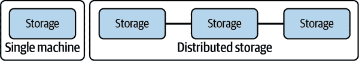

分布式存储协调多台服务器的活动，以更快的速度和更大的规模存储、检索和处理数据，同时在服务器不可用时提供冗余。在需要针对大量数据提供内置冗余和可扩展性的架构中，分布式存储很常见。例如，对象存储、Apache Spark 和云数据仓库都依赖分布式存储架构。

数据工程师必须时刻了解分布式系统的一致性范式，我们将在接下来进行探讨。

## 最终一致性与强一致性

分布式系统的一个挑战是数据分散在多台服务器上。该系统如何保持数据一致？不幸的是，分布式系统给存储和查询准确性带来了两难境地。跨系统节点复制更改需要时间；在分布式数据库中，获取当前数据与获取“差不多”当前数据之间往往存在平衡。让我们看看分布式系统中两种常见的一致性模式：最终一致性和强一致性。


# BASE 一致性与文件存储

## BASE 一致性模型

我们在全书中介绍了 `ACID` 合规性，始于第 5 章。另一个首字母缩略词是 `BASE`，代表 *basically available, soft-state, eventual consistency*（基本可用、软状态、最终一致性）。可将其视为 `ACID` 的对立面。`BASE` 是最终一致性的基础。让我们简要探讨其组成部分：

基本可用
: 不保证一致性，但数据库读写按“尽力而为”原则进行，意味着大多数时候数据是一致的。

软状态
: 事务的状态是模糊的，不确定事务是已提交还是未提交。

最终一致性
: 在*某个*时间点，读取数据将返回一致的值。

如果在最终一致性系统中读取数据不可靠，为什么还要使用它？最终一致性是大规模分布式系统中常见的权衡。如果你想横向扩展（跨多个节点）以处理大量数据，那么最终一致性往往是你必须付出的代价。最终一致性允许你快速检索数据，而无需验证你是否拥有跨所有节点的最新版本。

最终一致性的对立面是*强一致性*。强一致性下，分布式数据库确保对任意节点的写入首先通过共识分发，且针对数据库的任何读取都返回一致的值。当你能容忍较高的查询延迟，且每次从数据库读取都要求数据正确时，会使用强一致性。

通常，数据工程师在三个地方做出关于一致性的决策。首先，数据库技术本身为特定级别的一致性奠定了基础。其次，数据库的配置参数会影响一致性。第三，数据库通常支持在单个查询层面进行一些一致性配置。例如，`DynamoDB` 支持最终一致性读取和强一致性读取。强一致性读取较慢且消耗更多资源，因此最好谨慎使用，但在需要一致性时可用。

你应该了解你的数据库如何处理一致性。同样，数据工程师的任务是深入理解技术并适当地用它来解决问题。数据工程师可能需要与其他技术和业务利益相关者协商一致性要求。请注意，这既是技术问题也是组织问题；确保你已从利益相关者处收集需求并适当选择技术。

## 文件存储

我们每天都在处理文件，但文件的概念有些微妙。*文件* 是具有特定读、写和引用特征的数据实体，供软件和操作系统使用。我们定义文件具有以下特征：

有限长度
: 文件是有限长度的字节流。

追加操作
: 我们可以向文件追加字节，直至达到宿主存储系统的限制。

随机访问
: 我们可以从文件的任意位置读取，或向任意位置写入更新。

*对象存储* 的行为很像文件存储，但有关键差异。虽然我们通过先讨论文件存储为对象存储铺垫基础，但对象存储可以说对你今天将要进行的数据工程类型重要得多。在接下来的几页中，我们将大量前向引用对象存储的讨论。

文件存储系统将文件组织成目录树。文件的目录引用可能如下所示：

```
/Users/matthewhousley/output.txt
```

当此文件引用传递给操作系统时，它从根目录 `/` 开始，找到 `Users`、`matthewhousley`，最后是 `output.txt`。从左侧开始，每个目录都包含在一个父目录内，直到最终到达文件 `output.txt`。此示例使用 Unix 语义，但 Windows 文件引用语义类似。文件系统将每个目录作为其所包含文件和目录的元数据存储。这些元数据由每个实体的名称、相关权限详情以及指向实际实体的指针组成。要在磁盘上查找文件，操作系统会查看每个层级的元数据并跟随指针到达下一个子目录实体，直到最终到达文件本身。

请注意，其他类文件数据实体不一定具备所有这些属性。例如，对象存储中的*对象*仅支持第一个特征（有限长度），但仍极其有用。我们将在“对象存储”中讨论这一点。

在管道中需要文件存储范式的情况下，请小心处理状态，并尽可能使用临时环境。即使你必须在带有连接磁盘的服务器上处理文件，也请在处理步骤之间使用对象存储作为中间存储。尝试将手动的、低级的文件处理保留用于一次性摄入步骤或管道开发的探索阶段。

### 本地磁盘存储

最熟悉的文件存储类型是 SSD 或磁性磁盘本地磁盘分区上由操作系统管理的文件系统。`NTFS` 和 `ext4` 分别是 Windows 和 Linux 上流行的文件系统。操作系统处理存储目录实体、文件和元数据的细节。文件系统设计为以允许在写入期间断电时轻松恢复的方式写入数据，尽管任何未写入的数据仍会丢失。

本地文件系统通常支持完整的写后读一致性；写入后立即读取将返回写入的数据。操作系统还采用各种锁策略来管理对文件的并发写入尝试。

本地磁盘文件系统还可能支持日志记录、快照、冗余、跨多个磁盘扩展文件系统、全盘加密和压缩等高级功能。在“块存储”中，我们还将讨论 `RAID`。

### 网络附属存储

*网络附属存储* (`NAS`) 系统通过网络向客户端提供文件存储系统。`NAS` 是服务器的普遍解决方案；它们通常随附内置的专用 `NAS` 接口硬件。虽然通过网络访问文件系统存在性能损耗，但存储虚拟化也带来了显著优势，包括冗余和可靠性、资源的细粒度控制、跨多个磁盘的存储池化以实现大型虚拟卷，以及跨多台机器的文件共享。工程师应了解其 `NAS` 解决方案提供的一致性模型，尤其是当多个客户端可能访问相同数据时。

`NAS` 的一个流行替代方案是存储区域网络 (`SAN`)，但 `SAN` 系统提供块级访问，没有文件系统抽象。我们在“块存储”中介绍 `SAN` 系统。

### 云文件系统服务

云文件系统服务为多个云虚拟机和应用程序提供全托管文件系统，潜在包括云环境外的客户端。云文件系统不应与连接到虚拟机的标准存储混淆——通常指由虚拟机操作系统管理文件系统的块存储。云文件系统的行为很像 `NAS` 解决方案，但网络、管理磁盘集群、故障和配置的细节完全由云供应商处理。


## 云文件系统服务

例如，Amazon Elastic File System (EFS) 是云文件系统服务的一个极其流行的示例。存储通过 [NFS 4 协议](https://oreil.ly/GhvpT) 暴露，NAS 系统也使用该协议。EFS 提供自动扩展和按存储付费的定价，无需预先预留存储。该服务还提供*本地*写后读一致性（从执行写入的机器读取时）。它还在整个文件系统中提供关闭后打开一致性。换句话说，一旦应用程序关闭文件，后续的读取者将看到保存到已关闭文件中的更改。

## 块存储

从根本上说，*块存储* 是由 SSD 和磁盘提供的原始存储类型。在云中，虚拟化块存储是 VM 的标准。这些块存储抽象允许对存储大小、可扩展性和数据持久性进行精细控制，其能力超越了原始磁盘。

在我们之前关于 SSD 和磁盘的讨论中，我们提到对于这些随机访问设备，操作系统可以寻道、读取和写入磁盘上的任意数据。*块* 是磁盘支持的最小可寻址数据单元。在较老的磁盘上，这通常是 512 字节的可用数据，但现在对于大多数当前磁盘已增长到 4,096 字节，这使得写入粒度变粗，但大幅减少了管理块的开销。块通常包含用于错误检测/纠正和其他元数据的额外位。

磁盘上的块在物理盘片上按几何方式排列。同一磁道上的两个块可以在不移动磁头的情况下读取，而读取不同磁道上的两个块则需要寻道。SSD 上的块之间也可能发生寻道时间，但与磁盘磁道的寻道时间相比，这微不足道。

### 块存储应用

事务型数据库系统通常在块级别访问磁盘，以布局数据实现最佳性能。对于面向行的数据库，这最初意味着数据行作为连续流写入；随着 SSD 的出现及其相关的寻道时间性能改进，情况变得更加复杂，但事务型数据库仍然依赖直接访问块存储设备所提供的高随机访问性能。

块存储仍然是云 VM 上操作系统启动磁盘的默认选项。块设备的格式化方式与直接在物理磁盘上格式化非常相似，但存储通常是虚拟化的。（参见 “云虚拟化块存储”。)

### RAID

如前所述，*RAID* 代表 *redundant array of independent disks*（独立磁盘冗余阵列）。RAID 同时控制多个磁盘，以提高数据持久性、增强性能，并合并多个驱动器的容量。一个阵列在操作系统中可以显示为单个块设备。根据对增强有效带宽和更高容错能力（容忍多个磁盘故障）之间期望的平衡，有许多编码和奇偶校验方案可用。

### 存储区域网络

*存储区域网络* (SAN) 系统通过网络提供虚拟化块存储设备，通常来自存储池。SAN 抽象允许精细的存储扩展，并增强性能、可用性和持久性。如果您使用本地存储系统，可能会遇到 SAN 系统；您可能也会遇到 SAN 的云版本，如下一小节所述。

### 云虚拟化块存储

*云虚拟化块存储* 解决方案类似于 SAN，但使工程师免于处理 SAN 集群和网络细节。我们将以 Amazon Elastic Block Store (EBS) 作为标准示例；其他公有云也有类似的产品。EBS 是 Amazon EC2 虚拟机的默认存储；其他云提供商也将虚拟化对象存储视为其 VM 产品的关键组件。

EBS 提供多个服务层级，具有不同的性能特征。通常，EBS 性能指标以 IOPS 和吞吐量（传输速度）给出。EBS 存储的高性能层级由 SSD 磁盘支持，而磁盘支持的存储提供较低的 IOPS，但每 GB 成本更低。

EBS 卷将数据存储在独立于实例主机服务器但位于同一区域的位置，以支持高性能和低延迟（图 6-5）。这使得 EBS 卷在 EC2 实例关闭、主机服务器故障，甚至实例被删除时仍能持久化。EBS 存储适用于数据库等应用，其中数据持久性是高优先级。此外，EBS 将所有数据复制到至少两台独立的主机上，防止磁盘故障导致数据丢失。

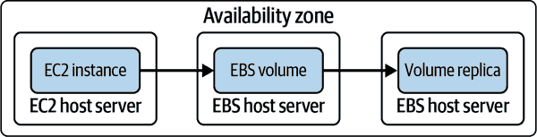

EBS 存储虚拟化还支持多项高级功能。例如，EBS 卷允许在驱动器使用期间进行即时时间点快照。虽然快照复制到 S3 仍需一些时间，但 EBS 可以在拍摄快照时有效地冻结数据块的状态，同时允许客户端机器继续使用磁盘。此外，初始全量备份后的快照是差异的；仅将已更改的块写入 S3，以最小化存储成本和备份时间。

EBS 卷也具有高度可扩展性。在撰写本文时，某些 EBS 卷类别可扩展至 64 TiB、256,000 IOPS 和 4,000 MiB/s。

### 本地实例卷

云提供商还提供物理连接到运行虚拟机的主机服务器的块存储卷。这些存储卷通常成本极低（在 Amazon EC2 实例存储的情况下，包含在 VM 价格中），并提供低延迟和高 IOPS。

实例存储卷（图 6-6）的行为基本上就像物理连接到数据中心服务器上的磁盘。一个关键区别是，当 VM 关闭或被删除时，本地连接磁盘的内容会丢失，无论该事件是否由有意的用户操作引起。这确保了新的虚拟机无法读取属于不同客户的磁盘内容。

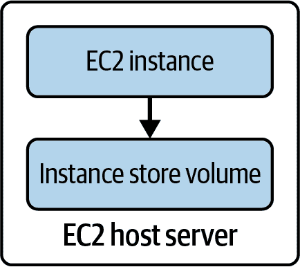

本地连接的磁盘不支持虚拟化存储服务（如 EBS）提供的任何高级虚拟化功能。本地连接的磁盘不进行复制，因此即使主机 VM 继续运行，物理磁盘故障也可能导致数据丢失或损坏。此外，本地连接的卷不支持快照或其他备份功能。

尽管存在这些限制，本地连接的磁盘非常有用。在许多情况下，我们将磁盘用作本地缓存，因此不需要像 EBS 这样的服务所提供的所有高级虚拟化功能。例如，假设我们在 EC2 实例上运行 AWS EMR。我们可能正在运行一个临时作业，该作业从 S3 消费数据，将其临时存储在跨实例运行的分布式文件系统中，处理数据，并将结果写回 S3。EMR 文件系统内置了复制和冗余，并作为缓存而非永久存储使用。在这种情况下，EC2 实例存储是一个完美的合适解决方案，并且可以提高性能，因为数据可以在本地读取和处理，而无需通过网络流动（参见 图 6-7）。

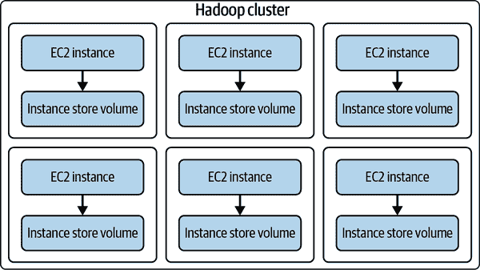


我们建议工程师在最坏情况下考虑本地连接存储。本地磁盘故障会有什么后果？意外的虚拟机或集群关闭呢？可用区或区域级云服务中断呢？如果在这些场景中，本地连接卷上的数据丢失都不会造成灾难性后果，那么本地存储可能是一个具有成本效益且高性能的选择。此外，简单的缓解策略（定期将检查点备份到 S3）可以防止数据丢失。

## 对象存储

*对象存储*包含各种形状和大小的*对象*(图 6-8)。术语*对象存储*有些令人困惑，因为*对象*在计算机科学中有多种含义。在此上下文中，我们讨论的是一种专门的类文件结构。它可以是任何类型的文件——TXT、CSV、JSON、图像、视频或音频。

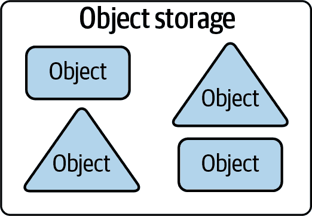

随着大数据和云计算的兴起，对象存储的重要性和普及度日益提高。Amazon S3、Azure Blob Storage 和 Google Cloud Storage (GCS) 是广泛使用的对象存储。此外，许多云数据仓库（以及越来越多的数据库）将对象存储用作其存储层，云数据湖通常建立在对象存储之上。

尽管许多本地部署的对象存储系统可以安装在服务器集群上，但我们将主要关注全托管的云对象存储。从运维角度来看，云对象存储最吸引人的特性之一是它易于管理和使用。对象存储可以说是最早的“无服务器”服务之一；工程师无需考虑底层服务器集群或磁盘的特性。

对象存储是用于不可变数据对象的键值存储。在对象存储中，我们失去了在本地磁盘文件存储中所期望的大部分写入灵活性。对象不支持随机写入或追加操作；相反，它们作为字节流一次性写入。在此初始写入之后，对象变为不可变。要更改对象中的数据或向其追加数据，我们必须重写整个对象。对象存储通常通过范围请求支持随机读取，但这些查找的性能可能比从 SSD 存储的数据中随机读取差得多。

对于习惯利用本地随机访问文件存储的软件开发人员来说，对象的特性可能看起来像是限制，但少即是多；对象存储不需要支持锁或更改同步，从而允许跨大规模磁盘集群存储数据。对象存储支持跨多个磁盘极其高性能的并行流式写入和读取，这种并行性对工程师隐藏，他们只需处理流，而无需与单个磁盘通信。在云环境中，写入速度随写入流的数量扩展，直到达到供应商设定的配额限制。读取带宽可随并行请求的数量、用于读取数据的虚拟机数量和 CPU 核心数量扩展。这些特性使对象存储成为服务高流量 Web 请求或向高度并行的分布式查询引擎交付数据的理想选择。

典型的云对象存储将数据保存在多个可用区中，大大降低了存储完全脱机或以不可恢复方式丢失的几率。这种持久性和可用性包含在成本中；云存储供应商以折扣价提供其他存储类别，以换取较低的持久性或可用性。我们将在“存储类别和层级”中讨论这一点。

云对象存储是分离计算和存储的关键要素，允许工程师使用临时集群处理数据，并按需扩展或缩减这些集群。这是让无法负担硬件成本、仅偶尔运行数据作业的小型组织也能使用大数据的关键因素。一些大型科技公司将继续在其硬件上运行永久的 Hadoop 集群。尽管如此，总体趋势是大多数组织将数据处理迁移到云端，使用对象存储作为基本的存储和服务层，同时在临时集群上处理数据。

在对象存储中，可用存储空间也具有高度可扩展性，这是大数据系统的理想特性。存储空间受存储提供商拥有的磁盘数量限制，但这些提供商处理 EB 级数据。在云环境中，可用存储空间实际上是无限的；实际上，公共云客户存储空间的主要限制是预算。从实际角度来看，工程师可以快速为项目存储海量数据，而无需提前几个月规划所需的服务器和磁盘。

### 面向数据工程应用的对象存储

从数据工程的角度来看，对象存储为大批量读取和批量写入提供了卓越的性能。这与大规模 OLAP 系统的用例非常契合。数据工程界有个说法认为对象存储不适合更新，但这只是部分正确。对象存储不适合每秒有许多小更新的事务性工作负载；这些用例更适合由事务性数据库或块存储系统处理。对象存储适合低频率的更新操作，其中每次操作更新大量数据。

对象存储现在是数据湖存储的金标准。在数据湖的早期，一次写入、多次读取 (WORM) 是运维标准，但这更多与管理数据版本和文件的复杂性有关，而非 HDFS 和对象存储的局限性。此后，Apache Hudi 和 Delta Lake 等系统应运而生以管理这种复杂性，GDPR 和 CCPA 等隐私法规使得删除和更新功能变得至关重要。对象存储的更新管理是数据湖屋概念的核心思想，我们在第 3 章中介绍了该概念。

除了这些结构化数据应用之外，对象存储还是任何格式非结构化数据的理想存储库。对象存储可以存放任何二进制数据，不限类型或结构，并经常在原始文本、图像、视频和音频的 ML 流水线中发挥作用。

### 对象查找

如前所述，对象存储是键值存储。这对工程师意味着什么？关键在于理解，与文件存储不同，对象存储不使用目录树来查找对象。对象存储使用顶层逻辑容器（S3 和 GCS 中的存储桶）并通过键引用对象。S3 中的一个简单示例如下所示：

```
S3://oreilly-data-engineering-book/data-example.json
```

在这种情况下，`S3://oreilly-data-engineering-book/` 是存储桶名称，`data-example.json` 是指向特定对象的键。S3 存储桶名称在整个 AWS 中必须唯一。键在存储桶内必须唯一。尽管云对象存储似乎支持目录树语义，但不存在真正的目录层级。我们可能会使用以下完整路径存储对象：

```
S3://oreilly-data-engineering-book/project-data/11/23/2021/data.txt
```


表面上看，这类似于常规文件夹系统中可能找到的子目录：`project-data`、`11`、`23` 和 `2021`。许多云控制台界面允许用户查看“目录”内的对象，云命令行工具通常也支持在对象存储目录中使用 Unix 风格的命令，如 `ls`。然而，在后台，对象系统并不会遍历目录树来到达对象。相反，它只是看到一个键（`project-data/11/23/2021/data.txt`），碰巧符合目录语义。这可能看起来像是一个微不足道的技术细节，但工程师需要理解，在对象存储中，某些“目录”级操作是昂贵的。要运行 `aws ls S3://oreilly-data-engineering-book/project-data/11/`，对象存储必须按键前缀 `project-data/11/` 过滤键。如果存储桶包含数百万个对象，即使“子目录”仅包含少数对象，此操作也可能需要一些时间。

## 对象一致性与版本控制

如前所述，作为通用规则，对象存储不支持原地更新或追加。我们通过在同一个键下写入一个新对象来更新对象。当数据工程师在数据流程中利用更新时，必须了解他们所使用的对象存储的一致性模型。对象存储可能是 `eventually consistent`（最终一致）或 `strongly consistent`（强一致）。例如，直到最近，S3 还是 `eventually consistent` 的；在同一个键下写入对象的新版本后，对象存储有时可能会返回该对象的旧版本。`eventual consistency` 中的 `eventual`（最终）意味着经过足够长的时间后，存储集群将达到一种状态，即只会返回对象的最新版本。这与我们期望的连接到服务器的本地磁盘的 `strong consistency`（强一致性）模型形成对比：写入后读取将返回最近写入的数据。

出于各种原因，可能希望在对象存储上施加强一致性，实现这一点的标准方法是存在的。一种方法是添加一个强一致性数据库（例如 PostgreSQL）。现在写入对象变成了一个两步过程：

1.  写入对象。
2.  将对象版本的返回元数据写入强一致性数据库。

版本元数据（对象哈希或对象时间戳）结合对象键可以唯一标识一个对象版本。要读取对象，读取器执行以下步骤：

1.  从强一致性数据库获取最新的对象元数据。
2.  使用对象键查询对象元数据。如果与从一致性数据库获取的元数据匹配，则读取对象数据。
3.  如果对象元数据不匹配，重复步骤 2，直到返回对象的最新版本。

实际实现需要考虑异常和边缘情况，例如在此查询过程中对象被重写。这些步骤可以在 API 后面进行管理，以便对象读取器以更高的对象访问延迟为代价看到一个强一致性的对象存储。

对象版本控制与对象一致性密切相关。当我们在对象存储中在现有键下重写对象时，本质上是在写入一个全新的对象，将引用从现有键设置到新对象，并删除旧对象的引用。跨集群更新所有引用需要时间，因此存在陈旧读取的可能性。最终，存储集群的垃圾回收器会释放取消引用数据所占用的空间，将磁盘容量回收供新对象使用。

开启对象版本控制后，我们会向对象添加额外的元数据以规定版本。虽然默认键引用会更新为指向新对象，但我们保留指向旧版本的其他指针。我们还维护一个版本列表，以便客户端可以获取所有对象版本的列表，然后拉取特定版本。因为旧版本的对象仍被引用，所以不会被垃圾回收器清理。

如果我们带版本引用对象，某些对象存储系统的一致性问题就会消失：键和版本元数据共同形成了对特定不可变数据对象的唯一引用。只要我们没有删除它，使用这对键值我们总能得到相同的对象。当客户端请求对象的“默认”或“最新”版本时，一致性问题依然存在。

工程师需要考虑的对象版本控制的主要开销是存储成本。历史版本的对象通常具有与当前版本相同的相关存储成本。对象版本成本可能微不足道，也可能灾难性地昂贵，这取决于各种因素。数据大小是一个问题，更新频率也是；更多的对象版本可能导致数据大小显著增加。请记住，我们讨论的是暴力对象版本控制。对象存储系统通常为每个版本存储完整的对象数据，而不是差分快照。

工程师还可以选择部署存储生命周期策略。生命周期策略允许在满足特定条件时自动删除旧对象版本（例如，当对象版本达到特定年龄或存在许多更新的版本时）。云供应商还提供各种归档数据层级，价格大幅折扣，归档过程可通过生命周期策略进行管理。

## 存储类别与层级

云供应商现在提供存储类别，以降低数据存储定价来换取减少的访问或降低的持久性。我们在此使用术语 `reduced access`（降低访问），因为许多存储层级仍使数据高度可用，但以高昂的检索成本换取降低的存储成本。

让我们看看 S3 中的几个例子，因为亚马逊是云服务标准的基准。S3 Standard-Infrequent Access（标准-低频访问）存储类别以降低每月存储成本来换取增加的数据检索成本。（有关云存储层级经济学的理论讨论，请参见“云经济学简述”。）亚马逊还提供 Amazon S3 One Zone-Infrequent Access（单可用区-低频访问）层级，仅复制到单个可用区。预计可用性从 99.9% 降至 99.5%，以考虑可用区中断的可能性。亚马逊仍声称具有极高的数据持久性，但有一个警告：如果可用区被破坏，数据将会丢失。

在降低访问的层级中更下方是 S3 Glacier 中的归档层级。S3 Glacier 承诺大幅降低长期存储成本，以换取更高的访问成本。用户有多种检索速度选项，从几分钟到几小时不等，更快的访问成本更高。例如，在撰写本文时，S3 Glacier Deep Archive（深度归档）进一步降低了存储成本；亚马逊宣称存储成本起价为每 TB 每月 1 美元。作为交换，数据恢复需要 12 小时。此外，此存储类别专为存储 7-10 年且每年仅访问一到两次的数据而设计。

请注意您计划如何使用归档存储，因为数据很容易存入，但访问数据通常成本高昂，特别是如果您需要的频率高于预期。有关归档存储经济学的更广泛讨论，请参见第 4 章。

## 对象存储支持的文件系统


对象存储同步解决方案变得越来越流行。像 `s3fs` 和 `Amazon S3 File Gateway` 这样的工具允许用户将 `S3` 存储桶作为本地存储挂载。这些工具的用户应该了解写入文件系统的特性，以及这些特性将如何与对象存储的特性和定价相互作用。例如，`File Gateway` 通过利用 `S3` 的高级功能将对象的各个部分组合成一个新对象，从而相当高效地处理文件更改。然而，高速事务性写入将会淹没对象存储的更新能力。将对象存储作为本地文件系统挂载，非常适合不频繁更新的文件。

## 缓存和基于内存的存储系统

正如“数据存储的原始要素”中所讨论的，`RAM` 提供了极佳的延迟和传输速度。然而，传统 `RAM` 极易发生数据丢失，因为哪怕持续一秒的断电也会擦除数据。基于 `RAM` 的存储系统通常专注于缓存应用，为快速访问和高带宽呈现数据。数据通常应写入更持久的介质以用于保留。

当数据工程师需要以超快检索延迟提供数据时，这些超快缓存系统非常有用。

### 示例：Memcached 和轻量级对象缓存

`Memcached` 是一个键值存储，旨在缓存数据库查询结果、`API` 调用响应等。`Memcached` 使用简单的数据结构，支持字符串或整数类型。`Memcached` 能够以极低的延迟提供结果，同时减轻后端系统的负载。

### 示例：Redis，具有可选持久化的内存缓存

与 `Memcached` 类似，`Redis` 也是一个键值存储，但它支持稍微复杂一些的数据类型（如列表或集合）。`Redis` 还内置了多种持久化机制，包括快照和日志记录。在典型配置下，`Redis` 大约每两秒写入一次数据。因此，`Redis` 适用于极高性能的应用，但可以容忍少量数据丢失。

## Hadoop 分布式文件系统

在最近一段时间里，“`Hadoop`”几乎成了“大数据”的代名词。`Hadoop 分布式文件系统` 基于 [Google File System (`GFS`)] (https://oreil.ly/GlIic)，最初是为使用 [MapReduce 编程模型](https://oreil.ly/DscVp) 处理数据而设计的。`Hadoop` 类似于对象存储，但有一个关键区别：`Hadoop` 将计算和存储结合在同一节点上，而对象存储通常对内部处理的支持有限。

`Hadoop` 将大文件分解为*块*，即大小不超过几百兆字节的数据块。文件系统由 `NameNode` 管理，它维护目录、文件元数据，以及描述文件块在集群中位置的详细目录。在典型配置中，每个数据块复制到三个节点。这增加了数据的持久性和可用性。如果磁盘或节点发生故障，某些文件块的复制因子将降至 3 以下。`NameNode` 将指示其他节点复制这些文件块，使其再次达到正确的复制因子。因此，除非发生*关联故障*（例如，小行星撞击数据中心），否则丢失数据的概率非常低。

`Hadoop` 不仅仅是一个存储系统。`Hadoop` 将计算资源与存储节点相结合，以允许就地数据处理。这最初是通过 `MapReduce` 编程模型实现的，我们将在第 8 章中讨论。

### Hadoop 已死。Hadoop 万岁！

我们经常看到声称 `Hadoop` 已死的言论。这只是部分属实。`Hadoop` 不再是一项热门的、前沿的技术。许多 `Hadoop` 生态系统工具（如 `Apache Pig`）现在处于维护模式，主要用于运行遗留作业。纯 `MapReduce` 编程模型已被淘汰。`HDFS` 仍广泛用于各种应用程序和组织中。

`Hadoop` 仍出现在许多遗留装置中。许多在大数据热潮巅峰期采用 `Hadoop` 的组织没有立即迁移到更新技术的计划。对于运行大规模（千节点）`Hadoop` 集群并拥有有效维护本地系统资源的公司来说，这是一个不错的选择。较小的公司可能需要权衡运行小型 `Hadoop` 集群的成本开销和规模限制，与迁移到云解决方案之间的利弊。

此外，`HDFS` 是许多当前大数据引擎（如 `Amazon EMR`）的关键组成部分。事实上，`Apache Spark` 仍通常运行在 `HDFS` 集群上。我们将在“计算与存储的分离”中更详细地讨论这一点。

## 流式存储

流式数据的存储需求与非流式数据不同。在消息队列的情况下，存储的数据是暂时的，预计在一定持续时间后消失。然而，像 `Apache Kafka` 这样的分布式、可扩展流式框架现在允许极长时间的流式数据保留。`Kafka` 通过将旧的、不常访问的消息推送到对象存储，支持无限期的数据保留。`Kafka` 的竞争对手（包括 `Amazon Kinesis`、`Apache Pulsar` 和 `Google Cloud Pub/Sub`）也支持长时间的数据保留。

与这些系统中的数据保留密切相关的是重放的概念。*重放* 允许流式系统返回一定范围的历史存储数据。*重放* 是流式存储系统的标准数据检索机制。*重放* 可用于对时间范围运行批量查询，或在流式管道中重新处理数据。第 7 章将更深入地介绍重放。

其他存储引擎已出现，用于实时分析应用。从某种意义上说，事务数据库是最早出现的实时查询引擎；数据一写入即对查询可见。然而，这些数据库存在众所周知的扩展和锁定限制，尤其是对于跨大量数据运行的分析查询。虽然可扩展的面向行事务数据库克服了其中一些限制，但它们仍未真正针对大规模分析进行优化。

## 索引、分区和聚簇

索引为特定字段提供表的映射，并允许极快地查找单个记录。没有索引，数据库将需要扫描整张表以查找满足 `WHERE` 条件的记录。

在大多数 `RDBMS` 中，索引用于主表键（允许唯一标识行）和外键（允许与其他表连接）。索引也可以应用于其他列，以满足特定应用程序的需求。使用索引，`RDBMS` 每秒可以查找和更新数千行。

我们在本书中不深入介绍事务数据库记录；该主题有大量技术资源可供参考。相反，我们关注的是分析导向存储系统中索引的演变，以及一些用于分析用例的索引新发展。

### 从行到列的演变

早期的数据仓库通常构建在用于事务应用的同类型 `RDBMS` 之上。`MPP` 系统日益流行，意味着向并行处理转变，以显著提高跨大量数据进行分析的扫描性能。然而，这些面向行的 `MPP` 仍然使用索引来支持连接和条件检查。


在“数据存储的原始要素”中，我们讨论了列式序列化。*列式序列化*允许数据库仅扫描特定查询所需的列，有时能大幅减少从磁盘读取的数据量。此外，按列排列数据将相似的值紧密地放在一起，以最小的压缩开销产生高压缩比。这使得数据能更快地从磁盘和网络上扫描。

列式数据库在事务性用例中表现不佳——即当我们尝试异步查找大量单个行时。然而，当必须扫描大量数据时——例如复杂的数据转换、聚合、统计计算或对大型数据集进行复杂条件评估时——它们表现极佳。

过去，列式数据库在连接操作上表现不佳，因此给数据工程师的建议是反规范化数据，尽可能使用宽模式、数组和嵌套数据。近年来，列式数据库的连接性能有了显著提升，因此虽然反规范化仍可能带来性能优势，但这不再是必需。您将在第 8 章中了解更多关于规范化和反规范化的内容。

### 从索引到分区和聚类

虽然列式数据库允许快速扫描速度，但尽可能减少扫描的数据量仍然很有帮助。除了仅扫描与查询相关的列中的数据外，我们还可以通过按字段拆分将一个表分区为多个子表。在分析和数据科学用例中，按时间范围扫描非常常见，因此基于日期和时间的分区极为常见。列式数据库通常也支持多种其他分区方案。

*聚类*允许在分区内对数据进行更细粒度的组织。应用于列式数据库中的聚类方案按一个或几个字段对数据进行排序，将相似的值放在一起。这提高了过滤、排序和连接这些值的性能。

### 示例：Snowflake 微分区

我们提到 Snowflake [微分区](https://oreil.ly/nQTaP)，因为它是列式存储方法近期发展和演变的一个很好的例子。*微分区*是未压缩大小在 50 到 500 兆字节之间的行集合。Snowflake 采用算法方法尝试将相似的行聚类在一起。这与基于单个指定字段（如日期）进行分区的传统简单方法形成对比。Snowflake 专门寻找在许多行中某字段重复的值。这允许基于谓词对查询进行激进的*剪枝*。例如，`WHERE` 子句可能规定如下：

```
WHERE created_date='2022-01-02'
```

在这样的查询中，Snowflake 会排除任何不包含该日期的微分区，从而有效地剪枝这些数据。Snowflake 还允许重叠的微分区，可能基于多个显示显著重复的字段进行分区。

高效的剪枝得益于 Snowflake 的元数据库，它存储了每个微分区的描述，包括行数和字段的值范围。在每个查询阶段，Snowflake 分析微分区以确定哪些需要扫描。Snowflake 使用*混合列式存储*一词，^(2) 部分指的是其表被分解成小行组，尽管存储从根本上说是列式的。元数据库扮演的角色类似于传统关系数据库中的索引。

# 数据工程存储抽象

*数据工程存储抽象*是位于数据工程生命周期核心的数据组织和查询模式，构建在先前讨论的数据存储系统之上（参见图 6-3）。我们在第 3 章中介绍了许多此类抽象，并将在此重新审视它们。

我们将关注的主要抽象类型是那些支持数据科学、分析和报告用例的类型。这些包括数据仓库、数据湖、数据湖屋、数据平台和数据目录。我们不会涵盖源系统，因为它们在第 5 章中讨论。

作为数据工程师，您所需的存储抽象归结为几个关键考量：

目的和用例

： 

您必须首先确定存储数据的目的。它用于什么？

更新模式

： 

该抽象是针对批量更新、流式插入还是更新插入进行优化的？

成本

： 

直接和间接的财务成本是什么？价值实现时间？机会成本？

分离存储和计算

： 

趋势是分离存储和计算，但大多数系统混合了分离和共置。我们在“计算与存储的分离”中介绍这一点，因为它影响目的、速度和成本。

您应该知道，分离存储和计算的流行意味着 OLAP 数据库和数据湖之间的界限日益模糊。主要的云数据仓库和数据湖正处于碰撞轨道上。未来，这两者的区别可能仅在于名称，因为它们在功能和技术上可能在底层非常相似。

## 数据仓库

数据仓库是标准的 OLAP 数据架构。正如第 3 章所讨论的，*数据仓库*一词指的是技术平台（如 Google BigQuery 和 Teradata）、数据集中化的架构以及公司内部的组织模式。就存储趋势而言，我们已从在传统事务数据库、基于行的 MPP 系统（如 Teradata 和 IBM Netezza）以及列式 MPP 系统（如 Vertica 和 Teradata Columnar）之上构建数据仓库，演变为云数据仓库和数据平台。（有关 MPP 系统的更多详细信息，请参阅我们在第 3 章中的数据仓库讨论。）

在实践中，云数据仓库常被用来将数据组织到数据湖中，数据湖是海量未处理原始数据的存储区域，最初由 James Dixon 构想。^(3) 云数据仓库可以处理海量原始文本和复杂的 JSON 文档。局限在于云数据仓库无法处理真正的非结构化数据，如图像、视频或音频，这与真正的数据湖不同。云数据仓库可以与对象存储结合，提供完整的数据湖解决方案。

## 数据湖

*数据湖*最初被构想为一个海量存储，其中数据以原始、未处理的形式保留。最初，数据湖主要构建在 Hadoop 系统上，廉价存储允许保留海量数据，而无需专有 MPP 系统的成本开销。

过去五年见证了数据湖存储演变中的两大主要发展。首先，发生了向*计算与存储分离*的大规模迁移。在实践中，这意味着从 Hadoop 迁移到云对象存储以实现数据的长期保留。其次，数据工程师发现，MPP 系统提供的许多功能（模式管理；更新、合并和删除能力）在冲向数据湖的浪潮中最初被忽视，但实际上极其有用。这导致了数据湖屋的概念。

## 数据湖屋


# 存储领域的宏观理念与趋势

## 数据湖仓

`data lakehouse` 是一种融合了数据仓库和数据湖特点的架构。按照普遍认知，湖仓像数据湖一样将数据存储在对象存储中。然而，湖仓在此基础上增加了旨在简化数据管理、并创造类似数据仓库工程体验的功能。这意味着强大的表和模式支持，以及管理增量更新和删除的功能。湖仓通常还支持表历史和回滚；这是通过保留旧版本的文件和元数据来实现的。

湖仓系统是一个与数据管理和转换工具协同部署的元数据和文件管理层。Databricks 通过 Delta Lake（一个开源存储管理系统）大力推广了湖仓概念。

我们必须指出，数据湖仓的架构与多个商业数据平台（包括 BigQuery 和 Snowflake）所采用的架构相似。这些系统将数据存储在对象存储中，并提供自动化的元数据管理、表历史以及更新/删除功能。底层文件和存储的管理复杂性对用户完全隐藏。

数据湖仓相对于专有工具的关键优势在于互操作性。当数据以开放文件格式存储时，在工具之间交换数据要容易得多。从专有数据库格式重新序列化数据会在处理、时间和成本上产生开销。在数据湖仓架构中，各种工具可以连接到元数据层，并直接从对象存储读取数据。

重要的是要强调，数据湖仓中的大部分数据可能没有强加表结构。我们可以在湖仓中需要的地方施加数据仓库特性，而将其他数据保留为原始甚至非结构化格式。

数据湖仓技术正在快速演进。出现了多种 Delta Lake 的新竞争对手，包括 Apache Hudi 和 Apache Iceberg。详见 附录 A。

## 数据平台

越来越多的供应商将其产品定位为 `data platforms`。这些供应商构建了其互操作工具的生态系统，并与核心数据存储层紧密集成。在评估平台时，工程师必须确保平台提供的工具满足其需求。平台未直接提供的工具仍可互操作，但数据交换会产生额外的数据开销。正如我们在云数据仓库讨论中提到的，平台还强调与对象存储的紧密集成，以应对非结构化用例。

目前，数据平台的概念坦白说尚未完全成熟。然而，构建数据工具“围墙花园”的竞赛已经开始，这既简化了数据工程工作，又产生了显著的供应商锁定。

## 流批一体存储架构

流批一体存储架构与 Lambda 架构有许多相似之处，尽管有人可能会对技术细节存疑。本质上，流经流式存储系统中主题的数据会被写入多个消费者。

其中一些消费者可能是实时处理系统，用于生成流上的统计信息。此外，批存储消费者将数据写入长期保留存储并支持批量查询。批消费者可以是 AWS Kinesis Firehose，它可以根据可配置的触发器（例如时间和批次大小）生成 S3 对象。BigQuery 等系统将流式数据摄入流式缓冲区。此流式缓冲区会自动重新序列化为列式对象存储。查询引擎支持无缝查询流式缓冲区和对象数据，为用户提供当前的、近乎实时的表视图。

## 数据目录

`data catalog` 是组织内所有数据的集中式元数据存储。严格来说，数据目录不是顶层数据存储抽象，但它与各种系统和抽象集成。数据目录通常跨越运营和分析数据源，集成数据血缘和数据关系展示，并允许用户编辑数据描述。

数据目录常用于提供一个中心场所，供人们查看其数据、查询和数据存储。作为数据工程师，你可能负责建立和维护数据管道和存储系统的各种数据集成，使其与数据目录集成，并维护数据目录本身的完整性。

### 目录应用集成

理想情况下，数据应用设计为与目录 API 集成，以直接处理其元数据和更新。随着目录在组织中被更广泛地使用，实现这一理想变得更加容易。

### 自动化扫描

实际上，编目系统通常需要依赖自动化扫描层，从数据湖、数据仓库和运营数据库等各种系统收集元数据。数据目录可以收集现有元数据，也可能使用扫描工具推断元数据，例如键关系或敏感数据的存在。

### 数据门户与社交层

数据目录通常还通过 Web 界面提供人工访问层，用户可在其中搜索数据并查看数据关系。数据目录可通过提供 Wiki 功能的社交层进行增强。这允许用户提供其数据集的信息、向其他用户请求信息，并在信息可用时发布更新。

### 数据目录用例

数据目录既有组织层面的用例，也有技术层面的用例。数据目录使元数据易于被系统获取。例如，数据目录是数据湖仓的关键组成部分，允许查询发现表。

在组织层面，数据目录允许业务用户、分析师、数据科学家和工程师搜索数据以回答问题。数据目录简化了跨组织的沟通与协作。

## 数据共享

`Data sharing` 允许组织和个人与特定实体共享特定数据和精心定义的权限。数据共享允许数据科学家将沙箱中的数据与组织内的协作者共享。跨组织方面，数据共享促进了合作伙伴企业间的协作。例如，广告技术公司可以与其客户共享广告数据。

云多租户环境使跨组织协作变得更加容易。然而，它也带来了新的安全挑战。组织必须严格控制管辖谁可以与谁共享数据的策略，以防止意外泄露或蓄意窃取。

数据共享是许多云数据平台的核心功能。更广泛的讨论见 第 5 章。

## 模式

数据的预期形式是什么？文件格式是什么？是结构化、半结构化还是非结构化？预期的数据类型是什么？数据如何融入更大的层级结构？它是否通过共享键或其他关系与其他数据关联？


## Schema

请注意，schema 无需是*关系型*的。相反，当我们拥有关于其结构和组织的尽可能多的信息时，数据会变得更有用。对于存储在数据湖中的图像，这些 schema 信息可能解释图像格式、分辨率，以及图像如何融入更大的层级结构中。

Schema 可以充当一种罗塞塔石碑，指导我们如何读取数据。存在两种主要的 schema 模式：`schema on write` 和 `schema on read`。`Schema on write` 本质上是传统的数据仓库模式：表具有集成的 schema；写入表的任何数据都必须符合该 schema。为了支持 `schema on write`，数据湖必须集成一个 schema 元存储。

对于 `schema on read`，schema 在数据写入时动态创建，读取数据时读取者必须确定 schema。理想情况下，`schema on read` 使用实现了内置 schema 信息的文件格式来实现，例如 `Parquet` 或 `JSON`。`CSV` 文件因 schema 不一致而臭名昭著，不建议在此场景下使用。

`schema on write` 的主要优势在于它强制执行数据标准，使数据在未来更易于消费和利用。`Schema on read` 强调灵活性，允许写入几乎任何数据。这以未来消费数据难度增加为代价。

## 计算与存储的分离

本书反复探讨的一个关键理念是计算与存储的分离。这已成为当今云时代标准的数据访问和查询模式。正如我们所讨论的，数据湖将数据存储在对象存储中，并启动临时计算容量来读取和处理数据。大多数全托管的 `OLAP` 产品现在都在后台依赖对象存储。为了理解分离计算和存储的动机，我们首先应该看看计算与存储的共置。

### 计算与存储的共置

计算与存储的共置长期以来一直是提高数据库性能的标准方法。对于事务型数据库，数据共置允许快速、低延迟的磁盘读取和高带宽。即使我们虚拟化存储（例如使用 `Amazon EBS`），数据也相对靠近主机。

同样的基本原理适用于跨机器集群运行的分析查询系统。例如，对于 `HDFS` 和 `MapReduce`，标准方法是定位集群中需要扫描的数据块，然后将单个 `map` 作业推送到这些块。`map` 步骤的数据扫描和处理严格保持本地化。`reduce` 步骤涉及在集群中洗牌数据，但保持 `map` 步骤本地化有效地为洗牌保留了更多带宽，从而提供更好的整体性能；大量过滤数据的 `map` 步骤也能显著减少需要洗牌的数据量。

### 计算与存储的分离

如果计算与存储的共置能提供高性能，为什么会转向计算与存储的分离？存在多种动机。

#### 临时性与可扩展性

在云中，我们看到了向临时性的巨大转变。一般来说，购买并托管服务器比从云提供商租用更便宜，*前提是你全天候不间断地运行它多年*。在实践中，工作负载差异巨大，如果服务器可以随需扩缩容，按需付费模式能实现显著的效率提升。这对在线零售的 Web 服务器适用，对可能仅定期运行的大数据批处理作业同样适用。

临时计算资源允许工程师启动大规模集群以按时完成作业，随后在作业完成后删除集群。在超大规模下临时运行的性能收益可能超过对象存储的带宽限制。

#### 数据持久性与可用性

云对象存储显著降低了数据丢失的风险，并通常提供极高的正常运行时间（可用性）。例如，`S3` 跨多个可用区存储数据；如果自然灾害摧毁了一个可用区，数据仍可从其余可用区获取。拥有多个可用区也降低了数据中断的几率。如果一个可用区的资源宕机，工程师可以在另一个可用区启动相同的资源。

对象存储中可能导致数据销毁的错误配置仍然令人担忧，但有简单易部署的缓解措施。将数据复制到多个云区域可以降低这种风险，因为配置变更通常一次只部署到一个区域。将数据复制到多个存储提供商可以进一步降低风险。

### 混合分离与共置

分离计算与存储的实际情况比我们暗示的更复杂。在实践中，我们不断混合共置和分离，以实现两种方法的优势。这种混合通常通过两种方式完成：`multitier caching` 和 `hybrid object storage`。

通过 `multitier caching`，我们利用对象存储进行长期数据保留和访问，但在查询和数据管道的各个阶段启动本地存储供使用。Google 和 Amazon 都提供 hybrid object storage 的版本（与计算紧密集成的对象存储）。

让我们看看一些流行处理引擎如何混合存储和计算的分离与共置的示例。

#### 示例：带有 S3 和 HDFS 的 AWS EMR

像 `Amazon EMR` 这样的大数据服务会启动临时的 `HDFS` 集群来处理数据。工程师可以选择同时引用 `S3` 和 `HDFS` 作为文件系统。一种常见模式是在 `SSD` 驱动器上搭建 `HDFS`，从 `S3` 拉取数据，并将中间处理步骤的数据保存在本地 `HDFS` 上。与直接从 `S3` 处理相比，这可以实现显著的性能提升。完整结果在集群完成步骤后写回 `S3`，然后删除集群和 `HDFS`。其他消费者直接从 `S3` 读取输出数据。

#### 示例：Apache Spark

在实践中，`Spark` 通常在 `HDFS` 或其他临时分布式文件系统上运行作业，以支持处理步骤之间数据的高性能存储。此外，`Spark` 严重依赖数据的内存存储来提高处理速度。拥有运行 `Spark` 的基础设施的问题在于动态内存（`DRAM`）极其昂贵；通过在云中分离计算和存储，我们可以租用大量内存，然后在作业完成后释放该内存。

#### 示例：Apache Druid

`Apache Druid` 严重依赖 `SSD` 来实现高性能。由于 `SSD` 比磁性磁盘贵得多，`Druid` 仅在其集群中保留一份数据副本，将“在线”存储成本降低了三倍。

当然，维护数据持久性仍然至关重要，因此 `Druid` 使用对象存储作为其持久层。数据摄入时，会被处理、序列化为压缩列，并写入集群 `SSD` 和对象存储。如果发生节点故障或集群数据损坏，数据可以自动恢复到新节点。此外，集群可以关闭，然后完全从 `SSD` 存储恢复。

#### 示例：混合对象存储

Google 的 `Colossus` 文件存储系统支持对数据块位置的细粒度控制，尽管此功能未直接向公众开放。`BigQuery` 使用此功能将客户表共置在单个位置，从而允许该位置的查询获得超高带宽。^(4) 我们称之为 `hybrid object storage`，因为它将对象存储的整洁抽象与计算存储共置的一些优势相结合。Amazon 也通过 `S3 Select` 提供了一种混合对象存储的概念，这是一项允许用户在数据跨网络返回之前直接在 `S3` 集群中过滤 `S3` 数据的功能。


# 混合对象存储与公有云

我们推测公有云将更广泛地采用混合对象存储，以提升其产品性能并更高效地利用可用网络资源。有些云厂商可能已经在这样做了，只是未公开披露。

混合对象存储的概念凸显了：拥有对硬件的低级访问权限，而非依赖他人的公有云，仍然存在优势。公有云服务不会暴露硬件和系统的低级细节（例如 Colossus 的数据块位置），但这些细节在性能优化和增强方面极为有用。请参阅我们在第 4 章中关于云经济学的讨论。

虽然我们目前正在见证数据向公有云的大规模迁移，但我们认为，许多目前运行在其他厂商公有云上的超大规模数据服务供应商未来可能会建立自己的数据中心，尽管会与公有云保持深度网络集成。

## 零拷贝克隆

基于对象存储的云原生系统支持*零拷贝克隆*。这通常意味着创建一个对象的新虚拟副本（例如新表），而无需物理复制底层数据。通常会创建指向原始数据文件的新指针，且对这些新表的未来更改不会记录在旧表中。对于熟悉 Python 等面向对象语言内部原理的人来说，这种“浅层”复制在其他上下文中也很常见。

零拷贝克隆是一项引人注目的功能，但工程师必须了解其优势和局限性。例如，在数据湖环境中克隆一个对象，然后删除原始对象中的文件，可能也会清除新对象。

对于全托管的基于对象存储的系统（如 Snowflake 和 BigQuery），工程师需要非常熟悉浅层复制的确切限制。在 Databricks 等数据湖系统中，工程师能更多地访问底层对象存储——这是福也是祸。数据工程师在删除底层对象存储中的任何原始文件前应格外谨慎。Databricks 和其他数据湖管理技术有时也支持*深拷贝*的概念，即复制所有底层数据对象。这是一个成本更高的过程，但在文件意外丢失或删除时更加稳健。

## 数据存储生命周期与数据保留

存储数据并非仅仅将其保存到对象存储或磁盘然后置之不理那么简单。你需要考虑数据存储生命周期和数据保留。当你考虑访问频率和用例时，请问自己：“该数据对下游用户有多重要，他们需要多久访问一次？”这就是数据存储生命周期。另一个你应该问的问题是：“我应该保留这份数据多久？”你是需要无限期保留数据，还是在特定时间范围后丢弃也无所谓？这就是数据保留。让我们深入了解这两个方面。

### 热、温、冷数据

你知道数据有“温度”吗？根据数据访问的频率，我们可以大致将其存储方式分为三类持久化层级：热、温和冷。每个数据集的查询访问模式各不相同（图 6-9）。通常，较新的数据比较旧的数据被查询得更频繁。让我们按热、冷、温数据的顺序来看（编者注：原文顺序为 hot, cold, and warm，但下文小节顺序为 Hot, Warm, Cold，此处按原文翻译）。

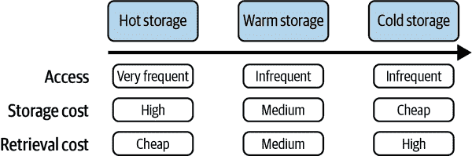

#### 热数据

*热数据*具有即时或频繁访问的需求。热数据的底层存储适合快速访问和读取，例如 SSD 或内存。由于热数据涉及的硬件类型，存储热数据通常是这三种存储层级中成本最高的。热数据的示例用例包括检索产品推荐和产品页面结果。存储热数据的成本是这三个存储层级中最高的，但检索通常很廉价。

查询结果缓存是热数据的另一个例子。当运行查询时，某些查询引擎会将查询结果持久化在缓存中。在一段时间内，当再次运行相同查询时，查询结果缓存会直接提供缓存结果，而不是重复对存储发起相同查询。这比反复冗余地发起相同查询能实现快得多的查询响应时间。在后续章节中，我们将更详细地介绍查询结果缓存。

#### 温数据

*温数据*是半定期访问的数据，例如每月一次。没有硬性规定温数据的访问频率，但它低于热数据且高于冷数据。主要云厂商提供适配温数据的对象存储层级。例如，S3 提供了低频访问层级，Google Cloud 有类似的存储层级称为 Nearline（近线存储）。厂商会给出推荐访问频率的模型，工程师也可以自行进行成本建模和监控。温数据的存储成本低于热数据，但检索成本略高。

#### 冷数据

在另一极端，*冷数据*是不常访问的数据。用于归档冷数据的硬件通常廉价且耐用，例如 HDD、磁带存储和基于云的归档系统。冷数据主要用于长期归档，几乎没有访问意图。虽然存储冷数据很便宜，但检索冷数据通常很昂贵。

#### 存储层级考量

在考虑数据的存储层级时，请考虑各层级的成本。如果你将所有数据存储在热存储中，所有数据都能快速访问。但这要付出巨大的代价！反之，如果你将所有数据存储在冷存储中以节省成本，你肯定会降低存储成本，但代价是检索时间延长，且如果需要访问数据，检索成本会很高。存储价格从更快/高性能存储向更低性能存储递减。

冷存储常用于数据归档。历史上，冷存储涉及物理备份，并常将这些数据邮寄给第三方，由其在实体保险库中归档。冷存储在云端越来越流行。每个云厂商都提供冷数据解决方案，你应权衡将数据推入冷存储的成本与检索数据的成本和时间。

数据工程师需要考虑从热存储向温/冷存储的溢出。内存昂贵且有限。例如，如果热数据存储在内存中，当新数据过多且内存不足时，数据可能会溢出到磁盘。某些数据库可能会将不常访问的数据移至温或冷层级，将数据卸载到 HDD 或对象存储。后者因对象存储的成本效益而变得越来越普遍。如果你身处云端并使用托管服务，磁盘溢出将自动发生。

如果你使用基于云的对象存储，请为你的数据创建自动化生命周期策略。这将大幅降低你的存储成本。例如，如果你的数据只需每月访问一次，将数据移至低频访问存储层级。如果数据已有 180 天且当前查询未访问，将其移至归档存储层级。在这两种情况下，你都可以自动化数据从常规对象存储的迁移，从而省钱。话虽如此，请考虑检索成本——无论是时间还是金钱——使用低频或归档类存储层级。访问和检索的时间及成本可能因云提供商而异。一些云提供商使数据迁移到归档存储变得简单且廉价，但检索数据却昂贵且缓慢。

### 数据保留


# 数据保留

在“大数据”的早期，人们倾向于不惜一切代价积累每一条可能的数据，而不管其是否有用。当时的预期是，“我们将来可能会用到这些数据”。这种数据囤积不可避免地变得难以驾驭且混乱不堪，导致数据沼泽的出现、监管机构对数据保留的严厉打击，以及其他后果和噩梦。如今，数据工程师需要考虑数据保留：你*需要*保留什么数据，以及应该保留*多久*？以下是关于数据保留的一些思考要点。

## 价值

数据是一项资产，因此你应该了解所存储数据的价值。当然，价值是主观的，取决于它对你当前用例及更广泛组织的价值。这些数据是否无法重新创建，还是说可以通过查询上游系统轻松重建？如果数据可用与不可用，对下游用户有何影响？

## 时间

数据对下游用户的价值也取决于数据的新旧程度。新数据通常比旧数据更有价值，访问频率也更高。技术限制可能决定了你能在特定存储层级中存储数据多久。例如，如果你将热数据存储在缓存或内存中，你可能需要设置 `TTL`，以便在某个时间点后让数据过期，或将其持久化到温存储或冷存储。否则，你的热存储将变满，针对热数据的查询将遭遇性能滞后。

## 合规性

某些法规（例如 `HIPAA` 和支付卡行业标准，即 `PCI`）可能要求你保留数据特定时长。在这些情况下，数据只需在请求时可访问即可，即使访问请求的可能性很低。其他法规可能要求你仅在有限期限内保留数据，你需要具备按时且在合规指南范围内删除特定信息的能力。你需要一个存储和归档数据流程——以及搜索数据的能力——以满足你需要遵守的特定法规的保留要求。当然，你会希望在合规性与成本之间取得平衡。

## 成本

数据是一项（希望）具有 `ROI`（投资回报率）的资产。在 `ROI` 的成本方面，数据存储涉及显而易见的存储费用。考虑你需要保留数据的时间线。鉴于我们关于热、温、冷数据的讨论，实施自动数据生命周期管理实践，如果在要求的保留日期后不再需要数据，则将其移至冷存储。或者如果数据确实不再需要，则将其删除。

# 单租户与多租户存储

在 第 3 章 中，我们介绍了单租户和多租户架构之间的权衡。回顾一下，采用*单租户*架构时，每组租户（例如个人用户、用户组、账户或客户）都会获得自己专用的资源集合，如网络、计算和存储。*多租户*架构则相反，它在用户组之间共享这些资源。这两种架构都被广泛使用。本节将探讨单租户和多租户存储的影响。

采用单租户存储意味着每个租户都获得其专用存储。在 图 6-10 的示例中，每个租户获得一个数据库。这些数据库之间不共享数据，存储完全隔离。使用单租户存储的一个示例是：每个客户的数据必须隔离存储，不能与任何其他客户的数据混合。在这种情况下，每个客户获得自己的数据库。

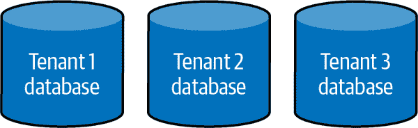

独立的数据存储意味着独立且互不相关的模式、存储桶结构以及所有与存储相关的内容。这意味着你可以自由设计每个租户的存储环境使其统一，或让它们随意演变。跨客户的模式差异既可能是优势也可能是麻烦；一如既往，需权衡取舍。如果每个租户的模式并非在所有租户中都统一，那么当你需要查询多个租户的表以创建所有租户数据的统一视图时，这将产生重大后果。

多租户存储允许在单个数据库中存储多个租户。例如，不同于单租户场景中客户获得自己的数据库，在多租户数据库中，多个客户可能驻留在相同的数据库模式或表中。存储多租户数据意味着每个租户的数据存储在同一位置（图 6-11）。

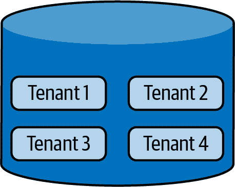

你需要了解查询单租户和多租户存储的情况，我们将在 第 8 章 中更详细地介绍。

# 你将与谁共事

存储是数据工程基础设施的核心。你将与拥有 IT 基础设施的人员打交道——通常是 `DevOps`、安全团队和云架构师。在数据工程与其他团队之间划定责任领域至关重要。数据工程师是否有权在 `AWS` 账户中部署其基础设施，还是说必须由另一个团队处理这些变更？与其他团队合作，定义简化的流程，以便团队能够高效、快速地协作。

数据存储的责任划分将很大程度上取决于相关组织的成熟度。如果公司处于数据成熟度的早期阶段，数据工程师很可能会管理存储系统和工作流。如果公司处于数据成熟度的后期阶段，数据工程师可能只会管理存储系统的一个部分。该数据工程师也很可能会与存储两侧的工程师——摄入和转换——进行交互。

数据工程师需要确保下游用户使用的存储系统安全可用、包含高质量数据、拥有充足的存储容量，并在运行查询和转换时性能良好。

# 暗流

存储的暗流影响深远，因为存储是数据工程生命周期所有阶段的关键枢纽。与其他数据可能处于运动中（摄入）或被查询和转换的暗流不同，存储的暗流之所以不同，是因为存储无处不在。

## 安全性

虽然工程师通常将安全性视为工作的阻碍，但他们应该接受这样一个理念：安全性是关键的赋能者。静态和动态的强大安全性，配合细粒度的数据访问控制，允许数据在业务内部更广泛地共享和使用。当这成为可能时，数据的价值会显著提升。

一如既往，遵循最小权限原则。除非必要，不要给任何人完全的数据库访问权限。这意味着在实践中，大多数数据工程师不需要完全的数据库访问权限。此外，注意数据库中的列级、行级和单元格级访问控制。仅给用户他们需要的信息，不多给。

## 数据管理

当我们使用存储系统读写数据时，数据管理至关重要。

### 数据目录与元数据管理

强大的元数据能增强数据价值。编目通过实现数据发现，赋能数据科学家、分析师和 `ML` 工程师。数据血统加快了追踪数据问题的速度，并允许使用者定位上游原始来源。当你构建存储系统时，要投资于你的元数据。将数据字典与这些其他工具集成，允许用户稳健地共享和记录机构知识。

元数据管理还能显著增强数据治理。除了单纯实现被动的数据编目和血统追踪外，还应考虑在这些系统上实施分析，以主动清晰地了解数据发生了什么。

### 对象存储中的数据版本控制


主要云对象存储系统支持数据版本控制。当流程失败且数据损坏时，数据版本控制有助于错误恢复。版本控制对于追踪用于构建模型的数据集历史也大有裨益。正如代码版本控制允许开发人员追踪导致 Bug 的提交一样，数据版本控制可以帮助 ML 工程师追踪导致模型性能下降的变更。

## 隐私

GDPR 和其他隐私法规对存储系统设计产生了重大影响。任何涉及隐私的数据都有一个生命周期，数据工程师必须对其进行管理。数据工程师必须准备好响应数据删除请求，并根据要求选择性地移除数据。此外，工程师可以通过匿名化和掩码来满足隐私和安全需求。

## DataOps

DataOps 并非与数据管理正交，两者存在大量重叠领域。DataOps 关注存储系统的传统运维监控以及对数据本身的监控，这与元数据和质量密不可分。

### 系统监控

数据工程师必须以多种方式监控存储。这包括监控基础设施存储组件（如果存在），还包括监控对象存储和其他“无服务器”系统。数据工程师应在 FinOps（成本管理）、安全监控和访问监控方面发挥主导作用。

### 观测与监控数据

虽然我们所描述的元数据系统至关重要，但优秀的工程实践必须考虑到数据的熵增本质，主动寻求了解其特征并监视重大变化。工程师可以监控数据统计信息，应用异常检测方法或简单规则，并主动测试和验证逻辑不一致性。

## 数据架构

第 3 章 涵盖了数据架构的基础知识，因为存储是数据工程生命周期的关键基础。

请考虑以下数据架构建议。为所需的可靠性和持久性进行设计。了解上游源系统，以及数据一旦被摄入后将如何存储和访问。了解下游将发生的数据模型和查询类型。

如果预期数据会增长，你能否与云服务商协商存储方案？采取积极的 FinOps 方法，将其视为架构讨论的核心部分。不要过早优化，但如果存在处理大数据量的业务机会，要为扩展做好准备。

倾向于使用全托管系统，并了解提供商的 SLA。全托管系统通常比你需要精心照料的系统更健壮、更具扩展性。

## 编排

编排与存储高度交织。存储允许数据流经管道，而编排则是泵。编排还帮助工程师应对数据系统的复杂性，可能组合多个存储系统和查询引擎。

## 软件工程

我们可以从两个方面考虑存储背景下的软件工程。首先，你编写的代码应在你的存储系统上表现良好。确保代码正确存储数据，不会意外导致数据泄露、内存泄漏或性能问题。其次，将存储基础设施定义为代码，并在处理数据时使用临时计算资源。由于存储与计算日益分离，你可以自动启动和关闭资源，同时将数据保留在对象存储中。这能保持基础设施整洁，避免存储层和查询层耦合。

## 总结

存储无处不在，支撑着数据工程生命周期的许多阶段。在本章中，你了解了存储系统的原始要素、类型、抽象和核心概念。深入了解你将使用的存储系统的内部工作原理和局限性。了解适合你存储系统的数据类型、活动和工作负载。

## 附加资源

*   [“列式 DBMS”维基百科页面](https://oreil.ly/FBZH0)
*   [“现代列式数据库系统的设计与实现”](https://oreil.ly/Q570W)，Daniel Abadi 等著
*   [*《设计数据密集型应用》*](https://oreil.ly/v1NhG)，Martin Kleppmann 著（O’Reilly 出版）
*   [“深入 Delta Lake：模式强制与演进”](https://oreil.ly/XSxuN)，Burak Yavuz 等著
*   [“热数据与冷数据：为何它很重要”](https://oreil.ly/h6mbt)，Afzaal Ahmad Zeeshan 著
*   IDC 的 [“根据 IDC Global DataSphere 和 StorageSphere 预测，数据创建与复制的增长速度将快于已安装存储容量”新闻稿](https://oreil.ly/Kt784)
*   [“行式与列式数据库？理论与实践”](https://oreil.ly/SB63g)，Mangat Rai Modi 著
*   [“Snowflake 解决方案反模式：可能的数据科学家”](https://oreil.ly/is1uz)，John Aven 著
*   [“什么是向量数据库？”](https://oreil.ly/ktw0O)，Bryan Turriff 著
*   [“什么是对象存储？定义与概述”](https://oreil.ly/ZyCrz)，Alex Chan 著
*   [“增量加载的内容、时机、原因与方法”](https://oreil.ly/HcfX8)，Tim Mitchell 著

^(1) Andy Klein, “Hard Disk Drive (HDD) vs. Solid-State Drive (SSD): What’s the Diff?,” Backblaze blog, October 5, 2021, [*https://oreil.ly/XBps8*](https://oreil.ly/XBps8).

^(2) Benoit Dageville, “The Snowflake Elastic Data Warehouse,” *SIGMOD ’16: Proceedings of the 2016 International Conference on Management of Data* (June 2016): 215–226, [*https://oreil.ly/Tc1su*](https://oreil.ly/Tc1su).

^(3) James Dixon, “Data Lakes Revisited,” *James Dixon’s Blog*, September 25, 2014, [*https://oreil.ly/FH25v*](https://oreil.ly/FH25v).

^(4) Valliappa Lakshmanan and Jordan Tigani, *Google BigQuery: The Definitive Guide* (Sebastopol, CA: O’Reilly, 2019), 16–17, 188, [*https://oreil.ly/5aXXu*](https://oreil.ly/5aXXu).
