# 第 7 章 摄入

你已经了解了作为数据工程师可能遇到的各种源系统以及存储数据的方法。现在让我们关注适用于从各种源系统摄取数据的模式和选择。在本章中，我们将讨论数据摄入（参见图 7-1）、摄入阶段的关键工程考量、批处理和流式摄入的主要模式、你将遇到的技术、开发数据摄入管道时将与谁合作，以及潜流在摄入阶段的体现。

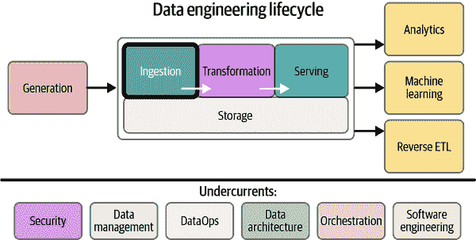

## 什么是数据摄入？

*数据摄入* 是将数据从一处移动到另一处的过程。数据摄入意味着在数据工程生命周期中，数据从源系统移动到存储中，摄入作为一个中间步骤（参见图 7-2）。

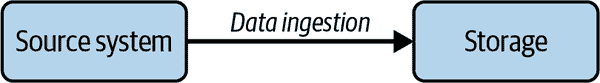

快速对比一下数据摄入与数据集成是有价值的。*数据摄入* 是从 A 点到 B 点的数据移动，而 *数据集成* 则是将来自不同来源的数据合并为一个新数据集。例如，你可以使用数据集成将 CRM 系统的数据、广告分析数据和网站分析数据结合起来创建用户画像，并将其保存到数据仓库中。此外，通过反向 ETL，你可以将这个新创建的用户画像*发回*给 CRM，以便销售人员利用数据对潜在客户进行优先级排序。我们将在第 8 章更全面地描述数据集成，届时我们将讨论数据转换；反向 ETL 将在第 9 章中介绍。

我们还要指出，数据摄入不同于系统内部的*内部摄入*。存储在数据库中的数据从一个表复制到另一个表，或流中的数据被暂时缓存。我们将此视为 第 8 章 中涵盖的通用数据转换过程的另一部分。

# 摄入阶段的关键工程考量

在准备设计或构建摄入系统时，以下是与数据摄入相关的主要考量因素和自问问题：

* 我摄入的数据的用例是什么？
* 我能否复用这些数据，避免摄入同一数据集的多个版本？
* 数据要去向何处？目标是什么？
* 应该多久从源头更新一次数据？
* 预期数据量是多少？
* 数据采用什么格式？下游存储和转换能否接受该格式？
* 源数据是否适合直接供下游使用？即数据质量是否良好？需要何种后处理才能提供服务？有哪些数据质量风险（例如，网站的机器人流量是否会污染数据）？
* 如果数据来自流式源，是否需要在传输过程中进行处理以供下游摄入？

这些问题贯穿批处理和流式摄入，并适用于您将创建、构建和维护的底层架构。无论数据摄入频率如何，在设计摄入架构时都应考虑以下因素：

* 有界与无界
* 频率
* 同步与异步
* 序列化与反序列化
* 吞吐量与可扩展性
* 可靠性与持久性
* 载荷
* 推、拉与轮询模式

让我们逐一了解。

## 有界数据与无界数据

正如您可能从 第 3 章 中回忆的那样，数据以两种形式存在：有界和无界（图 7-3）。*无界数据*是数据在现实中原本的样子，随着事件发生，无论是零星还是持续，源源不断地流动。*有界数据*是跨越某种边界（如时间）将数据分桶的一种便捷方式。

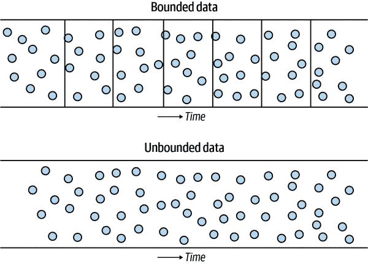

让我们采纳这句箴言：*所有数据在被界定之前都是无界的。*像许多箴言一样，这句并非 100% 的时间都精准无误。我今天下午随手记下的购物清单就是有界数据。我将意识流（无界数据）写在一张废纸上，思想如今以一份清单（有界数据）的形式存在，列出了我需要在杂货店购买的东西。然而，对于您在业务环境中将处理的绝大多数数据而言，这一观点在实践中是正确的。例如，在线零售商将全天候处理客户交易，直到企业倒闭、经济停摆或太阳爆炸。

业务流程长期以来通过切分离散批次，在数据上强加了人为界限。请牢记数据真正的无界性；流式摄入系统只是一种工具，用于保留数据的无界本质，以便生命周期中的后续步骤也能持续处理它。

## 频率

数据工程师在设计数据摄入流程时必须做出的关键决策之一是数据摄入频率。摄入流程可以是批处理、微批处理或实时。

摄入频率从慢到快差异巨大（图 7-4）。在慢速端，企业可能一年只向会计事务所发送一次税务数据。在较快端，CDC 系统可能每分钟从源数据库检索一次新的日志更新。甚至更快，系统可能持续从物联网传感器摄入事件并在几秒钟内处理。根据用例和技术，公司内部通常会混合使用多种数据摄入频率。

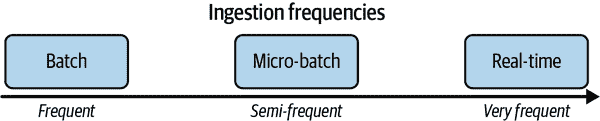

我们注意到，“实时”摄入模式正变得越来越普遍。我们给“实时”加上引号，因为没有任何摄入系统是真正的实时。任何数据库、队列或管道在将数据传递给目标系统时都存在固有延迟。称其为*准实时*更为准确，但我们为简洁起见常使用*实时*。准实时模式通常摒弃显式的更新频率；事件到达管道后逐个处理，或以微批次（即极短时间间隔内的批次）处理。在本书中，我们将*实时*和*流式*交替使用。

即使采用流式数据摄入流程，下游进行批处理也相对标准。在撰写本书时，机器学习模型通常基于批处理进行训练，尽管持续在线训练正变得更加普遍。数据工程师很少有机会构建一个纯粹的准实时管道且不含任何批处理组件。相反，他们选择批处理边界发生的位置——即数据工程生命周期数据将被分割成批次。一旦数据到达批处理流程，批处理频率就会成为所有下游处理的瓶颈。

此外，流式系统最适合许多数据源类型。在物联网应用中，典型模式是每个传感器在事件或测量发生时将其写入流式系统。虽然这些数据可以直接写入数据库，但像 Amazon Kinesis 或 Apache Kafka 这样的流式摄入平台更适合该应用。软件应用程序可以采用类似模式，在事件发生时将其写入消息队列，而不是等待提取进程从后端数据库拉取事件和状态信息。对于已经通过队列交换消息的事件驱动架构，这种模式效果非常好。同样，流式架构通常与批处理共存。

## 同步摄入与异步摄入

在*同步摄入*中，源、摄入和目标具有复杂的依赖关系且紧密耦合。正如您在 图 7-5 中所见，数据工程生命周期的每个阶段都有 A、B、C 等直接相互依赖的进程。如果进程 A 失败，进程 B 和 C 无法启动；如果进程 B 失败，进程 C 不会启动。这种同步工作流常见于较旧的 ETL 系统中，其中从源系统提取的数据必须先转换，再加载到数据仓库中。摄入下游的进程要等到批次中的所有数据都被摄入后才能启动。如果摄入或转换进程失败，整个进程必须重跑。

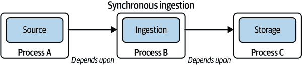

这里有一个关于如何*不*设计数据管道的迷你案例研究。在某公司，转换进程本身是一系列数十个紧密耦合的同步工作流，整个进程耗时超过 24 小时才能完成。如果转换管道的任何一步失败，整个转换进程就必须从头重启！在这种情况下，我们看到进程接连失败，且由于不存在或晦涩难懂的错误消息，修复管道变成了一场“打地鼠”游戏，花费了一周多时间才诊断并解决。与此同时，业务在那段时间内没有更新的报表。大家都很不开心。

## 异步摄入

采用 `asynchronous ingestion`（异步摄入），依赖项现在可以在单个事件层面运行，这与由微服务构建的软件后端中的运作方式非常相似（图 7-6）。单个事件在被单独摄入后，立即即可在存储中获取。以 AWS 上的一个 Web 应用程序为例，它将事件发送到 Amazon Kinesis Data Streams（此处充当缓冲区）。Apache Beam 读取该流，解析并丰富事件，然后将其转发到第二个 Kinesis 流；Kinesis Data Firehose 将事件汇总并将对象写入 Amazon S3。

核心理念在于：与其依赖异步处理——即在输入批次关闭并满足特定时间条件时，为每个阶段运行一个批处理进程——不如让异步管道的每个阶段在 Beam 集群中并行处理数据项，只要它们可用即可。处理速率取决于可用资源。Kinesis Data Stream 充当减震器，调节负载，使事件速率峰值不会压垮下游处理。当事件速率较低且任何积压已清除时，事件将快速通过管道。请注意，我们可以修改该场景，使用 Kinesis Data Stream 进行存储，最终在事件从流中过期前将其提取到 S3。

## 序列化与反序列化

将数据从源移动到目标涉及序列化和反序列化。提醒一下，`serialization`（序列化）是指对源数据进行编码，并为传输和中间存储阶段准备数据结构。

在摄入数据时，请确保您的目标系统能够反序列化接收到的数据。我们见过数据从源摄入后，却因无法正确反序列化而在目标系统中处于惰性、不可用的状态。关于序列化的更详尽讨论，请参阅 附录 A。

## 吞吐量与可扩展性

理论上，您的摄入过程永远不应成为瓶颈。实际上，摄入瓶颈非常普遍。随着数据量增长和需求变化，数据吞吐量和系统可扩展性变得至关重要。设计您的系统以便能够扩缩容，从而灵活匹配所需的数据吞吐量。

数据来源对摄入影响巨大。如果您是在数据生成时接收数据，上游系统是否会有任何问题影响您的下游摄入管道？例如，假设源数据库宕机。当它重新上线并尝试回填滞后的数据加载时，您的摄入系统能否跟上这种突然涌入的积压数据？

另一个需要考虑的因素是您处理突发性数据摄入的能力。数据生成很少以恒定速率发生，通常呈现潮汐式的起伏。需要内置缓冲机制，在速率峰值期间收集事件，以防止数据丢失。缓冲填补了系统扩容所需的时间窗口，并允许存储系统即使在动态可扩展的系统中也能应对突发流量。

只要可能，请使用为您处理吞吐量扩缩的托管服务。虽然您可以通过手动添加更多服务器、分片或工作节点来完成这些任务，但这通常不是增值工作，而且您很有可能会遗漏某些细节。如今，许多繁重的工作已实现自动化。如果非必要，请勿重复造数据摄入的轮子。

## 可靠性与持久性

`Reliability`（可靠性）和 `Durability`（持久性）在数据管道的摄入阶段至关重要。`Reliability` 意味着摄入系统具有高正常运行时间和适当的故障转移机制。`Durability` 意味着确保数据不丢失、不损坏。

某些数据源（如 IoT 设备和缓存）如果数据未被正确摄入，可能不会保留数据。一旦丢失，将永不可复得。从这个意义上说，摄入系统的 `reliability` 直接决定了生成数据的 `durability`。如果数据已摄入，即使下游进程暂时故障导致延迟运行，理论上也是可以接受的。

我们的建议是评估风险，并根据数据丢失的影响和成本，构建适当级别的冗余和自愈能力。可靠性和持久性既有直接成本，也有间接成本。例如，如果 AWS 可用区宕机，您的摄入流程能否继续？整个区域宕机呢？电网或互联网中断呢？当然，没有免费的午餐。这会花费您多少？您或许能构建一个高度冗余的系统，并安排团队 24 小时轮班处理故障。但这也意味着您的云成本和人力成本将变得难以承受（直接成本），且持续的运维工作会给团队带来巨大负担（间接成本）。没有唯一的标准答案，您需要评估可靠性和持久性决策的成本与收益。

不要假设您能构建一个在所有可能场景下都能可靠、持久地摄入数据的系统。即使拥有近乎无限预算的美国联邦政府也无法保证这一点。在许多极端场景下，摄入数据实际上已不再重要。即使您在地下掩体中建立了多个拥有独立电源的物理隔离数据中心，如果互联网中断，也几乎没有数据可摄入。请持续评估可靠性和持久性的权衡与成本。

## 载荷

`payload`（载荷）是您正在摄入的数据集，具有类型、结构、大小、模式和数据类型、元数据等特征。让我们看看其中一些特征，以了解其重要性。

### 类型

您处理的数据 `kind`（类型）直接影响其在数据工程生命周期下游的处理方式。类型由种类和格式组成。数据有种类——表格、图像、视频、文本等。种类直接影响数据格式，即其以字节、名称和文件扩展名表达的方式。例如，表格类数据可能采用 CSV 或 Parquet 等格式，每种格式对于序列化和反序列化都有不同的字节模式。另一种数据类型是图像，其格式为 JPG 或 PNG，本质上是非结构化的。

### 结构

每个载荷都有一个 `shape`（结构/形状）来描述其维度。数据结构在整个数据工程生命周期中至关重要。例如，图像的像素和红、绿、蓝（RGB）维度对于训练深度学习模型是必需的。再如，如果您尝试将 CSV 文件导入数据库表，而您的 CSV 列数多于数据库表，则在导入过程中很可能会报错。以下是各类数据结构的一些示例：

**表格**

: 数据集中的行数和列数，通常表示为 *M* 行 *N* 列

**半结构化 JSON**

: 键值对和嵌套深度（包含子元素）

**非结构化文本**

: 文本主体中的单词数、字符数或字节数

**图像**

: 宽度、高度和 RGB 色彩深度（例如，每像素 8 位）

**未压缩音频**

: 声道数（例如，立体声为两个）、采样深度（例如，每采样 16 位）、采样率（例如，48 kHz）和时长（例如，10,003 秒）

### 大小

数据的 `size`（大小）描述载荷的字节数。载荷大小可能从单个字节到 TB 甚至更大。为了减小载荷大小，可以将其压缩为 ZIP、TAR 等各种格式（有关压缩的讨论，请参阅 附录 A）。

巨大的负载也可以拆分为多个块，这能有效地将负载大小缩减为更小的子部分。当将大文件加载到云对象存储或数据仓库时，这是一种常见做法，因为较小的单个文件更易于通过网络传输（尤其是经过压缩后）。这些较小的分块文件被发送到目的地，待所有数据到达后再重新组装。

## 模式与数据类型

许多数据负载都有模式，例如表格数据和半结构化数据。正如本书前面所述，模式描述了字段及这些字段内的数据类型。其他数据，如非结构化文本、图像和音频，则没有显式的模式或数据类型。不过，它们可能附带有关形状、数据、文件格式、编码、大小等方面的技术文件描述。

虽然你可以通过多种方式连接到数据库（如文件导出、CDC、JDBC/ODBC），但连接本身很简单。巨大的工程挑战在于理解底层模式。应用程序以各种方式组织数据，工程师需要深入熟悉数据的组织方式和相关的更新模式，才能理清头绪。对象关系映射（ORM）的流行在一定程度上加剧了这一问题，ORM 会根据 Java 或 Python 等语言中的对象结构自动生成模式。面向对象语言中的自然结构往往映射为运行时数据库中混乱的结构。数据工程师可能需要熟悉应用程序代码的类结构。

模式不仅适用于数据库。正如我们所讨论的，API 也带来了模式方面的复杂性。许多供应商 API 提供友好的报表方法，为分析准备数据。在其他情况下，工程师就没那么走运了。API 只是底层系统的一层薄封装，要求工程师了解应用程序内部结构才能使用数据。

与从源模式摄取数据相关的大量工作发生在数据工程生命周期的转换阶段，我们将在第 8 章中讨论。我们将此讨论放在这里，是因为数据工程师一旦计划从新源摄取数据，就需要立即开始研究源模式。

沟通对于理解源数据至关重要，工程师也有机会扭转沟通流向，帮助软件工程师改进数据的生产环节。本章稍后我们将在“你将与谁共事”中回到这个话题。

### 检测与处理上游和下游模式变更

模式变更频繁发生在源系统中，且通常完全不在数据工程师的控制范围内。模式变更的示例包括：

*   新增列
*   更改列类型
*   创建新表
*   重命名列

摄取工具自动检测模式变更甚至自动更新目标表，这种情况越来越常见。归根结底，这有利有弊。模式变更仍可能破坏暂存和摄取阶段下游的管道。

工程师仍必须实施策略，以自动响应变更，并对无法自动适应的变更发出警报。自动化固然好，但依赖这些数据的分析师和数据科学家应了解违反现有假设的模式变更。即使自动化能适应变更，新模式也可能对报表和模型的性能产生不利影响。进行模式变更的人员与受这些变更影响的人员之间的沟通，与可靠地检查模式变更的自动化同样重要。

### 模式注册表

在流数据中，每条消息都有一个模式，且这些模式可能在生产者和消费者之间演变。*模式注册表* 是一个元数据存储库，用于在不断变化的模式面前维护模式和数据类型的完整性。模式注册表还可以跟踪模式版本和历史记录。它描述消息的数据模型，允许生产者和消费者之间进行一致的序列化和反序列化。模式注册表被大多数主流数据工具和云平台使用。

## 元数据

除了我们刚才介绍的明显特征外，负载通常还包含元数据，我们在第 2 章中首次讨论过它。元数据是关于数据的数据。元数据可能与数据本身一样关键。早期数据湖方法（或数据沼泽，可能演变为数据超级基金场地）的一个重大局限，是完全忽视了元数据。如果没有对数据的详细描述，数据可能价值不大。我们已经讨论过一些元数据类型（如模式），并将在本章中多次涉及它们。

## 推、拉与轮询模式

我们在第 2 章介绍数据工程生命周期时提到了推与拉。*推* 策略（图 7-7）涉及源系统将数据发送到目标，而*拉* 策略（图 7-8）则意味着目标直接从源读取数据。正如我们在该讨论中提到的，这两种策略的界限是模糊的。

与拉相关的另一种模式是*轮询* 数据（图 7-9）。轮询涉及定期检查数据源是否有任何变更。检测到变更时，目标会像在常规拉取情况下一样拉取数据。

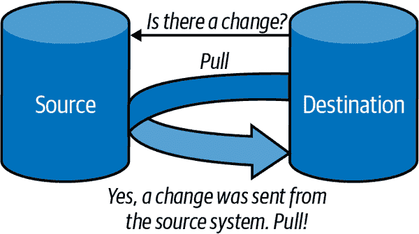

# 批量摄取注意事项

批量摄取涉及批量处理数据，通常是摄取数据的一种便捷方式。这意味着通过从源系统获取数据子集来摄取数据，依据要么是时间间隔，要么是累积数据的大小（图 7-10）。

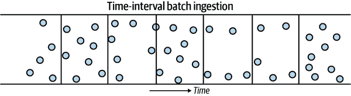

*基于时间间隔的批量摄取* 在用于数据仓库的传统业务 ETL 中广泛存在。这种模式常用于每天处理一次数据，通常在非工作时间的夜间进行，以提供日报，但也可使用其他频率。

*基于大小的批量摄取*（图 7-11）在将数据从基于流的系统移入对象存储时非常常见；最终，你必须将数据切割成离散的块，以便在数据湖中进行未来的处理。一些基于大小的摄取系统可以根据各种标准将数据拆分为对象，例如总事件数的字节大小。

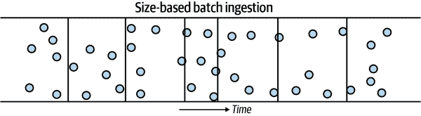

本节讨论的一些常用批量摄取模式包括：

*   全量快照或差分抽取
*   基于文件的导出和摄取
*   ETL 与 ELT
*   插入、更新与批次大小
*   数据迁移

## 全量快照或差分抽取

数据工程师必须选择是捕获源系统的全量快照，还是差分（有时称为*增量*）更新。采用*全量快照*时，工程师在每次更新读取时获取源系统的整个当前状态。采用*差分更新*模式时，工程师可仅拉取自上次读取以来源系统的更新和变更。虽然差分更新非常适合最大限度地减少网络流量和目标存储使用量，但全量快照读取因其简单性而仍极为常见。

## 基于文件的导出和摄取

# 文件摄取

数据通常通过文件在数据库和系统之间移动。数据被序列化为可交换格式的文件，然后提供给摄取系统。我们将基于文件的导出视为一种**推式**摄取模式。这是因为数据导出和准备工作是在源系统端完成的。

与直接数据库连接方法相比，基于文件的摄取有几个潜在优势。出于安全原因，通常不希望允许直接访问后端系统。使用基于文件的摄取，导出进程在数据源端运行，使源系统工程师能完全控制导出什么数据以及如何预处理数据。文件准备好后，可以通过多种方式提供给目标系统。常见的文件交换方法包括对象存储、`SFTP`（安全文件传输协议）、`EDI`（电子数据交换）或 `SCP`（安全复制）。

## ETL 与 ELT

第 3 章介绍了 `ETL` 和 `ELT`，这两种都是在批处理工作负载中极常见的摄取、存储和转换模式。以下是 `ETL` 和 `ELT` 中提取和加载部分的简要定义：

**Extract（提取）**

: 从源系统获取数据。虽然 *extract* 似乎暗示 *pulling*（拉取）数据，但也可以是基于推送的。提取可能还需要读取元数据和模式变更。

**Load（加载）**

: 数据提取后，可以在加载到存储目标前进行转换（`ETL`），或者直接加载到存储中以备将来转换。加载数据时，应注意你要加载的系统类型、数据模式以及加载对性能的影响。

我们将在第 8 章更详细地介绍 `ETL` 和 `ELT`。

## 插入、更新与批量大小

面向批处理的系统在用户尝试执行许多小批量操作而非少量大批量操作时，性能通常较差。例如，在事务型数据库中逐行插入很常见，但这对许多列式数据库是不良模式，因为它会强制创建许多小的、次优的文件，并迫使系统运行大量的 *create object* 操作。运行许多小的原地更新操作问题更大，因为它会导致数据库扫描每个现有列文件来执行更新。

了解你正在使用的数据库或数据存储的适当更新模式。同时要明白，某些技术专为高插入率而设计。例如，`Apache Druid` 和 `Apache Pinot` 可处理高插入率。`SingleStore` 可管理结合 `OLAP` 和 `OLTP` 特性的混合工作负载。`BigQuery` 在原生 `SQL` 单行插入的高速率下表现不佳，但如果数据通过其流缓冲区输入，则表现极好。了解工具的限制和特性。

## 数据迁移

将数据迁移到新数据库或环境通常并非易事，且需要批量移动数据。有时这意味着移动数百 TB 甚至更大规模的数据，通常涉及特定表的迁移以及整个数据库和系统的迁移。

作为数据工程师，数据迁移可能不是常规工作，但你应该熟悉它。与数据摄取一样，模式管理是关键考量。假设你要将数据从一个数据库系统迁移到另一个不同的系统（例如从 `SQL Server` 迁移到 `Snowflake`）。无论两个数据库多么相似，它们处理模式的方式几乎总存在细微差别。幸运的是，通常很容易测试样本数据的摄取，在进行完整表迁移前发现模式问题。

大多数数据系统在批量移动数据而非逐行或逐事件移动时性能最佳。文件或对象存储通常是传输数据的极佳中间阶段。此外，数据库迁移最大的挑战之一不是数据移动本身，而是将数据管道连接从旧系统迁移到新系统。

请注意，有许多工具可自动化各类数据迁移。特别是对于大型复杂的迁移，我们建议在手动操作或编写自己的迁移方案前，先考察这些选项。

# 消息与流摄取注意事项

摄取事件数据很常见。本节涵盖摄取事件时应考虑的问题，参考了第 5 章和第 6 章的主题。

## 模式演进

处理事件数据时模式演进很常见；字段可能被添加或移除，或值类型可能改变（例如从字符串变为整数）。模式演进可能对数据管道和目标产生意外影响。例如，`IoT` 设备通过固件更新为其传输的事件添加了新字段，或第三方 `API` 更改了其事件载荷，或其他无数场景。所有这些都可能影响下游能力。

为缓解模式演进相关问题，有几点建议。首先，如果你的事件处理框架有模式注册表（本章前面讨论过），用它来版本化模式变更。其次，死信队列（见“错误处理与死信队列”）可帮助你调查未被妥善处理的事件问题。最后，低保真路线（也是最有效的）是定期与上游利益相关者沟通潜在模式变更，主动与引入这些变更的团队解决模式变更问题，而不是在接收端被动应对破坏性变更。

## 晚到数据

虽然你可能希望所有事件数据准时到达，但事件数据可能晚到。一组事件可能在相同时间范围内发生（相似的事件时间），但由于各种原因，某些事件可能比其他事件晚到（晚摄取时间）。

例如，`IoT` 设备可能因网络延迟问题晚发送消息。摄取数据时这很常见。你应了解晚到数据及其对下游系统和用途的影响。假设你认为摄取时间或处理时间等同于事件时间。如果报表或分析依赖于事件发生时间的准确描述，可能会得到奇怪的结果。为处理晚到数据，你需要设置一个截止时间，超过该时间不再处理晚到数据。

## 顺序与多次投递

流平台通常基于分布式系统构建，这可能导致一些问题。具体来说，消息可能乱序投递且投递多次（至少一次投递）。详见第 5 章中关于事件流平台的讨论。

## 重放

*Replay*（重放）允许读取者从历史记录中请求一系列消息，使你能将事件历史倒回到特定时间点。重放是许多流摄取平台的关键能力，在需要为特定时间范围重新摄取和重新处理数据时特别有用。例如，`RabbitMQ` 通常在所有订阅者消费消息后删除它们。`Kafka`、`Kinesis` 和 `Pub/Sub` 都支持事件保留和重放。

## 生存时间

## 你将保留事件记录多久？

一个关键参数是*最大消息保留时间*，也称为*生存时间*（TTL）。TTL 通常是一项配置，用于设定你希望事件在被确认和摄取之前存活多久。任何在其 TTL 过期后仍未被确认和摄取的事件会自动消失。这有助于减少事件摄取管道中的背压和不必要的事件量。

为我们的数据管道找到 TTL 影响的恰当平衡点。极短的 TTL（毫秒或秒级）可能导致大多数消息在处理前就消失。非常长的 TTL（数周或数月）将造成大量未处理消息的积压，导致长时间的等待。

让我们看看在撰写本文时，一些流行平台是如何处理 TTL 的。Google Cloud Pub/Sub 支持最长 7 天的保留期。Amazon Kinesis Data Streams 的保留期可调高至 365 天。Kafka 可配置为无限期保留，仅受可用磁盘空间限制。（Kafka 还支持将较旧的消息写入云对象存储，从而解锁几乎无限的存储空间和保留期。）

## 消息大小

消息大小是一个容易被忽视的问题：你必须确保相关的流式处理框架能够处理预期的最大消息大小。Amazon Kinesis 支持的最大消息大小为 1 MB。Kafka 默认最大尺寸也是此值，但可配置为最大 20 MB 或更大。（在托管服务平台上，可配置性可能有所不同。）

## 错误处理和死信队列

有时事件无法成功摄取。可能是事件被发送到了不存在的主题或消息队列，消息大小可能过大，或者事件已过其 TTL 而过期。无法摄取的事件需要被重新路由并存储在一个称为*死信队列*的单独位置。

死信队列将有问题的事件与可被消费者接受的事件隔离开来（图 7-12）。如果事件不重新路由到死信队列，这些错误事件可能会阻塞其他消息的摄取。数据工程师可以利用死信队列诊断事件摄取错误的原因并解决数据管道问题，在修复导致错误的根本原因后，甚至可能重新处理队列中的某些消息。

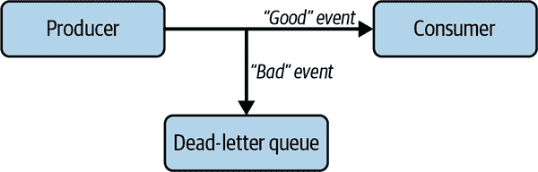

## 消费者拉取和推送

订阅主题的消费者可以通过两种方式获取事件：推送和拉取。让我们看看一些流式技术是如何拉取和推送数据的。Kafka 和 Kinesis 仅支持拉取订阅。订阅者从主题读取消息并在处理完成后确认。除了拉取订阅，Pub/Sub 和 RabbitMQ 还支持推送订阅，允许这些服务将消息写入监听器。

拉取订阅是大多数数据工程应用的默认选择，但你可能需要为专用应用考虑推送功能。请注意，仅支持拉取的消息摄取系统，如果你添加一个额外的层来处理此事，仍然可以实现推送。

## 位置

通常希望跨多个位置集成流式处理，以增强冗余并就近消费数据生成地的数据。作为一条通用规则，你的摄取位置越接近数据源头，你的带宽和延迟表现就越好。然而，你需要在将数据跨区域移动以对合并数据集运行分析的成本之间进行权衡。一如既往，数据流出成本可能会迅速失控。在构建架构时，请仔细评估这些权衡。

# 数据摄取方式

现在我们已经描述了批处理和流式摄取的一些重要底层模式，让我们专注于数据摄取的具体方式。虽然我们会列举一些常见方式，但请记住，数据摄取实践和技术的世界浩瀚且日新月异。

## 直接数据库连接

数据可以通过查询和网络连接读取，从数据库中提取用于摄取。最常见的是，此连接使用 ODBC 或 JDBC 建立。

ODBC 使用由访问数据库的客户端托管的驱动程序，将发送给标准 ODBC API 的命令转换为发送给数据库的命令。数据库通过网络返回查询结果，驱动程序接收它们并将其转换回标准形式供客户端读取。对于摄取而言，使用 ODBC 驱动程序的应用程序是摄取工具。摄取工具可能通过许多小查询或单个大查询来提取数据。

JDBC 在概念上与 ODBC 非常相似。Java 驱动程序连接到远程数据库，并作为标准 JDBC API 与目标数据库原生网络接口之间的转换层。拥有一个专门针对单一编程语言的数据库 API 似乎很奇怪，但这样做有充分的理由。Java 虚拟机 (JVM) 是标准化的，可跨硬件架构和操作系统移植，并通过即时 (JIT) 编译器提供编译代码的性能。JVM 是一种极其流行的编译型 VM，用于以可移植的方式运行代码。

JDBC 提供了非凡的数据库驱动程序可移植性。ODBC 驱动程序作为操作系统和架构的原生二进制文件发布；数据库供应商必须为其希望支持的每个架构/操作系统版本维护相应版本。另一方面，供应商可以发布单个 JDBC 驱动程序，该驱动程序兼容任何 JVM 语言（如 Java、Scala、Clojure 或 Kotlin）和 JVM 数据框架（即 Spark）。JDBC 变得如此流行，以至于它也被用作非 JVM 语言（如 Python）的接口；Python 生态系统提供了转换工具，允许 Python 代码与运行在本地 JVM 上的 JDBC 驱动程序通信。

JDBC 和 ODBC 广泛用于从关系型数据库摄取数据，回归到直接数据库连接的一般概念。各种增强技术被用于加速数据摄取。许多数据框架可以并行化多个并发连接并对查询进行分区，以并行提取数据。另一方面，没有免费的午餐；使用并行连接也会增加源数据库的负载。

长期以来，JDBC 和 ODBC 是从数据库摄取数据的金标准，但对于许多数据工程应用，这些连接标准开始显露老态。这些连接标准难以处理嵌套数据，且以行的形式发送数据。这意味着原生嵌套数据必须重新编码为字符串数据才能通过网络发送，列式数据库的列必须重新序列化为行。

正如“基于文件的导出和摄取”中所讨论的，许多数据库现在支持原生文件导出，绕过 JDBC/ODBC，直接以 Parquet、ORC 和 Avro 等格式导出数据。或者，许多云数据仓库提供直接的 REST API。

JDBC 连接通常应与其他摄取技术集成。例如，我们通常使用一个读取进程通过 JDBC 连接到数据库，将提取的数据写入多个对象，然后编排摄取到下游系统（见图 7-13）。读取进程可以在完全临时的云实例或编排系统中运行。

## 变更数据捕获

*变更数据捕获*（CDC），在第 2 章中介绍，是从源数据库系统摄取变更的过程。例如，我们可能有一个支持应用程序的源 PostgreSQL 系统，并定期或持续地摄取表变更用于分析。

请注意，此处的讨论绝非详尽无遗。我们向您介绍常见模式，但建议您阅读特定数据库的文档，以处理 CDC 策略的细节。

## 面向批处理的 CDC

如果相关数据库表包含 `updated_at` 字段，记录记录最后一次写入或更新的时间，我们可以查询该表，以查找自指定时间以来所有已更新的行。我们根据上次从表中捕获变更行的时间设置过滤时间戳。此过程允许我们拉取变更并差异化更新目标表。

这种面向批处理的 CDC 存在一个关键局限：虽然我们可以轻松确定自某个时间点以来哪些行发生了变化，但不一定能获得应用于这些行的所有变更。考虑每 24 小时在银行账户表上运行一次批处理 CDC 的示例。此操作表显示每个账户的当前余额。当资金进出账户时，银行应用程序运行事务以更新余额。

当我们运行查询以返回账户表中过去 24 小时内发生变化的所有行时，我们将看到每个记录了交易的账户的记录。假设某客户在过去 24 小时内使用借记卡取款五次。我们的查询将仅返回 24 小时内记录的最后一个账户余额；该期间内的其他记录不会出现。通过使用仅插入模式，可以缓解此问题，即每笔账户交易都作为新记录记录在表中（参见“仅插入”）。

## 持续 CDC

*持续 CDC* 捕获所有表历史，并可支持近实时数据摄取，无论是用于实时数据库复制，还是用于实时流式分析。持续 CDC 不运行定期查询以获取一批表变更，而是将对数据库的每次写入视为一个事件。

我们可以通过几种方式捕获用于持续 CDC 的事件流。对于 PostgreSQL 等事务型数据库，最常见的方法之一是 *基于日志的 CDC*。数据库二进制日志按顺序记录数据库的每一次变更（参见“数据库日志”）。CDC 工具可以读取此日志，并将事件发送到目标端，例如 Apache Kafka Debezium 流式平台。

某些数据库支持简化的托管 CDC 范式。例如，许多云托管数据库可配置为在数据库每次发生变更时，直接触发无服务器函数或写入事件流。这完全使工程师从担心事件如何在数据库中被捕获并转发的细节中解放出来。

## CDC 与数据库复制

CDC 可用于在数据库间复制：事件被缓冲到流中，并*异步*写入第二个数据库。然而，许多数据库原生支持紧密耦合的复制版本（同步复制），使副本与主数据库保持完全同步。同步复制通常要求主数据库和副本类型相同（例如 PostgreSQL 到 PostgreSQL）。同步复制的优势在于，副本数据库可作为读副本，将工作从主数据库卸载；读查询可重定向到副本。查询将返回与从主数据库返回的相同结果。

读副本常用于批量数据摄取模式，以允许大规模扫描运行而不使主生产数据库过载。此外，应用程序可配置为在主数据库不可用时故障转移到副本。由于副本与主数据库完全同步，故障转移期间不会丢失数据。

异步 CDC 复制的优势在于松耦合架构模式。虽然副本可能比主数据库略有延迟，但这对于分析应用程序通常不是问题，且事件现在可定向到各种目标；我们可能在运行 CDC 复制的同时，将事件同时定向到对象存储和流式分析处理器。

## CDC 注意事项

正如技术领域的任何事物一样，CDC 并非免费。CDC 消耗各种数据库资源，如内存、磁盘带宽、存储、CPU 时间和网络带宽。工程师应在生产系统上开启 CDC 之前，与生产团队合作并运行测试，以避免运维问题。类似的考虑也适用于同步复制。

对于批处理 CDC，请注意，针对事务型生产系统运行任何大型批处理查询都可能导致过度负载。要么仅在非峰时段运行此类查询，要么使用读副本以避免给主数据库增加负担。

## API

> 软件工程的大部分工作只是管道工程。
>
> —— Karl Hughes^(1)

正如我们在第 5 章中提到的，API 是一个日益重要且流行的数据源。典型组织可能拥有数百个外部数据源，如 SaaS 平台或合作伙伴公司。残酷的现实是，不存在用于 API 数据交换的适当标准。数据工程师可能花费大量时间阅读文档、与外部数据所有者沟通，以及编写和维护 API 连接代码。

三大趋势正在缓慢改变这一局面。首先，许多供应商为各种编程语言提供 API 客户端库，消除了 API 访问的大部分复杂性。

其次，现在有许多数据连接器平台可作为 SaaS、开源或托管开源使用。这些平台为许多数据源提供开箱即用的数据连接；它们提供框架用于为不支持的数据源编写自定义连接器。参见“托管数据连接器”。

第三个趋势是数据共享的出现（在第 5 章数据生成于源系统中讨论）——即通过标准平台（如 BigQuery、Snowflake、Redshift 或 S3）交换数据的能力。一旦数据落地到这些平台之一，存储、处理或将其移至其他地方就变得简单直接。数据共享在数据工程领域产生了巨大且快速的影响。

当数据共享不可行且必须直接访问 API 时，请勿重复造轮子。虽然托管服务看似昂贵，但请考虑您时间的价值，以及构建 API 连接器的机会成本，因为您本可以将时间花在更高价值的工作上。

此外，许多托管服务现在支持构建自定义 API 连接器。这可能以标准格式提供 API 技术规范，或编写运行在无服务器函数框架（如 AWS Lambda）中的连接器代码，而让托管服务处理调度和同步的细节。同样，这些服务对于工程师的开发和持续维护都能节省大量时间。

将自定义连接工作保留给现有框架不良支持的 API；您会发现仍有大量此类工作可做。处理自定义 API 连接有两个主要方面：软件开发和运维。遵循软件开发最佳实践；您应使用版本控制、持续交付和自动化测试。除了遵循 DevOps 最佳实践外，还应考虑编排框架，它能显著简化数据摄取的运维负担。

## 消息队列与事件流平台

# 实时数据摄取

消息队列和事件流平台是从 Web 和移动应用程序、物联网传感器及智能设备摄取实时数据的广泛方式。随着实时数据变得更加普遍，你经常会发现自己要么引入、要么改造现有方式，以便在摄取工作流中处理实时数据。因此，了解如何摄取实时数据至关重要。流行的实时数据摄取方式包括消息队列或事件流平台，我们已在第 5 章中介绍过。虽然这些都是源系统，但它们也充当数据摄取的方式。在这两种情况下，你都需要从订阅的发布者那里消费事件。

回顾一下消息与流的区别。`message`（消息）在单个事件层面处理，旨在是暂态的。一旦消息被消费，它就会被确认并从队列中移除。另一方面，`stream`（流）将事件摄取到有序日志中。日志会持久化任意时长，允许在各种范围内查询事件、聚合事件，并与其他流结合以创建新的转换发布给下游消费者。在图 7-14 中，我们有两个生产者（生产者 1 和 2）向两个消费者（消费者 1 和 2）发送事件。这些事件被合并成一个新数据集并发送给生产者以供下游消费。

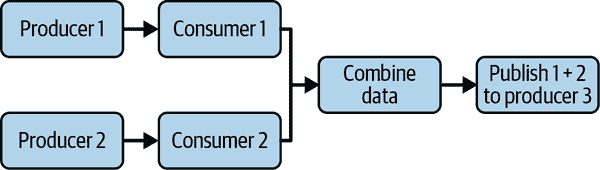

最后一点是批处理摄取与流式摄取的一个本质区别。批处理通常涉及静态工作流（摄取数据、存储数据、转换数据、提供数据），而消息和流则是流动的。摄取可以是非线性的，数据被发布、消费、再发布、再消费。在设计实时摄取工作流时，请牢记数据将如何流动。

另一个考量因素是实时数据管道的吞吐量。消息和事件应以尽可能低的延迟流动，这意味着你应该为分区（或分片）提供足够的带宽和吞吐量。为事件处理提供足够的内存、磁盘和 CPU 资源，如果你管理自己的实时管道，请引入 `autoscaling`（自动扩缩容）以应对峰值并在负载下降时节省成本。由于这些原因，管理流平台可能涉及大量开销。请考虑为实时摄取管道使用托管服务，并将精力集中在如何从实时数据中获取价值上。

## 托管数据连接器

如今，如果你正考虑编写一个连接到数据库或 API 的数据摄取连接器，请自问：这已经被创建过了吗？此外，是否有服务能为我管理该连接的繁杂细节？“API”提到了托管数据连接器平台和框架的流行度。这些工具旨在提供一套开箱即用的标准连接器，以免数据工程师构建复杂的管道来连接特定源。你不再需要创建和管理数据连接器，而是将这项服务外包给第三方。

通常，该领域的选项允许用户设置目标和源，以多种方式摄取数据（例如 `CDC`、复制、截断并重载），设置权限和凭证，配置更新频率，并开始同步数据。幕后的供应商或云会完全管理和监控数据同步。如果数据同步失败，你将收到包含错误原因日志信息的警报。

我们建议使用托管连接器平台，而不是自行创建和管理连接器。供应商和 `OSS`（开源软件）项目通常各自拥有数百个预构建的连接器选项，并能轻松创建自定义连接器。如今，数据连接器的创建和管理在很大程度上属于无差异的重体力劳动，应尽可能外包。

## 使用对象存储移动数据

对象存储是公有云中的多租户系统，支持存储海量数据。这使得对象存储成为在数据湖内外移动数据、团队间传输数据以及组织间传输数据的理想选择。你甚至可以通过 `signed URL`（签名 URL）提供对对象的短期访问，授予用户临时权限。

依我们来看，对象存储是处理文件交换最优且最安全的方式。公有云存储实施了最新的安全标准，拥有强劲的可扩展性和可靠性记录，接受任意类型和大小的文件，并提供高性能的数据移动。我们在第 6 章中更详细地讨论了对象存储。

## EDI

数据工程师面临的另一个实际情况是 `electronic data interchange`（EDI，电子数据交换）。该术语定义模糊，足以指代任何数据移动方法。它通常指某种过时的文件交换方式，例如通过电子邮件或闪存驱动器。数据工程师会发现，某些数据源不支持更现代的数据传输方式，这通常是因为陈旧的 IT 系统或人为流程限制。

工程师至少可以通过自动化来增强 EDI。例如，他们可以设置一个基于云的电子邮件服务器，一旦收到文件立即将其保存到公司对象存储中。这可以触发编排流程以摄取和处理数据。这比员工下载附件并手动上传到内部系统要稳健得多，而后者我们仍频繁见到。

## 数据库与文件导出

工程师应了解源数据库系统如何处理文件导出。对于许多事务型系统，导出涉及大规模数据扫描，会显著增加数据库负载。源系统工程师必须评估何时运行这些扫描而不影响应用性能，并可能选择一种策略来减轻负载。导出查询可以通过按键范围查询或一次查询一个分区，拆分为较小的导出。或者，`read replica`（只读副本）可以减轻负载。如果导出每天发生多次且与源系统高负载时期重合，只读副本尤为合适。

主流云数据仓库针对直接文件导出进行了高度优化。例如，Snowflake、BigQuery、Redshift 等支持以多种格式直接导出到对象存储。

## 常见文件格式的实际问题

工程师还应注意导出的文件格式。在撰写本文时，CSV 仍然无处不在且极易出错。首先，CSV 的默认分隔符也是英语中最常见的字符之一——逗号！但情况更糟。

CSV 绝非统一格式。工程师必须规定分隔符、引用字符和转义字符，以妥善处理字符串数据的导出。CSV 也不原生编码模式信息，也不直接支持嵌套结构。CSV 文件编码和模式信息必须在目标系统中配置，以确保正确摄取。自动检测是许多云环境提供的便利功能，但不适合生产环境摄取。作为最佳实践，工程师应在文件元数据中记录 CSV 编码和模式详情。

# 数据摄入格式与方法

## 稳健的导出格式

更稳健且表达力更强的导出格式包括 `Parquet`、`Avro`、`Arrow`、`ORC` 和 `JSON`。这些格式原生编码模式信息，且无需特殊干预即可处理任意字符串数据。其中许多格式还原生支持嵌套数据结构，因此 `JSON` 字段是使用内部嵌套结构存储，而非简单字符串。对于列式数据库，列式格式（`Parquet`、`Arrow`、`ORC`）能实现更高效的数据导出，因为列可以在格式间直接转码。这些格式通常也更针对查询引擎进行了优化。`Arrow` 文件格式旨在将数据直接映射到处理引擎内存中，在数据湖环境中提供高性能。

这些较新格式的劣势在于，许多源系统并不原生支持它们。数据工程师往往被迫处理 `CSV` 数据，并构建稳健的异常处理和错误检测机制，以确保摄入时的数据质量。更详尽的文件格式讨论请参见附录 A。

## Shell

`shell` 是一个接口，你可以通过它执行命令来摄入数据。Shell 可用于为几乎任何软件工具编写工作流脚本，且 Shell 脚本在摄入过程中仍被广泛使用。Shell 脚本可能从数据库读取数据，将其重新序列化为另一种文件格式，上传至对象存储，并触发目标数据库中的摄入进程。虽然在单个实例或服务器上存储数据扩展性不高，但我们的许多数据源规模并不大，此类方法完全够用。

此外，云厂商通常提供强大的基于 CLI 的工具。仅通过向 `AWS CLI` 发出命令即可运行复杂的摄入流程。随着摄入流程变得更复杂、SLA 要求更严格，工程师应考虑迁移到合适的编排系统。

## SSH

`SSH` 不是一种摄入策略，而是一种配合其他摄入策略使用的协议。我们主要通过以下几种方式使用 SSH。首先，如前所述，SSH 可配合 `SCP` 用于文件传输。其次，SSH 隧道用于建立通往数据库的安全、隔离连接。

应用数据库绝不应直接暴露在互联网上。取而代之，工程师可设置堡垒主机——即一台可连接目标数据库的中间主机实例。这台主机暴露在互联网上，但被锁定为仅允许来自指定 IP 地址对指定端口的最小访问权限。要连接数据库，远程机器首先建立到堡垒主机的 SSH 隧道连接，再从主机连接至数据库。

## SFTP 和 SCP

通过安全 FTP（`SFTP`）和安全复制（`SCP`）访问和发送数据是你应熟悉的技术，即使数据工程师通常不常规使用这些技术（IT 或安全/运维团队会处理这些）。

工程师听到 `SFTP` 理所当然会感到畏惧（偶尔我们甚至听到生产环境中仍在使用 `FTP` 的案例）。无论如何，`SFTP` 仍是许多企业的现实选择。它们与合作伙伴企业合作，后者使用 `SFTP` 消费或提供数据，且不愿依赖其他标准。为防止数据泄露，此类情况下的安全分析至关重要。

`SCP` 是一种基于 SSH 连接运行的文件交换协议。如果配置得当，`SCP` 可以是一种安全的文件传输选项。同样，强烈建议增加额外的网络访问控制（纵深防御）以增强 `SCP` 的安全性。

## Webhooks

正如我们在第 5 章所述，`Webhooks` 常被称为*反向 API*。对于典型的 REST 数据 API，数据提供方提供 API 规范，工程师据此编写数据摄入代码。代码发起请求并在响应中接收数据。

使用 Webhook（图 7-15）时，数据提供方定义 API 请求规范，但数据提供方*发起 API 调用*而非接收调用；数据消费方负责提供 API 端点供提供方调用。消费方负责摄入每个请求，并处理数据聚合、存储和处理。

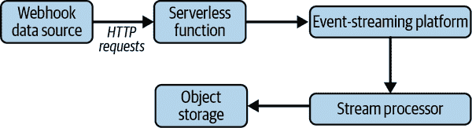

基于 Webhook 的数据摄入架构可能脆弱、难以维护且效率低下。借助合适的现成工具，数据工程师可构建维护成本和基础设施成本更低、更稳健的 Webhook 架构。例如，AWS 中的 Webhook 模式可能使用无服务器函数框架（`Lambda`）接收传入事件、托管事件流平台存储和缓冲消息（`Kinesis`）、流处理框架处理实时分析（`Flink`），以及对象存储用于长期存储（`S3`）。

你会注意到，此架构的功能远不止简单摄取数据。这凸显了摄入与数据工程生命周期其他阶段的纠缠；在不做出存储和处理决策的情况下，往往无法定义摄入架构。

## Web 界面

用于数据访问的 Web 界面仍是数据工程师的现实课题。我们经常遇到这样的情况：SaaS 平台并非所有数据和功能都通过 API 和文件投放等自动化接口暴露。取而代之，必须有人手动访问 Web 界面、生成报表并将文件下载到本地机器。这有明显缺点，如人员忘记运行报表或笔记本电脑损坏。在可能的情况下，应选择允许自动化访问数据的工具和工作流。

## 网页抓取

`Web scraping`（网页抓取）可自动从网页提取数据，通常通过遍历网页的各种 `HTML` 元素实现。你可能抓取电商网站以提取产品价格信息，或抓取多个新闻网站为你的新闻聚合器服务。网页抓取广泛存在，作为数据工程师你可能会遇到。这也是一个伦理和法律界限模糊的灰色地带。

在开展任何网页抓取项目前，请注意以下高层建议。首先，自问是否应该进行网页抓取，或数据是否可从第三方获取。如果决定抓取，请做个良民。不要无意中造成拒绝服务（`DoS`）攻击，也不要导致自己的 IP 地址被封禁。了解你产生的流量量级，并适当控制网络爬虫活动节奏。仅仅因为你能启动数千个并发 `Lambda` 函数进行抓取，并不意味着你应该这么做；过度的网页抓取可能导致你的 `AWS` 账户被禁用。

其次，注意活动的法律后果。同样，发起 `DoS` 攻击可能招致法律后果。违反服务条款的行为可能给你的雇主或你个人带来麻烦。

第三，网页不断变更其 `HTML` 元素结构，使得保持网页抓取器更新变得棘手。自问一下，维护这些系统的麻烦是否值得付出精力？

网页抓取对数据工程生命周期的处理阶段有着有趣的影响；工程师应在网页抓取项目伊始就考虑各种因素。你打算如何处理这些数据？是仅使用 `Python` 代码从抓取的 `HTML` 中提取所需字段并写入数据库？还是打算保留抓取网站的完整 `HTML` 代码，并使用 `Spark` 等框架处理这些数据？这些决策可能导致摄入下游出现截然不同的架构。

## 用于数据迁移的传输设备

# 面向海量数据的传输设备

对于海量数据（100 TB 或更多），通过互联网直接传输数据可能是一个缓慢且昂贵的过程。在该规模下，移动数据最快、最高效的方式不是“走线”，而是“走卡车”。云厂商提供通过物理“硬盘箱”发送数据的能力。只需订购一个称为 `transfer appliance` 的存储设备，从服务器加载数据，然后将其寄回云厂商，由云厂商上传数据。

建议考虑使用 `transfer appliance` 的场景是数据量在 100 TB 左右。在极端情况下，AWS 甚至提供 [Snowmobile](https://oreil.ly/r9vLY)，这是一种以半挂车形式送达的 `transfer appliance`！`Snowmobile` 旨在整体迁移整个数据中心，数据量达到 PB 级或更高。

`Transfer appliances` 非常适合创建混合云或多云架构。例如，Amazon 的数据传输设备（`AWS Snowball`）支持导入和导出。要迁移到第二个云，用户可以将数据导出到 `Snowball` 设备，然后导入到第二个 `transfer appliance` 以将数据移入 GCP 或 Azure。这听起来可能很笨拙，但即使在云之间通过互联网推送数据可行的情况下，数据出站费用也会使其成为一项昂贵的举措。当数据量巨大时，物理 `transfer appliances` 是一种更便宜的替代方案。

请记住，`transfer appliances` 和数据迁移服务是一次性数据摄入事件，**不建议**用于持续性工作负载。假设你有工作负载需要在混合云或多云场景中持续移动数据。在这种情况下，你的数据量推测是持续以批处理或流式方式处理小得多的数据量。

# 数据共享

`Data sharing` 正成为一种日益流行的数据消费选项（参见第 `#ch05.html#data_generation_in_source_systems` 章和 `#ch06.html#storage-id000094` 章）。数据提供方将数据集提供给第三方订阅者，无论是免费还是付费。这些数据集通常以只读方式共享，这意味着你可以将这些数据集与自己的数据（及其他第三方数据集）集成，但你并不拥有共享数据集的所有权。严格来说，这不属于摄入，因为摄入意味着你获得数据集的物理占有权。如果数据提供方决定移除你对某数据集的访问权限，你将不再能访问它。

许多云平台提供 `data sharing`，允许你共享数据并从各种提供方消费数据。其中一些平台还提供数据市场，公司和组织可以在其中出售其数据。

# 你将与谁共事

数据摄入处于多个组织边界之上。在开发和管理数据摄入管道时，数据工程师将与上游（数据生产者）和下游（数据消费者）的人员及系统共事。

## 上游利益相关者

负责 `generating data` 的人员——通常是软件工程师——与将准备这些数据用于分析和数据科学的数据工程师之间，往往存在显著的脱节。软件工程师和数据工程师通常处于不同的组织孤岛中；如果他们考虑到数据工程师，通常只是将他们视为其应用程序产生的数据废气的下游消费者，而非利益相关者。

我们将这种现状视为一个问题，也是一个重大机遇。数据工程师可以通过邀请软件工程师成为数据工程成果的利益相关者，来提高数据质量。绝大多数软件工程师都清楚分析和数据科学的价值，但不一定有协调一致的激励机制来直接为数据工程工作做贡献。

仅改善沟通就是一个重要的第一步。通常软件工程师已经识别出对下游消费有潜在价值的数据。开放沟通渠道鼓励软件工程师为消费者整理数据，并沟通数据变更以防止管道回归。

除了沟通，数据工程师还可以向团队成员、高管，尤其是产品经理突出软件工程师的贡献。让产品经理参与成果，并将下游数据处理视为产品的一部分，鼓励他们分配稀缺的软件开发资源与数据工程师协作。理想情况下，软件工程师可以部分作为数据工程团队的延伸工作；这使他们能够在各种项目上协作，例如创建事件驱动架构以实现实时分析。

## 下游利益相关者

数据摄入的最终客户是谁？数据工程师关注数据从业者和技术领导者，如数据科学家、分析师和首席技术官。他们最好也记住更广泛的业务利益相关者圈子，如市场总监、供应链副总裁和 CEO。

我们经常看到数据工程师追求复杂的项目（例如实时流式总线或复杂的数据系统），而隔壁的数字营销经理却只能手动下载 Google Ads 报告。将数据工程视为一项业务，并认识到你的客户是谁。通常，摄入流程的基础自动化具有显著价值，特别是对于控制巨额预算且处于业务收入核心的市场部门等部门。基础摄入工作可能看起来枯燥乏味，但为公司这些核心部分交付价值将开启更多预算和更令人兴奋的长期数据工程机会。

数据工程师还可以邀请更多高管参与这一协作过程。数据驱动文化在商业领导圈中非常流行，这是有充分理由的。但由数据工程师和其他数据从业者为高管提供关于数据驱动型业务最佳结构的指导。这意味着沟通降低数据生产者与数据工程师之间壁垒的价值，同时支持高管打破孤岛并建立激励机制，从而形成更统一的数据驱动文化。

再次强调，`communication` 是关键。与利益相关者早期、频繁且诚恳地沟通，将极大地确保你的数据摄入增加价值。

# 暗流

几乎所有暗流都涉及摄入阶段，但我们将在此强调最显著的几个。

## 安全性

移动数据会引入安全漏洞，因为你必须在不同位置之间传输数据。你最不希望的就是在移动过程中捕获或泄露数据。

考虑数据驻留在哪里以及要去往何处。需要在 `VPC` 内移动的数据应使用安全终端节点，且绝不应离开 `VPC` 的范围。如果你需要在云和本地网络之间发送数据，请使用 `VPN` 或专用私有连接。这可能会花费资金，但安全性是一项很好的投资。如果你的数据遍历公共互联网，请确保传输已加密。通过网络加密数据始终是一个好的实践。

## 数据管理

数据管理自然始于数据摄入。这是血缘和数据编目的起点；从这一点开始，数据工程师需要考虑模式变更、伦理、隐私和合规性。

### 模式变更

从我们的角度来看，`Schema changes`（如在数据库表中添加、更改或删除列）仍然是数据管理中一个未解决的问题。传统方法是谨慎的指挥控制审查流程。在与大型企业客户合作时，我们被告知添加单个字段的交付周期长达六个月。这是对敏捷性不可接受的阻碍。

# 模式演进与受 Git 启发的方法

在光谱的另一端，源端的任何模式变更都会触发目标表使用新模式重新创建。这解决了摄入阶段的模式问题，但仍可能破坏下游管道和目标存储系统。

一种可能的解决方案，是我们作者酝酿已久的，即 Git 版本控制所开创的方法。当 Linus Torvalds 开发 Git 时，他的许多选择都受到并行版本系统（CVS）局限性的启发。CVS 完全集中化；它仅支持一个当前的官方代码版本，存储在中央项目服务器上。为了使 Git 成为一个真正的分布式系统，Torvalds 使用了树的概念；每个开发者可以维护自己处理过的代码分支，然后向其他分支合并或从其他分支合并。

几年前，这种数据处理方法是不可想象的。本地 MPP 系统通常在接近最大存储容量的情况下运行。然而，在大数据和云数据仓库环境中，存储很便宜。人们可以很容易地维护多个具有不同模式甚至不同上游转换的表版本。团队可以通过使用 Airflow 等编排工具支持表的各种“开发”版本；模式变更、上游转换和代码变更可以在正式更改 `main` 表之前出现在开发表中。

## 数据伦理、隐私与合规

客户经常向我们咨询关于在数据库中加密敏感数据的建议，这通常会引出一个根本性问题：你是否需要试图加密的那些敏感数据？事实证明，在制定需求和解决问题时，这个问题经常被忽视。

数据工程师在设置摄入管道时，应始终训练自己提出这个问题。他们不可避免地会遇到敏感数据；自然的倾向是摄入它并将其转发给管道中的下一步。但如果不需要这些数据，为什么要收集它？为什么不直接在数据存储前丢弃敏感字段？如果从未收集，数据就不会泄露。

在确实需要跟踪敏感身份的情况下，常见的做法是应用标记化来匿名化模型训练和分析中的身份。但工程师应审视标记化的使用位置。如果可能，在摄入时对数据进行哈希处理。

在某些情况下，数据工程师无法避免处理高度敏感的数据。一些分析系统必须呈现可识别的敏感信息。工程师在处理敏感数据时，必须遵循最高的道德标准。此外，他们可以采取多种实践来减少对敏感数据的直接处理。在涉及敏感数据时，应尽可能追求*无接触生产*。这意味着工程师在开发和暂存环境中使用模拟或清洗后的数据进行开发和测试，但通过自动化代码部署到生产环境。

无接触生产是工程师应努力追求的理想，但不可避免地会出现一些无法在开发和暂存环境中完全解决的情况。如果不查看触发回归的实时数据，某些 Bug 可能无法复现。对于这些情况，应建立破玻璃取钥流程：要求至少两人批准访问生产环境中的敏感数据。此访问权限应严格限定在特定问题范围内，并附带过期日期。

关于敏感数据的最后一点建议：警惕用天真的技术方案解决人为问题。加密和标记化常被视为隐私保护的灵丹妙药。大多数云存储系统和几乎所有数据库默认都会对静态和传输中的数据进行加密。通常，我们看到的不是加密问题，而是数据访问问题。解决方案是对单个字段应用额外一层加密，还是控制对该字段的访问？毕竟，人们仍必须严格管理加密密钥的访问权限。单字段加密存在合法用例，但要警惕仪式化的加密。

在标记化方面，要运用常识并评估数据访问场景。如果有人拥有你某位客户的邮箱，他们能否轻松地对邮箱进行哈希并在你的数据中找到该客户？如果不加盐等策略就盲目地对数据进行哈希，可能无法像你想象的那样保护隐私。

## DataOps

可靠的数据管道是数据工程生命周期的基石。一旦它们失效，所有下游依赖都会戛然而止。数据仓库和数据湖无法获得新鲜数据补充，数据科学家和分析师无法有效开展工作；业务被迫在“盲飞”状态下运行。

确保数据管道得到妥善监控，是迈向可靠性和有效事件响应的关键一步。如果在数据工程生命周期中有一个阶段的监控至关重要，那就是摄入阶段。薄弱或不存在的监控意味着管道可能在工作，也可能不在工作。回顾我们之前关于时间的讨论，请务必跟踪时间的各个方面——事件创建、摄入、处理和加工时间。你的数据管道应能以批处理或流处理的方式可预测地处理数据。我们见过无数由陈旧数据生成的报表和机器学习模型。在一个极端案例中，摄入管道故障长达六个月未被发现。（有人可能会质疑该实例中数据的实际效用，但那是另一回事。）通过适当的监控，这完全可以避免。

应该监控什么？正常运行时间、延迟和处理的数据量是很好的切入点。如果摄入作业失败，你将如何响应？一般来说，从一开始就将监控构建到管道中，而不是等到部署时才添加。

监控固然关键，了解你所依赖的上游系统的行为及其数据生成方式同样重要。你应该了解你关心的时间间隔内生成的事件数量（每分钟事件数、每秒事件数等）以及每个事件的平均大小。你的数据管道应能处理你摄入的事件的频率和大小。

这也适用于第三方服务。对于这些服务，你在精益运营效率（减少人员）方面的收益，被你依赖的系统超出你控制范围这一事实所抵消。如果你使用第三方服务（云、数据集成服务等），当服务中断时如何收到警报？如果你依赖的服务突然离线，你的响应计划是什么？

遗憾的是，不存在针对第三方故障的通用响应计划。如果你可以故障转移到其他服务器，最好是另一个可用区或区域，一定要设置好。

如果你的数据摄入流程是内部构建的，你是否拥有适当的测试和部署自动化，以确保代码在生产环境中正常运行？如果代码有 Bug 或失败，你能否回滚到一个可工作的版本？

### 数据质量测试

我们常称数据为“隐形杀手”。如果高质量、有效的数据是当今商业成功的基石，那么使用坏数据做决策比没有数据要糟糕得多。坏数据给企业造成了无法估量的损失；这些数据灾难有时被称为*数据灾难*。[²]

数据具有熵增特性；它经常在毫无预警的情况下以意想不到的方式发生变化。DevOps 和 DataOps 之间的一个固有区别在于：我们预期软件回归仅在部署变更时发生，而数据往往会因我们无法控制的事件而独立地出现回归。

[²]: 参考脚注

DevOps 工程师通常能够通过使用二元条件来检测问题。请求失败率是否突破了特定阈值？响应延迟如何？在数据领域，回归问题通常表现为微妙的统计扭曲。搜索词统计的变化是客户行为导致的吗？是逃过检测的机器人流量激增导致的吗？还是公司其他部门部署的网站测试工具导致的？

就像 DevOps 中的系统故障一样，某些数据回归问题显而易见。例如，在 2000 年代初，当用户从搜索结果到达网站时，Google 会向网站提供搜索词。2011 年，Google 开始在某些情况下隐瞒此信息，以更好地保护用户隐私。分析师迅速发现“未提供”冒到了报表顶部。^(3)

真正危险的数据回归问题是隐蔽的，且可能来自企业内部或外部。应用程序开发人员可能会在未与数据团队充分沟通的情况下更改数据库字段的含义。来自第三方来源的数据变更可能不被察觉。在最好的情况下，报表会以显而易见的方式损坏。通常情况下，业务指标会在决策者毫不知情的情况下被扭曲。

只要可能，就与软件工程师合作，在源头修复数据质量问题。令人惊讶的是，通过遵循软件工程的基本最佳实践，可以解决多少数据质量问题，例如：用于记录数据变更历史的日志、检查（`nulls` 等）和异常处理（`try`、`catch` 等）。

传统的数据测试工具通常建立在简单的二元逻辑之上。非空字段中是否出现了空值？分类列中是否出现了新的、意外的项目？统计数据测试是一个新领域，但极有可能在未来五年内大幅增长。

## 编排

摄入通常位于庞大复杂的数据图的起始位置；由于摄入是数据工程生命周期的第一阶段，摄入的数据将流入更多的数据处理步骤，来自多个来源的数据将以复杂的方式混合在一起。正如我们在全书中强调的那样，编排是协调这些步骤的关键流程。

处于数据成熟度早期阶段的组织可能会选择将摄入流程部署为简单的计划 `cron` 作业。然而，必须认识到，这种方法脆弱不堪，会拖慢数据工程部署和开发的速度。

随着数据管道复杂性的增长，真正的编排变得必要。所谓真正的编排，是指能够调度完整任务图而非单个任务的系统。编排可以在适当的计划时间启动每个摄入任务。下游处理和转换步骤在摄入任务完成后开始。再往下游，处理步骤会引出更多的处理步骤。

## 软件工程

数据工程生命周期的摄入阶段工程属性强。该阶段位于数据工程领域的边缘，通常与外部系统交互，软件工程师和数据工程师必须构建各种定制的“管道连接”。

幕后摄入极其复杂，团队通常运行像 Kafka 或 Pulsar 这样的开源框架，或者一些最大的科技公司运行自己分叉或自研的摄入解决方案。正如本章所讨论的，托管数据连接器简化了摄入流程，例如 Fivetran、Matillion 和 Airbyte。数据工程师应利用最佳可用工具——主要是为你承担大量繁重工作的托管工具和服务——并在关键领域培养高水平的软件开发能力。对任何与摄入相关的代码使用适当的版本控制和代码审查流程并实施适当的测试，是值得的。

编写软件时，代码需要解耦。避免编写与源系统或目标系统存在紧密依赖的单体系统。

# 结论

作为数据工程师，摄入工作很可能会消耗你大量的精力和努力。从本质上讲，摄入就是管道工程，将管道连接到管道，确保数据持续、安全地流向目的地。有时，摄入的琐碎细节可能让人感到乏味，但如果没有它，令人兴奋的数据应用（例如分析和机器学习）就无法实现。

正如我们所强调的，我们正处于一场巨变之中，正从批处理向流式数据管道转变。这为数据工程师提供了一个机会，去发掘流式数据的有趣应用，向业务方传达这些应用，并部署激动人心的新技术。

# 附加资源

*   Airbyte 的 [“Connections and Sync Modes” 网页](https://oreil.ly/mCOvd)
*   Ellen Friedman 和 Kostas Tzoumas 所著 [*Introduction to Apache Flink*](https://oreil.ly/PAyf7) (O'Reilly) 第 6 章 “Batch Is a Special Case of Streaming”
*   Tyler Akidau 等人撰写的 [“The Dataflow Model: A Practical Approach to Balancing Correctness, Latency, and Cost in Massive-Scale, Unbounded, Out-of-Order Data Processing”](https://oreil.ly/ktS3p)
*   Google Cloud 的 [“Streaming Pipelines” 网页](https://oreil.ly/BC1Np)
*   Microsoft 的 [“Snapshot Window (Azure Stream Analytics)” 文档](https://oreil.ly/O7S7L)

^(1) Karl Hughes, “The Bulk of Software Engineering Is Just Plumbing,” Karl Hughes website, July 8, 2018, [*https://oreil.ly/uIuqJ*](https://oreil.ly/uIuqJ).

^(2) Andy Petrella, “Datastrophes,” *Medium*, March 1, 2021, [*https://oreil.ly/h6FRW*](https://oreil.ly/h6FRW).

^(3) Danny Sullivan, “Dark Google: One Year Since Search Terms Went ‘Not Provided,’” *MarTech*, October 19, 2012, [*https://oreil.ly/Fp8ta*](https://oreil.ly/Fp8ta).
