# 第 8 章 查询、建模与转换

到目前为止，数据工程生命周期的各个阶段主要关注将数据从一处传递到另一处或对其进行存储。在本章中，你将学习如何让数据变得有用。通过理解查询、建模和转换（参见 图 8-1），你将拥有将原始数据成分转化为下游利益相关者可消费内容的工具。

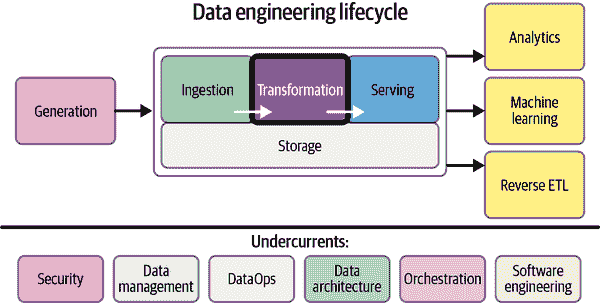

我们将首先讨论查询及其背后的重要模式。其次，我们将探讨可用于将业务逻辑引入数据的主要数据建模模式。然后，我们将介绍转换，它获取数据模型的逻辑和查询结果，使其便于下游更直接地消费。最后，我们将介绍你将与谁合作，以及与本章相关的潜在暗流。

可以使用多种技术在 SQL 和 NoSQL 数据库中查询、建模和转换数据。本节重点关注针对 OLAP 系统（如数据仓库或数据湖）的查询。虽然存在多种查询语言，但为了方便和熟悉度，本章大部分内容将重点关注 SQL，这是最流行和通用的查询语言。OLAP 数据库和 SQL 的大多数概念适用于其他类型的数据库和查询语言。本章假设你了解 SQL 语言及主键、外键等相关概念。如果这些概念对你陌生，有无数资源可以帮助你入门。


本章术语说明。为方便起见，我们将使用术语`database`作为查询引擎及其查询的存储的简写；这可能是云数据仓库，或 Apache Spark 查询存储在 S3 中的数据。我们假设`database`具有在底层组织数据的存储引擎。这延伸至基于文件的查询（将 CSV 文件加载到 Python 笔记本中）以及针对 Parquet 等文件格式的查询。

此外请注意，本章主要关注结构化和半结构化数据相关的查询、建模模式和转换，这些是数据工程师常用的。讨论的许多实践也可应用于处理非结构化数据，如图像、视频和原始文本。

在深入建模和转换数据之前，让我们先看看查询——它们是什么、如何工作、提升查询性能的考量因素，以及流数据查询。

# Queries（查询）

查询是数据工程、数据科学和分析的基础部分。在了解转换的底层模式和技术之前，你需要理解什么是查询、它们如何在各种数据上工作，以及提升查询性能的技术。

本节主要关注表格和半结构化数据上的查询。作为数据工程师，你最频繁地查询和转换这些数据类型。在深入探讨查询、数据建模和转换的更复杂主题之前，让我们先回答一个简单的问题：什么是查询？

## What Is a Query?（什么是查询？）

我们经常遇到会写 SQL 但不熟悉查询底层工作原理的人。如果你是经验丰富的数据工程师，其中一些关于查询的入门材料可能比较熟悉；请随意跳过。

`query`允许你检索并操作数据。回顾我们在第 5 章关于 CRUD 的对话。当查询检索数据时，它发出读取记录模式的请求。这是 CRUD 中的`R`（read）。你可能会发出查询获取表`foo`的所有记录，如`SELECT * FROM foo`。或者，你可能应用谓词（逻辑条件）按`id`为`1`的记录过滤数据，使用 SQL 查询`SELECT * FROM foo WHERE id=1`。

许多数据库允许你创建、更新和删除数据。这些是 CRUD 中的`CUD`；你的查询将创建、修改或销毁现有记录。让我们回顾一下使用查询语言时会遇到的其他常见缩写。

### Data definition language（数据定义语言）

从高层来看，你首先需要创建数据库对象，然后才能添加数据。你将使用`data definition language`（DDL）命令对数据库对象（如数据库本身、模式、表或用户）执行操作；DDL 定义数据库中对象的状态。

数据工程师使用常见的 SQL DDL 表达式：`CREATE`、`DROP`和`UPDATE`。例如，你可以使用 DDL 表达式`CREATE DATABASE bar`创建数据库。之后，你也可以创建新表（`CREATE table bar_table`）或删除表（`DROP table bar_table`）。

### Data manipulation language（数据操作语言）

使用 DDL 定义数据库对象后，你需要在这些对象中添加和修改数据，这是`data manipulation language`（DML）的主要目的。作为数据工程师，你将使用的一些常见 DML 命令如下：

```
SELECT
INSERT
UPDATE
DELETE
COPY
MERGE
```

例如，你可以`INSERT`新记录到数据库表，`UPDATE`现有记录，并`SELECT`特定记录。

### Data control language（数据控制语言）

你很可能希望限制对数据库对象的访问，并精细控制`who`有权访问`what`。`data control language`（DCL）允许你通过使用 SQL 命令（如`GRANT`、`DENY`和`REVOKE`）控制对数据库对象或数据的访问。

让我们通过一个使用 DCL 命令的简短示例进行演示。一位名叫 Sarah 的新数据科学家加入你的公司，她需要对名为`data_science_db`的数据库拥有只读访问权限。你通过以下 DCL 命令授予 Sarah 访问该数据库的权限：

```
GRANT SELECT ON data_science_db TO user_name Sarah;
```

就业市场火热，Sarah 在公司工作仅几个月就被一家大型科技公司挖走了。再见了，Sarah！作为一名注重安全的数据工程师，你移除 Sarah 读取数据库的能力：

```
REVOKE SELECT ON data_science_db TO user_name Sarah;
```

访问控制请求和问题很常见，理解 DCL 将帮助你解决你或团队成员无法访问所需数据的问题，并防止访问不需要的数据。

### Transaction control language（事务控制语言）

顾名思义，`transaction control language`（TCL）支持控制事务细节的命令。通过 TCL，我们可以定义提交检查点、操作回滚的条件等。两个常见的 TCL 命令包括`COMMIT`和`ROLLBACK`。

## The Life of a Query（查询的生命周期）

查询如何工作？执行查询时会发生什么？让我们通过一个典型 SQL 查询在数据库中执行的示例，介绍查询执行的高层基础知识（图 8-2）。

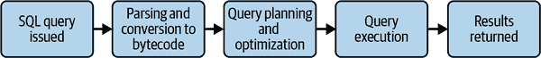

虽然运行查询看起来很简单——写代码、运行、获取结果——但在底层发生了很多事情。当你执行 SQL 查询时，以下是发生的过程摘要：

1.  数据库引擎编译 SQL，解析代码以检查语义是否正确，确保引用的数据库对象存在，且当前用户拥有访问这些对象的适当权限。

2.  SQL 代码被转换为字节码。该字节码以高效、机器可读的格式表达必须在数据库引擎上执行的步骤。

3.  数据库的查询优化器分析字节码，确定如何执行查询，重新排序和重构步骤，以尽可能高效地利用可用资源。

4.  查询被执行，生成结果。

## The Query Optimizer（查询优化器）

查询的执行时间可能截然不同，取决于它们如何被执行。查询优化器的工作是通过将查询分解为适当的步骤并按高效顺序执行，来优化查询性能并最小化成本。优化器将评估连接、索引、数据扫描大小和其他因素。查询优化器尝试以成本最低的方式执行查询。

查询优化器是查询性能的基础。每个数据库都不同，以明显和微妙的不同方式执行查询。你不会直接与查询优化器打交道，但理解其部分功能将帮助你编写性能更好的查询。你需要知道如何分析查询性能，使用如执行计划或查询分析等工具，下一节将介绍。

## Improving Query Performance（提升查询性能）

在数据工程中，你不可避免地会遇到性能不佳的查询。知道如何识别和修复这些查询非常宝贵。不要与数据库对抗。学会发挥其优势，弥补其弱点。本节展示提升查询性能的各种方法。

### Optimize your join strategy and schema（优化你的连接策略和模式）

单个数据集（如表或文件）本身很少有用；我们通过将其与其他数据集结合来创造价值。`Joins`是结合数据集并创建新数据集最常用的手段之一。我们假设你熟悉主要的连接类型（如 inner、outer、left、cross）和连接关系类型（如一对一、一对多、多对一、多对多）。


# 查询性能优化

连接操作在数据工程中至关重要，且在许多数据库中得到了良好的支持和性能表现。即使是列式数据库，过去因连接性能慢而著称，现在通常也提供卓越的性能。

一种提高查询性能的常用技术是*预连接*数据。如果你发现分析查询反复连接相同的数据，那么提前连接数据并让查询从预连接版本的数据中读取通常是合理的，这样就不会重复进行计算密集型工作。这可能意味着更改模式并放宽规范化条件以拓宽表，并利用较新的数据结构（如数组或结构体）来替换频繁连接的实体关系。另一种策略是保持更规范化的模式，但为最常见的分析和数据科学用例预连接表。我们可以简单地创建预连接表并培训用户使用它们，或者在物化视图中进行连接（请参阅“物化视图、联邦与查询虚拟化”）。

接下来，考虑连接条件的细节和复杂性。复杂的连接逻辑可能会消耗大量计算资源。我们可以通过几种方式提高复杂连接的性能。

许多面向行的数据库允许你索引从行计算得出的结果。例如，PostgreSQL 允许你在转换为小写的字符串字段上创建索引；当优化器遇到谓语中出现 `lower()` 函数的查询时，它可以应用该索引。你也可以为连接创建一个新的派生列，但你需要培训用户在此列上进行连接。

最后，使用公用表表达式（CTE）代替嵌套子查询或临时表。CTE 允许用户以可读的方式组合复杂查询，帮助你理解查询的流程。复杂查询的可读性重要性怎么强调都不为过。

在许多情况下，CTE 的性能也将优于创建中间表的脚本；如果你必须创建中间表，请考虑创建临时表。如果你想了解更多关于 CTE 的信息，快速搜索网络将获得大量有用的信息。

## 使用执行计划并了解查询性能

正如你在前一节中所学，数据库的查询优化器会影响查询的执行。查询优化器的执行计划将向你展示查询优化器如何确定其最优的最低成本查询、使用的数据库对象（表、索引、缓存等），以及每个查询阶段的各种资源消耗和性能统计信息。一些数据库提供查询阶段的可视化表示。相比之下，其他数据库则通过 SQL 的 `EXPLAIN` 命令提供执行计划，该命令显示数据库执行查询将采取的步骤序列。

除了使用 `EXPLAIN` 了解查询*如何*运行外，你还应该监控查询性能，查看数据库资源消耗的指标。以下是一些需要监控的领域：

- 磁盘、内存和网络等关键资源的使用情况。
- 数据加载时间与处理时间的对比。
- 查询执行时间、记录数、扫描数据大小和洗牌数据量。
- 可能导致数据库资源争用的竞争查询。
- 已用并发连接数与可用连接数的对比。过度订阅的并发连接会对无法连接到数据库的用户产生负面影响。

## 避免全表扫描

所有查询都会扫描数据，但并非所有扫描都是平等的。根据经验法则，你应该只查询所需的数据。当你运行不带谓语的 `SELECT *` 时，你是在扫描整个表并检索每一行和每一列。从性能角度来看，这非常低效且代价高昂，特别是当你使用按量付费的数据库时，该数据库会根据扫描的字节数或查询运行时使用的计算资源向你收费。

只要可能，请使用*裁剪*来减少查询中扫描的数据量。列式和面向行的数据库需要不同的裁剪策略。在面向列的数据库中，你应该只选择所需的列。大多数面向列的 OLAP 数据库还提供优化表以获得更好查询性能的额外工具。例如，如果你有一个非常大的表（大小为数 TB 或更大），Snowflake 和 BigQuery 允许你在表上定义聚簇键，这会以一种方式排序表的数据，使查询能更高效地访问超大数据集的部分数据。BigQuery 还允许你将表分区为更小的段，从而只查询特定分区而不是整个表。（请注意，不当的聚簇和键分布策略可能会降低性能。）

在面向行的数据库中，裁剪通常围绕表索引展开，你在第 6 章中已了解过。一般策略是创建表索引，以提高对性能最敏感的查询的性能，同时避免因索引过多而降低性能。

## 了解数据库如何处理提交

数据库*提交*是数据库内的一种更改，例如创建、更新或删除记录、表或其他数据库对象。许多数据库支持*事务*——即以维护一致状态的方式同时提交多个操作的概念。请注意，术语*事务*有些过载；请参阅第 5 章。事务的目的是在数据库处于活动状态时以及发生故障时，保持数据库的一致状态。当多个并发事件可能从同一数据库对象读取、写入和删除时，事务还处理隔离性。没有事务，用户查询数据库时可能会获得潜在的冲突信息。

你应该深入了解你的数据库如何处理提交和事务，并确定查询结果的预期一致性。你的数据库是否以符合 ACID 的方式处理写入和更新？如果不符合 ACID，你的查询可能会返回意外结果。这可能源于脏读，即读取了一行，而一个未提交的事务已经修改了该行。脏读是你数据库的预期行为吗？如果是，你如何处理？此外，请注意，在更新和删除事务期间，某些数据库会创建新文件来表示数据库的新状态，并保留旧文件以用于故障检查点参考。在这些数据库中，运行大量小提交会导致杂乱并消耗大量存储空间，可能需要定期进行清理。

让我们简要考虑三个数据库，以了解提交的影响（请注意，这些示例基于撰写时的情况）。首先，假设我们正在查看一个 PostgreSQL RDBMS 并应用 ACID 事务。每个事务由一组操作组成，这些操作作为一个整体要么失败要么成功。我们还可以跨多行运行分析查询；这些查询将呈现数据库在某一时间点的一致快照。

PostgreSQL 方法的缺点是它需要*行锁定*（阻塞对特定行的读取和写入），这会以各种方式降低性能。PostgreSQL 未针对大规模扫描或适合大规模分析应用程序的海量数据进行优化。


# 数据库提交模型与一致性

## Google BigQuery

接下来看 **Google BigQuery**。它采用**时间点全表提交模型**。发起读查询时，BigQuery 会从表的最新已提交快照读取。无论查询运行 1 秒还是 2 小时，它只会读取该快照，不会看到后续任何变更。读取期间 BigQuery **不会锁表**。相反，后续写操作会创建新的提交和新快照，而查询继续在其开始时的快照上运行。

为防止不一致状态，BigQuery **同一时间只允许一个写操作**。在此意义上，BigQuery **完全不提供写并发性**。（但在“单条写查询内部可并行写入海量数据”这一意义上，它具有高并发性。）若多个客户端尝试同时写入，写查询会按到达顺序排队。BigQuery 的提交模型与 **Snowflake**、**Spark** 等类似。

## MongoDB

最后看 **MongoDB**。我们称其为**“可变一致性数据库”**。工程师可在数据库层面和单个查询层面配置多种一致性选项。MongoDB 以**非凡的可扩展性和写并发性**著称，但也因工程师滥用而引发问题而“臭名昭著”。^(1)

例如，某些模式下 MongoDB 支持**超高写性能**，但代价是：流量过大时，数据库会**悄无声息地丢弃写入**。这完全适合**可容忍数据丢失**的应用——如物联网场景，只需大量测量值，不要求捕获所有测量值。但不适合**需要精确数据和统计**的应用。

这绝不意味着这些是糟糕的数据库。只要为合适的应用**正确选择并配置**，它们都是极好的数据库。几乎所有数据库技术皆是如此。

公司雇佣工程师并非让他们孤立地写代码。工程师应**深入理解**所解决的问题和技术工具，方不负其名。这适用于提交与一致性模型，也适用于技术性能的方方面面。**恰当的技术选型与配置**，最终能区分“非凡的成功”与“巨大的失败”。更深入的一致性讨论请参阅 第 6 章。

### 清理死记录

正如刚才所讨论，事务在更新、删除、索引操作等过程中会创建新记录，同时保留旧记录作为指向数据库上一状态的指针。随着这些旧记录在数据库文件系统中累积，最终不再需要被引用。你应通过**“真空清理”** 过程移除这些死记录。

可对单表、多表或数据库中所有表执行 `VACUUM`。无论如何选择，删除死记录至关重要，原因有三：
1. 释放空间供新记录使用，减少表膨胀，加快查询。
2. 新且相关的记录使查询计划更准确；过时记录会导致优化器生成次优甚至错误的计划。
3. 清理劣质索引，提升索引性能。

不同类型数据库处理 `VACUUM` 操作的方式不同。例如，**对象存储型数据库**（BigQuery、Snowflake、Databricks）中，旧数据保留的唯一缺点是占用存储空间，可能因存储定价模型产生费用。
- **Snowflake**：用户无法直接 `VACUUM`，而是控制“时间旅行”间隔，决定表快照保留多久后自动清理。
- **BigQuery**：采用固定的 **7 天历史窗口**。
- **Databricks**：通常无限期保留数据，直到手动 `VACUUM`；清理对控制直接 S3 存储成本很重要。

**Amazon Redshift** 以多种配置管理集群磁盘^(2)，`VACUUM` 会影响性能和可用存储。`VACUUM` 会在后台自动运行，但用户有时需手动运行以调优。

对于 **PostgreSQL** 和 **MySQL** 等关系型数据库，`VACUUM` 更为关键。大量事务操作会导致死记录快速累积，使用这些系统的工程师需熟悉 `VACUUM` 的细节与影响。

### 利用缓存查询结果

假设你有一个**高强度查询**，经常在**按查询数据量收费**的数据库上运行。每次运行都要花钱。与其反复重跑同一查询产生巨额费用，不如将查询结果存储起来即时检索？幸运的是，许多云 OLAP 数据库会**缓存查询结果**。

查询首次运行时，会从各源检索数据、过滤、连接并输出结果。这个初始查询——**冷查询**——类似于 第 6 章 探讨的“冷数据”概念。假设该查询耗时 40 秒。若数据库缓存查询结果，再次运行同一查询可能在 **1 秒内** 返回结果。结果已缓存，无需冷跑。尽可能**利用查询缓存**，减轻数据库压力，为高频查询提供更好用户体验。另请注意，**物化视图** 提供另一种查询缓存形式（参见 “物化视图、联邦与查询虚拟化”）。

# 流数据查询

流数据**持续在飞**。查询流数据与批数据截然不同。要充分利用数据流，必须采用反映其**实时性**的查询模式。例如，**Kafka** 和 **Pulsar** 等系统让查询流数据源更容易。下面看几种常见方式。

## 流上的基本查询模式

回顾 第 7 章 讨论的**持续 CDC**。这种形式的 CDC 本质上将分析数据库设置为生产数据库的**快速跟随者**。最经典的流查询模式之一，就是查询分析数据库，以略微滞后于生产数据库的方式检索统计结果和聚合。

### 快速跟随者方法

这为何是流查询模式？难道不能直接在生产数据库上跑查询吗？原则上可以；实践中不行。生产数据库通常**不具备同时承担生产负载和跨大量数据运行大型分析扫描的能力**。运行此类查询会拖慢生产应用，甚至导致其崩溃。^(3) 基本 CDC 查询模式让我们能以**最小影响**为生产系统提供实时分析。


## 快速跟随者模式

快速跟随者模式可以使用传统的事务型数据库作为跟随者，但使用合适的面向 OLAP 的系统具有显著优势（图 8-3）。Druid 和 BigQuery 都将流式缓冲区与长期列式存储相结合，其设置在某种程度上类似于 Lambda 架构（参见第 3 章）。这对于在近实时更新的情况下，基于海量历史数据计算滞后统计信息效果极佳。

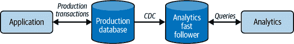

快速跟随者 CDC 方法存在关键局限性。它从根本上没有重新思考批量查询模式。你仍然是在针对当前表状态运行 `SELECT` 查询，错失了根据流中变化动态触发事件的机会。

### Kappa 架构

接下来，回顾一下我们在第 3 章讨论的 Kappa 架构。该架构的核心思想是将所有数据视为事件，并将这些事件作为流存储，而不是作为表存储（图 8-4）。当生产应用数据库是数据源时，Kappa 架构存储来自 CDC 的事件。事件流也可以直接从应用后端、物联网设备群，或任何能够生成事件并通过网络推送它们的系统流出。Kappa 架构不仅仅将流式存储系统视为缓冲区，而是在更长的保留期内将事件保留在存储中，并且可以直接从该存储中查询数据。保留期可以相当长（数月或数年）。请注意，这比纯实时导向系统中使用的保留期长得多，后者通常最多一周。

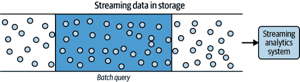

Kappa 架构的“大想法”是将流式存储视为实时传输层和用于检索及查询历史数据的数据库。这可以通过流式存储系统的直接查询功能或借助外部工具来实现。例如，Kafka KSQL 支持聚合、统计计算，甚至会话化。如果查询需求更复杂，或者数据需要与其他数据源结合，外部工具（如 Spark）可以从 Kafka 读取一段时间范围的数据并计算查询结果。流式存储系统还可以为其他应用或流处理器（如 Flink 或 Beam）提供数据。

## 窗口、触发器、发射统计与迟到数据

传统批量查询的一个根本局限性在于，这种范式通常将查询引擎视为外部观察者。数据外部的参导者（也许是一个每小时运行的 cron 作业，或打开仪表板的产品经理）触发查询运行。

另一方面，大多数广泛使用的流式系统支持直接从数据本身触发计算的概念。它们可能每当缓冲区收集到一定数量的记录时就发射平均值和中位数统计，或在用户会话关闭时输出摘要。

窗口是流式查询和处理中的一项基本功能。窗口是基于动态触发器处理的小批次。在某种程度上，窗口是随时间动态生成的。让我们看看一些常见的窗口类型：会话窗口、固定时间窗口和滑动窗口。我们还将了解水位线。

### 会话窗口

*会话窗口*将发生时间接近的事件分组，并过滤掉没有事件发生的非活动期。我们可以这样定义：用户会话是指非活动间隙不超过五分钟的任何时间间隔。我们的批处理系统按用户 ID 键收集数据，对事件排序，确定间隙和会话边界，并计算每个会话的统计信息。数据工程师通常通过向 Web 和桌面应用上的用户活动应用时间条件，对数据进行回顾性会话化。

在流式会话中，此过程可以动态发生。请注意，会话窗口是按键划分的；在前面的示例中，每个用户都有自己的一组窗口。系统按用户累积数据。如果发生五分钟无活动的间隙，系统关闭窗口，发送其计算结果，并刷新数据。如果该用户有新事件到达，系统将启动一个新的会话窗口。

会话窗口也可能为迟到数据做出规定。允许数据最多迟到五分钟到达，以应对网络状况和系统延迟，如果迟到事件表明在上一个事件后不到五分钟内发生了活动，系统将重新打开窗口。我们将在本章中进一步讨论迟到数据。图 8-5 展示了三个会话窗口，每个窗口之间由五分钟的非活动期分隔。

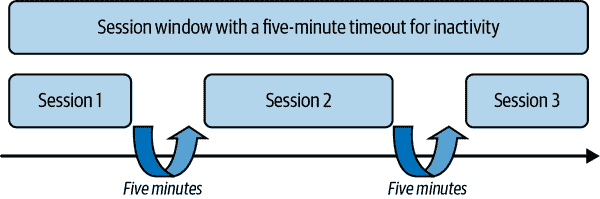

使会话化变得动态且近实时，从根本上改变了其效用。通过回顾性会话化，我们可以在用户会话关闭后一天或一小时自动执行特定操作（例如，发送一封包含用户浏览商品优惠券的跟进邮件）。通过动态会话化，用户可以根据其过去 15 分钟的活动，立即在移动应用中收到有用的警报。

### 固定时间窗口

*固定时间*（又称 *滚动*）窗口具有在固定时间表上运行的固定时间段，并处理自上一个窗口关闭以来的所有数据。例如，我们可能每 20 秒关闭一个窗口，并处理从上一个窗口到达的所有数据以给出平均值和中位数统计（图 8-6）。统计数据将在窗口关闭后尽快计算并发射。

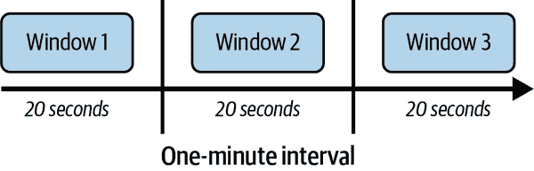

这类似于传统的批量 ETL 处理，我们可能每天或每小时运行一次数据更新作业。流式系统允许我们更频繁地生成窗口，并以更低的延迟交付结果。正如我们将反复强调的，批处理是流处理的一个特例。

### 滑动窗口

滑动窗口中的事件被分入固定时间长度的窗口中，不同的窗口可能会重叠。例如，我们可以每 30 秒生成一个新的 60 秒窗口（图 8-7）。就像之前一样，我们可以发射平均值和中位数统计。

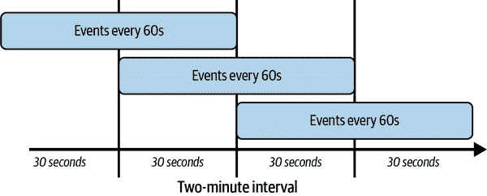

滑动方式可以不同。例如，我们可以将窗口视为真正连续滑动，但仅在满足特定条件（触发器）时发射统计数据。假设我们使用一个 30 秒连续滑动的窗口，但仅当用户点击特定横幅时才计算统计量。这将导致许多用户点击横幅时产生极高的输出率，而在低迷期则不进行计算。

### 水位线

我们已经介绍了各种窗口类型及其用途。正如第 7 章所讨论的，数据有时会以不同于其原始顺序的顺序被摄入。*水位线*（图 8-8）是窗口用来确定窗口中的数据是否在既定时间间隔内，或者是否被视为迟到的阈值。如果到达的数据对窗口来说是新的，但其时间戳早于水位线的时间戳，则认为它是迟到数据。

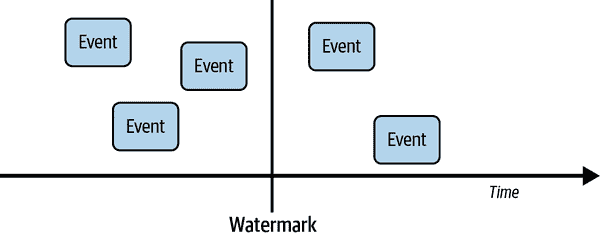

## 将流与其他数据结合

正如我们之前提到的，我们通常通过将数据与其他数据结合来获取价值。流式数据也不例外。例如，可以结合多个流，或将流与批量历史数据结合。

### 传统表连接


某些表可能由流提供数据（图 8-9）。解决此问题最基本的方法就是在数据库中直接连接这两张表。一个流可以为其中一张表或两张表提供数据。

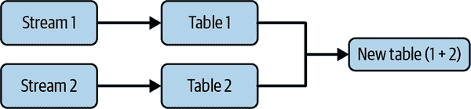

### 富集

*富集* 是指将流与其他数据进行连接（图 8-10）。通常这样做是为了将增强后的数据提供给另一个流。例如，假设一家在线零售商从合作伙伴企业接收包含产品 ID 和用户 ID 的事件流。零售商希望用产品详情和用户人口统计信息来丰富这些事件。零售商将这些事件送入一个无服务器函数，该函数在内存数据库（例如缓存）中查找产品和用户，将所需信息添加到事件中，并将增强后的事件输出到另一个流。

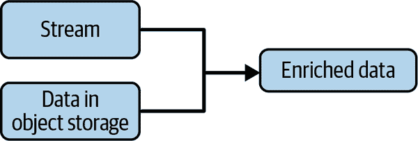

在实践中，富集源几乎可以来自任何地方——云数据仓库或 RDBMS 中的表，或对象存储中的文件。这只是一个从源读取并将所需的富集数据存储在适当位置以供流检索的问题。

### 流到流连接

越来越多的流式系统支持直接的流到流连接。假设一家在线零售商希望将其 Web 事件数据与广告平台的流式数据进行连接。公司可以将两个流都送入 Spark，但会出现各种复杂情况。例如，流在到达流式系统中处理连接的点时，可能具有显著不同的延迟。广告平台可能以五分钟的延迟提供数据。此外，某些事件可能会显著延迟——例如，用户的会话关闭事件，或在手机离线时发生、仅在用户重新进入移动网络范围后才出现在流中的事件。

因此，典型的流式连接架构依赖于流式缓冲区。缓冲区保留间隔是可配置的；较长的保留间隔需要更多的存储和其他资源。事件与缓冲区中的数据进行连接，并在保留间隔过后最终被驱逐（图 8-11）。^(4)

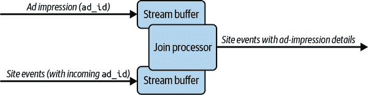

既然我们已经介绍了批处理和流式数据查询的工作原理，接下来让我们讨论如何通过建模让数据变得有用。

# 数据建模

数据建模是我们经常看到被令人不安地忽视的环节。我们常见数据团队在没有规划如何以对业务有用的方式组织数据的情况下，就直接跳进去构建数据系统。这是一个错误。精心构建的数据架构必须反映依赖这些数据的组织的目标和业务逻辑。数据建模涉及有意识地为数据选择一个连贯的结构，是让数据对业务变得有用的关键步骤。

数据建模以各种形式实践了几十年。例如，各种类型的范式技术（见范式）自 RDBMS 早期以来就被用于数据建模；数据仓库建模技术至少从 1990 年代初就已存在，甚至可以说更早。正如技术领域的钟摆效应常有的那样，数据建模在 2010 年代初到中期变得有些不合时宜。数据湖 1.0、NoSQL 和大数据系统的兴起让工程师得以绕过传统数据建模，有时是为了合理的性能提升。其他时候，缺乏严谨的数据建模造成了数据沼泽，伴随着大量冗余、不匹配或干脆错误的数据。

如今，钟摆似乎正摆回数据建模。数据管理（特别是数据治理和数据质量）日益增长的普及正在推动对连贯业务逻辑的需求。数据在企业中地位的飞跃式上升，使人们越来越认识到，建模对于在数据科学需求层级金字塔的更高层级实现价值至关重要。话虽如此，我们认为需要新的范式才能真正拥抱流式数据和 ML 的需求。在本节中，我们将调查当前主流的数据建模技术，并简要展望数据建模的未来。

## 什么是数据模型？

*数据模型* 代表数据与现实世界关联的方式。它反映了数据必须如何构建和标准化，以最好地反映组织的流程、定义、工作流和逻辑。良好的数据模型能捕捉沟通和工作在组织内自然流动的方式。相反，糟糕的数据模型（或不存在模型）是随意的、混乱的和不连贯的。

一些数据专业人士视数据建模为繁琐且仅属于“大型企业”的工作。像大多数良好的卫生习惯一样——例如使用牙线和保证良好的睡眠——数据建模被公认为一件好事，但在实践中常被忽视。理想情况下，每个组织都应该对其数据进行建模，哪怕只是为了确保业务逻辑和规则在数据层得到转化。

建模数据时，关键在于专注于将模型转化为业务成果。良好的数据模型应与有影响力的业务决策相关联。例如，*客户* 在公司不同部门可能意味着不同的东西。过去 30 天内向你购买过的人算客户吗？如果他们在过去六个月或一年内没有向你购买过呢？仔细定义和建模这些客户数据，会对下游的客户行为报告或客户流失模型的创建产生巨大影响，因为在这些模型中，距上次购买的时间是一个关键变量。

### 提示

良好的数据模型包含一致的定义。在实践中，定义在整个公司中往往是混乱的。你能想到公司中哪些概念或术语对不同的人可能意味着不同的东西吗？

我们的讨论主要集中在批处理数据建模上，因为大多数数据建模技术都源于此。我们也将探讨一些流式数据建模的方法以及建模的通用考量。

## 概念、逻辑和物理数据模型

建模数据时，思路是从抽象的建模概念过渡到具体的实现。在这个连续体中（图 8-12），主要有三种数据模型：概念、逻辑和物理。这些模型构成了本章所述各种建模技术的基础：

**概念模型**

: 包含业务逻辑和规则，描述系统的数据，如模式、表和字段（名称和类型）。创建概念模型时，通常将其可视化为实体关系（ER）图会有所帮助，ER 图是可视化数据中各实体（订单、客户、产品等）间关系的标准工具。例如，ER 图可能编码客户 ID、客户名称、客户地址和客户订单之间的联系。可视化实体关系对于设计连贯的概念数据模型极为推荐。

**逻辑模型**

: 通过添加更多细节，详述概念模型将如何在实践中实现。例如，我们会添加客户 ID 类型、客户名称和自定义地址的信息。此外，我们还会规划主键和外键。

**物理模型**

: 定义逻辑模型将如何在数据库系统中实现。我们会在逻辑模型中添加具体的数据库、模式和表，包括配置细节。

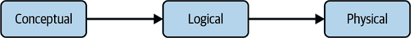


# 成功的数据建模

成功的数据建模在流程初期就让业务利益相关者参与进来。工程师需要获取数据的定义和业务目标。数据建模应是一项“全接触运动”，其目标是为业务提供高质量数据，以获得可执行的洞察并实现智能自动化。这是一项每个人都必须持续参与的实践。

数据建模的另一个重要考量是数据的*粒度*，即数据存储和查询的分辨率。粒度通常位于表中主键的层级，例如 `customer ID`、`order ID` 和 `product ID`；通常伴随日期或时间戳以提高保真度。

例如，假设一家公司刚开始部署 BI 报表。公司规模足够小，以至于同一个人同时担任数据工程师和分析师的角色。有人提出请求，需要一份汇总每日客户订单的报表。具体而言，该报表应列出所有下单客户、他们当天下单的数量以及总消费金额。

这份报表本质上是粗粒度的。它不包含每笔订单的消费详情或每笔订单中的商品项。数据工程师/分析师很容易直接从生产订单数据库摄取数据，并将其浓缩成仅包含报表所需基本聚合数据的报表。然而，当有更细粒度数据聚合的报表需求到来时，这将意味着要重头开始。

由于这位数据工程师实际上经验丰富，他们选择创建包含客户订单详细数据的表，包括每笔订单、商品项、商品成本、商品 ID 等。从本质上讲，他们的表包含客户订单的所有细节。数据的粒度位于客户-订单层级。这些客户-订单数据可以直接分析，也可以聚合以获取客户订单活动的汇总统计。

一般来说，你应该力求在尽可能低的粒度层级对数据建模。从这里出发，很容易聚合这个高度细粒度的数据集。反之则不然，通常无法恢复已被聚合掉的细节。

## 规范化

*规范化*是一种数据库数据建模实践，它对数据库内表和列的关系实施严格控制。规范化的目标是消除数据库内的数据冗余并确保引用完整性。从根本上说，它是将“不要重复自己”（DRY）原则应用于数据库中的数据。^(5)

规范化通常应用于包含行和列的表的关系型数据库（在本节中，我们交替使用*列*和*字段*这两个术语）。它最早由关系型数据库先驱 Edgar Codd 于 1970 年代初提出。

Codd 概述了规范化的四个主要目标：^(6)

*   使关系集合摆脱不期望的插入、更新和删除依赖
*   减少随着新数据类型引入而重构关系集合的需求，从而延长应用程序的生命周期
*   使关系模型对用户更具信息量
*   使关系集合对查询统计保持中立，而这些统计数据随时间推移容易发生变化

Codd 引入了*范式*的概念。范式是循序渐进的，每个范式都包含前一个范式的条件。我们在此描述 Codd 的前三个范式：

**反规范化**

:   无规范化。允许嵌套和冗余数据。

**第一范式 (1NF)**

:   每列唯一且仅包含单个值。表拥有唯一主键。

**第二范式 (2NF)**

:   满足 1NF 要求，且消除了部分依赖。

**第三范式 (3NF)**

:   满足 2NF 要求，且每个表仅包含与其主键相关的相关字段，且无传递依赖。

值得花点时间拆解一下我们刚抛给你的几个术语。*唯一主键*是唯一确定表中行的单个字段或多字段组合。每个键值最多出现一次；否则，一个值将映射到表中的多行。因此，行中的每个其他值都依赖于（可由）该键确定。当复合键中的一部分字段可用于确定表的非键列时，就会发生*部分依赖*。当一个非键字段依赖于另一个非键字段时，就会发生*传递依赖*。

让我们通过一个电商客户订单示例（表 8-1）来看看规范化的各个阶段——从反规范化到 3NF。我们将为上一段介绍的每个概念提供具体解释。

### 表 8-1. `OrderDetail`

| `OrderID` | `OrderItems` | `CustomerID` | `CustomerName` | `OrderDate` |
| --- | --- | --- | --- | --- |
| `100` | 
```
[{
  "sku": 1,
  "price": 50,
  "quantity": 1,
  "name": "Thingamajig"
}, {
  "sku": 2,
  "price": 25,
  "quantity": 2,
  "name": "Whatchamacallit"
}]
``` | `5` | `Joe Reis` | `2022-03-01` |

首先，这个反规范化的 `OrderDetail` 表包含五个字段。主键是 `OrderID`。注意 `OrderItems` 字段包含一个嵌套对象，其中有两个 SKU 及其价格、数量和名称。

要将这些数据转换为 1NF，让我们把 `OrderItems` 拆分为四个字段（表 8-2）。现在我们有了一个字段不包含重复或嵌套数据的 `OrderDetail` 表。

### 表 8-2. 无重复或嵌套数据的 `OrderDetail`

| `OrderID` | `Sku` | `Price` | `Quantity` | `ProductName` | `CustomerID` | `CustomerName` | `OrderDate` |
| --- | --- | --- | --- | --- | --- | --- | --- |
| `100` | `1` | `50` | `1` | `Thingamajig` | `5` | `Joe Reis` | `2022-03-01` |
| `100` | `2` | `25` | `2` | `Whatchamacallit` | `5` | `Joe Reis` | `2022-03-01` |

问题是现在我们没有唯一主键。即 `100` 在 `OrderID` 列中出现在两行不同的行里。为了更好地了解情况，让我们看看表中更大的样本（表 8-3）。

### 表 8-3. 含更大样本的 `OrderDetail`

| `OrderID` | `Sku` | `Price` | `Quantity` | `ProductName` | `CustomerID` | `CustomerName` | `OrderDate` |
| --- | --- | --- | --- | --- | --- | --- | --- |
| `100` | `1` | `50` | `1` | `Thingamajig` | `5` | `Joe Reis` | `2022-03-01` |
| `100` | `2` | `25` | `2` | `Whatchamacallit` | `5` | `Joe Reis` | `2022-03-01` |
| `101` | `3` | `75` | `1` | `Whozeewhatzit` | `7` | `Matt Housley` | `2022-03-01` |
| `102` | `1` | `50` | `1` | `Thingamajig` | `7` | `Matt Housley` | `2022-03-01` |

为了创建唯一主键（复合键），让我们通过添加一个名为 `LineItemNumber` 的列来为每个订单中的行编号（表 8-4）。

### 表 8-4. 含 `LineItemNumber` 列的 `OrderDetail`

| `OrderID` | `LineItemNumber` | `Sku` | `Price` | `Quantity` | `ProductName` | `CustomerID` | `CustomerName` | `OrderDate` |
| --- | --- | --- | --- | --- | --- | --- | --- | --- |
| `100` | `1` | `1` | `50` | `1` | `Thingamajig` | `5` | `Joe Reis` | `2022-03-01` |
| `100` | `2` | `2` | `25` | `2` | `Whatchamacallit` | `5` | `Joe Reis` | `2022-03-01` |
| `101` | `1` | `3` | `75` | `1` | `Whozeewhatzit` | `7` | `Matt Housley` | `2022-03-01` |
| `102` | `1` | `1` | `50` | `1` | `Thingamajig` | `7` | `Matt Housley` | `2022-03-01` |

复合键 (`OrderID`, `LineItemNumber`) 现在是一个唯一主键。


# 规范化到 2NF 和 3NF

要达到 2NF，我们需要确保不存在部分依赖。**部分依赖** 是指非键列完全由唯一主（复合）键中的一部分列决定；部分依赖只会在主键是复合键时发生。在我们的例子中，最后三列由订单号决定。要解决这个问题，让我们将 `OrderDetail` 拆分为两张表：`Orders` 和 `OrderLineItem`（表 8-5 和表 8-6）。

## 表 8-5. `Orders`

| `OrderID` | `CustomerID` | `CustomerName` | `OrderDate` |
| --- | --- | --- | --- |
| `100` | `5` | `Joe Reis` | `2022-03-01` |
| `101` | `7` | `Matt Housley` | `2022-03-01` |
| `102` | `7` | `Matt Housley` | `2022-03-01` |

## 表 8-6. `OrderLineItem`

| `OrderID` | `LineItemNumber` | `Sku` | `Price` | `Quantity` | `ProductName` |
| --- | --- | --- | --- | --- | --- |
| `100` | `1` | `1` | `50` | `1` | `Thingamajig` |
| `100` | `2` | `2` | `25` | `2` | `Whatchamacallit` |
| `101` | `1` | `3` | `75` | `1` | `Whozeewhatzit` |
| `102` | `1` | `1` | `50` | `1` | `Thingamajig` |

复合键 (`OrderID`, `LineItemNumber`) 是 `OrderLineItem` 的唯一主键，而 `OrderID` 是 `Orders` 的主键。

注意在 `OrderLineItem` 中 `Sku` 决定 `ProductName`。也就是说，`Sku` 依赖于复合键，而 `ProductName` 依赖于 `Sku`。这是一个传递依赖。让我们把 `OrderLineItem` 拆分为 `OrderLineItem` 和 `Skus`（表 8-7 和表 8-8）。

## 表 8-7. `OrderLineItem`

| `OrderID` | `LineItemNumber` | `Sku` | `Price` | `Quantity` |
| --- | --- | --- | --- | --- |
| `100` | `1` | `1` | `50` | `1` |
| `100` | `2` | `2` | `25` | `2` |
| `101` | `1` | `3` | `75` | `1` |
| `102` | `1` | `1` | `50` | `1` |

## 表 8-8. `Skus`

| `Sku` | `ProductName` |
| --- | --- |
| `1` | `Thingamajig` |
| `2` | `Whatchamacallit` |
| `3` | `Whozeewhatzit` |

现在，`OrderLineItem` 和 `Skus` 都符合 3NF。注意 `Orders` 不满足 3NF。存在哪些传递依赖？你会如何修复？

还存在更高的范式（在 Boyce-Codd 体系中高达 6NF），但这些比前三个范式少见得多。数据库通常被认为是规范化的，如果它符合第三范式，这也是本书采用的惯例。

你应该对数据应用的规范化程度取决于你的用例。不存在放之四海而皆准的解决方案，特别是在某些反规范化能带来性能优势的数据库中。虽然反规范化看起来像是一种反模式，但在许多存储半结构化数据的 OLAP 系统中很常见。研究规范化惯例和数据库最佳实践，以选择合适的策略。

# 批量分析数据建模技术

在描述数据湖或数据仓库的数据建模时，你应该假设原始数据采取多种形式（如结构化和半结构化），但输出是行和列的结构化数据模型。然而，在这些环境中可以使用多种数据建模方法。你可能会遇到的主要方法有 Kimball、Inmon 和 Data Vault。

在实践中，这些技术中的一些可以结合使用。例如，我们看到一些数据团队从 Data Vault 开始，然后在其旁边添加 Kimball 星型模式。我们还将介绍宽表和反规范化数据模型，以及你应该掌握的其他批量数据建模技术。在讨论这些技术时，我们将以电商订单系统中发生的交易建模为例。

> **注意**
>
> 我们对前三种方法——Inmon、Kimball 和 Data Vault——的介绍只是蜻蜓点水，远不足以体现它们各自的复杂性和细微差别。每节末尾我们列出了其创作者的经典著作。对数据工程师来说，这些书是必读的，我们强烈建议你阅读它们，哪怕只是为了理解数据建模为何是批量分析数据的核心。

## Inmon

数据仓库之父 Bill Inmon 于 1989 年创建了他的数据建模方法。在数据仓库出现之前，分析通常直接在源系统上进行，其显而易见的后果是长时间运行的查询拖垮了生产事务数据库。数据仓库的目标是将源系统与分析系统分离。

Inmon 这样定义数据仓库：^[7]

> 数据仓库是一个面向主题的、集成的、非易失的、随时间变化的数据集合，用于支持管理层的决策。数据仓库包含粒度级的企业数据。数据仓库中的数据可用于许多不同的目的，包括静待未来那些目前尚不清楚的需求。

数据仓库的四个关键部分可描述如下：

面向主题
: 数据仓库专注于特定主题领域，如销售或市场营销。

集成
: 来自不同来源的数据被整合并规范化。

非易失
: 数据存入数据仓库后保持不变。

随时间变化
: 可以查询不同时间范围。

让我们逐一了解这些部分，以理解它们对 Inmon 数据模型的影响。首先，逻辑模型必须专注于特定领域。例如，如果**主题方向**是“销售”，那么逻辑模型包含所有与销售相关的细节——业务键、关系、属性等。接下来，这些细节被**集成**到一个整合的、高度规范化的数据模型中。最后，数据以**非易失**和**随时间变化**的方式存储，这意味着你可以（理论上）在存储历史允许的范围内查询原始数据。Inmon 数据仓库必须严格遵守所有这四个关键部分，**以支持管理层的决策**。这是一个微妙的点，但它将数据仓库定位为用于分析，而非 OLTP。

Inmon 数据仓库的另一个关键特征：^[8]

> 数据仓库的第二个显著特征是它是集成的。在数据仓库的所有方面中，集成是最重要的。数据从多个不同的源系统馈送到数据仓库。在馈送过程中，数据被转换、重新格式化、重新排序、汇总等。结果是，一旦数据驻留在数据仓库中，它就拥有了单一的物理企业形象。

使用 Inmon 的数据仓库，数据以粒度级、高度规范化的 ER 模型从整个组织集成而来，并极其重视 ETL。由于数据仓库的面向主题特性，Inmon 数据仓库由组织中使用的关键源数据库和信息系统组成。来自关键业务源系统的数据被摄取并集成到一个高度规范化（3NF）的数据仓库中，这通常与源系统本身的规范化结构非常相似；数据按优先级增量引入，从最高优先级的业务领域开始。严格的规范化要求确保尽可能少的数据重复，从而减少下游分析错误，因为数据不会发散或遭受冗余。数据仓库代表了“单一事实来源”，支持整个业务的信息需求。数据通过面向业务和部门的数据集市呈现给下游报表和分析，这些数据集市也可能是反规范化的。


## Inmon 电商数据仓库

让我们看看 Inmon 数据仓库如何用于电商（图 8-13）。业务源系统包括订单、库存和营销。这些源系统的数据经过 ETL 进入数据仓库，并以 3NF（第三范式）存储。理想情况下，数据仓库全面涵盖企业的信息。为了满足部门特定的信息请求，ETL 流程从数据仓库提取数据、转换数据，并将其放入下游数据集市以供报表查看。

数据集市建模的一种流行选择是星型模式（将在后续关于 Kimball 的章节中讨论），尽管任何能提供易于访问信息的数据模型也都适用。在前面的例子中，销售、营销和采购部门拥有各自的星型模式，由数据仓库中的粒度数据向下游馈送。这使得每个部门都能拥有针对其特定需求进行优化的独特数据结构。

Inmon 持续在数据仓库领域创新，目前专注于数据仓库中的文本 ETL。他还是一位多产的作家和思想家，撰写了 60 多本书和无数文章。关于 Inmon 数据仓库的进一步阅读，请参阅“附加资源”中列出的他的书籍。

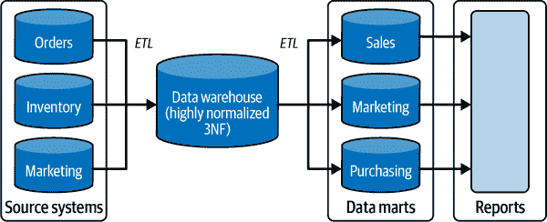

## Kimball

如果数据建模存在光谱，Kimball 处于与 Inmon 截然相反的一端。该方法由 Ralph Kimball 于 1990 年代初创立，较少关注规范化，在某些情况下甚至接受反规范化。正如 Inmon 所说，关于数据仓库和数据集市的区别：“数据集市永远不能替代数据仓库。”[⁹]

Inmon 在数据仓库中整合全企业数据，并通过数据集市提供部门特定的分析；而 Kimball 模型是自底向上的，鼓励你直接在数据仓库中为部门或业务分析建模和服务（Inmon 认为这种方法扭曲了数据仓库的定义）。Kimball 方法实际上将数据集市变成了数据仓库本身。与 Inmon 相比，这可能实现更快的迭代和建模，但代价是潜在的数据集成松散、数据冗余和重复。

在 Kimball 方法中，数据通过两种通用表类型建模：事实表和维度表。你可以将 `fact table`（事实表）视为数字表，将 `dimension tables`（维度表）视为引用事实的定性数据。维度表在一种称为 `star schema`（星型模式）的关系中围绕单个事实表（图 8-14）[¹⁰]。让我们看看事实、维度和星型模式。

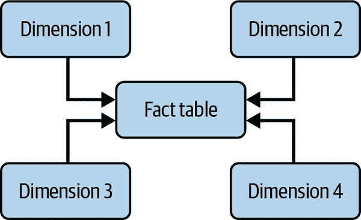

### 事实表

星型模式中的第一种表是事实表，包含 `factual`（事实性的）、定量的和事件相关的数据。事实表中的数据是不可变的，因为事实关联事件。因此，事实表不发生变化，仅支持追加。事实表通常是窄而长的，意味着列不多，但有大量代表事件的行。事实表应处于尽可能低的粒度。

针对星型模式的查询从事实表开始。事实表的每一行应代表数据的粒度。避免在事实表内聚合或派生数据。如果需要执行聚合或派生，请在下游查询、数据集市表或视图中进行。最后，事实表不引用其他事实表；它们仅引用维度。

让我们看一个基本事实表的例子（表 8-9)。公司常见的问题可能是：“按每个客户订单、按日期显示毛销售额。”同样，事实应处于尽可能低的粒度——在本例中，是销售的 `OrderID`、`CustomerKey`、`DateKey` 和 `GrossSalesAmt`。注意事实表中的数据类型全是数字（整数和浮点数）；没有字符串。此外，在本例中，`CustomerKey 7` 在同一天有两个订单，反映了表的粒度。相反，事实表拥有引用维度表的键，后者包含各自的属性，如客户和日期信息。`GrossSalesAmt` 代表该销售事件的总销售额。

**表 8-9. 事实表**

| `OrderID` | `CustomerKey` | `DateKey` | `GrossSalesAmt` |
| --- | --- | --- | --- |
| `100` | `5` | `20220301` | `100.00` |
| `101` | `7` | `20220301` | `75.00` |
| `102` | `7` | `20220301` | `50.00` |

### 维度表

Kimball 数据模型中的第二种主要表类型称为 `dimension`（维度）。维度表为存储在事实表中的事件提供参考数据、属性和关系上下文。维度表比事实表小，形状相反，通常是宽而短的。当与事实表连接时，维度可以描述事件的内容、地点和时间。维度是反规范化的，可能存在重复数据。这在 Kimball 数据模型中是可以接受的。让我们看看前面事实表示例中引用的两个维度。

在 Kimball 数据模型中，日期通常存储在日期维度中，允许你在事实表和日期维度表之间引用日期键（`DateKey`）。有了日期维度表，你可以轻松回答诸如“2022 年第一季度的总销售额是多少？”或“周二比周三多多少顾客购物？”等问题。注意除了日期键外，我们还有五个字段（表 8-10）。日期维度的优势在于，你可以根据分析数据的需要添加任意数量的新字段。

**表 8-10. 日期维度表**

| `DateKey` | `Date-ISO` | `Year` | `Quarter` | `Month` | `Day-of-week` |
| --- | --- | --- | --- | --- | --- |
| `20220301` | `2022-03-01` | `2022` | `1` | `3` | `Tuesday` |
| `20220302` | `2022-03-02` | `2022` | `1` | `3` | `Wednesday` |
| `20220303` | `2022-03-03` | `2022` | `1` | `3` | `Thursday` |

表 8-11 还通过 `CustomerKey` 字段引用了另一个维度——客户维度。客户维度包含描述客户的若干字段：名、姓、邮编，以及几个看起来很特别的日期字段。让我们看看这些日期字段，因为它们阐释了 Kimball 数据模型中的另一个概念：类型 2 缓慢变化维度，我们将在接下来详细描述。

**表 8-11. 类型 2 客户维度表**

| `CustomerKey` | `FirstName` | `LastName` | `ZipCode` | `EFF_StartDate` | `EFF_EndDate` |
| --- | --- | --- | --- | --- | --- |
| `5` | `Joe` | `Reis` | `84108` | `2019-01-04` | `9999-01-01` |
| `7` | `Matt` | `Housley` | `84101` | `2020-05-04` | `2021-09-19` |
| `7` | `Matt` | `Housley` | `84123` | `2021-09-19` | `9999-01-01` |
| `11` | `Lana` | `Belle` | `90210` | `2022-02-04` | `9999-01-01` |

例如，看看 `CustomerKey 5`，其 `EFF_StartDate`（`EFF_StartDate` 意为 *生效开始日期*）为 `2019-01-04`，`EFF_EndDate` 为 `9999-01-01`。这意味着 Joe Reis 的客户记录于 2019-01-04 在客户维度表中创建，结束日期为 9999-01-01。有趣。这个结束日期意味着什么？它意味着客户记录处于活动状态且未被更改。

[⁹]: 参考脚注 9
[¹⁰]: 参考脚注 10


# 缓慢变化维度 (SCD)

现在让我们看看 Matt Housley 的客户记录（`CustomerKey` `= 7`）。请注意 Housley 的开始日期有两个条目：`2020-05-04` 和 `2021-09-19`。看起来 Housley 在 `2021-09-19` 更改了他的邮政编码，导致其客户记录发生变化。当查询最新的客户记录时，你将查询结束日期等于 `9999-01-01` 的记录。

缓慢变化维度 (SCD) 用于跟踪维度中的变化。前面的示例是类型 2 SCD：当现有记录发生变化时，会插入一条新记录。虽然 SCD 可以多达七种类型，但让我们来看看最常见的三种：

## 类型 1

覆盖现有的维度记录。这非常简单，意味着你无法访问被删除的历史维度记录。

## 类型 2

保留维度记录的完整历史。当记录发生变化时，该特定记录会被标记为已更改，并创建一条新的维度记录来反映属性的当前状态。在我们的示例中，Housley 搬到了一个新的邮政编码，这触发了其初始记录以反映生效结束日期，并创建了一条新记录来显示他的新邮政编码。

## 类型 3

类型 3 SCD 类似于类型 2 SCD，但它不是创建新行，而是创建新字段。使用前面的示例，让我们看看以下表格中作为类型 3 SCD 的样子。

在 表 8-12 中，Housley 住在 `84101` 邮政编码区。当 Housley 搬到新的邮政编码时，类型 3 SCD 会创建两个新字段，一个用于他的新邮政编码，一个用于变更日期（表 8-13）。原始邮政编码字段也会被重命名，以反映这是较旧的记录。

### 表 8-12. 类型 3 缓慢变化维度

| `CustomerKey` | `FirstName` | `LastName` | `ZipCode` |
| --- | --- | --- | --- |
| `7` | `Matt` | `Housley` | `84101` |

### 表 8-13. 类型 3 客户维度表

| `CustomerKey` | `FirstName` | `LastName` | `Original ZipCode` | `Current ZipCode` | `CurrentDate` |
| --- | --- | --- | --- | --- | --- |
| `7` | `Matt` | `Housley` | `84101` | `84123` | `2021-09-19` |

在上述 SCD 类型中，类型 1 是大多数数据仓库的默认行为，而类型 2 是我们在实践中最常见的用法。关于维度有很多知识需要了解，我们建议将本节作为入门，以熟悉维度的工作原理及其用法。

#### 星型模式

现在你已经对事实和维度有了基本的了解，是时候将它们集成到星型模式中了。*星型模式* 代表业务的数据模型。与高度规范化的数据建模方法不同，星型模式是一个被必要维度包围的事实表。这比其他数据模型减少了连接操作，从而加快了查询性能。星型模式的另一个优势是，它可以说更容易让业务用户理解和使用。

请注意，星型模式不应反映特定的报表，尽管你可以在下游数据集市或直接在 BI 工具中对报表进行建模。星型模式应捕获你的*业务逻辑*的事实和属性，并具有足够的灵活性来回答相应的关键问题。

因为星型模式只有一个事实表，所以有时你会有多个星型模式来解决业务的不同事实。你应该尽可能减少维度的数量，因为这些参考数据有可能在不同的事实表之间重用。一个在多个星型模式中重用、因此共享相同字段的维度被称为*一致性维度*。一致性维度允许你跨多个星型模式组合多个事实表。记住，Kimball 方法允许冗余数据，但要避免复制相同的维度表，以防止业务定义漂移和数据完整性问题。

Kimball 数据模型和星型模式有很多细微差别。你应该知道，这种模式仅适用于批处理数据，不适用于流数据。因为 Kimball 数据模型很流行，所以你很有可能会遇到它。

### Data Vault

Kimball 和 Inmon 关注数据仓库中业务逻辑的结构，而 *Data Vault* 则提供了一种不同的数据建模方法。^11 Data Vault 方法论由 Dan Linstedt 在 1990 年代创建，它将源系统数据的结构方面与其属性分离开来。Data Vault 不在事实、维度或高度规范化的表中表示业务逻辑，而是以仅插入的方式将数据从源系统直接加载到少量专用表中。与你了解的其他数据建模方法不同，Data Vault 中没有好数据、坏数据或一致性数据的概念。

如今数据变化迅速，数据模型需要敏捷、灵活且可扩展；Data Vault 方法论旨在满足这一需求。该方法论的目标是让数据尽可能紧密地与业务保持一致，即使业务数据在不断演变。

Data Vault 模型由三种主要类型的表组成：Hub（中心）、Link（链接）和 Satellite（卫星）（图 8-15）。简而言之，*Hub* 存储业务键，*Link* 维护业务键之间的关系，而 *Satellite* 代表业务键的属性和上下文。用户将查询一个 Hub，它会链接到一个包含查询相关属性的 Satellite 表。让我们更详细地探讨 Hub、Link 和 Satellite。


#### Hub（中心）

查询通常涉及按业务键搜索，例如我们电商示例中的客户 ID 或订单 ID。Hub 是 Data Vault 的核心实体，它保留加载到 Data Vault 中的所有唯一业务键的记录。

Hub 始终包含以下标准字段：

**哈希键**

: 用于在系统之间连接数据的主键。这是一个计算出的哈希字段（`MD5` 或类似算法）。

**加载日期**

: 数据加载到 Hub 的日期。

**记录来源**

: 获取唯一记录的来源。

**业务键**

: 用于标识唯一记录的键。

重要的是要注意，Hub 是仅插入的，数据在 Hub 中不会被修改。一旦数据加载到 Hub，它就是永久的。

在设计 Hub 时，识别业务键至关重要。问问自己：什么是*可识别的业务要素*？^12 换句话说，用户通常如何查找数据？理想情况下，这是在你构建组织的概念数据模型时发现的，并且在你开始构建 Data Vault 之前。

使用我们的电商场景，让我们看一个产品 Hub 的示例。首先，让我们看看产品 Hub 的物理设计（表 8-14）。

### 表 8-14. 产品 Hub 的物理设计

| `HubProduct` |
| --- |
| `ProductHashKey` |
| `LoadDate` |
| `RecordSource` |
| `ProductID` |

在实践中，当填充数据时，产品 Hub 如下所示（表 8-15）。在该示例中，三种不同的产品在两个不同的日期从 ERP 系统加载到 Hub 中。

### 表 8-15. 填充数据的产品 Hub

| `ProductHashKey` | `LoadDate` | `RecordSource` | `ProductID` |
| --- | --- | --- | --- |
| `4041fd80ab...` | `2020-01-02` | `ERP` | `1` |
| `de8435530d...` | `2021-03-09` | `ERP` | `2` |
| `cf27369bd8...` | `2021-03-09` | `ERP` | `3` |


# 数据仓库建模：中心表、链接表、卫星表和宽表

趁热打铁，我们再为订单创建一个中心表（参见表 8-16），使用与 `HubProduct` 相同的模式，并填充一些示例订单数据。

## 表 8-16. 填充了数据的订单中心表

| `OrderHashKey` | `LoadDate` | `RecordSource` | `OrderID` |
| --- | --- | --- | --- |
| `f899139df5...` | `2022-03-01` | `Website` | `100` |
| `38b3eff8ba...` | `2022-03-01` | `Website` | `101` |
| `ec8956637a...` | `2022-03-01` | `Website` | `102` |

## 链接表

*链接表* 用于跟踪中心表之间业务键的关系。链接表连接中心表，理想情况下应在尽可能低的粒度上进行连接。因为链接表连接来自不同中心表的数据，所以它们是多对多关系。数据仓库模型的关系简单明了，通过对链接的变更来处理。这在底层数据不可避免地发生变化时提供了极佳的灵活性。你只需创建一个新的链接，将业务概念（或中心表）关联起来以表示新的关系。就这么简单！现在让我们看看如何使用卫星表从上下文角度查看数据。

回到我们的电商示例，我们希望将订单与产品关联起来。让我们看看产品和订单的链接表可能是什么样子的（参见表 8-17）。

## 表 8-17. 产品和订单的链接表

| `LinkOrderProduct` |
| --- |
| `OrderProductHashKey` |
| `LoadDate` |
| `RecordSource` |
| `ProductHashKey` |
| `OrderHashKey` |

当 `LinkOrderProduct` 表被填充数据时，它看起来如下所示（参见表 8-18）。注意，在这个示例中我们使用的是订单的记录来源。

## 表 8-18. 连接订单和产品的链接表

| `OrderProductHashKey` | `LoadDate` | `RecordSource` | `ProductHashKey` | `OrderHashKey` |
| --- | --- | --- | --- | --- |
| `ff64ec193d...` | `2022-03-01` | `Website` | `4041fd80ab...` | `f899139df5...` |
| `ff64ec193d...` | `2022-03-01` | `Website` | `de8435530d...` | `f899139df5...` |
| `e232628c25...` | `2022-03-01` | `Website` | `cf27369bd8...` | `38b3eff8ba...` |
| `26166a5871...` | `2022-03-01` | `Website` | `4041fd80ab...` | `ec8956637a...` |

## 卫星表

我们已经描述了涉及键、加载日期和记录来源的中心表和链接表之间的关系。如何理解这些关系的含义？*卫星表* 是赋予中心表含义和上下文的描述性属性。卫星表可以连接到中心表或链接表。卫星表中唯一必需的字段是由父中心表的业务键和加载日期组成的主键。除此之外，卫星表可以包含任意数量的合理属性。

让我们看一个 `Product` 中心表的卫星表示例（参见表 8-19）。在这个示例中，`SatelliteProduct` 表包含关于产品的附加信息，例如产品名称和价格。

## 表 8-19. `SatelliteProduct`

| `SatelliteProduct` |
| --- |
| `ProductHashKey` |
| `LoadDate` |
| `RecordSource` |
| `ProductName` |
| `Price` |

这是包含示例数据的 `SatelliteProduct` 表（参见表 8-20）。

## 表 8-20. 包含示例数据的产品卫星表

| `ProductHashKey` | `LoadDate` | `RecordSource` | `ProductName` | `Price` |
| --- | --- | --- | --- | --- |
| `4041fd80ab...` | `2020-01-02` | `ERP` | `Thingamajig` | `50` |
| `de8435530d...` | `2021-03-09` | `ERP` | `Whatchamacallit` | `25` |
| `cf27369bd8...` | `2021-03-09` | `ERP` | `Whozeewhatzit` | `75` |

让我们将这些串联起来，将中心表、产品表和链接表连接成一个数据仓库（参见图 8-16）。

```
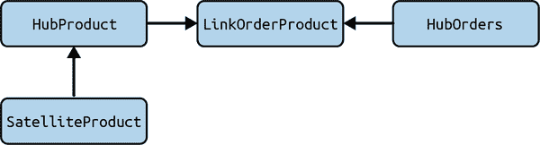
```

还有其他类型的数据仓库表，包括时间点（PIT）表和桥接表。我们这里不涉及这些，但提及它们是因为数据仓库模型非常全面。我们的目标只是让你大致了解数据仓库的强大之处。

与我们讨论的其他数据建模技术不同，在数据仓库中，业务逻辑是在查询这些表的数据时创建和解释的。请注意，数据仓库模型可以与其他数据建模技术一起使用。数据仓库作为分析数据的落地区，随后在数据仓库中单独建模（通常使用星型模式）的情况并不少见。数据仓库模型也可以适配 NoSQL 和流数据源。数据仓库是一个庞大的话题，本节只是旨在让你知晓它的存在。

## 宽反范式表

我们描述的严格建模方法，尤其是 Kimball 和 Inmon 方法，是在数据仓库昂贵、部署在本地、且计算与存储紧密耦合、资源严重受限的时代开发的。虽然批处理数据建模传统上与这些严格方法相关联，但更宽松的方法正变得越来越普遍。

原因如下。首先，云的普及意味着存储极其廉价。存储数据比纠结于在存储中表示数据的最佳方式更便宜。其次，嵌套数据（JSON 等）的流行意味着源系统和分析系统中的模式都是灵活的。

你可以选择像我们描述的那样严格地建模数据，也可以选择将所有数据扔进一张单一的宽表中。*宽表* 顾名思义：一个高度反范式化且非常宽的字段集合，通常创建于列式数据库中。字段可以是单个值，也可以包含嵌套数据。数据与一个或多个键一起组织；这些键与数据的*粒度*紧密相关。

宽表可能拥有数千列，而关系型数据库中通常少于 100 列。宽表通常是稀疏的；给定字段中绝大多数条目可能为 null。这在传统关系型数据库中代价高昂，因为数据库为每个字段条目分配固定量的空间；而在列式数据库中，null 几乎不占用空间。宽模式在关系型数据库中会显著降低读取速度，因为每一行必须分配宽模式指定的所有空间，且数据库必须完整读取每一行的内容。另一方面，列式数据库仅读取查询中选定的列，读取 null 基本是免费的。

宽表通常通过模式演进产生；工程师随着时间的推移逐渐添加字段。在关系型数据库中，模式演进是一个缓慢且资源密集的过程。在列式数据库中，添加字段最初只是元数据的变更。当数据写入新字段时，新文件会被添加到该列中。

宽表上的分析查询通常比高度规范化、需要多次连接的等效数据查询运行得更快。消除连接会对扫描性能产生巨大影响。宽表仅包含在更严格的建模方法中需要连接的所有数据。事实和维度在同一张表中表示。缺乏数据建模严谨性也意味着不需要太多思考。将数据加载到宽表中并开始查询即可。特别是随着源系统中的模式变得更加自适应和灵活，这些数据通常源自高容量事务，意味着数据量很大。将其作为嵌套数据存储在分析存储中有很多好处。


# 宽表与流式数据建模

将所有数据扔进一张表对铁杆数据建模师来说似乎是异端邪说，我们也见过很多批评。这些批评是什么？最大的批评是：当你融合数据时，你会在分析中丢失业务逻辑。另一个缺点是更新性能，比如更新数组中的一个元素，这可能会非常痛苦。

让我们看一个宽表的例子（表 8-21），使用我们之前规范化示例中的原始非规范化表。这张表可以有更多列——成百上千列！——为简洁和易于理解，我们只包含少量列。正如你所见，这张表结合了各种数据类型，以客户在某日期的订单为粒度进行表示。

我们建议在以下情况使用宽表：你不关心数据建模；或者你有大量数据，需要比传统数据建模严谨性所能提供的更多灵活性。宽表也适合流式数据，我们接下来将讨论这一点。随着数据向快速变化的模式和流式优先发展，我们预计将看到一波新的数据建模浪潮，也许类似于“宽松规范化”。

## 表 8-21. 非规范化数据示例

| `OrderID` | `OrderItems` | `CustomerID` | `CustomerName` | `OrderDate` | `Site` | `SiteRegion` |
| --- | --- | --- | --- | --- | --- | --- |
| `100` | 
```
[{
  "sku": 1,
  "price": 50,
  "quantity": 1,
  "name": "Thingamajig"
}, {
  "sku": 2,
  "price": 25,
  "quantity": 2,
  "name": "Whatchamacallit"
}]
``` | `5` | `Joe Reis` | `2022-03-01` | `abc.com` | `US` |

# 流式数据建模

虽然许多数据建模技术在批处理方面已相当成熟，但流式数据并非如此。由于流式数据无界且连续的特性，将 Kimball 等批处理技术转化为流式范式非常棘手，甚至不可能。例如，给定一个数据流，如果不让数据仓库瘫痪，你该如何持续更新 Type-2 缓慢变化维度？

世界正从批处理向流式处理、从本地部署向云端演进。旧批处理方法的约束不再适用。话虽如此，关于如何建模数据以平衡业务逻辑需求与流体模式变更、快速移动的数据和自助服务，仍有重大问题悬而未决。前面提到的批处理数据建模方法的流式等价物是什么？目前对于流式数据建模尚无共识方法。我们采访了许多流式数据系统专家，其中许多人告诉我们，传统的面向批处理的数据建模不适用于流式处理。一些人建议将 Data Vault 作为流式数据建模的一种选择。

正如你可能记得的，主要存在两类流：事件流和 CDC。大多数情况下，这些流中数据的形态是半结构化的，例如 JSON。建模流式数据的挑战在于载荷的模式可能随时变更。例如，假设你有一个 IoT 设备最近升级了固件并引入了一个新字段。此时，你的下游目标数据仓库或处理管道可能不知情并因此中断。这可不妙。再如，CDC 系统可能将字段重新转换为不同类型——比如字符串，而不是国际标准化组织 (ISO) 日期时间格式。同样，目标端如何处理这种看似随机的变更？

我们交谈过的流式数据专家绝大多数建议你预判源数据的变更并保持灵活的模式。这意味着分析型数据库中没有严格的数据模型。相反，假设源系统提供的数据具有正确的业务定义和逻辑，反映其当前状态。而且因为存储便宜，以一种可以将近期流式数据和保存的历史数据一起查询的方式存储它们。针对具有灵活模式的数据集进行全面分析优化。此外，与其对报表做出反应，为什么不创建自动化来响应流式数据中的异常和变更呢？

数据建模的世界正在变化，我们相信数据建模范式即将发生巨变。这些新方法可能会在直接位于源系统之上的流式层中，融合指标和语义层、数据管道以及传统分析工作流。既然数据是实时生成的，人为地将源系统和分析系统分成两个截然不同的桶，可能不像数据移动较慢且可预测时那样合理。时间会给出答案……

我们将在第 11 章进一步探讨流式数据的未来。

# 转换

> 转换数据的最终结果是统一和集成数据的能力。一旦数据被转换，就可以将其视为单一实体。但如果不转换数据，你就无法获得跨组织的统一数据视图。
>
> — Bill Inmon

既然我们已经涵盖了查询和数据建模，你可能会想：如果我能建模数据、查询数据并获得结果，为什么还需要考虑转换？转换以可扩展、可靠且具成本效益的方式操作、增强并保存数据以供下游使用，从而提升其价值。

想象一下，每当你想查看特定数据集的结果时都要运行一次查询。你一天要运行同一个查询几十次甚至上百次。想象一下，这个查询涉及跨 20 个数据集进行解析、清洗、连接、合并和聚合。更痛苦的是，查询运行需要 30 分钟，消耗大量资源，且多次重复运行会产生巨额云费用。你和你的利益相关者可能会疯掉。庆幸的是，你可以*保存查询结果*，或者至少只运行一次计算密集型部分，以便后续查询得到简化。

转换不同于查询。*查询*根据过滤和连接逻辑从各种源检索数据。*转换*则持久化结果，供后续转换或查询使用。这些结果可能是暂时存储，也可能是永久存储。

除了持久化，区分转换与查询的第二个方面是复杂性。你可能会构建复杂的管道，组合来自多个源的数据，并为多个最终输出重用中间结果。这些复杂管道可能会对数据进行规范化、建模、聚合或特征化。虽然你可以使用通用表表达式、脚本或 DAG 在单个查询中构建复杂的数据流，但这很快会变得难以驾驭、不一致且难以处理。转换应运而生。

转换关键依赖本书的主要潜流之一：编排。编排将许多离散操作（如中间转换）组合在一起，这些操作临时或永久存储数据，供下游转换或服务使用。越来越多的转换管道不仅跨越多个表和数据集，还跨越多个系统。

## 批量转换

*批量转换*在离散的数据块上运行，这与流式转换形成对比，后者在数据到达时连续处理。批量转换可以按固定计划运行（例如每天、每小时或每 15 分钟），以支持持续的报告、分析和机器学习模型。在本节中，你将学习各种批量转换模式和技术。

### 分布式连接


# 分布式连接

分布式连接背后的基本思想是，我们需要将一个*逻辑连接*（由查询逻辑定义的连接）拆分为在集群中各个服务器上运行的、小得多的*节点连接*。基本的分布式连接模式适用于 MapReduce（详见“MapReduce”）、BigQuery、Snowflake 或 Spark，尽管处理步骤之间的中间存储细节各异（在磁盘上或在内存中）。在最理想的场景中，连接一侧的数据足够小，可以放入单个节点（*广播连接*）。通常，需要更消耗资源的*洗牌哈希连接*。

## 广播连接

*广播连接*通常是不对称的，一张大表分布在各节点上，而一张小表可以轻松放入单个节点（图 8-17）。查询引擎将小表（表 A）“广播”到所有节点，在那里它与大表（表 B）的各个部分进行连接。广播连接比洗牌哈希连接少消耗算力得多。

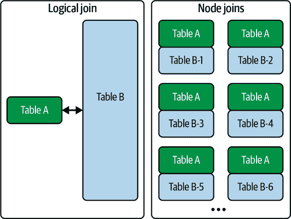

在实践中，表 A 通常是查询引擎收集并广播的一个经过下推过滤的大表。连接重排序是查询优化器的首要任务之一。通过尽早应用过滤器，并将小表移至左侧（针对左连接），通常可以大幅减少每次连接中处理的数据量。通过预过滤数据以在可能的情况下创建广播连接，可以显著提高性能并降低资源消耗。

## 洗牌哈希连接

如果没有任何一张表小到足以放入单个节点，查询引擎将使用*洗牌哈希连接*。在图 8-18 中，虚线上下表示相同的节点。虚线上方的区域表示表 A 和表 B 在各节点上的初始分区。通常，这种分区与连接键无关。使用哈希方案按连接键重新分区数据。

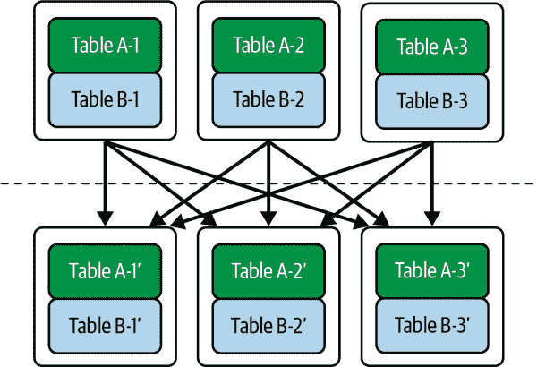

在该示例中，哈希方案将连接键分成三部分，每部分分配给一个节点。然后数据被重新洗牌到相应的节点，每个节点上表 A 和表 B 的新分区被连接起来。洗牌哈希连接通常比广播连接消耗更多资源。

# ETL、ELT 和数据管道

正如我们在第 3 章中讨论的那样，一种可追溯到关系型数据库早期的广泛转换模式是批量 ETL。传统 ETL 依赖外部转换系统来拉取、转换和清洗数据，同时为其准备目标模式，例如数据集市或 Kimball 星型模式。转换后的数据随后被加载到目标系统（如数据仓库）中，以便执行业务分析。

ETL 模式本身是由源系统和目标系统的局限性驱动的。抽取阶段往往是一个主要瓶颈，源 RDBMS 的限制制约了数据拉取的速率。而且，转换在专用系统中处理，因为目标系统在存储和 CPU 容量方面都极其受限。

ETL 现在流行的一种演进是 ELT。随着数据仓库系统在性能和存储容量上的增长，一种常见做法变成了：从源系统简单地抽取原始数据，仅做最少量的转换就将其导入数据仓库，然后直接在仓库系统中清洗和转换它。（关于 ETL 和 ELT 之间差异的更详细讨论，请参阅我们在第 3 章中关于数据仓库的讨论。）

随着数据湖的出现，ELT 的第二种略有不同的概念被普及。在这个版本中，数据在加载时不进行转换。确实，海量数据可能在没有任何准备和计划的情况下被加载。假设是转换步骤将在未来某个不确定的时间发生。无计划地摄入数据是制造数据沼泽的绝佳配方。正如 Inmon 所言：^(14)

> 我一直是 ETL 的粉丝，因为 ETL 迫使你在将数据放入可处理的形式*之前*对其进行转换。但一些组织只想简单地获取数据，将其放入数据库，然后再做转换……我见过太多案例，组织说，哦，我们先把数据放进去，稍后再转换。猜怎么着？六个月后，那些数据\[从未\]被碰过。

我们还看到，在数据湖仓环境中，ETL 和 ELT 之间的界限可能变得有些模糊。以对象存储作为基础层，什么在数据库内、什么在数据库外不再清晰。随着数据联邦、虚拟化和实时表的出现，这种模糊性进一步加剧。（我们将在本节后面讨论这些主题。）

越来越多地，我们认为*ETL*和*ELT*这两个术语应仅应用于微观层面（单个转换管道内部），而非宏观层面（描述整个组织的转换模式）。组织不再需要在 ETL 或 ELT 上标准化，而是可以在构建数据管道时，根据具体情况逐案应用恰当的技术。

# 基于 SQL 和代码的转换工具

此时，基于 SQL 和非基于 SQL 的转换系统之间的区别感觉有些人为。自 Hadoop 平台上引入 Hive 以来，SQL 已成为大数据生态系统中的一等公民。例如，Spark SQL 是 Apache Spark 的早期功能。以流为主的框架如 Kafka、Flink 和 Beam 也支持 SQL，功能和特性各异。

更恰当的思考方式是对比仅支持 SQL 的工具与支持更强大、通用编程范式的工具。仅支持 SQL 的转换工具涵盖了各种专有和开源选项。

## SQL 是声明式的……但它仍能构建复杂的数据工作流

我们经常听到 SQL 被贬低，因为它“不是过程式的”。这在技术上是正确的。SQL 是一种声明式语言：SQL 编写者不编写数据处理过程，而是用集合论语言规定其最终数据的特征；SQL 编译器和优化器确定将数据置于该状态所需的步骤。

人们有时暗示因为 SQL 不是过程式的，所以它无法构建复杂的管道。这是错误的。SQL 可以有效地用于构建复杂的 DAG，方法是使用公用表表达式、SQL 脚本或编排工具。

需要明确的是，SQL 有其局限性，但我们经常看到工程师用 Python 和 Spark 做一些本可以在 SQL 中更轻松、更高效完成的事情。为了更好地了解我们讨论的权衡，让我们看几个 Spark 和 SQL 的示例。

## 示例：何时在 Spark 中避免使用 SQL 进行批量转换

当你在决定是使用原生 Spark 或 PySpark 代码，而不是 Spark SQL 或其他 SQL 引擎时，请问自己以下问题：

1.  用 SQL 编写转换逻辑有多难？
2.  生成的 SQL 代码可读性和可维护性如何？
3.  部分转换代码是否应推入自定义库，以便在组织内未来复用？


### 关于问题 1

许多在 Spark 中编码的转换可以用相当简单的 SQL 语句来实现。另一方面，如果转换无法用 SQL 实现，或者实现起来极其别扭，那么原生 Spark 是更好的选择。例如，我们或许可以通过将词缀放入表中、与该表连接、使用解析函数查找单词中的词缀，然后利用子字符串函数将单词还原为词干，从而在 SQL 中实现词干提取。然而，这听起来像是一个极其复杂的过程，需要考虑大量边缘情况。在这里，功能更强大的过程式编程语言更为合适。

### 问题 2

问题 2 与之密切相关。词干提取查询将既难以阅读，也难以维护。

### 关于问题 3

SQL 的主要局限性之一在于它不包含库或可复用代码的自然概念。一个例外是某些 SQL 引擎允许你将用户定义函数（UDF）作为数据库内的对象进行维护。^(15) 然而，如果没有外部 CI/CD 系统来管理部署，这些函数无法提交到 Git 仓库。此外，SQL 对更复杂的查询组件缺乏良好的可复用性概念。当然，在 Spark 和 PySpark 中创建可复用库非常容易。

我们补充说明，SQL 可以通过两种方式实现复用。首先，我们可以通过提交到表或创建视图，轻松复用 SQL 查询的结果。这一过程通常最好由编排工具（如 Airflow）处理，以便在源查询完成后启动下游查询。其次，Data Build Tool (dbt) 促进了 SQL 语句的复用，并提供了一种模板语言，使定制化变得更容易。

## 示例：优化 Spark 和其他处理框架

Spark 追随者经常抱怨 SQL 无法让他们控制数据处理。SQL 引擎接收你的语句，对其进行优化，并将其编译为处理步骤。（在实践中，优化可能发生在编译之前、之后，或两者皆有。）

这是一个合理的抱怨，但存在一个推论。使用 Spark 和其他代码密集型处理框架时，代码编写者需承担起在基于 SQL 的引擎中由系统自动处理的大部分优化工作。Spark API 功能强大且复杂，这意味着识别重排、组合或分解的候选对象并非易事。在采用 Spark 时，数据工程团队需要主动应对 Spark 优化问题，尤其是针对昂贵、长时间运行的作业。这意味着要在团队内建立优化专长，并指导各个工程师如何进行优化。

使用原生 Spark 编码时，有几个高层级的要点需要牢记：

1.  尽早且频繁地过滤。
2.  大量依赖核心 Spark API，并学会理解 Spark 原生的做事方式。如果原生 Spark API 不支持你的用例，请尝试依赖维护良好的公共库。优秀的 Spark 代码具有高度的声明性。
3.  谨慎使用 UDF。
4.  考虑混合使用 SQL。

建议 1 同样适用于 SQL 优化，区别在于 Spark 可能无法重排 SQL 会自动为你处理的操作。Spark 是一个大数据处理框架，但你需要处理的数据越少，代码消耗的资源就越少、性能就越高。

如果你发现自己正在编写极其复杂的自定义代码，请暂停并判断是否有更原生的方式来完成你的目标。通过阅读公开示例和学习教程来理解地道的 Spark 用法。Spark API 中是否有功能可以实现你的目标？是否有维护良好且经过优化的公共库可以提供帮助？

第三条建议对 PySpark 至关重要。一般来说，PySpark 是 Scala Spark 的 API 封装。你的代码通过调用 API 将工作推送到 JVM 中运行的原生 Scala 代码中。运行 Python UDF 会强制数据传递给 Python，在那里处理效率较低。如果你发现自己在使用 Python UDF，请寻找更原生的 Spark 方式来完成任务。回到建议：是否有办法通过使用核心 API 或维护良好的库来完成你的任务？如果必须使用 UDF，考虑用 Scala 或 Java 重写它们以提高性能。

至于建议 4，使用 SQL 让我们能利用 Spark Catalyst 优化器，它可能比原生 Spark 代码榨取出更多性能。对于简单操作，SQL 通常更易编写和维护。结合原生 Spark 和 SQL 让我们能实现两全其美——强大的通用功能与适用场景下的简洁性相结合。

本节中的大部分优化建议相当通用，同样适用于 Apache Beam 等框架。要点在于，可编程数据处理 API 比 SQL 需要更多的优化技巧，而 SQL 可能功能较弱但更易用。

### 更新模式

由于转换会持久化数据，我们经常会就地更新持久化数据。更新数据是数据工程团队的一个主要痛点，尤其是在数据工程技术转型期间。我们讨论的是 SQL 中的 DML，这在本章前面已有介绍。

我们在全书中多次提到，最初的数据湖概念并未真正考虑更新数据。现在看来，这有几个原因显得荒谬。尽管大数据社区曾摒弃它，但更新数据长期以来一直是处理数据转换结果的关键部分。因为缺乏更新能力而重跑大量工作是愚蠢的。因此，数据湖仓概念现在内置了更新功能。此外，GDPR 和其他数据删除标准现在要求组织以定向方式删除数据，即使是在原始数据集中。

让我们考虑几种基本的更新模式。

#### 截断并重载

*截断* 是一种不更新任何内容的更新模式。它只是擦除旧数据。在截断并重载模式中，表被清空，转换被重新运行并加载到该表中，实际上生成了一个新的表版本。

#### 仅插入

*仅插入* 会插入新记录，而不更改或删除旧记录。仅插入模式可用于维护数据的当前视图——例如，如果插入记录的新版本而不删除旧记录。查询或视图可以通过主键查找最新记录来呈现当前数据状态。请注意，列式数据库通常不强制执行主键。主键将是工程师用来维护表当前状态概念的一种构造。这种方法的缺点是在查询时查找最新记录可能极其消耗计算资源。或者，我们可以使用物化视图（本章后面介绍）、一个保留所有记录的仅插入表，以及一个保存用于服务数据的当前状态的截断并重载目标表。

> **警告**
>
> 当向面向列的 OLAP 数据库插入数据时，常见的问题是：从面向行的系统转型过来的工程师试图使用单行插入。这种反模式会给系统带来巨大负载。它还会导致数据被写入许多单独的文件；这对后续读取极其低效，且数据稍后必须重新聚类。相反，我们建议以定期微批次或批量方式加载数据。
>
> 我们要提及一个不频繁插入建议的例外：BigQuery 和 Apache Druid 使用的增强型 Lambda 架构，它将流式缓冲区与列式存储混合。删除和就地更新仍然可能很昂贵，我们将在下文讨论。

#### 删除


删除操作在源系统删除数据并满足近期法规变更时至关重要。在列式系统和数据湖中，删除操作比插入操作更昂贵。

删除数据时，请考虑是需要执行硬删除还是软删除。`hard delete`（硬删除）会永久从数据库中移除记录，而 `soft delete`（软删除）则将记录标记为“已删除”。当您需要出于性能原因移除数据（例如表过大），或因法律或合规原因必须移除时，硬删除非常有用。当您不想永久删除记录，但又希望将其从查询结果中过滤掉时，可能会使用软删除。

第三种删除方法与软删除密切相关：`insert deletion`（插入式删除）会插入一条带有 `deleted` 标志的新记录，而不修改该记录的先前版本。这使我们能够遵循仅插入模式，同时仍能处理删除操作。只需注意，我们获取最新表状态的查询会变得稍微复杂一些。我们现在必须去重，按键查找每条记录的最新版本，并且不显示其最新版本显示为 `deleted` 的任何记录。

### Upsert/merge（Upsert/合并）

在这些更新模式中，upsert 和 merge 模式始终给数据工程团队带来最大的麻烦，特别是对于那些从行式数据仓库迁移到列式云系统的人员。

`Upserting`（Upsert 操作）获取一组源记录，并通过使用主键或另一个逻辑条件在目标表中查找匹配项。（同样，数据工程团队有责任通过运行适当的查询来管理此主键。大多数列式系统不会强制执行唯一性。）当发生键匹配时，目标记录会被更新（被新记录替换）。当不存在匹配项时，数据库会插入新记录。merge 模式在此基础上增加了删除记录的能力。

那么，问题出在哪里？upsert/merge 模式最初是为行式数据库设计的。在行式数据库中，更新是一个自然过程：数据库查找相关记录并就地修改它。

另一方面，基于文件的系统实际上不支持就地文件更新。所有这些系统都采用写时复制（COW）。如果文件中的一条记录被更改或删除，整个文件都必须连同新更改一起重写。

这也是早期大数据和数据湖采用者拒绝更新的部分原因：管理文件和更新似乎太复杂了。因此，他们只是使用仅插入模式，并假设数据消费者会在查询时或下游转换中确定数据的当前状态。实际上，Vertica 等列式数据库早已通过对用户隐藏 COW 的复杂性来支持就地更新。它们扫描文件，更改相关记录，写入新文件，并更改表的文件指针。主流列式云数据仓库支持更新和合并，尽管工程师在考虑采用小众技术时应调查其对更新的支持情况。

这里有几个关键点需要理解。即使分布式列式数据系统支持原生更新命令，合并也要付出代价：更新或删除单条记录的性能影响可能相当大。另一方面，对于大规模更新集，合并可以表现出极高的性能，甚至可能优于事务型数据库。

此外，重要的是要理解 COW 很少涉及重写整张表。取决于所涉及的数据库系统，COW 可以在不同粒度（分区、簇、块）上运行。为了实现高性能更新，请专注于根据您的需求和相关数据库的内部机制，制定合适的分区和聚类策略。

与插入一样，请小心对待您的更新或合并频率。我们见过许多工程团队在数据库系统之间迁移，并尝试像在旧系统上那样从 CDC 运行近实时合并。这根本行不通。无论您的 CDC 系统有多好，这种方法都会让大多数列式数据仓库不堪重负。我们见过系统在更新上落后数周，而简单地每小时合并一次的方法会更合理。

我们可以使用多种方法让列式数据库更接近实时。例如，BigQuery 允许我们将新记录流式插入表中，然后支持专门的物化视图，呈现高效的近实时去重表视图。Druid 使用两层存储和 SSD 来支持超快的实时查询。

### Schema updates（模式更新）

数据具有熵，可能会在您无法控制或不同意的情况下发生变化。外部数据源可能会更改其模式，或者应用程序开发团队可能会向模式添加新字段。列式系统相对于行式系统的一个优势在于，虽然更新数据更困难，但更新模式更容易。通常可以添加、删除和重命名列。

尽管有这些技术改进，实际的组织模式管理更具挑战性。某些模式更新会自动化吗？（这是 Fivetran 在从源复制时采用的方法。）尽管这听起来很方便，但存在下游转换中断的风险。

是否有简单直接的模式更新请求流程？假设数据科学团队想要添加一个来自先前未摄取来源的列。审查流程是什么样的？下游流程会中断吗？（是否有查询运行 `SELECT *` 而不是使用显式列选择？这在列式数据库中通常是不良实践。）实施更改需要多长时间？是否可以创建表分支——即专门针对该项目的新表版本？

针对半结构化数据，出现了一个有趣的新选项。借鉴文档存储的理念，许多云数据仓库现在支持编码任意 JSON 数据的数据类型。一种方法将原始 JSON 存储在一个字段中，同时将频繁访问的数据存储在相邻的扁平化字段中。这会占用额外的存储空间，但既允许扁平化数据的便利性，又为高级用户保留了半结构化数据的灵活性。JSON 字段中频繁访问的数据可以随着时间的推移直接添加到模式中。

当数据工程师必须从模式频繁变更的应用程序文档存储中摄取数据时，这种方法效果极好。半结构化数据作为数据仓库中的一等公民，极其灵活，并为数据分析师和数据科学家开辟了新机会，因为数据不再局限于行和列。

### Data wrangling（数据清洗/整理）

`Data wrangling`（数据清洗/整理）将混乱、格式错误的数据转化为有用、干净的数据。这通常是一个批量转换过程。

数据清洗长期以来一直是数据工程师的主要痛点和“饭碗保障”。例如，假设开发人员从合作伙伴企业接收 EDI 数据（参见第 7 章），内容涉及交易和发票，可能是结构化数据和文本的混合。清洗此数据的典型过程首先是尝试摄取它。通常，数据格式错误严重，涉及大量文本预处理。开发人员可能会选择将数据作为单文本字段表摄取——整行作为单个字段摄取。然后开发人员开始编写查询来解析和拆分数据。随着时间的推移，他们会发现数据异常和边缘情况。最终，他们会将数据整理成大致可用的形状。只有那时，下游转换的过程才能开始。


# 数据清洗工具

数据清洗工具旨在简化该过程的重要部分。这些工具往往会让数据工程师望而却步，因为它们声称是“无代码”的，听起来不够复杂。我们更倾向于将数据清洗工具视为面向格式不规范数据的集成开发环境（IDE）。在实践中，数据工程师花费了太多时间来解析糟糕的数据；自动化工具让数据工程师能将时间花在更有趣的任务上。清洗工具还可能允许工程师将一些解析和摄取工作移交给分析师。

图形化数据清洗工具通常会在可视化界面中展示数据样本，包含推断类型、统计信息（包括分布）、异常数据、离群值和空值。用户随后可以添加处理步骤来修复数据问题。一个步骤可能提供处理录入错误数据的指令、将文本字段拆分为多个部分，或与查找表进行连接。

当完整作业准备就绪时，用户可以在完整数据集上运行这些步骤。该作业通常会被推送到可扩展的数据处理系统（如 `Spark`）以处理大型数据集。作业运行后，会返回错误和未处理的异常。用户可以进一步优化配方以处理这些离群值。

我们强烈建议有志于此道的工程师和资深工程师都尝试使用清洗工具；主要云服务商都销售其版本的数据清洗工具，且有许多第三方选项可用。数据工程师可能会发现这些工具能显著简化其工作的某些部分。从组织角度来看，如果数据工程团队经常从新的、混乱的数据源摄取数据，可能需要考虑培养数据清洗专家。

## 示例：Spark 中的数据转换

让我们看一个实际的、具体的数据转换示例。假设我们构建一个管道，从三个 `JSON` 格式的 API 源摄取数据。此初始摄取步骤在 `Airflow` 中处理。每个数据源在 `S3` 存储桶中获得其前缀（文件路径）。

随后，`Airflow` 通过调用 API 触发一个 `Spark` 作业。该 `Spark` 作业将三个源分别摄取到一个 `DataFrame` 中，将数据转换为关系格式，某些列包含嵌套结构。`Spark` 作业将三个源合并为一张表，然后使用 `SQL` 语句过滤结果。最终结果以 `Parquet` 格式写入存储在 `S3` 中的 `Delta Lake` 表。

在实践中，`Spark` 会根据我们编写的用于摄取、连接和写出数据的代码创建一个步骤 `DAG`。基本的数据摄取发生在集群内存中，尽管其中一个数据源足够大，以至于在摄取过程中必须溢写到磁盘。（这些数据被写入集群存储；后续处理步骤会将其重新加载到内存中。）

连接操作需要 Shuffle 操作。使用 `key` 将数据重新分布到集群中；数据写入每个节点时，再次发生溢写到磁盘的情况。`SQL` 转换在内存中过滤行并丢弃未使用的行。最后，`Spark` 将数据转换为 `Parquet` 格式，进行压缩，并写回 `S3`。`Airflow` 定期回调 `Spark` 以查看作业是否完成。一旦确认作业已完成，它会将完整的 `Airflow` `DAG` 标记为完成。（注意这里有两个 `DAG` 结构，一个 `Airflow` `DAG` 和一个特定于 `Spark` 作业的 `DAG`。）

## 业务逻辑与衍生数据

转换最常见的用例之一是实现业务逻辑。我们将此讨论放在批量转换下，因为这种类型的转换最常发生在这里，但请注意它也可能发生在流式管道中。

假设一家公司使用多种专门的内部利润计算方法。一种版本可能关注营销成本之前的利润，另一种可能关注减去营销成本后的利润。尽管这似乎是一个简单的会计练习，但这些指标中的每一个都非常复杂。

营销成本前利润可能需要考虑欺诈订单；确定前一个工作日的合理利润估计，意味着要估算在未来几天欺诈团队调查可疑订单时，最终将有多少百分比的收入和利润会因订单取消而损失。数据库中是否有特殊标志表明某订单具有高欺诈概率，或已被自动取消？企业是否假设即使在特定订单的欺诈风险评估流程完成之前，也会有一定比例的订单因欺诈而被取消？

对于营销成本后利润，我们必须考虑上述指标的所有复杂性，再加上归因于特定订单的营销成本。公司是否有一个简单的归因模型——例如，按价格加权将营销成本归因于商品？营销成本也可能按部门、商品类别归因，或者——在最复杂的组织中——基于用户广告点击，按单个商品归因。

生成这种细微版本利润的业务逻辑转换必须整合归因的所有细微差别——即将订单与特定广告和广告成本关联的模型。归因数据是存储在 `ETL` 脚本的内部，还是从由广告平台数据自动生成的表中提取？

这种报表数据是*衍生数据*的典型例子——即从数据系统中存储的其他数据计算得出的数据。衍生数据的批评者会指出，`ETL` 难以维护衍生指标的一致性。^(16) 例如，如果公司更新其归因模型，此更改可能需要合并到许多用于报表的 `ETL` 脚本中。(`ETL` 脚本以打破 `DRY` 原则而臭名昭著。) 更新这些 `ETL` 脚本是一个手动且劳动密集型的过程，涉及处理逻辑和先前更改的领域专业知识。更新后的脚本还必须经过验证，以确保一致性和准确性。

从我们的角度来看，这些批评是合理的，但不一定具有建设性，因为在这种情况下，衍生数据的替代方案同样令人反感。如果利润数据不存储在数据仓库中，分析师将需要运行他们的报表查询，其中包含利润逻辑。更新复杂的 `ETL` 脚本以准确反映业务逻辑的变更是一项压倒性的、劳动密集型的任务，但让分析师始终如一地更新他们的报表查询几乎是不可能的。

一个有趣的替代方案是将业务逻辑推送到*指标层*^(17)，但仍利用数据仓库或其他工具进行繁重的计算工作。指标层对业务逻辑进行编码，允许分析师和仪表板用户从定义好的指标库中构建复杂的分析。指标层从指标生成查询并将其发送到数据库。我们将在第 9 章中更详细地讨论语义层和指标层。

## MapReduce

如果不涉及 `MapReduce`，任何关于批量转换的讨论都不算完整。这并非因为 `MapReduce` 如今被数据工程师广泛使用。`MapReduce` 是大数据时代具有定义性的批量数据转换模式，它仍然影响着数据工程师今天使用的许多分布式系统，数据工程师在基础层面了解它很有用。[MapReduce](https://oreil.ly/hdptb) 由 Google 在其关于 `GFS` 的论文后续中引入。它最初是 `Hadoop` 事实上的处理模式，`Hadoop` 是我们在第 6 章存储中介绍的 `GFS` 的开源类比技术。


# After MapReduce

一个简单的 `MapReduce` 作业由一组 map 任务组成，这些任务读取分散在各节点上的单个数据块，随后是一个将结果数据重新分布到集群各处的 shuffle 过程，以及一个在每个节点上聚合数据的 reduce 步骤。例如，假设我们想要运行以下 SQL 查询：

```
SELECT COUNT(*), user_id
FROM user_events
GROUP BY user_id;
```

表数据以数据块的形式分布在各节点上；`MapReduce` 作业会为每个数据块生成一个 map 任务。每个 map 任务本质上是在单个数据块上运行查询——即为该数据块中出现的每个用户 ID 生成一个计数。虽然一个数据块可能包含数百兆字节，但完整的表可能达到 PB 级别。然而，作业的 map 部分是**尴尬并行**（embarrassing parallelism）的近乎完美的示例；整个集群的数据扫描速率基本上随着节点数量线性扩展。

然后我们需要聚合（reduce）以收集来自整个集群的结果。我们不是将结果收集到单个节点；而是按键重新分发结果，使得每个键最终仅落在一个且只有一个节点上。这就是 shuffle 步骤，通常使用键上的哈希算法执行。一旦 map 结果被 shuffle 完成，我们就对每个键的结果求和。键/计数对可以写入计算它们所在节点的本地磁盘。我们收集存储在各节点上的结果以查看完整的查询结果。

现实世界中的 `MapReduce` 作业可能比我们在此描述的要复杂得多。一个包含 `WHERE` 子句过滤、连接三张表并应用窗口函数的复杂查询，将包含许多 map 和 reduce 阶段。

Google 最初的 `MapReduce` 模型极其强大，但现在被视为过于僵化。它利用大量短暂的临时任务从磁盘读取和写入磁盘。特别是，没有中间状态保留在内存中；所有数据通过存储到磁盘或通过网络推送在任务之间传输。这简化了状态和工作流管理并最小化了内存消耗，但也可能导致高磁盘带宽利用率并增加处理时间。

`MapReduce` 范式是围绕磁盘容量和带宽非常廉价这一理念构建的，因此直接向数据投入海量磁盘以实现超快查询是合理的。这在一定程度上奏效了；在 Hadoop 早期，`MapReduce` 反复刷新数据处理记录。

然而，我们已经生活在后 `MapReduce` 时代有一段时间了。后 `MapReduce` 处理并非真正抛弃 `MapReduce`；它仍然包含 map、shuffle 和 reduce 的要素，但放宽了 `MapReduce` 的约束以允许内存缓存。^(18) 回想一下，`RAM` 的传输速度和寻道时间比 `SSD` 和 `HDD` 快得多。即使只将少量精心挑选的数据持久化在内存中，也能显著加速特定的数据处理任务，并彻底碾压 `MapReduce` 的性能。

例如，`Spark`、`BigQuery` 和其他各种数据处理框架都是围绕内存处理设计的。这些框架将数据视为驻留在内存中的分布式集合。如果数据溢出可用内存，就会导致 `spill to disk`（溢写到磁盘）。磁盘被视为处理时的二等数据存储层，尽管它仍然非常有价值。

云是推动内存缓存更广泛采用的驱动力之一；在特定处理作业期间租用内存比全天候拥有内存要有效得多。利用内存进行转换的进步将在可预见的未来继续带来收益。

# Materialized Views, Federation, and Query Virtualization

在本节中，我们将探讨几种通过将查询结果呈现为类表对象来实现查询结果虚拟化的技术。这些技术可以成为转换管道的一部分，也可以位于最终用户数据消费之前。

## Views

首先，让我们回顾一下 view（视图），为 materialized view（物化视图）铺垫背景。`view` 是一个数据库对象，我们可以像查询其他表一样从中进行 `SELECT` 查询。实际上，`view` 只是一个引用其他表的查询。当我们从 `view` 中查询时，数据库会创建一个新查询，将 `view` 子查询与我们的查询结合起来。查询优化器随后会优化并运行完整查询。

`Views` 在数据库中扮演多种角色。首先，`views` 可以发挥安全作用。例如，`views` 可以仅选择特定列并过滤行，从而提供受限的数据访问。可以根据用户数据访问权限为不同工作角色创建各种 `views`。

其次，`view` 可用于提供当前的去重数据视图。如果我们使用仅追加（insert-only）模式，`view` 可用于返回表的去重版本，仅显示每条记录的最新版本。

第三，`views` 可用于呈现常见的数据访问模式。假设市场分析师必须频繁运行一个连接五张表的查询。我们可以创建一个将这五张表连接成一张宽表的 `view`。分析师随后可以编写查询，在此 `view` 之上进行过滤和聚合。

## Materialized views

我们在之前关于查询缓存的讨论中提到了 materialized views（物化视图）。非物化 `views` 的一个潜在缺点是它们不进行任何预计算。在连接五张表的 `view` 示例中，每当市场分析师在此 `view` 上运行查询时，该连接都必须执行，而该连接可能极其昂贵。

Materialized `view`（物化视图）会提前完成部分或全部的 `view` 计算。在我们的示例中，每当源表发生变化时，materialized `view` 可能会保存五表连接的结果。然后，当用户引用该 `view` 时，他们查询的是预连接的数据。Materialized `view` 实际上是一个转换步骤，但数据库为了方便而管理其执行。

取决于数据库，materialized `views` 还可能发挥重要的查询优化作用，即使对于不直接引用它们的查询也是如此。许多查询优化器可以识别“看起来像” materialized `view` 的查询。分析师可能运行一个使用出现在 materialized `view` 中的过滤器的查询。优化器会重写查询，以从预计算结果中进行选择。

## Composable materialized views

一般来说，materialized `views` 不允许组合——即 materialized `view` 不能从另一个 materialized `view` 中查询。然而，我们最近看到了支持此功能的工具的出现。例如，`Databricks` 引入了 `live tables`（实时表）的概念。每个表随着数据从源头到达而更新。数据异步流向后续表。

## Federated queries

`Federated queries`（联邦查询）是一项数据库功能，允许 `OLAP` 数据库从外部数据源（如对象存储或 `RDBMS`）进行查询。例如，假设你需要合并对象存储以及 `MySQL` 和 `PostgreSQL` 数据库中各种表的数据。你的数据仓库可以向这些源发出 `Federated queries` 并返回合并结果（图 8-19）。

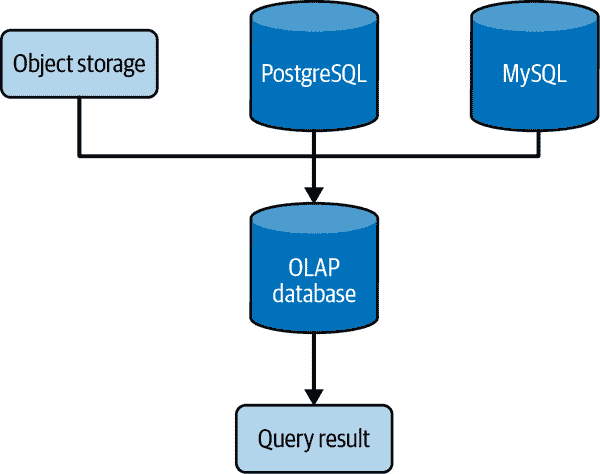

作为另一个例子，`Snowflake` 支持在 `S3` 存储桶上定义外部表的概念。创建表时会定义外部数据位置和文件格式，但数据尚未被摄入表中。当查询外部表时，`Snowflake` 会从 `S3` 读取并根据创建表时设置的参数处理数据。我们甚至可以将 `S3` 数据与内部数据库表连接。这使得 `Snowflake` 和类似数据库与数据湖环境更加兼容。


# OLAP 系统与物化视图

某些 OLAP 系统可将联邦查询转换为物化视图。这使我们能获得接近原生表的性能，而无需在外部源每次变更时手动摄入数据。每当外部数据发生变化，物化视图就会更新。

# 数据虚拟化

*数据虚拟化*与联邦查询密切相关，但通常指一种不在内部存储数据的数据处理和查询系统。目前，Trino（如 Starburst）和 Presto 是典型代表。任何支持外部表的查询/处理引擎都可充当数据虚拟化引擎。数据虚拟化最关键的考量因素是支持的外部源和性能。

## 查询下推

一个密切相关的概念是*查询下推*。假设我想从 Snowflake 查询数据，关联 MySQL 数据库的数据，并过滤结果。查询下推旨在将尽可能多的工作下推到源数据库。引擎会尝试将过滤谓词下推到源系统的查询中。这有两大作用：首先，它将计算从虚拟化层卸载，利用源系统的查询性能；其次，它可能减少必须跨网络传输的数据量，而这是虚拟化性能的关键瓶颈。

## 数据虚拟化实践

对于数据分散存储在各种数据源中的组织，数据虚拟化是一个不错的解决方案。然而，不应随意使用数据虚拟化。例如，虚拟化生产环境的 MySQL 数据库并不能解决分析查询对生产系统造成不利影响的核心问题——因为 Trino 不在内部存储数据，每次运行查询都会从 MySQL 拉取数据。

或者，数据虚拟化可作为数据摄入和处理管道的一个组件。例如，Trino 可用于在生产系统负载较低的午夜每天从 MySQL 查询一次。结果可保存到 S3，供下游转换和日常查询使用，从而保护 MySQL 免受直接分析查询的影响。

数据虚拟化可被视为一种工具，它通过抽象掉用于在组织单元间孤岛化数据的屏障，将数据湖扩展到更多源。组织可将频繁访问的转换后数据存储在 S3 中，并虚拟化公司各部门间的访问。这与*数据网格*的概念紧密契合（详见第 3 章），即小团队负责为分析准备其数据并与全公司共享；虚拟化可作为实用共享的关键访问层。

# 流式转换与处理

我们已在查询背景下讨论过流处理。流式转换与流式查询的区别微妙，值得进一步解释。

## 基础

如前所述，流式查询动态运行以呈现数据的当前视图。*流式转换*旨在为下游消费准备数据。

例如，数据工程团队可能有一个传入流，承载来自 IoT 源的事件。这些 IoT 事件携带设备 ID 和事件数据。我们希望用存储在单独数据库中的其他设备元数据动态丰富这些事件。流处理引擎按设备 ID 查询包含此元数据的单独数据库，生成附加了数据的新事件，并将其传递给另一个流。实时查询和触发指标在此丰富流上运行（参见图 8-20）。

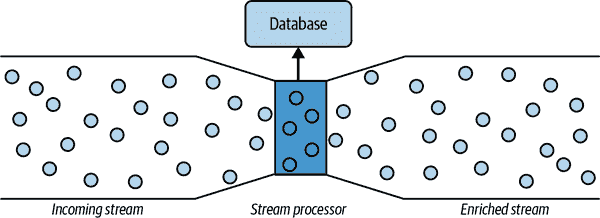

## 转换与查询构成连续体

在批处理中，转换与查询的界限也模糊不清，但在流式领域，差异变得更加微妙。例如，如果我们在窗口上动态计算汇总统计，然后将输出发送到目标流，这是转换还是查询？

也许我们最终会采用新术语来更好地表达流处理的实际用例。目前，我们将尽力使用现有术语。

## 流式 DAG

一个与流式丰富和关联密切相关的有趣概念是*流式 DAG*。^(19) 我们在第 2 章讨论编排时首次提到这个想法。编排本质上是批处理概念，但如果我们想实时丰富、合并和拆分多个流怎么办？

举一个流式 DAG 有用的简单例子。假设我们要将网站点击流数据与 IoT 数据结合。这将使我们能够通过结合 IoT 事件与点击，获得用户活动的统一视图。此外，每个数据流都需要预处理为标准格式（参见图 8-21）。

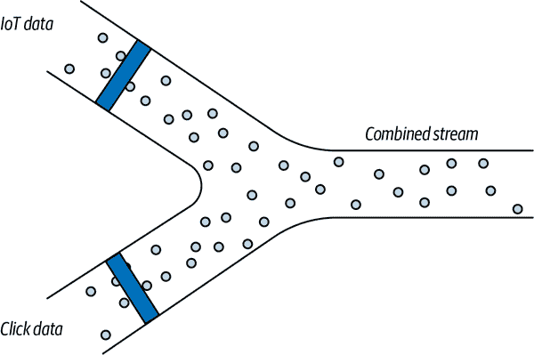

这早已通过结合流式存储（如 Kafka）与流处理器（如 Flink）成为可能。创建 DAG 相当于构建一个复杂的鲁布·戈德堡机械，包含众多相连的主题和处理作业。

Pulsar 通过将 DAG 视为核心流式抽象，极大地简化了这一过程。工程师无需管理跨多个系统的流程，即可在单一系统内以代码形式定义其流式 DAG。

## 微批处理与真流式

微批处理与真流式方法之间的长期争论一直在持续。根本上，理解你的用例、性能需求以及相关框架的性能能力至关重要。

微批处理是一种将面向批处理的框架应用于流式场景的方式。微批处理可能每两分钟到每秒运行一次。某些微批处理框架（如 Apache Spark Streaming）专为此用例设计，在适当分配资源和高批次频率下表现良好。（事实上，DBA 和工程师长期以来一直将微批处理用于更传统的数据库；这往往导致可怕的性能和资源消耗。）

真流式系统（如 Beam 和 Flink）旨在逐个事件处理。然而，这带来了显著的开销。此外，重要的是要注意，即使在这些真流式系统中，许多过程仍将以批次形式发生。一个向单个事件添加数据的基本丰富过程可低延迟地逐个事件交付。然而，窗口上的触发指标可能每几秒或每几分钟运行一次。

当你使用窗口和触发器（因此是批处理）时，窗口频率是多少？可接受的延迟是多少？如果你每隔几分钟收集一次黑色星期五销售指标，只要设置合适的微批处理频率，微批处理可能完全没问题。另一方面，如果你的运维团队每秒计算指标以检测 DDoS 攻击，则可能需要真流式处理。

何时该用哪种？坦白说，没有通用答案。*微批处理*一词常被用来贬低竞争技术，但它可能完全适合你的用例，且在许多方面可能更优，具体取决于你的需求。如果你的团队已具备 Spark 专长，你将能极快地搭建起 Spark（微批处理）流式解决方案。


没有任何东西能替代领域专业知识和真实世界的测试。与能够提供公正意见的专家交谈。您还可以通过在云基础设施上启动测试，轻松测试各种替代方案。此外，要警惕供应商提供的虚假基准测试。供应商以挑选有利的基准测试和设置不符合现实的人为示例而臭名昭著（回顾我们在第 4 章中关于基准测试的对话）。供应商经常在其基准测试结果中展示巨大优势，但在您的用例中却无法在现实世界中兑现。

# 您将与谁共事

查询、转换和建模影响数据工程生命周期中上下游的所有利益相关者。在此阶段，数据工程师负责多项任务。从技术角度来看，数据工程师设计、构建并维护查询和转换数据的系统的完整性。数据工程师还在该系统中实施数据模型。这是最“全接触”的阶段，您的重点是尽可能增加价值，无论是从功能系统还是可靠、可信的数据方面。

## 上游利益相关者

就转换而言，上游利益相关者大致可分为两类：控制业务定义的人和控制生成数据系统的人。

在与上游利益相关者就业务定义和逻辑进行交互时，您需要了解数据源——它们是什么、如何使用，以及涉及的业务逻辑和定义。您将与负责这些源系统的工程师以及监督互补产品和应用的业务利益相关者共事。数据工程师可能会与“业务方”和技术利益相关者一起处理数据模型。

数据工程师需要参与数据模型的设计及后续更新，因为业务逻辑会变更或出现新流程。转换本身很容易做；只需编写查询并将结果放入表或视图中即可。但要使它们既高性能又对业务有价值，则是另一码事。转换数据时，始终将业务的需求和期望放在首位。

上游系统的利益相关者希望确保您的查询和转换对其系统的影响最小。确保就源系统中的数据模型变更（例如列和索引变更）进行双向沟通，因为这些变更会直接影响查询、转换和分析数据模型。数据工程师应了解模式变更，包括字段的增删、数据类型变更，以及任何可能实质性影响查询和转换数据能力的其他变更。

## 下游利益相关者

转换是数据开始为下游利益相关者提供效用的地方。您的下游利益相关者包括许多人，如数据分析师、数据科学家、机器学习工程师和“业务方”。与他们协作，确保您提供的数据模型和转换既高性能又有用。在性能方面，查询应以最具成本效益的方式尽可能快地执行。什么是*有用*？分析师、数据科学家和机器学习工程师应该能够查询数据源，并确信数据具有最高质量和完整性，且可集成到他们的工作流和数据产品中。业务方应该能够信任转换后的数据是准确且可执行的。

# 暗流

转换阶段是您的数据发生变异并演变为对业务有用的东西的地方。由于有许多活动部件，暗流在此阶段尤为关键。

## 安全

查询和转换将不同的数据集组合成新的数据集。谁有权访问这个新数据集？如果有人确实有权访问某个数据集，请继续控制谁有权访问该数据集的列、行和单元格级别的访问权限。

注意查询时针对数据库的攻击向量。数据库的读/写权限必须受到严格监控和控制。对数据库的查询访问必须以您通常控制组织系统和环境访问的相同方式进行控制。

隐藏凭证；避免将密码、访问令牌或其他凭证复制粘贴到代码或未加密的文件中。在 GitHub 代码库中直接看到粘贴数据库用户名和密码的代码，这令人震惊地常见！不用说，不要与其他用户共享密码。最后，绝不允许未受保护或未加密的数据穿越公共互联网。

## 数据管理

虽然数据管理在源系统阶段（以及数据工程生命周期的每个其他阶段）都至关重要，但在转换阶段尤为关键。转换本质上会创建需要管理的新数据集。与数据工程生命周期的其他阶段一样，让所有利益相关者参与数据模型和转换并管理他们的期望至关重要。此外，确保所有人就与数据业务定义一致的命名约定达成一致。适当的命名约定应体现在易于理解的字段名中。用户还可以在数据目录中查看字段含义、创建时间、数据集维护者及其他相关信息，以获得更多清晰度。

在转换阶段，确保定义准确性是关键。转换是否遵循预期的业务逻辑？越来越流行的做法是引入独立于转换的语义层或指标层。与其在运行时在转换中强制执行业务逻辑，为何不在转换层之前将这些定义作为一个独立阶段保留？虽然还处于早期阶段，但预计语义层和指标层将在数据工程和数据管理中变得更流行、更普遍。

因为转换涉及数据变异，所以必须确保您使用的数据没有缺陷并代表基本事实。如果您公司可以实施 MDM（主数据管理），请推动其实施。一致性维度和其他转换依赖 MDM 来保持数据的原始完整性和基本事实。如果无法实施 MDM，请与控制数据的上游利益相关者合作，确保您转换的任何数据都是正确的，并符合商定的业务逻辑。

数据转换可能使人难以沿同一条脉络了解数据集是如何衍生出来的。在第 6 章中，我们讨论了数据目录。随着我们转换数据，*数据血缘*工具变得不可或缺。数据血缘工具既帮助数据工程师（他们在创建新转换时必须了解之前的转换步骤），也帮助分析师（他们在运行查询和构建报表时需要了解数据来源）。

最后，法规合规性对您的数据模型和转换有何影响？敏感字段是否在必要时进行了数据掩码或混淆？您是否有能力响应删除请求而删除数据？您的数据血缘跟踪是否允许您查看源自已删除数据的衍生数据，并重新运行转换以移除原始源下游的数据？

## DataOps

对于查询和转换，DataOps 有两个关注领域：数据和系统。您需要监控并针对这些领域的变化或异常发出警报。数据可观测性领域正在蓬勃发展，重点关注数据可靠性。甚至出现了一个名为*数据可靠性工程师*的新职位名称。本节强调数据可观测性和数据健康，重点关注查询和转换阶段。


## DataOps：数据与运维

让我们从 DataOps 的数据方面入手。当你查询数据时，输入和输出是否正确？你怎么知道？如果该查询被保存到一张表中，模式是否正确？数据的结构以及相关统计信息（如最小/最大值、空值计数等）又如何？你应该对输入数据集和转换后的数据集运行数据质量测试，这将确保数据满足上游和下游用户的期望。如果转换过程中存在数据质量问题，你应该有能力标记该问题、回滚变更并调查根因。

现在让我们看看 DataOps 的运维部分。系统运行状况如何？监控查询队列长度、查询并发度、内存使用率、存储利用率、网络延迟和磁盘 I/O 等指标。利用指标数据发现瓶颈和性能不佳的查询，这些查询可能是重构和调优的候选对象。如果查询本身没有问题，你将大致知道在哪里调优数据库本身（例如，通过对表进行聚类以获得更快的查找性能）。或者，你可能需要升级数据库的计算资源。如今的云数据库和 SaaS 数据库为快速升级（和降级）系统提供了极大的灵活性。采用数据驱动的方法，利用可观测性指标精准定位是查询问题还是系统相关问题。

向基于 SaaS 的分析型数据库转变改变了数据消费的成本结构。在本地数据仓库时代，系统和许可证是预先购买的，没有额外的使用成本。传统数据工程师会专注于性能优化，以从昂贵的采购中榨取最大效用；而使用按消费量计费的云数据仓库的数据工程师则需要专注于成本管理和成本优化。这就是 `FinOps` 的实践（参见第 4 章）。

## 数据架构

第 3 章中良好数据架构的通用原则适用于转换阶段。构建健壮的系统，能够在不崩溃的情况下处理和转换数据。你对摄入和存储的选择将直接影响整体架构执行可靠查询和转换的能力。如果摄入和存储适合你的查询和转换模式，你将处于有利位置。反之，如果你的查询和转换与上游系统配合不佳，你将陷入极大的痛苦。

例如，我们经常看到数据团队为工作选择了错误的数据管道和数据库。数据团队可能将实时数据管道连接到 `RDBMS` 或 `Elasticsearch`，并将其用作数据仓库。这些系统未针对大容量聚合 `OLAP` 查询进行优化，在这种工作负载下会崩溃。这支数据团队显然不了解其架构选择将如何影响查询性能。花时间了解架构选择中固有的权衡；明确你的数据模型将如何与摄入和存储系统配合工作，以及查询将如何表现。

## 编排

数据团队通常使用简单的基于时间的计划来管理其转换管道——例如 `cron` 作业。起初这效果尚可，但随着工作流变得更加复杂，会变成噩梦。使用编排通过基于依赖的方法来管理复杂管道。编排也是将跨越多个系统的管道组装在一起的粘合剂。

## 软件工程

编写转换代码时，你可以使用多种语言——如 `SQL`、`Python` 和基于 `JVM` 的语言——平台范围从数据仓库到分布式计算集群，以及两者之间的一切。每种语言和平台都有其优势和怪癖，因此你应该了解工具的最佳实践。例如，你可能会用 `Python` 编写数据转换，由 `Spark` 或 `Dask` 等分布式系统提供支持。运行数据转换时，你是否在原生函数可能效果好得多的情况下使用了 `UDF`？我们见过一些案例，编写拙劣、运行缓慢的 `UDF` 被内置 `SQL` 命令取代，性能瞬间显著提升。

分析工程的兴起将软件工程实践带给最终用户，即“分析即代码” 的概念。分析工程转换工具如 `dbt` 大受欢迎，使分析师和数据科学家能够使用 `SQL` 编写数据库内转换，而无需 `DBA` 或数据工程师直接介入。在这种情况下，数据工程师负责设置供分析师和数据科学家使用的代码仓库和 `CI/CD` 管道。这是数据工程师角色的重大变化，历史上他们构建和管理底层基础设施并创建数据转换。随着数据工具降低准入门槛并在数据团队中变得更加普及，将会很有趣地看到数据团队的工作流将如何变化。

使用基于 `GUI` 的低代码工具，你将获得转换工作流的有用可视化。你仍然需要了解底层发生了什么。这些基于 `GUI` 的转换工具通常会在后台生成 `SQL` 或其他语言。虽然低代码工具的初衷是减轻深入底层细节的需求，但了解后台代码将有助于调试和性能优化。盲目假设工具生成的是高性能代码是一个错误。

我们建议数据工程师在查询和转换阶段特别关注软件工程最佳实践。虽然简单地向数据集投入更多处理资源很诱人，但知道如何编写整洁、高性能的代码是一种好得多的方法。

## 结论

转换位于数据管道的核心。牢记转换的目的至关重要。归根结底，工程师受雇不是为了玩弄最新的技术玩具，而是为了服务客户。转换是数据为业务增加价值和 `ROI` 的地方。

我们的观点是，采用令人兴奋的转换技术*并*服务利益相关者是可能的。第 11 章讨论了 `实时数据栈`，本质上是围绕流式数据摄入重新配置数据栈，并将转换工作流带得更接近源系统应用本身。为技术而技术地考虑实时数据的工程团队将重蹈大数据时代的覆辙。但现实是，我们合作的大多数组织都有受益于流式数据的业务用例。在选择技术和复杂系统之前，识别这些用例并专注于价值是关键。

当我们进入数据工程生命周期的服务阶段（见第 9 章）时，请反思技术作为实现组织目标的工具。如果你是一名在职数据工程师，请思考转换系统的改进如何能帮助你更好地服务最终客户。如果你刚踏上数据工程之路，请思考你有兴趣用技术解决哪类业务问题。

## 附加资源

*   [“Building a Real-Time Data Vault in Snowflake”](https://oreil.ly/KiQtd) by Dmytro Yaroshenko and Kent Graziano
*   *Building a Scalable Data Warehouse with Data Vault 2.0* (Morgan Kaufmann) by Daniel Linstedt and Michael Olschimke
*   *Building the Data Warehouse* (Wiley)、*Corporate Information Factory* 和 *The Unified Star Schema* (Technics Publications) by W. H. (Bill) Inmon


* [“Caching in Snowflake Data Warehouse” Snowflake Community page](https://oreil.ly/opMFi)
* [“Data Warehouse: The Choice of Inmon vs. Kimball”](https://oreil.ly/pjuuz) by Ian Abramson
* *The Data Warehouse Toolkit* by Ralph Kimball and Margy Ross (Wiley)
* [“Data Vault—An Overview”](https://oreil.ly/Vxsm6) by John Ryan
* [“Data Vault 2.0 Modeling Basics”](https://oreil.ly/DLvaI) by Kent Graziano
* [“A Detailed Guide on SQL Query Optimization” tutorial](https://oreil.ly/WNate) by Megha
* [“Difference Between Kimball and Inmon”](https://oreil.ly/i8Eki) by manmeetjuneja5
* [“Eventual vs. Strong Consistency in Distributed Databases”](https://oreil.ly/IU3H1) by Saurabh.v
* [“The Evolution of the Corporate Information Factory”](https://oreil.ly/j0pRS) by Bill Inmon
* Gavroshe USA’s [“DW 2.0” web page](https://oreil.ly/y1lgO)
* Google Cloud’s [“Using Cached Query Results” documentation](https://oreil.ly/lGNHw)
* Holistics’ [“Cannot Combine Fields Due to Fan-Out Issues?” FAQ page](https://oreil.ly/r5fjk)
* [“How a SQL Database Engine Works,”](https://oreil.ly/V0WkU) by Dennis Pham
* [“How Should Organizations Structure Their Data?”](https://oreil.ly/00d2b) by Michael Berk
* [“Inmon or Kimball: Which Approach Is Suitable for Your Data Warehouse?”](https://oreil.ly/ghHPL) by Sansu George
* [“Introduction to Data Vault Modeling” document,](https://oreil.ly/3rrU0) compiled by Kent Graziano and Dan Linstedt
* [“Introduction to Data Warehousing”](https://oreil.ly/RpmFV), [“Introduction to Dimensional Modelling for Data Warehousing”](https://oreil.ly/N1uUg), and [“Introduction to Data Vault for Data Warehousing”](https://oreil.ly/aPDUx) by Simon Kitching
* Kimball Group’s [“Four-Step Dimensional Design Process”](https://oreil.ly/jj2wI), [“Conformed Dimensions”](https://oreil.ly/A9s6x), and [“Dimensional Modeling Techniques”](https://oreil.ly/EPzNZ) web pages
* [“Kimball vs. Inmon vs. Vault” Reddit thread](https://oreil.ly/9Kzbq)
* [“Modeling of Real-Time Streaming Data?” Stack Exchange thread](https://oreil.ly/wC9oD)
* [“The New ‘Unified Star Schema’ Paradigm in Analytics Data Modeling Review”](https://oreil.ly/jWFHk) by Andriy Zabavskyy
* Oracle’s [“Slowly Changing Dimensions” tutorial](https://oreil.ly/liRfT)
* ScienceDirect’s [“Corporate Information Factory” web page](https://oreil.ly/u2fNq)
* [“A Simple Explanation of Symmetric Aggregates or ‘Why on Earth Does My SQL Look Like That?’”](https://oreil.ly/7CD96) by Lloyd Tabb
* [“Streaming Event Modeling”](https://oreil.ly/KQwMQ) by Paul Stanton
* [“Types of Data Warehousing Architecture”](https://oreil.ly/gHEJX) by Amritha Fernando
* [US patent for “Method and Apparatus for Functional Integration of Metadata”](https://oreil.ly/C3URp)
* Zentut’s [“Bill Inmon Data Warehouse” web page](https://oreil.ly/FvZ6K)

^(1) 例如，参见 Emin Gün Sirer，“NoSQL Meets Bitcoin and Brings Down Two Exchanges: The Story of Flexcoin and Poloniex,” *Hacking, Distributed*, 2014 年 4 月 6 日，[*https://oreil.ly/RM3QX*](https://oreil.ly/RM3QX)。

^(2) 有些 [Redshift configurations](https://oreil.ly/WgLcV) 依赖对象存储。

^(3) 作者知晓一起事件：一家大型连锁杂货店的新分析师在生产数据库上运行 `SELECT *`，导致关键库存数据库瘫痪了三天。

^(4) 图 8-11 及其描述的示例主要基于 Tathagata Das 和 Joseph Torres 的 [“Introducing Stream—Stream Joins in Apache Spark 2.3”](https://oreil.ly/LG4EK)（Databricks *Engineering Blog*，2018 年 3 月 13 日）。

^(5) 关于 DRY 原则的更多细节，请参阅 David Thomas 和 Andrew Hunt 合著的 *The Pragmatic Programmer*（Addison-Wesley Professional，2019）。

^(6) E. F. Codd, “Further Normalization of the Data Base Relational Model,” IBM Research Laboratory (1971), [*https://oreil.ly/Muajm*](https://oreil.ly/Muajm)。

^(7) H. W. Inmon, *Building the Data Warehouse* (Hoboken: Wiley, 2005)。

^(8) Inmon, *Building the Data Warehouse*。

^(9) Inmon, *Building the Data Warehouse*。

^(10) 虽然维度和事实常与 Kimball 联系在一起，但它们最早用于 1960 年代的 General Mills 和 Dartmouth University，并在 Nielsen 和 IRI 等公司得到早期采用。

^(11) Data Vault 有 1.0 和 2.0 两个版本。本节重点介绍 Data Vault 2.0，但为简洁起见，我们将其称为 *Data Vault*。

^(12) Kent Graziano, “Data Vault 2.0 Modeling Basics,” Vertabelo, October 20, 2015, [*https://oreil.ly/iuW1U*](https://oreil.ly/iuW1U)。

^(13) Bill Inmon, “Avoiding the Horrible Task of Integrating Data,” LinkedIn Pulse, March 24, 2022, [*https://oreil.ly/yLb71*](https://oreil.ly/yLb71)。

^(14) Alex Woodie, “Lakehouses Prevent Data Swamps, Bill Inmon Says,” Datanami, June 1, 2021, [*https://oreil.ly/XMwWc*](https://oreil.ly/XMwWc)。

^(15) 我们提醒您负责任地使用 UDF。SQL UDF 通常性能相当不错。我们见过 JavaScript UDF 将查询时间从几分钟增加到数小时。

^(16) Michael Blaha, “Be Careful with Derived Data,” Dataversity, December 5, 2016, [*https://oreil.ly/garoL*](https://oreil.ly/garoL)。

^(17) Benn Stancil, “The Missing Piece of the Modern Data Stack,” *benn.substack*, April 22, 2021, [*https://oreil.ly/GYf3Z*](https://oreil.ly/GYf3Z)。

^(18) “What Is the Difference Between Apache Spark and Hadoop MapReduce?,” Knowledge Powerhouse YouTube video, May 20, 2017, [*https://oreil.ly/WN0eX*](https://oreil.ly/WN0eX)。

^(19) 关于流式 DAG 概念的详细应用，请参阅 Simba Khadder 的 “Why We Moved from Apache Kafka to Apache Pulsar”，StreamNative blog, April 21, 2020, [*https://oreil.ly/Rxfko*](https://oreil.ly/Rxfko)。
