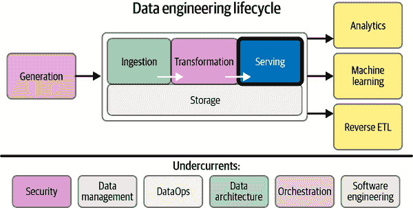
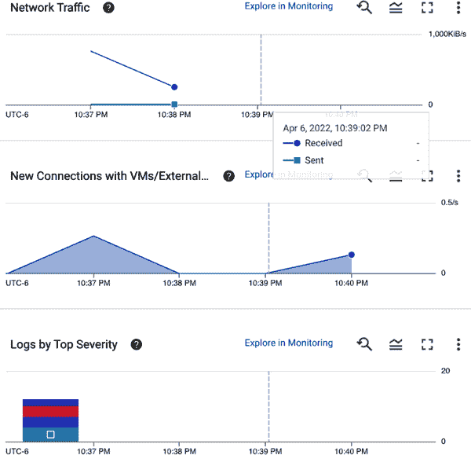
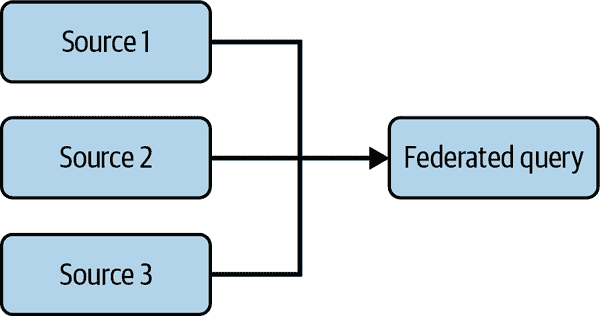
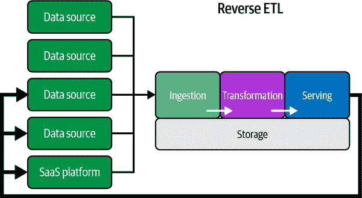
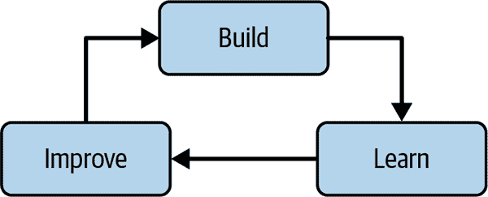

# 第 9 章 为分析、机器学习和反向 ETL 提供数据服务

恭喜！您已到达数据工程生命周期的最后阶段——为下游用例提供数据服务（参见 图 9-1）。在本章中，您将了解作为数据工程师将遇到的三种主要用例的各种数据服务方式。首先，您将为分析和 BI 提供数据服务。您将为统计分析、报告和仪表板准备数据。这是数据服务最传统的领域。可以说，它早于 IT 和数据库，但对于利益相关者深入了解业务、组织和财务流程而言，它依然至关重要。

其次，您将为 ML 应用提供数据服务。没有高质量、经过适当准备的数据，ML 就无从谈起。数据工程师与数据科学家和 ML 工程师合作，获取、转换并交付模型训练所需的数据。

第三，您将通过反向 ETL 提供数据服务。*反向 ETL* 是将数据送回数据源的过程。例如，我们可能从广告技术平台获取数据，对该数据运行统计流程以确定每次点击成本（CPC）出价，然后将该数据反馈回广告技术平台。反向 ETL 与 BI 和 ML 高度交织。

在深入探讨这三种主要数据服务方式之前，让我们先看一些通用考量因素。

## 为数据服务的通用考量因素

在深入探讨数据服务之前，我们有几个重要的考量因素。首当其冲的是信任。人们需要信任你提供的数据。此外，你需要了解你的用例和用户、将要生成的数据产品、你将如何服务数据（是否自助服务）、数据定义和逻辑，以及数据网格。我们将要讨论的这些考量因素是通用的，适用于三种数据服务方式中的任意一种。理解这些考量因素将帮助你更有效地服务你的数据客户。

## 信任

> 建立声誉需要 20 年，毁掉它只需 5 分钟。如果你想到这一点，你做事的方式就会不同。
>
> 沃伦·巴菲特^(1)

最重要的是，信任是数据服务中的根本考量；最终用户需要信任他们接收到的数据。如果最终用户不相信数据能可靠地代表他们的业务，那么最花哨、最复杂的数据架构和服务层也毫无意义。信任的丧失往往是数据项目的无声丧钟，即使该项目直到几个月或几年后才正式取消。数据工程师的工作是提供尽可能最好的数据，因此你需要确保你的数据产品始终包含高质量且值得信赖的数据。

当你在本章中学习数据服务时，我们将强化将信任“烘焙”进数据的理念，并讨论实现这一目标的务实方法。我们见过太多案例，数据团队执着于推送数据，却不先询问利益相关者是否信任它。通常，利益相关者会失去对数据的信任。一旦信任丧失，想要赢回它难上加难。这必然导致业务无法充分发挥数据的潜力，数据团队失去信誉（甚至可能被解散）。

为了实现数据质量并建立利益相关者的信任，请利用数据验证和数据可观测性流程，并结合与利益相关者进行可视化检查和确认有效性。*数据验证*是分析数据以确保其准确反映财务信息、客户互动和销售情况。*数据可观测性*提供对数据和数据流程的持续视图。这些流程必须应用于*整个数据工程生命周期*，以便在最终阶段取得良好结果。我们将在“暗流”中进一步讨论这些内容。

除了建立对数据质量的信任，工程师还有责任与最终用户和上游利益相关者建立对其 SLA 和 SLO 的信任。一旦用户依赖数据来完成业务流程，他们就会要求数据按照数据工程师的承诺持续可用且保持最新。如果高质量数据在做出关键业务决策时无法按预期获得，则价值寥寥。注意，SLA 和 SLO 也可能以*数据契约*的形式出现（参见第 5 章），无论是正式还是非正式的。

我们在第 5 章中讨论过 SLA，但在此再次讨论很有价值。SLA 有多种形式。无论形式如何，SLA 都会告诉用户可以从你的数据产品中期待什么；它是你和利益相关者之间的契约。SLA 的一个例子可能是：“数据将可靠可用且质量高。”SLO 是 SLA 的关键部分，描述了你将如何衡量绩效以对照已达成的协议。例如，鉴于前面的 SLA 示例，一个 SLO 可能是：“通往你的仪表板或机器学习工作流的数据管道将拥有 99% 的正常运行时间，95% 的数据无缺陷。”请确保预期清晰，并且你有能力验证你是在商定的 SLA 和 SLO 参数范围内运行的。

仅仅就 SLA 达成一致是不够的。持续沟通是良好 SLA 的核心特征。你是否沟通了可能影响 SLA 或 SLO 预期的潜在问题？你的补救和改进流程是什么？

信任就是一切。赢得它需要很长时间，而失去它却很容易。

## 用例是什么，用户是谁？

服务阶段关注的是数据的实际应用。但什么才是数据的*高效*用例？要回答这个问题，你需要考虑两件事：用例是什么，用户是谁？

数据的用例远不止查看报表和仪表板。数据在能够引发*行动*时发挥最大价值。高管会根据报表做出战略决策吗？移动外卖应用的用户会收到一张优惠券，从而被诱导在未来两分钟内下单购买吗？数据通常不止用于一个用例——例如，用于训练一个执行潜在客户评分并填充 CRM 的机器学习模型（反向 ETL）。高质量、高影响力的数据天然会吸引许多有趣的用例。但在寻找用例时，始终要问：“这数据将触发什么*行动*，*谁*将执行此行动？”，并配合适当的追问：“此行动能否自动化？”

只要可能，优先考虑 ROI 最高的用例。数据工程师喜欢痴迷于他们构建的系统的技术实现细节，而忽视目的这一基本问题。工程师想做他们最擅长的事：搞工程。当工程师意识到需要专注于价值和用例时，他们在其角色中会变得更有价值、更有效。

在启动新数据项目时，逆向思维很有帮助。虽然专注于工具很诱人，但我们鼓励你从用例和用户入手。以下是一些开始时可以自问的问题：

*   谁将使用数据，他们将如何使用？
*   利益相关者期望什么？
*   我如何与数据利益相关者（如数据科学家、分析师、业务用户）协作，以了解我正在处理的数据将如何被使用？

再次强调，始终从用户及其用例的角度出发开展数据工程。通过理解他们的期望和目标，你可以逆向工作，更轻松地创建出色的数据产品。让我们花点时间扩展一下关于数据产品的讨论。

## 数据产品

> 数据产品的一个好定义是：一种通过使用数据来促成最终目标的产品。
>
> D. J. Patil^(2)

数据产品不是在真空中创建的。正如我们讨论的许多其他组织流程一样，制作数据产品是一项全接触运动，涉及产品、业务和技术的混合。让关键利益相关者参与数据产品的开发非常重要。在大多数公司，数据工程师与数据产品的最终用户相隔几个层级；优秀的数据工程师会寻求充分了解直接用户（如数据分析师、数据科学家或公司外部客户）的成果。

创建数据产品时，考虑“待完成的工作”^(3)很有用。用户为“待完成的工作”“雇佣”一个产品。这意味着你需要知道用户想要什么——即他们“雇佣”你产品的动机。一个典型的工程错误是在不理解需求、最终用户需求或产品/市场契合度的情况下盲目构建。当你构建没人想用的数据产品时，就会发生这种灾难。

一个好的数据产品拥有正向反馈循环。数据产品的更多使用会产生更有用的数据，这些数据用于改进数据产品。周而复始。

构建数据产品时，请记住以下考量因素：

*   当有人使用数据产品时，他们希望实现什么？太多时候，数据产品是在不清楚用户预期结果的情况下制作的。

## 数据产品的考量因素

* 数据产品将服务于内部还是外部用户？在第 2 章中，我们讨论了面向内部和面向外部的数据工程。创建数据产品时，了解您的客户是面向内部还是面向外部，将影响数据的服务方式。
* 您正在构建的数据产品的成果和 ROI 是什么？

构建人们愿意使用且喜爱的数据产品至关重要。没有什么比不需要的效用和对数据输出失去信任更能破坏数据产品的采用了。请关注数据产品的采用率和使用情况，并愿意进行调整以让用户满意。

## 自助服务还是非自助服务？

用户将如何与您的数据产品交互？业务总监是会向数据团队请求报表，还是可以直接自行构建报表？自助式数据产品——赋予用户自行构建数据产品的能力——多年来一直是数据用户的共同愿望。还有什么比直接赋予最终用户创建报表、分析和机器学习模型的能力更好的呢？

如今，自助式 BI 和数据科学仍多停留在愿景层面。虽然我们偶尔能看到公司成功实现数据自助服务，但这很罕见。大多数情况下，数据自助服务的尝试始于美好的初衷，但最终以失败告终；自助式数据在实践中很难落地。因此，分析师或数据科学家只能承担提供临时报表和维护仪表板的繁重工作。

为什么自助式数据如此困难？答案很微妙，但通常涉及了解最终用户。如果用户是需要了解业务状况的高管，该人可能只想要一个包含清晰且可执行指标的预定义仪表板。高管很可能会忽略任何用于创建自定义数据视图的自助工具。如果报表引发了进一步的问题，他们可能会指派手下的分析师进行深入调查。另一方面，如果用户是分析师，他们可能已经在通过 SQL 等更强大的工具进行自助式分析。通过 BI 层进行自助式分析并无用处。同样的考量也适用于数据科学。尽管向“公民数据科学家”授予自助式机器学习一直是许多自动化机器学习供应商的目标，但由于与自助式分析相同的原因，其采用率仍处于起步阶段。在这两种极端情况下，自助式数据产品都是错误的工具。

成功的自助式数据项目归根结底在于拥有正确的受众。识别自助式用户及其想要完成的“工作”。他们使用自助式数据产品想要达成什么目标，而不是与数据分析师合作完成工作？一群具有数据背景的高管构成了自助服务的理想受众；他们可能希望自行切片和钻取数据，而无需拾起早已生疏的 SQL 技能。愿意投入时间通过公司倡议和培训计划学习数据技能的业务领导者，也能从自助服务中获得显著价值。

确定如何向该群体提供数据。他们对新数据的时间要求是什么？如果他们不可避免地想要更多数据或更改自助服务所需的范围，会发生什么？更多数据往往意味着更多问题，这需要更多数据。您需要预判自助式用户不断增长的需求。您还需要理解灵活性与护栏之间的微妙平衡，这将帮助您的受众发现价值和洞察，而不会导致错误结果和困惑。

## 数据定义与逻辑

正如我们反复强调的，数据在组织中的效用最终源于其正确性和可信度。关键在于，数据的正确性不仅限于忠实还原源系统中的事件值。数据正确性还包含恰当的数据定义和逻辑；这些必须贯穿所有生命周期阶段融入数据中，从源系统到数据管道，再到 BI 工具等。

*数据定义*是指数据在整个组织中被理解的含义。例如，*客户*在公司内部及跨部门都有精确的含义。当客户的定义出现差异时，必须记录下来并提供给所有使用该数据的人员。

*数据逻辑*规定了从数据衍生指标的公式——例如毛销售额或客户终身价值。恰当的数据逻辑必须编码数据定义和统计计算的细节。要计算客户流失指标，我们需要一个定义：谁是客户？要计算净利润，我们需要一组逻辑规则来决定从毛收入中扣除哪些费用。

我们经常看到数据定义和逻辑被视为理所当然，常以机构知识的形式在组织内流传。*机构知识*会自行演变，往往以轶事取代数据驱动的洞察、决策和行动。相反，在数据目录中以及数据工程生命周期的系统中正式声明数据定义和逻辑，对确保数据的正确性、一致性和可信度大有裨益。

数据定义可以通过多种方式提供，有时是显式的，但大多是隐式的。*隐式*是指，每当您为查询、仪表板或机器学习模型提供数据时，数据和衍生指标都能一致且正确地呈现。当您编写 SQL 查询时，您隐式地假设该查询的输入是正确的，包括上游管道逻辑和定义。这就是数据建模（见第 8 章）非常有用的地方，它能以一种可被多个最终用户理解和使用的方式捕获数据定义和逻辑。

使用语义层，您可以以可复用的方式整合业务定义和逻辑。一次编写，到处使用。这种范式是指标、计算和逻辑的面向对象方法。我们将在语义层与指标层中详细阐述。

## 数据网格

数据网格在数据服务方面将越来越成为一个考量因素。数据网格从根本上改变了组织内部数据服务的方式。数据网格不再是孤岛式的数据团队服务于其内部利益相关者，而是让每个领域团队承担去中心化、点对点数据服务的两个方面。

首先，团队负责通过准备数据来*向其他团队*提供数据服务。数据必须适合在整个组织的数据应用、仪表板、分析和 BI 工具中使用。其次，每个团队潜在地为*自助服务*运行其仪表板和分析。团队根据其领域的特定需求消费来自整个组织的数据。从其他团队消费的数据也可能通过嵌入式分析或机器学习特征进入领域团队设计的软件中。

这极大地改变了服务的细节和结构。我们在第 3 章中介绍了数据网格的概念。现在我们已经涵盖了一些数据服务的通用考量因素，让我们来看看第一个主要领域：分析。

# 分析

您可能遇到的第一个数据服务用例是*分析*，即在数据中发现、探索、识别并使关键洞察和模式可见化。分析有许多层面。作为一种实践，分析通过统计方法、报告、BI 工具等来执行。作为数据工程师，了解各种分析类型和技术是完成工作的关键。本节旨在展示您将如何为分析提供数据，并提出一些思考要点以助您的分析师成功。

在为分析提供数据之前，你需要做的第一件事（读完前一节后这听起来应该很熟悉）是确定最终用例。用户是在查看历史趋势吗？用户是否应立即自动收到异常通知，例如欺诈警报？有人是否正在移动应用程序上查看实时仪表板？这些示例凸显了商业分析（通常指 BI）、运营分析和嵌入式分析之间的区别。每个分析类别都有不同的目标和独特的服务要求。让我们看看如何为这些类型的分析提供数据。

## 商业分析

**商业分析** 利用历史和当前数据做出战略性和可执行的决策。决策类型往往考虑长期趋势，通常涉及统计和趋势分析的结合，以及领域专业知识和人工判断。商业分析既是一门艺术，也是一门科学。

商业分析通常分为几大领域——仪表板、报表和临时分析。商业分析师可能专注于其中一类或所有类别。让我们快速了解一下这些实践及相关工具的区别。了解分析师的工作流将帮助你——数据工程师——理解如何提供数据。

*仪表板* 简洁地向决策者展示组织在一系列核心指标（如销售额和客户留存率）上的表现。这些核心指标以可视化形式（如图表或热力图）、汇总统计数据，甚至单个数字呈现。这类似于汽车仪表盘，在驾驶车辆时为你提供关键信息的单一读数。一个组织可能有不止一个仪表板，C 级高管使用全局仪表板，而他们的直接下属使用包含其特定指标、KPI 或目标与关键结果（OKR）的仪表板。分析师协助创建和维护这些仪表板。一旦业务干系人接受并依赖某个仪表板，分析师通常会响应请求，调查指标的潜在问题或向仪表板添加新指标。目前，你可能会使用 BI 平台来创建仪表板，例如 Tableau、Looker、Sisense、Power BI 或 Apache Superset/Preset。

分析师经常受业务干系人委托创建 *报表*。报表的目标是利用数据驱动洞察和行动。一家在线零售公司的分析师被要求调查导致女士跑步短裤退货率高于预期的因素。分析师在数据仓库中运行一些 SQL 查询，汇总客户提供的退货原因代码，发现跑步短裤的面料质量低劣，通常几次穿着就会磨损。制造和质量控制等干系人被告知这些发现。此外，调查结果被总结在报表中，并分发在仪表板所在的同一个 BI 工具中。

分析师被要求深入调查潜在问题并带回洞察。这代表了 *临时分析* 的一个例子。报表通常始于临时请求。如果临时分析的结果有影响力，它们通常最终会进入报表或仪表板。用于报表和临时分析的技术与仪表板类似，但可能包括 Excel、Python、基于 R 的笔记本、SQL 查询等。

优秀的分析师持续与业务互动，深入数据以回答问题，发掘隐藏和反直觉的趋势与洞察。他们还与数据工程师合作，就数据质量、可靠性问题和新数据集需求提供反馈。数据工程师负责处理这些反馈，并为分析师提供新的数据集。

回到跑步短裤的例子，假设在沟通调查结果后，分析师得知制造部门可以提供跑步短裤所用材料的各种供应链细节。数据工程师承担项目将这些数据摄入数据仓库。一旦供应链数据到位，分析师就可以将特定服装序列号与该物品所用面料的供应商关联起来。他们发现大多数故障与三家供应商中的一家有关，工厂停止使用该供应商的面料。

商业分析的数据通常以批处理模式从数据仓库或数据湖提供。这在不同公司、部门甚至公司内部的不同数据团队之间差异巨大。新数据可能每秒、每分钟、每 30 分钟、每天或每周可用一次。批处理频率因多种原因而异。需要注意的一点是，从事分析问题的工程师应考虑数据的各种潜在应用——当前和未来的。拥有混合的数据更新频率以适当服务用例是很常见的，但请记住，摄入频率为下游频率设定了上限。如果数据存在流式应用，即使某些下游处理和服务步骤以批处理方式处理，也应作为流摄入。

当然，数据工程师在服务商业分析时必须解决各种后端技术考量。一些 BI 工具将数据存储在内部存储层中。其他工具在你的数据湖或数据仓库上运行查询。这很有利，因为你可以充分利用 OLAP 数据库的能力。正如我们在前几章讨论的，缺点是成本、访问控制和延迟。

## 运营分析

如果商业分析是关于利用数据发现可执行的洞察，那么运营分析则是利用数据采取 *即时行动* ：

运营分析 与 商业分析 = 即时行动 与 可执行洞察

运营分析和商业分析的最大区别在于 *时间*。商业分析中使用的数据对所考虑的问题有更长远的视角。逐秒更新虽好，但不会实质性地影响质量或结果。运营分析恰恰相反，实时更新在问题发生时解决问题可能极具影响力。

运营分析的一个例子是实时应用监控。许多软件工程团队想知道他们的应用程序表现如何；如果出现问题，他们希望立即收到通知。工程团队可能有一个仪表板（参见例如 图 9-2），显示关键指标，如每秒请求数、数据库 I/O 或任何重要指标。特定条件可触发扩容事件，如果服务器过载则增加容量。如果突破特定阈值，监控系统还可能通过短信、群聊和电子邮件发送警报。

让我们再次回到跑步短裤的例子。利用分析发现供应链中的劣质面料取得了巨大成功；业务领导者和数据工程师希望找到更多机会利用数据提高产品质量。数据工程师建议在工厂部署实时分析。工厂已经使用多种能够流式传输实时数据的机器。此外，工厂还有摄像头记录生产线视频。目前，技术人员实时观看视频，寻找缺陷产品，当他们看到产品中出现高比例的挂线时，通知生产线操作人员。

# 制造业中的实时分析

数据工程师意识到，他们可以使用现成的 `cloud machine vision`（云机器视觉）工具来自动实时识别缺陷。缺陷数据与特定商品序列号关联并进行流式传输。从此，实时分析流程可以将缺陷商品与装配线上游机器的流式事件关联起来。

采用这种方法，车间分析师发现原始面料库存的质量因箱而异，差异显著。当监控系统显示挂线缺陷率较高时，线工可以移除有缺陷的箱子，并向供应商追责索赔。

见到这个质量改进项目取得成功，供应商决定采用类似的质量控制流程。零售商的数据工程师与供应商合作部署他们的实时数据分析，显著提高了面料库存的质量。

# 嵌入式分析

业务分析和运营分析侧重于内部，而近期的趋势是面向外部的或嵌入式分析。随着如此多的数据驱动应用程序，公司越来越多地向最终用户提供分析功能。这些通常被称为 `data applications`（数据应用），通常在应用程序本身中嵌入分析仪表板。这些面向最终用户的仪表板也被称为 `embedded analytics`（嵌入式分析），它们为用户提供关于其与应用程序关系的关键指标。

智能恒温器拥有一个移动应用程序，可实时显示温度和最新的功耗指标，允许用户制定更节能的供暖或制冷计划。在另一个例子中，第三方电商平台为其卖家提供销售、库存和退货的实时仪表板。卖家可以选择利用这些信息，近乎实时地向客户提供优惠。在这两种情况下，应用程序都允许用户基于数据做出实时决策（手动或自动）。

嵌入式分析的格局正在滚雪球般扩大，我们预计此类数据应用将在未来几年内变得越来越普及。作为数据工程师，你可能不负责创建嵌入式分析的前端，因为那是应用开发人员的工作。既然你负责为嵌入式分析提供服务的数据库，你就需要了解嵌入式分析对速度和延迟的要求。

## 嵌入式分析的性能

嵌入式分析的性能包含三个问题。首先，应用用户不像内部分析师那样能容忍不频繁的批处理；招聘 SaaS 平台的用户可能希望在上传新简历后立即看到统计数据的变化。用户想要低 `data latency`（数据延迟）。其次，数据应用的用户期望快速的 `query performance`（查询性能）。当他们在分析仪表板中调整参数时，希望在几秒钟内看到刷新后的结果。第三，数据应用通常必须支持跨许多仪表板和众多客户的极高查询率。高 `concurrency`（并发性）至关重要。

Google 和数据应用领域的其他早期主要参与者开发了奇特的技术来应对这些挑战。对于新创公司，默认做法是将传统事务型数据库用于数据应用。随着客户群扩大，它们会超出初始架构的承载能力。它们可以使用新一代数据库，这些数据库将高性能——快速查询、高并发和近实时更新——与相对易用性（例如基于 `SQL` 的分析）相结合。

# 机器学习

服务数据的第二大领域是机器学习。ML 变得越来越普遍，所以我们假设你至少对这个概念有所了解。随着 ML 工程的兴起（它本身几乎是一个与数据工程平行的宇宙），你可能会问自己数据工程师在其中扮演什么角色。

不可否认，ML、数据科学、数据工程和 ML 工程之间的界限日益模糊，且这一界限在不同组织间差异巨大。在一些组织中，ML 工程师在数据收集后立即接管 ML 应用的数据处理，甚至可能形成一个完全独立且平行的数据组织，处理所有 ML 应用的整个生命周期。在其他环境中，数据工程师处理所有数据处理，然后将数据移交给 ML 工程师进行模型训练。数据工程师甚至可能处理一些极其特定的 ML 任务，例如数据的 `featurization`（特征化/特征工程）。

让我们回到在线零售商生产的运动短裤质量控制的例子。假设流式数据已在生产短裤原始面料的工厂中实施。数据科学家发现，制造面料的质量易受输入原始聚酯特性、温度、湿度以及织布机各种可调参数的影响。数据科学家开发了一个基础模型来优化织布机参数。ML 工程师实现模型训练自动化，并建立流程根据输入参数自动调整织布机。数据工程师和 ML 工程师共同设计 `featurization`（特征化/特征工程）管道，数据工程师实现并维护该管道。

## 数据工程师应了解的 ML 知识

在讨论为 ML 服务数据之前，你可能会问自己作为数据工程师需要了解多少 ML。ML 是一个极其广泛的主题，我们不会试图教会你这个领域；有无数的书籍和课程可供学习 ML。

虽然数据工程师不需要对 ML 有深入的理解，但了解 `classical`（经典/传统）ML 的工作原理基础和深度学习的基础知识将大有裨益。了解 ML 基础知识将极大地帮助你与数据科学家协作构建数据产品。

以下是我们认为数据工程师应熟悉的 ML 领域：

- 有监督学习、无监督学习和半监督学习的区别。
- 分类和回归技术的区别。
- 处理 `time-series`（时间序列）数据的各种技术。这包括 `time-series` 分析以及 `time-series` 预测。
- 何时使用 `classical`（经典/传统）技术（`logistic regression` 逻辑回归、`tree-based learning` 基于树的学习、`support vector machines` 支持向量机）与深度学习。我们经常看到数据科学家立即跳到深度学习，即使这大材小用。作为数据工程师，你对 ML 的基本了解可以帮助你判断某种 ML 技术是否合适，以及是否能扩展你需要提供的数据。
- 何时使用 `AutoML` 与手工制作 ML 模型？关于所用数据，每种方法的权衡是什么？
- `data-wrangling`（数据清洗/整理）技术用于结构化和非结构化数据有哪些？
- 用于 ML 的所有数据都会转换为数字。如果你提供的是结构化或半结构化数据，请确保数据能在 `feature-engineering`（特征工程）过程中正确转换。
- 如何对分类数据进行编码，以及各种数据类型的 `embeddings`（嵌入/向量表示）。
- `batch`（批处理）和 `online learning`（在线学习）的区别。哪种方法适合你的用例？
- 数据工程生命周期在贵公司如何与 ML 生命周期相交？你是否负责与 `feature stores`（特征存储）或 `ML observability`（ML 可观测性）等 ML 技术进行交互或提供支持？
- 知道何时适合在本地、集群或边缘进行训练。何时使用 `GPU` 而非 `CPU`？你使用的硬件类型主要取决于你要解决的 ML 问题类型、使用的技术以及数据集的大小。
- 了解 `batch`（批处理数据）和 `streaming data`（流式数据）在训练 ML 模型中的应用区别。例如，`batch` 数据通常适合 `offline model training`（离线模型训练），而 `streaming data` 适用于 `online training`（在线训练）。
- 什么是 [`data cascades`](https://oreil.ly/FBV4g)（数据级联/数据瀑布），它们如何影响 ML 模型？

# 简介

*   结果是实时返回还是批量返回？例如，批量语音转录模型可能会处理语音样本，并在 API 调用后批量返回文本。当客户与在线零售网站交互时，产品推荐模型可能需要实时运行。
*   结构化数据与非结构化数据的使用。我们可能会对表格（结构化）客户数据进行聚类，或使用神经网络识别图像（非结构化）。

ML *浩瀚*无垠，本书不会教授这些主题，甚至不会涉及 ML 概论。如果您想了解更多关于 ML 的信息，我们建议阅读 Aurélien Géron 编著的 [*Hands on Machine Learning with Scikit-Learn, Keras, and TensorFlow*](https://oreil.ly/zQtHI)（O’Reilly 出版）；网上还有无数其他 ML 课程和书籍可供选择。由于书籍和在线课程更新迭代极快，请自行调研以找到适合您的资源。

# 为分析和 ML 提供数据的方式

与分析一样，数据工程师为数据科学家和 ML 工程师提供完成工作所需的数据。我们将面向 ML 的数据服务与分析放在一起，因为它们的管道和流程极其相似。为分析和 ML 提供数据的方式有很多。一些常见的方式包括文件、数据库、查询引擎和数据共享。让我们简要了解一下每一种。

## 文件交换

文件交换在数据服务中无处不在。我们处理数据并生成文件传递给数据消费者。

请记住，一个文件可能用于多种用途。数据科学家可能会加载客户消息的文本文件（非结构化数据）以分析客户投诉的情绪。业务部门可能会从合作伙伴公司接收一组 `CSV` 文件（结构化数据）形式的发票数据，分析师必须对这些文件执行某些统计分析。或者，数据供应商可能会向在线零售商提供竞争对手网站上的产品图片（非结构化数据），用于利用计算机视觉进行自动分类。

提供文件的方式取决于多个因素，例如：

*   用例——商业分析、运营分析、嵌入式分析
*   数据消费者的数据处理流程
*   存储中单个文件的大小和数量
*   谁在访问此文件
*   数据类型——结构化、半结构化或非结构化

第二点是主要考量因素之一。通常必须通过文件而非数据共享来提供数据，因为数据消费者无法使用共享平台。

最简单的文件服务方式类似于通过电子邮件发送单个 Excel 文件。即使在文件可以协作共享的时代，这仍然是一种常见的工作流。通过电子邮件发送文件的问题在于，每个接收者都会获得该文件的一个版本。如果接收者编辑了文件，这些编辑仅针对该用户的文件。文件之间的差异不可避免地会产生。如果您不再希望接收者访问该文件，会发生什么？如果文件是通过电子邮件发送的，您几乎无法追回该文件。如果您需要一个连贯、一致的文件版本，我们建议使用协作平台，例如 `Microsoft 365` 或 `Google Docs`。

当然，提供单个文件难以扩展，您的需求最终会超出简单云文件存储的范围。如果您有少量大文件，可能会转向对象存储桶；如果您有稳定的文件供应，可能会转向数据湖。对象存储可以存储任何类型的 blob 文件，特别适用于半结构化或非结构化文件。

我们要指出，我们通常认为通过对象存储（数据湖）进行的文件交换归属于“数据共享”范畴，而非“文件交换”，因为该过程比临时文件交换更具可扩展性和流线型。

## 数据库

数据库是为分析和 ML 提供数据的关键层。在本讨论中，我们将隐性地将重点放在从 `OLAP` 数据库（如数据仓库和数据湖）提供数据上。在上一章中，您学习了查询数据库。提供数据涉及查询数据库，然后为用例使用这些结果。分析师或数据科学家可能会使用 `SQL` 编辑器查询数据库，并将这些结果导出到 `CSV` 文件供下游应用使用，或在笔记本中分析结果（参见“在笔记本中提供数据”）。

从数据库提供数据具有多种优势。数据库通过模式对数据施加秩序和结构；数据库可以在表、列和行级别提供细粒度权限控制，允许数据库管理员为各种角色制定复杂的访问策略；并且数据库可以为大型、计算密集型查询和高查询并发提供高服务性能。

`BI` 系统通常与源数据库共享数据处理工作负载，但这两个系统之间的处理边界各不相同。例如，`Tableau` 服务器运行初始查询从数据库拉取数据并将其存储在本地。基本的 `OLAP`/`BI` 切片和钻取（交互式筛选和聚合）直接在服务器上基于本地数据副本运行。另一方面，`Looker`（和类似的现代 `BI` 系统）依赖一种称为 `query pushdown` 的计算模型；`Looker` 使用一种专用语言（`LookML`）编码数据处理逻辑，将其与动态用户输入结合生成 `SQL` 查询，在源数据库上运行这些查询，并呈现输出。（参见“语义层和指标层”。）`Tableau` 和 `Looker` 都有各种缓存结果的配置选项，以减轻频繁运行查询的处理负担。

数据科学家可能会连接到数据库，提取数据，并执行特征工程和选择。然后将转换后的数据集输入 ML 模型；离线模型经过训练并产生预测结果。

数据工程师经常被指派管理数据库服务层。这包括性能和成本管理。在将计算和存储分离的数据库中，这是一个比固定本地基础设施时代更微妙的优化问题。例如，现在可以为每个分析或 ML 工作负载启动一个新的 `Spark` 集群或 `Snowflake` 仓库。通常建议至少按主要用例拆分集群，例如 `ETL` 以及面向分析和数据科学的服务。数据团队通常会切分得更细，为每个主要领域分配一个仓库。这使得不同团队能够在数据工程团队的监督下为其查询成本制定预算。

此外，请回顾我们在“嵌入式分析”中讨论的三个性能考量因素。它们是数据延迟、查询性能和并发。能够直接从流摄取数据的系统可以降低数据延迟。许多数据库架构依赖 `SSD` 或内存缓存来提升查询性能和并发，以应对嵌入式分析固有的挑战性用例。

越来越多的数据平台（如 `Snowflake` 和 `Databricks`）允许分析师和数据科学家在单一环境中操作，在同一个平台上提供 `SQL` 编辑器和数据科学笔记本。由于计算和存储分离，分析师和数据科学家可以以多种方式使用底层数据，而不会相互干扰。这将实现高吞吐量，并加快向利益相关者交付数据产品的速度。

## 流式系统

流式分析在服务领域变得越来越重要。从高层来看，请理解这种服务类型可能涉及 `emitted metrics`，这与传统查询不同。

# 运营分析与流式系统

此外，我们看到运营分析数据库在该领域扮演的角色日益重要（参见“运营分析”）。这些数据库允许查询跨越大范围的历史数据，涵盖最新的秒级当前数据。从本质上讲，它们结合了 `OLAP` 数据库与流处理系统的特点。越来越多地，你将使用流式系统为分析和 `ML` 提供数据服务，因此请熟悉这一范式。

你已在全书中了解了流式系统。要了解其未来发展方向，请阅读第 11 章中的实时数据栈内容。

# 查询联邦

正如你在第 8 章中所学，查询联邦从多个来源拉取数据，例如数据湖、`RDBMSs` 和数据仓库。随着分布式查询虚拟化引擎作为无需将数据集中到 `OLAP` 系统即可提供查询服务的方式获得认可，联邦查询正变得越来越流行。如今，你可以找到像 `Trino` 和 `Presto` 这样的 `OSS` 选项，以及像 `Starburst` 这样的托管服务。其中一些产品将自己描述为启用数据网格的方式；时间会证明事态如何发展。

在为联邦查询提供数据服务时，你应该意识到最终用户可能正在查询多个系统——`OLTP`、`OLAP`、`APIs`、文件系统等（图 9-3）。你不再是从单个系统提供数据，而是从多个系统提供数据，每个系统都有其使用模式、怪癖和细微差别。这给数据服务带来了挑战。如果联邦查询涉及实时生产源系统，你必须确保联邦查询不会在源系统中消耗过多资源。

根据我们的经验，当你希望在分析数据时拥有灵活性，或者源数据需要严格管控时，联邦查询是理想选择。联邦查询允许临时查询以执行探索性分析，融合来自各种系统的数据，而无需设置数据管道或 `ETL` 的复杂性。这将使你能够确定联邦查询的性能是否足以满足持续用途，或者你是否需要在部分或所有数据源上设置摄入，并将数据集中到 `OLAP` 数据库或数据湖中。

联邦查询还为源系统提供只读访问，这在你不想提供文件、数据库访问权限或数据转储时非常有用。最终用户只能读取他们应该访问的数据版本，别无其他。对于访问控制和合规性至关重要的情况，查询联邦是一个值得探索的绝佳选项。

# 数据共享

第 5 章包含了关于数据共享的详尽讨论。组织之间或大型组织内部单元之间的任何数据交换都可视为数据共享。不过，我们特指在云环境中通过大规模多租户存储系统进行共享。数据共享通常将数据服务转化为一个安全性和访问控制问题。

实际查询现在由数据消费者（分析师和数据科学家）处理，而非提供数据的工程师。无论是在组织内部的数据网格中提供数据、向公众提供数据，还是为合作伙伴企业提供服务，数据共享都是一种极具吸引力的服务模式。数据共享正日益成为 `Snowflake`、`Redshift` 和 `BigQuery` 等主要数据平台的核心功能，允许公司之间安全地共享数据。

# 语义层与指标层

当数据工程师考虑数据服务时，他们自然倾向于关注数据处理和存储技术——即，你将使用 `Spark` 还是云数据仓库？你的数据存储在对象存储中，还是缓存在一队 `SSDs` 中？但强大的处理引擎能在海量数据集上快速返回查询结果，这本身并不能保证高质量的业务分析。如果输入低质量数据或低质量查询，强大的查询引擎会迅速返回错误结果。

数据质量关注数据本身的特征以及过滤或改进坏数据的各种技术，而查询质量则是一个构建具有适当逻辑的查询以返回准确业务答案的问题。编写高质量的 `ETL` 查询和报表是耗时且细致的工作。各种工具可以帮助自动化这一过程，同时促进一致性、可维护性和持续改进。

从根本上说，`指标层` 是一个用于维护和计算业务逻辑的工具。^(4)（`语义层` 在概念上极其相似，^(5) `无头 BI` 是另一个密切相关的术语。）该层可以存在于 `BI` 工具中，或存在于构建转换查询的软件中。两个具体的例子是 `Looker` 和 `Data Build Tool (dbt)`。

例如，`Looker` 的 `LookML` 允许用户定义虚拟的、复杂的业务逻辑。报表和仪表板指向特定的 `LookML` 来计算指标。`Looker` 允许用户定义标准指标并在许多下游查询中引用它们；这旨在解决传统 `ETL` 脚本中重复和不一致的传统问题。`Looker` 使用 `LookML` 生成 `SQL` 查询，并将其下推到数据库。结果可以持久化在 `Looker` 服务器中，或针对大结果集持久化在数据库本身中。

`dbt` 允许用户定义包含许多查询和标准业务指标定义的复杂 `SQL` 数据流，非常类似于 `Looker`。与 `Looker` 不同，`dbt` 专门运行在转换层，尽管这可以包括将查询推送到在查询时计算的视图中。`Looker` 专注于查询服务和报表，而 `dbt` 可以作为分析工程师的稳健数据管道编排工具。

我们认为，指标层工具将随着更广泛的采用和更多参与者的加入而变得更加流行，并向上游向应用层发展。指标层工具有助于解决自从人们开始分析数据以来就困扰组织的分析核心问题：“这些数字正确吗？”除了我们提到的那些，该领域还有许多新进入者。

# 在笔记本中提供数据服务

数据科学家在日常工作中经常使用笔记本。无论是探索数据、特征工程还是训练模型，数据科学家很可能会使用笔记本。在撰写本文时，最流行的笔记本平台是 `Jupyter Notebook`，以及其下一代迭代版 `JupyterLab`。`Jupyter` 是开源的，可以托管在本地笔记本电脑、服务器上，或通过各种云托管服务。`Jupyter` 代表 `Julia`、`Python` 和 `R` ——后两者在数据科学应用中很流行，尤其是笔记本。无论使用哪种语言，你首先需要考虑的是如何从笔记本访问数据。

数据科学家将以编程方式连接到数据源，例如 `API`、数据库、数据仓库或数据湖（图 9-4）。在笔记本中，所有连接都是使用适当的内置或导入库创建的，以从文件路径加载文件、连接到 `API` 端点，或建立到数据库的 `ODBC` 连接。远程连接可能需要正确的凭证和权限来建立连接。连接后，用户可能需要正确的访问权限来访问表（以及行/列）或存储在对象存储中的文件。数据工程师通常会协助数据科学家找到合适的数据，然后确保他们拥有访问所需行和列的正确权限。

# 反向 ETL

如今，`reverse ETL` 是一个流行词，指的是通过将数据从 OLAP 数据库加载回源系统来提供数据服务。也就是说，任何在该领域工作超过几年的数据工程师可能都做过 `reverse ETL` 的某些变体。`reverse ETL` 在 2010 年代末/2020 年代初开始流行，并日益被视为一项正式的数据工程职责。

数据工程师可能会从 CRM 中提取客户和订单数据，并将其存储在数据仓库中。这些数据用于训练潜在客户评分模型，其结果被返回到数据仓库。贵公司的销售团队希望访问这些已评分的潜在客户，以尝试产生更多销售额。您有几种选择可以将该潜在客户评分模型的结果交到销售团队手中。您可以将结果放在仪表板中供他们查看。或者您可以将结果作为 Excel 文件通过电子邮件发送给他们。

这些方法的挑战在于它们未连接到 CRM——销售人员的工作场所。为什么不直接把评分后的潜在客户放回 CRM 呢？正如我们所提到的，成功的数据产品能减少与最终用户的摩擦。在此例中，最终用户是销售团队。

使用 `reverse ETL` 将评分后的潜在客户加载回 CRM 是该数据产品最简单、最好的方法。`reverse ETL` 从数据工程生命周期的输出端获取处理后的数据，并将其反馈回源系统（图 9-5）。

## 注意

与其叫 `reverse ETL`，我们作者半开玩笑地称之为[双向加载和转换 (BLT)](https://oreil.ly/SJmZn)。`reverse ETL` 这个术语并不完全准确地描述该过程中发生的事情。无论如何，该术语已在大众认知和媒体中固定下来，所以我们将在全书中使用它。更广泛地说，`reverse ETL` 这个术语能否长久流传谁也说不准，但将数据从 OLAP 系统加载回源系统的做法将保持重要。

如何开始使用 `reverse ETL` 提供数据服务？虽然您可以自行构建 `reverse ETL` 解决方案，但现成的 `reverse ETL` 选项有很多。我们建议使用开源方案或商业托管服务。话虽如此，`reverse ETL` 领域变化极快。尚无明显赢家出现，许多 `reverse ETL` 产品将被大型云厂商或其他数据产品供应商收购。请谨慎选择。

我们确实有几句关于 `reverse ETL` 的警告。`reverse ETL` 固有地会产生反馈循环。例如，假设我们下载 Google Ads 数据，使用模型计算新出价，将出价加载回 Google Ads，然后重新开始该过程。假设由于您的出价模型存在错误，出价不断走高，您的广告获得的点击越来越多。您可能会迅速浪费大量资金！请小心，并构建监控和护栏机制。

# 您将与谁共事

正如我们所讨论的，在服务阶段，数据工程师将与许多利益相关者打交道。这些包括（但不限于）以下内容：

*   数据分析师
*   数据科学家
*   MLOps/ML 工程师
*   业务方——非数据或非技术利益相关者、经理和高管

顺便提醒一下，数据工程师对这些利益相关者扮演*支持*角色，并不一定对数据的最终用途负责。例如，数据工程师为分析师解读的报告提供数据，但数据工程师不负责这些解读。相反，数据工程师负责生产尽可能高质量的数据产品。

数据工程师应意识到数据工程生命周期与数据落入利益相关者手中后的更广泛用途之间的反馈循环。数据很少是静态的，外部世界将影响被摄入、服务、再摄入和再服务的数据。

数据工程师在生命周期服务阶段的一个重要考量是职责和关注点的分离。如果您身处早期公司，数据工程师可能同时也是 ML 工程师或数据科学家；这是不可持续的。随着公司发展，您需要与其他数据团队成员建立清晰的职责分工。

采用数据网格会极大地重组团队职责，每个领域团队都承担服务方面的职责。要使数据网格成功，每个团队必须有效履行其数据服务职责，团队之间也必须有效协作以确保组织成功。

# 暗流

暗流在服务阶段达到终结。请记住，数据工程生命周期就是一个——生命周期。因果循环，周而复始。我们看到许多实例，服务数据凸显了生命周期早期遗漏的问题。时刻留意暗流如何帮助您发现改进数据产品的方法。

我们常说，“数据是无声的杀手”，而暗流在服务阶段达到高潮。服务是您在数据到达最终用户手中之前，确保数据处于良好状态的最后机会。

## 安全

# 服务

无论是与人还是与系统共享数据，相同的安全原则均适用。我们经常看到数据被随意共享，几乎没有访问控制，也未考虑数据将如何被使用。这是一个巨大的错误，可能导致灾难性后果，例如数据泄露及随之而来的罚款、负面舆论和失业。请认真对待安全，尤其是在生命周期的这个阶段。在所有生命周期阶段中，服务阶段呈现的安全攻击面最大。

一如既往，对人和系统都要遵循最小权限原则，仅提供当前目的和完成工作所需的访问权限。高管需要什么数据，分析师或数据科学家又需要什么？机器学习流水线或反向 ETL 流程呢？这些用户和目标都有不同的数据需求，访问权限应据此提供。避免向所有人和所有事物给予全权限（carte blanche permissions）。

除非人员或流程需要更新查询源系统中的数据，否则数据服务通常是只读的。除非角色需要写入或更新等更高级权限，否则应授予人员对特定数据库和数据集的只读访问权限。这可以通过将用户组与特定的 `IAM` 角色（即分析师组、数据科学家组）或自定义 `IAM` 角色（如果合理）相结合来实现。对于系统，以类似方式提供服务账号和角色。对于用户和系统，如果必要，将访问范围缩小到数据集的字段、行、列和单元格。访问控制应尽可能细粒度，并在不再需要访问时撤销。

在多租户环境中提供数据服务时，访问控制至关重要。确保用户只能访问自己的数据，别无其他。一个好的方法是通过过滤视图来中介访问，从而消除共享公共表访问权限固有的安全风险。另一个建议是在工作流中使用数据共享，这允许在你和数据消费者之间实现只读的细粒度控制。

检查数据产品的使用频率，以及是否有必要停止共享某些数据产品。高管紧急要求分析师创建报告，但报告很快就无人问津，这种情况极其常见。如果数据产品未被使用，请询问用户是否仍需要。如果不需要，终止该数据产品。这意味着少了一个潜在的安全漏洞。

最后，你不应将访问控制和安全视为服务的阻碍，而应视为关键赋能者。我们知晓许多案例，复杂的高级数据系统已构建完成，可能对公司产生重大影响。但因安全实施不当，极少人被允许访问数据，导致数据闲置。细粒度、稳健的访问控制意味着在保护企业及其客户的同时，可以开展更多有趣的数据分析和机器学习工作。

## 数据管理

你一直在数据工程生命周期中融入数据管理，随着人们开始使用你的数据产品，你努力的成效很快将显现。在服务阶段，你主要关注确保人们能够访问高质量、可信赖的数据。

正如本章开头所述，信任或许是数据服务中最关键的变量。如果人们信任数据，他们就会使用它；不受信任的数据将被闲置。请务必通过提供反馈循环，使数据信任和数据改进成为一个主动过程。当用户与数据交互时，他们可以报告问题并请求改进。当变更发生时，主动向用户沟通。

人们完成工作需要什么数据？特别是考虑到法规和合规顾虑给数据团队带来的压力，即使字段和行受限，授予人们访问原始数据的权限也存在将数据追溯到实体（如个人或群体）的问题。幸运的是，数据混淆技术的进步允许你向最终用户提供合成、打乱或匿名化的数据。这些“伪造”数据集应足以让分析师或数据科学家从数据中获取必要信号，但却使识别受保护信息变得困难。虽然这不是一个完美的过程——付出足够努力，许多数据集都可能被去匿名化或逆向工程——但它至少降低了数据泄露的风险。

此外，将语义层和指标层纳入你的服务层，同时辅以严谨的数据建模，以正确表达业务逻辑和定义。无论用于分析、机器学习、反向 ETL 还是其他服务用途，这都提供了单一事实来源。

## DataOps

你在数据管理中采取的步骤——数据质量、治理和安全——在 DataOps 中受到监控。本质上，DataOps 将数据管理运营化。以下是一些需要监控的事项：

- 数据健康状况和数据停机时间
- 为数据提供服务的系统延迟——仪表板、数据库等。
- 数据质量
- 数据和系统安全及访问
- 正在服务的数据和模型版本
- 为达到 `SLO` 的正常运行时间

各种新工具应运而生，以解决各个监控方面的问题。例如，许多流行的数据可观测性工具旨在将数据停机时间最小化、数据质量最大化。可观测性工具可能从数据领域跨越到机器学习领域，支持模型和模型性能的监控。更传统的 DevOps 监控对 DataOps 也至关重要——例如，你需要监控存储、转换和服务之间的连接是否稳定。

正如数据工程生命周期的每个阶段一样，对代码进行版本控制并将部署运营化。这适用于分析代码、数据逻辑代码、机器学习脚本和编排作业。对报告和模型使用多阶段部署（`dev`、`test`、`prod`）。

## 数据架构

数据服务应具有与其他数据工程生命周期阶段相同的架构考量。在服务阶段，反馈循环必须快速且紧凑。用户应能在需要时尽快访问所需数据。

数据科学家以在本地机器上进行大部分开发而闻名。如前所述，鼓励他们将这些工作流迁移到云环境中的通用系统，在那里数据团队可以在开发、测试和生产环境中协作，并创建适当的生产架构。通过支持以极少负担发布数据洞察的工具，便利你的分析师和数据科学家。

## 编排

数据服务是数据工程生命周期的最后阶段。因为服务位于众多流程的下游，所以它是一个极其复杂的重叠区域。编排不仅是组织和自动化复杂工作的一种方式，更是跨团队协调数据流的一种手段，以便在承诺的时间将数据提供给消费者。

编排的所有权是一个关键的组织决策。编排将是集中式还是分散式？分散式方法允许小团队管理其数据流，但会增加跨团队协调的负担。团队不再只是管理单个系统内的流程，直接触发属于其他团队的 `DAG` 或任务完成，而是必须在系统间传递消息或查询。

集中式方法意味着工作更易于协调，但也必须存在重要的把关机制来保护单一生产资产。例如，一个编写糟糕的 `DAG` 可能导致 `Airflow` 停摆。集中式方法将意味着整个组织的数据流程和服务瘫痪。集中式编排管理需要高标准、自动化的 `DAG` 测试和把关。

如果编排是集中式的，谁来负责？当公司拥有 DataOps 团队时，编排通常归属于此团队。通常，参与服务的团队是天然的选择，因为它对数据工程生命周期的所有阶段都有相当全面的了解。这可能是 DBA、分析工程师、数据工程师或 ML 工程师。ML 工程师协调复杂的模型训练流程，但可能不愿意（或不想）在本已繁重的职责清单上，再增加管理编排的运维复杂性。

# 软件工程

与几年前相比，数据服务变得更加简单。编写代码的需求已大幅简化。数据也变得更加“代码优先”，随着专注于简化数据服务的开源框架激增。存在许多向最终用户提供数据的方式，数据工程师的重点应放在了解这些系统如何工作以及数据如何交付上。

尽管数据服务变得简单，但如果涉及代码，数据工程师仍应了解主要服务接口的工作原理。例如，数据工程师可能需要将数据科学家在笔记本上本地运行的代码进行转换，并将其转化为报表或基础 ML 模型以供运行。

数据工程师大有用武之地的另一个领域是理解代码和查询针对存储系统运行时的性能影响。分析师可以通过多种编程方式生成 SQL，包括 LookML、dbt 中的 Jinja、各种对象关系映射 (ORM) 工具和指标层。当这些编程层编译为 SQL 时，该 SQL 的性能如何？数据工程师可以在 SQL 代码性能不如手写 SQL 时提出优化建议。

分析和 ML 基础设施即代码的兴起，意味着编写代码的角色正转向构建支持数据科学家和分析师的系统。数据工程师可能负责为其数据团队设置 CI/CD 流水线并构建流程。他们最好还能培训和支持其数据团队使用他们构建的 Data/MLOps 基础设施，以使这些数据团队尽可能实现自助服务。

对于嵌入式分析，数据工程师可能需要与应用开发人员合作，以确保查询能快速且具成本效益地返回。应用开发人员将控制用户交互的前端代码。数据工程师的职责是确保开发人员在请求时能收到正确的数据载荷。

# 结论

数据工程生命周期在服务阶段有一个合乎逻辑的终点。与所有生命周期一样，会发生反馈循环（图 9-6）。你应该将服务阶段视为了解什么有效、什么可以改进的机会。倾听利益相关者的声音。如果他们提出问题——他们必然会提出——尽量不要介怀。相反，将其作为改进你所构建事物的机会。

优秀的数据工程师始终乐于接受新的反馈，并不断寻找改进技艺的方法。现在我们已经走完了数据工程生命周期的旅程，你已了解如何设计、架构、构建、维护和改进你的数据工程系统和产品。让我们把目光转向本书的 第三部分，我们将介绍数据工程中一些我们被持续询问且坦白说值得更多关注的方面。

# 附加资源

*   [“Data as a Product vs. Data Products: What Are the Differences?”](https://oreil.ly/fRAA5) by Xavier Gumara Rigol
*   [“Data Jujitsu: The Art of Turning Data into Product”](https://oreil.ly/5TH6Q) by D. J. Patil
*   [*Data Mesh*](https://oreil.ly/VjniC) by Zhamak Dehghani (O’Reilly)
*   [“Data Mesh Principles and Logical Architecture”](https://oreil.ly/JqaW6) by Zhamak Dehghani
*   [“Designing Data Products”](https://oreil.ly/BKqu4) by Seth O’Regan
*   [“The Evolution of Data Products”](https://oreil.ly/DNk8x) and [“What Is Data Science”](https://oreil.ly/xWL0w) by Mike Loukides
*   Forrester’s [“Self-Service Business Intelligence: Dissolving the Barriers to Creative Decision-Support Solutions” blog article](https://oreil.ly/c3bpO)
*   [“Fundamentals of Self-Service Machine Learning”](https://oreil.ly/aALpB) by Paramita (Guha) Ghosh
*   [“The Future of BI Is Headless”](https://oreil.ly/INa17) by ZD
*   [“How to Build Great Data Products”](https://oreil.ly/9cI55) by Emily Glassberg Sands
*   [“How to Structure a Data Analytics Team”](https://oreil.ly/mGtii) by Niall Napier
*   [“Know Your Customers’ ‘Jobs to Be Done’”](https://oreil.ly/1W1JV) by Clayton M. Christensen et al.
*   [“The Missing Piece of the Modern Data Stack”](https://oreil.ly/NYs1A) and [“Why Is Self-Serve Still a Problem?”](https://oreil.ly/0vYvs) by Benn Stancil
*   [“Self-Service Analytics” in the Gartner Glossary](https://oreil.ly/NG1yA)
*   Ternary Data’s [“What’s Next for Analytical Databases? w/ Jordan Tigani (MotherDuck)” video](https://oreil.ly/8C4Gj)
*   [“Understanding the Superset Semantic Layer”](https://oreil.ly/YqURr) by Srini Kadamati
*   [“What Do Modern Self-Service BI and Data Analytics Really Mean?”](https://oreil.ly/Q9Ux8) by Harry Dix
*   [“What Is Operational Analytics (and How Is It Changing How We Work with Data)?”](https://oreil.ly/5yU4p) by Sylvain Giuliani
*   [“What Is User-Facing Analytics?”](https://oreil.ly/HliJe) by Chinmon Soman

^(1) Quoted in Benjamin Snyder, “7 Insights from Legendary Investor Warren Buffett,” CNBC *Make It*, May 1, 2017, [*https://oreil.ly/QEqF9*](https://oreil.ly/QEqF9).

^(2) D. J. Patil, “Data Jujitsu: The Art of Turning Data into Product,” *O’Reilly Radar*, July 17, 2012, [*https://oreil.ly/IYS9x*](https://oreil.ly/IYS9x).

^(3) Clayton M. Christensen et al., “Know Your Customers’ ‘Jobs to Be Done,’” *Harvard Business Review*, September 2016, [*https://oreil.ly/3uU4j*](https://oreil.ly/3uU4j).

^(4) Benn Stancil, “The Missing Piece of the Modern Data Stack,” *benn.substack*, April 22, 2021, [*https://oreil.ly/wQyPb*](https://oreil.ly/wQyPb).

^(5) Srini Kadamati, “Understanding the Superset Semantic Layer,” Preset blog, December 21, 2021, [*https://oreil.ly/6smWC*](https://oreil.ly/6smWC).
