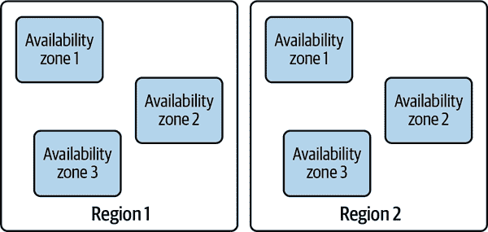

# 附录 B：云网络

本附录讨论了数据工程师应考虑的云网络因素。数据工程师在其职业生涯中经常遇到网络问题，但尽管网络很重要，却往往忽视它。

## 云网络拓扑

*云网络拓扑*描述了云中各种组件的排列和连接方式，例如云服务、网络、位置（可用区、区域）等。数据工程师应始终了解云网络拓扑将如何影响他们构建的数据系统之间的连接性。`Microsoft Azure`、`Google Cloud Platform (GCP)` 和 `Amazon Web Services (AWS)` 都使用非常相似的可用区和区域资源层级结构。在撰写本文时，`GCP` 增加了一个额外的层级，详见 GCP 特定的网络和多区域冗余。

## 数据流出费用

第 4 章讨论了云经济学，以及实际提供商成本不一定驱动云定价。关于网络，云允许免费入站流量，但对出站流量到互联网收费。出站流量本身并不更便宜，但云利用这种方法在其服务周围建立护城河，增加存储数据的粘性，这种做法受到广泛批评。^(1) 请注意，数据流出费用也可能适用于云内可用区和区域之间传输的数据。

## 可用区

*可用区*是公有云向客户可见的最小网络拓扑单元（图 B-1）。虽然一个可用区可能由多个数据中心组成，但云客户无法在此层级控制资源放置。

通常，云支持同一可用区内系统和服务之间的最高网络带宽和最低延迟。出于性能和成本原因，高吞吐量数据工作负载应运行在位于单个可用区内的集群上。例如，临时的 `Amazon EMR` 集群通常应位于单个可用区内。

此外，发送给可用区内虚拟机的网络流量是免费的，但有一个重要警告：流量必须发送到私有 IP 地址。主要云利用称为*虚拟私有云 (VPC)* 的虚拟网络。虚拟机在 VPC 内拥有私有 IP 地址。它们也可能被分配公有 IP 地址，以便与外部世界通信并接收来自互联网的流量，但使用外部 IP 地址进行通信可能会产生数据流出费用。

## 区域

*区域*是两个或多个可用区的集合。数据中心运行需要许多资源（电力、水等）。独立可用区的资源是相互独立的，因此局部停电不会导致多个可用区宕机。工程师可以通过在多个可用区运行服务器或创建自动化的跨可用区故障转移流程，即使在单个区域内也能构建高弹性的独立基础设施。

提供多个区域允许工程师将资源放置在靠近其任何用户的地方。*靠近*意味着用户连接服务时能获得良好的网络性能，最小化网络路径上的物理距离，并减少通过路由器的跳数。物理距离和网络跳数都会增加延迟并降低性能。主要云提供商持续增加新区域。

通常，区域支持区域间快速、低延迟的网络；区域间的网络性能将差于单个可用区内，且虚拟机之间会产生名义上的数据流出费用。区域间的网络数据移动甚至更慢，并可能产生更高的流出费用。

通常，对象存储是区域级资源。某些数据可能在可用区之间传输以到达虚拟机，但这主要对云客户不可见，且对此没有直接的网络费用。（当然，客户仍需承担对象访问成本。）

尽管区域具有异地冗余设计，但许多重大云服务故障已影响整个区域，这是*关联故障*的一个例子。工程师通常将代码和配置部署到整个区域；我们观察到的区域故障通常源于发生在区域层面的代码或配置问题。

## GCP 特定的网络和多区域冗余

`GCP` 提供了一些独特的抽象，如果工程师在此云中工作，应该了解这些抽象。第一个是*多区域*，资源层级中的一个层；一个多区域包含多个区域。当前的多区域有 `US`（美国的数据中心）、`EU`（欧盟成员国的数据中心）和 `ASIA`。

# 多区域存储和网络

多个 GCP 资源支持多区域，包括 Cloud Storage 和 BigQuery。数据以地理冗余的方式存储在多区域内的多个区域中，因此即使发生区域性故障，数据仍应保持可用。多区域存储还旨在高效地向多区域内的用户交付数据，而无需在区域之间设置复杂的复制流程。此外，位于多区域中的虚拟机访问同一多区域中的 Cloud Storage 数据无需支付数据流出费用。

云客户可以在 AWS 或 Azure 上设置多区域基础设施。对于数据库或对象存储，这涉及在区域之间复制数据以增加冗余并使数据更接近用户。

Google 还基本上拥有比其他云提供商多得多的全球规模网络资源，它将其作为 `premium-tier networking`（高级网络层级）提供给客户。高级网络层级允许区域和区之间的流量完全通过 Google 自有的网络传输，而无需遍历公共互联网。

## 到云的直接网络连接

每个主要公有云都提供增强的连接选项，允许客户将其网络直接与云区域或 VPC 集成。例如，Amazon 提供 AWS Direct Connect。除了提供更高的带宽和更低的延迟外，这些连接选项通常还能大幅降低数据流出费用。在美国的典型场景中，AWS 流出费用从通过公共互联网的每 GB 9 美分降至通过 Direct Connect 的每 GB 2 美分。

## CDN

*内容分发网络* (CDN) 可以为向公众或客户交付数据资产提供显著的性能提升和折扣。云提供商提供 CDN 选项，许多其他提供商（如 Cloudflare）也提供。CDN 在重复交付相同数据时效果最好，但请务必阅读条款细则。请记住，CDN 并非在所有地方都有效，某些国家/地区可能会屏蔽互联网流量和 CDN 分发。

## 数据流出费用的未来

数据流出费用是互操作性、数据共享和数据迁移上云的重大障碍。目前，数据流出费用是一道护城河，旨在阻止公有云客户离开或跨多云部署。

但有趣的信号表明变化可能即将到来。特别是，Zoom 在 2020 年 COVID-19 大流行初期宣布选择 Oracle 作为其云基础设施提供商，引起了许多云观察者的关注。^(2) Oracle 如何在云巨头的竞争中赢得这份关键远程办公基础设施的重要云合同？AWS 专家 Corey Quinn 提供了一个相当直接的答案。^(3) 根据他的粗略计算，Zoom 在 AWS 上的月度数据流出费用按标价计算将超过 1100 万美元；而 Oracle 的费用将不到 200 万美元。

我们推测 GCP、AWS 或 Azure 将在未来几年内宣布大幅削减流出费用，从而导致云商业模式发生巨变。流出费用完全消失也是完全可能的，这类似于几十年前有限且昂贵的手机通话分钟数消失一样。

^(1) Matthew Prince 和 Nitin Rao，《AWS 的过高流出费用》，《The Cloudflare Blog》，2021 年 7 月 23 日，[*https://oreil.ly/NZqKa*](https://oreil.ly/NZqKa)。

^(2) Mark Haranas 和 Steven Burke，《Oracle 击败云对手赢得大单云交易》，CRN，2020 年 4 月 28 日，[*https://oreil.ly/LkqOi*](https://oreil.ly/LkqOi)。

^(3) Corey Quinn，《为什么 Zoom 选择 Oracle Cloud 而非 AWS，以及你可能也应该这么做》，Last Week in AWS，2020 年 4 月 28 日，[*https://oreil.ly/Lx5uu*](https://oreil.ly/Lx5uu)。
