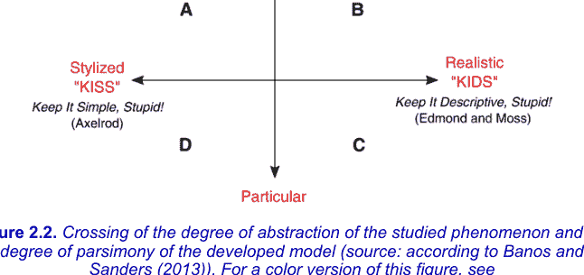

## 选择模型以解释城市和领土的动态

## 2.1. 引言

正如章节标题所暗示的，本贡献聚焦于建模过程中所做的选择。主题范围很广，这里一方面以地理为主题领域，另一方面以解释一种现象为目标来限定。介于为解释与城市或领土动态相关的现象而提出一组问题，以及开发旨在回应这些问题或至少为反思开辟途径的模型之间，确实穿插着一系列选择。研究人员选择采用的方法论方法既取决于他的目标，也取决于他的学科习惯和专业知识。他的选择并不总是以线性方式做出，并且往往基于隐含立场。例如，针对同一主题问题，即特定领土内社会空间不平等的演变，一人将采用基于半指导式访谈的定性方法，另一人采用基于人口普查数据统计分析的定量方法，而第三人则转向代理模拟模型。因此可能性范围仍然非常宽广，本章不可能穷尽。目标是展示研究人员在城市动态和领土使用方面所探究的方法、方法和模型之间广泛网络中的一组节点。第一步是明确感兴趣的对象，特别是我们试图解释的现象。经验示例将被用来建立具体案例背后的推理

对城市和领土的追问，例如空间和社会形态的出现、城市形态的演变以及活动的转变速率。这些案例将因此被用来阐明需要做出的选择的性质，而不是发展与之相关的主题知识。

在文本的其余部分，我们将讨论贯穿一项研究的不同选择，从一般到具体，有些是假设性的，另一些则更为隐含。第一个选择是关于解释的认知框架（第2.2节）。这个选择是在模型开发之前做出的，与研究者的期望及其认知定位有关。然后讨论研究者可用的各种模型，以审视“模型”一词的多义性（第2.3节）。这两个讨论的交集随后以比较的方式呈现两类解释模型：统计模型和基于主体的模型，它们通过机制实施解释（第2.4节）。最后一类模型将进一步展开。首先，解释了现象的抽象层次，并分析和说明了经验领域中个体与一般可以采取的不同形式（第2.5节）。最后，讨论了模型的简约性（KISS）或现实性（KIDS）与模型中形式化的空间和空间机制表示的关系。

## 2.2. 用理由或法则解释：选择认知框架

第一个选择具有认知性质，本段的标题涉及社会科学中关于科学解释的一系列争论。这些关于解释本质的争论主要源于哲学家，最初是面向历史领域展开的。我们将考虑几个要点，用植根于地理学的问题来说明这些争论。在此语境中，被解释项一词用以指代待解释的现象，而解释项则指代提供解释的内容。Hempel（1963）与Dray（1966, 2000）观点之间的争论可以追溯到20世纪60年代，但这些评论仍然具有现实意义，并经常被重复和讨论（Lenclud 2011; Nadeau 2007），尽管Ylikoski在2013年为一篇文章所加的标题《覆盖律理论的（但愿是）最后一次抵抗：答Opp》暗示这场争论应当结束。Ylikoski是机制解释的支持者，我们稍后将回到这一点。争论的核心是历史解释。对Hempel而言，*被解释项*源自一组初始条件和法则（称为“覆盖法则”）的组合，而这一组合构成了*解释项*。这些法则可以是普遍的，从而使方法具有演绎性；也可以是统计性的，从而使方法具有归纳性。Hempel提出的这种具有法则学性质的解释模型，作为历史学中的一种解释方法，接近于传统上用于自然科学的所谓科学解释。与此相对，Dray（2000）提出了一种基于理由的解释方法。要回答关于特定历史事实或事件的具体问题，必须识别涉及哪些行动者，他们的行动是什么，特别是这些行动者在所处情境中是什么促使他们采取这样的行动。对他来说，与其说是法则，不如说是基于某种理性形式来识别行为的逻辑序列。在Hempel的方法中，解释相当直接地指向法则，因此使解释和预测成为同义词；而在Dray的方法中，这两个概念被明确分开。在关于人文科学与自然科学解释方法差异的讨论中（Martin 2011），Lenclud（2011）指出，答案取决于所采用的观点，无论是本体论的（“事物的存在方式”）还是认识论的（“事物的认识方式”）（Veyne 1971）。在第一种情况下，决定解释模型的是被追问实体的本质。在第二种情况下，不同的解释模式之间存在着可能的选择。Lenclud建议区分自然科学的*解释*和适用于历史科学的*理解*：

“饥饿被解释，禁食被理解；双膝跪地被解释，屈膝礼被理解；失语症被解释，神经症被理解；攻击性被解释，复仇被理解；哭泣现象被解释，尤利西斯的眼泪被理解；埃特纳火山的愤怒被解释，阿喀琉斯的愤怒被理解”（Veyne 1971, p. 111）。

当试图解释地理学中的现象时，特别是当我们关注城市与领土的动态时，我们应如何定位这场争论？在该领域，*被解释项*的例子有：城市是如何形成的？为什么城市在特定领土上呈现规则或不规则的格局？不同领土之间增长差异的原因是什么？哪些因素构成选举地理学的基础（例如民粹主义政党在某些领土上代表过多，而在其他领土上代表不足）？让我们考察各自的贡献

这些相互作用增强了Guilhem的最初决定。他们的选择在某种程度上与Christaller的模型“一致”：这座城市的创建填补了当地城市格局中的一个空白，使区域城市网络更加规则。13世纪由Louis IX倡议创建的Aigues-Mortes城在同一地区提供了一个反例（Favory et al. 1998）。这座城市从未达到预期的发展水平。泻湖环境带来的问题肯定起到了一定作用，但这一相对失败的主要原因很可能在于Montpellier和Nîmes构成的竞争。在Aigues-Mortes创建时，这些城市正处于全面扩张中，Aigues-Mortes并没有像Montpellier此前所做的那样填补区域城市格局中的空白。这类失败的另一个标志性案例是Richelieu城，由Louis XIII的大臣Cardinal Richelieu于1631年创建。选择此地的原因是希望将城市建为其城堡的延伸。因此，这座城市的创建是高度规划并由上而下推动的。然而，选址并不符合空间法则。红衣主教的原因与城市区位模型的原则不符，这座城市也没能在其创始人消失后幸存下来。虽然现在由大区议会维护的建筑仍然宏伟，但Richelieu目前是一个仅有2000名居民的小镇。

这些例子表明，在解释诸如特定城市存在这样的具体经验事实时，理由与法则在多大程度上交织在一起。这与其说是一种对立，不如说是一种互补（Sanders 2018）。行动者的理由解释了城市为何被创建：Guilhem家族的理由使他们选择了这座山丘而不是其他地方；红衣主教则希望在他的城堡附近有一座真正的城市。另一方面，要解释城市为何能在时间中存续或消亡，空间模型可以提供可能的解释。“法则”反映了高度程式化的事实，即在空间均匀且各向同性、行为完全理性的情况下会发生什么。这类模型可以用作过滤器，以检测空间或时间上的特殊性（即法则之外的事实），从而寻找除最平常原因之外的其他理由（Durand-Dastès 1992）。这一初步讨论聚焦于解释的本质。这是在建模过程之前做出的认知选择。另一个反对Hempel方法而发展起来的趋势是基于机制的解释。这种解释的优势在于其构建模式接近基于主体的模拟模型的运作方式。在探讨它之前，建议从另一个切入点进入选择网络——一个与建模相关的切入点。

## 2.3. 建模方法：模型的多样性

为了引入模型的概念，Phan（2014）使用了一个语言学类比：“模型是一个符号系统，它指向现实世界中某个具体的事物，该事物将被指定为模型的指称对象”（第 55 页）。这个“指称对象”指的是我们正在研究、观察和质疑的现象。然而，“模型”这一术语本身具有多义性——有关建模方法的所有理论和经验方面的完整介绍，请参阅 Phan（2014）和 Tannier 等人（2017）。为了讨论本章将使用的含义，这里给出文献中经常使用的两个定义：一个来自地理学，另一个来自计算机科学：

- “模型是对现实的示意性表征，旨在理解现实并使其被理解”（Durand-Dastès 2001，引自 Haggett 1965）。
- “对于观察者 B 而言，对象 A* 是对象 A 的模型，其程度取决于 B 能否使用 A* 来回答他对 A 感兴趣的问题”（Minsky 1965）。

在第一种情况下，“指称对象”指的是“现实”（或现实的某个方面），并且对经验事实的锚定是显著的。还应注意，该定义中使用的是“理解”而非“解释”这一动词。在第二种情况下，指称对象更为笼统，它指向“对象 A”，“对象”一词取其最广泛的含义，既不涉及理解也不涉及解释，而是更一般地涉及回答问题。一项在 GDR MAGIS¹ 工作组跨学科框架内开展的实验，汇聚了地理学家、历史学家、考古学家和信息科学专家（计算机科学家和地理信息学家），使得人们能够理解“模型”一词是如何具有多义性，并可能成为研究者之间误解的根源（Ruas 和 Sanders 2015）。该实验围绕“空间动态建模”展开思考，这是一个统一的表述，而参与者在其中实际上代表了截然不同的事物。然而，研究者们并未按照各自学科出身来遵循 Durand-Dastès 和 Minsky 的定义。事实上，所有参与者都同意这两个定义，并且所有人都强调了它们的互补性而非对立性。对“空间动态建模”不同解释的根源不应在这一般性层面上寻找，

而*先验地*，人们可能会认为，第一个定义中强烈的经验锚定性更适合“主题专家”（无论是考古学家还是地理学家），而第二个更为笼统的定义则更能满足计算机科学家的需求。另一方面，似乎这些定义是根据每个人各自的具体能力领域来解读的，最终导致了对“建模空间动态”意味着什么的不同表征。

在这种背景下，与“模型”一词相关的多义性似乎源于对所追求目标缺乏明确说明，而这种目标往往是隐性的。虽然对给定现象的解释性探寻对某些参与者来说是建模方法的首要目标，但对另一些人来说，这样的目标并不明显，对他们而言，建模是用来构建感兴趣的现象，使其变得可观察和可读。地理信息的三个基本问题，即 Peuquet（1994）三元组的基础：什么？何时？何地？（三个 W），因而更受青睐。在这个三元组中，“什么”显然是核心，而模型的首要目标可能是构建或重建当前或过去时代所存在的事物。因此，模型对于从卫星图像中精细尺度地识别土地利用、从 GPS 调查中识别船舶或骑行者的轨迹，或从考古证据中重建过去的元素以确定例如城市功能随时间的演变，都是必要的。在这些情况中的每一种，都需要模型来基于间接可观测信息表征现象。问题在于让痕迹“说话”，以识别“现实”中发生了什么。

因此，“空间动态建模”可以指数据建模工作，它使得能够将以不断变化定义的对象上的多样且部分信息一致地汇集起来，并利用地理可视化或分类方法，表征感兴趣的现象，即表征我们感兴趣的空间动态（例如，建成区或活动随时间的演变，以及国际货运流轨迹的重建）。这种表征是建模的目标，在某些情况下，需要大量工作才能实现它。在其他情况下，这种表征是建模的起点：对现象的表征引出了诸如“如何？”和“为什么？”之类的问题。例如，为什么城市会经历差异化的经济增长？哪些因素解释了一个领土为何会被分割和重组？一种新的行为如何在某一地区的农民中传播？

数据模型使得探索丰富而复杂的数据库、进行查询，并通过查询突出规律性或断裂成为可能。解释模型则允许对产生所研究现象的空间配置和随时间演变的因素进行假设检验。不加限定地使用“模型”这一单一术语，在跨学科背景下很容易导致误解。

然而，一些研究者提出了更具体的定义。我们可以提及例如生物学家 Alain Pavé 和经济学家 Denis Phan 的定义，两人都对跨学科持开放态度。在描述建模过程时，Pavé（1994，第 29 页）强调了开发模型时需要明确的四点：“要表征的对象和/或现象；所选的形式系统；目标，即人们希望使用模型的目的；以及可通过经验或观察获得或可获取的数据（与变量相关）和知识（变量之间的关系）”（加粗词语来自原文）。经过对各部分的具体阐述后，Phan（2014，第 60 页）提出了以下建议：“模型是一种以形式语言表达的表征，它涉及一个特定的指称对象，并与一个相对于思维框架而言具有目的性和情境性的视角相关，该思维框架赋予其意义”。值得注意的是，尽管用词不同且两篇文章相隔 20 年，但这些提议之间具有相似性。唯一的区别在于，Pavé 选择强调数据，区分了描述符和关于数据的知识，而这些方面被包含在 Phan 定义的“指称对象”中。另一方面，后者强调了赋予模型元素意义的思维框架。

## 2.4. 通过统计关系或机制进行解释

一旦问题以围绕“如何”和/或“为什么”的解释和理解探寻的形式被提出，同一问题就可以采用具有截然不同哲学的建模方法来研究。这里提及其中两种方法：统计模型和计算机模拟模型。Manzo（2005）通过对比与统计领域相关的“变量语言”和模拟方法特有的“机制语言”，比较了这两类模型的操作模式。

在统计模型中，*被解释项*通过一个变量的分布具体化，并对应于此变量在不同分析实体上所取值之间的差异。在这种背景下，解释意味着基于同一批个体中其他变量的分布，说明统计个体（无论是被调查的人类个体，还是市政当局或城市等空间实体）之间的差异性。描述感兴趣现象分布的变量被称为“待解释”变量，而其组合能够再现这种分布的变量被称为“解释性”变量。数据（人口普查、调查、遗传分析、化石、GPS 数据等）是这类方法的驱动力，这类方法通常被称为*数据驱动*。挑战在于分析“现实”中存在（或曾存在）的事物，而再现所观察到的结果的能力是良好模型的关键。这样的统计模型使得能够根据一系列经验数据检验关于变量间相互关系的假设，问题在于识别最能再现所观察现象的变量配置（校准逻辑和对观测分布最佳拟合的寻求）。当统计个体是空间实体时，这类模型突出空间共变关系，这在一定程度上允许基于例如城市的经济或社会属性来预测（或估计）待解释变量（例如城市增长率）。*解释项*因而指的是一个相关系统，而非因果联系。Bulle（2005）使用“效果的现实主义”这一表述来表征这种方法，并将其与与智能体模型相关的“原因的现实主义”相对照。

在智能体模型中，*被解释项*对应于宏观层面产生的现象（如 Schelling 模型中的空间隔离），而*解释项*对应于模型中形式化的实体之间运作的机制。智能体模型使得构建一个人工世界成为可能，其中智能体（例如代表人类个体或如公司、城市等群体）被概念化，并与关于它们自身之间或与环境之间互动的行为规则相关联。这些模型可以被描述为*概念驱动*，其驱动力是控制模型中实体间关系并驱动所研究系统动态的机制。模拟随后允许测试情景并探索*替代故事*。例如，Premo（2007）指出，经典问题“在 Y 时期，X 地区发生了什么？”可以用一个更具探索性的问题来替代，例如：“行为 Q 或特征 Z 在特定条件下演化的可能性有多大？”

result. 因此，这种生成能力，如果必要并提供“解释的候选”，并不能让人理解机制是如何以及在什么条件下运行的。为弥补这一点，有必要增加第二项操作，Marchionni 和 Ylikoski（2013）称之为“实验成分”。这涉及系统地改变模型的假设并研究其对结果的影响。要理解“如何”，有必要研究反事实依赖关系（如果 A 是 B 的原因，这意味着如果 A 没有发生，则 B 不会发生）。此类实验使得能够识别哪些假设在结果的生成中起着核心作用，或相反，起着不加区分的作用。

在接下来的两点中，重点特别放在代理模型上。仍然存在多种可能性，一方面是选择要解释的现象的抽象程度，另一方面是选择要开发的模型的简约程度。

## 2.5. 为要解释的现象选择抽象程度：一般与特定

在 Arnaud Banos 的早期著作（Banos and Sanders 2013）中，我们曾将一组作品定位在一从一般到具体的轴上。由此得出“因此存在整个经验事实的连续体，从最具体的（为什么巴黎第 16 区有如此高的特权人口集中？）到最程式化的（为什么大都市区是隔离的？）”。这种区分模型的目标是解释特定现象（在特定地点、特定时间观察到的特定空间组织）还是一般现象（在时间和/或空间上反复观察到的程式化组织类型），使得能够说明建模者相对于其感兴趣的观察现象的定位。这可以表述为程式化事实的形式（为什么城市之间存在增长差异？）或涉及锚定在特定领土上的特定经验事实（例如，什么解释了法国？以及欧洲？这些差异的空间配置）。

现象的具体与一般区分是一个相对概念，取决于学科背景。虽然问题“为什么大都市区是隔离的？”从地理学家或社会学家的角度来看是非常一般的，但它对物理学家而言已属于特定的范畴。隔离过程确实是一个特定案例

从一般到特定的第二种方式是具体化尺度（建筑和邻里）以及/或所考虑的空间类型。这可能是居住地（最经典的案例）、工作地，或学校（例如在研究学校空间的隔离时）。Schelling（1971）则采取了一种基于美国城市之间白人与黑人人口隔离现象重复出现的方法。其立场因此介于特定（地理背景被具体化：涉及美国和城市）与一般（所有城市都涉及）之间。进一步迈向“特定”的一步是聚焦于特定地理位置的隔离现象，例如某个特定城市。这是 Alivon 和 Guillain（2018）工作的案例，他们研究了马赛的社会隔离并展示了隔离结构对失业风险增加的影响。关于隔离的一些问题属于这些不同类型特殊性的组合：这是 Poupeau 和 François（2008）工作的案例，他们考察了巴黎学校空间隔离所涉及的空间和社会逻辑。这是一种特定的空间类型，即学校空间（由学校及其就读学生组成），以及一个特定的地理区域，即巴黎。尽管与具体案例相关，这项工作基于通用的概念框架，因此可以转移到其他案例。前面为说明目的而开发的案例涉及空间隔离现象，但许多问题都可以产生将其置于该轴两端的表述，从一般到特定。另一个将在本章后面使用的例子涉及新区域的定居。在其最通用的版本中，问题涉及空间殖民现象：是什么因素导致个人或群体迁移？由此产生的定居配置是什么？

这种对我们试图描述和理解的现象的一般或特定性质的区分产生了模型分类的主要轴。该轴由研究人员通过开发模型来表述他试图解决的问题的方式来定义，即通过对所涉及人口以及所关注地理框架的精确具体化与否。模型分类的第二轴由将要构建的模型的自身特征提供。

- 村庄的出现和定居的等级组织模型：VILLAGE 模型（Kohler and Crabtree 2017）和 MayaSim 模型（Heckbert 2013），在区域尺度上，持续数百年；
- 城内隔离模型，例如 Schelling（1971）的模型，在城内空间尺度上，时间尺度约为数十年。

### 2.6.1. 空间表示模式：从程式化空间到现实空间

最简单和最程式化的空间表示由二维、同质和各向同性的数学空间组成，要么是连续空间，要么是由单元组成的网格。例如 Young（2002）的模型就属于这种情况，该模型模拟了在矩形空间中从初始情况开始的定居扩张，其中一个代理（代表家庭或群体）位于矩形的其中一个角落（图 2.1(a)）。Schelling（1971）的模型也是如此，其中空间由网格形式化，两个人口在初始情况下随机分布。在这两种情况下，空间都是同质的，起着简单的支撑作用。在第一种情况下，模拟代表了对应于扩张（殖民）过程的空间进展，而在第二种情况下，则模拟了所考虑的两个人口在空间中的重新分布（图 2.1(b)）。

将更现实的视野引入模型的一种方式是考虑非同质空间并引入根据代理在空间中的相对位置来调节代理之间相互作用的规则。一个例子如图 2.1(c) 所示。HU.M.E. 模型，其目标接近 Young 的模型（模拟定居的空间扩张），与之不同之处在于空间的规范：一方面，引入了不适合建立定居点的单元（例如海洋），另一方面，如果单元的环境潜力在初始情况下是同质的，随着人类群体的建立和对空间的利用，它会随时间分化。经过多次迭代，空间因此变得异质。这是对空间的高度程式化表示，但反映了断裂的存在（在适合或不适合人类定居的单元之间），以及环境条件的异质性，导致可用资源的空间变化，从而影响代理与其环境之间的相互作用。

在 HU.M.E. 模型中，代理的移动基本上由与前一种相同的抽象水平的机制控制：代理如果所在单元的可用资源不足就会移动。然而，该机制结合了两个互补元素，使模型处于“程式化”与“现实”之间的中间位置。一方面，代理具有不同的能力，取决于其技术水平来利用现有资源。另一方面，他们具有不同的移动能力，取决于代理在前几步中能够储存的能量。

在 Barton 等人（2012）的模型中，代理（代表采集狩猎群体）的移动以更抽象和详细的方式形式化。代理的潜在移动实际上是在两个尺度上理解的：（1）日常移动的尺度，即他们获取自然资源所在的区域，（2）所谓的“居住”移动的尺度，对应于基地营地的改变。模型的核心是确定与其他代理（相同或不同类型）的哪些相遇会导致后代的设计。移动本身因此并未由模型再现：模拟的是后代在空间中的位置。

|  | 空间机制的抽象程度 |  |  |
|---|---|---|---|
| 空间的抽象程度 | 简单 | 中间 | 现实 |
| 程式化且同质的空间 | Young Schelling |  |  |
| 分化的程式化空间 |  | HU.M.E. SimPop |  |
| 空间：经验轮廓 |  | Barton et al. |  |
| 经验空间（轮廓和内容） | VILLAGE | Parisi et al. | MayaSim VILLAGE |

表 2.1. 空间表示和空间机制抽象程度的交叉。一些说明性模型的位置

说明性模型根据上述两个空间维度相关的抽象程度在表 2.1 中呈现，第一项涉及空间的表示，第二项涉及空间的

作为模型中的规则引入的机制。毫不奇怪，这两个维度之间存在一定的对应关系。非常逼真的模型通常需要动员多样化的经验数据并参考逼真的地理，而最简化的模型则应用于中性、同质和各向同性的空间。中间情况就不那么明显了，因为它们可以基于空间支撑和所建模机制的抽象程度的不同组合。

## 2.7. 结论

在 Banos 和 Sanders（2013）的研究工作中，我们提出了交叉两个轴，分别涉及所研究现象的抽象程度（从一般到特殊）和所开发模型的简约程度（从简化到逼真），以便在此二维平面上定位模型。 与对模型进行类型学相比，这一方案使得能够识别和讨论不同类型的组合（图 2.2）。 为了使用本贡献中提到的模型，Young 和 Schelling 的模型明显位于象限 A，对应于一般现象的 KISS 模型，而 VILLAGE 模型位于相反的象限，记为 C，对应于特定现象的 KIDS 模型。 该轴平面对于追踪模型轨迹特别有趣，即识别父模型之间的联系，这些模型源于相似的问题，但根据对应于不同象限的方法进行开发。

图 2.2. 所研究现象的抽象程度与所开发模型的简约程度的交叉（来源：根据 Banos 和 Sanders（2013））。 如需彩色版本，请参见 www.iste.co.uk/pumain/geographical.zip

由 Bruce Edmonds 领导的跨学科 SCID（移民和社会多样性的社会复杂性）团队的工作是 B 到 A 象限所选方法论路径的一个很好的例子。 这是一个基于公民参与投票的公民参与率模型，取决于他们所参与的影响关系。 首先开发了一个形式化一组政策假设的多智能体模型（Fieldhouse et al. 2016）。 核心假设是，智能体的公民参与是其他智能体对其施加影响的函数。 该模型整合了若干机制（人口统计和行为）并以精确的方式形式化了交换网络的形式。 因此，该模型以 KIDS 方法解决了一个一般性问题（地点和时间未指定）并落入象限 B。 这种在运行方面相当逼真的第一个模型随后被简化，并且若干显式机制（例如，个人通过工作场所、学校等建立交换网络） simply 被随机抽样所取代。 简化后的模型（Lafuente et al. 2016）在计算方面更有效，并且已进行了许多实验，显示出存在对应于高参与率的政权和对应于低参与率的政权，具体取决于参数值。 通过与物理学家的进一步简化工作导致了分析方法（Lafuente et al. 2015），其模型明显位于象限 A。 该示例说明了在同一研究机构内跨学科团队进行的逐步简化工作过程中，从 B 到 A 的渐进轨迹。

模型的分析版本使得能够从形式角度理解其属性和运行。 另一方面，这种对形式属性的理解并不一定伴随着对所涉及社会机制的更好理解。 在 Schelling 模型的情况下，Clark 和 Fossett（2007）指出，文献中对该模型进行的正式工作并未让我们回答个人移动选择是如何做出的，也没有回答导致或不导致居住空间不同形式隔离的选择。 这些作者建议使用实证调查来确定智能体移动的规则并评估局部环境对智能体行为的影响。 这样做，他们将初始模型从象限 A 移至象限 D。

第三种轨迹案例由上述提到的 HU.M.E. 模型说明，其初始版本先验地包含在象限 B 中。 它确实包含多个机制：人口统计（群体的出现、消失和分裂）； 根据群体的技术水平利用资源，并有可能通过模仿其他智能体获得更高水平； 当智能体所在的单元不再有足够资源供养群体时移动到另一个单元； 以及根据在定居期间获得的能量水平移动的能力。 机制因此众多且相互交织，产生了一定程度的结果复杂性（Coupé et al. 2017a）。 将该模型适应 2,500 年前从喀麦隆高地向南迁移的班图人，导致了诸如引入与班图人与皮格米人之间互动相关的新的机制等具体化。 HU.M.E. 班图模型（Coupé et al. 2017b），探索这些互动对迁移率和班图群体到达南部赤道森林的能力的影响，位于象限 C。 与选举参与模型具有相似的初始位置相比，该示例说明了与另一示例相反的、向更大复杂性发展的轨迹。 图 2.2 中两个轴的组合因此使得能够可视化模型之间不同类型的联系，无论是继承联系还是 skim 联系。 在此层面上所做的选择，涉及在观察和对感兴趣现象的提问所制定的抽象水平与引入到模型机制中的现实程度之间的组合，与上述关于为解释选择认识论框架的选择的讨论平行。 解释模型之间的继承联系应该使得能够更好地理解方法之间的互补性形式，并促进在建模过程中需要做出的选择集群。
