## 城市和领土地理模型中的距离和尺度依赖效应

本章质疑距离和尺度依赖在分析人类聚落和活动的空间配置以及导致其演化的过程的模型中的基本作用，并参考城市或区域研究区域。 因此，研究对象既涉及人类聚落的形式，也涉及人们（个人和群体）在其领土（或领土）中的行动。

人类聚落由空间中的物质化——物理铭刻——构成一个或多个人类活动。 其特征在于一定的可持续性。 它可以是少数几座建筑物组成的群体，也可以是数千座建筑物、公园、停车场、果园、田地等的更大群体。 每个元素都通过交通和通信网络与彼此连接，无论是近还是远，功能相同或不同。 所有这些——建筑物、未建设环境和网络——都是人类活动的容器。 有不同的模型可用于研究该容器的空间配置或形状。 与该容器相关的内容是个体和群体，他们执行活动并具有空间实践和社会关系。 该内容物的空间配置以位置、流动和路径为研究对象。

地理学家对他们所研究的城市和领土提出了三个主要问题，每个问题同等重要。

- 1) 空间是否分化？ 为回答这个问题，他们专注于识别和表征空间分化。
- 2) 为什么它分化？ 他们正在寻找对观察到的分化的解释。
- 3) 为什么观察到这种分化而不是另一种分化？ 他们随后试图区分这些分化的解释在多大程度上是普遍的，对不同地点和/或不同时期有效，或是独特的且与地方特征相关。

因此，(...) 地理学将空间的组织及其功能置于前沿； 它寻求解释其多样性或更确切地说其多样化，在不同尺度上； 它将其主要关注点放在位置问题上（为什么在这里而不是在别处？）； 它以空间为起点来质疑现实，特别是社会，与其物质支撑有关，该支撑既继承自过去世代的行动，也继承自自然力量（Durand-Dastès 1989）（图 3.1）。

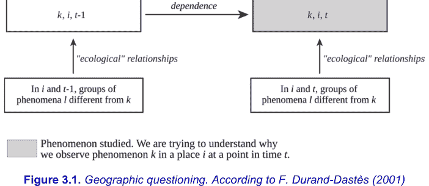

图 3.1. 地理学质询。 根据 F. Durand-Dastès（2001）

地理模型旨在回答上述一个或多个问题。 这些模型使得能够研究空间分化，无论是就位置（位置和情况）而言，还是就移动和流动（位置变化）而言。 被建模的实体可以


effort. 第二个原则是*竞争*（或*竞争*）原则，地球空间中的位置受制于此。这是在个人或个人群体之间为土地利用、资源获取、客户获取等进行的竞争。该过程的强度根据地点的地理位置及其其他特征而变化。根据具体情况，这会导致相同或不同类型的人类聚落或个人的分散或集中。第三个原则是地点之间、活动之间、社会群体之间等的*互补性*（或*合作、一致性*）原则。这可能导致相同或不同类型实体的集中，例如供需匹配，或分散，以便在一个地方提供产品或开展活动，同时在另一个地方提供另一种产品或开展另一种活动。

地理现象通常涉及这三个基本原则的结合，特别是在竞争–互补性或吸引–排斥的形式下。因此，E. L. Ullman（1954）确定了人们、货物或信息在起点 O 与目的地 D 之间移动的三个原因，即空间相互作用的三个驱动力：O 与 D 之间的互补性（目的地 D 提供或允许一种在位置 O 不可用或不可能获得的期望事物（例如货物、信息、服务、社会关系等））；可转移性（O 与 D 之间旅行的成本是可以承受的，或更根本地说，旅行是可能的），以及介入机会（在从位置 O 到位置 D 的路线上的其他地点存在获得或实现期望事物的其他可能性）。T. Hägerstrand（1952，1967 [1953]）也使用这三个原则来描述创新的传播（也可以是疾病、运动等的传播）：扩散过程涉及宿主和/或采用者的位移（最小化旅行能量使用的原则的介入），宿主和采用者必须在同一地点或共享对特定广播媒介（报纸、电视、互联网等）的共同兴趣（互补性或一致性原则的介入），以及创新必须能够作为创新而确立自身（竞争或竞争原则的介入）。第三个三个原则结合的例子见于 H. Hotelling（1929）的模型，该模型表明海滩上的两个冰商既有兴趣相互靠近以最大化潜在客户数量，也有兴趣尽可能远离彼此以避免相互竞争。

由此三个基本原则可知，距离和尺度依赖性在城市和领土的地理建模中各自发挥着非常重要的作用。

### 3.1.1. 距离效应

地理模型中的距离效应对应于彼此接近的元素比远离的元素更可能相关或相似的事实。这是 W. Tobler（1970）提出的地理第一定律：*万物与万物相关，但近物比远物更相关。* 根据 M. Goodchild（2001），空间构型的识别之所以可能，是因为假设短距离上的空间分化是最小的，可以忽略不计¹。就过程而言，M. Goodchild（2016）将其表述如下：*平滑过程占主导地位，锐化过程较弱，分化景观的过程弱于平滑景观的过程。*

距离效应的表现形式为摩擦，随着距离的增加而降低现象之间的相互影响。距离可以是公里距离，也可以是成本距离或时间距离。距离的另一个效应是属于或不属于同一领土：同一社区、同一国家、同一气候条件、同一语言、同一社会群体等等。距离的第二个效应在一定程度上解释了空间不连续性和边界效应的存在。C. Grasland（2009）因此区分了*空间相互作用*，其中涉及的距离以连续的数学形式衡量（距离的摩擦效应），与*领土相互作用*，其中距离是通过不连续性质的空间划分来表示的（属于同一领土的效应）²。然而，将距离的摩擦效应与“连续”距离的测量联系起来的想法是值得怀疑的。一方面，在度量空间上测量的距离（最常见的是欧几里得距离或曼哈顿距离）涉及一组按定义离散的点。另一方面，距离的摩擦也可以从离散距离测量中评估：图上的拓扑距离或不同阶的邻域矩阵（即邻接）。

A. Páez 等人（2008）基于 P. Marsden 和 N. Friedkin（1994）的反思，指出了用于分析社会依赖性（例如社会网络中的自相关度量）和空间依赖性（空间自相关度量，以及更一般地说地统计学和空间统计学）的计量工具的相似性。所有这些工具背后的原则是，空间（无论是地理还是社会）上的邻近性增加了两个现象相关的概率，至少从统计角度来看是如此。遵循同样的逻辑，C. Grasland（2009）建立了社会学家 P. M. Blau（1977a，1977b）为研究社会地位而区分的“名义参数”和“分级参数”之间的联系，一方面，以及他本人为研究地理位置而提出的“领土参数”和“空间参数”之间的区分，另一方面。根据 C. Grasland，“领土特征”（属于同一领土的效应）包括 P. M. Blau 定义的“名义特征”，即定义社会类别的个人的定性属性：族群、宗教归属、职业活动等等。与此同时，“空间特征”（距离的摩擦效应）涵盖 P. M. Blau 的“分级特征”，即用于定义社会阶层的定量属性：收入、薪水、年龄等等。

个体行为与共享社会或空间邻近性的个体之间存在相关性的证据促使我们寻求这种相关性的解释。问题是，这种相关性是否源于个体共享同一信息来源或同一个体特征（相关效应），个体是否因自我选择而具有相同的个体特征（情境效应或外生社会效应），或个体是否确实相互交流（内生社会效应）（Manski 2000）。第二种和第三种情况是距离效应以属于同一领土的形式的两种可能变体。

### 3.1.2. 尺度依赖性效应

社会空间分化是在相对于所建模的基本实体而言必然聚合的水平上观察到的。然而，测量的地理现象（集中和分散、相关性等）更经常地根据所考虑实体的聚合水平（Fotheringham and Wong 1991；Madelin et al. 2009；Openshaw 1983a）或采用的空间分辨率（Goodchild 1980；Muller 1978）而变化。

空间分辨率对应于用何种精细程度来表示一个地方容器的元素。例如，城市聚落的建成面貌可以逐栋建筑绘制，每栋建筑都有其自己的空间足迹，以极高的精度划定（米级甚至亚米级）。在这种情况下，空间分辨率是精细的。相同的建成面貌也可以映射为大致划定不同建筑群包络的城市斑块。在这种情况下，空间分辨率较粗。建成面貌也可以映射为边长 20 m（精细空间分辨率）或 200 m（较粗空间分辨率）的正方形或六边形规则网格。

所考虑实体的聚合水平不同于空间分辨率。例如，一个社区可以作为一个整体进行研究，而不被拆分，也可以被视为街区或建筑物的集合。同样，城市地区的居住迁移可以以家庭为单位考虑（分解分析），以社区为单位（对应于家庭的集合），或以市政为单位（更高聚合水平）。

地方容器的空间分辨率的精细程度在一定程度上决定了所考虑实体的聚合水平，反之亦然。例如，假设我们想研究建成形态（建筑高度、建筑类型、局部建成密度等）与家庭居住满意度之间的关系。如果我们拥有建筑的精细空间分辨率地图以及家庭居住满意度的个体数据，我们可以在建筑–家庭二元层面研究该关系。如果相反，框架地图具有较粗的空间分辨率，则应调查建成集合类型与居住其中的家庭群体之间的关系。如果框架地图现在具有精细的空间分辨率，但家庭数据在社区层面聚合，则应调查每个社区的建筑类型与社区层面的家庭居住满意度之间的关系。

¹ *空间依赖性为有效描述提供了关键，因为它使我们能够忽略短距离上的差异，因为它们很可能很小。*

² *我们建议使用“空间相互作用”一词来表示以数学连续形式测量的距离的一般效应，并指定“领土相互作用”当我们想要衡量空间划分的不连续效应时（Grasland 2009）。*


尺度依赖意味着，就定居点或人类活动而言，考虑到某一邻域的集中过程的存在意味着考虑到更宽或更窄的邻域的分散过程（Tannier 2017）。事实上，如果没有异质性或不平等，因而没有社会空间分化，就不存在尺度依赖。尺度依赖的一个可能后果是，在某一尺度（某一聚合水平或空间分辨率）上观察到的集中状态意味着在另一尺度上出现分散状态，反之亦然。尺度依赖的另一个可能后果是，两种现象之间的相关性在某些空间单元上计算时为负，而在另一些空间单元上计算时为正（Openshaw 1981）。这回应了 S. Openshaw（1983a）描述的*可修改面积单元问题*：所测量的状态取决于所考虑的基本空间单元的大小（尺度问题）、基本空间单元的形状和位置（区划问题），以及研究区域的界定（“结果显式地依赖于研究的边界”（Goodchild 2016））。特别是，空间表示的详细程度（聚合水平或空间分辨率）会影响地理形状和结构的测量。因此，(...) *在一点上定义真实的人口密度是不可能的，因为任何估计都显式地依赖于测量密度的尺度。(...)  remarkably few geographical variables are scale-less*（Goodchild 2001）。

W. Tobler（2004）对此主题作出了以下观察：*Arbia 的地理第二定律读作‘万物相互关联，但以粗略空间分辨率观测到的事物比以更精细分辨率观测到的事物关联性更强’。这表明聚合具有平滑效应，如众所周知（参见 Tobler 1969, 1990）。对于递归构造的分形对象而言，这非常清晰：随着空间分辨率变得更精细，占据元素的数量密度会下降（图 3.2）。密度下降的程度在分形维数较小时更为明显（Tannier et al. 2012）。在空间分辨率 i 下测得的密度 ρᵢ 与更精细空间分辨率 i+1 下的密度 ρᵢ₊₁ 之间的比率与分形维数 D 之间的关系为：*

$$\frac{\rho_{i+1}}{\rho_i} = (r)^{-2D} \tag{3.1}$$

其中 *r* 是从给定空间分辨率到更精细空间分辨率的元素尺寸缩减因子。该关系让人想起

另一个将城市中心到外围的建设密度下降与径向分形维数联系起来的关系（Batty and Kim 1992; Chen 2009; Fotheringham et al. 1989; Thomas et al. 2007）。

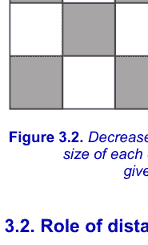

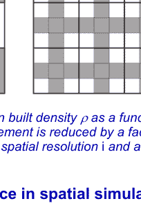

| Fractal dimension D | ρ_{i+1} / ρ_i |
|---|---|
| 1.26 | 0.44 |
| 1.46 | 0.55 |
| 1.63 | 0.67 |
| 1.77 | 0.78 |

图 3.2. 当每个元素的尺寸在给定空间分辨率 i 与更精细分辨率 i+1 之间按因子 r 等于 1/3 缩减时，建设密度 ρ 随分形维数 D 的下降

## 3.2. 距离在空间模拟模型中的作用

为了描述距离在城市和区域建模中可能发挥的不同作用，我们可以从研究四个空间模拟模型开始。第一个模型称为 SimFeodal（Cura et al. 2017b）。它能够模拟公元 800 年至 1200 年间欧洲西北部某一给定区域的领主对农民家庭的征税、教堂和城堡的建设，以及农民家庭农业用地位置的连续变化。模拟结果显示农业用地围绕教堂和城堡的集中和固定。1200 年实现的定居系统极化和等级的强度根据模拟情景而变化。第二个模型，MobiSim-MR（Tannier et al. 2016b），允许对约 2030–2040 年的时间视域进行前瞻性模拟，模拟城市区域中居民家庭的迁移。模拟结果显示不同类型家庭在城市区域不同地点（邻里、市镇、扇区等）的集中程度变化，以及这些地点之间迁移流强度的演变。

这两个模型都是在多智能体形式主义下开发的。因此，它们是通过连续迭代而动态的。模拟的动态涉及不同的时间范围：SimFeodal 的动态跨越 400 年，而 Mobisim-MR 的动态跨越取决于情景的 20–30 年。第一个的时间分辨率（模拟步长持续时间）为 20 年，而第二个为 1 年。

环境的概念是多智能体模型动态的核心（智能体对环境做出反应和/或与环境互动），而空间维度发挥着根本作用（Mathian and Tannier 2015）。在这两个模型中，环境由通过几何和地理坐标显式且绝对表示的空间或社会空间实体组成。这些实体可以是孤立的点（例如 Mobisim-MR 中的商店和服务或 SimFeodal 中的城堡）或区域（例如 SimFeodal 中的征税区域或 MobiSim-MR 中的公园和林地）。它们可以既是被动的也是主动的（智能体）。

构成智能体环境实体的识别是通过显式的空间关系进行的。当智能体与其环境实体之间的关系表现为邻近（几何、时间或其他）时，距离的作用是摩擦力（表 3.1）。智能体与相关实体之间的关系强度随着两者之间距离的增加而或快或慢地下降。在某一阈值之上，关系不再存在，该实体不再属于智能体的环境。另一种关系形式是智能体与实体共同属于一个更包容的整体（即一个领土）（表 3.1）。在这种情况下，关系本质上是二分的：它起作用或不起作用。

SimFeodal 和 MobiSim-MR 模型的核心是模拟个体居住迁移（农村区域内的农民家庭或城市区域内的家庭），而不是模拟个人的日常出行。然而，在两个模型中，智能体迁移在很大程度上取决于其环境所允许的日常出行。在 SimFeodal 中，到最近城堡和教堂的距离是农民家庭是否进行迁移的重要决定因素，其目的地可能是本地的也可能是遥远的。如果迁移概率发生，则根据吸引中心的各自吸引力进行加权随机抽样来决定农民家庭将定居何处。吸引中心的吸引力由在某一地点同时拥有城堡、一个或多个教区教堂以及村民社区的可能性所衡量。

在 MobiSim-MR 中，日常出行潜力的建模比 SimFeodal 更详细。十二个变量描述了家庭居住环境中不同的出行潜力（图 3.3 和 3.4）：住宅 400 m 内每日使用的商店和服务数量（面包店、学校、迷你超市等）（E_df）；住宅 2,000 m 内每周使用的商店和服务数量（肉店、超市、全科医生等）（E_wt）；400 m 内公共交通站点数量（E_tc）；到最近广场或公园的距离（单位为 m）（E_gs）；到城市边界的距离（单位为 m）（E_ub）；200 m 半径内高收入家庭的比例（E_hi）；1,700 m 半径内森林土地利用的比例（E_n）；100 m 半径内建设用地比例（E_bl）；乘汽车和公共交通前往市中心的出行成本（E_ccar）和（E_ctc）；以及通过私人汽车（E_wcar）和公共交通（E_wpt）通往就业岗位的总体可达性。这种详细程度在一定程度上可以解释，MobiSim-MR 被设计为与日常出行模拟模型（MobiSim-MQ – (Antoni et al. 2016a)）协同工作于 LUTI（土地利用与交通一体化）平台内，从而考虑居住出行与日常出行之间的相互作用。

我们之前看到，实体的邻域可能对应于领土的边界，也可能对应于距离摩擦使得某一兴趣点不再被视为可能目的地之外的极限。虽然距离摩擦意味着一种移动，即个体在两个位置之间的移动，但归属领土（社会、文化、景观等）的影响无需移动即可发挥作用；定义领土边界的空间划分与移动的方式、可能性或意愿没有根本联系。

有时很难区分基于距离摩擦定义的邻域和对应于领土边界的邻域。此外，在模型中，两种定义在形式上可能完全相同。在 MobiSim-MR 中，例如，使用不同的距离半径来定义不同的邻域（图 3.3）。在某些情况下，距离半径用于统计商店和服务或公共交通站点。这时所建模的是距离摩擦，根据这一想法，超过固定距离半径后，商店和服务或公共交通站点不再被使用。另一方面，关于 200 m 半径内高收入家庭的比例，其潜在思想并不是某个家庭的目标是尽可能多地（或尽可能少地）接触高收入家庭。该比例的


一定半径内的高收入家庭并不对应于实际参与；它用作代表某种“社会氛围”的代理指标，每个家庭根据其收入对这种氛围有不同程度的偏好。这样，建模的是同一地域归属的效应，而不是距离摩擦效应。同样的逻辑适用于评估某个邻里中林木和森林面积以及已建成面积的比例。

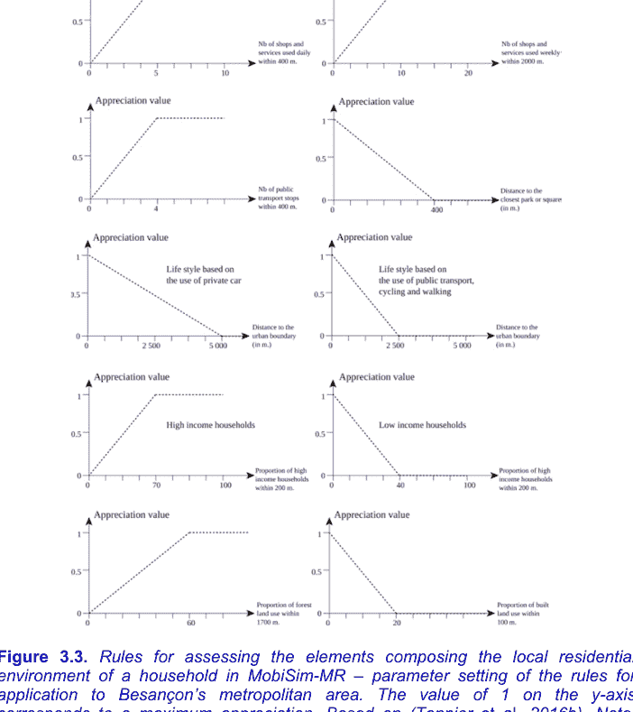

图3.3 评估MobiSim-MR中家庭本地居住环境构成要素的规则——应用于贝桑松都市区时的规则参数设置。y轴上的值1表示最大满意度。基于Tannier等人（2016b）。注：距离按直线距离计算。

我们感兴趣的其他两个模型不是多智能体模型。这两个模型是MUP-City（Tannier等人，2012）和Fractalopolis（Frankhauser等人，2018）：前者能够在可达性约束下模拟分形住宅发展，后者致力于多分形城市发展方案的交互式设计。这两个模型的目标是基于初始空间配置（建筑物、道路和路径网络、公共交通站、商店和服务设施、绿色和休闲基础设施）来模拟不同的可能城市发展配置。它们不包含任何时间动态：不仅通过模拟获得的配置在时间上没有定位，而且从初始配置到模拟配置的转换是单步（“一步”）完成的，而不是依次经过一系列中间状态轨迹的结果。

在MUP-City的情况下，模拟结果是可能用于城市化的有趣单元；在Fractalopolis的情况下，则是可以建造新住房的城市或郊区中心。这两个模型的规则具有几何性质。就MUP-City而言，它是一条城市化分形规则，强制规定了已建成单元之间的特定间距以及未开发单元之间的某种连通性。就Fractalopolis而言，它由一个迭代函数系统（Barnsley 1988）组成，该系统共同定义了不同中心之间的间距（即它们的相对位置）及其面积，以及中心外部空间的某种连通性。借助这些几何规则，通过模拟创建的空间实体（单元或中心）之间的距离被施加，而不以距离摩擦或同一地域归属来建模距离效应。这些效应通过一系列假设被间接纳入考虑：假设几何规则所施加的空间实体（单元或中心）之间的间距允许特定发展情景所期望的某些移动行为，同时阻止该情景要避免的其他行为。所涉及的移动行为包括个人前往商店和服务设施、公共交通、绿色和休闲基础设施的出行，以及动物种群在不同生态区域之间的幼体扩散（Frankhauser等人，2018；Tannier等人，2016a）。

除了用于定位模拟创建实体（单元或中心）的几何规则外，距离摩擦效应和同一地域归属的作用作为住宅开发评估中单元或中心价值的一部分被直接建模（表3.1）。为此，MUP-City和Fractalopolis模型与SimFeodal和MobiSim-MR模型一样，纳入空间可达性度量：到最近机会（兴趣点）的距离，以及特定邻里中机会的数量。然而，与SimFeodal和MobiSim-MR不同，MUP-City和Fractalopolis还建模了距离以外的效应，以便更详细地表示个体的移动行为。特别是，商店和服务、绿色和休闲基础设施以及公共交通的供给多样性被纳入考虑（图3.5和表3.2）。

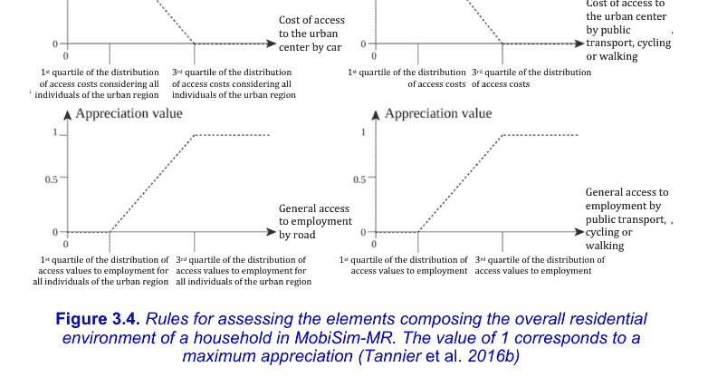

图3.4 评估MobiSim-MR中家庭整体居住环境构成要素的规则。值1表示最大满意度（Tannier等人，2016b）。

在Fractalopolis中，每个规划的发展中心都有一个邻里（即服务区），其大小根据该中心与更高功能级别相邻中心之间的距离而变化。同一层级中心的邻里（服务区）大小可能不同，而不同层级中心的邻里（服务区）大小可能相同。

每日光顾的商业集群

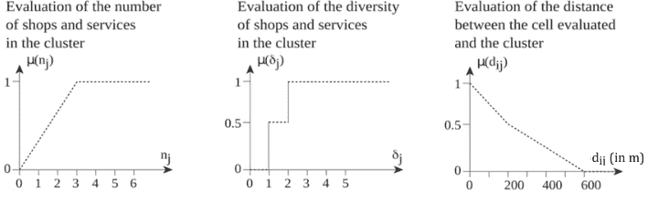

每周光顾的商业集群

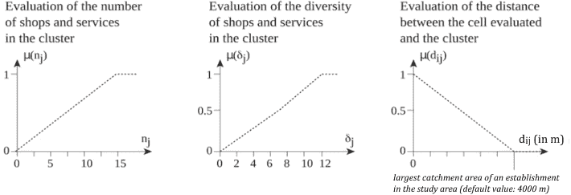

研究区域内一个设施的最大服务区（默认值：4000米）

每月或更少光顾的商业集群

评估到每类最近*m*个设施的距离

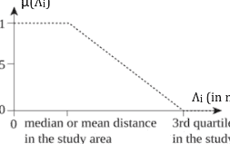

公共交通可达性

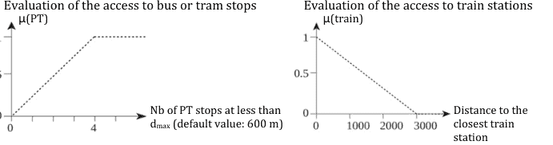

**图3.5.** MUP-City 1.2：模型中用于评估待城市化单元价值的可达性变量（默认设置值）。y轴上的值1对应最大满意度。

|  | 居民满意度最高时的机会数量 | 居民满意度最高时的不同类型机会数量 |
|---|---:|---:|
| 每日使用的商店和服务 | 8 | 5 |
| 每周使用的商店和服务 | 10 | 7 |
| 每月使用的商店和服务 | *不考虑* | 2 |
| 每日使用的绿色和休闲基础设施 | *不考虑* | 2 |
| 每周使用的绿色和休闲基础设施 | *不考虑* | 10 |
| 每月使用的绿色和休闲基础设施 | *不考虑* | 8 |

**表3.2.** *Fractalopolis 1.0：为贝桑松都市区（法国）设计城市发展情景的可达性规则配置*

在MUP-City中，邻里由道路和路径网络上测量的距离或直线距离（由模型用户选择）确定（图3.5）。例如，对于每日和每周使用的商店和服务，最近的设施必须位于距待评估住宅单元最大距离δₘₐₓ处（默认值：每日使用为600米，每周使用为2,000米）。否则，评估降为0。从距离小于600米的最近设施开始，所有彼此最大距离为200米的设施均予考虑，并限制在距离评估单元最远的设施与待评估单元之间的距离δₘₐₓₘₐₓ（默认值：每日光顾为1,000米，每周光顾为3,000米）。这样，每个商业集群都特定于每个住宅单元。在给定单元的情况下，一个商店和服务集群的价值对应于对集群中设施数量与多样性的评估，以及该集群与待评估单元之间的距离。当这个距离很大（接近δₘₐₓ）时，对集群特征的良好评估（设施数量多、现有设施类型多样）并不能弥补待评估单元与该集群之间距离的较差评估。相反，当集群与评估单元之间的距离接近0时，对集群特征的较差评估可以通过评估单元到该集群的距离的良好评估来弥补。

与每日和每周使用的商店和服务不同，在非常近的邻里内拥有大量供给是有价值的；而对于每月或更低频率的使用，可以认为每个类别在“合理”距离内有一家商店或服务就足够了。例如，没有必要在住宅附近有两家医院、两个牙医或两个图书馆。另一方面，能够在几十分钟内到达所有这些服务是有价值的。这一假设在公共行政可达性方面也是合理的：没有必要与两个市政管理机构等距，因为根据定义，一个住宅位于单一市政辖区。

最后，关于绿色和休闲基础设施可达性的评估，假设是单元附近基础设施的多样性比基础设施数量更重要。因此，可以使用一个足球场或网球场与可以使用两个这样的场地同样有价值。另一方面，可以使用一个足球场和一个网球场比只能使用一种类型的场地更有价值。

如果我们现在比较Fractalopolis和MUP-City应用于同一研究区域（即贝桑松都市区）时设置的可达性规则参数，我们也会注意到差异（见图3.5和表3.2）。特别是，居民总满意度达到最高的每日使用商店和服务数量，在MUP-City应用中为3，在Fractalopolis应用中为8。对于每周使用的商店和服务，这两个数字分别为15和10。这些数值差异主要源于单元邻里（MUP-City）和开发中心（Fractalopolis）的定义不同，以及两个应用使用了不同数据。需要注意的是，对于Fractalopolis的应用，仅区分了两种每月光顾的商店和服务类型（医院和大型购物中心）。这解释了为什么两种不同类型的机会就足以实现居民最大满意度。


|  | 卢森堡大公国 | 贝桑松都市区（法国） |
|---|---|---|
| 每日光顾的最近的商业或服务设施 | 400 m | 400 m |
| 每日光顾的最远的商业或服务设施 | 600 m | 600 m |
| 每周光顾的最近的商业或服务设施 | 2,000 m | 2,000 m |
| 每周光顾的最远的商业或服务设施 | 3,000 m | 3,000 m |
| 每月或更少光顾的商店和服务设施：最近的 m 种不同类型的商店和服务设施的距离 | 15 min | 30 min |
| 每日使用的自然和休闲区域 | 400 m | 300 m |
| 每周使用的自然和休闲区域 | 2,000 m | 2,000 m |
| 每月或更少使用的自然和休闲区域 | 5,000 m | 5,000 m |
| 公共交通站点：公交或有轨电车 | 300 m | 600 m |
| 公共交通站点：火车 | 500 m | 3,000 m |

表 3.3. 将 MUP-City 模型应用于两个不同研究区域的最大可接受距离。来源：Maxime Frémond（2015）和 Maxime Colomb（2019）的博士论文。灰色方框显示两个研究区域之间的不同值

需要指出的重要一点是，距离的摩擦效应因情境而异，这一点在评估 MobiSim-MR 家庭整体居住环境构成要素的规则（图 3.4）以及评估 MUP-City 中每月或更少使用商店和服务设施的可达性规则（图 3.5）中得到了明确体现：可达性阈值是根据研究区域内的所有可达性值设定的。也可以看出，MUP-City 应用于两个截然不同的研究区域——卢森堡大公国和贝桑松都市区——时，部分距离阈值会发生变化（表 3.3）。事实上，两个区域的绿色和休闲基础设施以及商店和服务设施的空间配置存在差异。此外，SimFeodal 模型中到最近教区的距离阈值会随时间变化（表 3.4）。

| 阈值 | 数值 |  |  |
|---|---|---|---|
|  | 960 年前 | 960 年至 1060 年 | 1060 年后 |
| 农民家庭不再完全满意的距离 | 5 km | 3 km | 1.5 km |
| 农民家庭完全不满意的距离 | 25 km | 10 km | 5 km |

表 3.4. SimFeodal（版本 6.3）——农民家庭与最近教区教堂之间距离的两个阈值的默认值

在 MobiSim-MR、MUP-City 和 Fractalopolis 中，表征建模实体（家庭、单元或规划开发中心）环境的各个变量并不同等重要。在 MobiSim-MR 中，表征居住环境的变量具有相对重要性，与一系列家庭特征相关（表 3.5 – 空白框表示家庭特征与所涉居住环境属性之间不存在关系）。在 Fractalopolis 中，不同类型机会的相对重要性以及不同使用频率机会的相对重要性会根据每个中心的职能等级而变化（表 3.6 和表 3.7）。

|  |  | 属性 |  |  |  |  |  |  |  |  |  |  |  |
|---|---|---|---|---|---|---|---|---|---|---|---|---|---|
| 家庭特征 | E_df | E_wf | E_ts | E_gs | E_ub | E_fl | E_bl | E_hi | E_ccar | E_cpt | E_wpt | E_wcar |
| 年龄 | < 30 岁 | MI |  |  |  |  |  |  |  |  | I\nI |  |  |
|  | 30–44 岁 | MI |  |  |  |  |  |  |  |  |  |  |  |
|  | 45–60 岁 | MI |  |  |  |  |  |  |  |  |  |  |  |
|  | > 60 岁 | I |  |  |  |  |  |  |  |  |  |  |  |
| 收入 | 低 |  |  |  |  |  |  |  | I\nI |  | I |  |
|  | 平均 |  |  |  |  |  | MI | MI |  |  |  |  |
|  | 高 |  |  |  |  |  | I | I | I\nVI | I |  |  |
| 子女数量 | 无 |  |  |  |  |  |  |  |  |  |  |  |
|  | 1 或 2 个 |  |  |  | I |  |  |  |  |  |  |  |
|  | 3 个或以上 |  |  |  | I |  |  |  |  |  |  |  |
| 生活方式 | 偏好城市设施 | VI\nI | VI\nI | I\nI | I\nMI | NVI | NVI | MI |  |  |  |  |
|  | 偏好乡村设施 |  | MI |  |  | VI\nVI | I\nI | VI\nVI |  |  |  |  |
|  | 优先使用汽车 | NVI | NVI |  |  | NVI |  |  |  | VI\nVI |  | I |
|  | 优先使用公共交通和其他替代方式 | VI\nI | I\nI | VI\nVI |  | I |  |  |  |  | VI\nI | I |  |

表 3.5. MobiSim-MR：相对于不同家庭特征，对当前住宅（斜体）和未来住宅（粗体）居住环境属性重要性的评估 – NVI：不太重要；I：重要；MI：中度重要；VI：非常重要（Tannier et al. 2016b）

| 使用频率 |  | 各中心职能等级 |  |  |  |
|---|---|---|---|---|---|
|  |  | 第一级 | 第二级 | 第三级 | 第四级 |
| 每日 | 商店和服务设施 | 0.6 | 0.6 | 0.5 | 0.5 |
|  | 绿色和休闲基础设施 | 0.4 | 0.4 | 0.5 | 0.5 |
| 每周 | 商店和服务设施 | 0.7 | 0.6 | 0.5 | 0.4 |
|  | 绿色和休闲基础设施 | 0.3 | 0.4 | 0.5 | 0.6 |
| 每月 | 商店和服务设施 | 0.6 | 0.5 | 0.4 | 0.3 |
|  | 绿色和休闲基础设施 | 0.4 | 0.5 | 0.6 | 0.7 |

表 3.6. 考虑每种使用频率独立来看的商店和服务设施与绿色和休闲基础设施的相对重要性。用于使用 Fractalopolis 1.0 模型设计法国贝桑松都市区城市发展情景时选定的数值。表中每个单元格的重要性值之和等于 1。来源：Frankhauser et al.（2018）

| 频率 | 各中心职能等级 |  |  |  |
|---|---|---|---|---|
|  | 第一级 | 第二级 | 第三级 | 第四级 |
| 每日 | 0.33 | 0.40 | 0.45 | 0.50 |
| 每周 | 0.33 | 0.40 | 0.45 | 0.40 |
| 每月 | 0.34 | 0.20 | 0.10 | 0.10 |

表 3.7. 根据规划开发中心的职能等级，按使用频率分类的活动的相对重要性。用于使用 Fractalopolis 1.0 模型设计法国贝桑松都市区城市发展情景时选定的数值。表中每列的重要性值之和等于 1。来源：Frankhauser et al.（2018）

关于 Fractalopolis 和 MUP-City，不同类型机会的相对重要性代表可以拉动的杠杆，以模拟不同的规划导向。在表 3.8 所示的示例中，对于情景 A，更重视每日使用的商店和服务设施的邻近性以及公共交通站点（有轨电车和火车）的邻近性。较少重视道路网络的邻近性以及

| 重要性比较 | 第一种类型相对于第二种类型的加权 | 第二种类型相对于第一种类型的加权 |
|---|---|---|
| Y 比 X 稍微重要 | ωYX = 3 | ωXY = 1/3 |
| Z 与 X 同等重要或略微更重要 | ωZX = 2 | ωXZ = 1/2 |
| Y 比 Z 稍微重要 | ωYZ = 3 | ωZY = 1/3 |

表 3.10. 使用成对比较确定三种类型机会（X、Y、Z）的相对权重示例

在此基础上，建立比较矩阵（行列为 (X, Y, Z)，且 xx = yy = zz = 1）。

```
[ [1 1/3 1/2] [3 1 3] [2 1/3 1] ]
```

计算该矩阵的特征向量可得出每种类型机会的权重：示例中 ωX = 0.16，ωY = 0.59，ωZ = 0.25。

除了我们举出的四个考虑距离在空间模拟模型中作用的例子外，还有其他可达性度量，它们在选择人们经常访问的地点时考虑的因素比距离和不同类型机会的潜在使用频率更多。这些其他度量明确整合了个人的出行行为，包括时间限制和个人活动链（Neutens et al. 2010）。

## 3.3. 建模尺度依赖性

个人位置的变化（迁移、其他流动等）以及人类聚落的空间配置（活动位置、交通基础设施等）是源于在不同空间和时间尺度上作用的众多过程的结果。每个过程在一种或多种


特征尺度（Quattrochi 等，2001，第 14 页³）。在模型中，特征尺度通过网格（或分区）来表示，这些网格可以按层级嵌套，既代表社会实体在同一区域内的隶属关系，也代表每个过程的不同空间范围，这些过程体现了距离的摩擦效应。这些不同邻域的叠加与交织产生了空间配置（空间分布与流动），其特征（集聚或分散、层级等）随分析尺度的变化而不同。

根据 M. Goodchild（2001，第 7–8 页）的观点，在地理学中对尺度效应进行建模需要满足两个需求。第一个需求是考虑尺度效应在所建模过程中是固有的这一事实。在这种情况下，我们认为，尺度依赖性产生的生成机制是多个空间邻域（隶属于同一地域网格，或几何或时间邻近）或其他邻域（社会、文化等邻域）的叠加与交织，每个邻域都定义了某一类潜在相互作用的包络。尺度依赖性由此被视为距离效应极其多样的过程的结果（见第 3.3.1 节）。第二个需求是将尺度效应整合到现象的描述中。此时使用尺度不变性或统计自相似性的假设来描述和刻画社会-空间配置（见第 3.3.2 节）。第三种情况是 Goodchild（2001）未提及的，即将尺度依赖性作为模拟配置的生成机制引入。为此，可以运用遵循层级嵌套原则的连续空间分解，或迭代应用的几何变换（见第 3.3.3 节）。

### 3.3.1. 尺度依赖性：不同尺度作用过程的结果

³ 许多景观过程的分层格局和结构……需要了解过程如何在与研究相关的距离和时间段上运作。

在 SimFeodal 中，环境变化包括教区的建立、教区教堂覆盖范围的调整、领主征税区域数量的增加、城堡的建造以及村民社区的出现。外生影响也会在模拟过程中改变农户的行为：10 世纪领主之间日益激烈的冲突导致模拟区域内暴力氛围的出现，这反映在模型中表现为农户对保护需求的产生并不断增强（因此他们尽可能靠近城堡以寻求庇护）；宗教义务的增加（尤其是教会监督加强所致）则反映为农户越来越倾向于靠近教区教堂选址。

在 MobiSim-MR 中，家庭环境的变化包括新住宅建筑的建设、高收入家庭的迁入或迁出、林地与森林比例的增减，以及可达性的变化（汽车和公共交通的通行时间与成本）。

在 MobiSim-MR 和 SimFeodal 模型中，地点和活动的差异化吸引力源于智能体与其周边及远处的环境之间的交互。对于模型中的智能体而言，地点吸引力宏观地理配置的知识是一种集体参照，其意义在于研究区域内所有家庭或农户共享这一知识。反过来，它又影响智能体的个体行为。在 MobiSim-MR 中，这一集体参照是固定不变的，在模型初始化时一次性计算完成，即初始化时所有住宅对所有家庭吸引力的中位值。而在 SimFeodal 中，它是每个模拟步骤中各吸引力中心之间的相对吸引力。因此，MobiSim-MR 和 SimFeodal 都整合了微观、中观和宏观地理层面之间的相互作用。

对于多智能体模型以外的模型而言，多个地理层面的整合方式有所不同。为说明这一点，我们以 MobiSim-DR（Tannier 等，2016b）和 ArtiScales（Colomb 等，2017）模型为例，这两个模型模拟城市区域内新建筑和住房单元的建造。在这两个模型中，住房单元和建筑的创建规则基于三个组织层面：宏观、中观和微观地理层面。比较图 3.6 和图 3.7 可以看出，两个模型在宏观、中观和微观地理层面上的过程存在差异。特别是，在 ArtiScales 中，具有城市化潜力的兴趣单元的区位被视为宏观地理层面的全局配置，而在 MobiSim-DR 中，它则参与微观地理层面的过程。

两个模型之间另一个关键差异在于其动态性。MobiSim-DR 逐年模拟新建筑和住房单元的建造，考虑约 20–30 年的时间影响。在每年的模拟中，新建设都会减少微观地理层面的潜在可城市化单元数量，并改变中观地理层面的空间配置，进而影响新建筑的位置选择。因此，该模型呈现了地理层面之间的相互作用。相比之下，ArtiScales 中不存在这种相互作用，因为该模型未整合时间动态。如果我们认为对地理现象尺度依赖性的建模不仅需要考虑不同的聚合层级或空间分辨率，还需要表征尺度之间的相互作用，即微观分析层面发生的事受到中观或宏观层面的影响，反之亦然（Tannier 2017），那么 ArtiScales 中的建模并非尺度依赖性的，而仅仅是多尺度的。

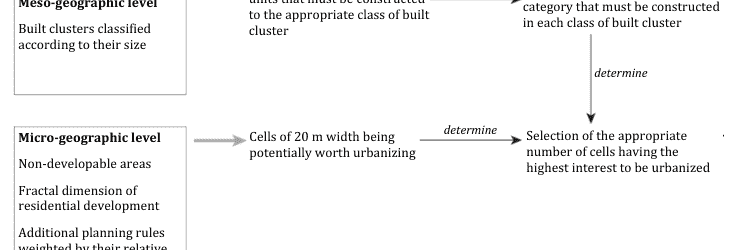

图 3.6. MobiSim-DR 中的多尺度建模

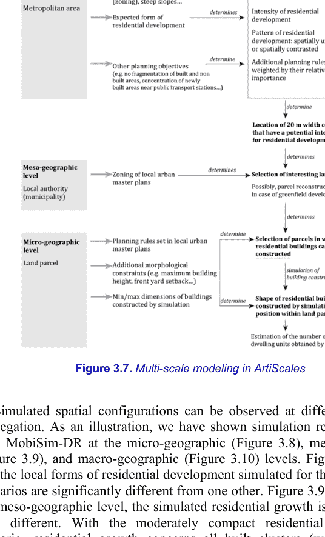

图 3.7. ArtiScales 中的多尺度建模

模拟的空间配置可以在不同的聚合层级上观察。作为示例，我们展示了使用 MobiSim-DR 在微观地理层面（图 3.8）、中观地理层面（图 3.9）和宏观地理层面（图 3.10）获得的模拟结果。图 3.8 显示，两种选定情景下模拟的局部住宅开发形态彼此差异显著。图 3.9 显示，在中观地理层面，模拟的住宅增长在空间上也差异很大。在适度紧凑型住宅开发情景下，住宅增长涉及所有已建成组团（强度不一），但最小的组团除外；而在偏向公共交通使用的住宅开发情景下，增长集中在仅 12 个组团中，并围绕着主组团呈放射状空间逻辑。在该情景下，城市区域的西南偏西区块中，住宅开发导致主建成组团向外扩展。这样一来，2010 年时位于贝桑松西部（弗朗瓦、塞尔莱萨潘和普伊莱维涅等市镇）的一个相当大的建成组团，以及贝桑松西南部的一些次级组团，因与主组团合并而消失。这些合并很大程度上解释了主组团面积的急剧增加，这一现象可见于图 3.10 中的位序规模分布。图 3.10 显示，在适度紧凑型住宅开发情景下，宏观地理层面的聚落格局层级与 2010 年的初始状态相比几乎不变。相比之下，偏向公共交通使用的情景则显示最大建成组团的规模增大，而最小组团的规模减小。换言之，在该情景下，建成组团的位序规模分布比 2010 年构建的配置更接近一条直线（规则层级）。

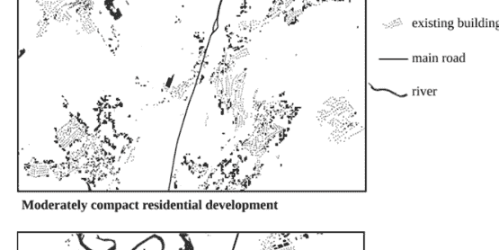

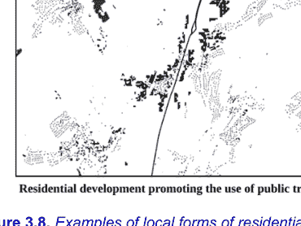

图 3.8. 使用 MobiSim-DR 为贝桑松城市区域模拟的住宅开发局部形态示例（聚焦于城市北部区域的几个市镇）。资料来源：Tannier 等（2016b）


- 建于2010年的建成组团
- 中等紧凑度住宅开发
- 促进公共交通使用的住宅开发

0 5 10 15 20 km

贝桑松、普耶莱维、圣维

建筑数量：0、500、2000、10000、20000

2010—2030年变化率（%）：[0 - 5]、[5 - 25]、[25 - 50]、> 50

建成组团

**图3.9.** 2010年和2030年各建成组团中的建筑数量，以及使用MobiSim-DR模型为贝桑松城市区域模拟的两种前瞻情景下2010—2030年的变化率。2030年建成组团的划界因情景而异。来源：Tannier（2017）。有关此图的彩色版本，请参见 www.iste.co.uk/pumain/geographical.zip

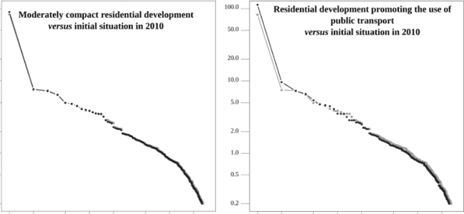

**图3.10.** *使用MobiSim-DR模型为贝桑松城市区域模拟至2030年的两种情景下，大于0.2 km²的建成组团的规模—位序分布（黑色），并与2010年的初始状况（灰色）进行比较。横轴：各组团的位序；纵轴：其面积（km²）。来源：Tannier（2017）。有关此图的彩色版本，请参见 www.iste.co.uk/pumain/geographical.zip*

### 3.3.2. *地理现象描述的尺度不变性*

经典地，为了跨尺度描述社会—空间配置，会有系统地改变所考虑实体的空间分辨率或聚合水平（Tate and Atkinson 2001）。在这种背景下，尺度不变性属性常被用来将尺度依赖性引入模型。尺度不变性意味着，当分布中样本的测量单位改变时，分布的形状以及由该形状产生的性质不会改变。换言之，分布具有通过改变单位⁴（即通过平移）而实现尺度不变性的属性（Dubrulle *等人* 1997）。该属性必然意味着一种幂律（标度律），如下列数学公式所示：

y = k x^α   [3.2]

> ⁴ 当所考虑的量是无量纲时，还存在其他与测量单位无关的尺度不变性情形（Dubrulle *等人* 1997）。

其中 *k* 为比例常数，α 为标度指数。根据定义，我们有：

α = d(log y) / d(log x)   [3.3]

幂律可以通过双对数坐标变换以线性形式表达：

log(y) = α log(x) + log(k)   [3.4]

对于线性分布，一个变量的两个值之间的不等性，在数量级上对应于这两个值之间的*差值*。而对于幂律，一个变量的两个值之间的不等性的数量级则对应于这两个值之间的*比值*。

不同的增长模型可以产生尺度不变的分布，其中最著名的是R. Gibrat（1931）的比例增长模型，该模型表明城市系统中的每个城市，其规模随时间变化的比例与该城市系统整体的规模变化比例相同（Pumain 2007）；受D’Arcy Thompson（1917）启发的异速增长模型（某些要素比其他要素增长得更快）；以及分形增长模型（Frankhauser 1990）。需要指出的一个重要点是，这些增长模型只是产生尺度不变的分布，并未解释其存在的原因。然而，一个分布是尺度不变的，并不一定意味着该分布起源的过程是尺度依赖的，如果我们认为尺度依赖意味着尺度之间存在相互作用的话。事实上，按规模对要素进行的分布可以符合幂律，却可能源于在单一尺度上作用的单一过程。反之，存在尺度依赖性也并不必然意味着要素的有序分布是尺度不变的。例如，SimFeodal模型就是这种情况，在该模型中，中观尺度（即人口聚簇的相对吸引力）与微观尺度（即农户个体的迁移）相互作用，而通过模拟得到的人口聚簇规模—位序分布并不遵循幂律。

在尺度不变的分布中，有些是统计自相似的，即分形的，这意味着表征其*形状*的数值或统计测量在各尺度上是一致的。空间配置的统计自相似性是将要素相对于彼此进行分布的规则的结果，这些规则在不同尺度上大致重复。这样一来，分布的形状在不同尺度上大致相同，但并不完全一致。自相似性蕴含尺度不变性，但反之则不成立。*用不同的放大镜或尺度观察一个自相似的密度，并不等同于改变测量单位*（A. Wierman，博客 *Rigor + Relevance*，2014年12月5日⁵）。

> ⁵ *Scale Invariance, Power Laws, and Regular Variation (Part I).* https://rigorandrelevance.wordpress.com/2014/05/12/scale-invariance-power-laws-and-regular-variation-part-i/. Accessed September 2, 2017.

在研究城市和区域时，分形维数测量具有重要意义，因为它们使我们能够刻画非常异质的空间分布（François *等人* 1995）。*分形几何不仅被视为对自然界中发现的不规则性提供了一种合适的模型，而且提供了对这种不规则性的一种与尺度无关的描述*（Tate and Wood 2001, p. 36）。将分形维数测量应用于不均匀集中空间分布的研究，源于测量的支撑体就是被测对象本身的形状：分形维数通过改变尺度来衡量对象相对于自身的变化（Tannier 2017）。相反，在测量密度时，测量的支撑体是被测对象的支撑空间，这就是为什么密度测量假定要素在空间上均匀分布，并且人口与面积之间呈线性、比例性关系。在计算集中度指数（基尼指数、胡佛指数、邓肯指数等）时，我们衡量的是相对于随机分布的偏差（Bretagnolle 1996）。

分形维数测量在空间上是变化的。例如，为整个城市估计的建成区分形维数与为其每个街区估计的有所不同。因此，对于大约40个欧洲大城市，基于Corine Land Cover建成区影像，M. Guérois（2003）确定了两个分形区域，将连续建成的集聚区地带与郊区边缘区分开。她表明，分形维数的数量级差异很大：在集聚区接近1.8，而在郊区边缘则远低于1。在单个城市内部，每个街区也有自己的分形维数。I. Thomas *等人*（2012）对18个欧洲城市区域的97个街区的研究表明，属于不同城市和国家街区之间的分形维数，可能比属于同一城市或国家的街区之间更为接近。根据这种观点，街区形态独立于其所从属的城市或国家的形态。考虑更精细的尺度，P. Frankhauser（2017）表明，为Cergy-Pontoise（法兰西岛大区）市镇计算的局部径向分形维数在该市镇的不同部分之间存在显著差异。

此外，对于给定的建成肌理（可以是整个街区或城市的建成肌理），即使其对幂律的拟合在统计上是正确的，两个尺度之间的变化 α(ε) = dN(ε)/dε（其中 N 为每个街区尺度 ε 下计数到的要素数量）在不同尺度上也会显著变化，而对于自相似分形，该变化是恒定的。这一点通过代表不同城市或街区的标度行为曲线得以凸显（Frankhauser 1997, 1998, 2004; Thomas *等人* 2010）。

事实上，地理学中非常早期的开创性工作已指出，分形维数在现实中并不被假定为恒定的（Goodchild 1980）；更常见的情况是，它在某一尺度范围内是恒定的，但在连续的尺度范围之间会变化（Lam 1990; Lam and Quattrochi 1992; White and Engelen 1994）。[...] 现实世界中的现象很少是纯粹的分形体，自相似性也极少存在于所有尺度上。在这种情况下，特定分形维数只定义在回归呈线性行为的特定尺度范围内（Quattrochi *等人* 2001, pp. 16–17）。

无论采用何种方法来估计分形维数，最小（或最大）的邻域尺度，低于（或高于）该尺度时分形维数的估计便失去其全部意义，正是被测对象不再自相似的那个尺度（Baveye and Boast 1998）。[...] 因此，任何对分形维数的经验测量都会突出一个所识别结构的有效域，通常位于一个下限阈值和一个上限阈值之间，低于或高于该阈值，分形维数会发生变化或无法再被确定（Pumain 2010a）。数据源的分辨率水平也会干扰结构分形性有效域的确定。事实上，由于测量分形维数包括在越来越小的盒子中计数被给定类型对象所占据的位点，当支撑性制图文档的比例尺不允许我们区分满盒与空盒时，这种计数便变得不可能（Pumain 2010a）。

尽管地理形状的统计自相似性在空间上受到局限，并且只涉及有限的尺度范围，分形测量


维数及相关缩放指数使它们能够彼此区分，所识别的差异或相似性具有视觉连贯性。在实践中，可以假设空间分布是尺度不变的（或统计自相似的），并研究相对于该模型的偏差。尺度不变性的偏差可能只出现在某些尺度范围内，而不出现在其他范围。尺度不变性的偏差也可能在空间上变化：空间分化因此被凸显出来（Tannier 2018）。

F. Sémécurbe 等人（2019）对法国本土建筑物空间分布的研究提供了一个很好的例证。法国本土被一个由间距为 2000 m 的独立估计点 i 组成的网格所覆盖（共 145,178 个点）。在每个点 i 周围 8000 m 半径范围内，研究了建筑物的空间分布。为此目的使用的数据来自 Topo® IGN 2011 数据库，代表了约 2400 万座建筑物。对于 50 至 800 m 的距离半径，研究表明，在法国东部以及大城市地区，建筑物的空间分布是局部尺度不变的，但在法国中部和西部则并非如此。对建筑物空间分布如何在局部偏离尺度不变分布的特征刻画，使得建立法国 145,178 个建成格局的类型学成为可能（图 3.11）。

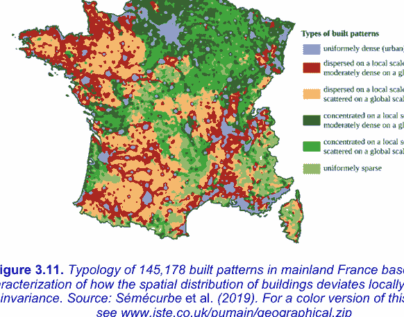

**图3.11** 基于建筑物空间分布局部偏离尺度不变性的特征刻画，对法国本土 145,178 个建成格局进行的类型学分析。来源：Sémécurbe 等人（2019）。本图彩色版本，请见 www.iste.co.uk/pumain/geographical.zip

### 3.3.3. 尺度依赖性作为模拟空间格局的生成机制

这里我们使用 Fractalopolis 模型和 MUP-City 模型的示例。Fractalopolis 模型用于设计多重分形的城市与区域发展计划，MUP-City 模型则用于模拟分形居住区发展情景。通过 MUP-City 模拟的新居住区开发以及通过 Fractalopolis 设计的城市发展计划，都是应用递归几何规则的结果，因此所产生的空间格局在统计上是自相似的。MUP-City 和 Fractalopolis 都整合了与城市开发形态相关的尺度依赖性：在宏观或介观尺度上未开发的空间，不能在微观尺度上进行建设。因此，MUP-City 和 Fractalopolis 在精细空间分辨率下保留了在较粗空间分辨率下识别出的未开发空间。

使用 MUP-City 时，新的模拟居住区开发采用方形格网单元的形式，其大小可以选择（迄今为止大多数应用中边长为 20 m）。值得城市化的单元位置由分形城市化规则确定，该规则基于现有建成格局的多尺度分解（图 3.12）。除了为模拟居住区开发选择分形维数（对应于图 3.12 中的变量*N*<sub>max</sub>）之外，分形城市化规则还要求：在分解层级*l*<sub>1</sub>中未被城市化的单元，不能在更细的分解层级*l*<sub>2</sub>中被城市化。

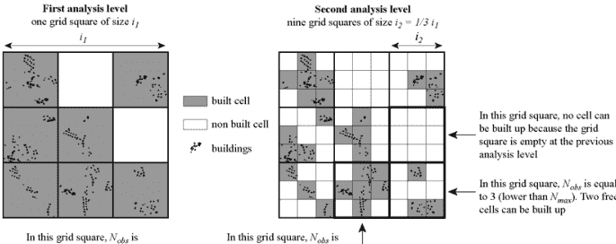

**图3.12** 对于*N*<sub>max</sub>等于 5（即分形维数等于 1.46）时，应用 MUP-City 分形城市化规则的示例。来源：Tannier 等人（2012）

图 3.12 显示，某些网格方块的已城市化单元数量超过了统计自相似对象中所应有的数量。这是因为初始建成格局并非按照缩减因子 r 等于 3 的简单分形逻辑组织。为了使模拟居住区开发更接近统计自相似性，MUP-City 中引入了一种“严格”变体的分形城市化规则（图 3.13）。

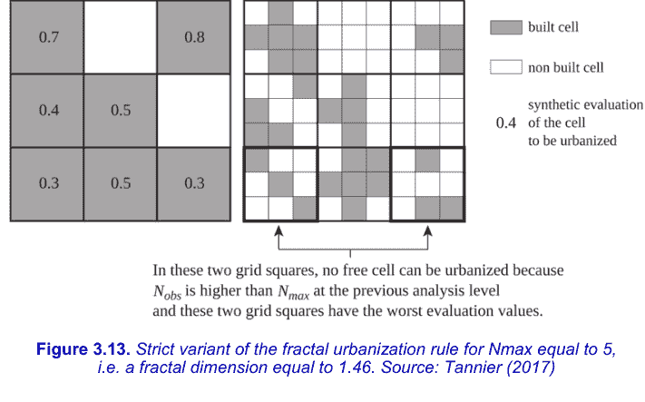

**图3.13** 对于*N*<sub>max</sub>等于 5（即分形维数等于 1.46）时，分形城市化规则的严格变体。来源：Tannier（2017）

MUP-City 可用于模拟形式非常多样的居住区开发（图 3.14）。模拟的开发对应于现有建成格局的致密化，通过提高其局部分形维数和/或创建新的形态上自相似的居住区扩展来实现。应当指出，这些扩展会导致城市化边界的长度增加。还应指出，模拟分形居住区开发能在局部层面提供视觉上逼真的居住区开发形态。当分形维数接近 1.5 时，建成格局的特征是建成簇的尺寸以及这些簇之间的距离具有很大的多样性。相反，当分形维数接近 2 时，建筑物要么均匀集中，要么均匀分散。

**分形城市化规则的严格变体**

**分形城市化规则的基本变体**

**图3.14** 在贝桑松城市区域使用 MUP-City 获得的两个结果示例。*N*<sub>max</sub>等于 5，即分形维数等于 1.46。来源：M. Colomb 等人（2017）。本图彩色版本，请见 www.iste.co.uk/pumain/geographical.zip

在 Fractalopolis 中，多重分形发展计划的创建遵循基于*迭代函数系统*（IFS）定义与应用的迭代逻辑（Barnsley 1988）。研究区分出两类区域：一类有利于城市发展（称为“计划发展中心”），另一类则仅设想少量或不作开发。使用 Fractalopolis 设计的发展计划的初始元是一个位于研究区域上的大小为*L*的正方形。计划生成元通常包含一个位于主要城市中心、大小为*S₁ = r₁ × L*的中心正方形，以及*N*个位于次级发展中心、尺寸较小（*S₀ = r₀ × L*）的正方形（图 3.15）。次级中心的数量、参数*r₀*和*r₁*的值以及功能层级的数量（通常为三或四个，对应应用 IFS 的迭代次数）根据每个案例研究的具体情况加以确定。然后，选定的用于创建多重分形发展计划的 IFS 被迭代应用，直到最小的正方形大约达到邻里的尺寸。在此迭代阶段，它们的边长在约 500 至 300 m 之间。基于此构建的发展计划之所以被称为多重分形，是因为该计划的生成元具有多个缩减因子 r（Mandelbrot 1982）。

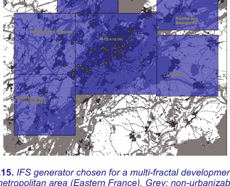

**图3.15** 为贝桑松都市区（法国东部）多重分形发展计划选定的 IFS 生成元。灰色：不可城市化区域。红点：公共交通站点。来源：Frankhauser 等人（2018）。本图彩色版本，请见 www.iste.co.uk/pumain/geographical.zip

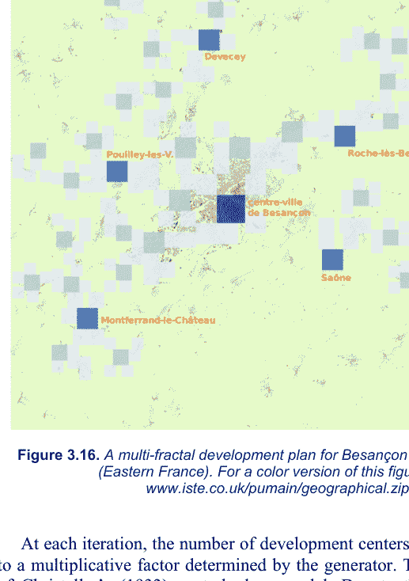

**图3.16** 贝桑松都市区（法国东部）的多重分形发展计划。本图彩色版本，请见 www.iste.co.uk/pumain/geographical.zip

在每次迭代中，发展中心的数量按照生成元所确定的乘数因子而增加。这让人想起克里斯塔勒（Christaller，1933）的中心地模型。由于生成元中存在两个缩减因子，每个中心的面积取决于其相对位置，即它与更高级别中心的距离。因此，不同层级中心的面积可能相同，而同一层级中心的面积可能不同（图 3.16）。这样，该模型不同于克里斯塔勒中心地模型，但符合这样的经验观察：同一功能层级的中心，当其靠近主要城市中心时面积较大，而位于人口稀少地区时面积较小。


## 3.4. 结论

当对某一现象进行建模时，考虑了多个聚合层级或一系列嵌套的空间分辨率时，该建模即为多尺度建模。此时尺度依赖性被视为一种可观测的结果。当表示现象在聚合层级或空间分辨率间的变化时，建模为跨尺度建模，且尺度依赖性被视为模拟社会空间配置生成的过程。采用多尺度或跨尺度方法使得能够明确考虑空间层级，例如城市区域包含大量小型建成聚落、较少的中型聚落以及更少的大型聚落，以及功能层级，例如不同层级的功能中心性。

在城市或区域的地理模型中，距离效应影响实体在位置上的区位及其位置变化，即迁移轨迹和流动。当建模的实体为地点时，这些地点之间的相互作用决定了每个地点对每种定居或活动类型的吸引力，以及定居或活动位置变化的吸引力。当建模的实体为个人或个人群体时，它们通过空间邻域进行相互作用。例如在 SimFeodal 中，农民家庭与领主之间的相互作用通过征税区进行：对于一位领主，其控制领土内农民家庭的到来和离开会改变其权力，从而影响其建造城堡的可能性。在 MobiSim-MR 中，每个家庭的居住环境包括其他家庭、企业、服务、休闲设施等。这使得家庭之间通过其环境进行相互作用得以体现。

不同作者将涌现区分为空涌现和强涌现，其中弱涌现是指宏观结构可从外部观察到，是微观过程的结果，而强涌现是指微观层级的动态会反过来适应其所生成并从内部观察的宏观层级结构（Livet et al. 2010）。事实上，社会系统以个体代理的表征和行为与所属群体或群体的集体参照之间存在强烈且持续的相互作用为特征。集体参照指社会群体每个成员共有的信念、信条或表征。它们支配社会互动，有助于引导个体行为，并确保在特定情境下所有个体行为的兼容性。通过是否属于某个社会群体或地点，每个个体都参与构建指向自身的集体参照的形成（弱涌现）。反过来，这些集体参照的采纳与否会影响其行为（强涌现）（Tannier et al. 2017a）。

在 SimFeodal 和 MobiSim-MR 模型中，定居点在时间上的集中与分散既创造了代理在物理和社会空间中的移动，也被其创造，即社会和/或空间位置的变化。在 SimFeodal 中，被选中改变位置的农民家庭会“观察”不同吸引中心的吸引力，以选择其新位置，该吸引力取决于其移动是局部还是远距离而在局部或整个建模空间范围内。这种“观察”在模型中以形式化的方式表示，即在用于确定农民家庭新位置的随机抽样中引入对每个中心选择概率的加权，该权重与其相对吸引力成比例。因为农民家庭“观察”了不同中心吸引力的宏观配置，所以 SimFeodal 模型模拟了强涌现。MobiSim-MR 也模拟了强涌现，因为每个家庭在模型初始化时“知道”所有家庭对所有住宅的吸引力的中位值，并且相对于此，它定位其自身已知的住宅的吸引力中位值。

MobiSim-DR 模型不包含社会实体。住房单元和建筑物纯粹是空间实体：它们不会根据在宏观或中观地理层级观察到的空间或社会空间配置来调整其行为，因为只有社会实体才能“观察”涌现的空间或社会配置。然而，中观地理空间配置，即每个建成聚落中存在的建筑物，会制约新建筑物的区位。MobiSim-DR 模型因此模拟了弱涌现。

本章讨论的另外三个模型是 MUP-City 和 Fractalopolis，两者均基于明确的空间尺度依赖原则，以及 ArtiScales，其性质为多尺度而非尺度依赖。由于这三个模型未整合时间动态，因此本身不具备涌现属性。
